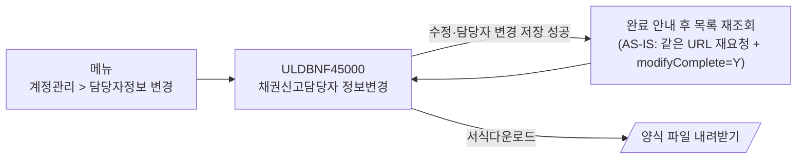
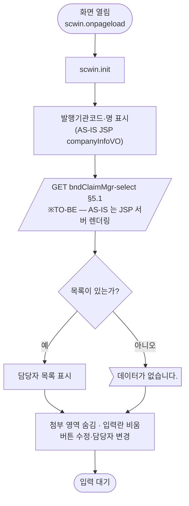
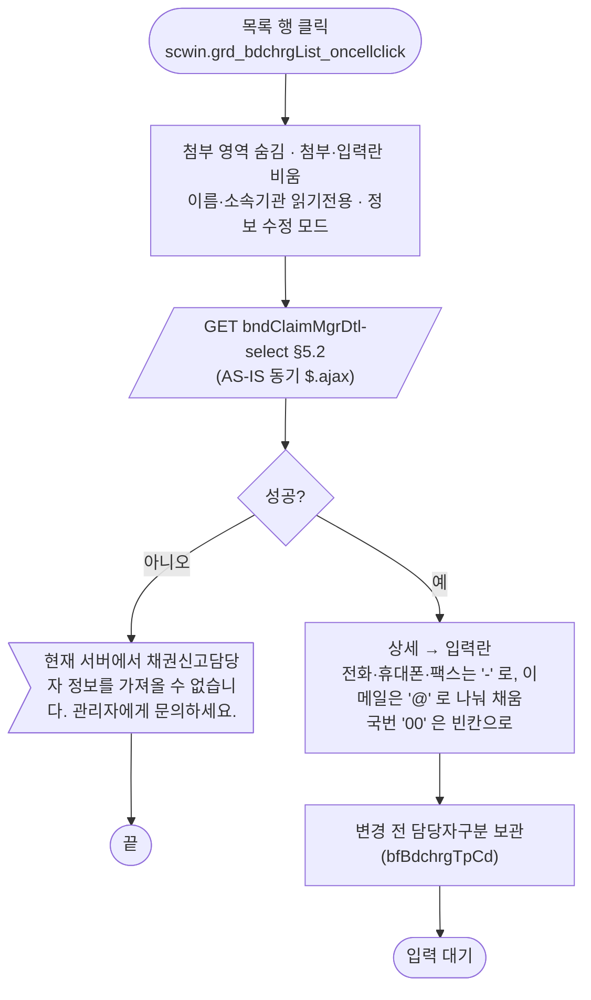
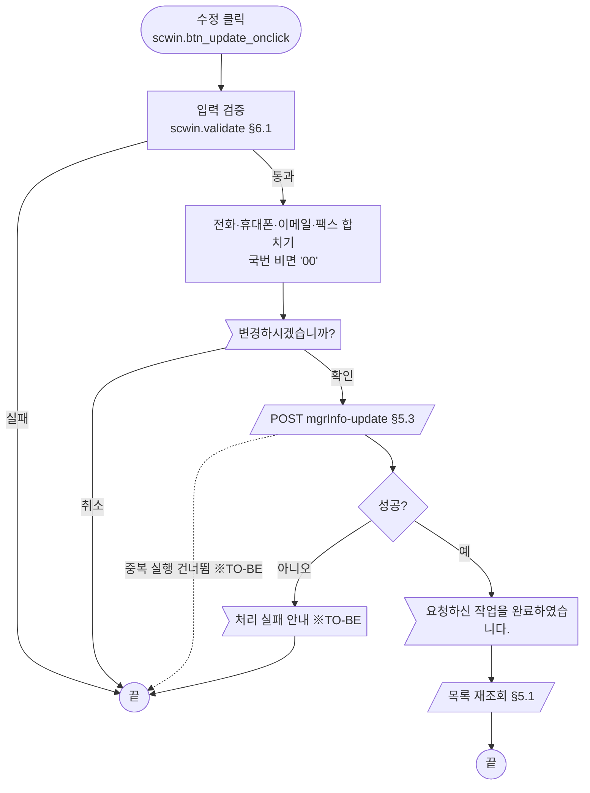
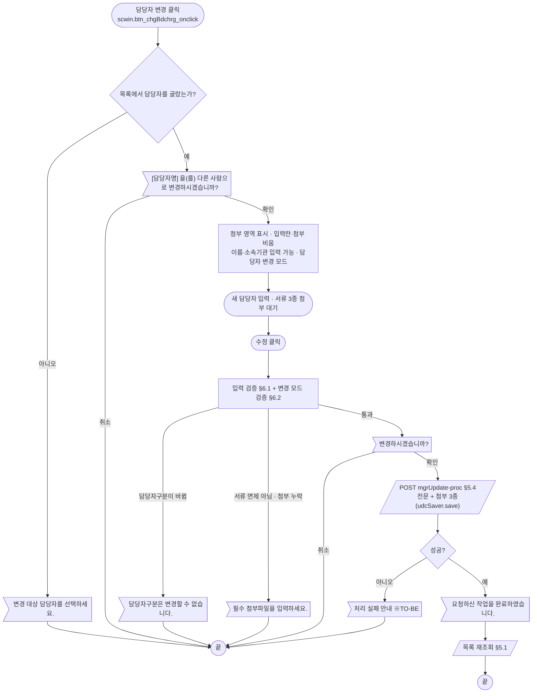
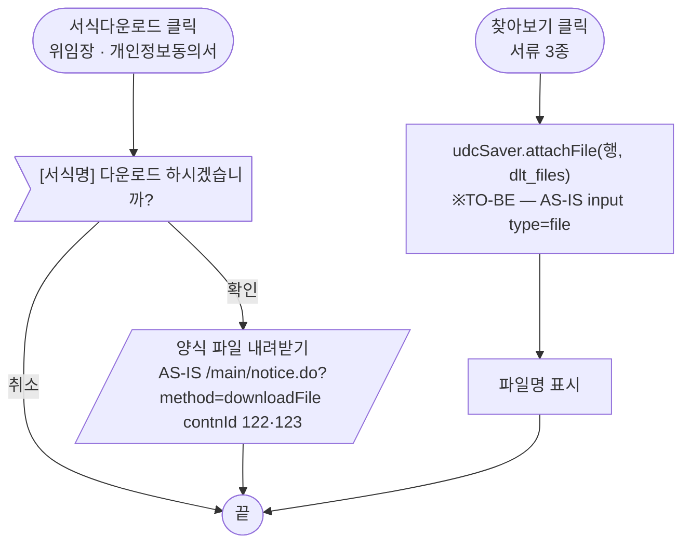
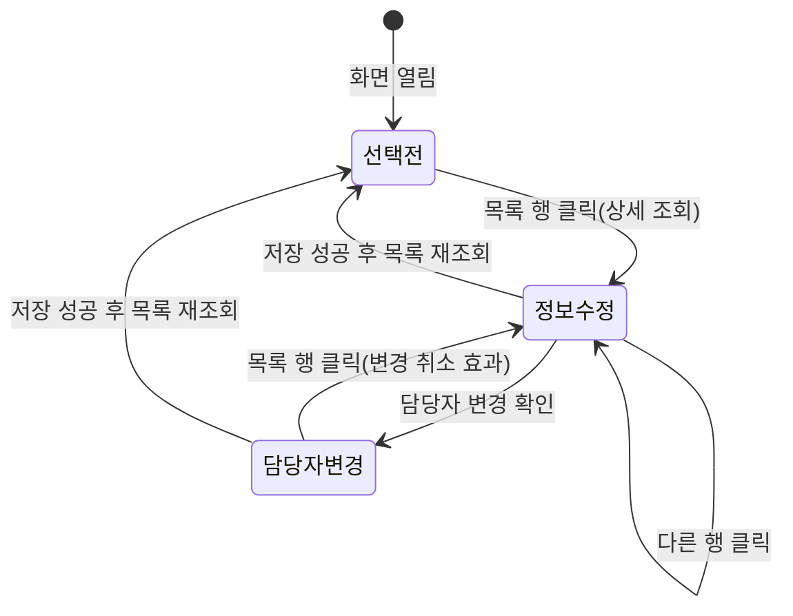

# ULDBNF45000 채권신고담당자 정보변경 — 업무 분석 및 전환 내역

| 항목 | 내용 |
|---|---|
| AS-IS | `ULDBNF45000.jsp` (JSP/jQuery, 대외 메인 화면 — 계정관리 > 담당자정보 변경, `dmenus` bmenu 7) — 반입 `conversion/conversion-front/ui/ULDBNF45000/ULDBNF45000.jsp` |
| 신규 API 명세 | `conversion/conversion-front/ui/ULDBNF45000/ULDBNF45000_API.md` — 블록 4종(이 화면 4종, 다른 화면 0종). §2.2·§5 는 명세 기준(가이드 §0.3·§5) |
| TO-BE | `conversion/conversion-front/ui-tobe/ULDBNF45000.xml` — 전환 완료(2026-10-26). 1단계 퍼블리싱(캡처 기준 마크업 + §2.1 id) → 2단계 스크립트(이 문서 + API 명세). 게이트: gate_screen(`--pcc fil`)·publish_gate(1단계 대비 `--allow P20`)·api_spec_check·convert 고정점·lint 0/0 통과. 남은 확인은 §10 의 `TODO` |
| 퍼블리셔 XML | `conversion/publish/채권/채권상장신청(대외)/ULDBNF45000.xml` (첨부 영역은 커밋 f21f61af 로 보강) |
| 화면 캡처 | `ULDBNF45000.png` (신고담당자(부) 선택 · 첨부 영역 표시 상태) — TO-BE 퍼블리싱 기준(가이드 §13.2) |
| 업무공통 | 쓰지 않음(gcc 만). 게이트는 `--pcc fil`(ULD* 기본) |
| 공통 UDC | `/cm/udc/bulkFileSaver.xml` (`udcSaver` — 첨부 + 전문 일괄 전송, 선례 `sample-front/ui/ULDINF05000.xml`) |
| 작성 | Inswave / 2026-10-26 |

참고 양식: [websquare_gfm_conversion.md](../../../md/websquare_gfm_conversion.md) — 이 화면은 Gauce 가 아니라 JSP/jQuery 원본이라 양식 본문(§11 대응표·§12 함정)을 그대로 따른다.

---

## 1. 화면 개요

대외(발행기관) 사용자가 **자기 회사의 채권신고담당자(정·부)** 를 확인하고, 담당자의 연락처 정보를 고치거나 담당자를 다른 사람으로 바꾸는 화면이다. 담당자를 바꿀 때는 필수 서류 3종(상장채권 신고권한 위임장·개인정보동의서·재직증명서)을 첨부한다.

1. 화면을 열면 발행기관코드·발행기관명과 담당자 목록(정·부)이 보인다(AS-IS 는 서버가 JSP 로 렌더링).
2. 목록에서 담당자를 고르면 그 담당자의 상세 정보가 아래 입력란에 채워진다(이름·소속기관은 수정 불가).
3. **정보 수정**: 직책·소속부서·전화·휴대폰·이메일·팩스를 고치고 [수정] → 확인 → 저장.
4. **담당자 변경**: 담당자를 고른 뒤 [담당자 변경] → 확인 → 입력란이 비고 이름·소속기관도 입력할 수 있게 되며 첨부 영역이 보인다 → 새 담당자 정보 + 서류 3종 첨부 → [수정] → 확인 → 저장. 담당자구분(정/부)은 바꿀 수 없다.
5. 서식다운로드(위임장·개인정보동의서) 버튼으로 서류 양식을 내려받는다.

### 1.1 호출 화면

- 메뉴로 여는 메인 화면이다(`dmenus = { bmenu : 7, mmenu : 0 }` — 계정관리 > 담당자정보 변경). 부모 화면·호출 규약은 없다.
- AS-IS 는 저장 뒤 같은 URL 로 다시 열면서 `?modifyComplete=Y` 를 붙여 "요청하신 작업을 완료하였습니다." 를 띄웠다(JSP `<c:if test="${param.modifyComplete == 'Y'}">`).

### 1.2 화면 진입 값

| AS-IS 출처 | 값 | TO-BE |
|---|---|---|
| JSP `${companyInfoVO.isurCd}` / `${companyInfoVO.comNm}` | 로그인 사용자 회사의 발행기관코드·명 | 명세에 조회 API 가 없다 → 세션(`$c.session.getUserInfo`) 또는 진입 파라미터로 받는다(§10 #1) |
| JSP `${result}` | 담당자 목록 | `GET …/bndClaimMgr-select` (§5.1) |
| JSP `${bdchrgRegNoFileInstYn}` | 신고담당자 등록 서류 면제 여부(국고채 대행 한국은행·정부·지자체 = `Y`) | 명세에 출처 없음(§10 #2) |
| 세션 Struts TOKEN | 중복 등록 방지 | 정보 수정은 `executeDynamic` 중복 실행 방지, 담당자 변경은 화면 플래그 `scwin.isSaving`(UDC `save` 는 fetch 직접 호출이라 sbm 중복 방지를 타지 않는다) |

### 1.3 이 화면이 여는 하위 팝업

해당 없음. (파일 선택은 UDC `bulkFileSaver` 의 첨부 다이얼로그, 서식다운로드는 파일 내려받기)

### 1.4 업무 프로세스 흐름

흐름은 AS-IS 동작을 기준으로 그렸다. 점선과 `※TO-BE` 는 전환본에서 바뀌는 곳이다(근거는 §8).

| # | 업무 | 시작 (사용자 동작·진입 조건) | 끝 (결과) | 주요 함수 | 관련 절 |
|---|---|---|---|---|---|
| 1 | 진입·목록 조회 | 메뉴로 화면 열기 | 발행기관 정보·담당자 목록 표시, 첨부 영역 숨김 | `scwin.onpageload` → `scwin.init` → `scwin.searchList` | §3, §5.1 |
| 2 | 담당자 선택 | 목록 행 클릭 | 상세 정보가 입력란에 채워짐(정보 수정 모드) | `scwin.grd_bdchrgList_oncellclick` → `scwin.selectDtl` | §4, §5.2 |
| 3 | 정보 수정 | [수정] (정보 수정 모드) | 완료 안내 → 목록 재조회 | `scwin.btn_update_onclick` → `scwin.updateInfo` | §5.3, §6.1 |
| 4 | 담당자 변경 | [담당자 변경] → 입력 → 첨부 → [수정] | 완료 안내 → 목록 재조회 | `scwin.btn_chgBdchrg_onclick` → `scwin.startChange` … `scwin.changeBdchrg` | §5.4, §6.2 |
| 5 | 서식 다운로드 | [서식다운로드] (위임장·개인정보동의서) | 양식 파일 저장 | `scwin.downloadDoc` | §6.4 |
| 6 | 첨부 파일 선택 | [찾아보기] (서류 3종) | 파일명 표시 | `udcSaver.attachFile` | §6.3 |

#### 화면 간 흐름



#### 업무 1: 진입·목록 조회



#### 업무 2: 담당자 선택



#### 업무 3: 정보 수정



| # | 단계 | 주체 | 내용 | 분기 · 메시지 | 관련 절 |
|---|---|---|---|---|---|
| 1 | 입력 검증 | 화면 | 이름·직책·소속기관·소속부서 필수(공백 제거 후), 전화 2·3번째, 휴대폰 3칸, 이메일 2칸 필수 | 각 "…을 입력하세요." + 포커스 | §6.1 |
| 2 | 값 합치기 | 화면 | `telNo = 국번(비면 00)-중간-끝`, `cellphoneNo`, `email = 앞@뒤`, `faxNo`(한 칸이라도 있으면) | — | §6.1 |
| 3 | 확인 | 사용자 | "변경하시겠습니까?" | 취소면 끝 | §7.2 |
| 4 | 저장 | 서버 | AS-IS 폼 submit `updateBdchrgInfo` → TO-BE `POST mgrInfo-update` | 실패 안내는 TO-BE 신설 | §5.3 |
| 5 | 결과 | 화면 | AS-IS 는 페이지 재요청 + 완료 안내 → TO-BE 는 완료 안내 + 목록 재조회 | — | §1.1 |

#### 업무 4: 담당자 변경



- 원본 검증의 "담당자구분은 변경할 수 없습니다." 분기는 오타(`endForm`)로 예외가 나서, 안내만 뜨고 담당자구분이 원래 값으로 돌아가지 않는다(§8 #2).

#### 업무 5·6: 서식 다운로드 · 첨부 파일 선택



#### 화면 모드 상태 전이



| 상태 | 입력란 | 첨부 영역 | 비고 |
|---|---|---|---|
| 선택전 | 비어 있음, 이름·소속기관 읽기전용 | 숨김 | AS-IS 는 이 상태에서 [수정] 을 누르면 이름 필수 안내가 뜬다(§8 #6) |
| 정보수정 | 상세 값, 이름·소속기관 읽기전용 | 숨김 | 저장 → `mgrInfo-update` |
| 담당자변경 | 비어 있음, 이름·소속기관 입력 가능 | 표시 | 저장 → `mgrUpdate-proc`(첨부 포함) |

---

## 2. 화면 구성 및 데이터 정의

### 2.1 화면 구성

퍼블리싱본은 컴포넌트 id 가 비어 있다. 아래 TO-BE id 는 명명 규칙(가이드 §0.1)으로 정한 것이고, 1단계 퍼블리싱 때 붙였다(마크업 구조는 그대로).

| 영역 | AS-IS 요소 | TO-BE 컴포넌트 (바인딩) | 설명 |
|---|---|---|---|
| 제목·경로 | `h1` "채권신고담당자 정보변경", Home > 계정관리 > 담당자정보 변경 | contentHeader | 퍼블리싱본 그대로 |
| 발행기관 | `${companyInfoVO.isurCd}`·`${companyInfoVO.comNm}` 텍스트 | `txt_isurCd`·`txt_comNm` (`w2:textbox`, `dma_page.isurCd`·`comNm`) | 읽기 전용 표시 |
| [담당자 변경] | `a onclick="fn_AddNewBdchrg()"` | `btn_chgBdchrg` | §6.2 |
| 담당자 목록 | `table#chgrList` + `tr onclick="focus_tr(this)"` (선택 행 `tr.on` 배경 `#F2CE98`) | `grd_bdchrgList` (`dlt_searchList`, `focusMode="row"`) | 구분·담당자명·소속기관·소속부서·직책·전화·휴대전화·이메일·팩스 9열. 퍼블리싱 컬럼 id `col1`… → `bdchrgTpNm`·`chrgNm`·`belngInstNm`·`belngDepNm`·`jobposNm`·`telNo`·`cellphoneNo`·`email`·`faxNo` |
| (숨김) 담당자ID | 행마다 `input hidden chrg_id` | **(옮기지 않음)** — `dlt_searchList.chrgId` | 그리드 행에서 읽는다 |
| 안내 | `h2` "담당자정보 수정" + 빨간 안내 "※ 국고채의 업무를 대행하는 한국은행 …" | titbox h3 + `txt_info` | 퍼블리싱본 그대로 |
| 담당자구분 | `select#bdchrg_tp_cd` (M 신고담당자(정) / S 신고담당자(부)) | `sbx_bdchrgTpCd` (`dma_form.bdchrgTpCd`) | 변경 모드에서 바꾸면 검증 탈락(§6.2) |
| 이름 | `input chrg_nm` (readonly, maxlength 20, byteCheck 40) | `ipt_chrgNm` (`dma_form.chrgNm`) | 정보 수정 모드 읽기전용, 변경 모드 입력 |
| 직책 | `input jobpos_nm` (maxlength 20) | `ipt_jobposNm` (`dma_form.jobposNm`) | |
| 소속기관 | `input belng_inst_nm` (readonly, maxlength 20) | `ipt_belngInstNm` (`dma_form.belngInstNm`) | 정보 수정 모드 읽기전용, 변경 모드 입력 |
| 소속부서 | `input belng_dep_nm` (maxlength 20) | `ipt_belngDepNm` (`dma_form.belngDepNm`) | |
| 전화번호 | `tel_no1`(6)·`tel_no2`(4)·`tel_no3`(4) + hidden `tel_no` | `ipt_telNo1`·`ipt_telNo2`·`ipt_telNo3` (`dma_form.telNo1~3`, `allowChar="0-9"`) | 저장 때 `telNo` 로 합침 |
| 휴대폰번호 | `encryp_cellphone_no1`·`encryp_cellphone_no2`·`encryp_cellphone_no3` + hidden `encryp_cellphone_no` | `ipt_cellphoneNo1~3` (`dma_form.cellphoneNo1~3`) | |
| 이메일 | `encryp_email1`·`encryp_email2` (maxlength 40) + hidden `encryp_email` | `ipt_email1`·`ipt_email2` (`dma_form.email1~2`) | 앞뒤 키 검사 `fn_emailFrontCheck`·`fn_emailBackCheck`(외부 JS) → `allowChar`/검증으로 |
| 팩스번호 | `fax_no1`·`fax_no2`·`fax_no3` + hidden `fax_no` | `ipt_faxNo1~3` (`dma_form.faxNo1~3`) | 선택 입력 |
| 첨부 영역 | `div#fileList` (처음 숨김) | `grp_fileList` | 담당자 변경 모드에서만 표시 |
| 첨부 3종 | 행마다 hidden `bdchrg_appl_doc_cd`(04·05·06)·`doc_bdchrg_tp_cd` + `attach_file_nm[i]`(readonly) + `input file attachFiles[i]`(찾아보기) | `ipt_fileNm1~3` (readOnly) + `btn_findFile1~3` + `dlt_files` 3행 + `udcSaver` | §6.3 |
| 서식다운로드 | 위임장·개인정보동의서 행의 `a onclick="fn_downloadDoc('122'/'123', …)"` | `btn_docDown1`·`btn_docDown2` | 재직증명서는 서식 없음 |
| 개인정보 안내 | "재직증명서 등에 "주소", "주민등록번호" … 가린(마스킹) 후 첨부" | `txt_info` | 퍼블리싱본(f21f61af)은 표 위 안내로 옮김 |
| [수정] | `a onclick="fn_Update()"` | `btn_update` (`btn_cm pt`) | §6.1·§6.2 |
| [취소] | 주석 처리된 `fnReset()` 버튼 | **(옮기지 않음)** | 규칙 0 |

### 2.2 데이터 정의

| AS-IS | TO-BE | 종류 | 키(컬럼) | 출처 / 용도 |
|---|---|---|---|---|
| (JSP `companyInfoVO`) | `dma_page` (**화면 전용 — 명세 외**) | dataMap | `isurCd`, `comNm`, `fileExemptYn` | 발행기관 표시·조회 조건, 서류 면제 여부(AS-IS `bdchrgRegNoFileInstYn`). 출처 §10 #1·#2 |
| (요청 파라미터) | `dma_searchList` | dataMap | 명세 그대로 — `isurCd`, `chrgId`, `bdchrgTpCd` | 목록 조회 요청 (`bndClaimMgr-select`) |
| JSP `${result}` | `dlt_searchList` | dataList | 명세 그대로 — `chrgId`, `chrgNm`, `isurCd`, `bdchrgTpCd`, `bdchrgTpNm`, `telNo`, `cellphoneNo`, `email`, `faxNo`, `belngInstNm`, `belngDepNm`, `jobposNm`, `chrgUseYn` | 목록 그리드 |
| (`snd_chrg_id` + 폼 직렬화) | `dma_searchDtlReq` | dataMap | 명세 그대로 — `isurCd`, `chrgId`, `bdchrgTpCd` | 상세 조회 요청 |
| `$.ajax` 결과 `result` | `dma_searchDtlRes` | dataMap | 명세 그대로 — 목록과 같은 13키 | 상세 응답 → `dma_form` 으로 나눠 옮김 |
| `SendForm` 입력 필드 | `dma_form` (**화면 전용 — 명세 외**) | dataMap | `bdchrgTpCd`, `chrgNm`, `jobposNm`, `belngInstNm`, `belngDepNm`, `telNo1~3`, `cellphoneNo1~3`, `email1~2`, `faxNo1~3` | 입력란 바인딩(전화·이메일을 칸별로) |
| `SendForm` 전체(submit) | `dma_mgrInfoUpdate` | dataMap | 명세 그대로 22키 — `bndApplId`, `chrgId`, `chrgNm`, `isurCd`, `bdchrgTpCd`, `bfBdchrgTpCd`, `bdchrgTpNm`, `telNo`, `cellphoneNo`, `email`, `faxNo`, `belngInstNm`, `belngDepNm`, `jobposNm`, `chrgUseYn`, `bdchrgApplTpCd`, `bdchrgApplStatCd`, `applProcsContn`, `loginId`, `transtrId`, `empNo`, `empNm` | 정보 수정(`mgrInfo-update`)·담당자 변경(`mgrUpdate-proc`) 공통 전문 |
| `attachFiles[0~2]` + `bdchrg_appl_doc_cd` | `dlt_files` | dataList | 명세 그대로 — `id`(number), `uid`, `empNo`, `empName`, `fileName`, `fileSize`(number, 기본 0), `fileChanged` | 첨부 3행(위임장·개인정보동의서·재직증명서). UDC `bulkFileSaver` 가 쓰는 열 구성과 같다 |

- AS-IS 폼 필드(snake_case) → TO-BE 키: `chrg_nm→chrgNm`, `jobpos_nm→jobposNm`, `belng_inst_nm→belngInstNm`, `belng_dep_nm→belngDepNm`, `bdchrg_tp_cd→bdchrgTpCd`, `bf_bdchrg_tp_cd→bfBdchrgTpCd`, `tel_no→telNo`, `encryp_cellphone_no→cellphoneNo`, `encryp_email→email`, `fax_no→faxNo`, `isur_cd→isurCd`, `snd_chrg_id/chrg_id→chrgId`.
- **명세에만 있는 요청 키**(`bndApplId`, `chrgUseYn`, `bdchrgApplTpCd`, `bdchrgApplStatCd`, `applProcsContn`, `loginId`, `transtrId`, `empNo`, `empNm`, `bdchrgTpNm`)는 AS-IS 가 보내지 않았다(서버가 세션으로 채운 것으로 보임) → §10 #3. **AS-IS 에만 있는 값**(첨부의 서류 코드 `bdchrg_appl_doc_cd`·`doc_bdchrg_tp_cd`, Struts TOKEN, `method`·`check_svc`·`addNew` hidden)은 명세에 대응 키가 없다 → §10 #4.

---

## 3. 로딩 (`scwin.onpageload` → `scwin.init`) — 2구역

AS-IS: `$(document).ready` 에서 첨부 영역(`#fileList`)만 숨긴다. 발행기관 정보·목록은 JSP 가 서버에서 그렸다. `dmenus` 는 메뉴 위치 표시용 전역(프레임 공통)이다.

`scwin.init` 의 단계 (code-convention 초기화 절 — onpageload 는 `scwin.init()` 만 호출):

1. **발행기관 정보** — `dma_page.isurCd`·`comNm` 을 채운다(출처 §10 #1). 서류 면제 여부 `fileExemptYn`(§10 #2).
2. **입력란·첨부 초기화** — §6.5 `scwin.resetForm()` 호출(정보 수정 모드, 첨부 영역 숨김, `dlt_files` 3행 준비).
3. **목록 조회** — `await scwin.searchList()` (§5.1). AS-IS 는 서버 렌더링이라 통신이 없었다(※TO-BE).

```javascript
scwin.onpageload = async function () {
    try {
        await scwin.init();
    } catch (ex) {
        await $c.exception.handleError(ex, { context : "ULDBNF45000.onpageload" });
    }
};

scwin.init = async function () {
    // 1) 발행기관 정보 — 출처 확정 전(§10 #1)
    dma_page.set("isurCd", $c.session.getUserInfo("isurCd"));
    dma_page.set("comNm", $c.session.getUserInfo("comNm"));

    // 2) 입력란·첨부 초기화 — 행 클릭·저장 뒤에도 같은 로직이라 5구역 함수로
    scwin.resetForm();

    // 3) 목록 조회
    await scwin.searchList();
};
```

- `dmenus`(메뉴 위치)는 TO-BE 프레임(contentHeader·메뉴)이 대신하므로 옮기지 않는다.

---

## 4. 컴포넌트 이벤트 — 3구역

| TO-BE 컴포넌트 | 이벤트 | TO-BE 핸들러 | 동작 (호출 함수) | AS-IS |
|---|---|---|---|---|
| `grd_bdchrgList` (목록) | `oncellclick` | `scwin.grd_bdchrgList_oncellclick` | `scwin.selectDtl(row)` — §5.2 | `tr onclick="focus_tr(this)"` → `fn_SelectBdchrgDtlInfo` |
| `btn_chgBdchrg` (담당자 변경) | `onclick` | `scwin.btn_chgBdchrg_onclick` | `scwin.startChange()` — §6.2 | `fn_AddNewBdchrg()` |
| `btn_update` (수정) | `onclick` | `scwin.btn_update_onclick` | 모드에 따라 `scwin.updateInfo()` 또는 `scwin.changeBdchrg()` — §6.1·§6.2 | `fn_Update()` |
| `btn_findFile1~3` (찾아보기) | `onclick` | `scwin.btn_findFile1_onclick` … | `udcSaver.attachFile(행, dlt_files)` — §6.3 | `input type="file"` + `onchange="fn_getFileNm(i)"` |
| `btn_docDown1`·`btn_docDown2` (서식다운로드) | `onclick` | `scwin.btn_docDown1_onclick` … | `scwin.downloadDoc("122"/"123", 서식명)` — §6.4 | `fn_downloadDoc('122'/'123', …)` |
| 전화·휴대폰·팩스 칸 | 키 입력 | (속성) | `allowChar="0-9"` + `maxLength` | `onkeypress="NumberCheck(this)"`·`onpaste="return false"` |
| 전화·휴대폰 칸 | 자동 이동 | **(옮기지 않음)** 또는 `maxLength` 도달 시 다음 칸 포커스 | — | `onkeyup="fnNextFeild(this, 'tel_no3')"`(외부 JS) — §10 #8 |
| 이메일 칸 | 키 입력 | (속성) | `allowChar` | `fn_emailFrontCheck()`·`fn_emailBackCheck()`(외부 JS) |
| 이름·이메일 | 바이트 검사 | (검증) | `validateDataCollect` `maxLengthB` | `onkeyup="byteCheck(this, 40)"` |

- 선택 행 강조(AS-IS `tr.on` 배경색)는 그리드 `focusMode="row"` 의 선택 표시로 대신한다.

---

## 5. 서버 통신 — 4구역

공통: AS-IS 는 상세 조회만 `$.ajax`(동기), 저장 두 가지는 `multipart/form-data` 폼 submit(+ Struts TOKEN) 이었다. TO-BE 는 명세 API 4종을 `$c.sbm.executeDynamic` 과 UDC `udcSaver.save` 로 부르고, 응답을 쓰기 전에 `if (result?.skipped) return;` 을 둔다.

| # | 용도 | AS-IS | TO-BE |
|---|---|---|---|
| 5.1 | 담당자 목록 조회 | (없음 — JSP 서버 렌더링 `${result}`) | `GET …/bndClaimMgr-select` |
| 5.2 | 담당자 상세 조회 | `$.ajax POST /account/userInfo.do?method=selectBdchrgDtlInfo` (`async:false`, 폼 직렬화) | `GET …/bndClaimMgrDtl-select` |
| 5.3 | 담당자 정보 수정 | 폼 submit `/register/registerNew.do?method=updateBdchrgInfo` | `POST …/mgrInfo-update` |
| 5.4 | 담당자 변경(첨부 포함) | 폼 submit `/register/registerNew.do?method=changeBdchrg` (multipart) | `POST …/mgrUpdate-proc` (UDC `udcSaver.save`) |

(`…` = `/api/bonds/accountMgt/bndClaimMgrUpdate`)

#### API 명세 대응 (`ULDBNF45000_API.md`)

| # | 명세 블록 | method · 경로 | 요청 (명세 정의) | 응답 (명세 정의) | AS-IS 대응 | TO-BE 함수 |
|---|---|---|---|---|---|---|
| 1 | [ULDBNF45000] 담당자 조회 | `GET …/bndClaimMgr-select` | `dma_searchList` (`isurCd`·`chrgId`·`bdchrgTpCd`) | `dlt_searchList` (13열) | JSP `${result}` | `scwin.searchList` |
| 2 | [ULDBNF45000] 담당자 상세 조회 | `GET …/bndClaimMgrDtl-select` | `dma_searchDtlReq` (`isurCd`·`chrgId`·`bdchrgTpCd`) | `dma_searchDtlRes` (13키) | `$.ajax …selectBdchrgDtlInfo` | `scwin.selectDtl` |
| 3 | [ULDBNF45000] 담당자 정보 수정 | `POST …/mgrInfo-update` | `dma_mgrInfoUpdate` (22키) | (없음) | 폼 submit `updateBdchrgInfo` | `scwin.updateInfo` |
| 4 | [ULDBNF45000] 담당자변경처리 | `POST …/mgrUpdate-proc` | `dma_mgrInfoUpdate` (22키) + `dlt_files` (7열) | (없음) | 폼 submit `changeBdchrg` + `attachFiles[0~2]` | `scwin.changeBdchrg` |

명세에 없는 AS-IS 통신: 서식다운로드(`/main/notice.do?method=downloadFile`, `contnId` 122·123, `cmNotiClssCd` 4) → §6.4·§10 #5.

#### 명세 ↔ AS-IS 차이 (→ §10)

| # | 차이 | 처리 | §10 |
|---|---|---|---|
| 1 | 목록을 AS-IS 는 JSP 가 렌더링, 명세는 조회 API — 조회 조건으로 `isurCd` 외에 `chrgId`·`bdchrgTpCd` 도 정의돼 있음 | 목록은 `isurCd` 만 채워 조회(나머지 빈 값) | #6 |
| 2 | 발행기관코드·명, 서류 면제 여부(`bdchrgRegNoFileInstYn`)의 출처 API 가 명세에 없음 | 세션 값 가정 | #1·#2 |
| 3 | 저장 요청 22키 중 `bndApplId`·`loginId`·`transtrId`·`empNo`·`empNm`·`bdchrgApplTpCd`·`bdchrgApplStatCd`·`applProcsContn`·`chrgUseYn`·`bdchrgTpNm` 은 AS-IS 가 보내지 않음 | 화면이 아는 값만 채우고 나머지는 빈 값 + TODO | #3 |
| 4 | 첨부의 서류 구분(AS-IS `bdchrg_appl_doc_cd` 04·05·06, `doc_bdchrg_tp_cd`)을 보낼 열이 `dlt_files` 에 없음 | 행 순서(1 위임장 · 2 개인정보동의서 · 3 재직증명서)로 가정 + TODO | #4 |
| 5 | 서식다운로드 API 없음 | AS-IS 다운로드 방식 유지 가정 + TODO | #5 |
| 6 | 저장 2종 응답이 비어 있음 | `responseJSON.success` 로 판정 | #7 |
| 7 | 상세 조회가 AS-IS 는 POST, 명세는 GET | 명세대로 GET | — |
| 8 | 요청 키 `cellphoneNo`·`email` 이름이 "암호화휴대폰번호/암호화이메일" — AS-IS 필드명도 `encryp_*` 이지만 화면은 평문을 보냄 | 평문 전송 가정(암호화는 서버) + TODO | #9 |

### 5.1 담당자 목록 조회 (`scwin.searchList`)

| 항목 | 내용 |
|---|---|
| `id` / `method` / `action` | `sbm_searchList` / `get` / `…/bndClaimMgr-select` |
| `requestData` | 명세 `dma_searchList` 에 `isurCd` 만 채우고, **값 있는 키만** 보낸다 — GET 은 빈 문자열도 쿼리(`chrgId=&bdchrgTpCd=`)에 붙어 서버 동적 조건이 빈 값으로 걸릴 수 있다(§10 #6) |
| `target` / `gridview` | `dlt_searchList=body` / `grd_bdchrgList` |
| 후처리 | 0건이면 "조회된 데이터가 없습니다."(`gridview : "grd_bdchrgList\|message"`). 조회 전에 선택 행(`scwin.selectedRow`)을 풀고, 실패하면 "현재 서버에서 채권신고담당자 목록을 가져올 수 없습니다. …" 안내(※TO-BE) |
| 중복 실행 | 기본(건너뜀) |

### 5.2 담당자 상세 조회 (`scwin.selectDtl(row)`)

| 항목 | 내용 |
|---|---|
| 선행 | §6.5 `scwin.resetForm()` (첨부 영역 숨김·입력란·첨부 비움·정보 수정 모드) — AS-IS `focus_tr` |
| `id` / `method` / `action` | `sbm_selectDtl` / `get` / `…/bndClaimMgrDtl-select` |
| `requestData` | 명세 `dma_searchDtlReq` — 선택 행의 `isurCd`·`chrgId`·`bdchrgTpCd` |
| `target` | `dma_searchDtlRes=body` |
| 후처리 | `dma_searchDtlRes` → `dma_form`: 담당자구분·이름·직책·소속기관·소속부서, 전화·휴대폰·팩스는 `-` 로 3칸(국번 `00` 이면 빈칸, 3조각이 아니면 비움), 이메일은 `@` 로 2칸. `scwin.bfBdchrgTpCd` 에 담당자구분 보관. 조회 전에 `bfBdchrgTpCd` 를 비우고 담당자구분은 목록 행 값으로 먼저 채운다(이전 행 값이 남지 않게). 실패하면 선택 행을 풀고(-1) 안내 |
| 실패 처리 | 통신 오류는 공통 오류 핸들러. AS-IS 문구 "현재 서버에서 채권신고담당자 정보를 가져올 수 없습니다. 관리자에게 문의하세요." 는 `success:false` 일 때 안내 |
| 중복 실행 | `{ onDuplicate : "abort" }` — 빠르게 다른 행을 누르면 마지막 행 기준(AS-IS 는 동기라 순서 보장) |

### 5.3 담당자 정보 수정 (`scwin.updateInfo`)

| 항목 | 내용 |
|---|---|
| `id` / `method` / `action` | `sbm_updateInfo` / `post` / `…/mgrInfo-update`, `mediatype : "application/json"` |
| `requestData` | 명세 `dma_mgrInfoUpdate` 에 담아 보냄 — `chrgId`·`isurCd`·`bdchrgTpCd`·`bfBdchrgTpCd`·`chrgNm`·`jobposNm`·`belngInstNm`·`belngDepNm`·`telNo`·`cellphoneNo`·`email`·`faxNo` (나머지 키 §10 #3) |
| 후처리 | 성공: "요청하신 작업을 완료하였습니다." → `scwin.resetForm()` → `scwin.searchList()` |
| 실패 처리 | `success:false` 면 처리 실패 안내(문구 §10 #7) |
| 중복 실행 | 기본(건너뜀) |

### 5.4 담당자 변경 (`scwin.changeBdchrg`)

| 항목 | 내용 |
|---|---|
| 방식 | UDC `udcSaver.save({ dataMap : dma_mgrInfoUpdate, dataMapId : "dto", dataList : dlt_files, dataListId : "fileList", saveUrl : "/api/bonds/accountMgt/bndClaimMgrUpdate/mgrUpdate-proc", onAfterSave, onError })` — 전문과 첨부 3종을 한 번에(선례 ULDINF05000). `dataMapId`·`dataListId`(서버가 받는 파트 이름)는 명세에 없어 가정값 → §10 #4 |
| UDC 주의 | `saveUrl` 은 명세 경로 그대로의 전체 경로 리터럴이고 `$c.sbm.getContextPath()` 를 붙이지 않는다(전환 규칙 39 — contextRoot 가 `"/"` 라 UDC `fetch` 에 붙이면 `"//api/…"` 프로토콜 상대 URL 이 되어 다른 호스트로 요청된다). `onSuccess` 는 HTTP 200 이면 처리 결과와 무관하게 await 없이 불리므로 쓰지 않고, await 되는 `onAfterSave` 에서 `res.success` 를 본다. 통신 오류는 `onError` → `$c.exception.handleError` |
| 중복 실행 | `scwin.save` 의 `scwin.isSaving` 플래그(try/finally). UDC 는 `onError` 를 await 하지 않으므로 화면이 오류 처리(`handleError`) Promise 를 받아 두었다가 `save` 뒤에 기다린다 — 오류 안내 중에 플래그가 풀리지 않게 |
| 전문 | §5.3 과 같은 키(`scwin.buildRequest`). AS-IS 의 담당자 변경 표시(`doc_bdchrg_tp_cd` 에 담당자구분 복사)는 **보내지 않는다 — 미결(§10 #4)** |
| 첨부 | `dlt_files` 3행 — 서류 면제(`fileExemptYn = "Y"`)면 빈 행 허용 |
| 배치 | 5구역 — 통신 함수지만 `executeDynamic` 이 아닌 UDC `save` 를 부르므로, convert 규칙 4(4구역 = `executeDynamic` 호출 함수)와 code-convention 서브미션 절 기준으로 5구역에 둔다(4구역으로 옮기면 convert 가 되돌린다 — 고정점 유지) |
| 후처리 | 성공: "요청하신 작업을 완료하였습니다." → `scwin.resetForm()` → `scwin.searchList()`. 실패(`success` 아님): `scwin.initFiles()` 로 첨부를 비우고 `com_complete_0151` + "첨부 서류를 다시 선택하세요." 안내(§10 #7) — UDC 는 HTTP 200 이면 결과와 무관하게 파일 맵을 먼저 비우므로, 파일명만 남으면 재시도 때 필수 첨부 검사는 통과하고 서류 없이 전송된다 |

---

## 6. 일반 함수 — 5구역

### 6.1 입력 검증 (`scwin.validate`) — 원본 `fn_chkData`

- **Return:** `Promise<Boolean>`
- **순서 (원본 그대로):** 이름 → 직책 → 소속기관 → 소속부서(앞뒤 공백 제거 후 빈 값이면 "…을 입력하세요." + 포커스) → 전화번호 2·3번째 칸("전화번호를 입력하세요.") → 휴대전화 3칸("휴대전화번호를 입력하세요.") → 이메일 2칸("이메일을 입력하세요."). 국번(전화 1번째)·팩스는 선택.
- **공통 검증으로 옮길 항목** (`validateDataCollect`, 규칙 24): 위 필수 13칸(이름은 `maxLengthB : 40`, 이메일 각 칸 `maxLengthB : 40`). 이름은 화면 라벨과 같게. 공통 검증이 공백만 있는 값을 빈 값으로 보는지 확인(§10 #10).
- **값 합치기** (원본 `setCellphoneNoEtc`, 검증 뒤·확인 전): 국번이 비면 `"00"`, `telNo = 1-2-3`, `cellphoneNo = 1-2-3`, `email = 앞@뒤`, 팩스는 한 칸이라도 있으면 `1-2-3`(모두 비면 빈 값).

### 6.2 담당자 변경 모드 (`scwin.startChange`, 변경 모드 검증)

- `startChange`(원본 `fn_AddNewBdchrg`):
  1. 목록에서 고른 행이 없으면 "변경 대상 담당자를 선택하세요." 후 끝.
  2. "[담당자명] 을(를) 다른 사람으로 변경하시겠습니까?" 확인 — 취소면 끝.
  3. 첨부 영역 표시, 입력란·첨부 비움, **이름·소속기관 입력 가능**, `scwin.mode = "CHANGE"`(원본 hidden `addNew = "ADD"`).
  - 원본은 입력란을 비우는 함수가 담당자구분 선택은 실제로 비우지 못해(§8 #1) **선택했던 담당자의 구분이 그대로 남는다**. 아래 검증이 이 값을 전제로 하므로 TO-BE 는 담당자구분을 비우지 않고 유지한다.
- 변경 모드 검증(원본 `fn_chkData` 의 `addNew == "ADD"` 분기, §6.1 뒤):
  1. 담당자구분이 변경 전(`bfBdchrgTpCd`)과 다르면 "담당자구분은 변경할 수 없습니다." + 원래 값으로 되돌림 → 끝.
  2. 서류 면제가 아니면(`fileExemptYn !== "Y"`) 첨부 3종 중 파일명이 빈 행이 있으면 "필수 첨부파일을 입력하세요." + 그 칸 포커스 → 끝.

### 6.3 첨부 파일 (UDC `bulkFileSaver`)

- 화면에 `udcSaver`(`/cm/udc/bulkFileSaver.xml`)를 둔다. `dlt_files` 는 3행(위임장·개인정보동의서·재직증명서)으로 미리 만든다.
- [찾아보기] → `udcSaver.attachFile(행, dlt_files)` → 선택한 파일명을 `ipt_fileNm1~3` 에 표시. 원본 `fn_getFileNm(i)`(외부 `fileUpload.js`)를 대신한다.
- 입력란 초기화 때 `udcSaver.clearFileMap()` 으로 첨부도 비운다(원본 `initFileList` — `input type="file"` 값 비움).
- 행의 `uid` 는 UDC 파일 맵의 키다. 처음 고를 때만 만들고, 같은 서류를 다시 고르면 그 `uid` 를 그대로 써서 이전 파일을 덮는다(새로 만들면 이전 파일이 맵에 남아 함께 전송된다).
- 파일 확장자·크기 제한은 원본에 없다(UDC 기본 크기 한도 102,400Kb).

### 6.4 서식다운로드 (`scwin.downloadDoc(no)` — 1 위임장, 2 개인정보동의서) — 원본 `fn_downloadDoc`

- "[서식명] 다운로드 하시겠습니까?" 확인 → 다운로드.
- 원본: 숨은 폼 `fileDownForm`(`contnId` = 122 위임장 / 123 개인정보동의서, `cmNotiClssCd` = 4)을 `/main/notice.do?method=downloadFile` 로 submit. 신규 API 명세에 대응이 없다(§10 #5).
- **현재 TO-BE 는 임시 상태**: 확인 뒤 "[서식명] 서식 다운로드 경로 확정 전(TODO)" 안내만 띄우고 내려받지 않는다. 다운로드 경로가 정해지면 gcc 파일 다운로드 공통함수로 바꾼다 — **배포 전 반드시 해소할 항목**(§10 #5).

### 6.5 입력란·첨부 초기화 (`scwin.resetForm`) — 원본 `initBdchrgInfo` + `initFileList`

- `dma_form` 의 모든 값을 비우되 담당자구분은 유지(§6.2), 이름·소속기관 읽기전용, `scwin.mode = "INFO"`, 첨부 영역 숨김, 첨부 비움.
- 로딩(§3)·행 클릭(§5.2)·저장 성공 뒤(§5.3·§5.4)에 부른다.

---

## 7. 업무 코드 · 메시지 목록

### 7.1 코드

| 용도 | 값 | 출처 |
|---|---|---|
| 채권신고담당자구분 `bdchrgTpCd` | `M` 신고담당자(정), `S` 신고담당자(부) | 원본 `select#bdchrg_tp_cd` (정·부 한 명씩) |
| 채권신고담당자신청문서코드 `BDCHRG_APPL_DOC_CD` | `01` 상장계약서, `02` 회사개황, `03` 법인인감증명서, `04` 상장채권신고권한위임장, `05` 개인정보동의서, `06` 재직증명서 — 이 화면은 04·05·06 | 원본 주석·hidden |
| 서식 콘텐츠 ID `contnId` | `122` 상장채권 신고권한 위임장, `123` 개인정보동의서 (`cmNotiClssCd` = `4`) | `fn_downloadDoc` |
| 국번 미입력 값 | `00` (조회 때는 `00` → 빈칸) | `setCellphoneNoEtc`·`setTelNo`·`setFaxNo` |
| 서류 면제 여부 | `Y` 면 담당자 변경 때 첨부 생략 가능 — 국고채 업무를 대행하는 한국은행·정부·지자체 | `bdchrgRegNoFileInstYn`, 화면 안내문 |
| 화면 모드 | `INFO` 정보 수정 / `CHANGE` 담당자 변경 | 원본 hidden `addNew` (`""` / `"ADD"`) |

### 7.2 메시지

| 문구 | 등장 위치 | TO-BE |
|---|---|---|
| "요청하신 작업을 완료하였습니다." | 저장 뒤 페이지 재요청(`modifyComplete=Y`) | 저장 성공 직후 `$c.win.alert` |
| "변경하시겠습니까?" | 수정 확인 | `await $c.win.confirm` |
| "변경 대상 담당자를 선택하세요." | 담당자 변경 — 미선택 | 그대로 |
| "[담당자명] 을(를) 다른 사람으로 변경하시겠습니까?" | 담당자 변경 확인 | `await $c.win.confirm` |
| "이름/직책/소속기관/소속부서을 입력하세요." · "전화번호를 입력하세요." · "휴대전화번호를 입력하세요." · "이메일을 입력하세요." | 검증 | 공통 검증 문구(또는 원문 유지 — `message` 옵션) |
| "담당자구분은 변경할 수 없습니다." | 변경 모드 검증 | 그대로 |
| "필수 첨부파일을 입력하세요." | 변경 모드 검증 | 그대로 |
| "현재 서버에서 채권신고담당자 정보를 가져올 수 없습니다. 관리자에게 문의하세요." | 상세 조회 실패 | 그대로 |
| "[서식명] 다운로드 하시겠습니까?" | 서식다운로드 확인 | `await $c.win.confirm` |
| "※ 국고채의 업무를 대행하는 한국은행 및 정부·지방자치단체에 한해 신고담당자 등록 필수 서류제출을 면제합니다." | 화면 안내 | `txt_info` |
| "재직증명서 등에 "주소", "주민등록번호" 등 불필요한 개인정보가 있다면 반드시 이를 가린(마스킹) 후 첨부하여 주시기 바랍니다." | 첨부 안내 | `txt_info` |

---

## 8. 원본 특이사항 · 결함

| # | 원본에서 실제로 일어나는 일 (근거) | 전환본 처리 |
|---|---|---|
| 1 | `initBdchrgInfo` 가 `selects.selectedIndex = -1`(변수 오타 — `select` 가 아니라 `selects`)라 담당자구분 선택이 비워지지 않는다. 결과적으로 담당자 변경 때 선택했던 구분이 남고, 변경 모드 검증이 이를 전제로 동작한다 | 의도된 결과로 보고 **담당자구분 유지**(§6.2) |
| 2 | `fn_chkData` 의 `$("#bdchrg_tp_cd").val(endForm.bf_bdchrg_tp_cd.value)` — `endForm` 오타(미정의)라 예외. 안내는 뜨지만 원래 값으로 되돌리지 못하고 `return false` 에도 도달하지 못한다(폼 submit 은 막힘) | 고침 — 원래 값으로 되돌리고 `false` |
| 3 | 상세 조회가 동기 `$.ajax`(`async:false`) | 고침 — `await` 순차(중복 클릭은 abort) |
| 4 | 저장이 폼 submit 후 페이지 전체 재요청(`modifyComplete=Y` 로 완료 안내) | 고침 — 비동기 저장 후 안내·목록 재조회 |
| 5 | 확인창이 브라우저 `confirm`(동기) | 고침 — `await $c.win.confirm` |
| 6 | 담당자를 고르지 않고 [수정] 을 누르면 빈 이름(읽기전용)에서 "이름을 입력하세요." + 읽기전용 칸 포커스 | 그대로 유지 + §10 #11(미선택 안내로 바꿀지) |
| 7 | 담당자 변경 모드에서 다른 행을 누르면 변경 모드가 조용히 풀린다(입력 내용 사라짐) | 그대로 유지 |
| 8 | 숫자·자동 이동·바이트 검사 함수(`NumberCheck`·`fnNextFeild`·`byteCheck`·`GetByte`·`fn_emailFrontCheck`·`fn_emailBackCheck`·`fn_getFileNm`)는 외부 JS(`fileUpload.js` 등) 정의 | 컴포넌트 속성(`allowChar`·`maxLength`)·공통 검증·UDC 로 대체. 자동 이동은 §10 #8 |
| 9 | 이름은 `maxlength="20"` 인데 `byteCheck(this, 40)` 도 건다 | `maxLengthB : 40` 하나로 |
| 10 | 첨부 안내 목록 닫는 태그 오타 `</ui>` | 마크업에서 해소(퍼블리싱본) |
| 11 | 쓰지 않는 것: `fnReset`(버튼 주석 처리), hidden `method`·`check_svc`, `$(document).ready` 의 주석 처리된 `#dtlInfo` 숨김, `complete` 콜백 주석 | 옮기지 않음(규칙 0) |
| 12 | 세 첨부 행 모두 찾아보기 이미지 `name="file_1"`(중복) | 옮기지 않음(UDC 버튼으로 대체) |
| 13 | 국번이 비면 전화는 `"00"` 을 채워 보내지만 팩스는 채우지 않는다(`setCellphoneNoEtc`). 표시할 때는 둘 다 `"00"` 을 빈칸으로 바꾼다(`setTelNo`·`setFaxNo`) | 그대로 유지(`scwin.joinContacts`·`scwin.splitTo`) |

---

## 9. 전환 내역 (AS-IS → TO-BE)

| AS-IS | TO-BE |
|---|---|
| `$(document).ready` (첨부 영역 숨김) + JSP 서버 렌더링(발행기관·목록) | `scwin.onpageload` → `scwin.init`(발행기관 → `scwin.resetForm` → `scwin.searchList`) |
| JSP `${result}` 목록 + `tr onclick="focus_tr(this)"` | `grd_bdchrgList`(`dlt_searchList`) + `scwin.grd_bdchrgList_oncellclick` |
| `focus_tr` + `fn_SelectBdchrgDtlInfo` (`$.ajax` 동기) | `scwin.selectDtl` — `await $c.sbm.executeDynamic` GET `bndClaimMgrDtl-select` |
| `setTelNo`·`setCellphoneNo`·`setEmail`·`setFaxNo` | `scwin.splitTo(prefix, value, sep, blankZeroArea)` (5구역 — 상세 → `dma_form`) |
| `fn_chkData` | `scwin.validate` (+ `validateDataCollect`) + 변경 모드 검증 |
| `setCellphoneNoEtc` | `scwin.joinContacts` (5구역 — `dma_form` → 전문) |
| `fn_Update` (+ `confirm` + `SendForm.submit`) | `scwin.btn_update_onclick` → `scwin.updateInfo`(정보 수정) / `scwin.changeBdchrg`(담당자 변경) |
| `fn_AddNewBdchrg` + `fn_GetSelectedIndex` + `fn_GetChrgNm` | `scwin.startChange` (선택 행은 `scwin.selectedRow` — 상세 조회 성공 때만 유지, 목록 재조회·조회 실패 때 -1) |
| `initBdchrgInfo` + `initFileList` | `scwin.resetForm` |
| `fn_downloadDoc` + `fileDownForm` | `scwin.downloadDoc` (§10 #5) |
| `input type="file"` + `fn_getFileNm` + multipart submit | UDC `udcSaver.attachFile` / `udcSaver.save` + `dlt_files` |
| hidden `addNew` | `scwin.mode` (`INFO` / `CHANGE`) |
| hidden `bf_bdchrg_tp_cd` | `scwin.bfBdchrgTpCd` |
| hidden `bdchrgRegNoFileInstYn` (JSP) | `dma_page.fileExemptYn` (§10 #2) |
| `alert` / `confirm` | `await $c.win.alert` / `await $c.win.confirm` |
| `$("input[name='x']").val()` · `document.SendForm.x.value` | `dma_form.get("x")` / 컴포넌트 `getValue()` (규칙 19) |
| `.attr("readonly", true/false)` | `setReadOnly(true/false)` |
| `$("#fileList").show()/hide()` | `grp_fileList.show("")/hide()` |
| Struts TOKEN | `scwin.isSaving` 플래그 + `executeDynamic` 중복 실행 방지 (§1.2) |
| `dmenus`, `fnReset`, hidden `method`·`check_svc` | 삭제 |

---

## 10. 남은 작업 (TODO)

1. **발행기관코드·명 출처** — AS-IS 는 JSP `companyInfoVO`(로그인 회사). 명세에 조회 API 가 없다. 세션(`$c.session.getUserInfo` 키 이름) 또는 진입 파라미터 중 무엇으로 받는지 확인한다(§3).
2. **서류 면제 여부(`bdchrgRegNoFileInstYn`) 출처** — 명세에 없다. 목록 응답·세션·별도 API 중 확인한다(§6.2).
3. **저장 요청의 명세 전용 키** — `bndApplId`·`loginId`·`transtrId`·`empNo`·`empNm`·`bdchrgApplTpCd`·`bdchrgApplStatCd`·`applProcsContn`·`chrgUseYn`·`bdchrgTpNm` 을 화면이 채워야 하는지(세션 값) 서버가 채우는지 확인한다(§5.3).
4. **담당자 변경 전문 형식** — UDC `udcSaver.save` 의 `dataMapId`·`dataListId`(서버 파트 이름), 첨부 행의 서류 구분(04·05·06)을 보내는 방법(명세 `dlt_files` 에 열이 없음), 변경 모드 표시(AS-IS `doc_bdchrg_tp_cd`)를 확인한다(§5.4).
5. **서식다운로드** — 신규 API 명세에 없다. AS-IS `/main/notice.do?method=downloadFile`(`contnId` 122·123)을 계속 쓸지, 신규 다운로드 API 가 있는지 확인한다(§6.4).
6. **목록 조회 조건** — 명세 요청에 `chrgId`·`bdchrgTpCd` 가 있다. 목록에서는 `isurCd` 만 채우면 되는지 확인한다(§5.1).
7. **저장 성공·실패 판정과 문구** — 저장 2종 응답이 비어 있다. `responseJSON.success` 로 판정하고 실패 문구를 정한다(AS-IS 는 실패 안내 없음).
8. **전화번호 칸 자동 이동** — AS-IS `fnNextFeild`(4자리 입력 시 다음 칸). 대외 화면 사용성 요구인지 확인 후 유지 여부를 정한다(§4).
9. **암호화 필드** — 요청 키 `cellphoneNo`·`email` 이 "암호화" 로 명시돼 있다. 화면은 평문을 보내고 서버가 암호화하는지 확인한다.
10. ~~**공백 검증**~~ — 확인 완료: 공통 검증(`validateDataCollect`)은 trim 하지 않는다. `scwin.validate` 가 검사 전에 네 값의 앞뒤 공백을 지운다(AS-IS `trim()` 과 같음, §6.1).
11. **미선택 [수정]** — 담당자를 고르지 않고 [수정] 을 누르면 "이름을 입력하세요." 가 뜬다(§8 #6). "담당자를 선택하세요." 로 바꿀지 정한다.
12. ~~**TO-BE 마크업 id**~~ — 반영 완료: §2.1 의 id 를 붙였고, 첨부 3행은 `dlt_files` 3행 + 행별 파일명 칸·[찾아보기] 버튼으로 다룬다(§6.3). 남은 확인: 퍼블리싱본이 캡처(첨부 안내가 표 오른쪽 칸)와 다르게 안내를 표 위로 옮긴 점(f21f61af) — TO-BE 는 퍼블리싱본 배치를 따랐다.
