# ULDBNS30300 채권상장마감 — 업무 분석 및 전환 내역

| 항목 | 내용 |
|---|---|
| AS-IS | `ULDBNS30300.gfm` (Gauce/X-Internet, 1250×751 메인 화면 — 채권 마감관리 메뉴에서 진입, 원 배포 경로 미상: `../js/*.js`·`../img/bns/*` 상대 참조) — 반입 `conversion/conversion-front/ui/completed/ULDBNS30300/ULDBNS30300.gfm` |
| 신규 API 명세 | `conversion/conversion-front/ui/completed/ULDBNS30300/ULDBNS30300_API.md` — 블록 14종(이 화면 14종 — 조회 11·처리 3, 다른 화면 0종), 모두 `/api/bonds/bndCloseMgt/bndListingClose/…`. §2.2·§5 는 명세 기준(가이드 §0.3·§5). **14종 모두 TO-BE 가 부른다**(`--allow-unused` 없음). 명세 응답 2종(블록 1·3)이 다른 화면(ULDBNS30400) 정의의 복사로 보이고, AS-IS 의 미처리건 확인(`listCheckNotComplt`) 블록이 없다 — §5 「명세 표기와 TO-BE 표기」, §10 #2·#3·#9 |
| TO-BE | `conversion/conversion-front/ui-tobe/ULDBNS30300.xml` (배포 경로 `/ui/bns/bnscls/ULDBNS30300.xml` — 가정, §10 #15). **1단계** 마크업 기준본(캡처 없음, 폴더 퍼블리싱 xml 기준 — 아래 「퍼블리싱」) → **2단계** 스크립트: 이 문서와 `ULDBNS30300_API.md` 대로 새로 씀. 게이트: `gate_screen --pcc stf` OK, `scan_mixed_compare` B 0건(A 6건 모두 숫자끼리 비교), `publish_gate --pcc stf --before {1단계 사본} --allow P20` OK, `api_spec_check` OK, `init_binding_check` OK, `wsxml_lint` 0/0 |
| 퍼블리싱 | **마크업 기준 = 화면 폴더의 `ULDBNS30300.xml`**(사용자 지시 2026-10-28 — 폴더 안 xml 이 퍼블리싱 파일). 퍼블리셔(임경환, 2026-04-16) 산출에 W-Craft 1차 스크립트가 들어 있는 판으로, publish 사본보다 한 단계 정비돼 있다: 본화면 `contentHeader`(pageFrame) 이미 있음(publish 사본은 `pgtbox`+breadcrumb 목업), `<xf:model>` W-Craft 주석·`<xf:events>` 목록 없음, 그리드 머리글 id `*_H` 와 `visibleRowNum` 지정, 중첩 탭 `tab_ListCls` `selectedIndex="0"`(publish 사본은 `1` — AS-IS `ActiveIndex=1`(1-base, 조치내역)과 어긋남). 컴포넌트 id·레이아웃·라벨은 publish 사본과 같다. **참고만 한 사본**: `conversion/publish/publish-tobe/채권/채권처리(대내)/ULDBNS30300.xml` 과 `…/publish-tobe/샘플(전환)/ULDBNS30300.xml` — 둘의 body 는 퍼블리셔 업무 설명 속성(`meta_name`·`metaev_*_desc` 11곳, body `metaev_onpageload_desc`)만 다르고(대내 사본에만 있음) 컴포넌트·레이아웃은 같다. 원본(`conversion/publish/…`) 끼리도 같고, 스크립트는 대내 사본이 gfm 에 더 가깝다(`vScrenID="ULDBNS30300.gfm"`, Gauce API 그대로 — 샘플 사본은 `getCellData` 등으로 일부 고침). 두 사본·폴더 xml 모두 gfm 의 2026.01.05 추가분(미처리건 확인)이 없는 이전 판 스크립트다. 차이 요약은 §10 #16 |
| 화면 캡처 | 없음 — 가이드 §13.2 1단계는 **폴더 퍼블리싱 xml 마크업을 기준본**으로 보강했다(「1단계 — 퍼블리싱 마크업 보강(캡처 없음, 기존 마크업 기준)」, §2.1·§10 #16). 기준본 사본 `$CLAUDE_JOB_DIR/tmp/stage1/ULDBNS30300.xml`(커밋 전 보관) |
| 업무공통 | `$c.stf`(`getMessageParam`·`fillGridHeaderTotalCnt`) — `cm/pcc/stf`. `$c.bns`(`cm/pcc/stf/bns_common.xml`)의 `popMktFile`·`popIsuDtlAndMktactDtl` 은 `data` 를 넘기지 못해 같은 URL·크기로 화면에서 `$c.win.openPopup` 을 직접 부른다(§1.3). 게이트는 `--pcc stf` 로 돌린다 |
| 작성 | Inswave / 2026-10-28 |

참고 양식: [websquare_gfm_conversion.md](../../../md/websquare_gfm_conversion.md) — 특히 §1.4 업무 프로세스 흐름, §5 「API 명세 적용」, §6.5 getPar/setPar 전환. Gauce 대응은 [gfm_business_analysis_guide.md](../../../md/gfm_business_analysis_guide.md) §5·§6. 전환 규칙은 [conversion_rules.md](../../../md/conversion_rules.md) 규칙 1·13·17·20·22·26·29·37·38·39·42. 가장 가까운 선례는 같은 채권 마감 업무의 `ui/completed/ULDBNS30400`(채권처리현황).

---

## 1. 화면 개요

채권 상장공시팀 담당자(대내)가 **채권 마감관리 > 채권상장마감** 메뉴에서, 그날 접수·처리된 채권 시장조치(신규상장·변경·상환·스트립·신용등급 수신 등)를 **매매시스템(Exture3.0)으로 보낼 시장조치내역으로 생성**하고 **상장마감**(재마감 포함)을 처리하며, 지난 업무마감일의 마감 내역·전송 정보를 확인하는 화면이다.

1. **[상장마감] 탭** — 화면을 열면 서버가 주는 현재일·적용일(마감 대상일)로 시장조치별 종목수, 전송내역(송신시장조치), 마감 상태 문구를 보여 준다. 시장조치 행을 고르면 그 시장조치의 종목정보(조치내역)를 시장조치 구분별 열 구성으로 보여 준다.
2. [시장조치내역생성] — 완성형 한글·데이터·신용등급·스트립·(미처리건)·종목중복을 확인한 뒤 송신시장조치를 만든다. 전송내역 탭에서 종목을 고르면 그 종목의 시장조치내역을 본다.
3. [상장마감] — 팀장 권한으로 마감한다(시장조치내역 생성이 선행). 운영자는 [재마감처리] 로 마감이력·전송내역을 지우고 다시 마감할 수 있다.
4. **[상장마감내역] 탭** — 업무마감일로 [조회] 하면 마감된 시장조치별 종목수·종목정보, 전송내역·시장조치내역, 아래 전송정보를 보여 준다. 종목 더블클릭은 종목상세정보 팝업, [시장지파일확인] 은 시장지파일 팝업.
5. 두 탭의 전송내역을 엑셀로 내려받는다.

### 1.1 호출 화면 (0본)

- 메뉴로 진입하는 메인 화면이다. 저장소(`conversion/**`, `cm/**`)에서 이 화면을 여는 화면은 없다(grep `ULDBNS30300` — 자기 사본만).

### 1.2 호출 규약 (부모 → 이 화면) / 반환 규약

해당 없음 — 진입 파라미터를 받지 않고(AS-IS 에 `fn_GetPar` 수신 없음) 돌려주는 값도 없다.

### 1.3 이 화면이 여는 하위 팝업

AS-IS 는 `fn_GetPar` 에 값을 채우는 함수를 끼운 뒤 `bns_common.js` 의 팝업 함수를 불렀고, 팝업이 `frame.Provider("../").fn_GetPar(arr)` 로 값을 받았다(`fn_SetPar` 반환 없음). TO-BE 는 가이드 §6.5 대로 `await $c.win.openPopup(url, options, data)` 로 연다. 두 팝업 모두 결과를 돌려받지 않는다.

| 팝업 | AS-IS 호출 (getPar/setPar) | 넘기는 `data` (TO-BE) | 받는 결과 (`closePopup`) / 취소 판정 |
|---|---|---|---|
| `ULDBNS30301` 시장지파일 (550×400, `/ui/bns/bnscls/`) | `btn_MktFileConfrm onclick` — `fn_GetPar = fn_GetParMktFile` (`arr[0] = { TRD_DD : edt_BizClsDd }`) → `fn_PopMktFile(grd_IsuList1)` | `{ trdDd : 업무마감일 }` — §6.11 | 없음(조회 팝업). 30301 은 publish/publish-tobe 1차본만 있고 `fn_GetPar` 로 받는다 → **배포 전 차단**(§10 #10) |
| `ULDBNS25102` 종목상세정보 (1250×750, `/ui/bns/bnslistsrchl/`) | `grd_IsuList1 OnDblClick` — `fn_GetPar = fn_GetParIsuDtlAndMktactDtl` (`arr[0] = { STD_CD, STRT_DD }` — `dts_IsuList` 현재 행) → `fn_PopIsuDtlAndMktactDtl(grd_MktList1)` | `{ stdCd, strtDd }` (더블클릭 행) — §6.12 | 없음. 25102 도 1차본(`fn_GetPar`) → **배포 전 차단**(§10 #10) |

- pcc `$c.bns.popMktFile(trdDd)`·`$c.bns.popIsuDtlAndMktactDtl(grdObj)` 는 `pageFramePopup` 이지만 인자를 `data` 로 넘기지 않는다 → 화면에서 `$c.win.openPopup` 을 직접 부른다(가이드 §6.5 예외, URL·크기·제목은 pcc 와 같게). pcc 에 `data` 인자가 생기면 그것으로 바꾼다.

### 1.4 업무 프로세스 흐름

흐름은 AS-IS 동작을 기준으로 그렸다. 점선과 `※TO-BE` 는 전환본에서 바뀌는 곳이다(근거는 §8). AS-IS 는 전역 `processGp`(`'1'` 마감전·`'2'` 마감내역·`'3'` 생성·`'4'` 마감·`'9'` 재마감)로 같은 데이터셋 이벤트(`dts_CheckCls`·`dts_MktList OnLoadCompleted`·`OnRowPosChanged`)의 후처리를 바꿨다 — TO-BE 는 탭마다 DataCollection 을 나누고 업무마다 함수를 따로 두어 이 상태값을 없앴다(§8 #1).

| # | 업무 | 시작 (사용자 동작·진입 조건) | 끝 (결과) | 주요 함수 | 관련 절 |
|---|---|---|---|---|---|
| 1 | 진입·로딩 | 메뉴로 화면을 엶 | 재마감 버튼 권한, 기본 열, [상장마감] 탭 조회(업무 2) | `scwin.onpageload` → `scwin.init` | §3 |
| 2 | [상장마감] 탭 조회 | 로딩 / 상위 탭을 [상장마감] 으로 / 처리 성공 뒤 | 현재일·적용일, 전송내역·건수, 마감 상태 문구, 시장조치별 종목수 + 첫 행 종목정보 | `scwin.loadClsTab` | §5.1·§5.2·§5.4·§5.9, §6.1 |
| 3 | 시장조치 선택(마감전) | 시장조치 행 이동 `grd_MktList` | 열 구성 바뀜 + 종목정보 | `scwin.grd_MktList_onrowindexchange` → `selectClsMkt` | §5.3, §6.1·§6.3 |
| 4 | 전송내역 종목의 시장조치내역 | 전송내역 행 클릭 `grd_SendList` / `grd_SendList1` | 시장조치내역 목록 | `scwin.grd_SendList_oncellclick` → `searchMktackDtl`, `grd_SendList1_oncellclick` → `searchMktackDtl1` | §5.7 |
| 5 | 시장조치내역생성 | [시장조치내역생성] `btn_SendCfm` | 송신시장조치 생성 → 성공 안내 → 업무 2 | `scwin.sendCfm` | §5.8~§5.11, §6.8 |
| 6 | 상장마감 | [상장마감] `btn_ClsProcs` (팀장) | 마감 → 성공 안내 → 업무 2 | `scwin.btn_ClsProcs_onclick` → `clsProcs` | §5.9·§5.12, §6.9 |
| 7 | 재마감처리 | [재마감처리] `btn_ReClsProcs` (운영자만 보임) | 마감이력·전송내역 삭제 → 성공 안내 → 업무 2 | `scwin.reClsProcs` | §5.9·§5.13, §6.10 |
| 8 | [상장마감내역] 조회 | [조회] `btn_Search` / 조회 영역 Enter | 마감 종목수·종목정보, 전송정보, 전송내역·건수 | `scwin.searchClsEndTab` | §5.1·§5.4·§5.5·§5.14, §6.2 |
| 9 | 시장조치 선택(마감내역) | 시장조치 행 이동 `grd_MktList1` | 마감 종목정보 | `scwin.grd_MktList1_onrowindexchange` → `selectClsEndMkt` | §5.6 |
| 10 | 하위 탭 되돌림 | 시장조치 행 클릭(두 탭) | 하위 탭이 전송내역이면 조치내역으로 | `scwin.grd_MktList_oncellclick`, `grd_MktList1_oncellclick` | §4 |
| 11 | 상위 탭 전환 | 탭 클릭 `tab_List` | [상장마감]: 비우고 업무 2 / [상장마감내역]: 종목수·종목정보만 비움 | `scwin.tab_List_onchange` | §4 |
| 12 | 종목상세 보기 | 마감 종목 더블클릭 `grd_IsuList1` | 종목상세정보 팝업 | `scwin.openIsuDtlPopup` | §6.12 |
| 13 | 시장지파일 확인 | [시장지파일확인] `btn_MktFileConfrm` | 시장지파일 팝업 | `scwin.openMktFilePopup` | §6.11 |
| 14 | 전송내역 엑셀 | [엑셀다운로드] `btn_Excel` / `btn_Excel1` | 엑셀 파일 | `scwin.excelDown` | §6.6 |

- 화면 리셋(초기화 버튼)은 AS-IS 에 없다 — 해당 없음.

#### 화면 간 흐름

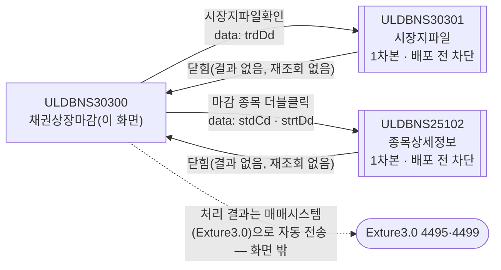

AS-IS 는 `fn_GetPar` 를 바꿔 끼우고(되돌리지 않음) 팝업이 부모 함수를 불러 값을 받았다. TO-BE 는 두 화살표 모두 `await $c.win.openPopup(url, options, data)` 이고 돌려받는 값은 없다. 두 팝업이 아직 1차본이라 **배포 전 차단**(§10 #10).

#### 업무 1: 진입·로딩

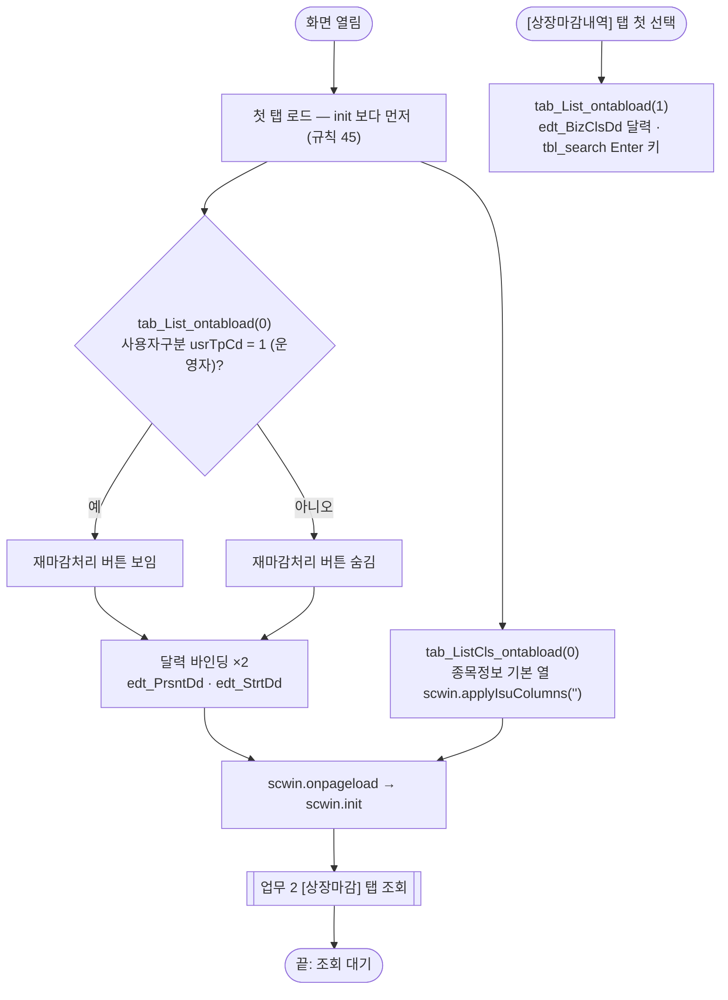

| # | 단계 | 주체 | 내용 | 분기 · 메시지 | 관련 절 |
|---|---|---|---|---|---|
| 1 | 재마감 버튼 | 화면 | AS-IS `js_usr_tp_cd == '1'` → `showObj(btn_ReClsProcs, true/false)` | 운영자만 보임 | §3 |
| 2 | 탭 선택 | 화면 | AS-IS `tab_List`·`tab_ListCls`·`tab_ListCls1.ActiveIndex = 1`(1-base 첫 탭) | TO-BE 마크업 `selectedIndex="0"` | §2.1 |
| 3 | (장식) | 화면 | AS-IS `BnsPanelToGroupBox` 7개 패널 | 삭제 — 퍼블리싱 그룹 | §9 |
| 4 | 열 초기화 | 화면 | AS-IS `fn_IntiIsuCol()`(`vMktCd = ''` → 기본 열) | — | §6.3 |
| 5 | init 바인딩 | 화면 | 단일 달력 3개, 조회 영역 Enter | — | §3 |
| 6 | 탭 조회 | 서버 | AS-IS `processGp = '1'; fn_SearchClsDd('')` | 업무 2 | §6.1 |
| 7 | (임시 데이터셋) | 화면 | AS-IS `dts_Temp.SetDataHeader('TEMP:String'); AddRow()` — 처리 전송 `KeyValue` 의 빈 입력 | 삭제(§5.11) | §9 |

#### 업무 2: [상장마감] 탭 조회

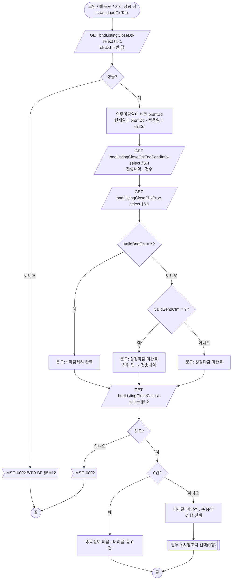

| # | 단계 | 주체 | 내용 | 분기 · 메시지 | 관련 절 |
|---|---|---|---|---|---|
| 1 | 마감일 조회 | 서버 | AS-IS `fn_SearchClsDd('')` → `dts_CheckCls`(`readChkClsDd`, 비동기 → `OnLoadCompleted`) | 실패 시 AS-IS 무반응 → TO-BE `MSG-0002` 후 끝 | §5.1 |
| 2 | 일자 표시 | 화면 | 업무마감일(`edt_BizClsDd`)이 비면 `PRSNT_DD`. `edt_PrsntDd = PRSNT_DD`, `edt_StrtDd = CLS_DD` | — | §2.2 |
| 3 | 전송내역 | 서버 | AS-IS `fn_SearchSendData()`(비동기) — `CLS_DD = edt_BizClsDd`(다른 탭 입력값), `STRT_DD = edt_StrtDd` → `txb_TotalCnt` "총 n건" | AS-IS 실패 처리 없음 | §5.4, §8 #6 |
| 4 | 마감 상태 | 서버 | AS-IS `readChkClsProc` **동기** 조회 → `VALID_BND_CLS = Y` "* 마감처리 완료" / `VALID_SEND_CFM = Y` 미완료 문구 + `tab_ListCls.ActiveIndex = 2`(전송내역) / 그 밖 미완료 문구 | TO-BE `await` 순서로 같게 | §5.9, §7.2 |
| 5 | 시장조치별 종목수 | 서버 | AS-IS `fn_SearchCls()` → `dts_MktList OnLoadCompleted` — 0건이면 `ClearData` + 머리글 "총 0 건", 아니면 "마감전 : 총 {TOT_MKTACT_CNT}건" | 실패 `MSG-0002`(`OnLoadError`) | §5.2 |
| 6 | 첫 행 | 화면 | AS-IS 데이터셋 로딩 때 `OnRowPosChanged` 가 첫 행으로 자동 발화 → TO-BE 는 `setFocusedCell(0, …)` + `selectClsMkt(0)` 직접 호출 | 이중 발화 실측 §10 #14 | §6.1 |

#### 업무 3: 시장조치 선택(마감전)

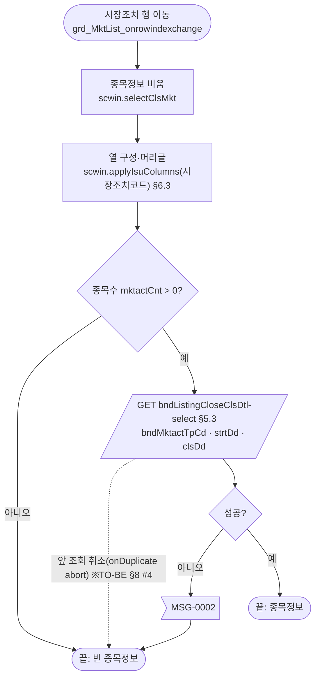

| # | 단계 | 주체 | 내용 | 분기 · 메시지 | 관련 절 |
|---|---|---|---|---|---|
| 1 | 비움·코드 | 화면 | AS-IS `dts_IsuList.ClearData(); vMktCd = BND_MKTACT_TP_CD` | `row == 0`(머리글) 가드는 옮기지 않음 | §6.1 |
| 2 | 열 구성 | 화면 | AS-IS `processGp == '1'` 일 때만 `fn_IntiIsuCol()` | — | §6.3 |
| 3 | 종목 조회 | 서버 | AS-IS `cnt > 0`(문자열 비교) 일 때 `fn_SearchClsDtl()` — queryId 를 `fn_GetQryId()` 로 코드별 선택 | TO-BE 경로 하나 + `bndMktactTpCd`(§10 #4) | §5.3 |

#### 업무 4: 전송내역 종목의 시장조치내역

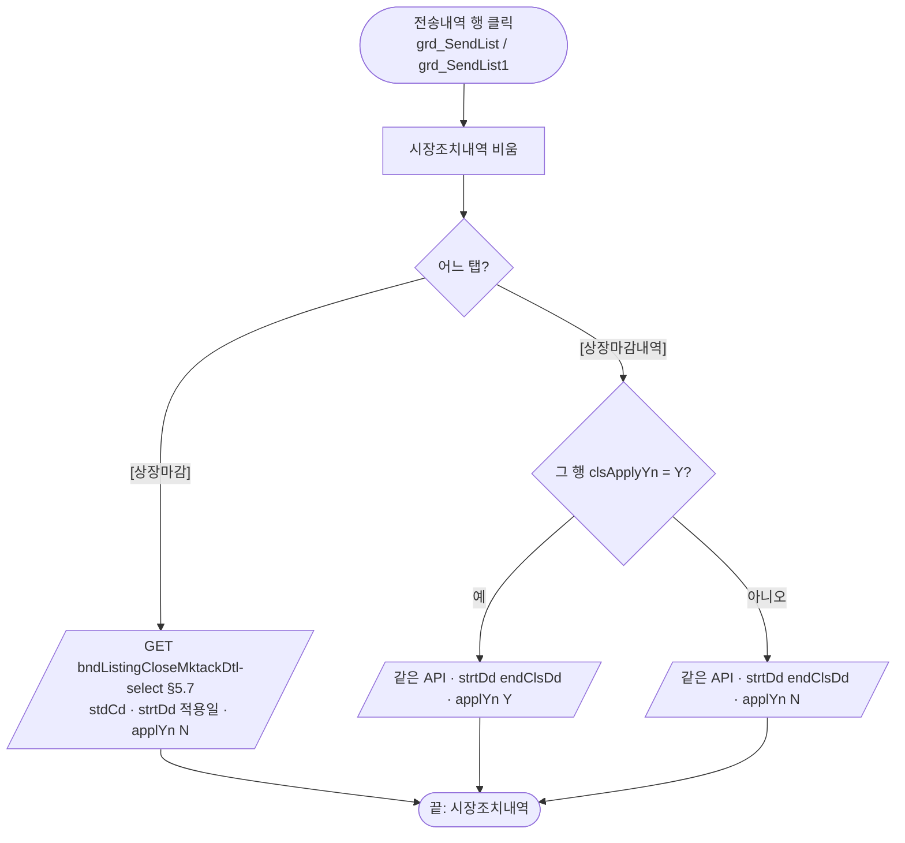

| # | 단계 | 주체 | 내용 | 분기 · 메시지 | 관련 절 |
|---|---|---|---|---|---|
| 1 | 비움 | 화면 | AS-IS `dts_List(1).ClearData()`; `vStdCd = STD_CD`(+ `vClsApplyYn = CLS_APPLY_YN`) | `row == 0` 가드 삭제. 복수조치(`MULTY_YN`) 가드는 주석 처리돼 무효 | §8 #5 |
| 2 | 조회 | 서버 | AS-IS `fn_SearchMktact` / `fn_SearchMktact1`(`queryId=lds.stf.bnscommon.select.listMktactDtlMulty`) | 실패 처리 없음(AS-IS 와 같음) | §5.7 |

#### 업무 5: 시장조치내역생성

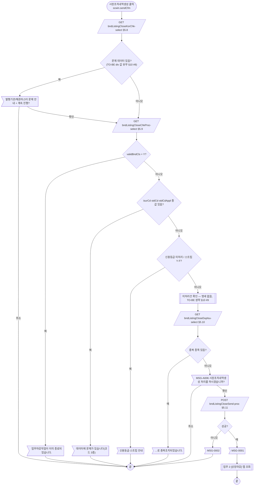

| # | 단계 | 주체 | 내용 | 분기 · 메시지 | 관련 절 |
|---|---|---|---|---|---|
| 0 | 상태 | 화면 | AS-IS `processGp = '3'` | 검증 탈락으로 끝나면 `'3'` 이 남는다(§8 #1) | — |
| 1 | 완성형 한글 | 서버·사용자 | AS-IS `processCompleteKoreanCheck`(**동기**, `outputMessageId=BNS_CHECK_CLS_COMPLETE_KOREAN`) — 행이 있으면 1행 `DIV` 로 문구: `1` 발행기관(코드·명), `2` 채권마스터(표준코드·한글종목명 — 값은 `ISUR_CD`·`COM_NM` 열), 끝에 "시스템담당자에게 연락바랍니다. 계속 진행하시겠습니까?" `confirm` | 취소 → `processGp = '1'` 후 끝 | §5.8, §7.2 |
| 2 | 처리 전 체크 | 서버 | AS-IS `readChkClsProc`(**동기**) | 실패 시 AS-IS 빈 값 판정 → TO-BE `MSG-0002` 후 끝 | §5.9 |
| 3 | 마감 종료 | 화면 | `VALID_BND_CLS = Y` | "업무마감작업이 이미 종료되었습니다." 후 끝 | §7.2 |
| 4 | 데이터 문제 | 화면 | `ISUR_CD`·`STD_CD`·`STD_CD_APPL`(라인구분 — jackal_140819) 중 하나라도 값 | "금일 발행기관, 채권마스터 데이터에 문제가 있습니다." + 코드 3종 + "시스템담당자에게 연락바랍니다." 후 끝 | §7.2 |
| 5 | 신용등급 | 화면 | `HAS_CREDIT_RCV = Y` 이고 `VALID_CREDIT_RCV = Y` | "금일 수신된 신용등급정보를 처리하지 않았습니다.\n 신용평가 수신내역을 확인바랍니다." 후 끝 | §7.2 |
| 6 | 스트립 | 화면 | `VALID_STRIP = Y` / `F` | Y "마감처리 전 스트립 통합처리를 하시기 바랍니다." / F "스트립 시장조치(…)와 '스트립 통합처리' 화면내용이 불일치함. …" 후 끝 | §7.2 |
| 7 | 미처리건 | 서버·사용자 | AS-IS(2026.01.05 추가) `listCheckNotComplt`(**동기**, `BNS_CHECK_CLS_NOT_COMPLT`) — 행이 있으면 "미처리건이 존재합니다. 계속하시겠습니까?" + `{BND_MKTACT_TP_NM} : {CNT}건` 줄들 `confirm` | **명세에 API 없음 → TO-BE 는 건너뜀**(`// TODO:`) — 배포 전 확인 §10 #9 | §5 |
| 8 | 종목중복 | 서버 | AS-IS `listCheckListIsuDupl`(**동기**) — 행이 있으면 `DUP_ISU` 줄들 + "로 중복조치되었습니다.\n확인 후 다시 처리하여 주십시오." | 후 끝 | §5.10 |
| 9 | 확인 | 사용자 | `MSG-A006`("시장조치내역생성") | 취소면 끝 | §7.2 |
| 10 | 생성 | 서버 | AS-IS `trs_Save` `/bns/ListCls.do?method=processSendCfm`, `STRT_DD`·`CLS_DD`(현재일) | 성공 `MSG-0001` → `processGp = '1'` → 업무 2 / 실패 `MSG-0002` + `alert_error` | §5.11 |

#### 업무 6: 상장마감

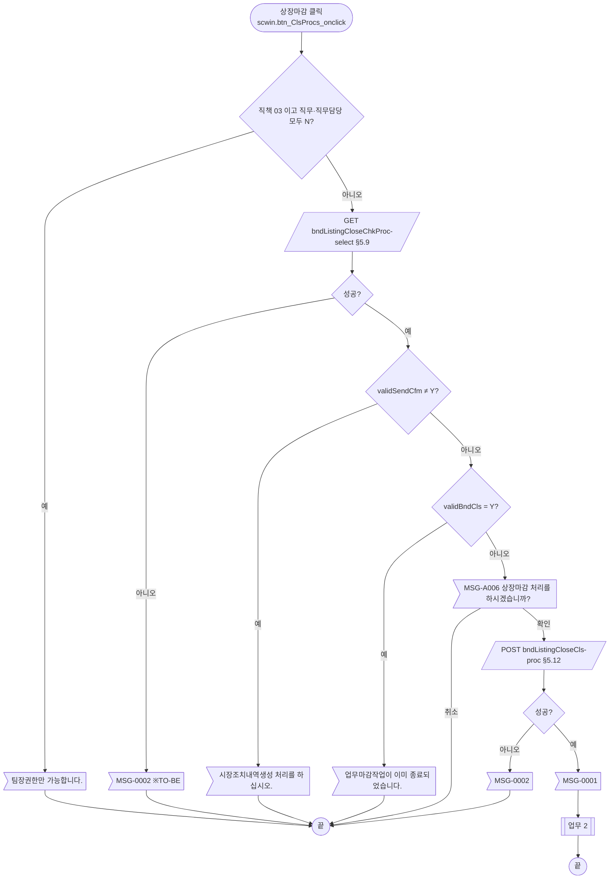

| # | 단계 | 주체 | 내용 | 분기 · 메시지 | 관련 절 |
|---|---|---|---|---|---|
| 1 | 권한 | 화면 | AS-IS `js_jobtitl == '03' && (js_duty == 'N' && js_duty_chrg == 'N')` → TO-BE `$c.session.getUserInfo("jobtitl"·"duty"·"dutyChrg")` | "팀장권한만 가능합니다." | §7.1 |
| 2 | 상태 | 화면 | AS-IS `processGp = '4'` | — | §8 #1 |
| 3 | 체크 | 서버 | `readChkClsProc`(**동기**) — 생성 선행(`VALID_SEND_CFM`), 마감 종료(`VALID_BND_CLS`) | 각 안내 후 끝 | §5.9 |
| 4 | 확인·마감 | 사용자·서버 | `MSG-A006`("상장마감") → `processCls`(`STRT_DD`·`CLS_DD`) | 성공 `MSG-0001` → 업무 2 | §5.12 |

#### 업무 7: 재마감처리

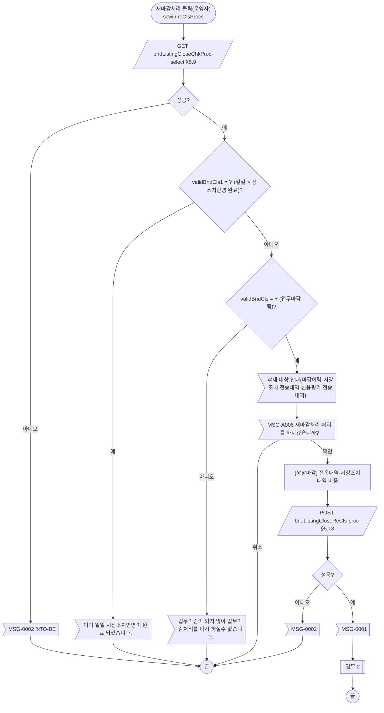

| # | 단계 | 주체 | 내용 | 분기 · 메시지 | 관련 절 |
|---|---|---|---|---|---|
| 1 | 상태 | 화면 | AS-IS `processGp = '9'` | — | §8 #1 |
| 2 | 체크 | 서버 | `readChkClsProc`(**동기**) — `VALID_BND_CLS1`(시장조치반영 시작) → 불가, `VALID_BND_CLS`(업무마감) 아니면 불가, 맞으면 삭제 대상 안내(`alert`, 진행 계속) | 문구 §7.2 | §5.9 |
| 3 | 확인 | 사용자 | `MSG-A006`("재마감처리") | 취소면 끝(목록은 그대로) | — |
| 4 | 비움·처리 | 화면·서버 | `dts_SendInfo`·`dts_List` `ClearData` → `reProcessCls`(`STRT_DD` 만) | TO-BE 명세 4키(§10 #6) | §5.13 |

#### 업무 8: [상장마감내역] 조회

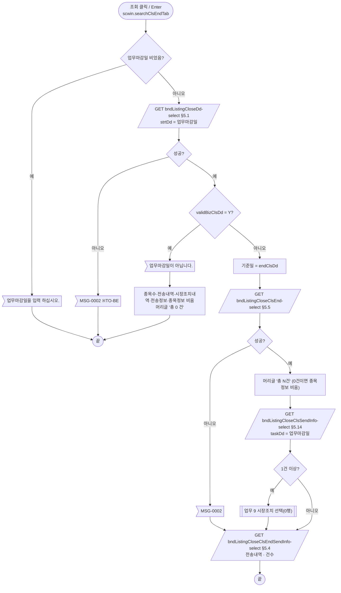

| # | 단계 | 주체 | 내용 | 분기 · 메시지 | 관련 절 |
|---|---|---|---|---|---|
| 1 | 필수 | 화면 | `edt_BizClsDd` 빈 값 | "업무마감일을 입력 하십시오." | §7.2 |
| 2 | 마감일 | 서버 | AS-IS `processGp = '2'; fn_SearchClsDd(업무마감일)` → `dts_CheckCls OnLoadCompleted` | `VALID_BIZ_CLS_DD = "Y"` 면 "업무마감일이 아닙니다." + `dts_MktList`·`dts_SendInfo1`·`dts_List1`·`dts_ClsSendInfo`·`dts_IsuList` 비움, `grd_MktList1` 머리글 "총 0 건" | §5.1, §7.1 |
| 3 | 마감 종목수 | 서버 | AS-IS `fn_SearchClsEnd()`(`V_STRT_DD = END_CLS_DD`) → `OnLoadCompleted`: 머리글 "총 {TOT_MKTACT_CNT}건"/"총 0 건" → `fn_SearchSendIsuInfo()` | 실패 `MSG-0002` | §5.5·§5.14 |
| 4 | 전송내역 | 서버 | AS-IS `fn_SearchSendData1()`(`CLS_DD = 업무마감일`, `STRT_DD = END_CLS_DD`) — 3 과 **동시에**(비동기) 나감 | TO-BE 순서대로 await | §5.4 |
| 5 | 첫 행 | 화면 | AS-IS 로딩 때 `OnRowPosChanged` 자동 발화(`processGp == '2'` → 열 구성 없이 `fn_SearchClsDtl`) | 업무 9 | §5.6 |

#### 업무 9: 시장조치 선택(마감내역)

| # | 단계 | 주체 | 내용 | 분기 · 메시지 | 관련 절 |
|---|---|---|---|---|---|
| 1 | 비움 | 화면 | `dts_IsuList.ClearData()` | 열 구성은 바꾸지 않음(`grd_IsuList1` 은 고정 3열) | §6.2 |
| 2 | 조회 | 서버 | 종목수 > 0 이면 `fn_SearchClsDtl()` — queryId `fn_GetQryIdEnd()`(500·900·314·신규상장군(111·121·131·141·151·104·105·113)·기본), `V_STRT_DD = END_CLS_DD` | 실패 `MSG-0002`. TO-BE 앞 조회 취소(`abort`) | §5.6 |

#### 업무 10·11: 탭 되돌림·상위 탭 전환

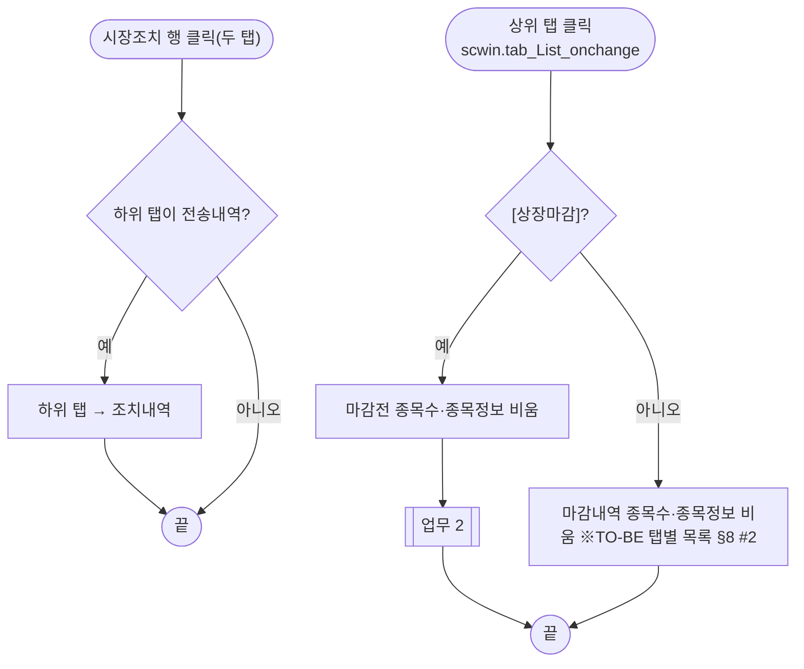

AS-IS 는 두 탭이 `dts_MktList`·`dts_IsuList` 를 함께 썼기 때문에 탭을 바꿀 때마다 둘을 비웠다(`processGp = nIndex`). TO-BE 는 탭별 DataCollection 이라 바뀐 탭 쪽 목록만 비워 같은 화면 결과를 낸다.

#### 업무 12~14: 종목상세·시장지파일·엑셀

| # | 업무 | 내용 | 분기 · 메시지 | 관련 절 |
|---|---|---|---|---|
| 12 | 종목상세 | `grd_IsuList1` 더블클릭 → 종목정보가 0건이면 끝, 아니면 `{ stdCd, strtDd }` 로 ULDBNS25102 | 컬럼 제한(`STD_CD` 만)은 주석 처리돼 무효 — 아무 열이나 더블클릭 | §6.12, §8 #5 |
| 13 | 시장지파일 | `{ trdDd : 업무마감일 }` 로 ULDBNS30301 | 업무마감일 빈 값 검사 없음(AS-IS 와 같음) | §6.11 |
| 14 | 엑셀 | `grd_SendList`(적용일) / `grd_SendList1`(종료달력일) 전송내역 | 0건 안내는 공통 함수 | §6.6 |

#### 화면 상태 (마감 상태 문구와 버튼)

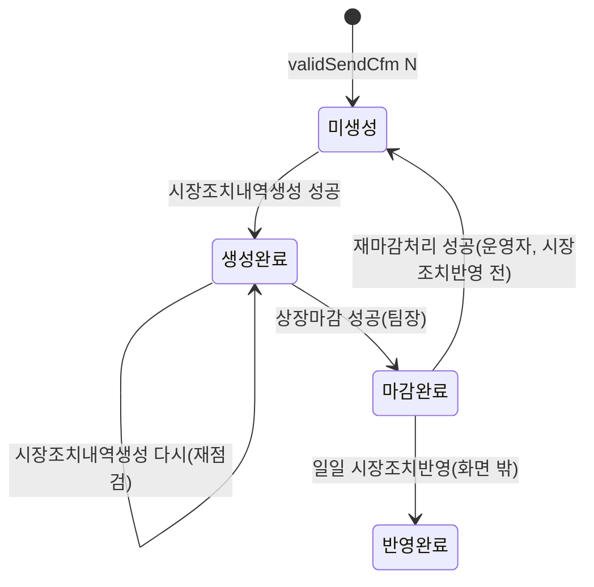

| 상태 | `txb_ClsDtl` 문구 | 하위 탭 | [시장조치내역생성] | [상장마감] | [재마감처리] |
|---|---|---|---|---|---|
| 미생성 | 상장마감 미완료 | 조치내역 | 진행 | "시장조치내역생성 처리를 하십시오." | "업무마감이 되지 않아 …" |
| 생성완료 | 상장마감 미완료 | **전송내역** | 진행(다시 생성) | 진행 | "업무마감이 되지 않아 …" |
| 마감완료 | * 마감처리 완료 | 조치내역 | "업무마감작업이 이미 종료되었습니다." | 같은 안내 | 진행 |
| 반영완료 | * 마감처리 완료 | 조치내역 | 같은 안내 | 같은 안내 | "이미 일일 시장조치반영이 완료 되었습니다." |

버튼은 상태에 따라 잠그지 않고 누른 뒤 서버 체크로 막는다(AS-IS 와 같음 — `setButtonState` 해당 없음). 재마감 후 상태(미생성)는 서버가 마감이력을 지운다는 안내 문구 기준의 추정이다.

---

## 2. 화면 구성 및 데이터 정의

### 2.1 화면 구성

1단계(마크업 보강) 기준은 폴더 퍼블리싱 xml 이다. 1단계에서 바꾼 것: W-Craft·퍼블리셔 잔재 속성(`userData2`·`hierarchy`·`orgid`·`comp_par_seqId`·`meta_name`·`metaev_*`·`tabIndex`·`cursor`·`xf:trigger src`) 삭제, 엉뚱한 바인딩 `edt_StrtDd ref="data:bnd_DtlInfo.STRT_DD"` 삭제, 마크업 `ev:onclick`(W-Craft 이름) 삭제 후 2단계에서 다시 붙임, 중첩 탭 `tbc_sub` → `tbcbox > tbc`, 그리드 `dataList` → `dlt_*`·컬럼 id camelCase·머리글 `h_`·번호 열 `expression`·전 열 `readOnly`·날짜 `dataType="date" displayFormat="yyyy-MM-dd"`(2026-10-28 규칙 46 — 종전 `####-##-##`)·금액 `#,##0`, 캡션 기본 문구 교체, `tbl_search` id. 2단계에서 `ref`·`ev:on*` 만 더했다(`publish_gate` P24 경고 = 의도).

| 영역 | AS-IS 요소 | TO-BE 컴포넌트 (바인딩) | 설명 |
|---|---|---|---|
| 화면 머리 | (없음) | `w2:pageFrame#pfmContentHeader` (`/cm/xml/contentHeader.xml`) | 본화면 필수 — 폴더 xml 에 이미 있음. 탭 본문에는 없음 |
| 상위 탭 | `tab_List`(`Tab_01`, 상장마감 / 상장마감내역) + 패널 `pnl_Item`·`pnl_Item2` | `tab_List`(`tbcbox > tbc`, `ev:onchange`), 본문 `pnl_Item_01`·`pnl_Item2_01` | §4 |
| [상장마감] 일자 | `label_7` 현재일 + `edt_PrsntDd`(read), `label_8` 적용일 + `edt_StrtDd`(read) | `edt_PrsntDd`(`dma_screen.prsntDd`)·`edt_StrtDd`(`dma_screen.strtDd`), 둘 다 `readOnly` | 마감일 조회 응답으로 채움(§6.1). 표는 `tblbox`(조회 영역 아님) |
| [상장마감] 단위 안내 | `label_1` "(단위 : 발행통화 참조)" | `label_1`(`titbox > rt`) | 퍼블리싱본에 없던 라벨 — 1단계에서 복원(하위 탭 위) |
| [상장마감] 시장조치별 종목수 | `grd_MktList`(`BND_MKTACT_TP_NM` 머리글 "마감전 : 총 건", `MKTACT_CNT` 종목수) | `grd_MktList`(`dlt_bndListingCloseClsList`: `bndMktactTpNm`·`mktactCnt`, `ev:oncellclick`·`ev:onrowindexchange`) | 머리글 `h_bndMktactTpNm` 에 총 건수(§5.2) |
| [상장마감] 하위 탭 | `tab_ListCls`(`Tab_BNS`, 조치내역 / 전송내역) + `pnl_ClsDtl`·`pnl_SendDtl` | `tab_ListCls`(`tbcbox > tbc`, `selectedIndex 0`), 본문 `pnl_ClsDtl_01`·`pnl_SendDtl_01` | 생성 완료면 전송내역으로(§6.1) |
| 조치내역 | `grd_IsuList`(46열 — 번호 + 45 토글 열) | `grd_IsuList`(`dlt_bndListingCloseClsDtl`) | 시장조치코드별 열·머리글(§6.3). 정렬·편집 없음 |
| 전송내역 건수·엑셀 | `txb_TotalCnt`("총 n건"), `btn_Excel`(이미지) | `txb_TotalCnt` 그룹의 숫자 `w2:span#spn_totalCnt`, `btn_Excel`(`ev:onclick`) | `$c.stf.fillGridHeaderTotalCnt` |
| 전송내역(송신시장조치) | `grd_SendList`(114열, `sort="True"`) | `grd_SendList`(`dlt_bndListingCloseClsEndSendInfo`, `sortable`, `ev:oncellclick`) | 열 id 는 명세 키(§2.2) |
| 시장조치내역 | `label_10`, `grd_List`(6열, `시장조치구분` 파란 글자) | `label_10`(h4), `grd_List`(`dlt_bndListingCloseMktackDtl`, `sortable`) | 파란 글자 `class="blue"`(규칙 40) |
| 마감 안내 | `pnl_Cls`: `label_4`·`label_12`·`label_5`·`label_2`·`label_9` 안내, `txb_ClsDtl`(빨간 굵은 글자, 상태 문구) | `pnl_Cls`(`msgbox`): 안내 5개 `w2:textbox`, `txb_ClsDtl` = 빨간 문구 `w2:textbox`(`txt_con red`) | 폴더 xml 은 고정 빨간 문구 + 숨김 `xf:input#txb_ClsDtl` 이었음 → 1단계에서 빨간 문구에 id 를 주고 숨김 input 삭제(상태별 문구는 스크립트) |
| 처리 버튼 | `btn_ReClsProcs`(재마감, 운영자만), `btn_SendCfm`(시장조치내역생성), `btn_ClsProcs`(상장마감) — 이미지 | `btnbox > rt` 의 `btn_cm` 3개(`ev:onclick`) | 규칙 41 의 주요 버튼(취소·삭제·수정·저장·신규)이 아니라 `pt` 없음. 재마감은 `show`/`hide` |
| [상장마감내역] 조회 영역 | `label_6` 업무마감일 + `edt_BizClsDd`(write) + `img_BizClsDd`(달력 이미지), `btn_MktFileConfrm`, `btn_Search` | `schbox` > `tbl_search` > `edt_BizClsDd`(`dma_screen.bizClsDd`), `btn_schbox` 의 `btn_MktFileConfrm`·`btn_Search`(`btn_cm sch`) | `img_BizClsDd` **(옮기지 않음)** — `inputCalendar` 내장. Enter 키(§3) |
| [상장마감내역] 종목수 | `grd_MktList1`(머리글 "총 건", "종목수") | `grd_MktList1`(`dlt_bndListingCloseClsEnd`, `ev:oncellclick`·`ev:onrowindexchange`) | |
| [상장마감내역] 하위 탭 | `tab_ListCls1` + `pnl_ClsDtl1`·`pnl_SendDtl1` | `tab_ListCls1`(`tbcbox > tbc`) | |
| 마감 종목정보 | `grd_IsuList1`(번호·접수번호·표준코드(노란 바탕 파란 글자)·한글종목명) | `grd_IsuList1`(`dlt_bndListingCloseClsEndDtl`, `ev:oncelldblclick`) | 표준코드 파란 글자 `class="blue"`, 노란 바탕은 공통 class 없음(옮기지 않음 — §8 #14) |
| 마감 전송내역 | `txb_TotalCnt1`, `btn_Excel1`, `grd_SendList1`(114열) | `spn_totalCnt1`, `btn_Excel1`, `grd_SendList1`(`dlt_bndListingCloseClsEndSendInfo1`, `ev:oncellclick`) | |
| 마감 시장조치내역 | `label_11`, `grd_List1` | `label_11`, `grd_List1`(`dlt_bndListingCloseMktackDtl1`) | |
| 전송정보 | `label_3` "전송내역", `grd_ClsSendInfo`(번호·구분·전송일·전송수(숨김)·전송시작시각·전송마감시각·전송건수) | `label_3`, `grd_ClsSendInfo`(`dlt_bndListingCloseClsSendInfo`) | 폴더 xml 은 숨김 "전송수" 만 남기고 보이는 "전송건수"(같은 `MKTACT_CNT`)를 뺐음 → 1단계에서 그 열을 **보이는 "전송건수"(오른쪽 정렬)** 로 바꿈(위치는 전송일 다음) |
| (보이지 않음) | `dts_Temp`(빈 1행 — 처리 전송 입력), `trs_Save` | **(옮기지 않음)** → `dma_save` + `executeDynamic` | §5.11 |

### 2.2 데이터 정의

명세 응답 정의는 id·name·dataType 을 그대로 옮겼다(블록 1·3 은 예외 — 아래). 탭 둘이 같은 API 를 따로 쓰는 전송내역·시장조치내역은 같은 정의로 두 개(`…`·`…1`)를 둔다.

| TO-BE | 종류 | 키(컬럼) | 출처 / 용도 |
|---|---|---|---|
| `dma_screen` | dataMap | `prsntDd`(현재일), `strtDd`(적용일), `bizClsDd`(업무마감일) | 화면 표시·입력 — AS-IS `edt_PrsntDd`·`edt_StrtDd`·`edt_BizClsDd` |
| `dma_search` | dataMap | `strtDd`, `clsDd`, `bndMktactTpCd`, `applYn`, `stdCd`, `empNo`, `isurCd`, `taskDd` | 명세 GET 블록 공통 requestData 8키 — `scwin.getSearchData(values)` 가 호출마다 채움(§6.13) |
| `dma_save` | dataMap | `strtDd`, `empNo`, `empNm`, `clsDd` | 명세 9·10·14 requestData, `ref : "dma_save"` |
| `dma_bndListingCloseDd` | dataMap | `clsDd`, `validClsDd`, `bizClsDd`, `validBizClsDd`, `prsntDd`, `endClsDd` | 명세 6 응답 — AS-IS `dts_CheckCls`(`CLS_DD`·`PRSNT_DD`·`END_CLS_DD`·`VALID_BIZ_CLS_DD`) |
| `dlt_bndListingCloseClsList` | dataList | `bndMktactTpCd`, `bndMktactTpNm`, `mktactCnt`, `totMktactCnt` | 명세 4 응답 — AS-IS `dts_MktList`(processGp 1) |
| `dlt_bndListingCloseClsEnd` | dataList | (같은 4키) | 명세 2 응답 — AS-IS `dts_MktList`(processGp 2) |
| `dlt_bndListingCloseClsDtl` | dataList | `bndApplId`, `stdCd`, `isurNm`, `isuNm`, `isuAmt`, `isuDd`, `listDd`, `redmptDd`, `bfIsuNm`, `afIsuNm`, `tpNm`, `bfListAmt`, `afListAmt`, `chgListDtl`, `exerAmt`, `bwIsuNm`, `geIsuNm`, `bwListAmt`, `geListAmt`, `redmptAmt`, `addListAmt`, `bfExerPrc`, `afExerPrc`, `bfIsurPrc`, `afIsurPrc`, `chgRsnContn`, `bfCoupnRt`, `afCoupnRt`, `bfRedmptDd`, `afRedmptDd`, `bfFstDd`, `afFstDd`, `delistRsnContn`, `delistDd`, `bfStripNsprtBal`, `sprtParAmt`, `recombinParAmt`, `afStripNsprtBal`, `bfCredit`, `afCredit`, `strtDdWit`, `splitRedmptDd`, `chgSplitRedmptDd`, `bkHoldyPrincPayDdDecsnNm`, `indexNm` (금액 열 number) | **가정** — 명세 1 응답은 `dlt_searchTotList`(procState·coNm… 24열, ULDBNS30400 정의와 같음)라 그리드 열과 맞지 않는다 → AS-IS `grd_IsuList` 열(`dts_IsuList`, 출력 전문 `BNS_CLS_ISU_INFO`)의 camelCase 로 정의(§10 #3) |
| `dlt_bndListingCloseClsEndDtl` | dataList | `bndApplId`, `stdCd`, `isuNm`, `strtDd` | **가정** — 명세 3 응답도 `dlt_searchPackListIsuList`(30400 복사). AS-IS `grd_IsuList1` 3열 + 팝업에 넘기던 `STRT_DD`(§10 #3) |
| `dlt_bndListingCloseClsEndSendInfo` / `…1` | dataList | 명세 8 응답 115키(`strtDd`·`stdCd`·`bndMktactTpCd`·`recProcsCd`·`isuNm` … `multyYn`·`clsApplyYn`·`presaleGovbndTrdTpNm`·`splitRedmptDd`) | 명세 8 — AS-IS `dts_SendInfo`·`dts_SendInfo1`(`BNS_SEND_ISU_INFO`). 그리드 113 데이터 열은 모두 AS-IS 열의 camelCase 와 같은 이름으로 명세에 있다(`bndMktactTpCd`·`clsApplyYn` 은 그리드에 없음 — `clsApplyYn` 은 행 클릭에 씀) |
| `dlt_bndListingCloseMktackDtl` / `…1` | dataList | `bndApplId`, `bndMktactTpNm`, `strtDd`, `contn`, `procsCompltChrgNm`, `bndMktactTpCd`, `packApplId` | 명세 7 — AS-IS `dts_List`·`dts_List1`(`BNS_MKTACT_DTL`). AS-IS `NO` 열은 번호 expression |
| `dlt_bndListingCloseClsSendInfo` | dataList | `mktactNm`, `taskDd`, `mktactTrnsmTm`, `mktactEndTm` + **`mktactCnt`(가정)** | 명세 5 — AS-IS `dts_ClsSendInfo`(`BNS_CLS_SEND_INFO`). 명세에 전송건수(`MKTACT_CNT`)가 없다(§10 #5) |
| `dma_bndListingCloseKorChk` | dataMap | `div`, `isurCd`, `comNm`, `comAbbrv`, `chk`, `failCnt` | 명세 11 — AS-IS `dts_completeKorean`(여러 행 가능, 1행만 읽음 — §10 #8) |
| `dma_bndListingCloseChkProc` | dataMap | `isurCd`, `stdCd`, `stdCdAppl`, `hasCreditRcv`, `validCreditRcv`, `validStrip`, `validBndCls`, `validBndCls1`, `validSendCfm` | 명세 12 — AS-IS `dts_CheckClsProc`(`BNS_CHECK_CLS_PROC`) |
| `dlt_bndListingCloseDupIsu` | dataList | `dupIsu` | 명세 13 — AS-IS `dts_CheckDup` |
| (삭제) | — | — | `dts_LstOrdYd`·`dts_CdLstOrdYd`(최종호가 — 호출 `fn_SearchLastOrdYd` 가 주석), `dts_CheckExa`(쓰지 않음), `dts_Temp`(빈 입력), `dts_notComplt`(명세 없음 — §10 #9) |

AS-IS 대문자 키 → 명세 키: `CLS_DD → clsDd`, `PRSNT_DD → prsntDd`, `END_CLS_DD → endClsDd`, `VALID_BIZ_CLS_DD → validBizClsDd`, `BND_MKTACT_TP_CD/NM → bndMktactTpCd/Nm`, `MKTACT_CNT → mktactCnt`, `TOT_MKTACT_CNT → totMktactCnt`, `VALID_SEND_CFM → validSendCfm`, `VALID_BND_CLS(1) → validBndCls(1)`, `HAS_CREDIT_RCV → hasCreditRcv`, `VALID_CREDIT_RCV → validCreditRcv`, `VALID_STRIP → validStrip`, `STD_CD_APPL → stdCdAppl`, `DIV/ISUR_CD/COM_NM/COM_ABBRV → div/isurCd/comNm/comAbbrv`, `DUP_ISU → dupIsu`, `CLS_APPLY_YN → clsApplyYn`, `MULTY_YN → multyYn`, 전송내역 113열은 같은 규칙. 명세에만 있는 키: `validClsDd`·`bizClsDd`(블록 6), `chk`·`failCnt`(블록 11), `packApplId`(블록 7) — 화면은 쓰지 않는다.

### 2.3 그리드 열 대응 (AS-IS 열 id `이름` → TO-BE 키)

`{CurRow}` 번호 열·`NO` 열은 `no`(expression `rowIndex()+1`). 숨김(`show="False"`) 표시는 *숨김*. `grd_SendList1` 은 `grd_SendList` 와 같은 열(→ `dlt_bndListingCloseClsEndSendInfo1`), `grd_List1` 은 `grd_List` 와 같은 열.

- **`grd_MktList`** (`dlt_bndListingCloseClsList`): `BND_MKTACT_TP_NM` 마감전 : 총 건 → `bndMktactTpNm` · `MKTACT_CNT` 종목수 → `mktactCnt`
- **`grd_MktList1`** (`dlt_bndListingCloseClsEnd`): `BND_MKTACT_TP_NM` 총 건 → `bndMktactTpNm` · `MKTACT_CNT` 종목수 → `mktactCnt`
- **`grd_IsuList`** (`dlt_bndListingCloseClsDtl`): 번호 → `no` · `BND_APPL_ID` 접수번호 → `bndApplId` · `STD_CD` 표준코드 → `stdCd` · `ISUR_NM` 발행기관명 → `isurNm` · `ISU_NM` 한글종목명 → `isuNm` · `ISU_AMT` 발행금액 → `isuAmt` · `ISU_DD` 발행일 → `isuDd` · `LIST_DD` 상장일 → `listDd` · `REDMPT_DD` 상환일 → `redmptDd` · `BF_ISU_NM` 변경전 종목명 → `bfIsuNm` · `AF_ISU_NM` 변경후 종목명 → `afIsuNm` · `TP_NM` 구분 → `tpNm` · `BF_LIST_AMT` 변경전 상장금액 → `bfListAmt` · `AF_LIST_AMT` 변경후 상장금액 → `afListAmt` · `CHG_LIST_DTL` 변경상장내역 → `chgListDtl` · `EXER_AMT` 행사금액 → `exerAmt` · `BW_ISU_NM` BW 종목명 → `bwIsuNm` · `GE_ISU_NM` 일반사채 종목명 → `geIsuNm` · `BW_LIST_AMT` BW 상장금액 → `bwListAmt` · `GE_LIST_AMT` 일반사채 상장금액 → `geListAmt` · `REDMPT_AMT` 중도상환금액 → `redmptAmt` · `ADD_LIST_AMT` 추가상장금액 → `addListAmt` · `BF_EXER_PRC` 변경전행사가액(원) → `bfExerPrc` · `AF_EXER_PRC` 변경후행사가액(원) → `afExerPrc` · `BF_ISUR_PRC` 변경전 발행가액 → `bfIsurPrc` · `AF_ISUR_PRC` 변경후 발행가액 → `afIsurPrc` · `CHG_RSN_CONTN` 사유 → `chgRsnContn` · `BF_COUPN_RT` 변경전 표면이자율 → `bfCoupnRt` · `AF_COUPN_RT` 변경후 표면이자율 → `afCoupnRt` · `BF_REDMPT_DD` 변경전 상환일 → `bfRedmptDd` · `AF_REDMPT_DD` 변경후 상환일 → `afRedmptDd` · `BF_FST_DD` 변경전 최초이자지급일 → `bfFstDd` · `AF_FST_DD` 변경후 최초이자지급일 → `afFstDd` · `DELIST_RSN_CONTN` 폐지사유 → `delistRsnContn` · `DELIST_DD` 폐지일 → `delistDd` · `BF_STRIP_NSPRT_BAL` 변경전 스트립미분리잔액 → `bfStripNsprtBal` · `SPRT_PAR_AMT` 신청 액면금액 → `sprtParAmt` · `RECOMBIN_PAR_AMT` 재결합신청금액 → `recombinParAmt` · `AF_STRIP_NSPRT_BAL` 변경후 액면금액 → `afStripNsprtBal` · `BF_CREDIT` 변경전등급 → `bfCredit` · `AF_CREDIT` 변경후등급 → `afCredit` · `STRT_DD_WIT` WIT개시일 → `strtDdWit` · `SPLIT_REDMPT_DD` 분할상환일 → `splitRedmptDd` · `CHG_SPLIT_REDMPT_DD` 수정분할상환일 → `chgSplitRedmptDd` · `BK_HOLDY_PRINC_PAY_DD_DECSN_NM` 휴무관련(원금)구분 → `bkHoldyPrincPayDdDecsnNm` · `INDEX_NM` 날짜구분 → `indexNm`
- **`grd_IsuList1`** (`dlt_bndListingCloseClsEndDtl`): 번호 → `no` · `BND_APPL_ID` 접수번호 → `bndApplId` · `STD_CD` 표준코드 → `stdCd` · `ISU_NM` 한글종목명 → `isuNm`
- **`grd_SendList`** (`dlt_bndListingCloseClsEndSendInfo`): 번호 → `no` · `MULTY_YN` 복수조치여부 → `multyYn` · `STRT_DD` 영업일자4 → `strtDd` · `STD_CD` 종목코드5 → `stdCd` · `REC_PROCS_CD` 레코드처리구분7 → `recProcsCd` · `ISU_NM` 종목명8 → `isuNm` · `ISU_ABBRV` 종목약명9 → `isuAbbrv` · `ISU_ENG_NM` 종목영문명10 → `isuEngNm` · `ISU_ENG_ABBRV` 종목영문약명11 → `isuEngAbbrv` · `ISUR_NM` 발행기관12 → `isurNm` · `LIST_STAT_CD` 채권상장구분13 → `listStatCd` · `BND_CLSS_NM` 채권분류14 → `bndClssNm` · `BND_TP_NM` 채권유형15 → `bndTpNm` · `SPECLBND_ISUR_CD` 특수채발행채16 → `speclbndIsurCd` · `MUNIBND_TP_NM` 지방채구분17 → `munibndTpNm` · `BND_GUAR_TP_NM` 채권보증구분18 → `bndGuarTpNm` · `GRT_RT` 지급보증율19 → `grtRt` · `NUSUAL_BND_TP_NM` 특이채권유형20 → `nusualBndTpNm` · `IMBDOPT_CORPBND_NM` 옵션부사채21 → `imbdoptCorpbndNm` · `INT_PAY_METHD_NM` 이자지급방법22 → `intPayMethdNm` · `REDMPT_METHD_TP_NM` 리스크채권상환유형23 → `redmptMethdTpNm` · `BND_ISU_METHD_NM` 채권발행방법24 → `bndIsuMethdNm` · `ASST_SECUTIZ_TP_NM` 자산유동화구분25 → `asstSecutizTpNm` · `DEBT_REPAY_RANK_TP_NM` 채무변제순위구분26 → `debtRepayRankTpNm` · `LIST_DD` 상장일자27 → `listDd` · `ISU_DD` 발행일자28 → `isuDd` · `REDMPT_DD` 상환일자29 → `redmptDd` · `SALE_DD` 매출일자30 → `saleDd` · `FST_INT_PAY_DD` 최초이자지급일자31 → `fstIntPayDd` · `BND_ISU_PRC` 채권발행율32 → `bndIsuPrc` · `COUPN_RT` 표면이자율33 → `coupnRt` · `INT_PAY_CALC_MMS` 이자지급계산월수34 → `intPayCalcMms` · `COUPN_PAY_METHD_NM` 이표지급방법35 → `coupnPayMethdNm` · `BND_INT_PAY_DD_BAS_TP_NM` 채권이자지급일기준구분36 → `bndIntPayDdBasTpNm` · `INT_MMEND_TP_NM` 이자월말구분37 → `intMmendTpNm` · `INT_UDWON_PROCS_NM` 이자원단위미만처리38 → `intUdwonProcsNm` · `INT_PAY_UNIT_MMS` 이자지급단위월수39 → `intPayUnitMms` · `BND_SALE_TP_NM` 채권매출형태40 → `bndSaleTpNm` · `BND_PRE_SALE_INT_PAY_METHD_NM` 채권선매출이자지급방법41 → `bndPreSaleIntPayMethdNm` · `ISU_AMT` 발행금액42 → `isuAmt` · `LIST_AMT` 상장금액43 → `listAmt` · `PACK_AMT_FINAL_YN` 일괄금액확정여부44 → `packAmtFinalYn` · `CURR_TP_NM` 통화구분45 → `currTpNm` · `EXP_REDMPT_RTO` 만기상환비율46 → `expRedmptRto` · `GRT_YD` 보장수익률47 → `grtYd` · `GRT_YD_STRT_DD` 보장수익률적용일자48 → `grtYdStrtDd` · `ADD_YD` 추가수익률49 → `addYd` · `ADD_YD_STRT_DD` 추가수익률적용일자50 → `addYdStrtDd` · `EQMT_FND` 시설자금51 → `eqmtFnd` · `OPER_FND` 운영자금52 → `operFnd` · `REFUND_FND` 차환자금53 → `refundFnd` · `MISC_FND` 기타자금54 → `miscFnd` · `SIGN_YN` 기명여부55 → `signYn` · `TAX_YN` 과세여부56 → `taxYn` · `BND_MAJAGNT_COM_NM` 채권주관기관57 → `bndMajagntComNm` · `GRT_INST_NM` 지급보증기관58 → `grtInstNm` · `TRST_INST_NM` 수탁기관59 → `trstInstNm` · `REG_INST_NM` (전자)등록기관60 → `regInstNm` · `PRINCINT_PAY_AGNT_NM` 원리금지급대행기관61 → `princintPayAgntNm` · `BND_SRT_CD` 종목단축코드62 → `bndSrtCd` · `BND_DELIST_RSN_NM` 채권상장폐지사유63 → `bndDelistRsnNm` · `BND_DELIST_DD` 채권상장폐지일자64 → `bndDelistDd` · `STK_REL_CORPBND_RGHT_TP_NM` 주식관련사채권리구분65 → `stkRelCorpbndRghtTpNm` · `OBJ_ISU_CD` 대상종목코드66 → `objIsuCd` · `OBJ_ISU_NM` 대상종목명67 → `objIsuNm` · `STK_REL_CORPBND_EXER_PRC` 주식관련사채권리행사가격68 → `stkRelCorpbndExerPrc` · `EXER_RTO` 행사비율69 → `exerRto` · `EXER_STRT_DD` 행사개시일자70 → `exerStrtDd` · `EXER_END_DD` 행사종료일자71 → `exerEndDd` · `CLM_INST_NM` 청구기관72 → `clmInstNm` · `DIV_RECK_DD_TP_NM` 배당기산일구분명73 → `divReckDdTpNm` · `PROFT_PARTC_ACC_YN` 이익참가누적여부74 → `proftPartcAccYn` · `SUBSRGHT_EXER_AF_ISU_CD` 신주인수권행사이후종목코드75 → `subsrghtExerAfIsuCd` · `SPLIT_REDMPT_TP_NM` 분할상환유형구분76 → `splitRedmptTpNm` · `EQUIV_REDMPT_VAL` 균등상환액77 → `equivRedmptVal` · `DEFR_MMS` 거치개월수78 → `defrMms` · `REDMPT_PD_INT_TP_NM` 상환기간이자구분79 → `redmptPdIntTpNm` · `SPLIT_REDMPT_CNT` 분할상환횟수80 → `splitRedmptCnt` · `INT_RT_DECSN_MISC_BAS_INT_NM` 이자율결정기타기준금리명81 → `intRtDecsnMiscBasIntNm` · `SPD` 가산금리82 → `spd` · `INT_RT_DECSN_TM_NM` 이자율결정시점83 → `intRtDecsnTmNm` · `UPLMT_COUPN_RT` 상한표면이자율84 → `uplmtCoupnRt` · `LWLMT_COUPN_RT` 하한표면이자율85 → `lwlmtCoupnRt` · `INT_RT_DECSN_BAS_DD` 이자율결정기준일자86 → `intRtDecsnBasDd` · `NUSUAL_ISU_COND_CONTN` 특이발행조건내용87 → `nusualIsuCondContn` · `BK_HOLDY_DD_INT_PAY_METHD_NM` 은행휴무일이자지급방법88 → `bkHoldyDdIntPayMethdNm` · `HBRDBND_YN` 신종자본증권여부89 → `hbrdbndYn` · `COND_CAP_SECU_TP_CD` 조건부자본증권유형90 → `condCapSecuTpCd` · `COUPN_RT_FINAL_YN` 표면이자율확정여부91 → `coupnRtFinalYn` · `BND_STRIP_TP_NM` 채권스트립구분92 → `bndStripTpNm` · `OBJ_ORGN_BND_CD` 대상원본채권코드93 → `objOrgnBndCd` · `STRIP_NSPRT_BAL` 스트립미분리잔액94 → `stripNsprtBal` · `INFLLNK_YN` 물가연동여부95 → `infllnkYn` · `ISU_DD_REF_IDX` 발행일참조지수96 → `isuDdRefIdx` · `COUPN_RT_DECSN_BAS_INT_NM` 표면이자율결정기준금리97 → `coupnRtDecsnBasIntNm` · `BND_ODDLLOTDD_INT_BAS_TP_NM` 채권단수일이자기준구분98 → `bndOddllotddIntBasTpNm` · `BK_HOLDY_DD_INT_BAS_INT_NM` 은행휴무일이자지급유형99 → `bkHoldyDdIntBasIntNm` · `BK_HOLDY_DD_INT_CMP_ACRINT_RT` 은행휴무이자대비경과이자율100 → `bkHoldyDdIntCmpAcrintRt` · `BK_HOLDY_PRINC_PAY_DD_DECSN_NM` 은행휴무일원금지급결정101 → `bkHoldyPrincPayDdDecsnNm` · `BK_HOLDY_DD_PRINC_BAS_INT_NM` 은행휴무일원금지급유형102 → `bkHoldyDdPrincBasIntNm` · `BK_HOLDY_DD_PRINC_ACRINT_RT` 은행휴무일원금경과이자율103 → `bkHoldyDdPrincAcrintRt` · `SCBD_INT` 낙찰금리104 → `scbdInt` · `FST_CALL_EXER_STRT_DD` 1차콜행사개시일자105 → `fstCallExerStrtDd` · `FST_CALL_EXER_END_DD` 1차콜행사종료일자106 → `fstCallExerEndDd` · `SCND_CALL_EXER_STRT_DD` 2차콜행사개시일자107 → `scndCallExerStrtDd` · `SCND_CALL_EXER_END_DD` 2차콜행사종료일자108 → `scndCallExerEndDd` · `CALL_EXER_RSN` 콜행사사유109 → `callExerRsn` · `FST_PUT_EXER_STRT_DD` 1차풋행사개시일자110 → `fstPutExerStrtDd` · `FST_PUT_EXER_END_DD` 1차풋행사종료일자111 → `fstPutExerEndDd` · `SCND_PUT_EXER_STRT_DD` 2차풋행사개시일자112 → `scndPutExerStrtDd` · `SCND_PUT_EXER_END_DD` 2차풋행사종료일자113 → `scndPutExerEndDd` · `PUT_EXER_RSN` 풋행사사유114 → `putExerRsn` · `PRESALE_GOVBND_TRD_TP_NM` 발행전국채거래구분115 → `presaleGovbndTrdTpNm` · `SPLIT_REDMPT_DD` 분할상환일 → `splitRedmptDd`
- **`grd_List`** (`dlt_bndListingCloseMktackDtl`): 번호 → `no` · `BND_APPL_ID` 접수번호 → `bndApplId` · `BND_MKTACT_TP_NM` 시장조치구분 → `bndMktactTpNm` · `STRT_DD` 적용일 → `strtDd` · `CONTN` 내용 (단위 : %, 발행통화 참조) → `contn` · `PROCS_COMPLT_CHRG_NM` 처리완료자 → `procsCompltChrgNm`
- **`grd_ClsSendInfo`** (`dlt_bndListingCloseClsSendInfo`): 번호 → `no` · `MKTACT_NM` 구분 → `mktactNm` · `TASK_DD` 전송일 → `taskDd` · `MKTACT_CNT` 전송수 *숨김* → `mktactCnt` · `MKTACT_TRNSM_TM` 전송시작시각 → `mktactTrnsmTm` · `MKTACT_END_TM` 전송마감시각 → `mktactEndTm` · `MKTACT_CNT` 전송건수 → `mktactCnt`

---

**날짜 표시 형식(규칙 46 확장, 2026-10-28)** — AS-IS 에 마스크가 없어 원시 값을 그대로 보여 주던 날짜 열에 `dataType="date" displayFormat="yyyy-MM-dd"` 를 붙였다(AS-IS 원시 표시 → TO-BE 날짜 형식): `grd_SendList`·`grd_SendList1` 전송 항목 20열(`strtDd` 영업일자 · `listDd` · `isuDd` · `redmptDd` · `saleDd` · `fstIntPayDd` · `grtYdStrtDd` · `addYdStrtDd` · `bndDelistDd` · `exerStrtDd` · `exerEndDd` · `intRtDecsnBasDd` · 1·2차 콜/풋 행사개시·종료일자 8열), `grd_ClsSendInfo.taskDd`(전송일). 값이 8자리 `yyyyMMdd` 가 아니면 엔진이 그대로 표시한다 — 확인 §10 #17.

## 3. 로딩 (`gform onload` → `scwin.onpageload` → `scwin.init`)

`scwin.onpageload` 는 `await scwin.init()` 만 하고 try/catch + `$c.exception.handleError` 로 감싼다. 탭 본문(`alwaysDraw` 기본 false — 처음 선택될 때 그려짐) 안 컴포넌트 제어는 init 이 아니라 tabControl `ev:ontabload` 에서 로드된 탭 index 로 나눠 한다(규칙 45). 첫 탭(`selectedIndex="0"`)의 `ontabload` 는 tabControl 초기화 때 오므로 `scwin.init` 보다 먼저 실행된다.

1. **`scwin.tab_List_ontabload`** (탭마다 처음 한 번)
   * index 0 [상장마감]: **재마감처리 버튼** — `$c.session.getUserInfo("usrTpCd") === "1"`(운영자)이면 `btn_ReClsProcs.show("")`, 아니면 `hide()` (AS-IS `js_usr_tp_cd == '1'` → `showObj`). 단일 달력 `edt_PrsntDd`·`edt_StrtDd`(읽기전용 표시) `$c.date.checkCalendarFormat(cal, "yyyyMMdd")`(규칙 37).
   * index 1 [상장마감내역]: 단일 달력 `edt_BizClsDd`(입력) `checkCalendarFormat`, 조회 영역 `schbox` > `tbl_search`(조회 버튼 `btn_Search`) `$c.win.setEnterKeyEvent(tbl_search, scwin.btn_Search_onclick)`(규칙 22).
   * 기간 쌍 없음. 마크업 `ev:onviewchange` 가 있는 달력은 없다.
2. **`scwin.tab_ListCls_ontabload`** — index 0 [조치내역]: **종목정보 기본 열** §6.3 `scwin.applyIsuColumns("")`(AS-IS `fn_IntiIsuCol`, `vMktCd = ''`). `grd_IsuList` 가 안쪽 탭 본문에 있어 가장 안쪽 tabControl 에서 한다.
3. **`scwin.init`** — **[상장마감] 탭 조회**: `await scwin.loadClsTab()`(§6.1). AS-IS 는 비동기 데이터셋 이벤트 사슬(`dts_CheckCls OnLoadCompleted` → …)이었고 TO-BE 는 `await` 순서로 같은 순서를 만든다.

- AS-IS 의 `tab_*.ActiveIndex = 1`(1-base)은 마크업 `selectedIndex="0"` 으로, `BnsPanelToGroupBox` 7회는 퍼블리싱 그룹으로, `dts_Temp` 준비는 `dma_save` 로 대신한다.

---

## 4. 컴포넌트 이벤트

| TO-BE 컴포넌트 | 이벤트 | TO-BE 핸들러 | 동작 (호출 함수) | AS-IS |
|---|---|---|---|---|
| `tab_List` | `onchange` | `scwin.tab_List_onchange` | [상장마감]: `dlt_bndListingCloseClsList`·`ClsDtl` 비움 → `loadClsTab`. [상장마감내역]: `dlt_bndListingCloseClsEnd`·`ClsEndDtl` 비움 | `tab_List OnSelChanged(nIndex)` (`dts_MktList`·`dts_IsuList.ClearData()`, `processGp = nIndex`, 1 이면 `fn_SearchClsDd('')`) |
| `grd_MktList` | `oncellclick` | `scwin.grd_MktList_oncellclick` | `tab_ListCls` 가 전송내역(1)이면 조치내역(0)으로 | `grd_MktList OnClick` (`ActiveIndex == 2` → 1) |
| `grd_MktList` | `onrowindexchange` | `scwin.grd_MktList_onrowindexchange` | `scwin.selectClsMkt(row)` | `dts_MktList OnRowPosChanged(row)` (processGp 1) |
| `grd_SendList` | `oncellclick` | `scwin.grd_SendList_oncellclick` | 시장조치내역 비움 → `searchMktackDtl(stdCd)` | `grd_SendList OnClick` → `fn_SearchMktact` |
| `btn_Excel` | `onclick` | `scwin.btn_Excel_onclick` | `scwin.excelDown(grd_SendList)` | `btn_Excel onclick` (`GridToExcel`) |
| `btn_ReClsProcs` | `onclick` | `scwin.btn_ReClsProcs_onclick` | `scwin.reClsProcs` | `fn_ReClsProcs` |
| `btn_SendCfm` | `onclick` | `scwin.btn_SendCfm_onclick` | `scwin.sendCfm` | `processGp = '3'; fn_SendCfm()` |
| `btn_ClsProcs` | `onclick` | `scwin.btn_ClsProcs_onclick` | 팀장 권한 확인 → `scwin.clsProcs` | 권한 확인 → `processGp = '4'; fn_ClsProcs()` |
| `btn_MktFileConfrm` | `onclick` | `scwin.btn_MktFileConfrm_onclick` | `scwin.openMktFilePopup` | `fn_GetPar = fn_GetParMktFile; fn_PopMktFile(grd_IsuList1)` |
| `btn_Search` | `onclick` | `scwin.btn_Search_onclick` | `scwin.searchClsEndTab` | `btn_Search onclick` |
| `tbl_search` | Enter 키 | — | `setEnterKeyEvent` 로 `btn_Search_onclick` (§3) | (없음 — 신규) |
| `grd_MktList1` | `oncellclick` | `scwin.grd_MktList1_oncellclick` | `tab_ListCls1` 전송내역이면 조치내역으로 | `grd_MktList1 OnClick` |
| `grd_MktList1` | `onrowindexchange` | `scwin.grd_MktList1_onrowindexchange` | `scwin.selectClsEndMkt(row)` | `dts_MktList OnRowPosChanged` (processGp 2) |
| `grd_IsuList1` | `oncelldblclick` | `scwin.grd_IsuList1_oncelldblclick` | 0건이면 끝, 아니면 `openIsuDtlPopup(row)` | `grd_IsuList1 OnDblClick` |
| `grd_SendList1` | `oncellclick` | `scwin.grd_SendList1_oncellclick` | 시장조치내역1 비움 → `searchMktackDtl1(stdCd, clsApplyYn === "Y" ? "Y" : "N")` | `grd_SendList1 OnClick` → `fn_SearchMktact1` |
| `btn_Excel1` | `onclick` | `scwin.btn_Excel1_onclick` | `scwin.excelDown(grd_SendList1)` | `btn_Excel1 onclick` |
| `img_BizClsDd` | — | — | **(옮기지 않음)** — `inputCalendar` 내장 달력 | `popUpCalendar2(edt_BizClsDd)` |

- AS-IS `<events>` 원문 이벤트명: `onload`, `onclick`, `OnClick(row, colid)`, `OnDblClick(row, colid)`, `OnSelChanged(nIndex)`, `OnLoadCompleted(rowcount)`, `OnLoadError()`, `OnRowPosChanged(row)`, `OnSuccess()`, `OnFail()`.
- 데이터셋 이벤트(`dts_* OnLoadCompleted/OnLoadError/OnRowPosChanged`, `trs_Save OnSuccess/OnFail`)는 §5 의 각 통신 함수 `await` 뒤 후처리로 옮겼다(§9).
- 그리드 `oncellclick` 은 본문 행만 발화하므로 AS-IS `if (row == 0) return;`(Gauce 머리글 0행 가드)은 옮기지 않는다.
- 모드 × 버튼 표는 §1.4 「화면 상태」.

---

## 5. 서버 통신

공통: AS-IS 조회는 `fn_SearchBns(vScrenID, 데이터셋, 출력전문, queryId, param)`(bns_common.js — `listingCommon.do` 계열에 `SCREN_ID=ULDBNS30300.gfm`·`{P}V_*` 조건) + `ShowWin/CloseWin`, 처리는 `trs_Save`(`/bns/ListCls.do?method=…`, `SCREN_PROCES_TP_CD=02`, `fn_encodeNSession`, `KeyValue "JSP(I:pInput=dts_Temp)"`, `Parameters "STRT_DD=…,CLS_DD=…"`). 일부 조회는 `SyncLoad = "true"` **동기**(마감 상태·처리 전 체크·한글·미처리·중복). TO-BE 는 모두 `await $c.sbm.executeDynamic` — 동기 조회는 `await` 순서로 보장한다. `action` 은 명세 경로 전체 리터럴(규칙 38), `getContextPath()` 없음(규칙 39). 명세에 `SCREN_ID`·`SCREN_PROCES_TP_CD` 가 없어 보내지 않는다(§10 #11). 응답을 쓰기 전에 `result?.skipped` 를 본다.

| # | 용도 | AS-IS | TO-BE (API 명세) |
|---|---|---|---|
| 5.1 | 마감일 데이터 | `fn_SearchClsDd(clsDd)` — `BNS_CHECK_CLS_DD` `lds.stf.bnscls.select.readChkClsDd`, `V_STRT_DD` → `dts_CheckCls` | `GET …/bndListingCloseDd-select` |
| 5.2 | [상장마감] 시장조치별 종목수 | `fn_SearchCls` — `BNS_CLS_LIST` `…select.listCls`, `V_STRT_DD`·`V_CLS_DD` → `dts_MktList` | `GET …/bndListingCloseClsList-select` |
| 5.3 | [상장마감] 종목정보 | `fn_SearchClsDtl`(processGp 1) — `BNS_CLS_ISU_INFO` `…select.listClsIsuInfo{코드}`(`fn_GetQryId`), `V_BND_MKTACT_TP_CD`·`V_STRT_DD`·`V_CLS_DD` → `dts_IsuList` | `GET …/bndListingCloseClsDtl-select` |
| 5.4 | 전송내역(두 탭) | `fn_SearchSendData` / `fn_SearchSendData1` — `BNS_SEND_ISU_INFO` `…select.listClsEndSendInfo`, `V_CLS_DD`·`V_STRT_DD` → `dts_SendInfo` / `dts_SendInfo1` | `GET …/bndListingCloseClsEndSendInfo-select` (2회 — `searchSendData`·`searchSendData1`) |
| 5.5 | [상장마감내역] 시장조치별 종목수 | `fn_SearchClsEnd` — `BNS_CLS_LIST` `…select.listClsEnd`, `V_STRT_DD = END_CLS_DD` → `dts_MktList` | `GET …/bndListingCloseClsEnd-select` |
| 5.6 | [상장마감내역] 종목정보 | `fn_SearchClsDtl`(processGp 2) — `…select.listClsEndIsuInfo{군}`(`fn_GetQryIdEnd`), `V_BND_MKTACT_TP_CD`·`V_STRT_DD = END_CLS_DD` | `GET …/bndListingCloseClsEndDtl-select` |
| 5.7 | 시장조치내역(두 탭) | `fn_SearchMktact` / `fn_SearchMktact1` — `BNS_MKTACT_DTL` `lds.stf.bnscommon.select.listMktactDtlMulty`, `V_STD_CD`·`V_STRT_DD`·`V_APPL_YN` → `dts_List` / `dts_List1` | `GET …/bndListingCloseMktackDtl-select` (2회) |
| 5.8 | 완성형 한글 체크 | `fn_SendCfm` — `/bns/ListCls.do?method=processCompleteKoreanCheck&outputMessageId=BNS_CHECK_CLS_COMPLETE_KOREAN&STRT_DD` → `dts_completeKorean`(동기) | `GET …/bndListingCloseKorChk-select` |
| 5.9 | 처리 전 체크 | `readChkClsProc`(`BNS_CHECK_CLS_PROC`, `V_STRT_DD`, 동기) — 로딩·생성·마감·재마감 4곳 → `dts_CheckClsProc` | `GET …/bndListingCloseChkProc-select` |
| 5.10 | 종목중복 체크 | `fn_SendCfm` — `…select.listCheckListIsuDupl`(출력전문 변수 `dsNm` 재사용 = `BNS_CHECK_CLS_PROC`) → `dts_CheckDup`(동기) | `GET …/bndListingCloseDupIsu-select` |
| (없음) | 미처리건 확인 | `fn_SendCfm` — `BNS_CHECK_CLS_NOT_COMPLT` `…select.listCheckNotComplt` → `dts_notComplt`(동기, 2026.01.05 추가) | **명세 없음 — TO-BE 미호출**(§10 #9) |
| 5.11 | 시장조치내역 생성 | `trs_Save` `/bns/ListCls.do?method=processSendCfm`, `STRT_DD`·`CLS_DD` | `POST …/bndListingCloseSend-proc` |
| 5.12 | 상장마감 | `trs_Save` `…method=processCls`, `STRT_DD`·`CLS_DD` | `POST …/bndListingCloseCls-proc` |
| 5.13 | 재마감 | `trs_Save` `…method=reProcessCls`, `STRT_DD` | `POST …/bndListingCloseReCls-proc` |
| 5.14 | [상장마감내역] 전송정보 | `fn_SearchSendIsuInfo` — `BNS_CLS_SEND_INFO` `…select.listClsSendInfo`, `V_TASK_DD` → `dts_ClsSendInfo` | `GET …/bndListingCloseClsSendInfo-select` |

(`…` = `/api/bonds/bndCloseMgt/bndListingClose`)

#### API 명세 대응 (`ULDBNS30300_API.md`)

| # | 명세 블록 | method · 경로 | 요청 | 응답 (명세 정의) | AS-IS 대응 | TO-BE 함수 |
|---|---|---|---|---|---|---|
| 1 | 상장마감 종목정보 조회 | `GET …/bndListingCloseClsDtl-select` | 8키 | `dlt_searchTotList` 24열(30400 복사 의심) | `fn_SearchClsDtl`(1) | `scwin.searchClsDtl` |
| 2 | 상장마감한 시장조치목록 조회 | `GET …/bndListingCloseClsEnd-select` | 8키 | `dlt_bndListingCloseClsEnd` 4열 | `fn_SearchClsEnd` | `scwin.searchClsEnd` |
| 3 | 상장마감 종목정보(상장마감내역탭) 조회 | `GET …/bndListingCloseClsEndDtl-select` | 8키 | `dlt_searchPackListIsuList` 24열(복사 의심) | `fn_SearchClsDtl`(2) — 명세 AS-IS 칸도 `fn_SearchClsDtl` | `scwin.searchClsEndDtl` |
| 4 | 상장마감 내역 조회 | `GET …/bndListingCloseClsList-select` | 8키 | `dlt_bndListingCloseClsList` 4열 | `fn_SearchCls` | `scwin.searchCls` |
| 5 | 상장마감완료 전송정보 조회 | `GET …/bndListingCloseClsSendInfo-select` | 8키 | `dlt_bndListingCloseClsSendInfo` 4열 | `fn_SearchSendIsuInfo` | `scwin.searchClsSendInfo` |
| 6 | 마감일 데이터 조회 | `GET …/bndListingCloseDd-select` | 8키 | `dma_bndListingCloseDd` 6키 | `fn_SearchClsDd` | `scwin.searchClsDd` |
| 7 | 시장조치내역 조회 | `GET …/bndListingCloseMktackDtl-select` | 8키 | `dlt_bndListingCloseMktackDtl` 7열 | `fn_SearchMktact`·`fn_SearchMktact1` | `scwin.searchMktackDtl`·`searchMktackDtl1` |
| 8 | 매매전송 종목정보 조회 | `GET …/bndListingCloseClsEndSendInfo-select` | 8키 | `dlt_bndListingCloseClsEndSendInfo` 115열 | `fn_SearchSendData`·`fn_SearchSendData1` | `scwin.searchSendData`·`searchSendData1` |
| 9 | 상장마감 | `POST …/bndListingCloseCls-proc` | `ref: dma_save` 4키 | (없음) | `fn_ClsProcs` | `scwin.procCls` |
| 10 | 재마감처리 | `POST …/bndListingCloseReCls-proc` | `ref: dma_save` 4키 | (없음) | `fn_ReClsProcs` | `scwin.procReCls` |
| 11 | 완성형한글체크 결과 조회 | `GET …/bndListingCloseKorChk-select` | 8키 | `dma_bndListingCloseKorChk` 6키 | `fn_SendCfm` | `scwin.searchKorChk` |
| 12 | 전송내역생성 전 체크 결과 조회 | `GET …/bndListingCloseChkProc-select` | 8키 | `dma_bndListingCloseChkProc` 9키 | `fn_SendCfm`(+ `fn_ClsProcs`·`fn_ReClsProcs`·로딩) | `scwin.searchChkProc` |
| 13 | 종목중복체크 조회 | `GET …/bndListingCloseDupIsu-select` | 8키 | `dlt_bndListingCloseDupIsu` 1열 | `fn_SendCfm` | `scwin.searchDupIsu` |
| 14 | 시장조치내역 생성 | `POST …/bndListingCloseSend-proc` | `ref: dma_save` 4키 | (없음) | `fn_SendCfm` | `scwin.procSend` |

8키 = `strtDd, clsDd, bndMktactTpCd, applYn, stdCd, empNo, isurCd, taskDd`(모든 GET 블록 같은 목록). 호출마다 AS-IS 가 보내던 값만 넣고 나머지는 빈 값, `empNo` 는 세션 사번(§6.13).

| 호출 | `strtDd` | `clsDd` | `bndMktactTpCd` | `applYn` | `stdCd` | `taskDd` |
|---|---|---|---|---|---|---|
| 5.1 마감일 | ""(로딩) / 업무마감일 | | | | | |
| 5.2 종목수(마감전) | 적용일 | 현재일 | | | | |
| 5.3 종목정보(마감전) | 적용일 | 현재일 | 시장조치코드 | | | |
| 5.4 전송내역 [상장마감] | 적용일 | 업무마감일 | | | | |
| 5.4 전송내역 [상장마감내역] | `endClsDd` | 업무마감일 | | | | |
| 5.5 종목수(마감내역) | `endClsDd` | | | | | |
| 5.6 종목정보(마감내역) | `endClsDd` | | 시장조치코드 | | | |
| 5.7 시장조치내역 [상장마감] | 적용일 | | | `N` | 표준코드 | |
| 5.7 시장조치내역 [상장마감내역] | `endClsDd` | | | `clsApplyYn` 이 Y 면 `Y`, 아니면 `N` | 표준코드 | |
| 5.8·5.9·5.10 체크 | 적용일 | | | | | |
| 5.14 전송정보 | | | | | | 업무마감일 |

#### 명세 표기와 TO-BE 표기 (→ §10 #1·#2)

| # | 명세 표기 | 프로젝트 표준 / AS-IS | TO-BE 결정 |
|---|---|---|---|
| 1 | GET 블록이 `{ ref: dma_search, target: … }` 와 `const requestData = {…}` 를 함께 적음, 값에 따옴표 없음·`target` 에 `=body` 없음 | conversion-front 선례(ULDBNS30400 등)는 `ref : ""` + `requestData` | **가정: `ref : ""` + `requestData = scwin.getSearchData(…)`**(GET 쿼리 문자열), `target : "<id>=body"` — §10 #1 |
| 2 | 처리 블록 9·10·14 `{ ref: dma_save, }` + requestData 4키 | — | `ref : "dma_save"`(requestData 없이 — 공통이 dataMap 을 보냄), `dma_save` 4키 |
| 3 | 블록 1·3 REQUEST `target: dlt_searchTotList`, 블록 3 RESPONSE·submission target `dlt_searchPackListIsuList` | 그리드 열과 맞지 않음 | `dlt_bndListingCloseClsDtl` / `dlt_bndListingCloseClsEndDtl`(경로 이름 기준, 열은 AS-IS 가정) — §10 #3 |
| 4 | 블록 6 응답은 `dma_bndListingCloseDd`(dataMap)인데 submission target 은 `"dlt_bndListingCloseDd=body"` | — | `"dma_bndListingCloseDd=body"` — §10 #2 |
| 5 | 블록 13 submission target `"dma_seardlt_bndListingCloseDupIsuchPrevBzDd=body"`(두 문자열이 섞임) | — | `"dlt_bndListingCloseDupIsu=body"` — §10 #2 |
| 6 | 블록 7 머리 AS-IS `fn_SearchMktact,fn_SearchMktact1`, 블록 8 `fn_SearchSendData,fn_SearchSendData1` — 한 API 두 함수 | AS-IS 데이터셋 둘 | 같은 정의로 dataList 두 개(`…`·`…1`) |

### 5.1 마감일 데이터 조회 (`scwin.searchClsDd(clsDd)`) — AS-IS `fn_SearchClsDd`

| 항목 | 내용 |
|---|---|
| `id` | `sbm_searchClsDd` |
| `method` / `action` | `get` / `"/api/bonds/bndCloseMgt/bndListingClose/bndListingCloseDd-select"` *(AS-IS `queryId=lds.stf.bnscls.select.readChkClsDd`)* |
| `ref` / `requestData` | `ref : ""` / `getSearchData({ strtDd : clsDd })` — 로딩은 `""`(서버가 현재 마감일을 줌), [상장마감내역] 은 업무마감일 |
| `target` | `"dma_bndListingCloseDd=body"` (먼저 `setEmptyValue`) |
| 선행 / 순서 | 두 탭 조회의 첫 단계 — 뒤 단계가 응답 값(`prsntDd`·`clsDd`·`endClsDd`·`validBizClsDd`)에 의존 |
| 후처리 | 부르는 쪽(`loadClsTab`·`searchClsEndTab`)이 응답을 읽음 — `Promise<Boolean>` 반환 |
| 실패 처리 | `success:false` → `MSG-0002` 후 false(AS-IS 는 실패 이벤트 없음 — §8 #12) |
| 중복 실행 | 기본(건너뜀 → false) |

### 5.2 [상장마감] 시장조치별 종목수 (`scwin.searchCls`) — AS-IS `fn_SearchCls` + `dts_MktList OnLoadCompleted`

| 항목 | 내용 |
|---|---|
| `id` / `action` | `sbm_searchCls` / `get` `"/api/bonds/bndCloseMgt/bndListingClose/bndListingCloseClsList-select"` *(AS-IS `…select.listCls`)* |
| 요청 | `strtDd` 적용일, `clsDd` 현재일(분할상환 전송 — JACKAL_190220 추가) |
| `target` / `gridview` | `"dlt_bndListingCloseClsList=body"` / `grd_MktList` |
| 후처리 | 0건: 종목정보 비움 + 머리글 `h_bndMktactTpNm` "총 0 건". 1건 이상: "마감전 : 총 {0행 totMktactCnt}건" → `setFocusedCell(0, "bndMktactTpNm")` → `await selectClsMkt(0)` |
| 실패 처리 | `MSG-0002`(AS-IS `dts_MktList OnLoadError` — `alert_error` 상세는 공통 오류 핸들러) |
| 중복 실행 | 기본 |

### 5.3 [상장마감] 종목정보 (`scwin.searchClsDtl(mktCd)`) — AS-IS `fn_SearchClsDtl`(processGp 1)

| 항목 | 내용 |
|---|---|
| `id` / `action` | `sbm_searchClsDtl` / `get` `"/api/bonds/bndCloseMgt/bndListingClose/bndListingCloseClsDtl-select"` *(AS-IS `queryId = fn_GetQryId()` — `lds.stf.bnscls.select.listClsIsuInfo` + 코드(201·202·203·105·205·104·301·320·302·303·304·305·306·307·308·309·311·314·316·315·500·900·321·401·402·403·404·405·113·330), 그 밖 `…111121131141151`)* |
| 요청 | `bndMktactTpCd`, `strtDd` 적용일, `clsDd` 현재일 — 서버가 코드로 쿼리를 고르는지 §10 #4 |
| `target` / `gridview` | `"dlt_bndListingCloseClsDtl=body"`(가정 정의 §2.2) / `grd_IsuList` |
| 후처리 | 없음(열 구성은 조회 전에 §6.3) |
| 실패 처리 | `MSG-0002`(AS-IS `dts_IsuList OnLoadError`) |
| 중복 실행 | **`{ onDuplicate : "abort" }`** — 행을 빠르게 옮기면 마지막 행이 이긴다. 취소된 앞 호출은 `{ aborted : true }` 로 reject → 함수 안에서 조용히 끝 |

### 5.4 전송내역 (`scwin.searchSendData` / `scwin.searchSendData1`) — AS-IS `fn_SearchSendData` / `fn_SearchSendData1`

| 항목 | 내용 |
|---|---|
| `action` | `get` `"/api/bonds/bndCloseMgt/bndListingClose/bndListingCloseClsEndSendInfo-select"` *(AS-IS `…select.listClsEndSendInfo`)* — id `sbm_searchSendData` / `sbm_searchSendData1` |
| 요청 | [상장마감] `strtDd` 적용일·`clsDd` 업무마감일(다른 탭 값 — §8 #6) / [상장마감내역] `strtDd` `endClsDd`·`clsDd` 업무마감일 |
| `target` / `gridview` | `"dlt_bndListingCloseClsEndSendInfo=body"` / `grd_SendList` · `"dlt_bndListingCloseClsEndSendInfo1=body"` / `grd_SendList1` |
| 후처리 | `$c.stf.fillGridHeaderTotalCnt(getRowCount(), spn_totalCnt / spn_totalCnt1)` (AS-IS `txb_TotalCnt(1)` "총 n건") |
| 실패 처리 | 안내 없이 끝(AS-IS 실패 이벤트 없음 — §8 #11) |
| 중복 실행 | 기본 |

### 5.5 [상장마감내역] 시장조치별 종목수 (`scwin.searchClsEnd`) — AS-IS `fn_SearchClsEnd` + `OnLoadCompleted`(processGp 2)

| 항목 | 내용 |
|---|---|
| `id` / `action` | `sbm_searchClsEnd` / `get` `"/api/bonds/bndCloseMgt/bndListingClose/bndListingCloseClsEnd-select"` *(AS-IS `…select.listClsEnd`)* |
| 요청 | `strtDd` = `scwin.endClsDd`(마감일 응답 `endClsDd`) |
| `target` / `gridview` | `"dlt_bndListingCloseClsEnd=body"` / `grd_MktList1` |
| 후처리 | 0건: 종목정보1 비움 + 머리글 "총 0 건", 아니면 "총 {totMktactCnt}건" → **0건이어도** `await searchClsSendInfo()`(§5.14) → 1건 이상이면 `setFocusedCell(0)` + `await selectClsEndMkt(0)` |
| 실패 처리 | `MSG-0002` 후 끝(전송정보는 부르지 않음 — AS-IS 도 `OnLoadError` 에서 끝) |
| 중복 실행 | 기본 |

### 5.6 [상장마감내역] 종목정보 (`scwin.searchClsEndDtl(mktCd)`) — AS-IS `fn_SearchClsDtl`(processGp 2)

| 항목 | 내용 |
|---|---|
| `id` / `action` | `sbm_searchClsEndDtl` / `get` `"/api/bonds/bndCloseMgt/bndListingClose/bndListingCloseClsEndDtl-select"` *(AS-IS `queryId = fn_GetQryIdEnd()` — `listClsEndIsuInfo500`·`900`·`314`·`111121131141151104105`(111·121·131·141·151·104·105·113), 그 밖 `listClsEndIsuInfoDefault`)* |
| 요청 | `bndMktactTpCd`, `strtDd` = `endClsDd` |
| `target` / `gridview` | `"dlt_bndListingCloseClsEndDtl=body"`(가정) / `grd_IsuList1` |
| 실패 처리 | `MSG-0002` |
| 중복 실행 | `onDuplicate : "abort"`(§5.3 과 같음) |

### 5.7 시장조치내역 (`scwin.searchMktackDtl(stdCd)` / `scwin.searchMktackDtl1(stdCd, applYn)`) — AS-IS `fn_SearchMktact` / `fn_SearchMktact1`

| 항목 | 내용 |
|---|---|
| `action` | `get` `"/api/bonds/bndCloseMgt/bndListingClose/bndListingCloseMktackDtl-select"` *(AS-IS `lds.stf.bnscommon.select.listMktactDtlMulty`)* — id `sbm_searchMktackDtl` / `sbm_searchMktackDtl1` |
| 요청 | [상장마감] `stdCd`·`strtDd` 적용일·`applYn "N"` / [상장마감내역] `stdCd`·`strtDd` `endClsDd`·`applYn`(행 `clsApplyYn === "Y"` 면 `"Y"`, 아니면 `"N"`) |
| `target` / `gridview` | `"dlt_bndListingCloseMktackDtl=body"` / `grd_List` · `"dlt_bndListingCloseMktackDtl1=body"` / `grd_List1` |
| 후처리 / 실패 | 없음(AS-IS `dts_List OnLoadCompleted` 는 스피너만, `dts_List1` 은 이벤트 없음) |
| 중복 실행 | `onDuplicate : "abort"`(행 클릭을 빠르게 바꿀 때 마지막이 이김) |

### 5.8 완성형 한글 체크 (`scwin.searchKorChk`) — AS-IS `fn_SendCfm` 1단계

| 항목 | 내용 |
|---|---|
| `id` / `action` | `sbm_searchKorChk` / `get` `"/api/bonds/bndCloseMgt/bndListingClose/bndListingCloseKorChk-select"` *(AS-IS `/bns/ListCls.do?method=processCompleteKoreanCheck`, 동기)* |
| 요청 / `target` | `strtDd` 적용일 / `"dma_bndListingCloseKorChk=body"`(먼저 비움) |
| 후처리 | `sendCfm` 이 `div` 로 판정(§6.8) — AS-IS 는 행 수(`CountRow > 0`)로 판정했고 응답이 dataMap 이라 1건만 온다(§10 #8) |
| 실패 처리 | `MSG-0002` 후 false(생성 중단) |
| 중복 실행 | 기본 |

### 5.9 처리 전 체크 (`scwin.searchChkProc`) — AS-IS `readChkClsProc` 4곳

| 항목 | 내용 |
|---|---|
| `id` / `action` | `sbm_searchChkProc` / `get` `"/api/bonds/bndCloseMgt/bndListingClose/bndListingCloseChkProc-select"` *(AS-IS `BNS_CHECK_CLS_PROC` `lds.stf.bnscls.select.readChkClsProc`, `SyncLoad = "true"`)* |
| 요청 / `target` | `strtDd` 적용일 / `"dma_bndListingCloseChkProc=body"`(먼저 비움) |
| 쓰는 곳 | 업무 2(상태 문구), 5(생성), 6(마감), 7(재마감) — §7.1 의 판정 키 |
| 실패 처리 | `MSG-0002` 후 false — 부르는 쪽이 처리를 멈춤(AS-IS 는 빈 값으로 판정 — §8 #12) |
| 중복 실행 | 기본 |

### 5.10 종목중복 체크 (`scwin.searchDupIsu`) — AS-IS `fn_SendCfm`

| 항목 | 내용 |
|---|---|
| `id` / `action` | `sbm_searchDupIsu` / `get` `"/api/bonds/bndCloseMgt/bndListingClose/bndListingCloseDupIsu-select"` *(AS-IS `…select.listCheckListIsuDupl`, 동기)* |
| 요청 / `target` | `strtDd` 적용일 / `"dlt_bndListingCloseDupIsu=body"` |
| 후처리 | 행이 있으면 `dupIsu` 를 줄마다 이어 붙인 안내 후 생성 중단(§6.8) |
| 실패 처리 | `MSG-0002` 후 false |

### 5.11 시장조치내역 생성 (`scwin.procSend`) — AS-IS `trs_Save` `processSendCfm`

| 항목 | 내용 |
|---|---|
| `id` / `action` | `sbm_procSend` / `post` `"/api/bonds/bndCloseMgt/bndListingClose/bndListingCloseSend-proc"` |
| `ref` | `"dma_save"` — `scwin.setSaveData()`: `strtDd` 적용일, `clsDd` 현재일, `empNo`·`empNm` 세션(§10 #7). AS-IS `Parameters "STRT_DD=…,CLS_DD=…"`, `pInput=dts_Temp`(빈 1행) |
| 선행 | §6.8 체크 전부 + `MSG-A006` 확인 |
| 후처리 | `scwin.afterProc`: 성공 `MSG-0001` → `await loadClsTab()`(AS-IS `trs_Save OnSuccess` — `processGp = '1'; fn_SearchClsDd('')`) |
| 실패 처리 | `MSG-0002`(AS-IS `trs_Save OnFail` + `alert_error`) |
| 중복 실행 | 기본(연속 클릭 건너뜀 — §8 #3), `isProcessMsg : true` |

### 5.12 상장마감 (`scwin.procCls`) — AS-IS `processCls`

`post` `"/api/bonds/bndCloseMgt/bndListingClose/bndListingCloseCls-proc"`, id `sbm_procCls`, `ref : "dma_save"`(§5.11 과 같은 4키). 선행 §6.9, 후처리·실패·중복은 §5.11 과 같다.

### 5.13 재마감 (`scwin.procReCls`) — AS-IS `reProcessCls`

`post` `"/api/bonds/bndCloseMgt/bndListingClose/bndListingCloseReCls-proc"`, id `sbm_procReCls`, `ref : "dma_save"`. AS-IS 는 `STRT_DD` 만 보냈다 — 명세 4키(`clsDd`·`empNo`·`empNm` 포함)를 그대로 보낸다(§10 #6). 선행 §6.10(전송내역·시장조치내역 비움), 후처리는 §5.11 과 같다.

### 5.14 [상장마감내역] 전송정보 (`scwin.searchClsSendInfo`) — AS-IS `fn_SearchSendIsuInfo`

| 항목 | 내용 |
|---|---|
| `id` / `action` | `sbm_searchClsSendInfo` / `get` `"/api/bonds/bndCloseMgt/bndListingClose/bndListingCloseClsSendInfo-select"` *(AS-IS `…select.listClsSendInfo`)* |
| 요청 | `taskDd` 업무마감일 |
| `target` / `gridview` | `"dlt_bndListingCloseClsSendInfo=body"` / `grd_ClsSendInfo` |
| 후처리 / 실패 | 없음(AS-IS `OnLoadCompleted` 는 스피너만, 실패 이벤트 없음). 명세에 `mktactCnt` 없음 — §10 #5 |

---

## 6. 일반 함수

### 6.1 [상장마감] 탭 조회 (`scwin.loadClsTab`) · 시장조치 선택 (`scwin.selectClsMkt(row)`)

- **`loadClsTab`** — 로딩(§3), 상위 탭 복귀(§4), 처리 성공 뒤(§5.11~§5.13)에 부른다. AS-IS `fn_SearchClsDd('')` + `dts_CheckCls OnLoadCompleted`(processGp 1) 사슬:
  1. `await searchClsDd("")` — 실패면 끝.
  2. 업무마감일(`dma_screen.bizClsDd`)이 비면 `prsntDd`. `dma_screen.prsntDd = prsntDd`, `strtDd = clsDd`(AS-IS `vStrtDd` 전역은 쓰는 곳이 없어 삭제).
  3. `await searchSendData()`.
  4. `await searchChkProc()` 성공이면 상태 문구(`txb_ClsDtl.setValue`) — `validBndCls = Y` "* 마감처리 완료", `validSendCfm = Y` 미완료 문구 + `tab_ListCls.setSelectedTabIndex(1)`, 그 밖 미완료 문구. 실패면 문구를 바꾸지 않고 다음 단계로.
  5. `await searchCls()`.
- **`selectClsMkt(row)`** — `dlt_bndListingCloseClsDtl.removeAll()` → `applyIsuColumns(bndMktactTpCd)` → `Number(mktactCnt) > 0` 이면 `await searchClsDtl(mktCd)`. AS-IS `cnt > 0` 은 문자열과 숫자 비교(JS 가 숫자로 바꿈) — `Number()` 로 같은 결과.

### 6.2 [상장마감내역] 조회 (`scwin.searchClsEndTab`) · 시장조치 선택 (`scwin.selectClsEndMkt(row)`)

- **Return:** 없음. 단계는 §1.4 업무 8 표. 업무마감일 빈 값이면 안내 후 `edt_BizClsDd.focus()`(AS-IS 는 포커스 없음 — 추가). `validBizClsDd === "Y"` 이면 다섯 목록 비우고 머리글 "총 0 건". 아니면 `scwin.endClsDd = endClsDd` → `await searchClsEnd()` → `await searchSendData1()`.
- **`selectClsEndMkt(row)`** — `dlt_bndListingCloseClsEndDtl.removeAll()` → 종목수 > 0 이면 `await searchClsEndDtl(mktCd)`. 열 구성은 바꾸지 않는다(AS-IS `processGp == '1'` 일 때만 `fn_IntiIsuCol`).

### 6.3 종목정보 열 구성 (`scwin.applyIsuColumns(mktCd)`) — AS-IS `fn_IntiIsuCol` + `fn_showFalse` + `fn_show*` 30개

- **로직:** 토글 열 45개(`scwin.ISU_TOGGLE_COLS`)를 `grd_IsuList.setColumnVisible(colId, 보임여부)` 로 정하고(번호 열은 늘 보임), 머리글을 기본 문구(`scwin.ISU_HEADER_DEFAULT`)로 되돌린 뒤 코드별 문구(`scwin.ISU_HEADER_BY_MKT`)를 `setHeaderValue("h_" + colId, …)` 로 넣는다. AS-IS `grd_IsuList.Redraw = false/true` 는 옮기지 않음.
- 코드 → 보이는 열(상수 `scwin.ISU_COLS_BY_MKT`, AS-IS 함수):

  | 코드 (AS-IS 함수) | 보이는 열 |
  |---|---|
  | 201 상호변경 (`fn_show201`) | 접수번호·표준코드·발행기관명·변경전/후 종목명 |
  | 202 합병/회사분할, 203 종목분할 (`fn_show202`) | 접수번호·구분·표준코드·**신청기관명**·변경전/후 종목명 |
  | 105 변경상장종목분할 (`fn_show105`) | 위 + 변경전/후 상장금액 |
  | 205 BW 신주인수권행사 (`fn_show205`) | 접수번호·발행기관명·변경상장내역·행사금액 |
  | 104 BW 분리종목 (`fn_show104`) | 접수번호·BW/일반사채 종목명·BW/일반사채 상장금액 |
  | 301·320 일괄상장 금액조정 (`fn_show301320`), 303·304 중도상환 (`fn_show303304`) | 접수번호·표준코드·한글종목명·변경전/후 상장금액 |
  | 302 주식관련사채 권리행사 (`fn_show302`) | … 변경전 상장금액·행사금액·변경후 상장금액 |
  | 305 국고채추가발행 (`fn_show305`) | … 변경전 상장금액·추가상장금액·변경후 상장금액 |
  | 306 권리행사가액 변경 (`fn_show306`) | … 변경전/후 행사가액·사유 |
  | 307 발행가액 변경 (`fn_show307`) | … 변경전/후 발행가액 |
  | 308·309 표면이자율·FRN (`fn_show308309`), 330 WIT 종목정보확정 (`fn_show330`, + 상장일) | … 변경전/후 표면이자율 |
  | 311 옵션상환일 변경 (`fn_show311`) | … 변경전/후 상환일·최초이자지급일 |
  | 314 수동상장폐지 (`fn_show314`) | … 폐지일·폐지사유 |
  | 315 BW(일반사채) 권리행사 (`fn_show315`), 316 기타변경 (`fn_show316`), 기본 (`fn_showDefault` — 111·121·131·141·151 신규상장 등) | 접수번호·표준코드·한글종목명·발행금액·발행일·상장일·상환일 |
  | 113 WIT 종목지정 (`fn_show113`) | … 발행금액·발행일·WIT개시일·상환일 |
  | 500 분할상환정보 (`fn_show500`) | 표준코드·한글종목명·발행일·상장일·상환일·분할상환일·수정분할상환일·휴무관련(원금)구분·날짜구분 (접수번호 없음) |
  | 900 자동상장폐지 (`fn_show900`) | 표준코드·한글종목명·폐지일·상환일·발행일 |
  | 321 신용평가등급수신 (`fn_show321`) | … 변경전/후 등급 |
  | 401 스트립신규 (`fn_show401`) | … 구분·변경전 스트립미분리잔액·신청 액면금액·변경후 액면금액 |
  | 402 스트립추가·재결합 (`fn_show402`) | … 구분·변경전 잔액·**분리신청금액**·재결합신청금액·변경후 액면금액 |
  | 403 추가상장 및 스트립신규 (`fn_show403`) | … 구분·변경전 상장금액·**분리신청금액(추가상장금액 열)**·변경후 상장금액·변경전 잔액·신청 액면금액·변경후 액면금액 |
  | 404·405 추가상장 및 스트립추가/재결합·스트립통합 (`fn_show404405`) | 접수번호·구분·표준코드·한글종목명·변경전 상장금액·추가상장금액·변경후 상장금액·변경전 잔액·**분리신청금액**·재결합신청금액·변경후 액면금액 |

- 중도상환금액(`redmptAmt`)은 어느 코드에서도 보이지 않는다(AS-IS 와 같음).

### 6.4 조회 조건 검증

해당 없음 — 별도 검증 함수는 없다(필수 검사는 업무마감일 하나, §6.2).

### 6.5 부모 ↔ 팝업 파라미터 (getPar/setPar → `openPopup` + `await`)

getPar/setPar 계약은 §6.11·§6.12 에서 `openPopup` data 로 바꿨다(가이드 §6.5). 이 화면은 `fn_SetPar` 를 쓰지 않는다.

### 6.6 전송내역 엑셀 (`scwin.excelDown(grd)`) — AS-IS `btn_Excel`·`btn_Excel1 onclick`

- `$c.data.downloadGridViewExcel(grd, { fileName : $c.win.getProgramId() + "_시장조치내역_" + yyyyMMddHHmmss + ".xlsx", sheetName : "sheet1" })`(규칙 20·42).
- AS-IS 파일명은 `{적용일 또는 END_CLS_DD}_시장조치내역`, `GridToExcel('', 파일명, '8')`(주석의 `'29'` 는 근거 아님). 날짜 접두는 규칙 42 형식이 대신한다(§8 #13), 옵션 `'8'` 은 §10 #12.

### 6.7 화면 리셋

해당 없음 — 초기화 버튼이 없다. 처리 성공 뒤 재조회는 §6.1 `loadClsTab`.

### 6.8 시장조치내역생성 (`scwin.sendCfm`) — AS-IS `fn_SendCfm`

- **Return:** 없음. 단계·문구는 §1.4 업무 5 표. 모든 `confirm` 은 `await`.
- 완성형 한글: `div` 가 비어 있지 않으면 문구를 만들어 `confirm` — `div` 가 `1`·`2` 가 아니면 머리 문구 없이 끝 두 줄만(AS-IS 와 같음). 문구의 코드·명 값은 1·2 모두 `isurCd`·`comNm` 키(AS-IS `ISUR_CD`·`COM_NM`).
- 처리 전 체크: `isurCd`·`stdCd`·`stdCdAppl` 은 `?? ""` 로 빈 문자열 비교(AS-IS `!= ''` — 데이터셋 빈 값은 `''`).
- 미처리건: 명세 없음 → `// TODO:` 로 건너뜀(§10 #9).
- 종목중복: 0-base 반복(`for (let i = 0; i < 행수; i++)` — AS-IS 1-base `<= CountRow`).

### 6.9 상장마감 (`scwin.clsProcs`) — AS-IS `fn_ClsProcs`

권한 확인은 핸들러(`btn_ClsProcs_onclick`)에서 `$c.session.getUserInfo("jobtitl")`·`("duty")`·`("dutyChrg")` 로 한다. 이후 §1.4 업무 6 표.

### 6.10 재마감처리 (`scwin.reClsProcs`) — AS-IS `fn_ReClsProcs`

§1.4 업무 7 표. 확인 뒤 `dlt_bndListingCloseClsEndSendInfo`·`dlt_bndListingCloseMktackDtl` 를 비우고 처리한다(AS-IS `dts_SendInfo`·`dts_List.ClearData()` — [상장마감] 탭 목록).

### 6.11 시장지파일 팝업 (`scwin.openMktFilePopup`) — AS-IS `fn_GetParMktFile` + `fn_PopMktFile`

- `await $c.win.openPopup("/ui/bns/bnscls/ULDBNS30301.xml", { id : "ULDBNS30301", type : "pageFramePopup", popupName : "시장지파일", modal : true, width : 550, height : 400 }, { trdDd : 업무마감일 })`.
- 돌려받는 값 없음. AS-IS `fn_GetParMktFile` 의 `return arrPar, length;`(쉼표 연산자)는 옮기지 않음.

### 6.12 종목상세정보 팝업 (`scwin.openIsuDtlPopup(row)`) — AS-IS `fn_GetParIsuDtlAndMktactDtl` + `fn_PopIsuDtlAndMktactDtl`

- `data = { stdCd, strtDd }` — 더블클릭한 행(`dlt_bndListingCloseClsEndDtl`). AS-IS 는 `dts_IsuList.RowPosition`(더블클릭으로 바뀐 현재 행)이라 같은 행.
- `await $c.win.openPopup("/ui/bns/bnslistsrchl/ULDBNS25102.xml", { id : "ULDBNS25102", type : "pageFramePopup", popupName : "종목상세정보", modal : true, width : 1250, height : 750 }, data)`.

### 6.13 요청 데이터 (`scwin.getSearchData(values)`) · 처리 데이터 (`scwin.setSaveData()`) · 처리 결과 (`scwin.afterProc(result)`)

- `getSearchData` — `dma_search.setEmptyValue()` → `empNo` = 세션 사번 → `values` 의 키만 덮어씀 → `dma_search.getJSON()`.
- `setSaveData` — `dma_save` 에 `strtDd` 적용일, `clsDd` 현재일, `empNo`·`empNm` 세션.
- `afterProc` — `success` 면 `MSG-0001` → `await loadClsTab()` → true, 아니면 `MSG-0002` → false.

---

## 7. 업무 코드 · 메시지 목록

### 7.1 코드

| 용도 | 값 | 의미 |
|---|---|---|
| 사용자구분 `usrTpCd`(AS-IS `js_usr_tp_cd`) | `"1"` | 운영자 — 재마감처리 버튼 보임 |
| 직책 `jobtitl` + `duty` + `dutyChrg` | `"03"` + `"N"` + `"N"` | 담당자(직무·직무담당 없음) — 상장마감 불가("팀장권한만 가능합니다.") |
| `validBndCls` | `Y` | 업무마감(상장마감) 완료 |
| `validBndCls1` | `Y` | 일일 시장조치반영 시작(재마감 불가) — 명세 name "시장조치반영시작시각 여부" |
| `validSendCfm` | `Y` | 시장조치내역 생성됨(마감 가능, 상태 문구는 미완료 + 전송내역 탭) |
| `hasCreditRcv` / `validCreditRcv` | `Y` / `Y` | 금일 신용등급 수신 있음 / 미처리 있음 |
| `validStrip` | `Y` / `F` | 스트립 통합처리 안 함 / 화면내용 불일치 |
| `validBizClsDd` | `Y` | **업무마감일이 아님**(이름과 반대 의미 — AS-IS 그대로) |
| 완성형 한글 `div` | `1` / `2` | 발행기관 데이터 문제 / 채권마스터 데이터 문제 |
| 시장조치내역 `applYn` | `N` / `Y` | 미적용 / 적용(마감이력 `clsApplyYn = Y` 인 행) |
| 시장조치코드 | §6.3 표 | 종목정보 열 구성·queryId 분기 |
| 탭 index | 0 / 1 | TO-BE 0-base(AS-IS `ActiveIndex` 1-base 1 / 2) |

### 7.2 메시지

| 위치 | 코드 / 문구 |
|---|---|
| 처리 확인 | `MSG-A006` "[^] 처리를 하시겠습니까?" — "시장조치내역생성" / "상장마감" / "재마감처리" (`$c.stf.getMessageParam("MSG-A006", 업무명)`) |
| 처리 성공 | `MSG-0001` "성공적으로 처리되었습니다." |
| 조회·처리 실패 | `MSG-0002` "작업처리 중 오류가 발생하였습니다." |
| 마감 상태(`txb_ClsDtl`) | "* 마감처리 완료" / "* \"상장마감\"이 완료되지 않았습니다. 상장마감 시 \"시장조치내역생성\" 후 \"상장마감\" 하시기 바랍니다." |
| 업무마감일 | "업무마감일을 입력 하십시오." · "업무마감일이 아닙니다." |
| 권한 | "팀장권한만 가능합니다." |
| 생성·마감 체크 | "시장조치내역생성 처리를 하십시오." · "업무마감작업이 이미 종료되었습니다." |
| 완성형 한글 | (div 1) " 금일 발행기관 데이터에 문제가 있습니다.\n\n 문제발생 발행기관코드 : {isurCd}\n 문제발생 발행기관명 : {comNm}" / (div 2) "금일 채권마스터 데이터에 문제가 있습니다.\n\n 문제발생 표준코드 : …\n 문제발생 한글종목명 : …" + "\n\n 시스템담당자에게 연락바랍니다.\n\n 계속 진행하시겠습니까?" |
| 데이터 문제 | "금일 발행기관, 채권마스터 데이터에 문제가 있습니다.\n 문제발생 발행기관코드 : …\n 문제발생 채권마스터코드 : …\n 문제발생 신청마스터코드 : …\n 시스템담당자에게 연락바랍니다." |
| 신용등급 | "금일 수신된 신용등급정보를 처리하지 않았습니다.\n 신용평가 수신내역을 확인바랍니다." |
| 스트립 | "마감처리 전 스트립 통합처리를 하시기 바랍니다." · "스트립 시장조치(스트립신규, 추가 및 재결합)와\n\n'스트립 통합처리' 화면내용이 불일치함.\n\n'스트립 통합처리'를 취소 후 다시 진행바람." |
| 미처리건(TO-BE 미적용) | "미처리건이 존재합니다. 계속하시겠습니까?\n\n" + "{시장조치명} : {건수}건\n"… |
| 종목중복 | "{dupIsu}\n…로 중복조치되었습니다.\n확인 후 다시 처리하여 주십시오." |
| 재마감 | "이미 일일 시장조치반영이 완료 되었습니다." · "채권송신(매매)데이타를 다시 생성하여 송신 할 경우에 해당합니다.\n다음 데이타가 클리어(Delete)됩니다.\n- 채권마감이력\n- 시장조치 전송내역\n- 신용평가 전송내역" · "업무마감이 되지 않아 업무마감처리를\n다시 하실수 없습니다." |
| 고정 안내(마크업) | `label_4` "- 채권상장공시팀 마감 안내", `label_12` "(※ 생성된 시장조치내역 확인 후 …다시 한번 클릭)", `label_5` 상장마감(Exture3.0 4495), `label_2` 시장조치마감(Exture3.0 4499), `label_9` 공시마감(STF45000) |

---

## 8. 원본 특이사항 · 결함

| # | 원본에서 실제로 일어나는 일 (근거) | 전환본 처리 |
|---|---|---|
| 1 | 전역 `processGp` 로 같은 데이터셋 이벤트의 후처리를 바꾼다. 생성·마감·재마감이 검증 탈락으로 `return` 하면 `processGp` 가 `'3'`·`'4'`·`'9'` 로 남고, 그 뒤 시장조치 행을 옮기면 `OnRowPosChanged` 가 열 구성을 건너뛰고 `fn_SearchClsDtl` 이 queryId·적용일 없이 조회한다(빈 결과 또는 오류) | **고침** — 상태값 없이 탭별 DataCollection·함수로 나눔 |
| 2 | 두 탭이 `dts_MktList`·`dts_IsuList` 를 함께 써서 탭을 바꿀 때마다 비운다. [상장마감내역] 0건이면 [상장마감] 머리글까지 "총 0 건"으로 바꾼다 | **바뀜** — 탭별 목록, 바뀐 탭 쪽만 비움(화면 결과 같음). 다른 탭 머리글은 건드리지 않음 |
| 3 | 처리(`trs_Save`)·조회가 비동기라 버튼 연속 클릭 때 겹친다 | **고침** — `executeDynamic` 중복 건너뜀 + `skipped` 확인 |
| 4 | 시장조치·전송내역 행을 빠르게 옮기면 늦게 온 응답이 이길 수 있다 | **고침** — 종목정보·시장조치내역 조회 `onDuplicate : "abort"` |
| 5 | 주석 처리돼 무효인 가드: 전송내역 클릭의 복수조치(`MULTY_YN != 'Y'`) 가드, 종목상세 더블클릭의 표준코드 열 제한, 최종호가 조회(`fn_SearchLastOrdYd`) | **옮기지 않음**(규칙 0) — 무효 사실만 기록 |
| 6 | [상장마감] 전송내역 조회가 `CLS_DD` 로 **다른 탭의 업무마감일** 입력값을 보낸다 — 첫 조회에서는 현재일이지만, [상장마감내역] 에서 날짜를 바꾸고 돌아오면 그 날짜가 간다 | **유지** + §10 #13 확인 |
| 7 | `fn_GetParMktFile`·`fn_GetParIsuDtlAndMktactDtl` 의 `return arrPar, length;`(쉼표 연산자 — 전역 `window.length`) | **옮기지 않음** — `data` 객체 |
| 8 | `fn_showFalse` 가 `ISUR_NM` 을 두 번 숨기고, 330 이 `ISU_NM` 을 두 번 보인다 | **옮기지 않음**(중복 무해) |
| 9 | `fn_show403` 이 `ADD_LIST_AMT` 머리글을 "분리신청금액"으로 바꾸는데 `fn_showFalse` 는 되돌리지 않는다 → 403 을 본 뒤 305·404·405 를 보면 "추가상장금액" 열이 "분리신청금액"으로 남는다 | **고침** — 기본 머리글 목록에 `addListAmt` "추가상장금액" 포함 |
| 10 | [상장마감] 0건 머리글은 "마감전 :" 없이 "총 0 건" | **유지** |
| 11 | 전송내역·전송정보·시장조치내역 조회는 실패 이벤트가 없어 안내 없이 끝난다 | **유지**(안내 없음) |
| 12 | 마감일·처리 전 체크 조회는 실패 이벤트가 없다 — 처리 전 체크가 실패하면 빈 값으로 판정해 마감에서 "시장조치내역생성 처리를 하십시오." 같은 엉뚱한 안내가 나온다 | **고침** — `MSG-0002` 후 처리 중단 |
| 13 | 엑셀 파일명이 `{날짜}_시장조치내역`, 클라이언트 저장 대화상자 | **바뀜** — 규칙 42 `{menuId}_시장조치내역_{일시}.xlsx`(날짜 접두 없음) |
| 14 | `grd_IsuList1` 표준코드 열 노란 바탕(`#FFFF99`)·파란 글자, `grd_List(1)` 시장조치구분 파란 글자·짝수행 배경 decode | **바뀜** — 파란 글자 `class="blue"`, 노란 바탕·짝수행 배경은 공통 class 가 없어 옮기지 않음(그리드 기본 줄무늬) |
| 15 | `grd_ClsSendInfo` 에 같은 `MKTACT_CNT` 열이 두 번(숨김 "전송수" + 보이는 "전송건수") | **고침** — 보이는 "전송건수" 하나(1단계) |
| 16 | 완성형 한글 체크가 여러 행이어도 1행만 안내하고, 확인을 누르면 계속한다 | **유지**(명세가 dataMap 1건 — §10 #8) |
| 17 | 업무마감일 빈 값 검사는 [조회] 만 한다 — [시장지파일확인] 은 빈 매매일자로 연다 | **유지** |
| 18 | `vRowCount`·`vSelObj`·`vStrtDd` 전역은 쓰는 곳이 없고, `vScrenID`·`fn_GetPar`/`fn_SetPar` 전역, `dts_Temp` 준비, `#include` 8종 | **옮기지 않음**(규칙 0·1·11) |
| 19 | 상장마감 권한(팀장)만 화면에서 막고, 생성·재마감은 화면 권한 확인이 없다(재마감은 버튼 숨김) | **유지** |

---

## 9. 전환 내역 (AS-IS → TO-BE)

| AS-IS | TO-BE |
|---|---|
| `gform onload` | `scwin.onpageload` → `scwin.init`(재마감 버튼 → 기본 열 → init 바인딩 → `loadClsTab`) |
| `showObj(btn_ReClsProcs, …)` + `js_usr_tp_cd` | `btn_ReClsProcs.show("")`/`hide()` + `$c.session.getUserInfo("usrTpCd")` |
| `tab_*.ActiveIndex = 1` | 마크업 `selectedIndex="0"` |
| `BnsPanelToGroupBox(…)` 7회 | 삭제 — 퍼블리싱 그룹 |
| `dts_Temp.SetDataHeader`·`AddRow` | 삭제 — `dma_save` |
| (없음) | `$c.date.checkCalendarFormat` ×3, `$c.win.setEnterKeyEvent(tbl_search, scwin.btn_Search_onclick)` (규칙 22·37) — 탭 로드 `scwin.tab_List_ontabload` 에서 (규칙 45) |
| `processGp` 전역 + `dts_CheckCls OnLoadCompleted` 분기 | `scwin.loadClsTab`(1) / `scwin.searchClsEndTab`(2) |
| `fn_SearchClsDd` | `scwin.searchClsDd` (§5.1) |
| `fn_SearchCls` + `dts_MktList OnLoadCompleted`(1) / `OnLoadError` | `scwin.searchCls` (§5.2) |
| `fn_SearchClsEnd` + `dts_MktList OnLoadCompleted`(2) | `scwin.searchClsEnd` (§5.5) |
| `dts_MktList OnRowPosChanged(row)` | `grd_MktList`/`grd_MktList1` `onrowindexchange` → `scwin.selectClsMkt` / `scwin.selectClsEndMkt` |
| `fn_SearchClsDtl` + `fn_GetQryId` / `fn_GetQryIdEnd` + `dts_IsuList OnLoadCompleted/OnLoadError` | `scwin.searchClsDtl` / `scwin.searchClsEndDtl` — queryId 분기는 서버(§10 #4) |
| `fn_SearchSendData` / `fn_SearchSendData1` + `dts_SendInfo(1) OnLoadCompleted` | `scwin.searchSendData` / `scwin.searchSendData1` + `$c.stf.fillGridHeaderTotalCnt` |
| `fn_SearchSendIsuInfo` + `dts_ClsSendInfo OnLoadCompleted` | `scwin.searchClsSendInfo` |
| `fn_SearchMktact` / `fn_SearchMktact1` + `dts_List OnLoadCompleted` · `vStdCd`·`vClsApplyYn` 전역 | `scwin.searchMktackDtl(stdCd)` / `scwin.searchMktackDtl1(stdCd, applYn)` — 인자로 |
| `readChkClsProc` 동기 조회 4곳 (`dts_CheckClsProc.SyncLoad`) | `await scwin.searchChkProc()` |
| `fn_SendCfm` (`dts_completeKorean`·`dts_notComplt`·`dts_CheckDup` 동기) | `scwin.sendCfm` → `searchKorChk`·`searchChkProc`·(미처리 TODO)·`searchDupIsu`·`procSend` |
| `fn_ClsProcs` | `scwin.clsProcs` → `procCls` |
| `fn_ReClsProcs` | `scwin.reClsProcs` → `procReCls` |
| `trs_Save.Action/KeyName/KeyValue/Parameters/Post()` + `fn_encodeNSession` | `await $c.sbm.executeDynamic({ method : "post", action : 명세 경로, ref : "dma_save" })` |
| `trs_Save OnSuccess` / `OnFail` (`alert_error`) | `scwin.afterProc` (`MSG-0001` → `loadClsTab` / `MSG-0002`) |
| `fn_IntiIsuCol` + `fn_showFalse` + `fn_show500`·`fn_show330`·`fn_show113`·`fn_show404405`·`fn_show403`·`fn_show402`·`fn_show401`·`fn_show321`·`fn_show900`·`fn_show315`·`fn_show316`·`fn_show314`·`fn_show311`·`fn_show308309`·`fn_show307`·`fn_show306`·`fn_show305`·`fn_show303304`·`fn_show302`·`fn_show301320`·`fn_show104`·`fn_show205`·`fn_show105`·`fn_show202`·`fn_show201`·`fn_showDefault` | `scwin.applyIsuColumns(mktCd)` + 상수 `scwin.ISU_TOGGLE_COLS`·`ISU_COLS_BY_MKT`·`ISU_HEADER_DEFAULT`·`ISU_HEADER_BY_MKT` (§6.3) |
| `grd_IsuList.ColumnProp(col, "Show"/"Name")` | `setColumnVisible(colId, bool)` / `setHeaderValue("h_" + colId, 문구)` (규칙 29) |
| `grd_MktList(1).ColumnProp('BND_MKTACT_TP_NM','Name') = …` | `grd_MktList(1).setHeaderValue("h_bndMktactTpNm", …)` |
| `setObjectValue(txb_ClsDtl, …)` / `tab_ListCls.ActiveIndex = 2` | `txb_ClsDtl.setValue(…)` / `tab_ListCls.setSelectedTabIndex(1)` |
| `setObjectValue(txb_TotalCnt(1), '총 n건')` | `$c.stf.fillGridHeaderTotalCnt(n, spn_totalCnt(1))` |
| `getObjectValue(edt_*)` / `setObjectValue(edt_*, …)` / `dts_CheckCls.NameValue(1, 'END_CLS_DD')` | `dma_screen.get/set(…)` / `scwin.endClsDd` |
| `tab_List OnSelChanged(nIndex)` | `scwin.tab_List_onchange` |
| `grd_MktList(1) OnClick` | `scwin.grd_MktList_oncellclick` / `scwin.grd_MktList1_oncellclick` |
| `grd_SendList(1) OnClick` | `scwin.grd_SendList_oncellclick` / `scwin.grd_SendList1_oncellclick` |
| `btn_Search onclick` | `scwin.btn_Search_onclick` → `scwin.searchClsEndTab` |
| `btn_ClsProcs onclick` + `js_jobtitl`·`js_duty`·`js_duty_chrg` | `scwin.btn_ClsProcs_onclick` + `$c.session.getUserInfo("jobtitl"·"duty"·"dutyChrg")` |
| `btn_SendCfm` / `btn_ReClsProcs onclick` | `scwin.btn_SendCfm_onclick` / `scwin.btn_ReClsProcs_onclick` |
| `btn_MktFileConfrm onclick` + `fn_GetPar = fn_GetParMktFile` + `fn_PopMktFile` | `scwin.btn_MktFileConfrm_onclick` → `scwin.openMktFilePopup` — `await $c.win.openPopup(…ULDBNS30301.xml, options, { trdDd })` (§6.11) |
| `grd_IsuList1 OnDblClick` + `fn_GetPar = fn_GetParIsuDtlAndMktactDtl` + `fn_PopIsuDtlAndMktactDtl` | `scwin.grd_IsuList1_oncelldblclick` → `scwin.openIsuDtlPopup(row)` — `{ stdCd, strtDd }` (§6.12) |
| `fn_GetPar`/`fn_SetPar` 전역·바꿔 끼우기 | 삭제 — `openPopup` 의 `data` (가이드 §6.5) |
| `btn_Excel` / `btn_Excel1 onclick` (`GridToExcel`) | `scwin.btn_Excel_onclick` / `scwin.btn_Excel1_onclick` → `scwin.excelDown(grd)` — `$c.data.downloadGridViewExcel` (규칙 20·42) |
| `img_BizClsDd onclick` → `popUpCalendar2` | 삭제 (inputCalendar 내장) |
| `ShowWin(grd)` / `CloseWin(rowcount, grd)` | 삭제 — `gridview` 옵션 스피너 |
| `alert(...)` / `window.confirm(...)` | `await $c.win.alert(...)` / `await $c.win.confirm(...)` |
| `getMessageParam("MSG-…")` | `$c.stf.getMessageParam("MSG-…")` |
| `{CurRow},{ToString}` 번호 열·`NO` 열 | `inputType="expression" expression="rowIndex()+1"` |
| 그리드 대문자 컬럼 id | 명세 camelCase 키(전송내역·시장조치내역·종목수·전송정보), 종목정보 2종은 AS-IS camelCase 가정, 머리글 `h_` (§2) |
| `vScrenID`, `vSelObj`, `vRowCount`, `vMktCd`, `vStrtDd`, `vStdCd`, `vClsApplyYn`, `#include(...)` 8종 | 삭제(§8 #18) — `vMktCd`·`vStdCd`·`vClsApplyYn` 은 함수 인자 |
| (없음 — 화면 보조) | `scwin.getSearchData`, `scwin.setSaveData`, `scwin.afterProc`, 상수 `scwin.CLS_DTL_MSG`, 전역 `scwin.endClsDd` |

**W-Craft 1차본(폴더 xml 의 head 스크립트) 대비** — 1차본은 그대로 동작하지 않아 스크립트를 새로 썼다: `fn_SearchBns`·`trs_Save`·`NameValue`·`ColumnProp`·`ActiveIndex`·`SyncLoad` 등 Gauce API 잔존, AS-IS URL(`/bns/ListCls.do`) 잔존(A04), head `<w2:dataCollection>` 없음, `publicInfo` 에 데이터셋 이벤트 이름 다수, 미처리건 확인(2026.01.05) 없음.

---

## 10. 남은 작업 (TODO)

1. **요청 방식 — `ref` vs `requestData` (가정)** — 명세 GET 블록은 `{ ref: dma_search, target: … }` 와 `requestData` 8키를 함께 적었다. TO-BE 는 선례대로 `ref : ""` + `requestData = scwin.getSearchData(…)`(쿼리 문자열)로 보낸다. 서버가 본문을 읽으면 `ref : "dma_search"` 로 바꾼다(§5). 처리 3종은 명세대로 `ref : "dma_save"`.
2. **명세 표기 오류 정정 요청** — 블록 6 submission target `dlt_bndListingCloseDd`(정의는 `dma_…`), 블록 13 submission target `"dma_seardlt_bndListingCloseDupIsuchPrevBzDd=body"`(깨진 문자열), 블록 1·3 REQUEST `target: dlt_searchTotList`. TO-BE 는 `"<정의 id>=body"` 로 썼다(§5 「명세 표기와 TO-BE 표기」).
3. **종목정보 응답 정의 (가정, 중요)** — 블록 1(`bndListingCloseClsDtl-select`)·3(`bndListingCloseClsEndDtl-select`) 응답이 `dlt_searchTotList`/`dlt_searchPackListIsuList`(procState·coNm·mktNm… 24열 — ULDBNS30400 정의와 같음)로, 이 화면 그리드(종목정보 45열 / 3열)와 맞지 않는다. TO-BE 는 AS-IS 열 camelCase 로 `dlt_bndListingCloseClsDtl`(45열)·`dlt_bndListingCloseClsEndDtl`(`bndApplId`·`stdCd`·`isuNm`·`strtDd`)을 정의했다(§2.2). 실제 응답 키를 받아 정의·그리드 열 id·`scwin.ISU_*` 상수를 맞춘다. `strtDd` 는 종목상세 팝업에 넘기는 값이라 응답에 꼭 있어야 한다.
4. **시장조치코드별 queryId 분기** — AS-IS 는 `fn_GetQryId`(30갈래)·`fn_GetQryIdEnd`(5갈래)로 쿼리를 골랐다. 명세는 경로 하나 + `bndMktactTpCd` 다 — 서버가 코드로 분기하는지 확인(§5.3·§5.6).
5. **전송정보 `mktactCnt`** — 명세 5 응답에 전송건수가 없다. AS-IS `MKTACT_CNT` 를 받는지 확인하고, 없으면 `grd_ClsSendInfo` 의 "전송건수" 열을 지운다(§2.1·§5.14).
6. **재마감 요청 키** — AS-IS 재마감은 `STRT_DD` 만 보냈는데 명세는 `clsDd`·`empNo`·`empNm` 까지 4키다. TO-BE 는 명세대로 4키(`clsDd` = 현재일). 서버가 `clsDd` 를 쓰는지 확인(§5.13).
7. **세션 값 `empNo`·`empNm`** — 명세가 요청에 로그인 사번·성명을 둔다. AS-IS 는 세션(`fn_encodeNSession`)으로 서버가 처리했다. TO-BE 는 `$c.session.getUserInfo("empNo"·"empNm")` 를 넣는다 — 서버 세션으로 대신하면 지운다(§6.13).
8. **완성형 한글 체크 판정** — AS-IS 는 결과 행 수(`CountRow > 0`)로 문제 유무를 판정하고 1행만 안내했다. 명세 응답은 dataMap 이라 TO-BE 는 `div` 값 유무로 판정한다. 문제가 없을 때 서버가 빈 body 를 주는지, `div` 가 늘 채워지는지 확인(§6.8).
9. **미처리건 확인 API 없음 (배포 전 확인)** — AS-IS(2026.01.05 추가)는 생성 전에 `listCheckNotComplt` 로 미처리 시장조치를 세어 "미처리건이 존재합니다. 계속하시겠습니까?" + 시장조치별 건수를 묻는다. 명세에 해당 블록이 없어 **TO-BE 는 이 확인 없이 진행한다**(코드 `// TODO:`). 명세를 받아 `scwin.sendCfm` 3단계에 조회 + `await $c.win.confirm` 을 넣는다(응답 키 `bndMktactTpNm`·`cnt` 가정). 퍼블리싱 사본·폴더 xml 스크립트에도 이 확인이 없다(이전 판).
10. **하위 팝업 전환 — 배포 전 차단** — `ULDBNS30301`(시장지파일)·`ULDBNS25102`(종목상세정보)는 publish/publish-tobe 1차본만 있고 `fn_GetPar` 로 값을 받는다. TO-BE 는 `data` 로 `{ trdDd }` / `{ stdCd, strtDd }` 를 넘기므로, 두 팝업을 `$c.data.getParameter()` 수신으로 전환하기 전에는 빈 값으로 열린다. pcc `$c.bns.popMktFile`·`popIsuDtlAndMktactDtl` 에 `data` 인자가 생기면 화면 직접 호출을 그것으로 바꾼다(§1.3).
11. **화면 이력 파라미터** — AS-IS `SCREN_ID`·`SCREN_PROCES_TP_CD`(01 조회 / 02 처리)는 명세에 없어 보내지 않는다. 서버가 이력을 따로 남기는지 확인.
12. **엑셀 옵션** — AS-IS `GridToExcel('', 파일명, '8')` 의 `'8'`(숨김 열·서식 포함 여부)을 확인해 `downloadGridViewExcel` 옵션을 맞춘다(§6.6).
13. **[상장마감] 전송내역의 `clsDd`** — AS-IS 는 다른 탭 입력값(업무마감일)을 보낸다(§8 #6). 의도가 현재일이면 `searchSendData` 의 `clsDd` 를 `dma_screen.prsntDd` 로 바꾼다.
14. **엔진 이벤트 실측** — ① 조회 직후 `setFocusedCell(0, …)` 이 `onrowindexchange` 를 발화해 종목정보를 두 번 부르는지(두 번째가 `abort` 로 이겨 결과는 같음, 통신만 한 번 더) ② `tab_ListCls.setSelectedTabIndex(1)` 이 탭 본문 지연 렌더 중에도 안전한지 ③ 숨겨진 탭(처음 열기 전 [상장마감내역]·전송내역) 그리드에 조회 결과·머리글(`setHeaderValue`)·`setColumnVisible` 이 반영되는지 ④ `tab_List` 의 `onchange` 가 사용자 클릭에서만 발화하는지(코드로 바꾸지 않음).
15. **TO-BE 배포 경로** — `/ui/bns/bnscls/ULDBNS30300.xml`(가정 — pcc 의 30301 경로 `/ui/bns/bnscls/` 근거). head `meta_desc` 끝에 `(원본 ULDBNS30300.gfm, 업무 분석 ULDBNS30300.md)`.
16. **퍼블리싱 사본 차이 (참고)** — 마크업 기준은 폴더 xml. publish-tobe 대내·샘플 사본과 폴더 xml 의 차이: 폴더 xml 은 `contentHeader` pageFrame(사본은 `pgtbox`+breadcrumb), `<xf:model>` W-Craft 주석·`<xf:events>` 27행 없음, 머리글 id `*_H`·`visibleRowNum`, `tab_ListCls` `selectedIndex="0"`(사본 `1`). 대내 사본과 샘플 사본은 body 의 퍼블리셔 업무 설명 속성(`meta_name`·`metaev_*`)만 다르다(대내에만 있음 — 내용은 §1.4 와 같은 업무 설명이며 "적용일은 오늘일자 + 1 세팅" 은 AS-IS(서버 `CLS_DD`)와 다름). 1단계 보강(완료, 2026-10-28): 잔재 속성 삭제, `edt_StrtDd` 엉뚱한 `ref` 삭제, 중첩 탭 `tbcbox > tbc`, `tbl_search`, 그리드 `dlt_*`·camelCase·`h_`·expression·`readOnly`·표시 형식, `txb_ClsDtl` 을 빨간 문구 textbox 로(숨김 input 삭제), `label_1` 복원, 전송건수 열, 읽기전용 달력. 남은 퍼블리셔 잔재(Minor): 그리드 높이 인라인 `style="height:153px"`, 고정 안내 문구의 `msgbox` 배치 — 동작 영향 없음.
17. **날짜 표시 형식 확인(규칙 46 확장)** — §2.2 끝의 21열(전송 항목·전송일)에 날짜 형식을 붙였다. 서버 값이 8자리 `yyyyMMdd` 인지 확인 — 이미 `-` 가 들었거나 일시면 엔진이 그대로 보여 주고, 8자리 비날짜 값이면 자리만 끼워져 깨진다.
