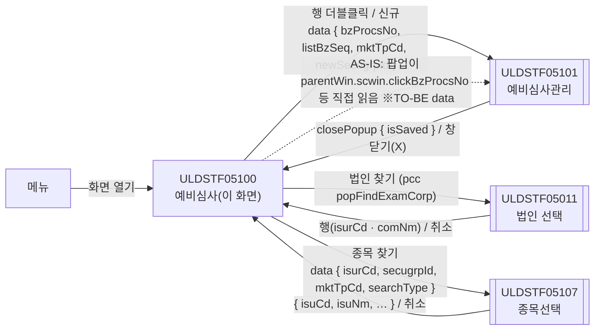
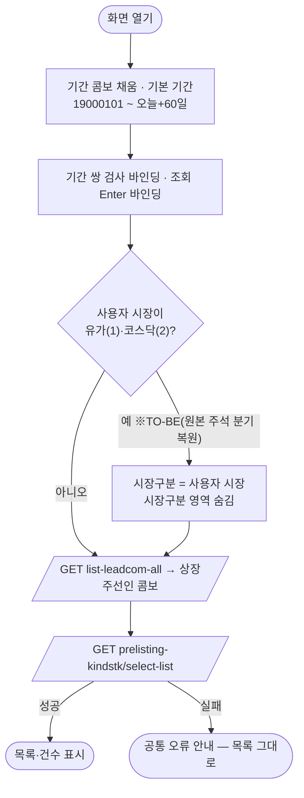
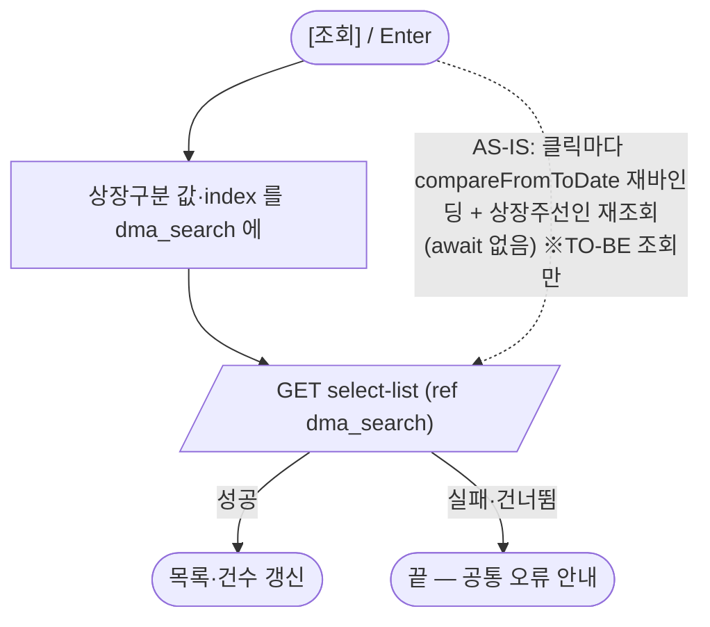
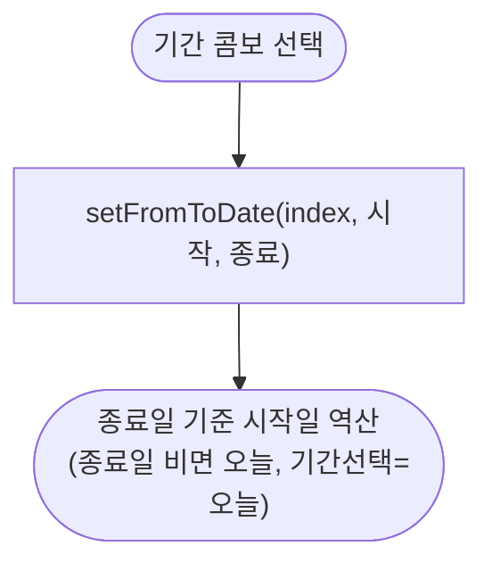
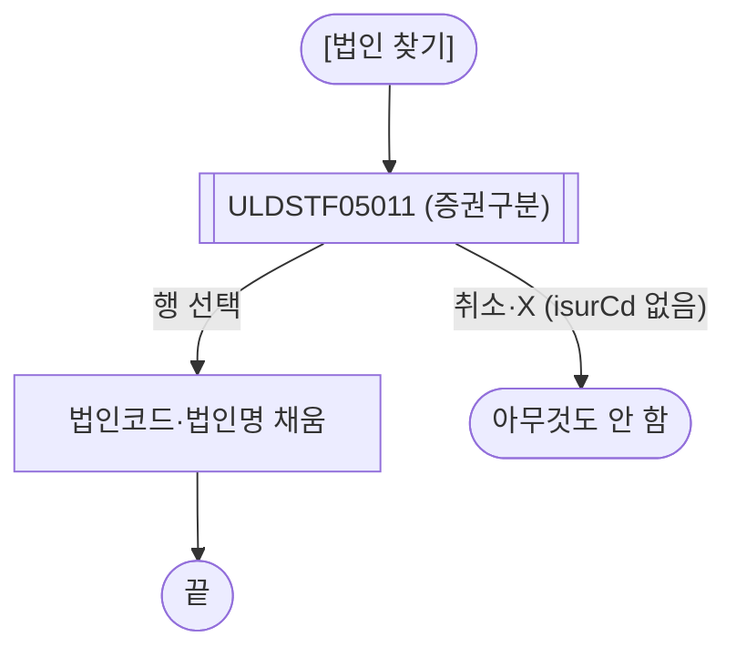
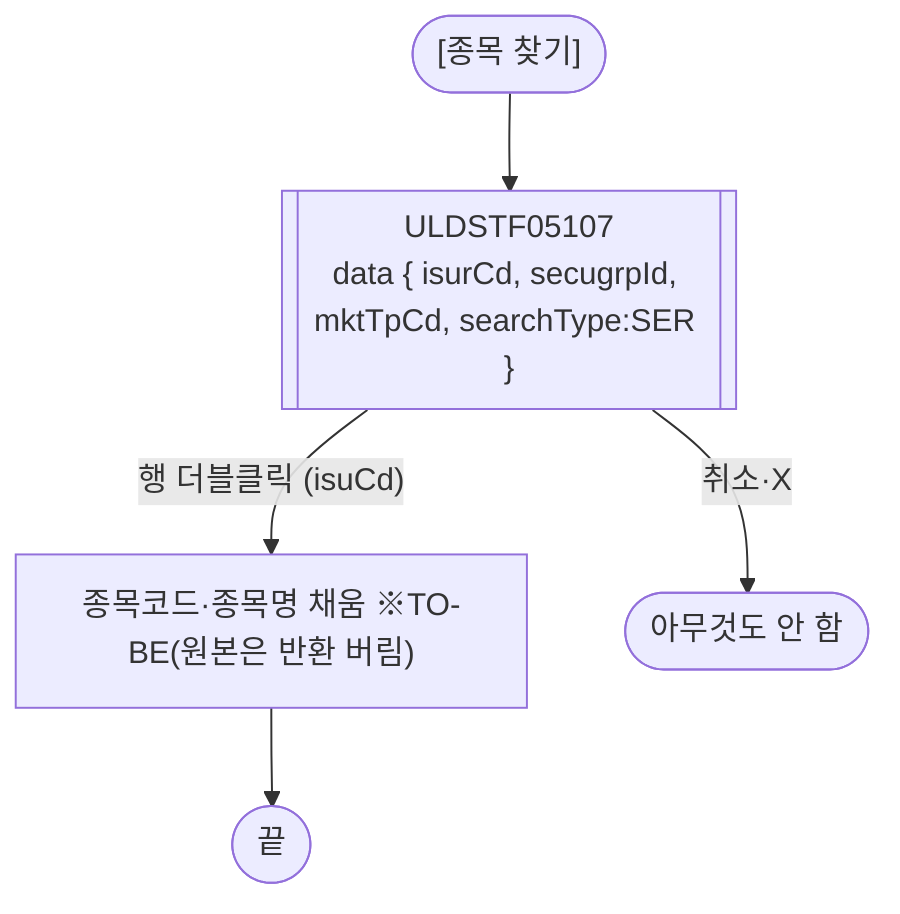
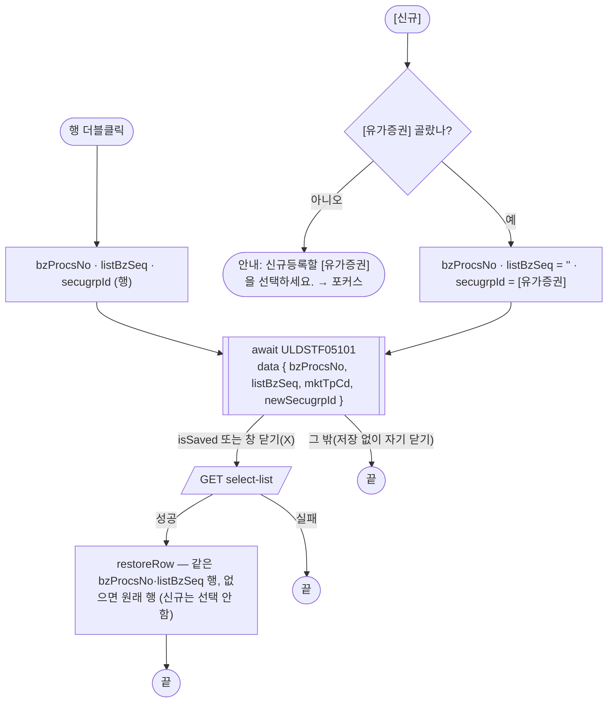
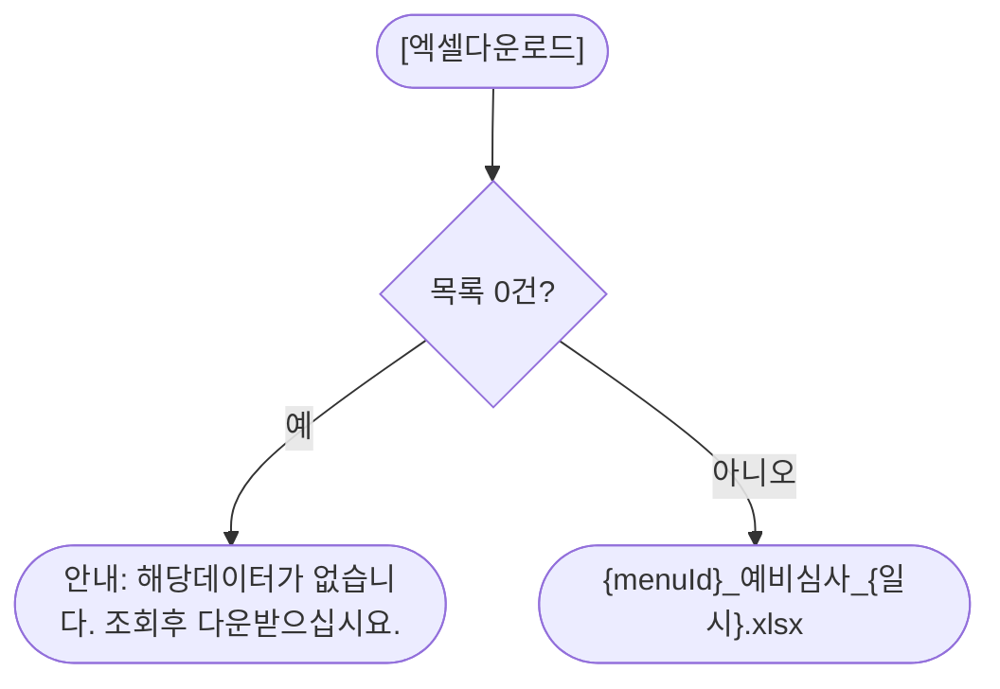

# ULDSTF05100 예비심사(종류주식) — 업무 분석 및 전환 내역

| 항목 | 내용 |
|---|---|
| AS-IS 원본 | `ULDSTF05100.xml` — W-Craft 1차 변환본(`meta_asisFileNm="ULDSTF05100.gfm"`, 원본 gfm 은 저장소에 없음)에 **API 적용까지 마친 개발 사본**. 업무 로직은 이 스크립트와 남은 옛 코드 주석(`$c.frame.CreateDialogFrame`·`js_market` 분기 등)으로 분석했다. **메뉴 본화면**(팝업 아님) |
| 신규 API 명세 | 없음 — **화면에 적용된 `/api/...` 경로·method·dataCollection keyInfo 를 명세로 간주**(사용자 결정 2026-10-29). 적용 API 2종: `GET /api/listing/lstproc/kind/prelisting-kindstk/select-list`(목록), `GET /api/listing/common/code/list-leadcom-all`(상장주선인 콤보). §5 는 「화면 적용 API ↔ AS-IS」 대응표. `api_spec_check` 는 SKIP(A07·A08 형식 검사만 통과) |
| 화면 캡처 | 없음 |
| 퍼블리싱 파일 | 화면 폴더 `ULDSTF05100.xml` 의 body(퍼블리싱 반영됨)를 1단계 기준으로 했다. publish 원본 `conversion/publish/상장/상장처리(대내)/ULDSTF05100.xml` 은 참고만 했다. 1단계는 선례 ULDBNS30400 처럼 「캡처 없음, 기존 마크업 정비」 — §2.1 |
| TO-BE | `conversion/conversion-front/ui-tobe/ULDSTF05100.xml` (배포 경로 `/ui/lst/kindstk/ULDSTF05100.xml` — 같은 묶음 원본 리터럴 `/ui/lst/kindstk/` 기준). **2026-10-29 재전환** — 1단계: 기존 마크업 정비(본화면 `sub_contents` + contentHeader, 조회조건 `schbox`, 목록 그리드 + 총건수·엑셀, 하단 [유가증권]·[신규] — [닫기] 없음), 2단계: 이 결과서대로 스크립트 재전환. 게이트: `gate_screen --pcc stf`, `scan_mixed_compare`(A 3 숫자 비교·B 0), `publish_gate --pcc stf --before {1단계 사본} --allow P20`, `api_spec_check`(SKIP), `init_binding_check`, `wsxml_lint` 0/0, `convert.py` 고정점 |
| 묶음 계약 | kindstk 13본 공통 계약서(잡 임시 `kindstk_contracts.md`) — 05101·05107 data/반환 키, 재조회 규약(`isSaved`), 공통 결정 §4. 이 화면은 **부모 쪽**이다 |
| 업무공통 | pcc(`cm/pcc/stf`): `$c.lc`(`popFindExamCorp`·`getSecuGrpNm`·`getGlbValue`·`initSearchDate`)·`$c.stf.setFromToDate`. gcc: `$c.data`(`comboCbDataSetPeriod`·`downloadGridViewExcel`)·`$c.date`(`compareFromToDate`·`dateFormat`·`getServerDateTime`)·`$c.session.getUserInfo`·`$c.util.isEmpty`·`$c.win`(`alert`·`openPopup`·`setEnterKeyEvent`·`getProgramId`)·`$c.sbm.executeDynamic`·`$c.exception.handleError` |
| 작성 | Inswave / 2026-10-29 |

참고 양식: [websquare_gfm_conversion.md](../../../../md/websquare_gfm_conversion.md) — §1.4 업무 프로세스 흐름, §6.5 getPar/setPar 전환. 같은 꼴의 메뉴 본화면 [ULDSTF05700.md](../ULDSTF05700/ULDSTF05700.md) 의 결정(조회 실패 처리·재조회·엑셀 파일명)을 따랐고, 짝 화면 [ULDSTF05102.md](../ULDSTF05102/ULDSTF05102.md)(상장심사)와 조회 영역·시장 사용자 처리를 맞췄다.

---

## 1. 화면 개요

상장 담당자가 **종류주식 예비심사** 건을 찾아보고 관리 팝업으로 들어가는 메뉴 본화면이다. 이 화면은 저장하지 않는다.

1. 조회조건(증권구분·청구접수일/상장일 기간·법인·상장구분·시장구분·종목·상장주선인)으로 예비심사 목록을 조회한다. 화면을 열면 기본 조건(1900-01-01 ~ 오늘+60일)으로 바로 조회한다.
2. 행을 **더블클릭**하면 그 건으로 **예비심사관리 팝업(ULDSTF05101)** 을 연다.
3. 하단 **[유가증권]** 에서 증권구분(주권·외국주권·주식예탁증권)을 고르고 **[신규]** 를 누르면 빈 예비심사관리 팝업을 연다.
4. 팝업이 저장하고 닫히거나 창 닫기(X)로 닫히면 목록을 다시 조회하고 연 행을 다시 선택한다.
5. [법인 찾기]·[종목 찾기]로 조회조건을 채우고, [엑셀다운로드]로 목록을 내려받는다.

### 1.1 호출 화면 (메뉴)

- 메뉴로 연다. 업무공통 메뉴→증권그룹 표(`cm/pcc/stf/list_common.xml`)에는 이 화면 항목이 없다 — 증권그룹은 화면 조회조건(`rdo_SECUGRP_ID`)으로 고른다.
- 저장소에서 이 화면을 여는 다른 화면은 없다.

### 1.2 호출 규약 (부모 → 이 화면) / 반환 규약

해당 없음 — 메뉴 본화면이라 받는 파라미터·반환값이 없다. 원본 [닫기](`btn_Close` → `$c.win.closePopup()`)는 본화면에서 쓸 수 없어 옮기지 않았다(§2.1, §8 #11).

### 1.3 이 화면이 여는 하위 팝업

| 팝업 | AS-IS 호출 (getPar/setPar · 부모 직접 참조) | 넘기는 `data` (TO-BE) | 받는 결과 / 취소 판정 |
|---|---|---|---|
| `ULDSTF05101` 종류주식 예비심사관리 (1400×1500, `frameModal:"top"`) | `fn_OpenDetail` → `$c.win.openPopup("/ui/lst/kindstk/ULDSTF05101.xml", opts)` — data 없이 열고, **팝업이 부모를 직접 읽었다**(`parentWin.scwin.clickBzProcsNo`·`clickListBzSeq`, `parentWin.rdo_SPOT_ISU_TRD_MKT_TP_CD`, `parentWin.cmb_NEW_SECUGRP_ID`). `opts.mktTpCd`(정의되지 않은 `scwin.mktTpCd`)는 옵션 자리에 잘못 둔 값 | `{ bzProcsNo, listBzSeq, mktTpCd, newSecugrpId }` — 계약 05101 절. 신규면 `bzProcsNo`·`listBzSeq` 는 `""` | `{ isSaved }`. **`isSaved === true` 또는 `isCloseButtonClick === true`(창 닫기 — 저장 여부 모름)이면 목록 재조회 + 행 복원**, 그 밖은 아무것도 안 함 — §6.2 |
| `ULDSTF05011` 법인 선택 (800×750, pcc) | `btn_CoCdSearch_onclick` → `$c.lc.popFindExamCorp(rdo_SECUGRP_ID)` (원본 Gauce 는 `fn_GetPar`/`fn_SetPar` — `arr[0..4]` 법인코드·법인명·증권구분·시장구분·`SEARCH_TYP_SER`) | `await $c.lc.popFindExamCorp(rdo_SECUGRP_ID.getValue())` — pcc 가 `{ secugrpId }` 로 연다 | 05011 목록 행(`getRowJSON`, camelCase `isurCd`·`comNm`…). **`isurCd` 가 비면 취소**(취소·X 는 `{ isCloseButtonClick }`) — §6.3 |
| `ULDSTF05107` 종류주식 예비심사 종목선택 (800×780, `pageFramePopup`) | `fn_PopFindKindStkExamIsu` → `openPopup(…, { secugrpId, mktTpCd, searchType:"SER" })`. 회사코드는 **팝업이 부모 `ibx_isurCd`·`txb_ISU_CD` 를 직접 읽음**(05100 에는 없어 오류). 반환값은 버림(TODO) | `{ isurCd, secugrpId, mktTpCd, searchType: $c.lc.getGlbValue("SEARCH_TYP_SER") }` — 계약 05107 절 | `{ isuCd, isuNm, isuEngNm, isurCd, bzProcsNo, dbClickYn }`. **`isuCd` 가 비면 취소**. 고르면 `txb_ISU_CD`·`txb_ISU_NM` 에 넣는다 — §6.4 |

### 1.4 업무 프로세스 흐름

흐름은 AS-IS(개발 사본) 동작 기준이다. 점선과 `※TO-BE` 는 전환본에서 바뀌는 곳이다(근거 §8).

| # | 업무 | 시작 (사용자 동작·진입 조건) | 끝 (결과) | 주요 함수 | 관련 절 |
|---|---|---|---|---|---|
| 1 | 진입·로딩 | 메뉴에서 화면 열기 | 기본 조건으로 목록 표시 | `scwin.onpageload` → `scwin.init` → `scwin.selectLeadcomList` → `scwin.selectList` | §3 |
| 2 | 조회 | [조회] / 조회 영역 Enter | 목록·건수 표시 | `scwin.btn_Search_onclick` → `scwin.selectList` | §5.2 |
| 3 | 기간선택 | 기간 콤보 선택 | 시작·종료일 채움 | `scwin.cmb_PeriodTp_onviewchange` | §4 |
| 4 | 법인 찾기 | [법인 찾기] | 법인코드·법인명 채움 / 취소 | `scwin.btn_CoCdSearch_onclick` → `scwin.openCorpPopup` | §6.3 |
| 5 | 종목 찾기 | [종목 찾기] | 종목코드·종목명 채움 / 취소 | `scwin.btn_ISU_CD_SEARCH_onclick` → `scwin.openIsuPopup` | §6.4 |
| 6 | 상세(관리) | 목록 행 더블클릭 | 05101 → (저장·X 닫기면) 재조회·행 복원 | `scwin.grd_List_oncelldblclick` → `scwin.openDetail` → `scwin.restoreRow` | §6.2 |
| 7 | 신규 | [유가증권] 선택 + [신규] | 05101(신규) → 재조회 / 증권구분 미선택 안내 | `scwin.btn_New_onclick` → `scwin.openNew` → `scwin.openDetail` | §6.1·§6.2 |
| 8 | 엑셀 | [엑셀다운로드] | 목록 xlsx / 0건 안내 | `scwin.btn_Excel_onclick` → `scwin.excelDown` | §6.5 |

#### 화면 간 흐름

#### 업무 1: 진입·로딩

| 단계 | 주체 | 동작 | 분기·예외 | 근거 |
|---|---|---|---|---|
| 1 | 화면 | `comboCbDataSetPeriod(cmb_PeriodTp)`·`initSearchDate(edt_SDate, edt_EDate)` | — | 원본 `gform_onload` |
| 2 | 화면 | `compareFromToDate`(규칙 37)·`setEnterKeyEvent(panel_Top)`(규칙 22) | — | §3 |
| 3 | 화면 | 시장 사용자 고정 | 유가·코스닥 사용자만 | §8 #6 |
| 4 | 서버 | 상장주선인 → 목록 순서로 `await` | 실패는 공통 안내 | §5 |

#### 업무 2: 조회

| 단계 | 주체 | 동작 | 분기·예외 | 근거 |
|---|---|---|---|---|
| 1 | 화면 | `listLmCd`·`listLmCdIdx` 를 `cmb_ListLMCd` 에서 꺼냄 | "전체"·"상장 - 전체" 같은 값 → index 로 구분 | §8 #3 |
| 2 | 서버 | `select-list` — 나머지 조건은 ref 바인딩 | 진행 중이면 `skipped` | §5.2 |
| 3 | 화면 | `spn_page` = 행 수 | — | — |

#### 업무 3: 기간선택

| 단계 | 주체 | 동작 | 분기·예외 | 근거 |
|---|---|---|---|---|
| 1 | 화면 | 콤보 index(0~6)를 숫자로 넘김 | 원본은 문자열 값 → 어느 기간에도 맞지 않음 | §8 #8 |

#### 업무 4: 법인 찾기

| 단계 | 주체 | 동작 | 분기·예외 | 근거 |
|---|---|---|---|---|
| 1 | 팝업 | pcc `popFindExamCorp(rdo_SECUGRP_ID)` | 취소는 `{ isCloseButtonClick }` | §6.3 |
| 2 | 화면 | `txb_ISUR_CD`·`txb_COM_NM` | `isurCd` 없으면 중단(원본은 undefined 대입) | §8 #15 |

#### 업무 5: 종목 찾기

| 단계 | 주체 | 동작 | 분기·예외 | 근거 |
|---|---|---|---|---|
| 1 | 팝업 | data 로 회사코드 전달 | 원본은 팝업이 부모 칸을 직접 읽어 오류 | §8 #4 |
| 2 | 화면 | `txb_ISU_CD`·`txb_ISU_NM` | `isuCd` 없으면 중단 | §8 #5 |

#### 업무 6: 상세(관리) · 업무 7: 신규

| 단계 | 주체 | 동작 | 분기·예외 | 근거 |
|---|---|---|---|---|
| 1 | 화면 | 신규는 [유가증권] 검사 | 비면 안내·포커스 | §6.1 |
| 2 | 팝업 | data 로 열고 `await` | 원본은 팝업이 부모 전역 직접 참조 | §6.2 |
| 3 | 화면 | 재조회 규약 | `isSaved`·`isCloseButtonClick` | 계약 공통 규칙 |
| 4 | 화면 | 행 복원 | 원본 팝업의 `parentWin.grd_*.setFocusedCell(rowPos)` 대체 | §6.2 |

#### 업무 8: 엑셀

| 단계 | 주체 | 동작 | 분기·예외 | 근거 |
|---|---|---|---|---|
| 1 | 화면 | 0건 검사 | 원본 `alert(...)` → `$c.win.alert` | §6.5 |
| 2 | 화면 | `downloadGridViewExcel(grd_List, { fileName })` | 파일명 규칙 42 | §6.5 |

---

## 2. 화면 구성 및 데이터 정의

### 2.1 화면 구성 (AS-IS 요소 → TO-BE 컴포넌트)

| 영역 | AS-IS 요소 | TO-BE | 비고 |
|---|---|---|---|
| 머리 | `pfmContentHeader` | 그대로 | 본화면 contentHeader 필수 |
| 조회조건 `panel_Top` (`schbox`) | `rdo_SECUGRP_ID`(전체 A1·주권 ST·외국주권 FS·주식예탁증권 DR), `label_5` | 그대로 + `ref dma_search.secugrpId` | 원본은 조회 때 값을 옮겨 넣음 |
| | `rdo_DateType`(청구접수일 2·상장일 1, th 안 라디오) | 그대로 + `ref dateType` | 원본 배치(머리 칸에서 기간 기준 선택) 유지 |
| | `edt_SDate` ~ `edt_EDate`(`label_3` "~"), `cmb_PeriodTp` | `flex flex_no` 묶음, `w2:span "~"`, 달력 `ref startDate/endDate`, 기간 콤보 `ev:onviewchange` | 원본 `ev:onchange` → onviewchange(사용자 변경만) |
| | `txb_ISUR_CD`(maxlength 5) · `txb_COM_NM`(읽기) · `btn_CoCdSearch`, `label_2` | 그대로 + `ref isurCd`, 버튼 `type="button"`·라벨 "법인 찾기" | `src="../img/…"` 등 W-Craft 속성 삭제 |
| | `cmb_ListLMCd`(상장구분 14항목), `label_12` | 그대로, **ref 없음** | "전체"·"상장 - 전체" 두 항목이 같은 값("") — ref 로 묶으면 값 동기화 때 첫 항목으로 돌아갈 수 있어 조회 때 값·index 를 꺼낸다(§8 #3) |
| | `panel_mkt_gubun` 안 `rdo_SPOT_ISU_TRD_MKT_TP_CD`(전체 A·유가 1·코스닥 2), `label_10` | `td.in_tbl` colspan 2 안 표 그대로, `ref spotIsuTrdMktTpCd` | 시장 사용자면 숨김(§3) |
| | `txb_ISU_CD`(maxlength 5) · `txb_ISU_NM` · `btn_ISU_CD_SEARCH`, `label_1` | 그대로 + `ref isuCd`, 종목명 maxlength 5 삭제 | 종목코드 maxlength 5 는 유지(§10 #4) |
| | `cmb_LeadcomMbrNo`(chooseOption "전체"), `label_4`, 빈 th/td | `ref leadcomMbrNo` + `itemset nodeset="data:dlt_codeSelectBox"`(label `text`·value `value`), 빈 칸 대신 colspan 3 | 원본 스크립트 `setNodeSet` → 마크업 itemset |
| | `btn_Search` | `btn_schbox` 안 `btn_cm sch` | — |
| 목록 제목줄 | `spn_page`(총 n 건), `btn_Excel` | `titbox > rt` 그대로 | — |
| 목록 | `grd_List`(`dlt_List`, 고정 3열, `row20`) | `readOnly="true"`·`focusMode="row"`·`rowNumWidth="40"`, caption "예비심사 목록", 머리글 id `h_{gBody id}`, 빈 `column1`/`column2` 열 삭제 | 열 결함·형식은 §2.2 |
| 목록 머리글 | 원본 머리글 id(대문자 스네이크) `h_SECUGRP_NM`·`h_ISUR_CD`·`h_COM_NM`·`h_INVSTG_BILL_ACPT_DD`·`h_LIST_DD`·`h_LIST_DELIB_SCHDL_DD`·`h_ISU_CD`·`h_ISU_NM`·`h_FST_EXAMPRN_EMP_NM`·`h_INVSTG_PROG_STAT_NM`·`h_BFRELIST_CORP_NM`·`h_LEADCOM_MBR_NM_STR`·`h_EXT_AUDTR_NM`·`h_LGSHRHD_NM`·`h_LGSHRHD_RTO`·`h_LIST_COMITE_DD`·`h_INVSTG_COMPLT_DD`·`h_SECU_STAT_SUBMIT_DD`·`h_SECU_STAT_EFCT_OCCR_DD`·`h_PARVAL`·`h_LIST_SHRS`·`h_TRANSSTK_AGNT_NM`·`h_APPL_COM_CHRG_NM`·`h_APPL_COM_CHRG_TEL_NO`·`h_CEO_NM`·`h_FOUND_DD`·`h_ASSO_REG_DD`·`h_ACNTCLS_MMDD1`·`h_ADDR`·`h_STD_IND_NM`·`h_MAINTR_BK_NM`·`h_HDCOM_YN`·`h_LEADCOM_CHRG_NM`·`h_REP_MAJAGNT_COM_TEL_NO`·`h_PERSHR_PUBPRC_LWLMT_AMT`·`h_PERSHR_PUBPRC_UPLMT_AMT`·`h_LWLMT_PUBOFR_SCHDL_TOTAMT`·`h_UPLMT_PUBOFR_SCHDL_TOTAMT`·`h_PUBOFR_SHRS`·`h_PUBOFR_PRC`·`h_PUBOFR_COMPTE_RT`·`h_FST_BAS_PRC`·`h_LISTDD_CLSPRC`·`h_TOT_ASST_AMT`·`h_TOT_CAP`·`h_CAP`·`h_SALES`·`h_BZ_PROFT_AMT`·`h_ORDNINCM_AMT`·`h_NETINCM_AMT`·`h_EXAMPRN_EMP_NM`·`h_CNTR_ISO_NM`·`h_LIST_FORN_EXCH_NM1`·`h_LIST_FORN_EXCH_LIST_DD1`·`h_LIST_FORN_EXCH_NM2`·`h_LIST_FORN_EXCH_LIST_DD2`·`h_PER1DR_FORNSTK_RTO`·`h_BZ_PROCS_NO`·`h_ACCTP_YN`·`h_CASH_DIV_YN`·`h_CMSTK_PCT1_DIV_YN`·`h_COM_CASH_REDMPT_YN`·`h_COM_CONV_OBJ_STK_CONTN`·`h_COM_CONV_PD_END_DD`·`h_COM_CONV_PD_STRT_DD`·`h_COM_CONV_RGHT_YN`·`h_COM_CONV_RTO`·`h_COM_REDMPT_PD_END_DD`·`h_COM_REDMPT_PD_STRT_DD`·`h_COM_REDMPT_RGHT_YN`·`h_CONTIN_DEADLINE_END_DD`·`h_CONTIN_DEADLINE_STRT_DD`·`h_CONV_YN`·`h_DIV_RT`·`h_LWST_DIV_RT_DSC_YN`·`h_MISC_DIV_YN`·`h_NDIVTM_VOTERGHT_YN`·`h_PARTCTP_YN`·`h_PROFT_DIV_YN`·`h_REDMPT_YN`·`h_REMAIN_PROPRT_DISTR_YN`·`h_SHRHD_CASH_REDMPT_YN`·`h_SHRHD_CONV_PD_END_DD`·`h_SHRHD_CONV_PD_STRT_DD`·`h_SHRHD_CONV_RGHT_YN`·`h_SHRHD_CONV_RTO`·`h_SHRHD_REDMPT_PD_END_DD`·`h_SHRHD_REDMPT_PD_STRT_DD`·`h_SHRHD_REDMPT_RGHT_YN`·`h_VOTERGHT_EXCLD_YN`·`h_VOTERGHT_LMT_YN`·`h_LIST_BZ_SEQ`, 구조 id `caption1`·`header1`·`gBody1`, 빈 머리글 `column1` | `h_{gBody id}`(camelCase, 예 `h_ACCTP_YN`→`h_acctpYn`), 구조 id 그대로(`row1`·`row2` 추가) | 머리글 id 를 열 키와 맞춘 것뿐 — 표시 라벨은 원본 그대로 |
| 하단 `btnbox` | `label_6` "유가증권" · `cmb_NEW_SECUGRP_ID`(선택하세요·ST·FS·DR) · `btn_New` · `btn_Close` | `rt` 안 [유가증권] 콤보 + `btn_New`(`btn_cm pt`) | **`btn_Close`(옮기지 않음)** — 본화면 닫기는 창 탭으로(§8 #11). 규칙 41: 신규 pt 오른쪽 |

### 2.2 데이터 정의 (DataCollection)

| AS-IS | TO-BE | 종류 | 키 | 비고 |
|---|---|---|---|---|
| `dma_search` | `dma_search` | dataMap | `spotIsuTrdMktTpCd`·`secugrpId`·`isurCd`·`isuCd`·`leadcomMbrNo`·`listLmCdIdx`·`listLmCd`·`dateType`·`startDate`·`endDate` | select-list 요청(원본 keyInfo 그대로). `listLmCd`·`listLmCdIdx` 만 스크립트가 넣고 나머지는 ref 바인딩 |
| `dlt_List` | `dlt_List` | dataList | 아래 전체 | select-list 응답(원본 columnInfo 그대로 — 명세 대용) |
| `dlt_codeSelectBox` | `dlt_codeSelectBox` | dataList | `value`·`text` | list-leadcom-all 응답 — 상장주선인 콤보 itemset |

- 조회조건 표는 `colgroup` 6칸(`table` 태그 그룹) — 각 행 칸 수를 colspan 포함 6칸으로 맞췄다(P01). 조회 종료일 키 명칭 「종료일자 (20260929)」·시작일 「시작일자(19000101)」 는 원본 keyInfo 의 예시값 표기 그대로 둔다.
- `dlt_List` 키(원본 순, 147개): `bzProcsNo`·`listDd`·`listNo`·`examprnEmpNo`·`examprnEmpNm`·`invstgProgStatCd`·`invstgProgStatNm`·`lgshrhdNm`·`invstgBillAcptDd`·`listComiteDd`·`invstgCompltDd`·`secuStatEfctOccrDd`·`listSchdlDd`·`transstkAgntCd`·`transstkAgntNm`·`applComChrgNm`·`applComChrgTelNo`·`ceoNm`·`foundDd`·`assoRegDd`·`acntclsMmdd1`·`acntclsMmdd2`·`acntclsMmdd3`·`acntclsMmdd4`·`addr`·`stdIndCd`·`stdIndNm`·`maintrBkCd`·`maintrBkNm`·`extAudtrCd`·`extAudtrNm`·`leadcomChrgNm`·`repMajagntComTelNo`·`dirctlistCorpYn`·`smeYn`·`ventbzYn`·`hdcomYn`·`asstvalAmt`·`earngvalAmt`·`intrvalAmt`·`relvalAmt`·`pershrPubprcLwlmtAmt`·`pershrPubprcUplmtAmt`·`lwlmtPubofrSchdlTotamt`·`uplmtPubofrSchdlTotamt`·`dfcAvgPrc`·`pubofrShrs`·`pubofrPrc`·`pubofrCompteRt`·`fstBasPrc`·`listShrs`·`parval`·`totAsstAmt`·`totCap`·`sales`·`bzProftAmt`·`ordnincmAmt`·`netincmAmt`·`condListYn`·`condListRsnContn`·`listddClsprc`·`secuStatSubmitDd`·`cap`·`invstgWrtrptSaveYn`·`bfrelistCorpNm`·`exstStrtDd`·`exstEndDd`·`lgshrhdRto`·`fstExamprnEmpNm`·`fstExamprnEmpNo`·`listFornExchNm1`·`listFornExchNm2`·`listFornExchListDd1`·`listFornExchListDd2`·`fornstkYn`·`per1drFornstkRto`·`cntrIsoCd`·`cntrIsoNm`·`currIsoCd`·`isurCd`·`secugrpId`·`secugrpNm`·`comNm`·`comEngNm`·`invstgAcptRegDd`·`kisComCd`·`webDpYn`·`webNopnYn`·`repTelNo`·`majProdNm`·`subsStrtDd`·`subsEndDd`·`dfcDd`·`empCnt`·`listDelibSchdlDd`·`listDelibSchdlNotiDd`·`leadcomMbrNoStr`·`leadcomMbrNmStr`·`nparvalstkYn`·`proftDivYn`·`cmstkPct1DivYn`·`lwstDivRtDscYn`·`miscDivYn`·`cashDivYn`·`partctpYn`·`divRt`·`acctpYn`·`ndivtmVoterghtYn`·`proftDivRemk`·`remainProprtDistrYn`·`remainProprtDistrRemk`·`voterghtExcldYn`·`voterghtExcldRemk`·`voterghtLmtYn`·`voterghtLmtContn`·`voterghtLmtRemk`·`redmptYn`·`comRedmptRghtYn`·`comRedmptPdEndDd`·`comRedmptPdStrtDd`·`comCashRedmptYn`·`comRedmptRemk`·`shrhdRedmptRghtYn`·`shrhdRedmptPdEndDd`·`shrhdRedmptPdStrtDd`·`shrhdCashRedmptYn`·`shrhdRedmptRemk`·`convYn`·`comConvRghtYn`·`comConvRto`·`comConvObjStkContn`·`comConvPdStrtDd`·`comConvPdEndDd`·`comConvRemk`·`shrhdConvRghtYn`·`shrhdConvRto`·`shrhdConvObjStkContn`·`shrhdConvPdStrtDd`·`shrhdConvPdEndDd`·`shrhdConvRemk`·`continDeadlineEndDd`·`continDeadlineStrtDd`·`listBzSeq`·`isuCd`·`isuNm`·`per1stkCap`·`listInvstgSchdlDd`
- 그리드 표시 열(원본 머리글 순, 92열)은 `dlt_List` 키를 그대로 쓴다. 정리한 것:
  - **gBody id 결함 고침**(§8 #12): `PARTCTP_YN`→`partctpYn`, `REMAIN_PROPRT_DISTR_YN`→`remainProprtDistrYn`, `VOTERGHT_EXCLD_YN`→`voterghtExcldYn`(의결권 배제여부), 원본 「의결권 제한여부」 열의 `voterghtExcldYn`→`voterghtLmtYn`, `LIST_BZ_SEQ`→`listBzSeq`. 원본은 대문자 id 라 값이 비어 보였다.
  - **날짜(규칙 46)** `dataType="date" displayFormat="yyyy-MM-dd"`:
    - AS-IS 마스크(`XXXX-XX-XX`) 열 — `listDd`·`listDelibSchdlDd`·`listComiteDd`·`invstgCompltDd`·`secuStatSubmitDd`·`secuStatEfctOccrDd`·`foundDd`·`assoRegDd`·`listFornExchListDd1`·`listFornExchListDd2`. 원본 `displayFormat="####-##-##"`(자릿수 마스크) 또는 형식 없음 → 이 형태로 정정.
    - 확장 대상(id `…Dd` + 명칭 `…일자`) — `comConvPdStrtDd`·`comConvPdEndDd`·`comRedmptPdStrtDd`·`comRedmptPdEndDd`·`shrhdConvPdStrtDd`·`shrhdConvPdEndDd`·`shrhdRedmptPdStrtDd`·`shrhdRedmptPdEndDd`·`continDeadlineStrtDd`·`continDeadlineEndDd`. **AS-IS 원시 표시 → TO-BE 날짜 형식(규칙 46)**, 서버 값이 8자리인지 §10 #5.
    - `invstgBillAcptDd`(청구서접수일) 는 원본 마스크 열이지만 **8자리 날짜와 14자리 일시가 섞여 오는 열**이라 개발 사본의 `customFormatter` 를 유지·정리했다(`scwin.fmtInvstgBillAcptDd` — 8자리 날짜, 14자리 이상 일시, 그 밖은 원값; 규칙 43 순수 데이터 반환). 규칙 46 「길이 섞인 열」 조항 — 서버 형식 통일 여부 §10 #5.
  - **숫자** — 원본 `decao:N` → `#,##0.` + N자리(`lgshrhdRto`·`pubofrCompteRt`·`per1drFornstkRto` 6자리, `parval` 3자리), 원본 `#,###` 열과 `listShrs` 는 `#,###`, 모두 오른쪽 정렬. `lgshrhdRto` 의 `textAlign="rigth"` 오타 정정.
  - `…Yn` 열은 가운데, 이름·주소·내용 열은 왼쪽 정렬로 맞췄다(원본은 오른쪽 정렬이 섞임).
  - 머리글 ` ` → ` `.

---

## 3. 로딩 (`scwin.onpageload` → `scwin.init`)

`scwin.onpageload` 는 `scwin.init()` 호출만 갖는다(try/catch → `$c.exception.handleError`). 원본 `gform_onload` 의 로직을 `scwin.init` 하나로 옮겼다.

| 순서 | 동작 | await | 근거 |
|---|---|---|---|
| 1 | `$c.data.comboCbDataSetPeriod(cmb_PeriodTp)` — 기간선택(0)·1주일(1)…2년(6) | — | 원본 |
| 2 | `$c.lc.initSearchDate(edt_SDate, edt_EDate)` — 시작 `19000101`, 종료 오늘+60일 | — | 원본이 직접 하던 값과 같음 |
| 3 | `$c.date.compareFromToDate(edt_SDate, edt_EDate, ["조회 시작일", "조회 종료일"])` — 기간 쌍(규칙 37, 쌍에는 이것만) | — | 원본은 [조회] 클릭마다 호출(§8 #7) |
| 4 | `$c.win.setEnterKeyEvent(panel_Top, scwin.btn_Search_onclick)` (규칙 22) | — | 신규 |
| 5 | 사용자 시장(`$c.session.getUserInfo("market")`)이 1·2 면 `rdo_SPOT_ISU_TRD_MKT_TP_CD` 를 그 값으로, `panel_mkt_gubun.hide()` | — | 원본 주석 `js_market` 분기 복원(§8 #6). 이 그리드에는 시장 열이 없어 열 숨김은 없다 |
| 6 | `await scwin.selectLeadcomList()` → `await scwin.selectList()` | 예 — 콤보를 채운 뒤 조회(원본 순서) | §5 |

---

## 4. 컴포넌트 이벤트

| AS-IS 바인딩 | TO-BE 핸들러 | 동작 |
|---|---|---|
| body `ev:onpageload` | `scwin.onpageload` | §3 |
| body `ev:onpageunload` → `scwin.onpageunload`(빈 함수) | (삭제) | 할 일 없음 |
| `btn_Search` onclick → `scwin.btn_Search_onclick` | `scwin.btn_Search_onclick` | `scwin.selectList` (§8 #7) |
| `btn_CoCdSearch` onclick | `scwin.btn_CoCdSearch_onclick` | `scwin.openCorpPopup` |
| `txb_ISUR_CD` onblur | `scwin.txb_ISUR_CD_onblur` | 법인코드가 비면 법인명 비움(원본 그대로) |
| `btn_ISU_CD_SEARCH` onclick | `scwin.btn_ISU_CD_SEARCH_onclick` | `scwin.openIsuPopup` |
| `cmb_PeriodTp` onchange → `scwin.cmb_PeriodTp_OnSelChange` | `scwin.cmb_PeriodTp_onviewchange` | `$c.stf.setFromToDate(cmb_PeriodTp.getSelectedIndex(), edt_SDate, edt_EDate)` (§8 #8) |
| `grd_List` oncelldblclick → `scwin.grd_List_oncelldblclick` | `scwin.grd_List_oncelldblclick` | `scwin.openDetail(rowIndex)` |
| `scwin.grd_List_OnDblClick`(빈 함수, 바인딩 없음) | (삭제) | — |
| `btn_Excel` onclick | `scwin.btn_Excel_onclick` | `scwin.excelDown` |
| `btn_New` onclick | `scwin.btn_New_onclick` | `scwin.openNew` |
| `btn_Close` onclick → `scwin.btn_Close_onclick` | (삭제) | 본화면 — §8 #11 |
| `grd_List.invstgBillAcptDd` customFormatter → `scwin.invstgBillAcptDd_customFormatter` | `scwin.fmtInvstgBillAcptDd` | §2.2 |

---

## 5. 서버 통신

화면에 적용된 API 를 명세로 본다(머리 표). AS-IS(Gauce) 의 옛 호출은 데이터셋 `dts_List`(핸들러 이름 `dts_List_OnLoadError`·`dts_List_OnLoadCompleted` 로 남음)와 상장주선인 코드 조회였다.

| 화면 적용 API | method | 요청 | 응답 target | AS-IS | TO-BE 함수 |
|---|---|---|---|---|---|
| `/api/listing/common/code/list-leadcom-all` | GET | 없음 | `dlt_codeSelectBox=body` | `fn_set_code` | `scwin.selectLeadcomList` (§5.1) |
| `/api/listing/lstproc/kind/prelisting-kindstk/select-list` | GET | `ref: dma_search` | `dlt_List=body`, `gridview: grd_List` | `fn_list_sync`(옛 `dts_List`) | `scwin.selectList` (§5.2) |

### 5.1 상장주선인 콤보 조회 (`scwin.selectLeadcomList`)

- `executeDynamic({ id:"sbm_listLeadcomAll", method:"get", action:"/api/listing/common/code/list-leadcom-all", target:"dlt_codeSelectBox=body", isProcessMsg:false })`.
- 콤보는 마크업 itemset 으로 묶여 있어 데이터만 받으면 된다(원본 `cmb_LeadcomMbrNo.setNodeSet(...)` 삭제).
- `skipped` 면 `false`, 성공 여부 반환. 실패 안내는 공통 오류 핸들러.
- 중복 실행: 로딩 때 1회(원본은 [조회]마다 다시 불렀다 — §8 #7).

### 5.2 예비심사 목록 조회 (`scwin.selectList`)

- 요청 전 `dma_search.set("listLmCd", cmb_ListLMCd.getValue())`, `dma_search.set("listLmCdIdx", String(cmb_ListLMCd.getSelectedIndex()))`. 나머지 키는 ref 바인딩(원본은 컴포넌트 값을 하나씩 `set`).
- `executeDynamic({ id:"sbm_selectList", method:"get", action:".../select-list", ref:"dma_search", target:"dlt_List=body", gridview:"grd_List", isProcessMsg:false })` — 원본 id `sbm_commitments` 를 용도대로 고쳤다. `gridview` 는 id 만(규칙 44).
- 후처리: `spn_page.setValue(dlt_List.getRowCount())`. `skipped`·실패면 `false`(목록 그대로, 공통 안내).
- 원본 `grd_List.getTotalRow()` → `dlt_List.getRowCount()`.

---

## 6. 일반 함수

### 6.1 신규 (`scwin.openNew`)

- `cmb_NEW_SECUGRP_ID` 가 비면 `"신규등록할 [유가증권]을 선택하세요."` 안내 후 포커스, 멈춤(원본 `btn_New_onclick`).
- 고르면 `scwin.openDetail(-1)`(원본 `fn_OpenDetail(-999)`).

### 6.2 예비심사관리 팝업 (`scwin.openDetail` · `scwin.restoreRow`) — getPar/부모 직접 참조 → `openPopup` data + `await`

- 행이면 `bzProcsNo`·`listBzSeq`·`secugrpId` 를 행에서, 신규면 `""`·`""`·`cmb_NEW_SECUGRP_ID`.
- data(계약 05101 절):

  | TO-BE 키 | 값 | AS-IS |
  |---|---|---|
  | `bzProcsNo` | 행 `bzProcsNo` / 신규 "" | `scwin.clickBzProcsNo`(`fn_setBzProcsNo`) — 팝업이 `parentWin.scwin.clickBzProcsNo` 로 읽음 |
  | `listBzSeq` | 행 `listBzSeq` / 신규 "" | `scwin.clickListBzSeq`(`fn_setListBzSeq`) |
  | `mktTpCd` | `rdo_SPOT_ISU_TRD_MKT_TP_CD.getValue()` | 팝업이 `parentWin.rdo_SPOT_ISU_TRD_MKT_TP_CD` 직접. 원본 `opts.mktTpCd: scwin.mktTpCd`(미정의) 는 결함(§8 #9) |
  | `newSecugrpId` | `cmb_NEW_SECUGRP_ID.getValue()` | 팝업이 `parentWin.cmb_NEW_SECUGRP_ID` 직접 |

- `await $c.win.openPopup("/ui/lst/kindstk/ULDSTF05101.xml", { id:"ULDSTF05101", popupName: getSecuGrpNm(secugrpId) + " 종류주식 예비심사관리", width:1400, height:1500, frameModal:"top" }, data)`.
- 반환이 `isSaved === true` 또는 `isCloseButtonClick === true` 면 `scwin.selectList()` 후 `scwin.restoreRow(bzProcsNo, listBzSeq, rowIndex)`. 그 밖(팝업이 저장 없이 자기 닫기)은 아무것도 안 한다.
- `scwin.restoreRow`: 신규(-1)·0건이면 선택 안 함. 같은 `bzProcsNo`·`listBzSeq` 행을 찾고, 없으면 원래 행 번호(범위 안일 때)로 `grd_List.setFocusedCell(row, 0)`. 원본은 팝업이 `parentWin.grd_*.setFocusedCell(rowPos)` 로 했다(계약 「행 포커스 복원은 부모가」).

### 6.3 법인 찾기 (`scwin.openCorpPopup`)

- `const res = await $c.lc.popFindExamCorp(rdo_SECUGRP_ID.getValue())` → `isEmpty(res?.isurCd)` 면 멈춤, 아니면 `txb_ISUR_CD`·`txb_COM_NM`.
- 원본 Gauce `fn_GetPar`(arr 0~4: 법인코드·법인명·증권구분·시장구분·`SEARCH_TYP_SER`)/`fn_SetPar`(`arrPar[0].ISUR_CD`·`COM_NM`) 는 pcc 로 대체 — 시장구분·조회유형은 pcc 계약에 없어 넘기지 않는다(§10 #3).

### 6.4 종목 찾기 (`scwin.openIsuPopup`)

- data `{ isurCd: txb_ISUR_CD, secugrpId: rdo_SECUGRP_ID, mktTpCd: rdo_SPOT_ISU_TRD_MKT_TP_CD, searchType: $c.lc.getGlbValue("SEARCH_TYP_SER") }` (원본 리터럴 `"SER"` → 상수).
- `await openPopup("/ui/lst/kindstk/ULDSTF05107.xml", { id:"ULDSTF05107", popupName:"종류주식 예비심사 종목 선택", width:800, height:780, frameModal:"top", type:"pageFramePopup" }, data)`.
- `isEmpty(res?.isuCd)` 면 멈춤, 아니면 `txb_ISU_CD`·`txb_ISU_NM`(원본 `fn_SetParForIsuCd` 의 `ISU_CD`·`ISU_NM` → camelCase).
- 원본 `fn_GetParForIsuCd`(`arr[0..4]` 종목코드·종목명·증권구분·시장구분·"SER", `return` 뒤 죽은 코드)는 계약 data 로 대체.

### 6.5 엑셀 (`scwin.excelDown`)

- 0건이면 `"해당데이터가 없습니다. 조회후 다운받으십시요."`(원본 `alert` → `await $c.win.alert`).
- `$c.data.downloadGridViewExcel(grd_List, { fileName: $c.win.getProgramId() + "_예비심사_" + 서버일시 + ".xlsx", sheetName: "sheet1" })` — 규칙 42(원본은 fileName 없이 공통 기본값).

### 6.6 청구서접수일 표시 (`scwin.fmtInvstgBillAcptDd`)

- §2.2. 원본 `invstgBillAcptDd_customFormatter` 는 `data.length != 8` 이면 일시로 형식화해 빈 값·짧은 값도 일시 형식으로 넘겼다 → 8자리·14자리 이상만 형식, 그 밖은 원값.

---

## 7. 업무 코드 · 메시지 목록

| 구분 | 값 |
|---|---|
| 증권구분 `secugrpId` | `A1` 전체 · `ST` 주권 · `FS` 외국주권 · `DR` 주식예탁증권 (신규 [유가증권]은 ST·FS·DR) |
| 시장구분 `spotIsuTrdMktTpCd` | `A` 전체 · `1` 유가 · `2` 코스닥. 사용자 시장 1·2 면 고정 |
| 기간 기준 `dateType` | `2` 청구접수일 · `1` 상장일 |
| 상장구분 `listLmCd` (index) | (0)"" 전체 · (1)`01` 심사진행 · (2)`02` 심사완료 · (3)`03` 심사완료(6개월경과등) · (4)`04` 심사연기 · (5)`05` 심사철회 · (6)`06` 심사기각 · (7)"" 상장 - 전체 · (8)`1` 신규상장 - 전체 · (9)`10` 신규상장 - 비상장 · (10)`11` 신규상장 - 코스닥법인 · (11)`21` 재상장 - 분할 · (12)`22` 재상장 - 폐지 · (13)`23` 재상장 - 합병 |
| 기간선택 | 0 기간선택(=오늘) · 1 1주일 · 2 1개월 · 3 3개월 · 4 6개월 · 5 1년 · 6 2년 |
| 조회유형 | `SEARCH_TYP_SER` = "SER" (유가예비심사등록조회) |
| 메시지 | "신규등록할 [유가증권]을 선택하세요." · "해당데이터가 없습니다. 조회후 다운받으십시요." |

---

## 8. 원본 특이사항 · 결함

| # | 내용 | 결정 |
|---|---|---|
| 1 | `scwin.vScrenID = "ULDSTF05002.xml"` — 다른 화면 ID 이고 쓰는 곳도 없다. `scwin.arrPar` 도 `fn_GetPar` 전용 | 옮기지 않음 |
| 2 | `scwin.fn_getBzProcsNo` 가 **두 번 정의**되고 뒤의 것이 `clickListBzSeq` 를 돌려준다. `fn_setBzProcsNo`·`fn_setListBzSeq` 와 함께 팝업이 부모에서 읽던 값 | 옮기지 않음 — data 로 대체(§6.2) |
| 3 | `listLmCdIdx`(키 명칭 「상장구분코드 index값」)에 **상장주선인** 콤보 index(`cmb_LeadcomMbrNo.getSelectedIndex()`)를 넣었다. 상장구분은 "전체"·"상장 - 전체" 가 같은 값이라 index 가 필요하다 | 고침 — `cmb_ListLMCd` index |
| 4 | 05107 이 회사코드를 부모 `ibx_isurCd ?? txb_ISU_CD` 로 읽는데 05100 에는 둘 다 없어 `tr_Isur_Cd` ReferenceError | 고침 — data `isurCd`(계약) |
| 5 | 05107 반환을 버렸다(`//TODO`) — 종목 찾기가 아무것도 채우지 않음 | 고침 — `txb_ISU_CD`·`txb_ISU_NM` |
| 6 | 시장 사용자 분기(`js_market` → 시장 열 숨김·시장 고정·시장구분 숨김)가 주석 처리돼 동작하지 않음 | 고침 — 짝 화면 05102 와 같게 세션 시장으로 복원(이 그리드엔 시장 열이 없음). §10 #6 확인 |
| 7 | [조회]가 `compareFromToDate`(바인딩 함수)를 검사처럼 매번 부르고, 상장주선인을 다시 조회하며, 둘 다 `await` 하지 않았다 | 고침 — 바인딩은 init 1회, [조회]는 목록만 |
| 8 | 기간선택이 콤보 값(문자열)을 `setFromToDate` 에 넘김 — 공통 함수는 숫자 `===` 비교라 어느 기간에도 맞지 않는다 | 고침 — `getSelectedIndex()`(index = 값) |
| 9 | 05101 을 열 때 `opts.mktTpCd: scwin.mktTpCd`(정의되지 않음)를 옵션 자리에 둠. 높이 분기(`hight`·`yPoint`)는 쓰지 않는 변수 | 고침 — data `mktTpCd` = 시장구분 라디오, 크기는 계약 1400×1500 |
| 10 | `dts_List_OnLoadError`(전역 `alert_error`)·`dts_List_OnLoadCompleted`(`FillGridHeaderTotalCnt`·`CloseWin`) — 바인딩 없는 잔재, 함수도 정의돼 있지 않다 | 옮기지 않음 — 실패는 `$c.sbm` 공통 안내 |
| 11 | 본화면 하단 [닫기] `btn_Close` → `$c.win.closePopup()` | 옮기지 않음 |
| 12 | 그리드 gBody id: `PARTCTP_YN`·`REMAIN_PROPRT_DISTR_YN`·`VOTERGHT_EXCLD_YN`·`LIST_BZ_SEQ` 대문자(값 안 나옴), 「의결권 제한여부」 열에 `voterghtExcldYn`(배제) 중복 바인딩 | 고침(§2.2) |
| 13 | `txb_ISU_NM`(종목명) `maxlength="5"` | 고침 — 삭제. `txb_ISU_CD` 의 5 는 유지(§10 #4) |
| 14 | `fn_GetParForIsuCd` 의 `return` 뒤 죽은 코드(`arrPar, length;`) | 옮기지 않음 |
| 15 | 법인 찾기 `if (res)` — 취소·X 의 `{ isCloseButtonClick }` 도 참이라 `undefined` 를 넣는다 | 고침 — `isurCd` 판정 |
| 16 | `lgshrhdRto` `textAlign="rigth"` 오타, 숫자 열 형식 없음, 날짜 열 `####-##-##` | 고침(§2.2) |
| 17 | `scwin.gform_onload` 이름의 로딩 함수(`onpageload` 가 호출) | 고침 — `scwin.init` |

---

## 9. 전환 내역 (AS-IS → TO-BE)

| AS-IS | TO-BE |
|---|---|
| `scwin.onpageload` → `scwin.gform_onload` | `scwin.onpageload` → `scwin.init` |
| `scwin.onpageunload` | 삭제(빈 함수) |
| `scwin.btn_Search_onclick` | `scwin.btn_Search_onclick` → `scwin.selectList` |
| `scwin.fn_set_code` | `scwin.selectLeadcomList` |
| `scwin.fn_list_sync` | `scwin.selectList` |
| `scwin.grd_List_oncelldblclick` | `scwin.grd_List_oncelldblclick` → `scwin.openDetail` |
| `scwin.grd_List_OnDblClick` | 삭제(빈 함수) |
| `scwin.btn_New_onclick` | `scwin.btn_New_onclick` → `scwin.openNew` |
| `scwin.fn_OpenDetail` | `scwin.openDetail` + `scwin.restoreRow` |
| `scwin.fn_setBzProcsNo` · `scwin.fn_getBzProcsNo`(2개) · `scwin.fn_setListBzSeq` · `scwin.clickBzProcsNo` · `scwin.clickListBzSeq` | 삭제 — data 키(§6.2) |
| `scwin.fn_GetPar` · `scwin.fn_SetPar` · `scwin.arrPar` | 삭제 — pcc `popFindExamCorp`(§6.3) |
| `scwin.btn_CoCdSearch_onclick` | `scwin.btn_CoCdSearch_onclick` → `scwin.openCorpPopup` |
| `scwin.txb_ISUR_CD_onblur` | `scwin.txb_ISUR_CD_onblur` |
| `scwin.btn_ISU_CD_SEARCH_onclick` · `scwin.fn_PopFindKindStkExamIsu` | `scwin.btn_ISU_CD_SEARCH_onclick` → `scwin.openIsuPopup` |
| `scwin.fn_GetParForIsuCd` · `scwin.fn_SetParForIsuCd` | 삭제 — 05107 계약 data·반환(§6.4) |
| `scwin.cmb_PeriodTp_OnSelChange` | `scwin.cmb_PeriodTp_onviewchange` |
| `scwin.btn_Excel_onclick` · `scwin.fn_ExcelDown` | `scwin.btn_Excel_onclick` → `scwin.excelDown` |
| `scwin.dts_List_OnLoadError` · `scwin.dts_List_OnLoadCompleted` | 삭제(§8 #10) |
| `scwin.btn_Close_onclick` | 삭제(§8 #11) |
| `scwin.invstgBillAcptDd_customFormatter` | `scwin.fmtInvstgBillAcptDd` |
| `scwin.vScrenID` | 삭제(§8 #1) |

---

## 10. 남은 작업 (TODO)

1. **05101 계약 대조** — 05101(묶음 C)이 `bzProcsNo`·`listBzSeq`·`mktTpCd`·`newSecugrpId` 로 받고 저장 성공 후 자기 닫기에서 `{ isSaved }` 를 넘기는지 최종 대조(2026-10-29 시점 05101 TO-BE 수신부는 이 4키와 일치).
2. **05107 계약 대조** — 05107(묶음 A)의 반환 `{ isuCd, isuNm, … }` 일치 확인(2026-10-29 시점 일치).
3. **법인 찾기 조회유형** — 원본 Gauce 는 법인 찾기에 시장구분·`SEARCH_TYP_SER` 를 넘겼다. pcc `popFindExamCorp` 는 증권구분만 넘기고, 05011 은 `spotIsuTrdMktTpCd`·`searchTyp` 파라미터를 읽는다 — 예비심사 법인만 걸러야 하면 pcc 확장 필요.
4. **종목코드 maxlength 5** — `txb_ISU_CD` 가 5자리로 제한돼 있다(원본 그대로). 종목코드(표준 12자리·단축 6자리)를 직접 입력해야 하면 늘려야 한다.
5. **날짜 열 서버 값** — 확장 대상 10열·마스크 열이 8자리 `yyyyMMdd` 인지, `invstgBillAcptDd` 가 8/14자리로 섞여 오는 이유와 통일 여부(규칙 46).
6. **시장 사용자 분기 복원** — §8 #6 을 원본(Gauce) 동작과 대조.
7. **팝업 크기** — 05101 `1400×1500`(계약)은 개발 사본 값이다. 실제 화면 높이에 맞게 조정 필요할 수 있다.
8. **배포 경로** — `/ui/lst/kindstk/ULDSTF05100.xml` 는 같은 묶음 원본 리터럴 기준 가정.
