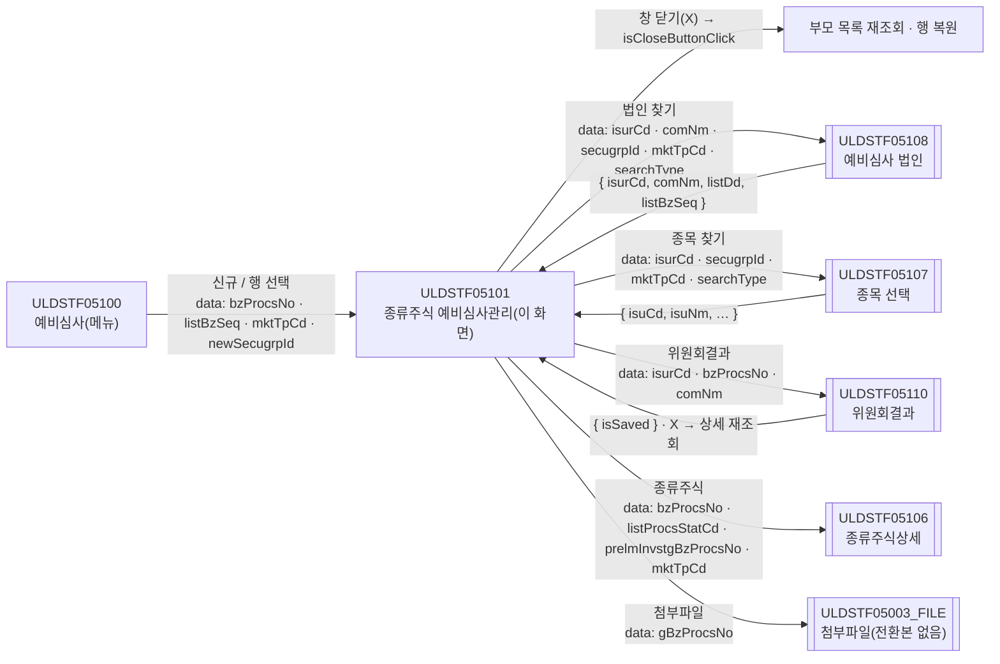
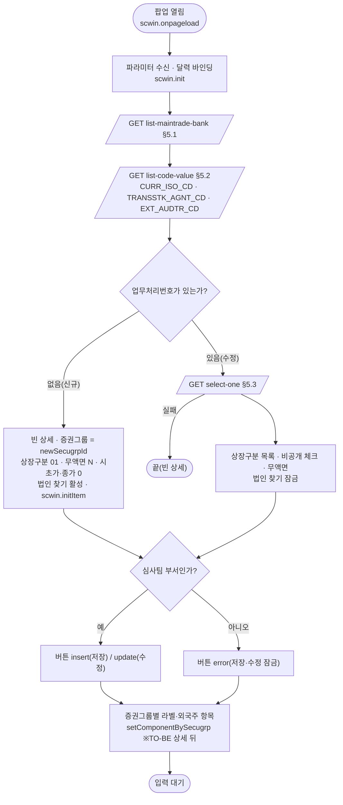
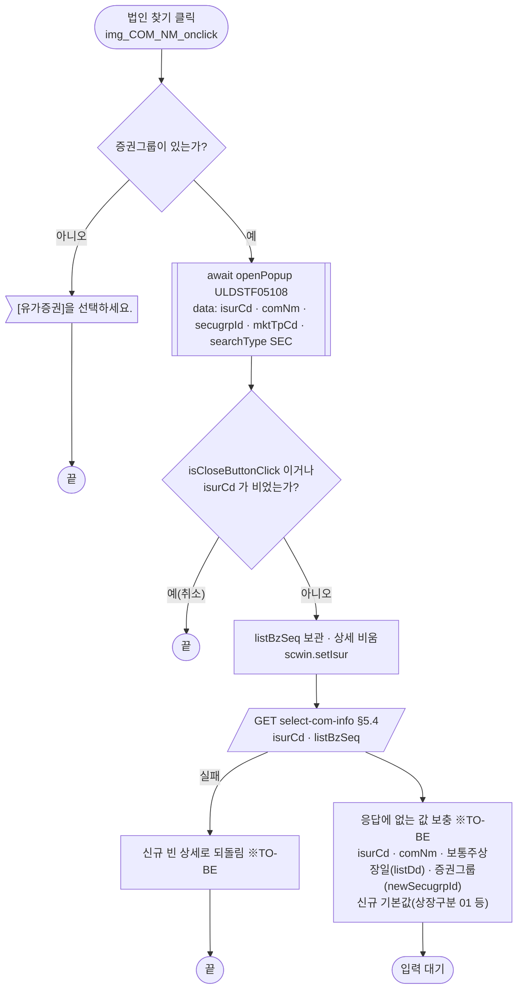
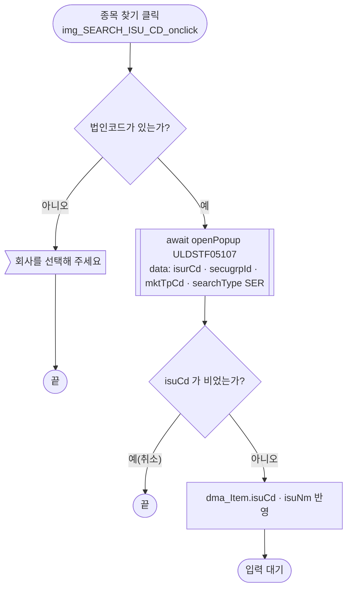
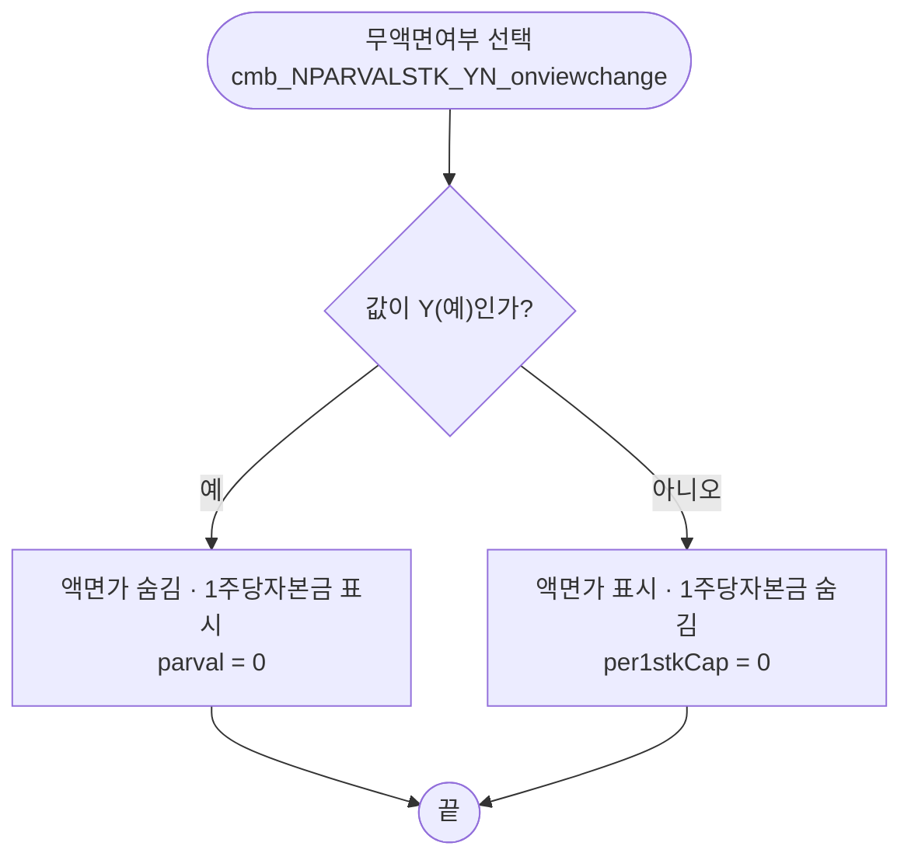
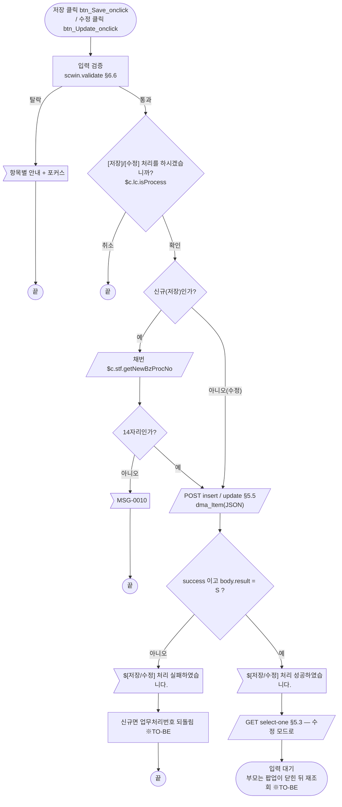
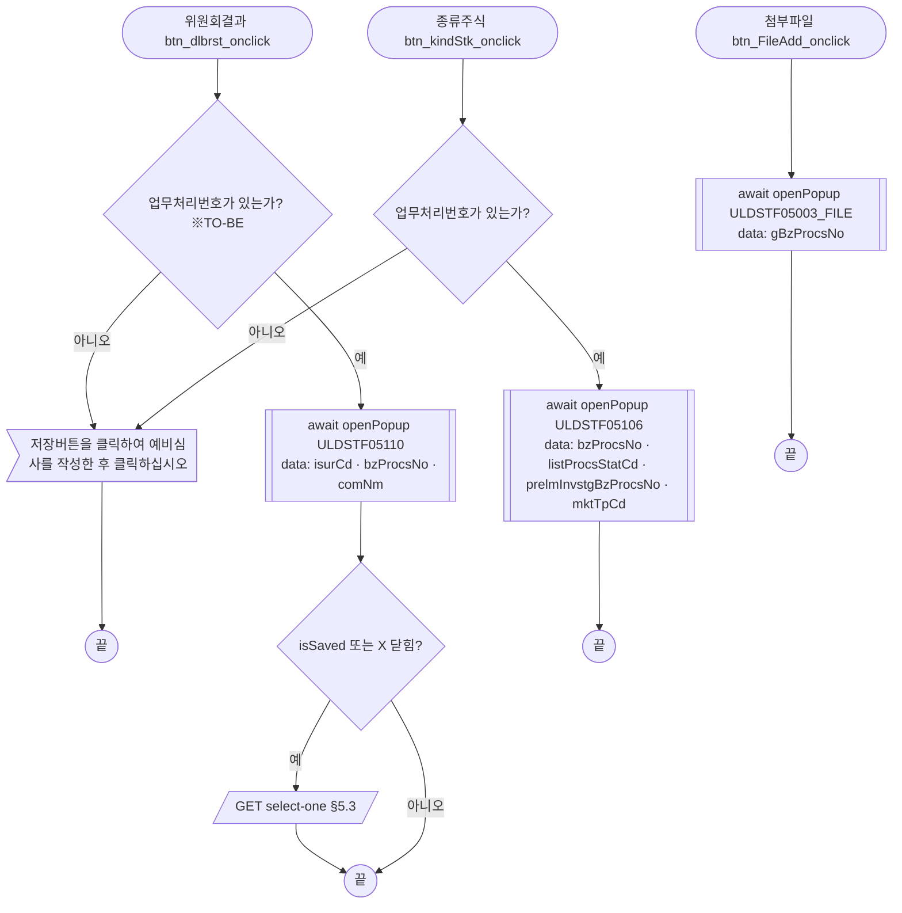

# ULDSTF05101 (팝업)주권 종류주식 예비심사관리 — 업무 분석 및 전환 내역

| 항목 | 내용 |
|---|---|
| AS-IS 원본 | `ULDSTF05101.xml` — W-Craft 1차 변환본(`meta_asisFileNm` `ULDSTF05101.gfm`, 원본 gfm 은 저장소에 없음)에 **API 적용까지 마친 개발 사본**. 업무 로직은 이 스크립트와 남은 옛 코드 주석으로 분석했다. 반입 `conversion/conversion-front/ui/ULDSTF05101/ULDSTF05101.xml`(2,614줄) |
| 신규 API 명세 | 없음 — **화면에 적용된 `/api/...` 경로·method·dataCollection keyInfo 를 명세로 간주**(사용자 결정 2026-10-29). §5 는 "화면 적용 API ↔ AS-IS(옛 호출)" 대응표로 쓴다. `api_spec_check` 는 명세 대조 SKIP(A07·A08 형식 검사만) |
| 화면 캡처 | 없음 |
| 퍼블리싱 파일 | 화면 폴더 `ULDSTF05101.xml` 의 body(이미 퍼블리싱 반영됨)를 1단계 기준으로 했다. publish 원본 `conversion/publish/상장/상장처리(대내)/ULDSTF05101.xml`(2,320줄)은 참고만 — 같은 표 구성에 [닫기] 표시, 인라인 배경색 27곳(§10 #9). 1단계는 선례 ULDBNS30400 처럼 "캡처 없음, 기존 마크업 정비" |
| TO-BE | `conversion/conversion-front/ui-tobe/ULDSTF05101.xml` (배포 경로 `/ui/lst/kindstk/ULDSTF05101.xml` — 부모 05100 의 원본 리터럴) |
| 공통 계약 | kindstk 13본 공통 계약서(작업 임시 문서) — 05100 → 05101 data 키, 05107·05108·05110·05106 호출 계약, 부모 재조회 규약, 미정의 호출 대체(§4.1), 공통 코드 패턴(§4.5) |
| 업무공통 | `$c.lc`(`isProcess`·`getGlbValue`·`getSecuGrpNm`)·`$c.stf`(`getNewBzProcNo`·`getMessageParam`) — `cm/pcc/stf`. 게이트는 `--pcc stf` |
| 작성 | Inswave / 2026-10-29 |

참고 양식: [websquare_gfm_conversion.md](../../../md/websquare_gfm_conversion.md) — 특히 §1.4 업무 프로세스 흐름, §6.5 getPar/setPar 전환. Gauce 대응은 [gfm_business_analysis_guide.md](../../../md/gfm_business_analysis_guide.md) §5·§6 을 함께 따랐다. 선례: ULDSTF05232(관리 팝업 저장·수정·버튼 상태), ULDBNS30400(캡처 없는 1단계 마크업 정비).

---

## 1. 화면 개요

상장 심사 담당자가 **예비심사(ULDSTF05100)** 목록에서 종류주식 예비심사 건을 새로 등록하거나 고르면 열리는 관리 팝업이다. 주권(ST)·외국주권(FS)·주식예탁증권(DR) 이 같은 화면을 쓰고, 증권그룹에 따라 외국주 관련 항목과 라벨이 바뀐다.

1. 부모가 업무처리번호·상장업무일련번호·거래시장구분·신규 증권그룹을 넘긴다. 업무처리번호가 없으면 **신규**, 있으면 **수정**이다.
2. 신규: [법인 찾기]로 예비심사 법인(ULDSTF05108)을 고르면 법인정보(설립일·주소·업종·재무 등)를 서버에서 받아 채운다. 담당자·상장구분·종목 등을 입력하고 [저장]하면 업무처리번호를 채번해 등록한다.
3. 수정: 상세를 조회해 채우고 [수정]으로 고친다. 법인은 바꿀 수 없다(법인 찾기 잠금).
4. 심사팀 부서(13개 부서코드)가 아니면 [저장]·[수정]이 잠긴다.
5. 상장구분 콤보는 상태가 예비심사 단계(01~06)이면 예비심사 목록, 상장 단계(10~24)이면 상장 목록을 보인다.
6. 무액면여부가 「예」면 액면가 대신 1주당자본금을 입력한다.
7. [종목 찾기](05107)·[위원회결과](05110)·[종류주식](05106)·[첨부파일](05003_FILE) 하위 팝업을 연다.

### 1.1 호출 화면 (1본)

- `ULDSTF05100` 예비심사(메뉴 화면, kindstk 묶음 B 에서 함께 전환) — `fn_OpenDetail`(05100:357-391)이 `scwin.clickBzProcsNo`·`clickListBzSeq` 를 자기 scwin 에 두고 `$c.win.openPopup("/ui/lst/kindstk/ULDSTF05101.xml", { id:"ULDSTF05101", popupName: getSecuGrpNm(secugrpId)+"종류주식 예비심사관리", width:1400, height:1500, frameModal:"top", mktTpCd })` 로 연다. [신규]는 업무처리번호 "" 로, 목록 행 선택은 그 행 번호로 연다.

### 1.2 호출 규약 (부모 → 이 화면) / 반환 규약

AS-IS 는 data 를 넘기지 않고, 팝업이 로딩 때 부모를 직접 읽었다(05101:183-187·195·484-485).

| TO-BE 키 | 값(부모 05100) | AS-IS 직접 접근 | 이 화면에서 |
|---|---|---|---|
| `bzProcsNo` | 선택 행 `bzProcsNo`, 신규 "" | `parentWin.scwin.clickBzProcsNo` | `scwin.bzProcsNo` — 비면 신규 |
| `listBzSeq` | 선택 행 `listBzSeq`, 신규 "" | `parentWin.scwin.clickListBzSeq` | `scwin.listBzSeq` — 상세 조회 조건 |
| `mktTpCd` | `rdo_SPOT_ISU_TRD_MKT_TP_CD` 값 | `$c.stf.getObjectValue(parentWin.rdo_SPOT_ISU_TRD_MKT_TP_CD)` | `scwin.mktTpCd` — 조회·저장 `spotIsuTrdMktTpCd`, 하위 팝업 data |
| `newSecugrpId` | `cmb_NEW_SECUGRP_ID` 값 | `parentWin.cmb_NEW_SECUGRP_ID` (init·법인 선택 두 곳) | `scwin.newSecugrpId` — 신규 증권그룹, 법인정보에 증권그룹이 없을 때 보충 |

- 원본 `scwin.rowPos = parentWin.dlt_List.getRowPosition()`(05101:187)과 수정 뒤 `parentWin.dlt_List.getRowPosition(scwin.rowPos)`(05101:766 — 조회 함수에 인자를 준 결함)는 옮기지 않는다. 행 위치는 부모가 기억했다가 되돌린다(계약서 부모 재조회 규약).
- **반환**: 계약서상 `{ isSaved }` 지만, 이 화면은 스스로 닫는 경로가 없다(원본 [닫기] 도 `display:none`, TO-BE 는 팝업 하단 닫기 금지로 삭제). 그래서 사용자는 창의 X·ESC 로만 닫고, 부모는 `res?.isCloseButtonClick === true` 로 재조회한다(계약서 규약의 X 분기). 원본은 저장 직후 `fn_parentRefresh`(부모 `fn_list_sync`)로 부모를 바로 갱신했다 — §8 #9.

```javascript
// 부모 ULDSTF05100 (묶음 B)
const res = await $c.win.openPopup("/ui/lst/kindstk/ULDSTF05101.xml",
    { id : "ULDSTF05101", popupName : $c.lc.getSecuGrpNm(secugrpId) + "종류주식 예비심사관리", width : 1400, height : 1500, frameModal : "top" },
    { bzProcsNo, listBzSeq, mktTpCd, newSecugrpId });
if (res?.isSaved === true || res?.isCloseButtonClick === true) { /* 목록 재조회 + 행 복원 */ }
```

### 1.3 이 화면이 여는 하위 팝업

| 팝업 | AS-IS 호출 | 넘기는 `data` (TO-BE) | 받는 결과 / 취소 판정 | 닫힌 뒤 |
|---|---|---|---|---|
| `ULDSTF05108` 예비심사 법인 선택 (1180×880) | `img_COM_NM_onclick` 이 `fn_GetPar = fn_GetParIsur`, `fn_SetPar = fn_SetParIsur` 로 바꿔 끼우고 `fn_PopFindKindStkExamCorp` → `openPopup(…, {})`. 05108 이 `parentWin.scwin.fn_GetPar(arr)` 로 [0] 법인코드 [1] 법인명 [2] 증권그룹 [3] 시장 [4] `$c.lc.SEARCH_TYP_SEC`(미정의) 을 받고 `fn_SetPar` 로 대문자 키 행을 돌려줬다 | `{ isurCd, comNm, secugrpId, mktTpCd, searchType : getGlbValue("SEARCH_TYP_SEC") }` | `{ isurCd, comNm, listDd, listBzSeq, dbClickYn }` — `isCloseButtonClick` 또는 `isurCd` 빈 값이면 취소 | 법인정보 조회(§5.4) |
| `ULDSTF05107` 예비심사 종목 선택 (800×780, pageFramePopup) | `fn_PopFindKindStkExamIsu` — data 에 **부모(05100) 컴포넌트** `rdo_SECUGRP_ID`·`rdo_SPOT_ISU_TRD_MKT_TP_CD` 값과 `searchType:"SER"`, 반환 대문자 `res.ISU_CD` | `{ isurCd, secugrpId, mktTpCd, searchType : getGlbValue("SEARCH_TYP_SER") }` | `{ isuCd, isuNm, isuEngNm, isurCd, bzProcsNo, dbClickYn }` — `isuCd` 빈 값이면 취소 | 종목코드·종목명 반영 |
| `ULDSTF05110` 종류주식 위원회결과 (800×580) | `fn_OpenInvRst` 가 `fn_GetPar = fn_GetParDtl`(arr [0] 법인코드 [1] 업무처리번호 [2] 법인명) 후 data 없이 open | `{ isurCd, bzProcsNo, comNm }` | `{ isSaved }` — 저장했거나 X 로 닫으면 재조회 | 상세 재조회(원본은 05110 이 `parentWin.scwin.fn_read_sync()` 직접 호출) |
| `ULDSTF05106` 종류주식상세 (1135×840, pageFramePopup) | `btn_kindStk_onclick` — data `{ vBzProcsNo, vListProcsStatCd, vPRELM_INVSTG_BZ_PROCS_NO:"", mktTpCd }` (원본 800×900) | `{ bzProcsNo, listProcsStatCd, prelmInvstgBzProcsNo : "", mktTpCd }` | 없음(`await` 만) | — |
| `ULDSTF05003_FILE` 예비심사 첨부파일등록 (740×370) | `fn_FileAdd` — `openPopup("/ui/lst/lstproc/ULDSTF05003_FILE.xml", opts, { gBzProcsNo })` | 같음 `{ gBzProcsNo }` | 없음 | — (전환본 없음, §10 #5) |

### 1.4 업무 프로세스 흐름

흐름은 AS-IS 동작을 기준으로 그렸다. `※TO-BE` 는 전환본에서 바뀌는 곳이다(근거는 §8).

| # | 업무 | 시작 (사용자 동작·진입 조건) | 끝 (결과) | 주요 함수 | 관련 절 |
|---|---|---|---|---|---|
| 1 | 진입·로딩 | 부모가 팝업을 엶 | 신규 빈 상세 또는 상세, 모드별 버튼 | `scwin.onpageload` → `scwin.init` → `initItem` / `selectDetail` → `setComponentBySecugrp` | §3, §5.1~§5.3 |
| 2 | 법인 선택(신규) | [법인 찾기] `img_COM_NM` | 법인정보로 상세 채움 | `openIsurPopup` → `setIsur` → `selectComInfo` | §5.4, §6.8 |
| 3 | 종목 선택 | [종목 찾기] `img_SEARCH_ISU_CD` | 종목코드·종목명 반영 | `openIsuPopup` | §6.9 |
| 4 | 무액면여부 변경 | `cmb_NPARVALSTK_YN` 선택 | 액면가 ↔ 1주당자본금 전환 | `cmb_NPARVALSTK_YN_onviewchange` → `applyNparvalView(true)` | §6.4 |
| 5 | 저장(신규) | [저장] (신규·심사팀) | 등록 성공 안내 후 수정 모드로 재조회 | `save` → `saveTrs("I")` | §5.5, §6.6, §6.7 |
| 6 | 수정 | [수정] (수정·심사팀) | 수정 성공 안내 후 재조회 | `update` → `saveTrs("U")` | §5.5, §6.6 |
| 7 | 위원회결과 | [위원회결과] `btn_dlbrst` | 05110 저장·닫힘 후 재조회 | `openInvRstPopup` | §6.10 |
| 8 | 종류주식상세 | [종류주식] `btn_kindStk` | 05106 팝업 | `openKindStkPopup` | §6.11 |
| 9 | 첨부파일 | [첨부파일] `btn_FileAdd` | 05003_FILE 팝업 | `openFilePopup` | §6.12 |

#### 화면 간 흐름



AS-IS 는 부모·하위 팝업이 서로의 컴포넌트와 함수(`fn_GetPar`·`fn_SetPar`·`fn_read_sync`·`fn_list_sync`)를 이름으로 불렀다. TO-BE 는 모두 `await $c.win.openPopup(url, options, data)` 와 반환값으로 바꾼다(가이드 §6.5).

#### 업무 1: 진입·로딩



| # | 단계 | 주체 | 내용 | 분기 · 메시지 | 관련 절 |
|---|---|---|---|---|---|
| 1 | 파라미터 | 화면 | `$c.data.getParameter()` → `bzProcsNo`·`listBzSeq`·`mktTpCd`·`newSecugrpId` | `bzProcsNo` 빈 값이면 신규 | §1.2, §3 |
| 2 | 콤보 목록 | 서버 | 주거래은행 → 공통 코드 3종(한 번 호출) | 원본은 은행 조회 성공 때만 공통 코드를 불렀다 → TO-BE 는 각각 부른다(§8 #2) | §5.1, §5.2 |
| 3a | 신규 | 화면 | `initItem` — 빈 상세, 신규 기본값 | — | §6.1, §6.2 |
| 3b | 수정 | 서버 | `select-one` `{ bzProcsNo, listBzSeq, spotIsuTrdMktTpCd }` | 실패 시 빈 상세 그대로 | §5.3 |
| 4 | 버튼 | 화면 | `applyButtonState` — 신규 insert / 수정 update / 비심사팀 error | — | §6.5 |
| 5 | 증권그룹 화면 | 화면 | `setComponentBySecugrp(secugrpId)` | 원본은 상세를 기다리지 않아 수정 건이 늘 ST 화면이었다 ※TO-BE(§8 #1) | §6.3 |

#### 업무 2: 법인 선택(신규)



| # | 단계 | 주체 | 내용 | 분기 · 메시지 | 관련 절 |
|---|---|---|---|---|---|
| 1 | 증권그룹 확인 | 화면 | `cmb_SECUGRP_ID` 값 | `[유가증권]을 선택하세요.` | §6.8 |
| 2 | 법인 선택 | 05108 | 계약서 05108 data·반환 | 취소면 끝 | §1.3 |
| 3 | 법인정보 | 서버 | `select-com-info` → `dma_Item` | 실패 시 신규 빈 상세 ※TO-BE | §5.4 |
| 4 | 보충 | 화면 | 원본은 값을 넣은 뒤 `setEmptyValue` 로 지워 응답 값만 남았다 → 응답에 없는 값만 선택 결과·기본값으로 채운다 ※TO-BE | — | §8 #4 |

#### 업무 3: 종목 선택



#### 업무 4: 무액면여부 변경



#### 업무 5·6: 저장(신규)·수정



| # | 단계 | 주체 | 내용 | 분기 · 메시지 | 관련 절 |
|---|---|---|---|---|---|
| 1 | 검증 | 화면 | `validate` | 항목별 안내 | §6.6 |
| 2 | 확인 | 화면 | `$c.lc.isProcess("I"/"U")` — MSG-A006 | 취소면 끝 | §7 |
| 3 | 채번(저장만) | 서버 | `$c.stf.getNewBzProcNo()` → 14자리 검사 | `MSG-0010` | §6.7 |
| 4 | 등록·수정 | 서버 | `POST /api/listing/lstproc/kind/prelisting-kindstk/insert`·`/update` | `body.result !== "S"` 이면 실패 | §5.5 |
| 5 | 후처리 | 화면 | 성공 안내 → `scwin.bzProcsNo` 확정 → 상세 재조회 | 원본은 부모 재조회 + 부모 행 위치(결함) → 부모가 닫힌 뒤 처리 | §8 #7·#9 |

#### 업무 7·8·9: 위원회결과·종류주식상세·첨부파일



---

## 2. 화면 구성 및 데이터 정의

### 2.1 화면 구성 (AS-IS 요소 → TO-BE 컴포넌트)

팝업 골격은 `pop_contents` > `pfmContentHeader`(contentHeader, 팝업 필수) > 안내 목록(`ul`·`li` 의 `txt_list`) > 상세 표 `panel_Item`(`tblbox` > `w2tb tbl` 8칸 `table`·`colgroup`·`col`·`tr`·`th`·`td`) > 외국주 제목(`titbox` 의 `h3` `label_dr`) > 외국주 표 `panel_foriegn`(6칸) > 하단 `btnbox` `grp_btnBox` 이다. id 는 모두 AS-IS 그대로 두었다.

1단계 마크업 정비(공통):

- W-Craft 잔재 속성 삭제 — `hierarchy`·`orgid`·`userData2`·`cursor`·`cbdatacolumns`·`listexprformat`·`item`·`tabIndex`, 버튼의 `src`·`text`, `w2:textbox` 의 `maxlength`·`readOnly`. 버튼에 `type="button"`.
- 콤보 `emptyItem="true"` → `chooseOption="true" chooseOptionLabel="$blank"`. itemset 은 `label ref="text"`·`value ref="value"`(원본은 빈 ref).
- **공시 공개 항목 색(규칙 40)** — 원본은 라벨·체크에 인라인 `background-color:#ffcc99` 를 줬다(27곳). 인라인 색 금지라 주황 계열 공통 class `bg_orange` 를 그 항목의 **값 칸(`w2tb_td`)** 에 붙였다(`base.css` 에서 `w2tb_td` 와 `w2textbox` 중 배경 class 가 정의된 것은 표 칸뿐). 색 견본 `label_62` 는 삭제하고 범례 문구 `label_73` 을 「주황색 바탕의 입력 칸은 …」으로 바꿨다(§10 #9).
- 하단 [닫기] `btn_Close` 삭제(팝업 하단 닫기 금지). 버튼 순서는 규칙 41 대로 이미 [위원회결과][첨부파일] | [수정 pt][저장 pt].
- `ev:onpageunload`(정의 없는 `scwin.onpageunload`)는 옮기지 않았다.

| AS-IS id (W-Craft 변환본) | 종류 | 라벨 / 내용 | 바인딩(ref) | TO-BE |
|---|---|---|---|---|
| `pfmContentHeader` | w2:pageFrame |  |  | 같음 |
| `label_27` | w2:textbox |  항목 앞에 * 표시는 필수 항목 입니다. |  | 같음 |
| `label_28` | w2:textbox |  금액단위는 '원'단위 입니다.(외국주의 금액단위는 나라별 통화 참조) |  | 같음 |
| `label_62` | w2:textbox |  |  | (옮기지 않음) 색 견본(인라인 배경) — 공개 항목은 값 칸 `bg_orange` 로 표시, 범례 문구 label_73 수정 |
| `label_73` | w2:textbox | 색으로 표시된 항목은 전자공시조회시스템에 공개되는 항목임 |  | 같음 — 문구 「주황색 바탕의 입력 칸은 전자공시조회시스템에 공개되는 항목임」 |
| `panel_Item` | xf:group | 영역 |  | 같음 |
| `label_13` | w2:textbox | 법인코드 |  | 같음 |
| `txb_ISUR_CD` | xf:input | 법인코드 | `dma_Item.isurCd` | 같음 — `readOnly="true"`(법인 찾기로만 채움) |
| `img_COM_NM` | xf:trigger(버튼) | (돋보기) |  | 같음 |
| `label_64` | w2:textbox | 유가증권 |  | 같음 |
| `cmb_SECUGRP_ID` | xf:select1(콤보) | 유가증권 | `dma_Item.secugrpId` | 같음 — 빈 항목(chooseOption) |
| `chk_WEB_DP_YN` | xf:select(체크) | 비공개 심사시 선택 | `dma_Item.webDpYn` | 같음 — 값이 반대(체크=webDpYn "N")라 ref 를 떼고 스크립트에서 옮김 |
| `label_4` | w2:textbox | 한글법인명 |  | 같음 |
| `txb_COM_NM` | xf:input | 한글법인명 | `dma_Item.comNm` | 같음 — 값 칸 `bg_orange`(공시 공개 항목) |
| `chk_WEB_NOPN_YN` | xf:select(체크) | 비공개(인적분할 재상장시 선택) | `dma_Item.webNopnYn` | 같음 — 값 칸 `bg_orange`(공시 공개 항목) |
| `label_63` | w2:textbox | 영문법인명 |  | 같음 |
| `txb_COM_ENG_NM` | xf:input | 영문법인명 | `dma_Item.comEngNm` | 같음 — 값 칸 `bg_orange`(공시 공개 항목) |
| `label_26` | w2:textbox | 홈페이지 |  | 같음 |
| `txb_HPAGE` | xf:input | 홈페이지 | `dma_Item.hpage` | 같음 — 값 칸 `bg_orange`(공시 공개 항목) |
| `label_6` | w2:textbox | 신청회사담당자 |  | 같음 |
| `txb_APPL_COM_CHRG_NM` | xf:input | 신청회사담당자 | `dma_Item.applComChrgNm` | 같음 |
| `label_21` | w2:textbox | 담당자연락처 |  | 같음 |
| `txb_APPL_COM_CHRG_TEL_NO` | xf:input | 담당자연락처 | `dma_Item.applComChrgTelNo` | 같음 |
| `label_22` | w2:textbox | 대표이사 |  | 같음 |
| `txb_CEO_NM` | xf:input | 대표이사 | `dma_Item.ceoNm` | 같음 — 값 칸 `bg_orange`(공시 공개 항목) |
| `label_36` | w2:textbox | 설립일 |  | 같음 |
| `edt_FOUND_DD` | w2:inputCalendar | 설립일 | `dma_Item.foundDd` | 같음 — 값 칸 `bg_orange`(공시 공개 항목) |
| `label_7` | w2:textbox | 결산월 |  | 같음 |
| `edt_ACNTCLS_MMDD1` | xf:input | 결산월 | `dma_Item.acntclsMmdd1` | 같음 — 값 칸 `bg_orange`(공시 공개 항목) |
| `label_37` | w2:textbox | 코스닥상장일 |  | 같음 |
| `edt_ASSO_REG_DD` | w2:inputCalendar | 코스닥상장일 | `dma_Item.assoRegDd` | 같음 |
| `label_23` | w2:textbox | 본점소재지 |  | 같음 |
| `txb_ADDR` | xf:input | 본점소재지 | `dma_Item.addr` | 같음 — 값 칸 `bg_orange`(공시 공개 항목) |
| `label_8` | w2:textbox | 업종 |  | 같음 |
| `txb_STD_IND_CD` | xf:input | 업종 | `dma_Item.stdIndCd` | 같음 — 값 칸 `bg_orange`(공시 공개 항목) |
| `txb_STD_IND_NM` | xf:input | 업종 | `dma_Item.stdIndNm` | 같음 — 값 칸 `bg_orange`(공시 공개 항목) |
| `label_25` | w2:textbox | 주거래은행 |  | 같음 |
| `cmb_MAINTR_BK_CD` | xf:select1(콤보) | 주거래은행 | `dma_Item.maintrBkCd` | 같음 — itemset `dlt_maintrBkCd`, 빈 항목(chooseOption) |
| `label_38` | w2:textbox | 중소기업여부 |  | 같음 |
| `cmb_SME_YN` | xf:select1(콤보) | 중소기업여부 | `dma_Item.smeYn` | 같음 — 정적 choices N 아님/Y 중소기업 |
| `label_39` | w2:textbox | 지주회사여부 |  | 같음 |
| `cmb_HDCOM_YN` | xf:select1(콤보) | 지주회사여부 | `dma_Item.hdcomYn` | 같음 — 정적 choices N 관련없음/Y 지주회사 |
| `label_24` | w2:textbox | 명의개서대리인 |  | 같음 |
| `cmb_TRANSSTK_AGNT_CD` | xf:select1(콤보) | 명의개서대리인 | `dma_Item.transstkAgntCd` | 같음 — itemset `dlt_transstkAgntCd`, 빈 항목(chooseOption) |
| `label_40` | w2:textbox | 외부감사인 |  | 같음 |
| `cmb_EXT_AUDTR_CD` | xf:select1(콤보) | 외부감사인 | `dma_Item.extAudtrCd` | 같음 — itemset `dlt_extAudtrCd`, 빈 항목(chooseOption) |
| `label_67` | w2:textbox | 법인전화번호 |  | 같음 |
| `txb_REP_TEL_NO` | xf:input | 법인전화번호 | `dma_Item.repTelNo` | 같음 |
| `label_68` | w2:textbox | 주요제품 |  | 같음 |
| `txb_MAJ_PROD_NM` | xf:input | 주요제품 | `dma_Item.majProdNm` | 같음 — 값 칸 `bg_orange`(공시 공개 항목) |
| `label_56` | w2:textbox | 종업원수 |  | 같음 |
| `edt_EMP_CNT` | xf:input | 종업원수 | `dma_Item.empCnt` | 같음 — 값 칸 `bg_orange`(공시 공개 항목) |
| `lb_PARVAL` | w2:textbox | 액면가 |  | 같음 |
| `lb_PER1STK_CAP` | w2:textbox | 1주당자본금 |  | 같음 |
| `edt_PARVAL` | xf:input | 액면가 | `dma_Item.parval` | 같음 — 값 칸 `bg_orange`(공시 공개 항목) |
| `edt_PER1STK_CAP` | xf:input | 액면가 | `dma_Item.per1stkCap` | 같음 — 값 칸 `bg_orange`(공시 공개 항목) |
| `label_83` | w2:textbox | 무액면여부 |  | 같음 |
| `cmb_NPARVALSTK_YN` | xf:select1(콤보) | 무액면여부 | `dma_Item.nparvalstkYn` | 같음 — 정적 choices N 아니오/Y 예 + `ev:onviewchange` |
| `btn_kindStk` | xf:trigger(버튼) | 종류주식 |  | 같음 — 값 칸 `bg_orange`(공시 공개 항목) |
| `label_20` | w2:textbox | 자산총계 |  | 같음 |
| `edt_TOT_ASST_AMT` | xf:input | 자산총계 | `dma_Item.totAsstAmt` | 같음 |
| `label_16` | w2:textbox | 자본총계 |  | 같음 |
| `edt_TOT_CAP` | xf:input | 자본총계 | `dma_Item.totCap` | 같음 |
| `label_17` | w2:textbox | 자본금 |  | 같음 |
| `edt_CAP` | xf:input | 자본금 | `dma_Item.cap` | 같음 — 값 칸 `bg_orange`(공시 공개 항목) |
| `label_52` | w2:textbox | 매출액 |  | 같음 |
| `edt_SALES` | xf:input | 매출액 | `dma_Item.sales` | 같음 — 값 칸 `bg_orange`(공시 공개 항목) |
| `label_41` | w2:textbox | 영업이익 |  | 같음 |
| `edt_BZ_PROFT_AMT` | xf:input | 영업이익 | `dma_Item.bzProftAmt` | 같음 |
| `label_51` | w2:textbox | 세전이익 |  | 같음 |
| `edt_ORDNINCM_AMT` | xf:input | 세전이익 | `dma_Item.ordnincmAmt` | 같음 — 값 칸 `bg_orange`(공시 공개 항목) |
| `label_80` | w2:textbox | 당기순이익 |  | 같음 |
| `edt_NETINCM_AMT` | xf:input | 당기순이익 | `dma_Item.netincmAmt` | 같음 — 값 칸 `bg_orange`(공시 공개 항목) |
| `label_59` | w2:textbox | * 액면가, 자본금은 본점소재지 국가의 화폐단위임 |  | 같음 |
| `label_79` | w2:textbox | 당기순이익 (외화) |  | 같음 |
| `edt_NETINCM_AMT1` | xf:input | 당기순이익 (외화) | `dma_Item.netincmAmt1` | 같음 — 값 칸 `bg_orange`(공시 공개 항목) |
| `cmb_NETINCM_CURR_ISO_CD` | xf:select1(콤보) | 당기순이익 (외화) | `dma_Item.netincmCurrIsoCd` | 같음 — 값 칸 `bg_orange`(공시 공개 항목), itemset `dlt_currIsoCd`, 빈 항목(chooseOption) |
| `label_78` | w2:textbox | * 재무금액은 청구 직전년도 <b>온기</b> 실적입력 / 단위는 <b>단단위</b> ( "천"이나 "백만" 단위 아님 ) |  | 같음 |
| `label_81` | w2:textbox | * 외국기업은 당기순이익 "원화"와 "외화"를 모두 입력 |  | 같음 |
| `label_84` | w2:textbox | 종목명/종목코드 |  | 같음 |
| `txb_ISU_NM` | xf:input | 종목명/종목코드 | `dma_Item.isuNm` | 같음 |
| `txb_ISU_CD` | xf:input | 종목명/종목코드 | `dma_Item.isuCd` | 같음 |
| `img_SEARCH_ISU_CD` | xf:trigger(버튼) | (돋보기) |  | 같음 |
| `label_1` | w2:textbox | 청구서접수일 |  | 같음 |
| `edt_INVSTG_BILL_ACPT_DD` | w2:inputCalendar | 청구서접수일 | `dma_Item.invstgBillAcptDd` | 같음 |
| `label_2` | w2:textbox | 상장예정일 |  | 같음 |
| `edt_LIST_DD` | w2:inputCalendar | 상장예정일 | `dma_Item.listSchdlDd` | 같음 |
| `label_9` | w2:textbox | 상장심의예정일 |  | 같음 |
| `edt_LIST_DELIB_SCHDL_DD` | w2:inputCalendar | 상장심의예정일 | `dma_Item.listDelibSchdlDd` | 같음 |
| `label_70` | w2:textbox | 상장심의예정통보일 |  | 같음 |
| `edt_LIST_DELIB_SCHDL_NOTI_DD` | w2:inputCalendar | 상장심의예정통보일 | `dma_Item.listDelibSchdlNotiDd` | 같음 |
| `label_30` | w2:textbox | 심사결과확정일 |  | 같음 |
| `edt_INVSTG_COMPLT_DD` | w2:inputCalendar | 심사결과확정일 | `dma_Item.invstgCompltDd` | 같음 |
| `label_31` | w2:textbox | 증권신고제출일 |  | 같음 |
| `edt_SECU_STAT_SUBMIT_DD` | w2:inputCalendar | 증권신고제출일 | `dma_Item.secuStatSubmitDd` | 같음 |
| `label_32` | w2:textbox | 증권신고서효력발생일 |  | 같음 |
| `textbox_1` | xf:input | 증권신고서효력발생일 |  | (옮기지 않음) 숨김 잔재 입력 — 바인딩·사용처 없음 |
| `edt_SECU_STAT_EFCT_OCCR_DD` | w2:inputCalendar | 증권신고서효력발생일 | `dma_Item.secuStatEfctOccrDd` | 같음 |
| `label_82` | w2:textbox | 보통주상장일 |  | 같음 |
| `txb_CMSTK_LIST_DD` | w2:inputCalendar | 보통주상장일 | `dma_Item.cmstkListDd` | 같음 |
| `label_5` | w2:textbox | 최초심사담당자 |  | 같음 |
| `txb_FST_EXAMPRN_EMP_NM` | xf:input | 최초심사담당자 | `dma_Item.fstExamprnEmpNm` | 같음 |
| `label_34` | w2:textbox | 상장구분 |  | 같음 |
| `cmb_INVSTG_PROG_STAT_CD` | xf:select1(콤보) | 상장구분 | `dma_Item.invstgProgStatCd` | 같음 — itemset `dlt_invstgProgStatCd`, 빈 항목(chooseOption) |
| `label_35` | w2:textbox | 재상장전 법인명 |  | 같음 |
| `txb_BFRELIST_CORP_NM` | xf:input | 재상장전 법인명 | `dma_Item.bfrelistCorpNm` | 같음 |
| `label_33` | w2:textbox | 상장위원회일자 |  | 같음 |
| `edt_LIST_COMITE_DD` | w2:inputCalendar | 상장위원회일자 | `dma_Item.listComiteDd` | 같음 |
| `lb_LIST_SHRS` | w2:textbox | 상장(예정)주식수 |  | 같음 |
| `edt_LIST_SHRS` | xf:input | 상장(예정)주식수 | `dma_Item.listShrs` | 같음 — 값 칸 `bg_orange`(공시 공개 항목) |
| `label_11` | w2:textbox | 상장주선인담당자 |  | 같음 |
| `txb_LEADCOM_CHRG_NM` | xf:input | 상장주선인담당자 | `dma_Item.leadcomChrgNm` | 같음 |
| `label_60` | w2:textbox | 상장주선인 |  | 같음 |
| `txb_LEADCOM_MBR_NM_STR` | xf:input | 상장주선인 | `dma_Item.leadcomMbrNmStr` | 같음 — 값 칸 `bg_orange`(공시 공개 항목) |
| `label_54` | w2:textbox | 주선인연락처 |  | 같음 |
| `txb_REP_MAJAGNT_COM_TEL_NO` | xf:input | 주선인연락처 | `dma_Item.repMajagntComTelNo` | 같음 |
| `label_55` | w2:textbox | 공모희망가 |  | 같음 |
| `edt_PERSHR_PUBPRC_LWLMT_AMT` | xf:input | 공모희망가 | `dma_Item.pershrPubprcLwlmtAmt` | 같음 |
| `label_71` | w2:textbox | ~ |  | 같음 |
| `edt_PERSHR_PUBPRC_UPLMT_AMT` | xf:input | 공모희망가 | `dma_Item.pershrPubprcUplmtAmt` | 같음 |
| `label_15` | w2:textbox | 공모경쟁률 |  | 같음 |
| `edt_PUBOFR_COMPTE_RT` | xf:input | 공모경쟁률 | `dma_Item.pubofrCompteRt` | 같음 |
| `label_58` | w2:textbox | 상장일시초가 |  | 같음 |
| `edt_FST_BAS_PRC` | xf:input | 상장일시초가 | `dma_Item.fstBasPrc` | 같음 |
| `label_12` | w2:textbox | 상장일종가 |  | 같음 |
| `edt_LISTDD_CLSPRC` | xf:input | 상장일종가 | `dma_Item.listddClsprc` | 같음 |
| `label_65` | w2:textbox | 청약개시일 |  | 같음 |
| `edt_SUBS_STRT_DD` | w2:inputCalendar | 청약개시일 | `dma_Item.subsStrtDd` | 같음 — 값 칸 `bg_orange`(공시 공개 항목) |
| `label_66` | w2:textbox | 청약종료일 |  | 같음 |
| `edt_SUBS_END_DD` | w2:inputCalendar | 청약종료일 | `dma_Item.subsEndDd` | 같음 — 값 칸 `bg_orange`(공시 공개 항목) |
| `label_69` | w2:textbox | 수요예측일 |  | 같음 |
| `edt_DFC_DD` | w2:inputCalendar | 수요예측일 | `dma_Item.dfcDd` | 같음 |
| `label_57` | w2:textbox | 공모가격 |  | 같음 |
| `edt_PUBOFR_PRC` | xf:input | 공모가격 | `dma_Item.pubofrPrc` | 같음 — 값 칸 `bg_orange`(공시 공개 항목) |
| `lb_PUBOFR_SHRS` | w2:textbox | 공모주식수 |  | 같음 |
| `edt_PUBOFR_SHRS` | xf:input | 공모주식수 | `dma_Item.pubofrShrs` | 같음 |
| `label_61` | w2:textbox | 공모(예정)금액 |  | 같음 |
| `edt_LWLMT_PUBOFR_SCHDL_TOTAMT` | xf:input | 공모(예정)금액 | `dma_Item.lwlmtPubofrSchdlTotamt` | 같음 — 값 칸 `bg_orange`(공시 공개 항목) |
| `label_72` | w2:textbox | ~ |  | 같음 — 값 칸 `bg_orange`(공시 공개 항목) |
| `edt_UPLMT_PUBOFR_SCHDL_TOTAMT` | xf:input | 공모(예정)금액 | `dma_Item.uplmtPubofrSchdlTotamt` | 같음 — 값 칸 `bg_orange`(공시 공개 항목) |
| `label_3` | w2:textbox | 최대주주 |  | 같음 |
| `txb_LGSHRHD_NM` | xf:input | 최대주주 | `dma_Item.lgshrhdNm` | 같음 — 값 칸 `bg_orange`(공시 공개 항목) |
| `label_19` | w2:textbox | 최대주주비율 |  | 같음 |
| `edt_LGSHRHD_RTO` | xf:input | 최대주주비율 | `dma_Item.lgshrhdRto` | 같음 — 값 칸 `bg_orange`(공시 공개 항목) |
| `label_dr` | w2:textbox | 외국주관련 |  | 같음 |
| `panel_foriegn` | xf:group | 영역 |  | 같음 |
| `panel_Forn_Item` | xf:group | 영역 |  | id 를 th → 그 행(tr)으로 옮김(행 전체 표시/숨김) |
| `label_42` | w2:textbox | 본점소재지국가 |  | 같음 |
| `txb_CNTR_ISO_CD` | xf:input | 본점소재지국가 | `dma_Item.cntrIsoCd` | 같음 |
| `txb_CNTR_ISO_NM` | xf:input | 본점소재지국가 | `dma_Item.cntrIsoNm` | 같음 |
| `label_29` | w2:textbox | 예탁증권일경우 입력 |  | 같음 |
| `label_74` | w2:textbox | 액면가 통화표시3 |  | 같음 |
| `label_47` | w2:textbox | 통화표시 |  | 같음 |
| `cmb_PARVAL_CURR_ISO_CD` | xf:select1(콤보) | 액면가 통화표시3 | `dma_Item.parvalCurrIsoCd` | 같음 — itemset `dlt_currIsoCd`, 빈 항목(chooseOption) |
| `cmb_CURR_ISO_CD` | xf:select1(콤보) | 액면가 통화표시3 |  | 같음 — itemset `dlt_currIsoCd` |
| `label_43` | w2:textbox | 상장해외거래소_1 |  | 같음 |
| `txb_LIST_FORN_EXCH_NM1` | xf:input | 상장해외거래소_1 | `dma_Item.listFornExchNm1` | 같음 |
| `label_48` | w2:textbox | 상장일_1 |  | 같음 |
| `edt_LIST_FORN_EXCH_LIST_DD1` | w2:inputCalendar | 상장일_1 | `dma_Item.listFornExchListDd1` | 같음 |
| `label_75` | w2:textbox | 재무 통화표시(당기순이익제외) |  | 같음 |
| `cmb_FNC_CURR_ISO_CD` | xf:select1(콤보) | 재무 통화표시(당기순이익제외) | `dma_Item.fncCurrIsoCd` | 같음 — itemset `dlt_currIsoCd`, 빈 항목(chooseOption) |
| `label_44` | w2:textbox | 상장해외거래소_2 |  | 같음 |
| `txb_LIST_FORN_EXCH_NM2` | xf:input | 상장해외거래소_2 | `dma_Item.listFornExchNm2` | 같음 |
| `label_49` | w2:textbox | 상장일_2 |  | 같음 |
| `edt_LIST_FORN_EXCH_LIST_DD2` | w2:inputCalendar | 상장일_2 | `dma_Item.listFornExchListDd2` | 같음 |
| `label_76` | w2:textbox | 공모가 통화표시 |  | 같음 |
| `cmb_PUBPRC_CURR_ISO_CD` | xf:select1(콤보) | 공모가 통화표시 | `dma_Item.pubprcCurrIsoCd` | 같음 — itemset `dlt_currIsoCd`, 빈 항목(chooseOption) |
| `label_50` | w2:textbox | 1DR당 원주비율(주) |  | 같음 |
| `edt_PER1DR_FORNSTK_RTO` | xf:input | 1DR당 원주비율(주) | `dma_Item.per1drFornstkRto` | 같음 |
| `label_46` | w2:textbox | 원주보관기관명 |  | 같음 |
| `txb_FORNSTK_STORG_INST_NM` | xf:input | 원주보관기관명 |  | 같음 |
| `label_77` | w2:textbox | 공모예정 통화표시 |  | 같음 |
| `cmb_PUBPRC_SCHDL_CURR_ISO_CD` | xf:select1(콤보) | 공모예정 통화표시 | `dma_Item.pubprcSchdlCurrIsoCd` | 같음 — itemset `dlt_currIsoCd`, 빈 항목(chooseOption) |
| `grp_btnBox` | xf:group | 영역 |  | 같음 |
| `btn_dlbrst` | xf:trigger(버튼) | 위원회결과 |  | 같음 |
| `btn_FileAdd` | xf:trigger(버튼) | 첨부파일 |  | 같음 |
| `btn_Update` | xf:trigger(버튼) | 수정 |  | 같음 |
| `btn_Save` | xf:trigger(버튼) | 저장 |  | 같음 |
| `btn_Close` | xf:trigger(버튼) | 닫기 |  | (옮기지 않음) 팝업 하단 [닫기] 금지 — 원본도 `display:none` |

### 2.2 데이터 정의 (DataCollection)

화면에 적용된 keyInfo 를 명세로 간주한다 — 키 id·dataType 은 원본 그대로 두고, 잘못된 표시 이름(name)만 고쳤다.

| AS-IS | TO-BE | 종류 | 키 / 컬럼 | 쓰임 |
|---|---|---|---|---|
| `dma_Item` | `dma_Item` | dataMap | 아래 표 113키 | 상세 바인딩, `select-one`·`select-com-info` 응답, `insert`·`update` 요청 |
| `dlt_invstgProgStatCd` | `dlt_invstgProgStatCd` | dataList | `value`(값)·`text`(라벨) | 상장구분 콤보 — 상태에 따라 예비심사/상장 단계 목록을 `setJSON` |
| `dlt_MaintrBkCd` | `dlt_maintrBkCd` | dataList | `value`·`text` | 주거래은행 (`list-maintrade-bank` 응답 body) |
| (없음 — `setCommonCode` 가 콤보마다) | `dlt_currIsoCd` | dataList | `value`·`text` | 통화ISO코드 `CURR_ISO_CD` — 통화 콤보 6개 공용 |
| (없음) | `dlt_transstkAgntCd` | dataList | `value`·`text` | 명의개서대리인 `TRANSSTK_AGNT_CD` |
| (없음) | `dlt_extAudtrCd` | dataList | `value`·`text` | 외부감사인 `EXT_AUDTR_CD` |
| (없음) | `dma_codReq` | dataMap | `codeList` | 공통 코드 조회 요청(계약서 §4.5) |
| `dlt_SME_YN`·`dlt_HDCOM_YN`·`dlt_NPARVALSTK_YN` + `scwin.strCbd_SME_YN`·`strCbd_HDCOM_YN`·`strCbd_NPARVALSTK_YN` | (삭제) | — | — | 고정 2항목 — 콤보 정적 `xf:choices` 로 옮겼다 |

`dma_Item` 키 (원본 keyInfo 순서):

| 키 | name (AS-IS keyInfo) | dataType | 바인딩 컴포넌트 | 비고 |
|---|---|---|---|---|
| `bzProcsNo` | 업무처리번호 | text |  |  |
| `listDd` | listDd | text |  | name 을 「상장일」로 고침 |
| `listNo` | 상장번호 | text |  |  |
| `examprnEmpNo` | 현심사담당자 사원번호 | text |  |  |
| `examprnEmpNm` | 현심사담당자 | text |  |  |
| `invstgProgStatCd` | 상장구분코드 | text | `cmb_INVSTG_PROG_STAT_CD` | name 을 「심사진행상태코드(상장구분)」로 고침 |
| `invstgProgStatNm` | 상장구분 | text |  | name 을 「심사진행상태명(상장구분)」로 고침 |
| `lgshrhdNm` | 최대주주 | text | `txb_LGSHRHD_NM` |  |
| `invstgBillAcptDd` | 청구서접수일 | text | `edt_INVSTG_BILL_ACPT_DD` |  |
| `listComiteDd` | 상장위원회일 | text | `edt_LIST_COMITE_DD` |  |
| `invstgCompltDd` | 상장위원회일 | text | `edt_INVSTG_COMPLT_DD` | name 을 「심사결과확정일」로 고침 |
| `secuStatEfctOccrDd` | 유가증권신고서 효력발생일 | text | `edt_SECU_STAT_EFCT_OCCR_DD` |  |
| `listSchdlDd` | 상장예정일자 | text | `edt_LIST_DD` |  |
| `transstkAgntCd` | 명의개서대리인코드 | text | `cmb_TRANSSTK_AGNT_CD` |  |
| `transstkAgntNm` | 명의개서대리인 | text |  |  |
| `applComChrgNm` | 신청회사담당자명 | text | `txb_APPL_COM_CHRG_NM` |  |
| `applComChrgTelNo` | 신청회사 담당자연락처 | text | `txb_APPL_COM_CHRG_TEL_NO` |  |
| `ceoNm` | 대표이사 | text | `txb_CEO_NM` |  |
| `foundDd` | 설립일 | text | `edt_FOUND_DD` |  |
| `assoRegDd` | 코스닥상장일 | text | `edt_ASSO_REG_DD` |  |
| `acntclsMmdd1` | 결산월1 | text | `edt_ACNTCLS_MMDD1` |  |
| `acntclsMmdd2` | 결산월2 | text |  |  |
| `acntclsMmdd3` | 결산월3 | text |  |  |
| `addr` | 주소 | text | `txb_ADDR` |  |
| `stdIndCd` | 표준산업코드 | text | `txb_STD_IND_CD` |  |
| `stdIndNm` | 업종 | text | `txb_STD_IND_NM` |  |
| `maintrBkCd` | 주거래은행코드 | text | `cmb_MAINTR_BK_CD` |  |
| `maintrBkNm` | 주거래은행 | text |  |  |
| `extAudtrCd` | 외부감사인코드 | text | `cmb_EXT_AUDTR_CD` |  |
| `extAudtrNm` | 외부감사인 | text |  |  |
| `leadcomChrgNm` | 상장주선인 담당자 | text | `txb_LEADCOM_CHRG_NM` |  |
| `repMajagntComTelNo` | 상장주선인 담당자연락처 | text | `txb_REP_MAJAGNT_COM_TEL_NO` |  |
| `dirctlistCorpYn` | 직상장법인여부 | text |  |  |
| `smeYn` | 중소기업여부 | text | `cmb_SME_YN` |  |
| `ventbzYn` | 벤처기업여부 | text |  |  |
| `hdcomYn` | 지주회사 여부 | text | `cmb_HDCOM_YN` |  |
| `asstvalAmt` | 자산가치금액 | number |  |  |
| `earngvalAmt` | 수익가치 | number |  |  |
| `intrvalAmt` | 수익가치 | number |  | name 을 「본질가치」로 고침 |
| `relvalAmt` | 상대가치금액 | number |  |  |
| `pershrPubprcLwlmtAmt` | 공모희망 하한가 | number | `edt_PERSHR_PUBPRC_LWLMT_AMT` |  |
| `pershrPubprcUplmtAmt` | 공모희망 상한가 | number | `edt_PERSHR_PUBPRC_UPLMT_AMT` |  |
| `lwlmtPubofrSchdlTotamt` | 공모예정하한금액 | number | `edt_LWLMT_PUBOFR_SCHDL_TOTAMT` |  |
| `uplmtPubofrSchdlTotamt` | 공모예정상한금액 | number | `edt_UPLMT_PUBOFR_SCHDL_TOTAMT` |  |
| `dfcAvgPrc` | 수요예측평균가격 | number |  |  |
| `pubofrShrs` | 공모주식수 | number | `edt_PUBOFR_SHRS` |  |
| `pubofrPrc` | 공모가격 | number | `edt_PUBOFR_PRC` |  |
| `pubofrCompteRt` | 공모경쟁율 | number | `edt_PUBOFR_COMPTE_RT` |  |
| `fstBasPrc` | 상장일시초가 | number | `edt_FST_BAS_PRC` |  |
| `listShrs` | (빈 값) | number | `edt_LIST_SHRS` | name 을 「상장(예정)주식수」로 고침 |
| `parval` | 액면가 | number | `edt_PARVAL` |  |
| `totAsstAmt` | 자산총계 | number | `edt_TOT_ASST_AMT` |  |
| `totCap` | 자본총계 | number | `edt_TOT_CAP` |  |
| `sales` | 매출액 | number | `edt_SALES` |  |
| `bzProftAmt` | 영업이익 | number | `edt_BZ_PROFT_AMT` |  |
| `ordnincmAmt` | 경상이익 | number | `edt_ORDNINCM_AMT` |  |
| `netincmAmt` | 당기순이익 | number | `edt_NETINCM_AMT` |  |
| `condListYn` | 조건부상장여부 | text |  |  |
| `condListRsnContn` | 조건부상장사유내용 | text |  |  |
| `listddClsprc` | 상장일종가 | number | `edt_LISTDD_CLSPRC` |  |
| `secuStatSubmitDd` | 유가증권신고서 제출일 | text | `edt_SECU_STAT_SUBMIT_DD` |  |
| `cap` | 자본금 | number | `edt_CAP` |  |
| `invstgWrtrptSaveYn` | 심사보고서저장여부 | text |  |  |
| `bfrelistCorpNm` | 재상장전 법인명 | text | `txb_BFRELIST_CORP_NM` |  |
| `exstStrtDd` | 존립개시일자 | text |  |  |
| `exstEndDd` | 존립종료일자 | text |  |  |
| `lgshrhdRto` | 최대주주비율 | number | `edt_LGSHRHD_RTO` |  |
| `fstExamprnEmpNm` | 최초심사 담당자 | text | `txb_FST_EXAMPRN_EMP_NM` |  |
| `fstExamprnEmpNo` | 최초심사 담당자 사번 | text |  |  |
| `listFornExchNm1` | 해외제1거래소 | text | `txb_LIST_FORN_EXCH_NM1` |  |
| `listFornExchNm2` | 해외제2거래소 | text | `txb_LIST_FORN_EXCH_NM2` |  |
| `listFornExchListDd1` | 제1거래소상장일 | text | `edt_LIST_FORN_EXCH_LIST_DD1` |  |
| `listFornExchListDd2` | 제2거래소상장일 | text | `edt_LIST_FORN_EXCH_LIST_DD2` |  |
| `fornstkYn` | 원주여부 | text |  |  |
| `per1drFornstkRto` | 1DR당 원주비율 | number | `edt_PER1DR_FORNSTK_RTO` |  |
| `cntrIsoCd` | 외국기업국가코드 | text | `txb_CNTR_ISO_CD` |  |
| `cntrIsoNm` | 외국기업국가 | text | `txb_CNTR_ISO_NM` |  |
| `currIsoCd` | 통화코드 | text |  |  |
| `isurCd` | 법인코드 | text | `txb_ISUR_CD` |  |
| `secugrpId` | 증권구분ID | text | `cmb_SECUGRP_ID` |  |
| `secugrpNm` | 증권구분 | text |  |  |
| `comNm` | 법인명 | text | `txb_COM_NM` |  |
| `comEngNm` | 법인영문명 | text | `txb_COM_ENG_NM` |  |
| `invstgAcptRegDd` | 심사접수등록일자 | text |  |  |
| `kisComCd` | 한신평코드 | text |  |  |
| `webDpYn` | 심사내역웹표시여부 | text | `chk_WEB_DP_YN` | 체크 `chk_WEB_DP_YN` 와 값이 반대 — 스크립트로 옮김 |
| `webNopnYn` | 웹비공개여부 | text | `chk_WEB_NOPN_YN` |  |
| `repTelNo` | 대표전화번호 | text | `txb_REP_TEL_NO` |  |
| `majProdNm` | 주요제품명 | text | `txb_MAJ_PROD_NM` |  |
| `subsStrtDd` | 청약개시일자 | text | `edt_SUBS_STRT_DD` |  |
| `subsEndDd` | 청약종료일자 | text | `edt_SUBS_END_DD` |  |
| `dfcDd` | 수요예측일자 | text | `edt_DFC_DD` |  |
| `empCnt` | 종업원수 | number | `edt_EMP_CNT` |  |
| `listInvstgSchdlDd` | 상장심사예정일자 | text |  |  |
| `listDelibSchdlNotiDd` | 상장심의예정통보일자 | text | `edt_LIST_DELIB_SCHDL_NOTI_DD` |  |
| `leadcomMbrNoStr` | 주간사번호 | text |  |  |
| `leadcomMbrNmStr` | 주간사 | text | `txb_LEADCOM_MBR_NM_STR` |  |
| `nparvalstkYn` | (빈 값) | text | `cmb_NPARVALSTK_YN` | name 을 「무액면여부」로 고침 |
| `statCnt` | 예비심사처리절차 등록확인 | text |  |  |
| `parvalCurrIsoCd` | 액면가통화ISO코드 | text | `cmb_PARVAL_CURR_ISO_CD` |  |
| `fncCurrIsoCd` | 재무통화ISO코드 | text | `cmb_FNC_CURR_ISO_CD` |  |
| `pubprcCurrIsoCd` | 공모가통화ISO코드 | text | `cmb_PUBPRC_CURR_ISO_CD` |  |
| `pubprcSchdlCurrIsoCd` | 공모가예정통화ISO코드 | text | `cmb_PUBPRC_SCHDL_CURR_ISO_CD` |  |
| `netincmAmt1` | 당기순이익금액1 | number | `edt_NETINCM_AMT1` |  |
| `netincmCurrIsoCd` | 당기순이익통화ISO코드 | text | `cmb_NETINCM_CURR_ISO_CD` |  |
| `cmstkListDd` | 보통주상장일자 | text | `txb_CMSTK_LIST_DD` |  |
| `isuCd` | 종목코드 | text | `txb_ISU_CD` |  |
| `isuNm` | 종목명 | text | `txb_ISU_NM` |  |
| `per1stkCap` | 1주당자본금 | number | `edt_PER1STK_CAP` |  |
| `hpage` | 홈페이지 | text | `txb_HPAGE` |  |
| `listDelibSchdlDd` | 상장심의 예정일 | text | `edt_LIST_DELIB_SCHDL_DD` |  |
| `listBzSeq` | 상장업무일련번호 | number |  |  |
| `spotIsuTrdMktTpCd` | spotIsuTrdMktTpCd | text |  | name 을 「시장구분코드」로 고침 |

---

## 3. 로딩 (`scwin.onpageload` → `scwin.init`) — 2구역

- `scwin.onpageload` 는 `scwin.init()` 호출만 갖고 try/catch + `$c.exception.handleError` 로 감싼다(규칙 26). 원본 onpageload 의 `scwin.userInfo = $c.session.getUserInfo()` 는 쓰는 곳(부서·사번)에서 그때 읽는다.
- `scwin.init` 단계(모두 `await` — 콤보 목록이 차야 상세 값이 콤보에 보이고, 상세가 와야 증권그룹 화면을 정할 수 있다):
  1. 파라미터 수신 — §1.2 표.
  2. **달력 바인딩(규칙 37)** — 단일 14개 `checkCalendarFormat(cal, "yyyyMMdd")`: `edt_FOUND_DD`·`edt_ASSO_REG_DD`·`edt_INVSTG_BILL_ACPT_DD`·`edt_LIST_DD`·`edt_LIST_DELIB_SCHDL_DD`·`edt_LIST_DELIB_SCHDL_NOTI_DD`·`edt_INVSTG_COMPLT_DD`·`edt_SECU_STAT_SUBMIT_DD`·`edt_SECU_STAT_EFCT_OCCR_DD`·`txb_CMSTK_LIST_DD`·`edt_LIST_COMITE_DD`·`edt_DFC_DD`·`edt_LIST_FORN_EXCH_LIST_DD1`·`edt_LIST_FORN_EXCH_LIST_DD2`. 기간 쌍 1개 `compareFromToDate(edt_SUBS_STRT_DD, edt_SUBS_END_DD, ["청약개시일", "청약종료일"])`. 읽기전용·비활성 달력도 선례(05923)처럼 건다.
  3. `await scwin.selectMaintrBk()` → `await scwin.selectCodeList()` (§5.1·§5.2).
  4. 업무처리번호가 비면 `scwin.initItem()`(§6.1), 있으면 `await scwin.selectDetail()`(§5.3).
  5. `scwin.setComponentBySecugrp(dma_Item.get("secugrpId"))`(§6.3).
- 조회 영역(`schbox`·`tbl_search`)이 없는 입력 팝업이라 `setEnterKeyEvent`(규칙 22)는 해당 없음.
- 원본 init 의 `cmb_SECUGRP_ID.setDisabled(true)` 는 마크업이 이미 `disabled="true"` 라 옮기지 않았다. 신규 분기에서 `fn_initForm('C')` 를 두 번, 버튼 상태를 두 번 부르던 중복도 하나로 합쳤다.

## 4. 컴포넌트 이벤트 — 3구역

| 컴포넌트 | AS-IS 바인딩 | TO-BE 핸들러 | 하는 일 |
|---|---|---|---|
| body | `ev:onpageload="scwin.onpageload"`, `ev:onpageunload="scwin.onpageunload"`(정의 없음) | `scwin.onpageload` | §3. onpageunload 는 옮기지 않음 |
| `img_COM_NM` | `ev:onclick="scwin.img_COM_NM_onclick"` | `scwin.img_COM_NM_onclick` → `openIsurPopup` | 법인 찾기(신규만 활성) |
| `img_SEARCH_ISU_CD` | `ev:onclick="scwin.img_SEARCH_ISU_CD_onclick"` | `scwin.img_SEARCH_ISU_CD_onclick` → `openIsuPopup` | 종목 찾기 |
| `cmb_NPARVALSTK_YN` | `ev:onchange="scwin.cmb_NPARVALSTK_YN_OnSelChange"` | `scwin.cmb_NPARVALSTK_YN_onviewchange` → `applyNparvalView(true)` | 무액면 전환(사용자 선택 시만 — 규칙 3 소문자, OnSelChange = onviewchange) |
| `btn_kindStk` | `ev:onclick="scwin.btn_kindStk_onclick"` | `scwin.btn_kindStk_onclick` → `openKindStkPopup` | 종류주식상세 |
| `btn_dlbrst` | `ev:onclick="scwin.btn_dlbrst_onclick"` | `scwin.btn_dlbrst_onclick` → `openInvRstPopup` | 위원회결과 |
| `btn_FileAdd` | `ev:onclick="scwin.btn_FileAdd_onclick"` | `scwin.btn_FileAdd_onclick` → `openFilePopup` | 첨부파일 |
| `btn_Update` | `ev:onclick="scwin.fn_update"` | `scwin.btn_Update_onclick` → `update` | 수정 (BTN_MAP `modify`) |
| `btn_Save` | `ev:onclick="scwin.fn_save"` | `scwin.btn_Save_onclick` → `save` | 저장 (BTN_MAP `save`) |
| `btn_Close` | `ev:onclick="scwin.btn_Close_onclick"`(`display:none`) | (삭제) | 팝업 하단 닫기 금지 |

- 모든 핸들러는 try/catch + `$c.exception.handleError`(규칙 26).
- 버튼 상태: `scwin.BTN_MAP = { save : "btn_Save", modify : "btn_Update" }` + `$c.util.setButtonState("grp_btnBox", 상태, BTN_MAP)` — insert = 저장만, update = 수정만, error = 둘 다 잠금(공통 BTN_STATE_MAP). [위원회결과]·[첨부파일]·[종류주식] 은 매핑 밖이라 늘 활성이다(원본과 같음).

## 5. 서버 통신 — 4구역

화면에 적용된 API 를 명세로 간주한다. action 은 전체 경로 리터럴(규칙 38), contextRoot 접두 없음(규칙 39).

| # | 용도 | TO-BE 함수 | method · action | 요청 | 응답(target) | AS-IS |
|---|---|---|---|---|---|---|
| 5.1 | 주거래은행 목록 | `scwin.selectMaintrBk` | GET `/api/listing/common/code/list-maintrade-bank` | — | `dlt_maintrBkCd=body` | `fn_SetComboCode` 의 `sbm_list-maintrade-bank`(같은 경로) |
| 5.2 | 공통 코드 | `scwin.selectCodeList` | GET `/api/listing/common/code/list-code-value` | `ref dma_codReq` `codeList="CURR_ISO_CD, TRANSSTK_AGNT_CD, EXT_AUDTR_CD"` | `dlt_currIsoCd=body.CURR_ISO_CD, dlt_transstkAgntCd=body.TRANSSTK_AGNT_CD, dlt_extAudtrCd=body.EXT_AUDTR_CD` | `fn_searchCode` — 같은 경로 `?codeList=X` 8건을 `$c.data.setCommonCode` 옵션으로(동작 안 함, §8 #2) |
| 5.3 | 상세 조회 | `scwin.selectDetail` | GET `/api/listing/lstproc/kind/prelisting-kindstk/select-one` | `{ bzProcsNo, listBzSeq, spotIsuTrdMktTpCd }` | `dma_Item=body` | `fn_read_sync`(같은 경로·요청) |
| 5.4 | 법인정보 | `scwin.selectComInfo` | GET `/api/listing/lstproc/kind/prelisting-kindstk/select-com-info` | `{ isurCd, listBzSeq }` | `dma_Item=body` | `fn_SetParIsur` 의 `sbm_selectcominfo` |
| 5.5 | 등록 / 수정 | `scwin.saveTrs` | POST `/api/listing/lstproc/kind/prelisting-kindstk/insert` / `…/update` (JSON) | `ref dma_Item` | `responseJSON.body.result` | `fn_trs` — action `"/api/…/prelisting-kindstk/" + id` 조립 → 가지마다 전체 경로(규칙 38) |

#### 5.1 주거래은행 목록 조회 (`scwin.selectMaintrBk`)

- 결과를 콤보 `cmb_MAINTR_BK_CD`(itemset `dlt_maintrBkCd`, 빈 항목)에 보인다. 실패는 `$c.sbm` 공통 안내. 반환값(성공 여부)은 쓰지 않는다 — 원본은 실패면 공통 코드 조회를 건너뛰었다(§8 #2).

#### 5.2 공통 코드 조회 (`scwin.selectCodeList`)

- 계약서 §4.5 B 형태 — 코드 그룹을 콤마로 묶어 한 번에 받는다. 통화 콤보 6개(`cmb_CURR_ISO_CD`·`cmb_PARVAL_CURR_ISO_CD`·`cmb_FNC_CURR_ISO_CD`·`cmb_PUBPRC_CURR_ISO_CD`·`cmb_PUBPRC_SCHDL_CURR_ISO_CD`·`cmb_NETINCM_CURR_ISO_CD`)가 `dlt_currIsoCd` 하나를 쓴다. 응답 행 키 `value`·`text` 는 원본 `setCommonCode` 옵션(`valueColumn:"value"`, `labelColumn:"text"`) 그대로다.

#### 5.3 상세 조회 (`scwin.selectDetail`)

- 성공 후처리(원본 `fn_read_sync`): `dma_Item.bzProcsNo`·`listBzSeq` 를 다시 넣고 → 상장구분 목록(`setInvstgProgStatList`) → 비공개 심사 체크(`webDpYn === "N"` 이면 체크) → 무액면 화면(`applyNparvalView(false)`) → 법인 찾기 잠금 → 버튼 상태.
- 실패면 `false` 를 돌려주고 화면은 그대로 둔다(원본도 후처리 없음).
- 원본은 수정 분기에서 이 조회를 `await` 없이 불렀다 → TO-BE 는 기다린다(§8 #1).

#### 5.4 법인정보 조회 (`scwin.selectComInfo`)

- `setIsur` 가 상세를 비운 뒤 부른다. 응답이 `dma_Item` 전체를 채운다. 성공 뒤 보충은 §6.8.

#### 5.5 등록·수정 (`scwin.saveTrs`)

- 보내기 전(원본 `fn_trs`): `examprnEmpNo`·`fstExamprnEmpNo` = 로그인 사번(`$c.session.getUserInfo("empNo")`), `webDpYn` = 체크면 "N" 아니면 "Y"(반대), `webNopnYn` = 체크면 "Y" 아니면 "N", `spotIsuTrdMktTpCd` = `scwin.mktTpCd`.
- 성공 판정: `responseJSON.success === true` **그리고** `body.result === "S"`(원본과 같음). 실패면 `com_complete_0151`(「$[0] 처리 실패하였습니다.」), 성공이면 `com_complete_0150`(「$[0] 처리 성공하였습니다.」) — `$[0]` 은 원본이 늘 "저장" 이었는데 TO-BE 는 처리구분 이름(저장/수정)을 넣는다.
- 성공 뒤 `scwin.bzProcsNo = dma_Item.bzProcsNo`(신규면 채번 번호) → `selectDetail` 로 수정 모드가 된다.
- 원본의 `fn_parentRefresh`(부모 `fn_list_sync` 직접 호출)·부모 행 위치 복원은 옮기지 않는다 — 부모가 닫힌 뒤 처리(§1.2).
- 중복 실행: `$c.sbm` 이 진행 중 호출을 건너뛰면 `result.skipped` → 아무것도 하지 않는다.
- 응답 정의가 없어 `body.result` 외 필드는 보지 않는다(§10 #2).

## 6. 일반 함수 — 5구역

#### 6.1 신규 빈 상세 (`scwin.initItem`)

- `dma_Item.setEmptyValue()` → 증권그룹 = `scwin.newSecugrpId` → 신규 기본값(§6.2) → 비공개 체크 해제 → 법인 찾기 활성 → 버튼 상태.
- 원본(init 신규 분기)의 `chk_WEB_DP_YN.setValue(dma_Item.get("webDpYn") == "N")`(체크박스에 boolean)·`fn_initForm("C")` 두 번은 하나로 정리했다.

#### 6.2 신규 기본값 (`scwin.applyNewDefaults`)

- 비어 있는 것만: 상장구분 「심사진행(01)」(목록 포함 — `setInvstgProgStatList`), 무액면여부 "N", 상장일시초가 `fstBasPrc`·상장일종가 `listddClsprc` 0. 그 뒤 무액면 화면을 맞춘다.
- `initItem` 과 `setIsur`(법인 선택 뒤) 둘 다 부른다 — 원본은 법인을 고르면 dma_Item 을 비워 상장구분이 사라졌다(§8 #4).
- 원본 `fn_initLabel` 은 시초가·종가를 늘 "0" 으로 넣었는데, 상세 조회를 기다리게 바꾸면 조회 값을 0 으로 덮는다 → 신규 기본값으로 옮겼다(§8 #1).

#### 6.3 증권그룹별 화면 (`scwin.setComponentBySecugrp`) — 원본 `fn_initLabel`

| 증권그룹 | 보임 | 숨김 | 기타 |
|---|---|---|---|
| 공통(먼저) | — | `label_59`·`label_78`·`label_79`·`label_81`·`edt_NETINCM_AMT1`·`cmb_NETINCM_CURR_ISO_CD` | 라벨 `lb_LIST_SHRS` 「상장(예정)주식수」·`lb_PARVAL` 「액면가」·`lb_PUBOFR_SHRS` 「공모주식수」 |
| FS 외국주권 | `label_78`·`label_79`·`label_81`·`label_dr`·`edt_NETINCM_AMT1`·`cmb_NETINCM_CURR_ISO_CD`·`panel_Forn_Item` | `label_47`·`label_80`·`cmb_CURR_ISO_CD` | `panel_foriegn` 활성·쓰기, `edt_PER1DR_FORNSTK_RTO` 잠금, 공모가·공모예정 통화가 비면 "KRW" |
| DR 주식예탁증권 | `label_59`·`label_dr`·`panel_Forn_Item` | `label_74`~`label_77`, 통화 콤보 5개(`cmb_PARVAL_CURR_ISO_CD`·`cmb_FNC_CURR_ISO_CD`·`cmb_PUBPRC_CURR_ISO_CD`·`cmb_PUBPRC_SCHDL_CURR_ISO_CD`·`cmb_NETINCM_CURR_ISO_CD`) | `panel_foriegn` 활성·쓰기, `edt_PER1DR_FORNSTK_RTO` 활성, 라벨 「상장DR수」·「액면가(원주기준)」·「공모DR수」 |
| 그 밖(ST) | — | `label_dr`·`panel_Forn_Item` | `panel_foriegn` 잠금·읽기전용 |

- 원본 라벨 「*상장(예정)주식수」의 `*` 는 라벨 `req` class 가 이미 표시하므로 뺐다.
- `panel_Forn_Item` 은 원본에서 th 의 id 라 숨기면 칸이 어긋났다 → 1단계에서 그 행(tr)의 id 로 옮겼다.
- FS 에서 `label_80`(당기순이익)을 숨기고 `label_79`(당기순이익(외화))를 보이는 원본 조합은 그대로 뒀다 — 원화 당기순이익 칸의 라벨이 사라져 보이는 점은 §10 #8.

#### 6.4 무액면 화면 (`scwin.applyNparvalView`)

- 원본에 같은 분기가 3벌(init·`fn_read_sync`·`cmb_NPARVALSTK_YN_OnSelChange`) 있던 것을 하나로. `reset` 이 true(사용자 변경)일 때만 가려지는 칸을 0 으로 둔다(원본도 OnSelChange 에서만 0).

#### 6.5 버튼 상태 (`scwin.applyButtonState`·`scwin.isExamDept`)

- 업무처리번호가 비면 `insert`, 있으면 `update`. 로그인 부서(`$c.session.getUserInfo("depCd")`)가 `scwin.EXAM_DEP_CD_LIST`(2500·2520·2540·3300·3320·3330·3E00·3E10·3E20·3E30·3E40·2615·3G20 — 원본 주석 「심사1팀,심사2팀」)에 없으면 `error`.

#### 6.6 입력 검증 (`scwin.validate`) — 원본 `fn_CheckForm`

| 순서 | 조건 | 메시지 | 포커스 |
|---|---|---|---|
| 1 | 법인코드 빈 값 | `[법인]을 선택하세요.` | `img_COM_NM` |
| 2 | 한글법인명 빈 값 | `[한글법인명]을 입력하세요..` | `txb_COM_NM` |
| 3 | ST 이고 한글법인명에 '주식회사' | `한글회사명에 '주식회사'는 '(주)'로 입력, 영문회사명에 'CO.,LTD' 를 입력하세요` | `txb_COM_NM` |
| 4 | ST 이고 '(주)' 없음 | `한글회사명에 '(주)' 를 입력하세요` | `txb_COM_NM` |
| 5 | 영문법인명 빈 값 | `[영문법인명]을 입력하세요..` | `txb_COM_ENG_NM` |
| 6 | 비공개 체크 2개 모두 | `[비공개 심사시 선택] 와 [비공개(인적분할 재상시)]를 중복으로 선택하실수 없습니다.` | `chk_WEB_DP_YN` |
| 7 | 신청회사 담당자명 빈 값 | `신청회사 담당자명을 입력하십시오` | `txb_APPL_COM_CHRG_NM` |
| 8 | 담당자 연락처 빈 값 | `담당자 연락처를 입력하십시오` | `txb_APPL_COM_CHRG_TEL_NO` |
| 9 | 상장구분 빈 값 | `[심사상태]을 선택하세요.` | `cmb_INVSTG_PROG_STAT_CD` |
| 10 | FS: 당기순이익(원화)·(외화)·외화 통화 빈 값 | `[당기순이익(원화)]를 입력하세요.` / `[당기순이익(외화)]를 입력하세요.` / `[당기순이익(외화) 통화표시]를 입력하세요.` | 각 칸 |
| 10' | 그 밖: 당기순이익 빈 값 | `[당기순이익]을 입력하세요.` | `edt_NETINCM_AMT` |
| 11 | 본점소재지국가 410(대한민국) 이고 액면가 빈 값·0 이하 | `[액면가]를 입력하세요.` | `edt_PARVAL` |
| 12 | 종목명 빈 값 | `[종목명]를 입력하세요.` | `txb_ISU_NM` |

- 원본에서 본문이 주석뿐인 검사(청구서접수일·심사결과확정일·상장(예정)주식수·액면가 통화표시 — `//alert(…)`)는 옮기지 않았다(규칙 0).
- 7·8 은 원본이 `return;`(undefined)라 사실상 탈락 — TO-BE 는 `false` 를 명시. 11 의 `parseInt(값, 18)` 은 진법 10 으로(§8 #6). 12 는 원본이 안내만 하고 저장을 계속했다 → 멈춘다, 메시지 오타 「[종목명명]」도 고침(§8 #5).
- 조건부 필수(증권그룹·국가)와 버튼 포커스가 섞여 `$c.validate.validateDataCollect` 로 옮기지 않고 순서 검사로 둔다(규칙 24 판단).

#### 6.7 저장·수정 (`scwin.save`·`scwin.update`·`scwin.getNewBzProcsNo`)

- `save`: 검증 → `$c.lc.isProcess("I")` → `getNewBzProcsNo()` → `$c.str.getByteLength(번호) !== 14` 면 `MSG-0010` → `dma_Item.bzProcsNo` 에 넣고 `saveTrs("I")` → 실패면 `dma_Item.bzProcsNo` 를 비운다.
- 원본은 채번 값을 바로 `scwin.vBzProcsNo` 에 넣어, 14자리가 아니거나 등록에 실패해도 수정 모드처럼 남았다(이후 [종류주식] 등이 열림) → TO-BE 는 등록 성공 뒤에만 `scwin.bzProcsNo` 를 바꾼다(§8 #7).
- `getNewBzProcsNo`: pcc `$c.stf.getNewBzProcNo()`(`/api/listing/lstproc/stock/chglisting/new-bzprocsno`)가 `responseJSON` 전체를 돌려주므로 `body` 가 문자열이든 `{ bzProcsNo }` 든 번호를 꺼낸다(선례 05232, §10 #3).
- `update`: 검증 → `isProcess("U")` → `saveTrs("U")`.

#### 6.8 법인 선택 (`scwin.openIsurPopup`·`scwin.setIsur`) — 원본 `img_COM_NM_onclick` + `fn_GetParIsur`/`fn_SetParIsur` + `fn_PopFindKindStkExamCorp`

- 팝업 이름은 `$c.lc.getSecuGrpNm(증권그룹) + " 종류주식 예비심사 법인 선택"`. data·반환은 §1.3.
- `setIsur(res)`: `scwin.listBzSeq = res.listBzSeq` → `dma_Item.setEmptyValue()` → `selectComInfo(res.isurCd)` → 실패면 `initItem()`(증권그룹까지 비는 것 방지) → 성공이면 응답에 없는 `isurCd`·`comNm`·`cmstkListDd`(← `res.listDd`, 원본 `txb_CMSTK_LIST_DD`)·`secugrpId`(← `newSecugrpId`)를 채우고 `listBzSeq` 를 넣은 뒤 신규 기본값.
- 원본 `fn_SetParIsur` 는 `DBCLICKYN === "Y"` 일 때만 반영했다 — 계약서 05108 은 선택하면 늘 `dbClickYn:"Y"` 라 TO-BE 는 `isurCd` 로 취소를 판정한다. 05108 행에 없는 `COM_ENG_NM`(영문법인명)은 법인정보 응답이 채운다(계약서).

#### 6.9 종목 선택 (`scwin.openIsuPopup`) — 원본 `img_SEARCH_ISU_CD_onclick` + `fn_PopFindKindStkExamIsu` + `fn_GetParIsuCd`/`fn_SetParIsuCd`/`fn_SetParForIsuCd`

- 법인코드가 비면 `회사를 선택해 주세요`. 원본은 부모(05100) 컴포넌트의 증권그룹·시장을 읽었다(결함 — 05100 에서 열린 이 화면의 값이어야 함) → 이 화면의 `cmb_SECUGRP_ID`·`scwin.mktTpCd` 를 넘긴다. 반환은 camelCase `isuCd`·`isuNm`(원본 `res.ISU_CD`).
- `fn_GetParIsuCd`(return 뒤 죽은 코드가 있는 W-Craft 산출)·`fn_SetParIsuCd`·`fn_SetParForIsuCd` 는 getPar 방식 잔재라 삭제했다.

#### 6.10 위원회결과 (`scwin.openInvRstPopup`) — 원본 `fn_GetParDtl` + `fn_OpenInvRst`

- 업무처리번호가 비면 `저장버튼을 클릭하여 예비심사를 작성한 후 클릭하십시오` 로 막는다(원본은 막지 않아 빈 번호로 05110 이 열렸다 — §8 #8). 닫힌 뒤 `isSaved` 이거나 X 로 닫혔으면 상세를 다시 읽는다.

#### 6.11 종류주식상세 (`scwin.openKindStkPopup`) — 원본 `btn_kindStk_onclick`

- 업무처리번호가 비면 같은 안내(원본과 같음). data 키를 camelCase 로 바꿨다. `prelmInvstgBzProcsNo` 는 예비심사 화면에서 넘길 값이 없어 "" (원본 TODO 그대로 — §10 #6).

#### 6.12 첨부파일 (`scwin.openFilePopup`) — 원본 `fn_FileAdd`

- 원본 경로·크기·data(`gBzProcsNo`) 그대로. 업무처리번호 확인은 원본처럼 하지 않는다.

#### 6.13 부모 ↔ 팝업 파라미터 전달 (getPar/setPar → `$c.win.openPopup` + `await`) — 가이드 §6.5

| AS-IS | 방향 | TO-BE |
|---|---|---|
| `parentWin.scwin.clickBzProcsNo`·`clickListBzSeq`·`rdo_SPOT_ISU_TRD_MKT_TP_CD`·`cmb_NEW_SECUGRP_ID`·`dlt_List` 직접 읽기 | 부모 → 이 화면 | `$c.data.getParameter()` 의 `bzProcsNo`·`listBzSeq`·`mktTpCd`·`newSecugrpId` |
| `fn_parentRefresh` → 부모 `scwin.fn_list_sync()` | 이 화면 → 부모 | 부모가 `await openPopup` 뒤 `isCloseButtonClick`(또는 `isSaved`)로 재조회 |
| `fn_GetPar = fn_GetParIsur` / `fn_SetPar = fn_SetParIsur` (05108 이 이름으로 부름) | 이 화면 ↔ 05108 | data `{ isurCd, comNm, secugrpId, mktTpCd, searchType }` / 반환 `{ isurCd, comNm, listDd, listBzSeq }` |
| `fn_GetParIsuCd`·`fn_SetParIsuCd`·`fn_SetParForIsuCd` | 이 화면 ↔ 05107 | data `{ isurCd, secugrpId, mktTpCd, searchType }` / 반환 `{ isuCd, isuNm, … }` |
| `fn_GetPar = fn_GetParDtl`, `fn_SetPar = undefined` (05110 이 이름으로 부름, 저장 뒤 `parentWin.scwin.fn_read_sync()`) | 이 화면 ↔ 05110 | data `{ isurCd, bzProcsNo, comNm }` / 반환 `{ isSaved }` |
| `fn_GetParStdInd`·`fn_SetParStdInd` (업종 찾기용) | — | 삭제 — 이 화면에 업종 찾기 버튼이 없고 업종은 읽기전용(법인정보로 채움), 부르는 곳 없음 |
| `fn_getLeadComNoStr`·`fn_setLeadComNMStr` (상장주선인 찾기 ULDSTF05013 이 부모 이름으로 부르는 함수) | — | 삭제 — 05013 은 05003 이 여는 팝업이고 이 화면에는 상장주선인 찾기가 없다(상장주선인은 읽기전용), 부르는 곳 없음 |

- 호환용으로 남긴 부모 함수는 없다(이 화면을 이름으로 부르는 하위 팝업이 계약서상 모두 data 수신으로 바뀐다).

## 7. 업무 코드 · 메시지 목록

| 구분 | 값 | 뜻 / 문구 | 쓰는 곳 |
|---|---|---|---|
| 증권그룹 | `ST`·`FS`·`DR` | 주권·외국주권·주식예탁증권 | `cmb_SECUGRP_ID`, §6.3, §6.6 |
| 거래시장구분 | `1`·`2` | 유가·코스닥 | `scwin.mktTpCd` |
| 상장구분(심사진행상태) | `01`~`06` | 심사진행·심사완료·심사완료(6개월경과등)·심사연기·심사철회·심사기각 | `scwin.INVSTG_PROG_STAT_LIST_PRELM` |
| 상장구분(상장 단계) | `10`·`11`·`21`~`24` | 신규상장 - 비상장/코스닥법인, 재상장 - 인적분할/폐지/합병/물적분할 | `scwin.INVSTG_PROG_STAT_LIST_LIST` |
| 국가 | `410` | 대한민국 — 액면가 필수 | `scwin.KOREA_CNTR_ISO_CD` |
| 검색구분 | `SEARCH_TYP_SEC`(SEC)·`SEARCH_TYP_SER`(SER) | 유가예비심사신규등록 / 유가예비심사등록조회 | 05108·05107 data (`$c.lc.getGlbValue`) |
| 처리 결과 | `body.result = "S"` | 성공 | §5.5 |
| 메시지 | `MSG-A006` | 「[$[0]] 처리를 하시겠습니까?」(업무공통 `$c.lc.isProcess`) | 저장·수정 확인 |
| 메시지 | `MSG-0010` | 채번 실패(업무처리번호 14자리 아님) | §6.7 |
| 메시지 | `com_complete_0150` / `com_complete_0151` | 「$[0] 처리 성공하였습니다.」 / 「$[0] 처리 실패하였습니다.」 | §5.5 |
| 메시지(화면 문구) | — | §6.6 표 12종, `[유가증권]을 선택하세요.`, `회사를 선택해 주세요`, `저장버튼을 클릭하여 예비심사를 작성한 후 클릭하십시오` | §6 |

## 8. 원본 특이사항 · 결함

| # | 결함 / 특이사항 | 근거 | 결정 |
|---|---|---|---|
| 1 | 수정 진입 때 `fn_read_sync()` 를 `await` 없이 불러, 뒤이은 `fn_initLabel(cmb_SECUGRP_ID 값)` 이 빈 증권그룹으로 돌았다 → FS·DR 수정 건도 ST 화면. 반대로 `fn_initLabel` 의 시초가·종가 "0" 은 조회 전에 돌아 값이 살아남았다 | 05101:190-191·228·420-421 | **고침** — 상세를 기다린 뒤 증권그룹 화면, 0 설정은 신규 기본값으로 |
| 2 | 공통 코드를 `setCommonCode` 에 `action:"/api/…/list-code-value?codeList=X"` 8건으로 넘겼는데 공통 함수는 action·labelColumn 을 무시하고 gcc 공통코드 URL 로 간다 → 통화·명의개서·외부감사인 콤보가 비었다. 또 주거래은행 조회가 성공해야만 불렸다 | 05101:285-352·269-271, `cm/gcc/data.xml` | **고침** — §5.2 한 번 호출, 은행 조회와 독립 |
| 3 | 수정 뒤 `parentWin.dlt_List.getRowPosition(scwin.rowPos)` — 조회 함수에 인자를 줘 아무 일도 안 함. `fn_parentRefresh` 로 부모 함수를 직접 부름 | 05101:764-767·777-780 | **옮기지 않음** — 부모가 닫힌 뒤 재조회·행 복원 |
| 4 | 법인 선택(`fn_SetParIsur`)이 txb 에 값을 넣은 뒤 `dma_Item.setEmptyValue()` 로 지워(바인딩이라 txb 도 비워짐) 법인정보 응답 값만 남고, 신규 기본 상장구분 「01」도 사라졌다 | 05101:459-466 | **고침** — 비운 뒤 조회, 응답에 없는 값만 보충, 신규 기본값 다시 적용 |
| 5 | 검증 마지막 종목명 검사가 안내 후 `return false` 없이 저장을 계속, 메시지 오타 「[종목명명]」 | 05101:703-706 | **고침** — 멈춤, 「[종목명]」 |
| 6 | 액면가 검사 `parseInt(값, 18)` — 18진법 | 05101:696 | **고침** — 10진법 |
| 7 | 저장 때 채번 값을 바로 `scwin.vBzProcsNo` 에 넣어, 14자리 실패·등록 실패 뒤에도 수정 모드처럼 남음 | 05101:716-722 | **고침** — 등록 성공 뒤에만 반영, 실패면 되돌림 |
| 8 | [위원회결과]가 업무처리번호 없이도 05110 을 엶(05110 은 번호가 있어야 조회) | 05101:981-993, 05110:224-236 | **고침** — [종류주식]과 같은 안내로 막음 |
| 9 | 저장 직후 부모 목록을 바로 갱신했다(`fn_parentRefresh`). TO-BE 는 팝업이 닫힐 때 부모가 갱신 | 05101:763 | **변경(계약서 규약)** — §1.2 |
| 10 | 05107 을 열 때 부모(05100) 컴포넌트 `rdo_SECUGRP_ID`·`rdo_SPOT_ISU_TRD_MKT_TP_CD` 를 읽음(이 화면 값이어야), 반환 대문자 키 | 05101:1033-1040 | **고침** — 계약서 05107 |
| 11 | 05108 을 열면서 결과(`res`)를 버리고 `fn_SetPar` 이름 호출에 의존, `$c.lc.SEARCH_TYP_SEC` 는 pcc 에 없는 이름(`glb.SEARCH_TYP_SEC`) | 05101:447·1012-1015 | **고침** — 반환값 사용, `getGlbValue("SEARCH_TYP_SEC")` |
| 12 | `$c.stf.SCREN_PROCS_TP_CD_02/03` 은 pcc 에 없는 이름(`$c.stf.glb.…`)이고 값 `vScrenProcTpCd` 도 쓰이지 않음 | 05101:733-741 | **옮기지 않음**(미사용) |
| 13 | `dts_Fias_OnLoadError`(`$c.stf.alert_error` — pcc 에 없음)·`dts_Fias_OnLoadCompleted` 는 바인딩 없는 Gauce 잔재 | 05101:1052-1058 | **옮기지 않음**(계약서 §4.1) |
| 14 | 비공개 심사 체크 `chk_WEB_DP_YN` 이 `webDpYn` 에 바인딩됐는데 값은 반대(체크=N)라 로딩·저장마다 뒤집어 썼다. 신규 때는 체크박스에 boolean 을 넣음 | 05101:198·536·744 | **고침** — 바인딩을 떼고 로딩·저장 때만 옮김 |
| 15 | `panel_Forn_Item` 이 th 하나의 id 라 숨기면 th 만 사라져 칸이 어긋남 | 05101:2351 | **고침** — 행(tr)의 id 로 |
| 16 | 숨김 입력 `textbox_1`(바인딩·사용처 없음), 상장주선인 함수 2종·업종 getPar 2종(부르는 곳 없음), `fn_print`(주석, 현업 요청 삭제), 주석 블록의 `fn_SetComboCode2`·`fn_SetComboCode3`(Gauce 시험 코드) | 05101:1955·584-593·423-440·789-955·233-245 | **옮기지 않음** |
| 17 | `vScrenID` 전역(규칙 1), `scwin.fn_GetPar, scwin.fn_SetPar;`·`scwin.vBzProcsNo, …;` 같은 쉼표 식 선언(효과 없음) | 05101:159-169 | **옮기지 않음** |
| 18 | 라벨 `label_74` 「액면가 통화표시3」의 「3」 | body | **유지** — 원본 근거 없음, §10 #8 |
| 19 | 저장·수정 모두 최초심사담당자(`fstExamprnEmpNo`)를 로그인 사용자로 덮어씀 | 05101:743 | **유지** — §10 #4 |

## 9. 전환 내역 (AS-IS → TO-BE)

| AS-IS | TO-BE | 비고 |
|---|---|---|
| `scwin.onpageload` | `scwin.onpageload` | `init()` 호출만 + handleError |
| `scwin.init` | `scwin.init` | 파라미터 data 수신, 달력 바인딩, 순서 `await` |
| `scwin.fn_SetComboCode` | `scwin.selectMaintrBk` + 정적 choices | 정적 3종은 마크업, 은행은 §5.1 |
| `scwin.fn_searchCode` | `scwin.selectCodeList` | §5.2 |
| `scwin.fn_initForm` | `scwin.setIsurSearchEnabled` | 이미지 교체 → `setDisabled` |
| `scwin.fn_initLabel` | `scwin.setComponentBySecugrp` | 0 설정은 `applyNewDefaults` 로 |
| `scwin.fn_GetParStdInd`·`scwin.fn_SetParStdInd` | 삭제 | 부르는 곳 없음(§6.13) |
| `scwin.fn_GetParIsur`·`scwin.fn_SetParIsur`·`scwin.fn_PopFindKindStkExamCorp` | `scwin.openIsurPopup`·`scwin.setIsur`·`scwin.selectComInfo` | §6.8 |
| `scwin.fn_GetParIsuCd`·`scwin.fn_SetParIsuCd`·`scwin.fn_SetParForIsuCd`·`scwin.fn_PopFindKindStkExamIsu` | `scwin.openIsuPopup` | §6.9 |
| `scwin.fn_read_sync` | `scwin.selectDetail` | §5.3 |
| `scwin.strCbd_INVSTG_PROG_STAT_CD_1`·`scwin.strCbd_INVSTG_PROG_STAT_CD_2` | `scwin.INVSTG_PROG_STAT_LIST_PRELM`·`scwin.INVSTG_PROG_STAT_LIST_LIST` | 상수 |
| `scwin.strCbd_SME_YN`·`strCbd_HDCOM_YN`·`strCbd_NPARVALSTK_YN` | 삭제(정적 choices) | §2.2 |
| `scwin.fn_changeForm` | `scwin.setInvstgProgStatList` | `setNodeSet` 재지정 → itemset 고정 + `setJSON` |
| `scwin.fn_getLeadComNoStr`·`scwin.fn_setLeadComNMStr` | 삭제 | 부르는 곳 없음(§6.13) |
| `scwin.fn_CheckForm` | `scwin.validate` | §6.6 |
| `scwin.fn_save` | `scwin.save` (+ `scwin.getNewBzProcsNo`) | §6.7 |
| `scwin.fn_update` | `scwin.update` | §6.7 |
| `scwin.fn_trs` | `scwin.saveTrs` | §5.5 |
| `scwin.fn_parentRefresh` | 삭제 | 부모가 닫힌 뒤 재조회(§8 #3) |
| `scwin.fn_FileAdd` | `scwin.openFilePopup` | §6.12 |
| `scwin.fn_GetParDtl`·`scwin.fn_OpenInvRst` | `scwin.openInvRstPopup` | §6.10 |
| `scwin.img_COM_NM_onclick` | `scwin.img_COM_NM_onclick` | → `openIsurPopup` |
| `scwin.img_SEARCH_ISU_CD_onclick` | `scwin.img_SEARCH_ISU_CD_onclick` | → `openIsuPopup` |
| `scwin.cmb_NPARVALSTK_YN_OnSelChange` | `scwin.cmb_NPARVALSTK_YN_onviewchange` (+ `scwin.applyNparvalView`) | 규칙 3 |
| `scwin.btn_kindStk_onclick` | `scwin.btn_kindStk_onclick` → `scwin.openKindStkPopup` | §6.11 |
| `scwin.btn_dlbrst_onclick` | `scwin.btn_dlbrst_onclick` | → `openInvRstPopup` |
| `scwin.btn_FileAdd_onclick` | `scwin.btn_FileAdd_onclick` | → `openFilePopup` |
| (`ev:onclick="scwin.fn_update"`·`"scwin.fn_save"`) | `scwin.btn_Update_onclick`·`scwin.btn_Save_onclick` | 규칙 3 |
| `scwin.btn_Close_onclick` | 삭제 | 닫기 버튼 금지 |
| `scwin.dts_Fias_OnLoadError`·`scwin.dts_Fias_OnLoadCompleted` | 삭제 | §8 #13 |
| `scwin.BTN_MAP` | `scwin.BTN_MAP` | `save`·`modify` |
| `scwin.vScrenID` | 삭제 | 규칙 1 |
| `scwin.vBzProcsNo`·`scwin.vListBzSeq`·`scwin.mktTpCd` | `scwin.bzProcsNo`·`scwin.listBzSeq`·`scwin.mktTpCd` | 진입 파라미터(§1.2) |
| `scwin.TR_JOB`·`scwin.rowPos`·`scwin.vListProcsStatCd` | `scwin.trJob` / 삭제 / 삭제 | 처리구분만 남김(행 위치·상태코드 전역은 쓰는 곳 없음) |
| (init·read_sync 의 부서 조건·버튼 상태) | `scwin.applyButtonState`·`scwin.isExamDept` | §6.5 |
| (신규 분기) | `scwin.initItem`·`scwin.applyNewDefaults` | §6.1·§6.2 |
| (주석) `scwin.fn_print` | 옮기지 않음 | 현업 요청 삭제(원본 주석) |

- publicInfo: 정의한 33함수 전부(내부 helper 없음). 전역 상수·상태는 등재하지 않는다.
- 게이트: `gate_screen --pcc stf`·`scan_mixed_compare`(A 1건: `getByteLength(…) !== 14` 숫자 비교 — 의도)·`publish_gate --before 1단계 사본 --allow P20`(P22·P24 는 스크립트 전환분)·`api_spec_check`(명세 SKIP, A07·A08 통과)·`init_binding_check`·`wsxml_lint` 0/0, `convert.py` 고정점.
- **규칙 48(2026-10-30) 숫자·금액 입력 오른쪽 정렬**: `edt_PER1DR_FORNSTK_RTO`(1DR당 원주비율) 에 `class="tar"` 추가(정수형 — 이미 `dataType="number"`, `displayFormat="#,###"` 추가).

## 10. 남은 작업 (TODO)

1. **부모 05100 계약 확인** — 05100(묶음 B)이 계약서대로 `{ bzProcsNo, listBzSeq, mktTpCd, newSecugrpId }` 를 넘기고, 닫힌 뒤 `isCloseButtonClick` 으로 재조회·행 복원하는지 대조.
2. **insert/update 응답** — 응답 정의가 화면에 없다. `body.result === "S"` 판정 외에 등록 때 서버가 다른 번호를 돌려주는지 확인(지금은 화면 채번 번호를 그대로 쓴다).
3. **채번 응답 모양** — `$c.stf.getNewBzProcNo` 가 `/stock/chglisting/new-bzprocsno` 를 부른다. 종류주식 예비심사도 같은 채번인지, body 가 문자열/`{ bzProcsNo }` 중 무엇인지.
4. **최초심사담당자 덮어쓰기** — 수정 때도 `fstExamprnEmpNo` 를 로그인 사번으로 보낸다(원본과 같음). 서버가 수정에서 무시하는지 확인.
5. **ULDSTF05003_FILE** — 저장소에 전환본이 없다. 경로 `/ui/lst/lstproc/ULDSTF05003_FILE.xml`·수신 키 `gBzProcsNo` 는 원본 그대로.
6. **05106 `prelmInvstgBzProcsNo`** — 예비심사에서 열 때 넘길 예비심사 업무처리번호가 없어 "" (원본 TODO). 05106(묶음 F)이 빈 값을 허용하는지.
7. **05107·05108·05110 반환** — 묶음 A 가 계약서 반환 키(05108 `{ isurCd, comNm, listDd, listBzSeq }`, 05107 `{ isuCd, isuNm, … }`, 05110 `{ isSaved }`)를 그대로 쓰는지 대조.
8. **라벨 확인** — FS 에서 `label_80`(당기순이익) 숨김으로 원화 당기순이익 칸 라벨이 사라져 보임, `label_74` 「액면가 통화표시3」 문구, 비공개 체크 2개가 `disabled` 인데 검증 6 이 있는 점(값은 서버가 채우는지) — 원본 gfm 이 없어 원본 근거로만 유지.
9. **퍼블리싱 확인 요청** — 공시 공개 항목 표시를 라벨 배경(원본) → 값 칸 `bg_orange` 로 옮김, 색 견본 삭제·범례 문구 변경. `w2textbox`·`th` 에는 배경 class 가 없어 원본 모양 그대로는 낼 수 없다.
10. **업무 코드 상수** — 심사팀 부서코드 13개·검색구분은 화면 상수/`$c.lc.glb` 값. 조직 변경 때 함께 고쳐야 한다(pcc 공통화 대상인지).
