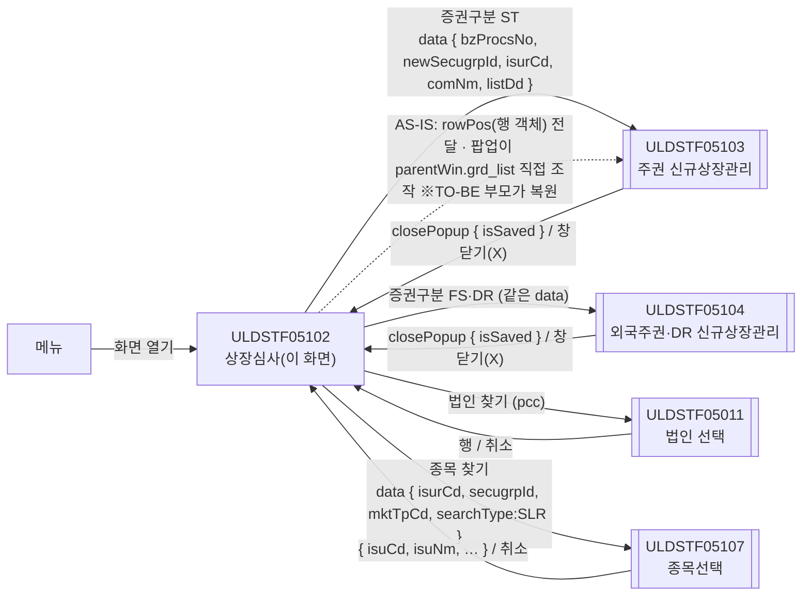
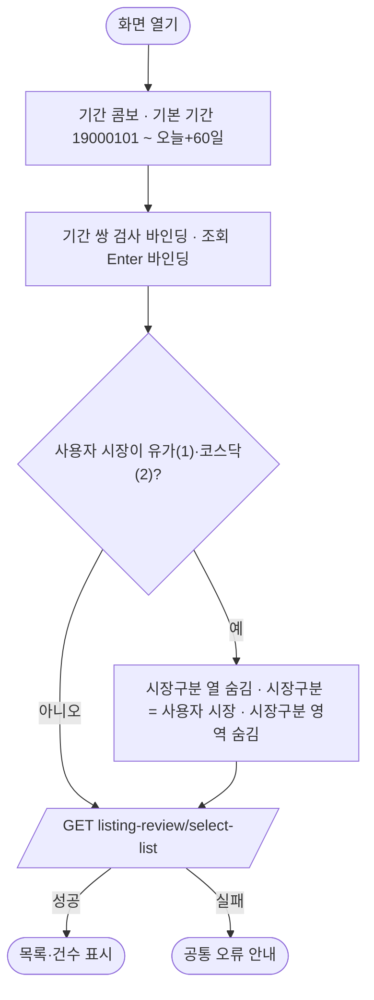
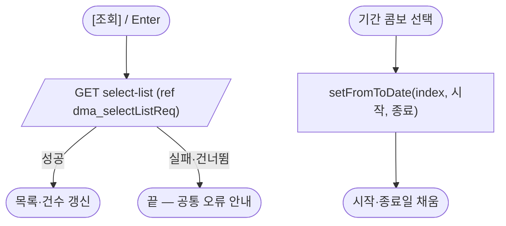
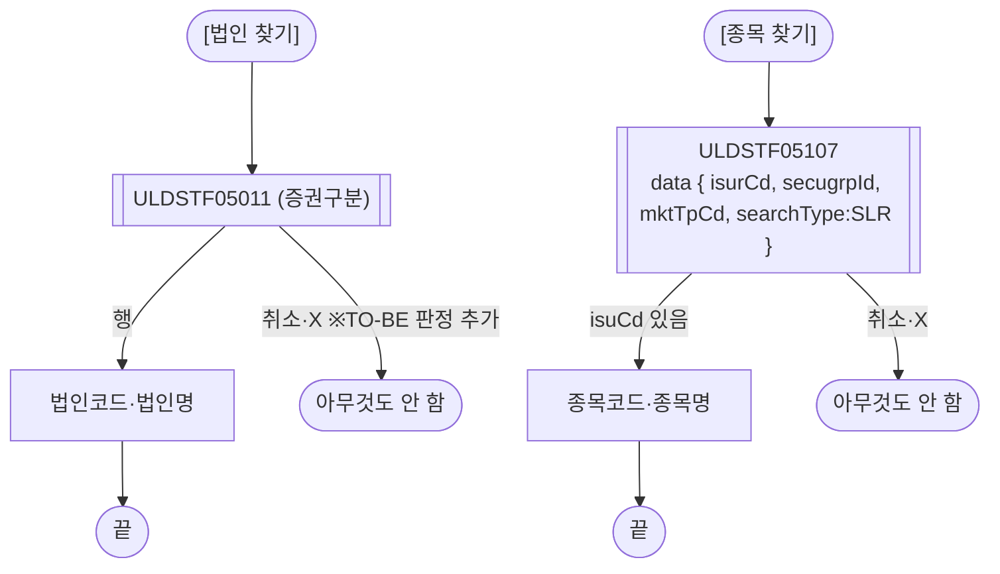
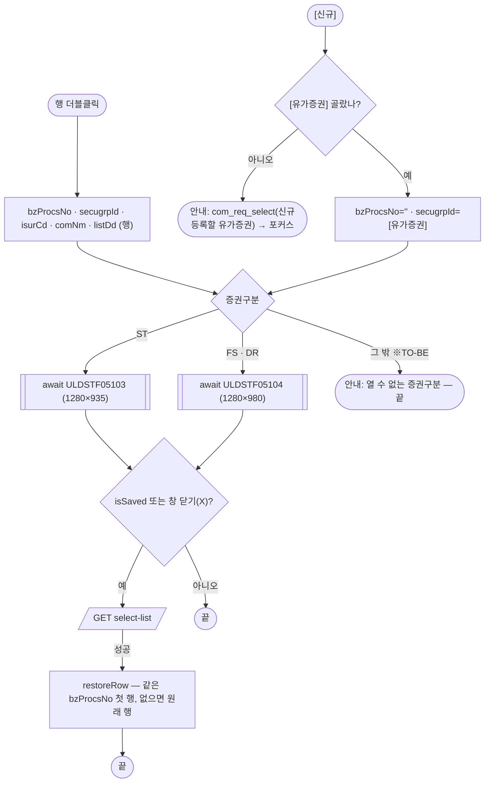
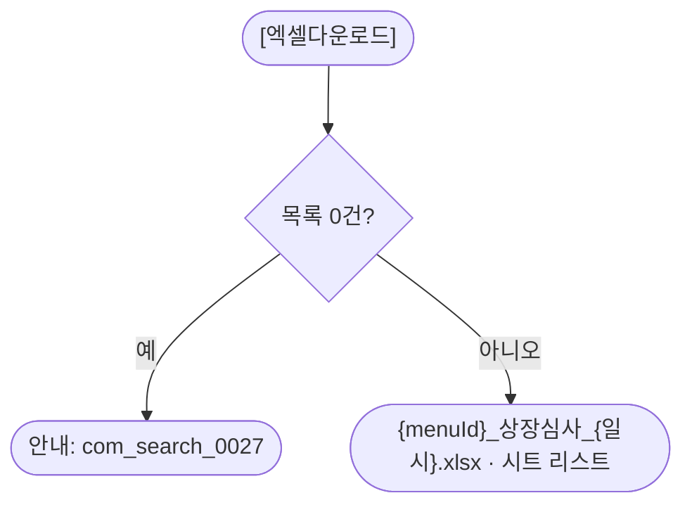

# ULDSTF05102 상장심사(종류주식) — 업무 분석 및 전환 내역

| 항목 | 내용 |
|---|---|
| AS-IS 원본 | `ULDSTF05102.xml` — W-Craft 1차 변환본(`meta_asisFileNm="ULDSTF05102.gfm"`, 원본 gfm 은 저장소에 없음)에 **API 적용까지 마친 개발 사본**(작성 배성우, 2026-08-18 — 5구역 구조로 이미 손본 상태). 업무 로직은 이 스크립트와 남은 옛 코드 주석(`fn_GetPar`/`fn_SetPar`, body 의 `mxdataset dts_List`·`xf:events` 잔재)으로 분석했다. **메뉴 본화면**(팝업 아님) |
| 신규 API 명세 | 없음 — **화면에 적용된 `/api/...` 경로·method·dataCollection keyInfo 를 명세로 간주**(사용자 결정 2026-10-29). 적용 API 1종: `GET /api/listing/lstproc/kind/listing-review/select-list`(목록). §5 는 「화면 적용 API ↔ AS-IS」 대응표. `api_spec_check` 는 SKIP(A07·A08 형식 검사만 통과) |
| 화면 캡처 | 없음 |
| 퍼블리싱 파일 | 화면 폴더 `ULDSTF05102.xml` 의 body(퍼블리싱 반영됨)를 1단계 기준으로 했다. publish 원본 `conversion/publish/상장/상장처리(대내)/ULDSTF05102.xml` 은 참고만 했다. 1단계는 선례 ULDBNS30400 처럼 「캡처 없음, 기존 마크업 정비」 — §2.1 |
| TO-BE | `conversion/conversion-front/ui-tobe/ULDSTF05102.xml` (배포 경로 `/ui/lst/kindstk/ULDSTF05102.xml` — 같은 묶음 원본 리터럴 기준). **2026-10-29 재전환** — 1단계: 기존 마크업 정비(본화면 `sub_contents` + contentHeader, 조회조건 `schbox`, 목록 그리드 + 총건수·엑셀, 하단 [유가증권]·[신규]), 2단계: 이 결과서대로 스크립트 재전환. 게이트: `gate_screen --pcc stf`, `scan_mixed_compare`(A 2 숫자 비교·B 0), `publish_gate --pcc stf --before {1단계 사본} --allow P20`, `api_spec_check`(SKIP), `init_binding_check`, `wsxml_lint` 0/0, `convert.py` 고정점 |
| 묶음 계약 | kindstk 13본 공통 계약서(잡 임시 `kindstk_contracts.md`) — 05103/05104·05107 data/반환 키, 재조회 규약(`isSaved`), 공통 결정 §4. 이 화면은 **부모 쪽**이다 |
| 업무공통 | pcc(`cm/pcc/stf`): `$c.lc`(`popFindExamCorp`·`getSecuGrpNm`·`getGlbValue`·`initSearchDate`)·`$c.stf.setFromToDate`. gcc: `$c.data`(`comboCbDataSetPeriod`·`downloadGridViewExcel`·`getMessage`)·`$c.date`(`compareFromToDate`·`getServerDateTime`)·`$c.session.getUserInfo`·`$c.util.isEmpty`·`$c.win`(`alert`·`openPopup`·`setEnterKeyEvent`·`getProgramId`)·`$c.sbm.executeDynamic`·`$c.exception.handleError` |
| 작성 | Inswave / 2026-10-29 |

참고 양식: [websquare_gfm_conversion.md](../../../../md/websquare_gfm_conversion.md) — §1.4 업무 프로세스 흐름, §6.5 getPar/setPar 전환. 짝 화면 [ULDSTF05100.md](../ULDSTF05100/ULDSTF05100.md)(예비심사)와 조회 영역·재조회·행 복원을 같은 방식으로 맞췄다.

---

## 1. 화면 개요

상장 담당자가 **종류주식 상장심사(신규상장)** 건을 찾아보고 신규상장관리 팝업으로 들어가는 메뉴 본화면이다. 이 화면은 저장하지 않는다.

1. 조회조건(증권구분·상장일 기간·법인·시장구분·종목)으로 상장심사 목록을 조회한다. 화면을 열면 기본 조건(1900-01-01 ~ 오늘+60일)으로 바로 조회한다.
2. 행을 **더블클릭**하면 그 건의 증권구분으로 **신규상장관리 팝업**을 연다 — 주권(ST)은 **ULDSTF05103**, 외국주권(FS)·주식예탁증권(DR)은 **ULDSTF05104**.
3. 하단 **[유가증권]** 에서 증권구분을 고르고 **[신규]** 를 누르면 빈 신규상장관리 팝업을 연다.
4. 팝업이 저장하고 닫히거나 창 닫기(X)로 닫히면 목록을 다시 조회하고 연 행을 다시 선택한다.
5. [법인 찾기]·[종목 찾기]로 조회조건을 채우고, [엑셀다운로드]로 목록을 내려받는다.

### 1.1 호출 화면 (메뉴)

- 메뉴로 연다. 업무공통 메뉴→증권그룹 표(`cm/pcc/stf/list_common.xml`)에는 이 화면 항목이 없다 — 증권그룹은 조회조건(`rdo_secugrpId`)으로 고른다.
- 저장소에서 이 화면을 여는 다른 화면은 없다.

### 1.2 호출 규약 (부모 → 이 화면) / 반환 규약

해당 없음 — 메뉴 본화면이라 받는 파라미터·반환값이 없다.

### 1.3 이 화면이 여는 하위 팝업

| 팝업 | AS-IS 호출 (getPar/setPar · 부모 직접 참조) | 넘기는 `data` (TO-BE) | 받는 결과 / 취소 판정 |
|---|---|---|---|
| `ULDSTF05103` 주권 종류주식 신규상장관리 (1280×935) · `ULDSTF05104` 외국주권·DR 종류주식 신규상장관리 (1280×980), `frameModal:"top"` | `fn_OpenDetail` → `openPopup("/ui/lst/kindstk/" + pageNM + ".xml", opts, { clickBzProcsNo, rowPos: getRowJSON(row), newSecugrpId, isurCd, comNm, listDd })`. 팝업은 저장 뒤 `parentWin.grd_list.setFocusedCell(rowPos)`·`parentWin.scwin.fn_list_sync()` 로 부모를 직접 다뤘다(05104 는 05102 에 없는 `parentWin.dts_List` 참조) | `{ bzProcsNo, newSecugrpId, isurCd, comNm, listDd }` — 계약 05103/05104 절. 원본 키 `clickBzProcsNo` → `bzProcsNo`, `rowPos` 는 넘기지 않음(§8 #2) | `{ isSaved }`. **`isSaved === true` 또는 `isCloseButtonClick === true` 면 목록 재조회 + 행 복원** — §6.2 |
| `ULDSTF05011` 법인 선택 (800×750, pcc) | `btn_coSearch_onclick` → `$c.lc.popFindExamCorp(rdo_secugrpId, "SLR", rdo_spotIsuTrdMktTpCd)` — 2·3번째 인자는 pcc 가 받지 않음. 결과를 판정 없이 대입 | `await $c.lc.popFindExamCorp(rdo_secugrpId.getValue())` — pcc 가 `{ secugrpId }` 로 연다 | 05011 목록 행(camelCase `isurCd`·`comNm`…). **`isurCd` 가 비면 취소** — §6.3 |
| `ULDSTF05107` 종류주식 종목선택 (800×780, `pageFramePopup`) | `fn_PopFindKindStkExamIsu` → `openPopup(…, { isurCd, comNm, secugrpId, mktTpCd, searchType: getGlbValue("SEARCH_TYP_SLR") })`, 크기 1180×880. 결과 판정 `result.isCloseButtonClick === false` + 대문자 `result.ISU_CD`·`ISU_NM` | `{ isurCd, secugrpId, mktTpCd, searchType: $c.lc.getGlbValue("SEARCH_TYP_SLR") }` — 계약 05107 절(`comNm` 은 05107 이 쓰지 않아 뺌) | `{ isuCd, isuNm, … }`. **`isuCd` 가 비면 취소**. 고르면 `ibx_isuCd`·`ibx_isuNm` — §6.4 |

### 1.4 업무 프로세스 흐름

흐름은 AS-IS(개발 사본) 동작 기준이다. 점선과 `※TO-BE` 는 전환본에서 바뀌는 곳이다(근거 §8).

| # | 업무 | 시작 (사용자 동작·진입 조건) | 끝 (결과) | 주요 함수 | 관련 절 |
|---|---|---|---|---|---|
| 1 | 진입·로딩 | 메뉴에서 화면 열기 | 기본 조건으로 목록 표시 | `scwin.onpageload` → `scwin.init` → `scwin.selectList` | §3 |
| 2 | 조회 | [조회] / 조회 영역 Enter | 목록·건수 표시 | `scwin.btn_search_onclick` → `scwin.selectList` | §5.1 |
| 3 | 기간선택 | 기간 콤보 선택 | 시작·종료일 채움 | `scwin.sbx_periodTp_onviewchange` | §4 |
| 4 | 법인 찾기 | [법인 찾기] | 법인코드·법인명 / 취소 | `scwin.btn_coSearch_onclick` → `scwin.openCorpPopup` | §6.3 |
| 5 | 종목 찾기 | [종목 찾기] | 종목코드·종목명 / 취소 | `scwin.btn_isuCdSearch_onclick` → `scwin.openIsuPopup` | §6.4 |
| 6 | 상세(관리) | 목록 행 더블클릭 | 05103/05104 → (저장·X 닫기면) 재조회·행 복원 | `scwin.grd_list_oncelldblclick` → `scwin.openDetail` → `scwin.restoreRow` | §6.2 |
| 7 | 신규 | [유가증권] 선택 + [신규] | 05103/05104(신규) → 재조회 / 미선택 안내 | `scwin.btn_new_onclick` → `scwin.openNew` → `scwin.openDetail` | §6.1·§6.2 |
| 8 | 엑셀 | [엑셀다운로드] | 목록 xlsx / 0건 안내 | `scwin.btn_excel_onclick` → `scwin.excelDown` | §6.5 |

#### 화면 간 흐름

#### 업무 1: 진입·로딩

| 단계 | 주체 | 동작 | 분기·예외 | 근거 |
|---|---|---|---|---|
| 1 | 화면 | `comboCbDataSetPeriod(sbx_periodTp)`·`initSearchDate(cal_sDate, cal_eDate)` | — | 원본 `init` |
| 2 | 화면 | `compareFromToDate(cal_sDate, cal_eDate, 명칭)`·`setEnterKeyEvent(grp_search)` | — | 규칙 37·22 |
| 3 | 화면 | 시장 사용자 고정 | 유가·코스닥만 | 원본 그대로 |
| 4 | 서버 | 목록 조회 `await` | 실패는 공통 안내 | §5.1 |

#### 업무 2: 조회 · 업무 3: 기간선택

| 단계 | 주체 | 동작 | 분기·예외 | 근거 |
|---|---|---|---|---|
| 1 | 서버 | 조건은 모두 ref 바인딩 | `skipped`·실패 | §5.1 |
| 2 | 화면 | 기간선택 index 를 숫자로 | 원본 `$c.cp.valueOfIndex` 도 index 를 돌려줌 | §9 |

#### 업무 4: 법인 찾기 · 업무 5: 종목 찾기

| 단계 | 주체 | 동작 | 분기·예외 | 근거 |
|---|---|---|---|---|
| 1 | 팝업 | pcc `popFindExamCorp(증권구분)` | 원본은 결과 판정 없이 대입 | §8 #5 |
| 2 | 팝업 | 05107 data 로 열기 | 원본 판정·대문자 키 결함 | §8 #6 |

#### 업무 6: 상세(관리) · 업무 7: 신규

| 단계 | 주체 | 동작 | 분기·예외 | 근거 |
|---|---|---|---|---|
| 1 | 화면 | 신규는 [유가증권] 검사 | 비면 안내·포커스 | §6.1 |
| 2 | 화면 | 증권구분으로 화면·높이 결정 | ST·FS·DR 외면 안내 후 중단 | §8 #4 |
| 3 | 팝업 | data 로 열고 `await` | 원본 `rowPos` 결함 | §8 #2 |
| 4 | 화면 | 재조회 규약 + 행 복원 | 계약 공통 규칙 | §6.2 |

#### 업무 8: 엑셀

| 단계 | 주체 | 동작 | 분기·예외 | 근거 |
|---|---|---|---|---|
| 1 | 화면 | 0건 검사 | `getMessage("com_search_0027")` | 원본 |
| 2 | 화면 | 파일명 규칙 42 | 원본 화면 ID 하드코딩·확장자 없음 | §8 #7 |

---

## 2. 화면 구성 및 데이터 정의

### 2.1 화면 구성 (AS-IS 요소 → TO-BE 컴포넌트)

| 영역 | AS-IS 요소 | TO-BE | 비고 |
|---|---|---|---|
| body 잔재 | `xf:model ref="data:bnd_Isu.undefined"`(주석 `mxdataset dts_List`), `xf:events`(`btn_search`·`dts_List`·`btn_excel`·`grd_list`·`btn_new`·`btn_EDate`·`btn_SDate`·`btn_coSearch`·`ibx_isurCd`·`sbx_periodTp`·`btn_Close`·`gform`·`btn_isuCdSearch`), 그룹·머리행의 `ref="data:bnd_Isu.undefined"` | **(옮기지 않음)** — W-Craft 변환 잔재(바인딩 대상 없음) | §8 #8 |
| 머리 | `pfmContentHeader` | 그대로 | 본화면 contentHeader 필수 |
| 조회조건 `grp_search` | `rdo_secugrpId`(A1·ST·FS·DR, `ref secugrpId`), `label_5` | 그대로 | — |
| | `cal_sDate` ~ `cal_eDate`(`label_3` "~"), `sbx_periodTp`, `label_1` "상장일기간" | `flex flex_no` 묶음, `w2:span "~"`, 달력 ref 유지, 기간 콤보 `ev:onviewchange` 유지 | 원본 `style="width:120px"`·`userData2` 정리 |
| | `ibx_isurCd`(ref isurCd, maxlength 40) · `ibx_comNm` · `btn_coSearch`, `label_2` | 그대로, 버튼 `type="button"`·라벨 "법인 찾기" | 주석 처리된 `w2:autoComplete` 삭제 |
| | `panel_mkt_gubun`(th `in_tbl` 안) 안 `rdo_spotIsuTrdMktTpCd`(A·1·2), `label_10` | **td** `in_tbl` colspan 2 안 표로 | 원본은 th 에 `in_tbl` — 칸 종류 정정 |
| | `ibx_isuCd`(ref isuCd) · `ibx_isuNm`(maxlength 5) · `btn_isuCdSearch`, `label_4` | 그대로, 종목명 maxlength 삭제 | §8 #12 |
| | `btn_search` | `btn_schbox` 안 `btn_cm sch` | — |
| 목록 제목줄 | `tbx_totCnt`(w2:textbox) · `btn_excel` | `w2:span` 총/건 + `tbx_totCnt`(span, id 유지) · `btn_excel` | 관용구 5.1 |
| 목록 | `grd_list`(`dlt_selectListRes`, 고정 4열, `row10`, `style="height:153px"`, `userData2` 대량) | `readOnly="true"`·`focusMode="row"`·`rowNumWidth="40"`, caption "상장심사 목록", 고정 높이·`userData2` 삭제 | §8 #14 |
| 목록 머리글 | 원본 머리글 id(대문자, `h_` 없음) `DISCLS_YN`·`TR_MKT_NM`·`SECUGRP_NM`·`COM_NM`·`ISU_CD`·`ISU_NM`·`ISUR_CD`·`LIST_DD`·`LIST_CLSS_NM`·`ACNTCLS_MMDD1`·`CEO_NM`·`STD_IND_NM`·`MAINTR_BK_NM`·`TRANSSTK_AGNT_NM`·`NPARVALSTK_YN`·`PARVAL`·`LIST_SHRS`·`CAP`·`ADDR`·`FNL_EMP_NM`·`ACCTP_YN`·`CASH_DIV_YN`·`CMSTK_PCT1_DIV_YN`·`COM_CASH_REDMPT_YN`·`COM_CONV_OBJ_STK_CONTN`·`COM_CONV_PD_END_DD`·`COM_CONV_PD_STRT_DD`·`COM_CONV_RGHT_YN`·`COM_CONV_RTO`·`COM_REDMPT_PD_END_DD`·`COM_REDMPT_PD_STRT_DD`·`COM_REDMPT_RGHT_YN`·`CONTIN_DEADLINE_END_DD`·`CONTIN_DEADLINE_STRT_DD`·`CONV_YN`·`DIV_RT`·`LWST_DIV_RT_DSC_YN`·`MISC_DIV_YN`·`NDIVTM_VOTERGHT_YN`·`PARTCTP_YN`·`PROFT_DIV_YN`·`REDMPT_YN`·`REMAIN_PROPRT_DISTR_YN`·`SHRHD_CASH_REDMPT_YN`·`SHRHD_CONV_PD_END_DD`·`SHRHD_CONV_PD_STRT_DD`·`SHRHD_CONV_RGHT_YN`·`SHRHD_CONV_RTO`·`SHRHD_REDMPT_PD_END_DD`·`SHRHD_REDMPT_PD_STRT_DD`·`SHRHD_REDMPT_RGHT_YN`·`VOTERGHT_EXCLD_YN`·`VOTERGHT_LMT_YN`·`BZ_PROCS_NO`, 구조 id `caption1`·`header1`·`gBody1` | `h_{gBody id}`(예 `DISCLS_YN`→`h_disclsYn`), 구조 id 그대로 | §8 #13. 라벨 원본 그대로(` `→` `) |
| 하단 `btnbox` | `label_6` "유가증권" · `sbx_newSecugrpId`(chooseOption, 라벨 "") · `btn_new` | `rt` 안 그대로, chooseOption 라벨 "선택하세요", `btn_new` `btn_cm pt` | §8 #11. 규칙 41 |

### 2.2 데이터 정의 (DataCollection)

| AS-IS | TO-BE | 종류 | 키 | 비고 |
|---|---|---|---|---|
| `dma_selectListReq` | `dma_selectListReq` | dataMap | `secugrpId`·`isurCd`·`startDate`·`endDate`·`spotIsuTrdMktTpCd`·`isuCd` | select-list 요청(원본 keyInfo 그대로). 모두 ref 바인딩 |
| `dlt_selectListRes` | `dlt_selectListRes` | dataList | 아래 전체 | select-list 응답. **키·dataType 은 원본 그대로**, `name` 은 원본 자리표(`name1`~`name71`)를 한글 명칭으로 채웠다(짝 화면 05100 같은 키의 명칭 → 그리드 머리글 순) — §8 #9 |

- `dlt_selectListRes` 키(원본 순, 71개): `prelmInvstgBzProcsNo`·`bzProcsNo`·`trMktNm`·`disclsYn`·`mktactYn`·`isurCd`·`spotIsuTrdMktTpCd`·`secugrpNm`·`secugrpId`·`comNm`·`listClssNm`·`listNo`·`listDd`·`maintrBkNm`·`ceoNm`·`transstkAgntNm`·`addr`·`stdIndNm`·`acntclsMmdd1`·`listShrs`·`parval`·`cap`·`exstStrtDd`·`exstEndDd`·`isuCd`·`isuNm`·`fnlEmpNm`·`nparvalstkYn`·`proftDivYn`·`cmstkPct1DivYn`·`lwstDivRtDscYn`·`miscDivYn`·`cashDivYn`·`partctpYn`·`divRt`·`acctpYn`·`ndivtmVoterghtYn`·`proftDivRemk`·`remainProprtDistrYn`·`remainProprtDistrRemk`·`voterghtExcldYn`·`voterghtExcldRemk`·`voterghtLmtYn`·`voterghtLmtContn`·`voterghtLmtRemk`·`redmptYn`·`comRedmptRghtYn`·`comRedmptPdEndDd`·`comRedmptPdStrtDd`·`comCashRedmptYn`·`comRedmptRemk`·`shrhdRedmptRghtYn`·`shrhdRedmptPdEndDd`·`shrhdRedmptPdStrtDd`·`shrhdCashRedmptYn`·`shrhdRedmptRemk`·`convYn`·`comConvRghtYn`·`comConvRto`·`comConvObjStkContn`·`comConvPdStrtDd`·`comConvPdEndDd`·`comConvRemk`·`shrhdConvRghtYn`·`shrhdConvRto`·`shrhdConvObjStkContn`·`shrhdConvPdStrtDd`·`shrhdConvPdEndDd`·`shrhdConvRemk`·`continDeadlineEndDd`·`continDeadlineStrtDd`
- 그리드 표시 열(54열)은 원본 gBody id 그대로. 정리한 것:
  - **날짜(규칙 46)** `dataType="date" displayFormat="yyyy-MM-dd"`: AS-IS 마스크 열 `listDd`(원본 `inputType="calendar"` → 표시 전용 text). 확장 대상(id `…Dd` + 명칭 `…일자`, 위 name 보충 기준) `comConvPdStrtDd`·`comConvPdEndDd`·`comRedmptPdStrtDd`·`comRedmptPdEndDd`·`shrhdConvPdStrtDd`·`shrhdConvPdEndDd`·`shrhdRedmptPdStrtDd`·`shrhdRedmptPdEndDd`·`continDeadlineStrtDd`·`continDeadlineEndDd` — **AS-IS 원시 표시 → TO-BE 날짜 형식(규칙 46)**, 서버 값 8자리 여부 §10 #4.
  - **숫자** — `parval`(액면가/1주당자본금, 원본 `decao:{decode(SECUGRP_ID,'FS',3,0)}`)·`cap`(자본금, `decode(SECUGRP_ID,'ST',3,0)`) → `#,##0.###`(소수 있으면 3자리까지, 정수면 정수), `listShrs` → `#,###`.
  - `isuNm`(종목명) 오른쪽 정렬 → 왼쪽.

---

## 3. 로딩 (`scwin.onpageload` → `scwin.init`)

`scwin.onpageload` 는 `scwin.init()` 호출만 갖는다(try/catch → `$c.exception.handleError`).

| 순서 | 동작 | await | 근거 |
|---|---|---|---|
| 1 | `$c.data.comboCbDataSetPeriod(sbx_periodTp)` | — | 원본 |
| 2 | `$c.lc.initSearchDate(cal_sDate, cal_eDate)` — 시작 `19000101`, 종료 오늘+60일 | — | 원본 |
| 3 | `$c.date.compareFromToDate(cal_sDate, cal_eDate, ["상장일 시작일", "상장일 종료일"])` (규칙 37) | — | 원본은 명칭 없이 호출 |
| 4 | `$c.win.setEnterKeyEvent(grp_search, scwin.btn_search_onclick)` (규칙 22) | — | 원본 그대로 |
| 5 | 사용자 시장 1·2 면 `grd_list.setColumnVisible("trMktNm", false)`, `rdo_spotIsuTrdMktTpCd.setValue(시장)`, `panel_mkt_gubun.hide()` | — | 원본 그대로(원본 `else` 의 `show()` 는 기본 표시라 생략) |
| 6 | `await scwin.selectList()` | 예 | §5.1 |

---

## 4. 컴포넌트 이벤트

| AS-IS 바인딩 | TO-BE 핸들러 | 동작 |
|---|---|---|
| body `ev:onpageload` | `scwin.onpageload` | §3 |
| body `ev:onpageunload` → `scwin.onpageunload`(빈 함수) | (삭제) | — |
| `btn_search` onclick | `scwin.btn_search_onclick` | `scwin.selectList` |
| `btn_excel` onclick | `scwin.btn_excel_onclick` | `scwin.excelDown` |
| `grd_list` oncelldblclick | `scwin.grd_list_oncelldblclick` | `scwin.openDetail(rowIndex)` |
| `btn_new` onclick | `scwin.btn_new_onclick` | `scwin.openNew` |
| `btn_coSearch` onclick | `scwin.btn_coSearch_onclick` | `scwin.openCorpPopup` |
| `ibx_isurCd` onblur | `scwin.ibx_isurCd_onblur` | 법인코드가 비면 법인명 비움 |
| `sbx_periodTp` onviewchange | `scwin.sbx_periodTp_onviewchange` | `$c.stf.setFromToDate(sbx_periodTp.getSelectedIndex(), cal_sDate, cal_eDate)` |
| `btn_isuCdSearch` onclick | `scwin.btn_isuCdSearch_onclick` | `scwin.openIsuPopup` |
| `ibx_isuCd` onblur | `scwin.ibx_isuCd_onblur` | 종목코드가 비면 종목명 비움 |

---

## 5. 서버 통신

| 화면 적용 API | method | 요청 | 응답 target | AS-IS | TO-BE 함수 |
|---|---|---|---|---|---|
| `/api/listing/lstproc/kind/listing-review/select-list` | GET | `ref: dma_selectListReq` | `dlt_selectListRes=body`, `gridview: grd_list` | `fn_list_sync`(옛 `dts_List` — body 주석 `mxdataset`) | `scwin.selectList` (§5.1) |

### 5.1 상장심사 목록 조회 (`scwin.selectList`)

- `executeDynamic({ id:"sbm_selectList", method:"get", action:".../listing-review/select-list", ref:"dma_selectListReq", target:"dlt_selectListRes=body", gridview:"grd_list", isProcessMsg:false })` — `gridview` 는 id 만(규칙 44, 원본에는 없어 추가).
- 후처리: `tbx_totCnt.setValue(dlt_selectListRes.getRowCount())`. `skipped`·실패면 `false`(공통 안내).

---

## 6. 일반 함수

### 6.1 신규 (`scwin.openNew`)

- `sbx_newSecugrpId` 가 비면 `$c.data.getMessage("com_req_select", "신규등록할 유가증권")` 안내 후 포커스, 멈춤. 고르면 `scwin.openDetail(-1)`.

### 6.2 신규상장관리 팝업 (`scwin.openDetail` · `scwin.restoreRow`) — 부모 직접 참조 → `openPopup` data + `await`

- 행이면 `bzProcsNo`·`secugrpId`·`isurCd`·`comNm`·`listDd` 를 행에서, 신규면 `secugrpId` = `sbx_newSecugrpId`, 나머지 `""`.
- 화면: `secugrpId === getGlbValue("SECUGRP_ID_ST")` → `ULDSTF05103`(높이 935), `SECUGRP_ID_DR`·`SECUGRP_ID_FS` → `ULDSTF05104`(980). 그 밖은 `"종류주식 신규상장관리를 열 수 없는 증권구분입니다."` 안내 후 중단(§8 #4).
- data(계약 05103/05104 절):

  | TO-BE 키 | 값 | AS-IS |
  |---|---|---|
  | `bzProcsNo` | 행 `bzProcsNo` / 신규 "" | `clickBzProcsNo`(= `scwin.clickBzProcsNo`) — 키 개명 |
  | `newSecugrpId` | `sbx_newSecugrpId.getValue()` | 같음 |
  | `isurCd` · `comNm` · `listDd` | 행 값 / 신규 "" | 같음 |
  | (넘기지 않음) | — | `rowPos: dlt_selectListRes.getRowJSON(row)` — §8 #2 |

- `await $c.win.openPopup("/ui/lst/kindstk/" + pageId + ".xml", { id: pageId, popupName: getSecuGrpNm(secugrpId) + " 종류주식 신규상장관리", width:1280, height, frameModal:"top" }, data)`.
- 반환 `isSaved === true` 또는 `isCloseButtonClick === true` 면 `scwin.selectList()` → `scwin.restoreRow(bzProcsNo, rowIndex)`: 신규·0건이면 선택 안 함, 같은 `bzProcsNo` 첫 행, 없으면 원래 행 번호로 `grd_list.setFocusedCell(row, 0)`.

### 6.3 법인 찾기 (`scwin.openCorpPopup`)

- `await $c.lc.popFindExamCorp(rdo_secugrpId.getValue())` → `isEmpty(res?.isurCd)` 면 멈춤, 아니면 `ibx_isurCd`·`ibx_comNm`.
- 원본 Gauce `fn_GetPar`(주석, arr 0~4: 법인코드·법인명·증권구분·시장구분·`SEARCH_TYP_SLR`)/`fn_SetPar`(`arrPar[0].ISUR_CD`·`COM_NM`)는 개발 사본에서 이미 주석 처리 — pcc 호출로 대체돼 있었다.

### 6.4 종목 찾기 (`scwin.openIsuPopup`)

- data `{ isurCd: ibx_isurCd, secugrpId: rdo_secugrpId, mktTpCd: rdo_spotIsuTrdMktTpCd, searchType: getGlbValue("SEARCH_TYP_SLR") }`.
- `await openPopup("/ui/lst/kindstk/ULDSTF05107.xml", { id:"ULDSTF05107", popupName:"종류주식 종목 선택", width:800, height:780, frameModal:"top", type:"pageFramePopup" }, data)` — 크기는 계약 권고(원본 1180×880).
- `isEmpty(res?.isuCd)` 면 멈춤, 아니면 `ibx_isuCd`·`ibx_isuNm`.

### 6.5 엑셀 (`scwin.excelDown`)

- 0건이면 `getMessage("com_search_0027")` 안내.
- `downloadGridViewExcel(grd_list, { fileName: $c.win.getProgramId() + "_상장심사_" + 서버일시 + ".xlsx", sheetName: "리스트" })` — 규칙 42.

---

## 7. 업무 코드 · 메시지 목록

| 구분 | 값 |
|---|---|
| 증권구분 `secugrpId` | `A1` 전체 · `ST` 주권 · `FS` 외국주권 · `DR` 주식예탁증권. 팝업 분기: ST → 05103, FS·DR → 05104 (`$c.lc.getGlbValue("SECUGRP_ID_ST|DR|FS")`) |
| 시장구분 `spotIsuTrdMktTpCd` | `A` 전체 · `1` 유가 · `2` 코스닥. 사용자 시장 1·2 면 고정 |
| 기간선택 | 0 기간선택(=오늘) · 1 1주일 · 2 1개월 · 3 3개월 · 4 6개월 · 5 1년 · 6 2년 |
| 조회유형 | `SEARCH_TYP_SLR` = "SLR" (유가신규상장등록조회) |
| 메시지 | `com_req_select`("신규등록할 유가증권") · `com_search_0027`(0건) · "종류주식 신규상장관리를 열 수 없는 증권구분입니다."(TO-BE 신규) |

---

## 8. 원본 특이사항 · 결함

| # | 내용 | 결정 |
|---|---|---|
| 1 | `scwin.vScrenID`·`scwin.clickBzProcsNo` 전역 — vScrenID 는 쓰는 곳이 없고, clickBzProcsNo 는 팝업이 부모에서 읽던 값 | 옮기지 않음 — 지역 변수·data |
| 2 | 팝업 data `rowPos: dlt_selectListRes.getRowJSON(row)` — **행 객체**를 넘기는데 05103 은 그것을 `parentWin.grd_list.setFocusedCell(rowPos)` 행 번호로 썼다. 05104 는 05102 에 없는 `parentWin.dts_List` 를 참조 | 고침 — 넘기지 않고 부모가 `restoreRow` 로 복원(계약) |
| 3 | 원본 키 `clickBzProcsNo` | 고침 — 계약 키 `bzProcsNo` |
| 4 | 증권구분이 ST·FS·DR 이 아니면 `pageNM` 이 비어 `"/ui/lst/kindstk/undefined.xml"` 을 연다 | 고침 — 안내 후 중단 |
| 5 | 법인 찾기 결과를 판정 없이 대입 — 취소·X 면 `undefined`. `"SLR"`·시장구분 인자는 pcc 가 받지 않는다 | 고침 — `isurCd` 판정, 인자 정리(§10 #3) |
| 6 | 종목 찾기 판정 `result.isCloseButtonClick === false`(자기 닫기 반환에는 이 키가 없어 늘 거짓) + 대문자 `ISU_CD`·`ISU_NM` — 고른 종목이 채워지지 않음 | 고침 — `isuCd` 판정·camelCase(계약) |
| 7 | 엑셀 파일명 `"ULDSTF05102_상장심사_" + today` — 화면 ID 하드코딩, 확장자 없음 | 고침 — 규칙 42 |
| 8 | body 의 W-Craft 잔재(`xf:model`·`xf:events`·`ref="data:bnd_Isu.undefined"`) | 옮기지 않음 |
| 9 | 응답 dataList `name` 이 `name1`~`name71` 자리표 | 고침 — 한글 명칭(키·dataType 불변) |
| 10 | 그리드 `listDd` `inputType="calendar"`(표시 전용 그리드인데 입력형), 숫자 열 decao 수식 | 고침(§2.2) |
| 11 | `sbx_newSecugrpId` chooseOption 라벨 "" — 빈 첫 항목 | 고침 — "선택하세요"(원본 item 정의 `''^'선택하세요'` 의 의도) |
| 12 | `ibx_isuNm`(종목명) `maxlength="5"` | 고침 — 삭제 |
| 13 | 머리글 id 가 대문자 스네이크(`h_` 접두 없음) | 고침 — `h_{camelCase}` |
| 14 | 그리드 `style="height:153px"` 고정 + `userData2` 대량(Gauce 속성) | 고침 — `row10` class 로 높이, userData2 삭제 |
| 15 | `scwin.fn_list_sync` 가 성공 때만 건수 갱신 — 그대로. `isProcessMsg:false` 유지 | 유지 |

---

## 9. 전환 내역 (AS-IS → TO-BE)

| AS-IS | TO-BE |
|---|---|
| `scwin.onpageload` → `scwin.init` | 같음(로딩 순서 §3) |
| `scwin.onpageunload` | 삭제(빈 함수) |
| `scwin.btn_search_onclick` | `scwin.btn_search_onclick` → `scwin.selectList` |
| `scwin.fn_list_sync` | `scwin.selectList` |
| `scwin.btn_excel_onclick` · `scwin.fn_excelDown` | `scwin.btn_excel_onclick` → `scwin.excelDown` |
| `scwin.grd_list_oncelldblclick` | `scwin.grd_list_oncelldblclick` → `scwin.openDetail` |
| `scwin.btn_new_onclick` | `scwin.btn_new_onclick` → `scwin.openNew` |
| `scwin.fn_OpenDetail` | `scwin.openDetail` + `scwin.restoreRow` |
| `scwin.btn_coSearch_onclick` | `scwin.btn_coSearch_onclick` → `scwin.openCorpPopup` |
| `scwin.ibx_isurCd_onblur` · `scwin.ibx_isuCd_onblur` | 같음 |
| `scwin.sbx_periodTp_onviewchange` (`$c.cp.valueOfIndex`) | `scwin.sbx_periodTp_onviewchange` (`getSelectedIndex()` — 같은 값) |
| `scwin.btn_isuCdSearch_onclick` · `scwin.fn_PopFindKindStkExamIsu` | `scwin.btn_isuCdSearch_onclick` → `scwin.openIsuPopup` |
| 주석 `scwin.fn_GetPar` · `scwin.fn_SetPar` | 삭제(주석 잔재 — pcc 로 이미 대체) |
| `scwin.clickBzProcsNo` · `scwin.vScrenID` | 삭제(§8 #1) |

---

## 10. 남은 작업 (TODO)

1. **05103/05104 계약 대조** — 묶음 D 가 `bzProcsNo`·`newSecugrpId`·`isurCd`·`comNm`·`listDd` 로 받고, 저장 성공 후 자기 닫기에서 `{ isSaved }` 를 넘기는지 최종 대조.
2. **05107 계약 대조** — 반환 `{ isuCd, isuNm, … }`(2026-10-29 시점 05107 TO-BE 와 일치).
3. **법인 찾기 조회유형** — 원본은 `"SLR"`·시장구분을 넘기려 했다. pcc `popFindExamCorp` 는 증권구분만 넘기고 05011 은 `spotIsuTrdMktTpCd`·`searchTyp` 를 읽는다 — 신규상장 법인만 걸러야 하면 pcc 확장 필요.
4. **날짜 열 서버 값** — `listDd`·확장 대상 10열이 8자리 `yyyyMMdd` 인지(규칙 46).
5. **팝업 크기** — 05107 을 계약 권고 800×780 으로 줄였다(원본 1180×880). 05103/05104 1280×935/980 은 원본 그대로.
6. **배포 경로** — `/ui/lst/kindstk/ULDSTF05102.xml` 는 같은 묶음 원본 리터럴 기준 가정.
