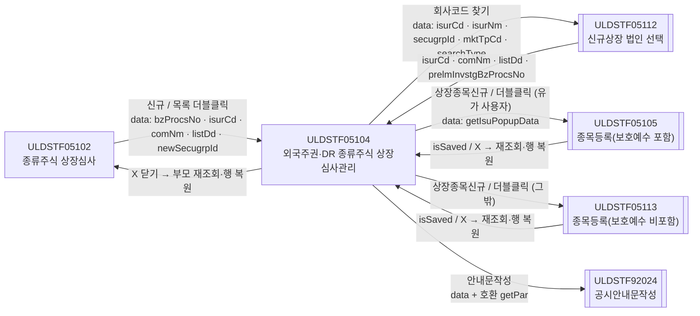
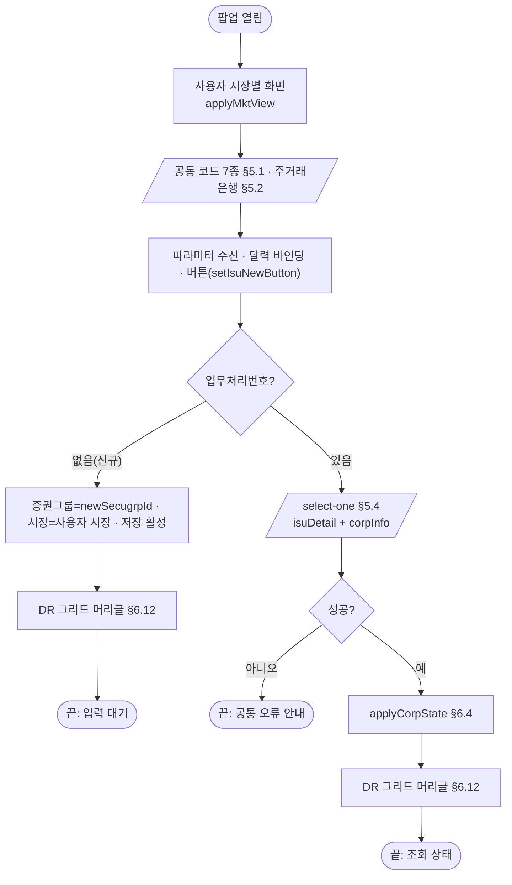
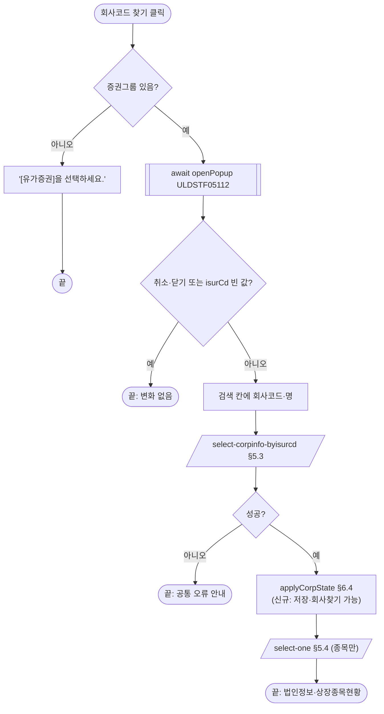
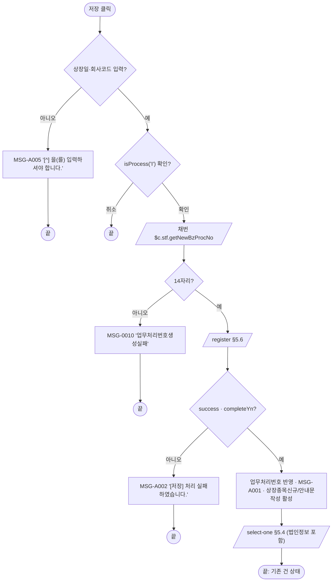
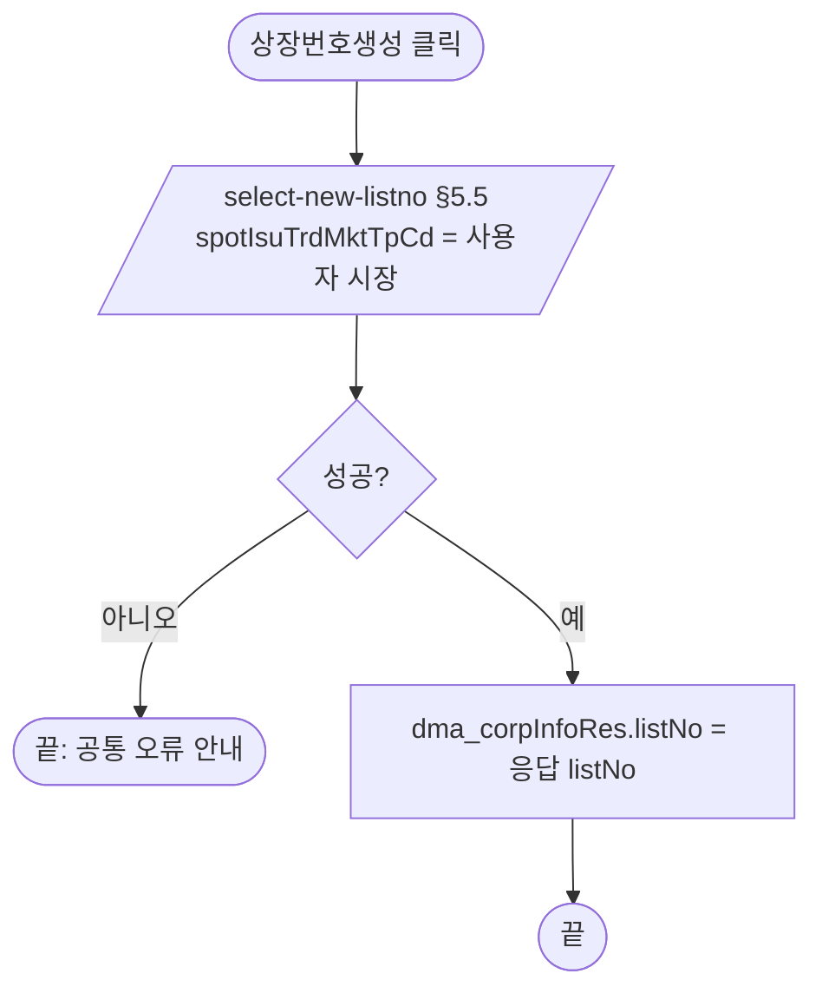
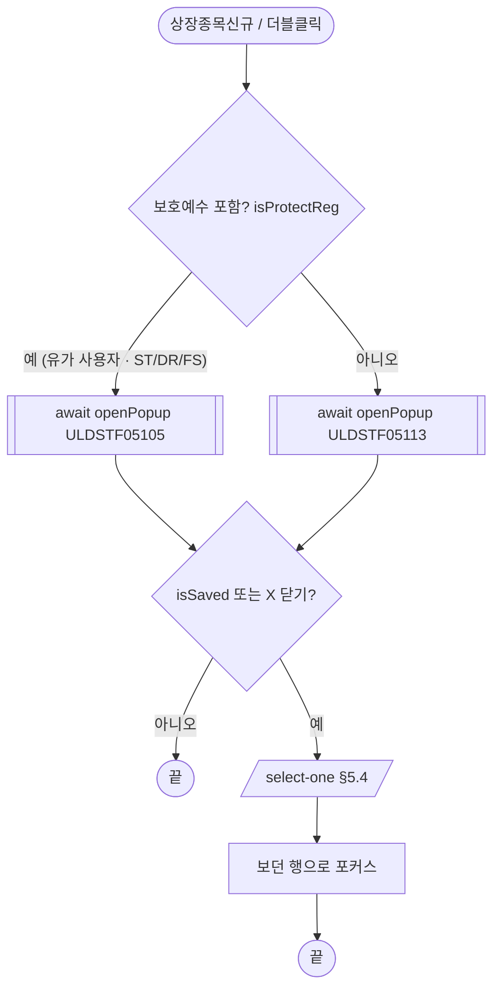
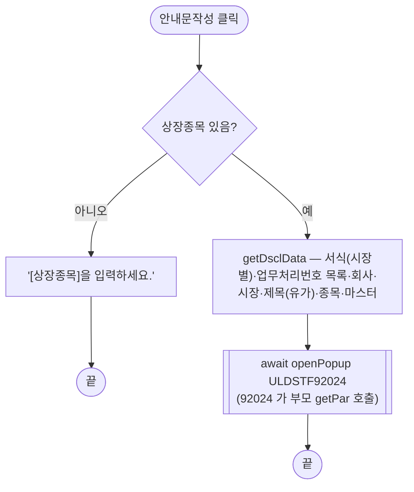
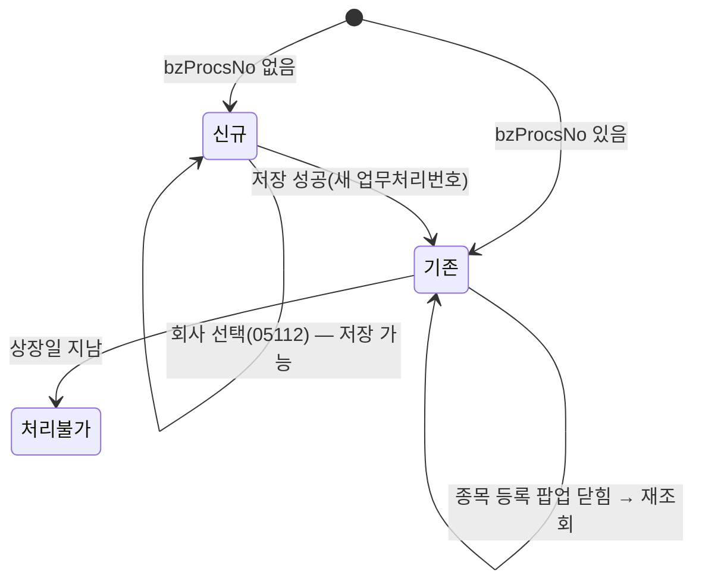

# ULDSTF05104 (팝업)외국주권,주식예탁증권 종류주식 상장심사관리 — 업무 분석 및 전환 내역

| 항목 | 내용 |
|---|---|
| AS-IS 원본 | `ULDSTF05104.xml` — W-Craft 1차 변환본(`meta_asisFileNm="ULDSTF05104.gfm"`, 원본 gfm 은 저장소에 없음)에 **API 적용까지 마친 개발 사본**(작성 배성우, 2026-08-19). 업무 로직은 이 스크립트와 남은 옛 코드 주석으로 분석했다 — 반입 `conversion/conversion-front/ui/ULDSTF05104/ULDSTF05104.xml` (kindstk 묶음, 부모 05102 가 1280×980 으로 연다) |
| 신규 API 명세 | 없음 — **화면에 적용된 `/api/...` 경로·method·dataCollection keyInfo 를 명세로 간주**(사용자 결정 2026-10-29). §5 는 "화면 적용 API ↔ AS-IS(주석에 남은 옛 호출)" 대응표로 쓴다. `api_spec_check` 는 SKIP |
| TO-BE | `conversion/conversion-front/ui-tobe/ULDSTF05104.xml` (배포 경로 `/ui/lst/kindstk/ULDSTF05104.xml` — 부모 05102 의 원본 리터럴) |
| 퍼블리싱 | 화면 폴더 `ULDSTF05104.xml` 의 body(이미 퍼블리싱 반영)를 1단계 기준으로 정비했다(선례 ULDBNS30400 「캡처 없음, 기존 마크업 정비」). `conversion/publish/상장/상장처리(대내)/ULDSTF05104.xml` 은 참고만 했고 라벨은 같다 |
| 화면 캡처 | 없음 |
| 업무공통 | `$c.stf`(`getMessageParam`·`getNewBzProcNo`)·`$c.lc`(`isProcess`·`getGlbValue`·`getSecuGrpNm`) — `cm/pcc/stf`. 게이트는 `--pcc stf` 로 돌린다 |
| 공통 계약 | kindstk 13본 공통 계약서(부모·팝업 data/반환 키, 경로, 미정의 호출 대체) — 05102 → 05104, 05104 → 05112·05105·05113·92024 계약을 그대로 따른다 |
| 작성 | Inswave / 2026-10-29 |

참고 양식: [websquare_gfm_conversion.md](../../../md/websquare_gfm_conversion.md) — 특히 §1.4 업무 프로세스 흐름, §6.5 getPar/setPar 전환. Gauce 대응은 [gfm_business_analysis_guide.md](../../../md/gfm_business_analysis_guide.md) §5·§6 을 함께 따랐다. 짝 화면은 ULDSTF05103(주권) — 구조가 같아 함수 이름과 절 번호를 맞췄다. 선례: ULDSTF05232(92024 호환 `getPar`)·ULDSTF05806(응답 판정 `checkResult`).

---

## 1. 화면 개요

상장심사 담당자가 **종류주식 상장심사 화면(ULDSTF05102)** 에서 외국주권(FS)·주식예탁증권(DR) 종류주식의 **신규상장 회사정보**를 등록하고, 그 회사의 **종류주식 종목**(상장종목현황)을 등록·조회하며 공시안내문을 작성하는 팝업이다. 회사 법인정보는 보통주 상장심사 때 등록된 값을 읽어 보여 주기만 하고(전부 읽기 전용), 이 화면에서 직접 고치는 값은 **상장일**과 **상장번호(생성)** 뿐이다.

1. 부모가 선택 행의 업무처리번호·회사코드·회사명·상장일과 신규 증권그룹을 넘겨 연다. 업무처리번호가 있으면 기존 건, 없으면 신규다.
2. 신규: [회사코드 찾기]로 신규상장 법인 선택 팝업(ULDSTF05112)을 열어 회사를 고르면 법인정보와 상장종목현황을 받는다.
3. 상장일을 넣고 [저장]하면 확인 → 업무처리번호 채번 → 등록 후, 그 번호로 다시 조회한다. 저장 뒤에야 [상장종목신규]·[안내문작성]이 켜진다.
4. 기존 건은 법인정보·상장종목현황을 조회하고, 회사 찾기와 저장을 잠근다(상장일 전에도 저장 버튼뿐이라 수정 불가). 상장일이 지났으면 처리 불가 상태가 된다. 증권그룹이 DR 이면 상장종목현황의 자본금 열을 숨기고 머리글을 DR 용어로 바꾼다. 외국주 항목(본점소재지국가·상장해외거래소·1DR당 원주비율·원주보관기관·통화·적용환율·Reg.S)도 법인정보로 보여 준다.
5. [상장번호생성]은 사용자 시장의 새 상장번호를 받아 채운다(이미 있으면 잠김).
6. [상장종목신규]·상장종목현황 더블클릭은 종목 등록 팝업 — 유가 사용자는 보호예수 포함(ULDSTF05105), 그 밖은 비포함(ULDSTF05113) — 을 열고, 닫히면 다시 조회한다.
7. [안내문작성]은 상장종목이 있을 때 공시안내문작성(ULDSTF92024)을 연다.

### 1.1 호출 화면 (1본)

- `ULDSTF05102` 종류주식 상장심사(메뉴 본화면, 같은 kindstk 묶음) — `fn_OpenDetail` 이 증권그룹 DR·FS 면 이 화면을, ST 면 ULDSTF05103 을 연다(05102:283-328). 크기 1280×980, `frameModal:"top"`.
  - [신규] → 업무처리번호 `""` 와 신규 증권그룹(`sbx_newSecugrpId`).
  - 목록 더블클릭 → 선택 행의 업무처리번호·회사코드·회사명·상장일.
  - 원본 팝업은 저장 뒤 `$c.win.getParent().scwin.fn_list_sync()` 로 부모 목록을 다시 조회했고(`fn_parentRefresh`), 05102 에 없는 `parentWin.dts_List` 로 행 포커스를 옮기려 했다(§8 #5).

### 1.2 호출 규약 (부모 → 이 화면) / 반환 규약

개발 사본은 이미 `$c.data.getParameter()` 로 받지만 키가 `clickBzProcsNo`·`rowPos` 였다. 공통 계약대로 정리한다.

| TO-BE 키 | 의미 (부모 05102 값) | AS-IS | 빈 값일 때 / 분기 |
|---|---|---|---|
| `bzProcsNo` | 회사 업무처리번호 — 신규 `""`, 기존은 선택 행 | `clickBzProcsNo`(개명) | **비면 신규**, 있으면 기존 건 조회 |
| `isurCd` | 선택 행 회사코드 | 같음 | 기존 건 조회 조건(회사코드) |
| `comNm` | 선택 행 회사명 | 같음 | 조회 전 검색 칸 표시 |
| `listDd` | 선택 행 상장일 | 같음 | 기존 건 조회 조건(상장일) |
| `newSecugrpId` | 부모의 신규 증권그룹 콤보 값 | 같음 | 신규 건 증권그룹, 회사 조회 응답에 증권그룹이 없을 때 보충 |
| (넘기지 않음) | — | `rowPos`(부모가 행 객체를 넘기고 이 화면이 행 번호로 씀) | 결함 — 행 포커스 복원은 부모가 한다(§8 #6) |

- **반환**: 이 화면에는 스스로 닫는 경로가 없다(하단 [닫기] 금지 규칙, 원본의 삭제 후 닫기 분기는 도달 불가 — §8 #9). X·ESC 로 닫히면 `{ isCloseButtonClick : true }` 가 가므로 부모는 공통 계약대로 **다시 조회하고 기억한 행으로 돌아간다**.

```javascript
// 부모 ULDSTF05102 (공통 계약)
const res = await $c.win.openPopup("/ui/lst/kindstk/ULDSTF05104.xml",
    { id : "ULDSTF05104", popupName : …, width : 1280, height : 980, frameModal : "top" },
    { bzProcsNo, newSecugrpId, isurCd, comNm, listDd });
if (res?.isSaved === true || res?.isCloseButtonClick === true) { /* 목록 재조회 + 행 복원 */ }
```

### 1.3 이 화면이 여는 하위 팝업

| 팝업 | AS-IS 호출 | 넘기는 `data` (TO-BE) | 받는 결과 / 취소 판정 |
|---|---|---|---|
| `ULDSTF05112` 신규상장 법인 선택 (880×700 — 개발 사본 1180×880) | `fn_PopFindKindStkExamCorp` — 개발 사본이 이미 openPopup data 로 열었으나 결과를 대문자 `res.ISUR_CD`·`res.COM_NM` 으로 읽음. 옛 방식은 `fn_GetParIsur`/`fn_SetParIsur` | `{ isurCd, isurNm, secugrpId, mktTpCd, searchType : getGlbValue("SEARCH_TYP_SLC") }` — §6.9 | `{ isurCd, comNm, listDd, prelmInvstgBzProcsNo, dbClickYn }` — `isCloseButtonClick` 이거나 `isurCd` 가 비면 취소 |
| `ULDSTF05105` 종류주식 신규상장 종목등록(보호예수 포함) (1180×880) | `fn_OpenKindStkDetailCorpIsu_protect` — data `{}`, 팝업이 이 화면의 `scwin.vBzProcsNo`·`clickBzProcsNo`·컴포넌트를 직접 읽음 | `getIsuPopupData(row)` 11키 — §6.10 | `{ isSaved }` / X 닫기 `{ isCloseButtonClick }` → 다시 조회 + 행 복원 |
| `ULDSTF05113` 종류주식 신규상장 종목등록(보호예수 비포함) (1350×900 — 개발 사본 1180×880) | `fn_OpenKindStkDetailCorpIsu` — 위와 같음 | 위와 같음 | 위와 같음 |
| `ULDSTF92024` 종류주식 공시안내문작성 (735×815, pageFramePopup) | `fn_dscl` — 개발 사본은 `alert("공시안내문"); return;` 으로 막혀 있음. 옛 방식은 임시 `fn_GetPar` + `CreateDialogFrame("…/ULDSTF92024.gfm", …, "window")` | `getDsclData()` + **호환용 `scwin.getPar`** — §6.11 | 반환 없음(닫힐 때까지 `await`, 원본도 재조회 안 함) |

### 1.4 업무 프로세스 흐름

| # | 업무 | 시작 (사용자 동작·진입 조건) | 끝 (결과) | 주요 함수 | 관련 절 |
|---|---|---|---|---|---|
| 1 | 로딩·기존 건 조회 | 팝업 열림 | 기존 건: 법인정보·상장종목현황 표시, 버튼 상태 / 신규: 입력 대기 | `init` → `selectCode`·`selectMaintradeBank` → `readSync` → `selectDetail` → `applyCorpState` → `setGridHeaderBySecugrp` | §3, §5.1~5.4, §6.4, §6.12 |
| 2 | 신규 회사 선택 | [회사코드 찾기] | 고른 회사의 법인정보·상장종목현황 | `btn_coSearch_onclick` → `openCorpPopup` → `selectCorpInfo` → `readSync` | §5.3·5.4, §6.9 |
| 3 | 회사정보 저장 | [저장] | 등록 성공 → 새 업무처리번호로 재조회, [상장종목신규] 활성 | `save` → `validate` → `$c.lc.isProcess` → `getNewBzProcsNo` → `saveTrs` → `readSync` | §5.6, §6.7·6.8 |
| 4 | 상장번호 생성 | [상장번호생성] | 상장번호 채움 | `selectNewListNo` | §5.5 |
| 5 | 종목 등록 | [상장종목신규] / 상장종목현황 더블클릭 | 팝업이 닫히면 재조회·행 복원 | `openIsuPopup` → `getIsuPopupData` | §6.6, §6.10 |
| 6 | 공시안내문작성 | [안내문작성] | 92024 팝업 | `writeDscl` → `checkBiz` → `getDsclData`(+ `getPar`) | §6.11 |

#### 화면 간 흐름



#### 업무 1: 로딩·기존 건 조회



| # | 단계 | 주체 | 내용 | 분기 · 메시지 | 관련 절 |
|---|---|---|---|---|---|
| 1 | 시장별 화면 | 화면 | 세션 market 1 → 영문회사심볼(KSE) / 2 → 소속부·기업구분(KOSDAQ)·적용환율 | 그 밖 시장: 신규 시장구분 "1" | §6.2 |
| 2 | 코드 목록 | 서버 | 공통 코드 7종·주거래은행 — 콤보가 조회 값을 표시하도록 먼저 await(개발 사본은 await 없음, §8 #3) | 실패는 공통 안내 | §5.1·5.2 |
| 3 | 파라미터 | 화면 | `bzProcsNo`·`isurCd`·`comNm`·`listDd`·`newSecugrpId` | 비면 신규 | §1.2 |
| 4 | 기존 건 조회 | 서버 | 회사코드·상장일·업무처리번호로 select-one → 상장종목현황·법인정보 | — | §5.4 |
| 5 | 상태 | 화면 | 회사 찾기 잠금, 상장일 기준 저장 잠금, 상장번호가 있으면 상장번호생성 잠금 | — | §6.4 |
| 6 | 그리드 머리글 | 화면 | 증권그룹이 DR 이면 자본금 열 숨김·DR 용어 | — | §6.12 |

#### 업무 2: 신규 회사 선택



| # | 단계 | 주체 | 내용 | 분기 · 메시지 | 관련 절 |
|---|---|---|---|---|---|
| 1 | 검사 | 화면 | 증권그룹이 비면 안내 | "[유가증권]을 선택하세요." | §4 |
| 2 | 팝업 | 화면 | 05112 를 data 로 열고 await | 취소 판정 `isCloseButtonClick`·`isurCd` | §6.9 |
| 3 | 법인정보 | 서버 | 회사코드로 법인정보(dma_corpInfoRes 전체) | 응답에 증권그룹이 없으면 부모 신규 증권그룹으로 보충 | §5.3, §6.4 |
| 4 | 상장종목 | 서버 | 업무처리번호 없이 select-one — 상장종목현황만 받는다(법인정보는 덮지 않음). 개발 사본 05104 는 이 조회가 없었다(공통 계약으로 추가, §8 #10) | — | §5.4 |

#### 업무 3: 회사정보 저장



| # | 단계 | 주체 | 내용 | 분기 · 메시지 | 관련 절 |
|---|---|---|---|---|---|
| 1 | 필수 입력 | 화면 | 상장일·회사코드 — 원본은 채번 뒤에 검사했으나 채번 전으로 옮김 | MSG-A005(원본 상장일은 문구 '상장일이 입력되지 않았습니다') | §6.7 |
| 2 | 확인 | 화면 | `$c.lc.isProcess("I")` "[저장] 처리를 하시겠습니까?" | 취소 시 끝 | §6.8 |
| 3 | 채번 | 서버 | 14자리가 아니면 중단 | MSG-0010 | §6.8 |
| 4 | 등록 | 서버 | dma_registerReq 6키 POST | MSG-A002 | §5.6 |
| 5 | 후처리 | 화면 | 성공 뒤에만 `scwin.vBzProcsNo` 반영, MSG-A001, 버튼, 재조회 | 기존 건 상태가 되어 저장 잠김 | §6.8 |

#### 업무 4: 상장번호 생성



| # | 단계 | 주체 | 내용 | 분기 · 메시지 | 관련 절 |
|---|---|---|---|---|---|
| 1 | 생성 | 서버 | 사용자 시장(세션 market)으로 새 상장번호 | 상장번호가 있으면 버튼이 잠겨 있다(§6.4) | §5.5 |
| 2 | 반영 | 화면 | 상장번호 칸에 채움 — 등록 요청에는 상장번호 키가 없다 | §10 #3 | §5.5 |

#### 업무 5: 종목 등록



| # | 단계 | 주체 | 내용 | 분기 · 메시지 | 관련 절 |
|---|---|---|---|---|---|
| 1 | 화면 선택 | 화면 | [상장종목신규]는 유가(1)·전체(9), 더블클릭은 유가(1) 사용자만 보호예수 포함(원본 그대로) | — | §6.6 |
| 2 | 팝업 | 화면 | 선택 행(신규 -1)의 종목 업무처리번호와 회사·법인 값 11키 — 개발 사본은 `row > 0` 이라 첫 행 더블클릭이 신규로 열렸다(§8 #7) | — | §6.10 |
| 3 | 재조회 | 서버 | 저장했거나 X 로 닫혔으면 재조회, 행 번호가 남아 있으면 포커스 | — | §6.10 |

#### 업무 6: 공시안내문작성



| # | 단계 | 주체 | 내용 | 분기 · 메시지 | 관련 절 |
|---|---|---|---|---|---|
| 1 | 확인 | 화면 | 상장종목이 0건이면 중단 | "[상장종목]을 입력하세요." | §6.11 |
| 2 | 팝업 | 화면 | data + 호환 `scwin.getPar`(arr 길이: 유가 6, 코스닥 4) | — | §6.11 |

#### 화면 모드 상태 전이



- **신규**: 저장 활성, 회사 찾기 가능, [상장종목신규]·[안내문작성] 잠금.
- **기존**(상장일 전): 저장 잠금(`update` 상태 — 원본 `buttonSet.setUpdateStatus`(개발 사본은 없는 객체 호출), 저장 버튼뿐), 회사 찾기 잠금, [상장종목신규]·[안내문작성] 활성.
- **처리불가**: 저장 잠금(`error`).

## 2. 화면 구성 및 데이터 정의

### 2.1 화면 구성

영역 순서는 원본과 같다 — 회사코드(명)·유가증권 검색 줄(`panel_Top`) → 필수 표시·외국주 금액단위 안내(`label_45`·`label_28`) → 법인정보 4단 표(`panel_Item`, 안쪽에 유가 전용 `panel_KSE`·코스닥 전용 `panel_KOSDAQ`·`panel_KOSDAQ1`) → 「외국주관련」 제목(`label_dr`·`label_55`)과 외국주 표(`panel_Forn_Item`·코스닥 전용 적용환율 `panel_APPL_EXCHRT`) → 「상장종목현황」 제목·저장 안내 문구·[상장종목신규] → 상장종목현황 그리드 → 하단 [안내문작성]·[저장](규칙 41: 주요 버튼 `btn_cm pt` 오른쪽). 팝업이라 contentHeader 를 두고 하단 [닫기]는 없다.

1단계 마크업 정비(퍼블리싱 게이트 통과): W-Craft 잔여 속성(`userData2`·이미지 `src`·`cursor`·`hierarchy`·`orgid`·`item`, [저장] 버튼의 옛 [신규] 흔적 `text`·`btn_New`)과 `xf:events` 블록·`bnd_Isu.undefined` 바인딩 삭제, 그리드 머리글 id 를 `h_` + 열 id 로, 그리드 `readOnly`·`focusMode="row"`, 기본 캡션(`caption1` "this is a grid caption.") 삭제, contentHeader pageFrame 정리, 하단 버튼 영역에 id `grp_btnBox`(공통 버튼 상태용). 그리드 내부 id(`header1`·`gBody1`)와 표 구조 태그(`tagname` `table`·`colgroup`·`tr`·`th`·`td`, 제목 `h3`)는 그대로 둔다. 2단계에서 `ref`·`ev:on*`·itemset 을 얹었다.

| AS-IS 요소 | 라벨 | TO-BE 컴포넌트 (바인딩 · 이벤트) |
|---|---|---|
| `pfmContentHeader` 공통 머리 | - | `pfmContentHeader` |
| `panel_Top` 영역 | - | `panel_Top` |
| `label_2_top` 라벨 | 회사코드(명) | `label_2_top` |
| `ibx_searchCd` 입력 | - | `ibx_searchCd` |
| `ibx_searchNm` 입력 | - | `ibx_searchNm` |
| `btn_coSearch` 버튼 | - | `btn_coSearch` · `scwin.btn_coSearch_onclick` |
| `label_15` 라벨 | 유가증권 | `label_15` |
| `sbx_secugrpId` 콤보 (`dma_corpInfoRes.secugrpId`) | - | `sbx_secugrpId` (`dma_corpInfoRes.secugrpId`) |
| `label_45` 라벨 | - 항목 앞에 * 표시는 필수 항목 입니다. | `label_45` |
| `label_28` 라벨 | - 외국주의 금액단위는 나라별 통화 참조 | `label_28` |
| `panel_Item` 영역 | - | `panel_Item` |
| `label_7` 라벨 | 회사코드 | `label_7` |
| `ibx_isurCd` 입력 (`dma_corpInfoRes.isurCd`) | - | `ibx_isurCd` (`dma_corpInfoRes.isurCd`) |
| `label_47` 라벨 | 금감원코드 | `label_47` |
| `ibx_fssUnqNo` 입력 (`dma_corpInfoRes.fssUnqNo`) | - | `ibx_fssUnqNo` (`dma_corpInfoRes.fssUnqNo`) |
| `panel_KSE` 영역 | - | `panel_KSE` |
| `label_54` 라벨 | 영문회사심볼 | `label_54` |
| `ibx_isurSymbl` 입력 (`dma_corpInfoRes.isurSymbl`) | - | `ibx_isurSymbl` (`dma_corpInfoRes.isurSymbl`) |
| `label_8` 라벨 | 한글회사명 | `label_8` |
| `ibx_comNm` 입력 (`dma_corpInfoRes.comNm`) | - | `ibx_comNm` (`dma_corpInfoRes.comNm`) |
| `label_2` 라벨 | 영문회사명 | `label_2` |
| `ibx_comEngNm` 입력 (`dma_corpInfoRes.comEngNm`) | - | `ibx_comEngNm` (`dma_corpInfoRes.comEngNm`) |
| `label_9` 라벨 | 한글회사약명 | `label_9` |
| `ibx_comAbbrv` 입력 (`dma_corpInfoRes.comAbbrv`) | - | `ibx_comAbbrv` (`dma_corpInfoRes.comAbbrv`) |
| `label_10` 라벨 | 영문회사약명 | `label_10` |
| `ibx_comEngAbbrv` 입력 (`dma_corpInfoRes.comEngAbbrv`) | - | `ibx_comEngAbbrv` (`dma_corpInfoRes.comEngAbbrv`) |
| `label_34` 라벨 | 대표이사 | `label_34` |
| `ibx_ceoNm` 입력 (`dma_corpInfoRes.ceoNm`) | - | `ibx_ceoNm` (`dma_corpInfoRes.ceoNm`) |
| `label_44` 라벨 | 상장번호 | `label_44` |
| `ibx_listNo` 입력 (`dma_corpInfoRes.listNo`) | - | `ibx_listNo` (`dma_corpInfoRes.listNo`) |
| `btn_listNo` 버튼 | 상장번호생성 | `btn_listNo` · `scwin.btn_listNo_onclick` |
| `label_33` 라벨 | 회사등록번호 | `label_33` |
| `ibx_corpRegNo` 입력 (`dma_corpInfoRes.corpRegNo`) | - | `ibx_corpRegNo` (`dma_corpInfoRes.corpRegNo`) |
| `label_42` 라벨 | 사업자등록번호 | `label_42` |
| `ibx_bzRegNo` 입력 (`dma_corpInfoRes.bzRegNo`) | - | `ibx_bzRegNo` (`dma_corpInfoRes.bzRegNo`) |
| `label_22` 라벨 | 상장구분 | `label_22` |
| `sbx_listClssCd` 콤보 (`dma_corpInfoRes.listClssCd`) | - | `sbx_listClssCd` (`dma_corpInfoRes.listClssCd`) |
| `label_11` 라벨 | 설립일 | `label_11` |
| `cal_foundDd` 달력 (`dma_corpInfoRes.foundDd`) | - | `cal_foundDd` (`dma_corpInfoRes.foundDd`) |
| `label_49` 라벨 | *상장승인일 | `label_49` |
| `cal_stkcertListApprovDd` 달력 (`dma_corpInfoRes.stkcertListApprovDd`) | - | `cal_stkcertListApprovDd` (`dma_corpInfoRes.stkcertListApprovDd`) |
| `label_60` 라벨 | 상장주선인 | `label_60` |
| `ibx_leadcomMbrNmStr` 입력 (`dma_corpInfoRes.leadcomMbrNmStr`) | - | `ibx_leadcomMbrNmStr` (`dma_corpInfoRes.leadcomMbrNmStr`) |
| `label_48` 라벨 | 시장구분 | `label_48` |
| `sbx_spotIsuTrdMktTpCd` 콤보 (`dma_corpInfoRes.spotIsuTrdMktTpCd`) | - | `sbx_spotIsuTrdMktTpCd` (`dma_corpInfoRes.spotIsuTrdMktTpCd`) |
| `label_12` 라벨 | 이전시장 | `label_12` |
| `sbx_oldSpotIsuTrdMktTpCd` 콤보 (`dma_corpInfoRes.oldSpotIsuTrdMktTpCd`) | - | `sbx_oldSpotIsuTrdMktTpCd` (`dma_corpInfoRes.oldSpotIsuTrdMktTpCd`) |
| `label_4` 라벨 | 명의개서대행기관 | `label_4` |
| `sbx_transstkAgntCd` 콤보 (`dma_corpInfoRes.transstkAgntCd`) | - | `sbx_transstkAgntCd` (`dma_corpInfoRes.transstkAgntCd`) |
| `label_46` 라벨 | 상장일 | `label_46` |
| `cal_listDd` 달력 (`dma_corpInfoRes.listDd`) | - | `cal_listDd` (`dma_corpInfoRes.listDd`) |
| `label_14` 라벨 | 이전상장일 | `label_14` |
| `cal_oldListDd` 달력 (`dma_corpInfoRes.oldListDd`) | - | `cal_oldListDd` (`dma_corpInfoRes.oldListDd`) |
| `label_39` 라벨 | 외국명의개서대행기관 | `label_39` |
| `ibx_fornTransstkAgntNm` 입력 (`dma_corpInfoRes.fornTransstkAgntNm`) | - | `ibx_fornTransstkAgntNm` (`dma_corpInfoRes.fornTransstkAgntNm`) |
| `label_16` 라벨 | 이전상장폐지일 | `label_16` |
| `cal_oldDelistDd` 달력 (`dma_corpInfoRes.oldDelistDd`) | - | `cal_oldDelistDd` (`dma_corpInfoRes.oldDelistDd`) |
| `label_27` 라벨 | 외부감사인 | `label_27` |
| `sbx_extAudtrCd` 콤보 (`dma_corpInfoRes.extAudtrCd`) | - | `sbx_extAudtrCd` (`dma_corpInfoRes.extAudtrCd`) |
| `label_51` 라벨 | 업종 | `label_51` |
| `ibx_stdIndCd` 입력 (`dma_corpInfoRes.stdIndCd`) | - | `ibx_stdIndCd` (`dma_corpInfoRes.stdIndCd`) |
| `ibx_stdIndNm` 입력 (`dma_corpInfoRes.stdIndNm`) | - | `ibx_stdIndNm` (`dma_corpInfoRes.stdIndNm`) |
| `label_36` 라벨 | 회사전화번호 | `label_36` |
| `ibx_corpTelNo` 입력 (`dma_corpInfoRes.corpTelNo`) | - | `ibx_corpTelNo` (`dma_corpInfoRes.corpTelNo`) |
| `label_35` 라벨 | 회사팩스번호 | `label_35` |
| `ibx_headqtrFaxNo` 입력 (`dma_corpInfoRes.headqtrFaxNo`) | - | `ibx_headqtrFaxNo` (`dma_corpInfoRes.headqtrFaxNo`) |
| `label_1` 라벨 | 우편번호 | `label_1` |
| `ibx_zipcd` 입력 (`dma_corpInfoRes.zipcd`) | - | `ibx_zipcd` (`dma_corpInfoRes.zipcd`) |
| `ibx_addr` 입력 (`dma_corpInfoRes.addr`) | - | `ibx_addr` (`dma_corpInfoRes.addr`) |
| `label_3` 라벨 | 홈페이지 | `label_3` |
| `ibx_hpage` 입력 (`dma_corpInfoRes.hpage`) | - | `ibx_hpage` (`dma_corpInfoRes.hpage`) |
| `label_56` 라벨 | 나머지 주소 | `label_56` |
| `ibx_dtlAddr` 입력 (`dma_corpInfoRes.dtlAddr`) | - | `ibx_dtlAddr` (`dma_corpInfoRes.dtlAddr`) |
| `label_26` 라벨 | 주요제품 | `label_26` |
| `ibx_majProdNm` 입력 (`dma_corpInfoRes.majProdNm`) | - | `ibx_majProdNm` (`dma_corpInfoRes.majProdNm`) |
| `label_58` 라벨 | 결산기 | `label_58` |
| `label_32` 라벨 | 결산월 | `label_32` |
| `ibx_acntclsMm1` 입력 (`dma_corpInfoRes.acntclsMmdd1`) | - | `ibx_acntclsMm1` (`dma_corpInfoRes.acntclsMmdd1`) |
| `panel_KOSDAQ` 영역 | - | `panel_KOSDAQ` |
| `label_24` 라벨 | 소속부 | `label_24` |
| `sbx_sectTpCd` 콤보 (`dma_corpInfoRes.sectTpCd`) | - | `sbx_sectTpCd` (`dma_corpInfoRes.sectTpCd`) |
| `label_18` 라벨 | 벤처기업여부 | `label_18` |
| `sbx_ventbzYn` 콤보 (`dma_corpInfoRes.ventbzYn`) | - | `sbx_ventbzYn` (`dma_corpInfoRes.ventbzYn`) |
| `label_25` 라벨 | 주거래은행 | `label_25` |
| `sbx_maintrBkCd` 콤보 | - | `sbx_maintrBkCd` (`dma_corpInfoRes.maintrBkCd`) |
| `label_5` 라벨 | 직상장법인여부 | `label_5` |
| `sbx_dirctlistCorpYn` 콤보 (`dma_corpInfoRes.dirctlistCorpYn`) | - | `sbx_dirctlistCorpYn` (`dma_corpInfoRes.dirctlistCorpYn`) |
| `label_19` 라벨 | 중소기업여부 | `label_19` |
| `sbx_smeYn` 콤보 (`dma_corpInfoRes.smeYn`) | - | `sbx_smeYn` (`dma_corpInfoRes.smeYn`) |
| `label_13` 라벨 | 주거래은행지점명 | `label_13` |
| `ibx_maintrBkBrnNm` 입력 (`dma_corpInfoRes.maintrBkBrnNm`) | - | `ibx_maintrBkBrnNm` (`dma_corpInfoRes.maintrBkBrnNm`) |
| `label_6` 라벨 | 조건부상장여부 | `label_6` |
| `sbx_condListYn` 콤보 (`dma_corpInfoRes.condListYn`) | - | `sbx_condListYn` (`dma_corpInfoRes.condListYn`) |
| `label_20` 라벨 | 국민주여부 | `label_20` |
| `sbx_peplstkYn` 콤보 (`dma_corpInfoRes.peplstkYn`) | - | `sbx_peplstkYn` (`dma_corpInfoRes.peplstkYn`) |
| `label_57` 라벨 | 부실기재건수 | `label_57` |
| `sbx_confpnt` 콤보 (`dma_corpInfoRes.confPnt`) | - | `sbx_confpnt` (`dma_corpInfoRes.confPnt`) |
| `panel_KOSDAQ1` 영역 | - | `panel_KOSDAQ1` |
| `label_59` 라벨 | 기업구분 | `label_59` |
| `sbx_prelmInvstgComTpCd` 콤보 (`dma_corpInfoRes.prelmInvstgComTpCd`) | - | `sbx_prelmInvstgComTpCd` (`dma_corpInfoRes.prelmInvstgComTpCd`) |
| `label_dr` 라벨 | 외국주관련 | `label_dr` |
| `label_55` 라벨 | *예탁증권일경우 입력 | `label_55` |
| `label_21` 라벨 | 본점소재지국가 | `label_21` |
| `ibx_cntrIsoCd` 입력 (`dma_corpInfoRes.cntrIsoCd`) | - | `ibx_cntrIsoCd` (`dma_corpInfoRes.cntrIsoCd`) |
| `ibx_cntrIsoNm` 입력 (`dma_corpInfoRes.cntrIsoNm`) | - | `ibx_cntrIsoNm` (`dma_corpInfoRes.cntrIsoNm`) |
| `panel_Forn_Item` 영역 | - | `panel_Forn_Item` |
| `label_43` 라벨 | 상장해외거래소_1 | `label_43` |
| `ibx_listFornExchNm1` 입력 (`dma_corpInfoRes.listFornExchNm1`) | - | `ibx_listFornExchNm1` (`dma_corpInfoRes.listFornExchNm1`) |
| `label_37` 라벨 | 상장일_1 | `label_37` |
| `cal_listFornExchListDd1` 달력 (`dma_corpInfoRes.listFornExchListDd1`) | - | `cal_listFornExchListDd1` (`dma_corpInfoRes.listFornExchListDd1`) |
| `label_23` 라벨 | 상장해외거래소_2 | `label_23` |
| `ibx_listFornExchNm2` 입력 (`dma_corpInfoRes.listFornExchNm2`) | - | `ibx_listFornExchNm2` (`dma_corpInfoRes.listFornExchNm2`) |
| `label_38` 라벨 | 상장일_2 | `label_38` |
| `cal_listFornExchListDd2` 달력 (`dma_corpInfoRes.listFornExchListDd2`) | - | `cal_listFornExchListDd2` (`dma_corpInfoRes.listFornExchListDd2`) |
| `label_30` 라벨 | 1DR당 원주비율(주) | `label_30` |
| `ibx_per1drFornstkRto` 입력 (`dma_corpInfoRes.per1drFornstkRto`) | - | `ibx_per1drFornstkRto` (`dma_corpInfoRes.per1drFornstkRto`) |
| `label_29` 라벨 | 원주보관기관명 | `label_29` |
| `ibx_fornstkStorgInstNm` 입력 (`dma_corpInfoRes.fornstkStorgInstNm`) | - | `ibx_fornstkStorgInstNm` (`dma_corpInfoRes.fornstkStorgInstNm`) |
| `label_31` 라벨 | 통화표시 | `label_31` |
| `sbx_currIsoCd` 콤보 (`dma_corpInfoRes.currIsoCd`) | - | `sbx_currIsoCd` (`dma_corpInfoRes.currIsoCd`) |
| `panel_APPL_EXCHRT` 영역 | - | `panel_APPL_EXCHRT` |
| `label_40` 라벨 | 적용환율 | `label_40` |
| `ibx_applExchrt` 입력 (`dma_corpInfoRes.applExchrt`) | - | `ibx_applExchrt` (`dma_corpInfoRes.applExchrt`) |
| `label_50` 라벨 | Reg.S여부 | `label_50` |
| `sbx_regsYn` 콤보 (`dma_corpInfoRes.regsYn`) | - | `sbx_regsYn` (`dma_corpInfoRes.regsYn`) |
| `label_52` 라벨 | 주요주주관련 | `label_52` |
| `label_53` 라벨 | (주식분포상황) | `label_53` |
| `txa_majshrhdContn` 여러 줄 입력 (`dma_corpInfoRes.majshrhdContn`) | - | `txa_majshrhdContn` (`dma_corpInfoRes.majshrhdContn`) |
| `label_41` 라벨 | 비고 | `label_41` |
| `txa_remk` 여러 줄 입력 (`dma_corpInfoRes.remk`) | - | `txa_remk` (`dma_corpInfoRes.remk`) |
| `label_17` 라벨 | 상장종목현황 | `label_17` |
| `lab_btn` 라벨 | 저장버튼을 클릭하면 '상장종목신규' 버튼이 활성화 됩니다. | `lab_btn` |
| `btn_isuNew` 버튼 | 상장종목신규 | `btn_isuNew` · `scwin.btn_isuNew_onclick` |
| `grd_issList` 그리드 | - | `grd_issList` · `scwin.grd_issList_oncelldblclick` (`dlt_isuDetailRes`) |
| `btn_dscl` 버튼 | 안내문작성 | `btn_dscl` · `scwin.btn_dscl_onclick` |
| `btn_save` 버튼 | 저장 | `btn_save` · `scwin.btn_save_onclick` |

상장종목현황 그리드(`grd_issList`, `dlt_isuDetailRes`):

| AS-IS 머리글 id | 머리글 | TO-BE 열 / 머리글 id | 표시 형식 |
|---|---|---|---|
| `STKCERT_KIND_NM` | 주식종류 | `stkcertKindNm` / `h_stkcertKindNm` | - |
| `ISU_RND` | 발행회차 | `isuRnd` / `h_isuRnd` | - |
| `STK_ISU_RSN_NM` | 발행사유 | `stkIsuRsnNm` / `h_stkIsuRsnNm` | - |
| `LIST_METHD_TP_NM` | 상장방식 | `listMethdTpNm` / `h_listMethdTpNm` | - |
| `LIST_DD` | 상장일 | `listDd` / `h_listDd` | 날짜 `yyyy-MM-dd`(규칙 46, AS-IS mask XXXX-XX-XX) |
| `ISU_DD` | 발행일 | `isuDd` / `h_isuDd` | 날짜 `yyyy-MM-dd`(규칙 46, AS-IS mask XXXX-XX-XX) |
| `ISU_PRC` | 발행가 | `isuPrc` / `h_isuPrc` | 숫자 `#,##0.###` |
| `NPARVALSTK_YN` | 무액면여부 | `nparvalstkYn` / `h_nparvalstkYn` | - |
| `PARVAL` | 액면가/개별주당자본금 | `parval` / `h_parval` | 숫자 `#,##0.###` |
| `ISU_SHRS` | 증감주식수 | `isuShrs` / `h_isuShrs` | 숫자 `#,###` |
| `CMSTK_ISU_SHRS` | 총발행 보통주식수 | `cmstkIsuShrs` / `h_cmstkIsuShrs` | 숫자 `#,###` |
| `PREFSTK_ISU_SHRS` | 총발행 우선주식수 | `prefstkIsuShrs` / `h_prefstkIsuShrs` | 숫자 `#,###` |
| `ACC_ISU_SHRS` | 총발행 주식수 | `accIsuShrs` / `h_accIsuShrs` | 숫자 `#,###` |
| `ISU_CAP` | 종목별 증감 상장자본금 | `isuCap` / `h_isuCap` | 숫자 `#,##0.###` |
| `ACC_ISU_CAP` | 종목별 변경후 상장자본금 | `accIsuCap` / `h_accIsuCap` | 숫자 `#,##0.###` |
| `DIV_RECK_DD1` | 배당기산일 | `divReckDd1` / `h_divReckDd1` | 날짜 `yyyy-MM-dd`(규칙 46, AS-IS mask XXXX-XX-XX) |
| `PREFSTK_TP_NM` | 신형우선주여부 | `prefstkTpNm` / `h_prefstkTpNm` | - |
| `SKTAMT_PAYLOC_NM` | 주금납입처 | `sktamtPaylocNm` / `h_sktamtPaylocNm` | - |
| `REMK` | 비고 | `remk` / `h_remk` | - |
| `ISU_CD` | 종목코드 | `isuCd` / `h_isuCd` | - |
| `ISU_KOR_NM` | 종목명 | `isuKorNm` / `h_isuKorNm` | - |

- 금액 열(발행가·액면가·증감/변경후 상장자본금)은 AS-IS `Decao:3`(소수 셋째 자리) → `#,##0.###`. 주식수 열은 개발 사본의 `#,###` 유지.
- 시장구분·이전시장 콤보는 고정 항목(1 유가증권시장, 2 코스닥시장) 대신 이미 받던 공통 코드 `dlt_spotIsuTrdMktTpCd` 로 바인딩했다(비활성 표시 전용).
- 증권그룹 콤보(`sbx_secugrpId`)는 개발 사본대로 `dma_corpInfoRes.secugrpId` 바인딩 — 기존 건은 회사의 증권그룹, 신규는 부모 값.
- 개발 사본 결함 보정(§8 #4): 기업구분(`sbx_prelmInvstgComTpCd`)·통화표시(`sbx_currIsoCd`) 콤보에 항목이 없어 → 공통 코드 `dlt_prelmInvstgComTpCd`·`dlt_currIsoCd` itemset, 주거래은행(`sbx_maintrBkCd`)은 `ref=""` 라 값이 안 보여 → `dma_corpInfoRes.maintrBkCd` 바인딩(05103 과 같게).
- 결산 칸(`ibx_acntclsMm1`)은 고정 마스크 `##월 ##일` 대신 `scwin.acntclsMmFormatter`(05103 과 같게, §6.3). 이름 라벨은 `label_58`(결산기)·`label_32`(결산월) 두 개를 시장에 따라 바꿔 보인다.

### 2.2 데이터 정의

화면에 적용된 keyInfo 를 명세로 간주한다. 키는 이미 camelCase 다.

| AS-IS(=TO-BE) id | 종류 | TO-BE | 키(컬럼) — `id`(AS-IS name) |
|---|---|---|---|
| `dma_codReq` | dataMap | 유지 | `codeList`(코드정보 List) |
| `dlt_transstkAgntCd` | dataList | 유지 | `value`(name1), `text`(name2), `cdId`(name3), `cdEngNm`(name4) |
| `dlt_spotIsuTrdMktTpCd` | dataList | 유지 | `value`(name1), `text`(name2), `cdId`(name3), `cdEngNm`(name4) |
| `dlt_extAudtrCd` | dataList | 유지 | `value`(name1), `text`(name2), `cdId`(name3), `cdEngNm`(name4) |
| `dlt_sectTpCd` | dataList | 유지 | `value`(name1), `text`(name2), `cdId`(name3), `cdEngNm`(name4) |
| `dlt_listClssCd` | dataList | 유지 | `value`(name1), `text`(name2), `cdId`(name3), `cdEngNm`(name4) |
| `dlt_prelmInvstgComTpCd` | dataList | 유지 | `value`(name1), `text`(name2), `cdId`(name3), `cdEngNm`(name4) |
| `dlt_currIsoCd` | dataList | 유지 | `value`(name1), `text`(name2), `cdId`(name3), `cdEngNm`(name4) |
| `dlt_listMaintradeBank` | dataList | 유지 | `value`(name1), `text`(name2) |
| `dma_selectOneReq` | dataMap | 유지 | `bzProcsNo`(업무처리번호), `isurCd`(발행회사코드), `listDd`(상장일) |
| `dlt_isuDetailRes` | dataList | 유지 | `bzProcsNo`(name1), `isurCd`(name2), `isuCd`(name3), `prefstkTpCd`(name4), `stkcertIsuSeq`(name5), `listDd`(name6), `stkcertKindCd`(name7), `stkIsuRsnCd`(name8), `listMethdTpCd`(name9), `prefstkTpNm`(name10), `stkIsuRsnNm`(name11), `stkcertKindNm`(name12), `listMethdTpNm`(name13), `isuDd`(name14), `isuRnd`(name15), `parval`(name16), `isuPrc`(name17), `isuShrs`(name18), `cmstkIsuShrs`(name19), `prefstkIsuShrs`(name20), `accIsuShrs`(name21), `isuCap`(name22), `accIsuCap`(name23), `errCorrctCapDiffamt`(name24), `sktamtPaylocNm`(name25), `divReckDd1`(name26), `divReckDd2`(name27), `divReckDd3`(name28), `divReckDd4`(name29), `stkcertMixFlowStrtDd`(name30), `stkcertMixFlowEndDd`(name31), `stkcertSinglFlowStrtDd`(name32), `remk`(name33), `prefstkDivRt`(name34), `prefstkContinDeadlineYys`(name35), `prefstkContinDeadlineMm`(name36), `prefstkContinDeadlineDys`(name37), `prefstkEndDd`(name38), `indefinpdYn`(name39), `partctpYn`(name40), `acctpYn`(name41), `ndivtmVoterghtYn`(name42), `prefstkRemk`(name43), `mktactEnforceDd`(name44), `isuKorNm`(name45), `isuEngNm`(name46), `isuKorAbbrv`(name47), `isuEngAbbrv`(name48), `isuEngSymbl`(name49), `isuSrtCd`(name50), `nparvalstkYn`(name51) |
| `dma_corpInfoRes` | dataMap | 유지 | `bzProcsNo`(name1), `isurCd`(name2), `prelmInvstgBzProcsNo`(name3), `secugrpId`(name4), `spotIsuTrdMktTpCd`(name5), `fssUnqNo`(name6), `comNm`(name7), `comAbbrv`(name8), `comEngNm`(name9), `comEngAbbrv`(name10), `isurSymbl`(name11), `ceoNm`(name12), `bzRegNo`(name13), `corpRegNo`(name14), `foundDd`(name15), `listNo`(name16), `stkcertListApprovDd`(name17), `listDd`(name18), `oldSpotIsuTrdMktTpCd`(name19), `oldListDd`(name20), `oldDelistDd`(name21), `stdIndCd`(name22), `stdIndNm`(name23), `zipcdSeq`(name24), `zipcd`(name25), `addr`(name26), `dtlAddr`(name27), `hpage`(name28), `corpTelNo`(name29), `headqtrFaxNo`(name30), `majProdNm`(name31), `sectTpCd`(name32), `transstkAgntCd`(name33), `fornTransstkAgntNm`(name34), `extAudtrCd`(name35), `maintrBkCd`(name36), `maintrBkNm`(name37), `maintrBkBrnNm`(name38), `acntclsMmdd1`(name39), `acntclsMmdd2`(name40), `acntclsMmdd3`(name41), `acntclsMmdd4`(name42), `parTpCd`(name43), `reitsKindCd`(name44), `exstStrtDd`(name45), `exstEndDd`(name46), `inprospctsExstStrtDd`(name47), `inprospctsExstEndDd`(name48), `asstcomNm`(name49), `asstcustdNm`(name50), `asstsellNm`(name51), `transagntNm`(name52), `shipcomNm`(name53), `shipmngcomNm`(name54), `majagntComNm`(name55), `smeYn`(name56), `capInroadYn`(name57), `dirctlistCorpYn`(name58), `condListYn`(name59), `ventbzYn`(name60), `per1drFornstkRto`(name61), `listFornExchNm1`(name62), `listFornExchNm2`(name63), `listFornExchListDd1`(name64), `listFornExchListDd2`(name65), `fornstkYn`(name66), `fornstkStorgInstNm`(name67), `applExchrt`(name68), `cntrIsoCd`(name69), `cntrIsoNm`(name70), `currIsoCd`(name71), `currIsoCdDscl`(name72), `newListTpCd`(name73), `invstorgTpCd`(name74), `listClssCd`(name75), `peplstkYn`(name76), `majshrhdContn`(name77), `remk`(name78), `parval`(name79), `isuCap`(name80), `sectTpNm`(name81), `transstkAgntNm`(name82), `exstDeadlineRemk`(name83), `proftDistrPayTmContn`(name84), `valuPrc`(name85), `hgstOrdPrc`(name86), `lwstOrdPrc`(name87), `leadcomMbrNoStr`(name88), `leadcomMbrNmStr`(name89), `regsYn`(name90), `regsRemk`(name91), `spacYn`(name92), `subcomYn`(name93), `hdcomIsurCd`(name94), `hdcomIsurNm`(name95), `confPnt`(name96), `earngDistrBasMmdd1`(name97), `earngDistrBasMmdd2`(name98), `earngDistrBasMmdd3`(name99), `earngDistrBasMmdd4`(name100), `prelmInvstgComTpCd`(name101) |
| `dma_newListIsuSelectOneReq` | dataMap | 삭제(쓰지 않음) | `bzProcsNo`(업무처리번호) |
| `dma_newListIsuSelectOneRes` | dataList | 삭제(쓰지 않음) | `bzProcsNo`(name1), `isurCd`(name2), `isuCd`(name3), `prefstkTpCd`(name4), `stkcertIsuSeq`(name5), `listDd`(name6), `stkcertKindCd`(name7), `stkIsuRsnCd`(name8), `listMethdTpCd`(name9), `prefstkTpNm`(name10), `stkIsuRsnNm`(name11), `stkcertKindNm`(name12), `listMethdTpNm`(name13), `isuDd`(name14), `isuRnd`(name15), `parval`(name16), `per1stkCap`(name17), `isuPrc`(name18), `isuShrs`(name19), `bfAccIsuShrs`(name20), `accIsuShrs`(name21), `isuCap`(name22), `bfAccIsuCap`(name23), `accIsuCap`(name24), `sktamtPaylocNm`(name25), `divReckDd1`(name26), `divReckDd2`(name27), `divReckDd3`(name28), `divReckDd4`(name29), `stkcertMixFlowStrtDd`(name30), `stkcertMixFlowEndDd`(name31), `stkcertSinglFlowStrtDd`(name32), `remk`(name33), `prefstkIsuDd`(name34), `prefstkDivRt`(name35), `prefstkContinDeadlineYys`(name36), `prefstkContinDeadlineMm`(name37), `prefstkContinDeadlineDys`(name38), `prefstkEndDd`(name39), `indefinpdYn`(name40), `partctpYn`(name41), `acctpYn`(name42), `newprefstkRemk`(name43), `filelawstDd`(name44), `newstkRelLawstYn`(name45), `isuKorNm`(name46), `isuEngNm`(name47), `isuKorAbbrv`(name48), `isuEngAbbrv`(name49), `isuEngSymbl`(name50), `isuSrtCd`(name51), `draftYn`(name52), `disclsYn`(name53), `mktactYn`(name54), `fnlEmpNm`(name55), `currIsoCd`(name56), `corpbndIsuRnd`(name57), `paidcapincIsuTpCd`(name58), `sktamtPayDd`(name59), `nparvalstkYn`(name60) |
| `dma_registerReq` | dataMap | 유지 | `bzProcsNo`(name1), `listClssCd`(name2), `listDd`(name3), `prelmInvstgBzProcsNo`(name4), `isurCd`(name5), `spotIsuTrdMktTpCd`(name6) |
| `dma_selectNewListNoReq` | dataMap | 유지 | `spotIsuTrdMktTpCd`(시장구분코드) |
| `dma_selectNewListNoRes` | dataMap | 유지 | `listNo`(name1) |

- 추가: `dma_corpInfoReq` { `isurCd` } — 회사코드로 법인정보 조회(§5.3) 요청. 개발 사본은 GET query string 으로 붙였다(`?isurCd=`·requestData).
- 삭제: `dma_newListIsuSelectOneReq`·`dma_newListIsuSelectOneRes` — 쓰는 곳이 없다(05103 에서 주석 처리된 옛 조회용, 05104 의 `fn_readKindStkNewList` 는 옛 `/KindStk.do` 를 부르는 죽은 코드). 이름은 `dma_` 이지만 실제는 dataList 였다.
- `dma_corpInfoRes` 에는 `listProcsStatCd` 키가 없다 — 원본이 저장 때 `'20'` 을 넣던 값은 등록 요청에도 없어 옮기지 않았다(§10 #4).

## 3. 로딩 (`scwin.onpageload` → `scwin.init`)

`onpageload` 는 `scwin.init()` 만 부른다(try/catch → `$c.exception.handleError`).

1. **사용자 시장별 화면** — `scwin.userMkt` = 세션 market, `applyMktView()`(§6.2).
2. **코드 목록** — `await selectCode()`(§5.1), `await selectMaintradeBank()`(§5.2). 콤보 목록이 먼저 있어야 조회 값이 표시되므로 순서대로 기다린다(개발 사본 05104 는 await 없음 — §8 #3).
3. **파라미터 수신** — `$c.data.getParameter()` → `vBzProcsNo`·`isurCd`·`comNm`·`listDd`·`newSecugrpId`(§1.2).
4. **달력 바인딩(규칙 37)** — 모두 단일 `checkCalendarFormat`: `cal_foundDd`·`cal_stkcertListApprovDd`·`cal_listDd`·`cal_oldListDd`·`cal_oldDelistDd`·`cal_listFornExchListDd1`·`cal_listFornExchListDd2`(상장해외거래소 1·2 상장일은 기간 쌍이 아니다). 읽기 전용 달력도 선례(05923·05807)대로 건다. 조회 영역(`schbox`·`tbl_search`)이 없어 `setEnterKeyEvent` 대상은 없다.
5. **버튼** — `setIsuNewButton()`(§6.5).
6. **기존 건** — 검색 칸에 부모 값 → `dma_corpInfoRes` 의 회사코드·상장일에 부모 값 → `await readSync()`(§6.1) → 검색 칸을 조회 값으로.
   **신규** — `dma_corpInfoRes.secugrpId` = `newSecugrpId`, `spotIsuTrdMktTpCd` = `newMktTpCd`, 버튼 `insert`.
7. **DR 그리드 머리글** — `setGridHeaderBySecugrp(증권그룹)`(§6.12).
8. **결산 칸 이름** — `applyMktLabel()`(§6.3).

## 4. 컴포넌트 이벤트

| TO-BE 컴포넌트 | 이벤트 | TO-BE 핸들러 | 동작 (호출 함수) | AS-IS |
|---|---|---|---|---|
| `btn_coSearch` | onclick | `scwin.btn_coSearch_onclick` | 증권그룹 검사 → `openCorpPopup`(§6.9) | `btn_coSearch_onclick` → `fn_PopFindKindStkExamCorp` |
| `btn_isuNew` | onclick | `scwin.btn_isuNew_onclick` | `openIsuPopup(-1, isProtectReg(true))`(§6.10) | `btn_isuNew_onclick` → `fn_OpenKindStkDetailCorpIsu(_protect)(-9999)` |
| `grd_issList` | oncelldblclick | `scwin.grd_issList_oncelldblclick` | `openIsuPopup(rowIndex, isProtectReg(false))` | `grd_issList_oncelldblclick` (원본 `OnDblClick(row, colid)`) |
| `btn_listNo` | onclick | `scwin.btn_listNo_onclick` | `selectNewListNo`(§5.5) | `btn_listNo_onclick` + `sbm_selectNewListNo_submitdone`(submitDoneHandler) |
| `btn_save` | onclick | `scwin.btn_save_onclick` | `save`(§6.8) | `btn_save_onclick` → `fn_save` |
| `btn_dscl` | onclick | `scwin.btn_dscl_onclick` | `writeDscl`(§6.11) | `btn_dscl_onclick` → `fn_dscl` |
| `ibx_acntclsMm1` | displayFormatter | `scwin.acntclsMmFormatter` | 결산월(일) 표시(§6.3) | 같음 |
| `sbx_spotIsuTrdMktTpCd` | (onchange 삭제) | — | 비활성 콤보라 사용자가 바꿀 수 없다 → 조회 뒤 `applyMktLabel()` 로 처리 | `sbx_spotIsuTrdMktTpCd_OnSelChange` |
| body | onpageunload (삭제) | — | 빈 함수 | `onpageunload` |

개발 사본의 `btn_Close_onclick`(`closePopup`)은 `btn_Close` 컴포넌트가 없는 핸들러라 옮기지 않는다(하단 [닫기] 금지 규칙과도 같다). AS-IS `xf:events` 블록의 `btn_Close`·`img_LIST_DD`·`dts_Isu`·`dts_DoubleChk`·`dts_Discls_Isu`·`dts_Corp`·`trs_Save`·`gform` 항목은 W-Craft 가 남긴 Gauce 이벤트 목록으로 화면에 그 컴포넌트가 없다 — 옮기지 않는다.

## 5. 서버 통신

| # | 용도 | AS-IS (주석에 남은 옛 호출 / 개발 사본) | TO-BE (화면 적용 API — 명세 간주) |
|---|---|---|---|
| 5.1 | 공통 코드 7종 | 개발 사본 `fn_searchCode` | `GET /api/listing/common/code/list-code-value` |
| 5.2 | 주거래은행 목록 | `fn_SetComboCode` (옛 `/CodeAction.do?method=listInstCd`) | `GET /api/listing/common/code/list-maintrade-bank` |
| 5.3 | 회사코드로 법인정보 | `fn_readKindStkNewRegNewList` (옛 `/KindStk.do?method=readKindStkNewRegNewList`) | `GET /api/listing/lstproc/realship/newlisting/select-corpinfo-byisurcd` |
| 5.4 | 상장종목현황(+법인정보) | `fn_read_sync` → `fn_kindStkIsuDtl` (옛 `readKindStkNewList` + `readKindStkIsuDtlList`) | `GET /api/listing/lstproc/kind/listing-review/stock/select-one` |
| 5.5 | 새 상장번호 | `btn_listNo_onclick` | `GET /api/listing/lstproc/listinvstg-common/select-new-listno` |
| 5.6 | 회사정보 등록 | `fn_trs` (옛 `/KindStk.do?method=saveKindStkNewList`, `trs_Save`) | `POST /api/listing/lstproc/kind/listing-review/stock/register` |
| — | 채번 | `$c.stf.getNewBzProcNo` | pcc 함수 그대로(§6.8) |
| — | 공시용 종목 | `fn_readKindStkCorpisuDiscls` (옛 `readDisclsData`, 개발 사본은 본문 주석) | **API 없음** — 상장종목현황으로 대신(§10 #6) |
| — | 옛 조회 | `fn_readKindStkNewList` → 옛 `/KindStk.do?method=readKindStkNewList`(`dts_Corp` — 없는 객체, 부르는 곳 없음) | 쓰지 않음 — select-one(§5.4)이 법인정보를 함께 준다 |

### 5.1 공통 코드 (`scwin.selectCode`)

| 항목 | 내용 |
|---|---|
| `id` | `sbm_listCodeValue` |
| `method` / `action` | `get` `/api/listing/common/code/list-code-value` |
| `ref` | `dma_codReq` — `codeList` = `"TRANSSTK_AGNT_CD, SPOT_ISU_TRD_MKT_TP_CD, EXT_AUDTR_CD, SECT_TP_CD, LIST_CLSS_CD, PRELM_INVSTG_COM_TP_CD, CURR_ISO_CD"` |
| `target` | `dlt_transstkAgntCd=body.TRANSSTK_AGNT_CD, dlt_spotIsuTrdMktTpCd=body.SPOT_ISU_TRD_MKT_TP_CD, dlt_extAudtrCd=body.EXT_AUDTR_CD, dlt_sectTpCd=body.SECT_TP_CD, dlt_listClssCd=body.LIST_CLSS_CD, dlt_prelmInvstgComTpCd=body.PRELM_INVSTG_COM_TP_CD, dlt_currIsoCd=body.CURR_ISO_CD` (공통 계약 §4.5 B 형태). 개발 사본은 `EXT_AUDTR_CD` 뒤 쉼표가 빠져 소속부 이후 4종이 들어오지 않았다(§8 #2) |
| 선행 / 순서 | 로딩 2단계, 조회보다 먼저 await(개발 사본은 await 없음) |
| 후처리 | 없음 — 콤보 itemset(`label=text`, `value=value`) |
| 실패 처리 | 공통 오류 처리. `skipped`·`success` 로 결과만 돌려준다 |
| 중복 실행 | 로딩 때 한 번 |

### 5.2 주거래은행 (`scwin.selectMaintradeBank`)

| 항목 | 내용 |
|---|---|
| `id` | `sbm_listMaintradeBank` |
| `method` / `action` | `get` `/api/listing/common/code/list-maintrade-bank` |
| `ref` | 없음 |
| `target` | `dlt_listMaintradeBank=body` → `sbx_maintrBkCd` itemset |
| 선행 / 순서 | §5.1 뒤 |
| 실패 처리 | 공통 |

### 5.3 회사코드로 법인정보 (`scwin.selectCorpInfo`)

| 항목 | 내용 |
|---|---|
| `id` | `sbm_selectCorpInfo` (개발 사본 `sbm_selectComInfo`) |
| `method` / `action` | `get` `/api/listing/lstproc/realship/newlisting/select-corpinfo-byisurcd` |
| `ref` | `dma_corpInfoReq` { `isurCd` } — 개발 사본은 05103 이 requestData(`reqMap`), 05104 가 query string 으로 보냈다 |
| `target` | `dma_corpInfoRes=body` |
| 선행 / 순서 | 05112 에서 회사를 고른 뒤. 이어서 §5.4(종목만) |
| 후처리 | `applyCorpState()`(§6.4) — 원본 `dts_Corp OnLoadCompleted` |
| 실패 처리 | 공통 오류 처리, `false` 반환 → §5.4 를 부르지 않는다 |
| 중복 실행 | 공통 `skipped` |

### 5.4 상장종목현황(+법인정보) (`scwin.selectDetail`)

| 항목 | 내용 |
|---|---|
| `id` | `sbm_selectOne` |
| `method` / `action` | `get` `/api/listing/lstproc/kind/listing-review/stock/select-one` |
| `ref` | `dma_selectOneReq` { `bzProcsNo` = 회사 업무처리번호, `isurCd`, `listDd` } — `readSync()` 는 `dma_corpInfoRes` 의 회사코드·상장일을 넘긴다 |
| `target` | 업무처리번호가 있으면 `dlt_isuDetailRes=body.isuDetail, dma_corpInfoRes=body.corpInfo`, 없으면(신규) `dlt_isuDetailRes=body.isuDetail` 만 — 신규 건의 법인정보를 빈 corpInfo 로 덮지 않게 한다(§8 #5) |
| 선행 / 순서 | 로딩(기존 건), 회사 선택 뒤, 저장 뒤, 종목 등록 팝업 닫힘 뒤 |
| 후처리 | 업무처리번호가 있을 때 `applyCorpState()`(§6.4) — 원본 `fn_read_sync` 가 `dts_Corp` 를 다시 읽어 `OnLoadCompleted` 가 돌던 것 |
| 실패 처리 | 공통, `false` |

### 5.5 새 상장번호 (`scwin.selectNewListNo`)

| 항목 | 내용 |
|---|---|
| `id` | `sbm_selectNewListNo` (개발 사본은 await 없이 `submitDoneHandler`) |
| `method` / `action` | `get` `/api/listing/lstproc/listinvstg-common/select-new-listno` |
| `ref` | `dma_selectNewListNoReq` { `spotIsuTrdMktTpCd` = 세션 market } |
| `target` | `dma_selectNewListNoRes=body` |
| 후처리 | `dma_corpInfoRes.listNo` = 응답 `listNo` (원본 `sbm_selectNewListNo_submitdone`) |
| 실패 처리 | 공통 |

### 5.6 회사정보 등록 (`scwin.saveTrs`)

| 항목 | 내용 |
|---|---|
| `id` | `sbm_register` |
| `method` / `action` | `post` `/api/listing/lstproc/kind/listing-review/stock/register` |
| `ref` | `dma_registerReq` { `bzProcsNo`(새 번호), `listClssCd`, `listDd`, `prelmInvstgBzProcsNo`, `isurCd`, `spotIsuTrdMktTpCd` } ← `dma_corpInfoRes` |
| `target` | 없음(응답 정의 없음) |
| 선행 / 순서 | 검증 → 확인 → 채번(§6.8) |
| 후처리 | `checkResult(result, "저장")` — `success === true` 이고 `completeYn` 이 없거나 `"true"` 면 성공. 성공 뒤 `save` 가 MSG-A001·재조회 |
| 실패 처리 | MSG-A002 "[저장] 처리 실패하였습니다." (개발 사본 `trs_Save_OnFail` 의 `$c.lc.fn_alertMsg('F')` + `$c.stf.alert_error` — 둘 다 pcc 에 없음, §8 #12) |
| 중복 실행 | 공통 `skipped` → `false` |

## 6. 일반 함수

### 6.1 다시 조회 (`scwin.readSync`)

* **Return:** 성공 여부
* **로직:** `selectDetail(dma_corpInfoRes.isurCd, dma_corpInfoRes.listDd)`. 원본 `fn_read_sync` 는 `ibx_isurCd`·`cal_listDd` 값을 읽었는데 둘 다 `dma_corpInfoRes` 바인딩이라 같다.

### 6.2 사용자 시장별 화면 (`scwin.applyMktView`)

* **로직:** 세션 market 1 → `panel_KOSDAQ`·`panel_KOSDAQ1`·`panel_APPL_EXCHRT` 숨김, `panel_KSE` 표시, 신규 시장 "1" / 2 → 반대, "2" / 그 밖 → 신규 시장 "1"(원본 `pJsMarket = '1'`).

### 6.3 결산 칸 이름·표시 (`scwin.applyMktLabel` · `scwin.acntclsMmFormatter`)

* **applyMktLabel:** 회사 시장구분이 2(코스닥)면 `label_58`(결산기) 숨김·`label_32`(결산월) 표시, 그 밖은 반대. 원본은 로딩 끝과 `sbx_spotIsuTrdMktTpCd_OnSelChange` 에서 했는데, 이 이벤트는 비활성 콤보의 사용자 변경 이벤트라 실제로 돌지 않았다 — 로딩·법인정보 수신 뒤 부른다.
* **acntclsMmFormatter(value):** 2자리 "MM월", 4자리 "MM월 DD일", 그 밖은 원값. 개발 사본은 마스크 `##월 ##일` 고정이라 코스닥 2자리 값이 깨졌고, 시장 변경 때의 `getDisplayFormatter(...)` 호출은 서식을 바꾸지 못했다(§8 #14).

### 6.4 법인정보 수신 후 상태 (`scwin.applyCorpState`)

* **로직:** (원본 `dma_corpInfoRes_OnLoadCompleted`)
  1. 응답에 증권그룹이 없으면 `newSecugrpId` 로 보충, `applyMktLabel()`.
  2. 업무처리번호 없음 → 버튼 `insert`, 회사 찾기 활성 / 있음 → 회사 찾기 잠금, 상장일 > 서버 오늘이면 `update`(저장 잠금 — 개발 사본은 없는 `buttonSet.setUpdateStatus()`, §8 #8), 아니면 `error`.
  3. 상장번호가 있으면 [상장번호생성] 잠금.
* 05103 과 달리 보통주 상장심사·금감원코드·심사 부서 검사는 원본에 없다(옮기지 않음 — 원본 그대로).
* 상태 → 버튼: 공통 `$c.util.setButtonState("grp_btnBox", 상태, { save : "btn_save" })` — `insert` 는 저장 활성, `update`·`error` 는 저장 잠금.

### 6.5 버튼 (`scwin.setCoSearchEnabled` · `scwin.setIsuNewButton`)

* **setCoSearchEnabled(enabled):** `btn_coSearch` 활성(원본 `fn_initForm('C'|'X')`, 이미지 교체는 삭제).
* **setIsuNewButton():** 회사 업무처리번호가 있으면 `btn_isuNew`·`btn_dscl` 활성, `lab_btn` 숨김 / 없으면 반대(원본 `fn_btnShow`, 20100910 (2616)). 개발 사본 05104 는 `btn_dscl` 을 건드리지 않았다 — 05103 과 같게 맞췄다(§8 #15).

### 6.6 보호예수 포함 판단 (`scwin.isProtectReg`)

* **파라미터:** `withAllMkt` — 전체(9) 사용자도 포함으로 볼지. **Return:** 05105 로 열지 여부.
* **로직:** (유가 1 이거나 `withAllMkt` 이고 9) 이고 증권그룹이 ST·DR·FS. [상장종목신규]는 `true`, 더블클릭은 `false`(원본 그대로, §8 #7). 증권그룹 콤보 항목이 ST·FS·DR 뿐이라 증권그룹 조건은 늘 참이다.

### 6.7 저장 전 검증 (`scwin.validate`)

* **로직:** 상장일·회사코드가 비면 MSG-A005 "[^] 을(를) 입력하셔야 합니다." 후 포커스(회사코드는 읽기 전용이라 [회사코드 찾기]에). 원본 메시지는 상장일이 문구 '상장일이 입력되지 않았습니다', 회사코드가 `$c.data.getMessage("com_req_input", …)`(메시지 정의가 저장소에 없음)였다 — pcc 메시지로 통일했다(05103 과 같게).

### 6.8 저장 (`scwin.save` · `scwin.getNewBzProcsNo` · `scwin.checkResult`)

* **save:** `trJob = "I"` → `validate` → `$c.lc.isProcess("I")` → `getNewBzProcsNo()` 14자리 검사(MSG-0010) → `saveTrs(번호)` → 성공이면 `vBzProcsNo` 반영 → MSG-A001 "[저장] 처리 성공하였습니다." → `setIsuNewButton()` → `readSync()`.
  * 원본은 채번 즉시 `vBzProcsNo` 를 바꿔, 등록이 실패해도 화면이 업무처리번호를 가진 상태가 됐다 — 성공 뒤로 옮겼다(§8 #11).
  * 원본 `trs_Save_OnSuccess` 의 `TR_JOB == "U"`(부모 `dts_List` 행 포커스)·`"D"`(닫기) 분기는 `TR_JOB` 이 늘 `'I'` 라 도달하지 않는다 — 옮기지 않는다(§8 #9).
* **getNewBzProcsNo:** 선례 05232 — 응답 봉투에서 body 를 꺼내 문자열/`{ bzProcsNo }` 모두 받는다(§10 #5).
* **checkResult:** 선례 05806 (§5.6).

### 6.9 신규상장 법인 선택 (`scwin.openCorpPopup`) — getPar/setPar → `openPopup` data + `await`

* **data:** `{ isurCd : ibx_searchCd, isurNm : ibx_searchNm, secugrpId : sbx_secugrpId, mktTpCd : sbx_spotIsuTrdMktTpCd, searchType : $c.lc.getGlbValue("SEARCH_TYP_SLC") }` — 원본 `fn_GetParIsur` arr[0]~[4].
* **옵션:** `{ id : "ULDSTF05112", popupName : getSecuGrpNm(증권그룹) + " 종류주식 신규상장 법인 선택", width : 880, height : 700, frameModal : "top" }` (05103·05104 크기가 달라 공통 계약대로 880×700).
* **반환:** `isCloseButtonClick === true` 이거나 `isurCd` 가 비면 끝. 아니면 검색 칸 → `await selectCorpInfo(isurCd)` → 성공이면 `await readSync()`. 원본 `fn_SetParIsur` 의 `DBCLICKYN == "Y"` 판정은 `isurCd` 판정으로 바꿨다(취소는 `{ isCloseButtonClick }` 객체가 온다).

### 6.10 종목 등록 (`scwin.getIsuPopupData` · `scwin.openIsuPopup`)

* **getIsuPopupData(row):** 공통 계약 11키 — `bzProcsNo`(선택 행 종목 업무처리번호, 신규 ""), `coBzProcsNo`(회사 업무처리번호), `secugrpId`, `prelmInvstgBzProcsNo`, `spotIsuTrdMktTpCd`, `isurCd`, `comNm`, `listDd`, `listClssCd`, `isurSymbl`, `comAbbrv`. 원본은 팝업이 `parentWin.scwin.vBzProcsNo`·`clickBzProcsNo`(`fn_setBzProcsNo`/`fn_getBzProcsNo`)와 이 화면 컴포넌트를 직접 읽었다.
* **openIsuPopup(row, isProtect):** 05105(1180×880) 또는 05113(1350×900 — 공통 계약 통일 크기, 개발 사본 05104 는 1180×880). 신규는 `row = -1` — 개발 사본은 `row > 0` 판정에 원본(Gauce 1부터) 행 번호 기준이 남아 0번 행을 신규로 처리했다(§8 #7). 결과가 `isSaved === true` 이거나 `isCloseButtonClick === true` 면 `readSync()` 뒤 그 행(`row` 가 남아 있으면)에 포커스. 원본은 팝업이 `parentWin.fn_read_sync()`·`parentWin.grd_issList.setFocusedCell` 을 직접 불렀다.

### 6.11 공시안내문작성 (`scwin.checkBiz` · `scwin.getDsclTitle` · `scwin.getDsclData` · `scwin.writeDscl` · `scwin.getPar` · `scwin.fillDataList`)

* **checkBiz:** 상장종목 0건이면 "[상장종목]을 입력하세요."(원본 `fn_CheckBiz`).
* **getDsclTitle(comNm, listDd):** `"{회사명} 종류주식,  상장일 yyyy.MM.dd"`(원본 `fn_getKindStkDsclsTitle`, 공백 두 칸 그대로).
* **getDsclData():**

  | AS-IS | TO-BE 키 | 값 |
  |---|---|---|
  | `arr[0]` | `formCd` | 시장 1 → `"68157"`, 2 → `"70735"` (`scwin.DSCL_FORM_CD`) |
  | `arr[1]` | `bzProcsNo` | 회사 업무처리번호 + 종목 업무처리번호들을 콤마로(원본 누적 방식 그대로) |
  | `arr[2]` | `isurCd` | `dma_corpInfoRes.isurCd` (원본 `dts_Corp.getCellData(1, "ISUR_CD")` — 없는 객체) |
  | `arr[3]` | `mktId` | `dma_corpInfoRes.spotIsuTrdMktTpCd` |
  | `arr[5]` | `title` | `getDsclTitle(회사명, 상장일)` — **유가(1)만** arr 에 넣는다 |
  | `CopyDataSet(dts_Discls_Isu, param_dts_isu)` | `isu` | `dlt_isuDetailRes.getAllJSON()` — 공시용 종목 조회 API 가 없어 대신(§10 #6) |
  | `CopyDataSet(dts_Corp, param_dts_mst)` + 종목 루프(`DIV_RECK_DD1` 등 대문자 키) | `mst` | `[{ ...dma_corpInfoRes, divReckDd1, isuPrc, isuCd, isuSrtCd, isuDd(마지막 종목), listClssNm : sbx_listClssCd.getText() }]` |

* **writeDscl:** `checkBiz` → `await openPopup("/ui/listingcommon/ULDSTF92024.xml", { id : "ULDSTF92024", popupName : "종류주식 공시안내문작성", width : 735, height : 815, type : "pageFramePopup" }, getDsclData())`. 개발 사본의 `alert("공시안내문"); return;` 막음은 풀었다(공통 계약 §3).
* **getPar(arr, dltIsu, dltMst):** [호환용 · 임시] 92024 전환본(sample-front)이 부모 `scwin.getPar` 를 이름으로 불러 받는다 — 선례 05232·05918. arr[0]~[3] + 유가면 arr[5]. **원본 arr 길이 재현**: 유가 6, 코스닥 4 — 92024 는 길이 5 이상이면 본문을 생성하지 않는다(`isNoGen`). arr[4] 는 원본처럼 비운다.
* **fillDataList:** 92024 원천 dataList 에 첫 행 키로 컬럼을 만든 뒤 `setJSON`.

### 6.12 DR 그리드 머리글 (`scwin.setGridHeaderBySecugrp`)

* **파라미터:** `secugrpId` — 증권그룹ID.
* **로직:** `$c.lc.getGlbValue("SECUGRP_ID_DR")` 과 같으면 `parval`·`cmstkIsuShrs`·`prefstkIsuShrs`·`isuCap`·`accIsuCap` 열을 숨기고 머리글 `h_stkcertKindNm` "DR종류", `h_accIsuShrs` "총발행DR수", `h_isuShrs` "증감DR수". 아니면 열을 보이고 "주식종류"·"총발행주식수"·"증감주식수". 원본 `fn_kindStkGridNameChange`(머리글 id 는 개발 사본의 대문자 → `h_` 로 바꾼 id). 원본도 로딩 때 한 번만 부른다.

## 7. 업무 코드 · 메시지 목록

| 구분 | 값 | 쓰는 곳 |
|---|---|---|
| 세션 market | 1 유가증권, 2 코스닥, 9 전체(종목 등록 화면 선택만) | §6.2, §6.6 |
| 증권그룹 | ST 주권, FS 외국주권, DR 주식예탁증권 | `sbx_secugrpId`, §6.6 |
| 검색 구분 | `SEARCH_TYP_SLC` (`$c.lc.getGlbValue`) | 05112 data |
| 공시 서식코드 | 68157(유가), 70735(코스닥) | §6.11 |
| DR 증권그룹 | `$c.lc.getGlbValue("SECUGRP_ID_DR")` | §6.12 |
| 버튼 상태 | `insert`(저장 활성)·`update`·`error`(저장 잠금) — 공통 `BTN_STATE_MAP` | §6.4 |
| MSG-A005 | "[^] 을(를) 입력하셔야 합니다." (상장일·회사코드) | §6.7 |
| MSG-A006 | "[저장] 처리를 하시겠습니까?" (`$c.lc.isProcess`) | §6.8 |
| MSG-0010 | "업무처리번호생성실패" | §6.8 |
| MSG-A001 / MSG-A002 | "[저장] 처리 성공하였습니다." / "[저장] 처리 실패하였습니다." | §6.8, §5.6 |
| 화면 문구 | "[유가증권]을 선택하세요." · "[상장종목]을 입력하세요." · "저장버튼을 클릭하면 '상장종목신규' 버튼이 활성화 됩니다."(`lab_btn`) · "- 외국주의 금액단위는 나라별 통화 참조"(`label_28`) · "*예탁증권일경우 입력"(`label_55`) | §4, §6.11, §6.5 |

## 8. 원본 특이사항 · 결함

| # | 원본에서 실제로 일어나는 일 (근거) | 전환본 처리 |
|---|---|---|
| 1 | 공시안내문작성이 `await $c.win.alert("공시안내문"); return;` 으로 막혀 있고, 아래 옛 코드는 없는 객체(`dts_Corp`·`dts_Isu`·`dts_Discls_Isu`)·대문자 키·`frame` 을 쓴다 | **고침** — 공통 계약대로 data + 호환 `getPar` 로 연다(§6.11) |
| 2 | 공통 코드 target 이 `"…EXT_AUDTR_CD" + "dlt_sectTpCd=…"` 로 쉼표가 빠져 소속부·상장구분·기업구분·통화 목록이 들어오지 않는다(`fn_searchCode`) | **고침**(§5.1) |
| 3 | 공통 코드·주거래은행 조회를 await 하지 않아, 조회 값이 들어올 때 콤보 목록이 비어 있을 수 있다 | **고침** — 순서대로 await(§3) |
| 4 | 기업구분(`sbx_prelmInvstgComTpCd`)·통화표시(`sbx_currIsoCd`) 콤보에 항목(itemset)이 없고, 주거래은행(`sbx_maintrBkCd`)은 `ref=""` 라 조회 값이 표시되지 않는다 | **고침**(§2.1) |
| 5 | 저장 뒤 `$c.win.getParent().scwin.fn_list_sync()`(`fn_parentRefresh`)와 `parentWin.dts_List.setFocusedCell` — `dts_List` 는 05102 에 없는 id | **고침** — 부모가 팝업 결과(X 닫기)로 재조회·행 복원(§1.2) |
| 6 | 부모가 `rowPos` 자리에 행 객체를 넘기고 이 화면은 행 번호로 씀 | **옮기지 않음** — 행 복원은 부모 몫 |
| 7 | `fn_setBzProcsNo` 가 없는 `dts_Isu`·대문자 `BZ_PROCS_NO` 를 읽고, 종목 등록 열기의 `row > 0` 판정 때문에 0번 행 더블클릭이 신규로 열린다 | **고침** — `dlt_isuDetailRes.bzProcsNo`, `row >= 0`(§6.10) |
| 8 | 기존 건 상태 처리에서 없는 `buttonSet.setUpdateStatus()` 를 불러 ReferenceError | **고침** — 공통 버튼 상태 `update`(저장 잠금, §6.4) |
| 9 | `trs_Save_OnSuccess` 의 `TR_JOB == "U"`·`"D"` 분기 — `TR_JOB` 은 늘 `'I'` | **옮기지 않음** |
| 10 | 신규 회사를 고른 뒤 법인정보만 받고 상장종목현황은 다시 읽지 않는다(`fn_read_sync` 주석) — 05103 은 읽는다 | **고침** — 공통 계약대로 종목만 다시 받는다(§5.4, 법인정보는 덮지 않음) |
| 11 | 채번 즉시 `vBzProcsNo` 를 바꿔, 등록 실패 뒤에도 새 번호 기준으로 동작 | **고침** — 등록 성공 뒤 반영 |
| 12 | `trs_Save_OnFail` 의 `$c.lc.fn_alertMsg('F')`·`$c.stf.alert_error(trs_Save)` — pcc 에 없는 함수, `trs_Save` 는 없는 객체 | **고침** — `checkResult` 의 MSG-A002 + 공통 오류 처리 |
| 13 | `btn_Close_onclick`(컴포넌트 없음), `fn_readKindStkNewList`·`fn_readKindStkCorpisuDiscls`(옛 `/KindStk.do`·없는 `dts_Corp`, 부르는 곳 없음 또는 막힌 코드에서만) | **옮기지 않음** |
| 14 | 결산 칸 마스크가 `##월 ##일` 고정이라 코스닥 2자리 결산월이 깨지고, 시장 변경 때 `getDisplayFormatter(...)`(getter) 를 불러도 서식이 바뀌지 않는다 | **고침** — `acntclsMmFormatter`(§6.3) |
| 15 | `fn_btnShow` 가 [안내문작성]을 켜고 끄지 않는다(05103 은 함께 제어) | **고침** — 05103 과 같게(업무처리번호가 없으면 상장종목도 없어 안내문작성이 의미 없다) |
| 16 | 원본 저장이 `dma_corpInfoRes.set("listProcsStatCd", '20')` — 키가 없고 등록 요청에도 없음 | **옮기지 않음** + TODO(§10 #4) |
| 17 | `btn_listNo.src`·`btn_coSearch.src` 이미지 교체 | **삭제** — `setDisabled` 만 |

## 9. 전환 내역 (AS-IS → TO-BE)

| AS-IS (개발 사본 함수) | TO-BE |
|---|---|
| `onpageload` · `init` | `scwin.onpageload`(try/catch) → `scwin.init`(§3) |
| `onpageunload` | 삭제(빈 함수) |
| `fn_initForm` | `scwin.setCoSearchEnabled` |
| `fn_SetComboCode` | `scwin.selectMaintradeBank` |
| `fn_searchCode` | `scwin.selectCode` |
| `fn_GetParIsur` · `fn_SetParIsur` | `scwin.openCorpPopup` data / 반환(§6.9) |
| `fn_read_sync` | `scwin.readSync` |
| `fn_readKindStkNewRegNewList` | `scwin.selectCorpInfo` |
| `fn_readKindStkNewList` | 삭제 — 옛 `/KindStk.do`, select-one 이 대신 |
| `fn_kindStkIsuDtl` | `scwin.selectDetail` |
| `fn_save` | `scwin.save` + `scwin.getNewBzProcsNo` |
| `fn_trs` | `scwin.validate` + `scwin.saveTrs` + `scwin.checkResult` |
| `fn_CheckBiz` | `scwin.checkBiz` |
| `fn_getKindStkDsclsTitle` | `scwin.getDsclTitle` |
| `fn_readKindStkCorpisuDiscls` | 삭제 — API 없음(§10 #6) |
| `fn_dscl` (+ 임시 `fn_GetPar`/`fn_SetPar`) | `scwin.writeDscl` + `scwin.getDsclData` + 호환 `scwin.getPar`·`scwin.fillDataList` |
| `fn_parentRefresh` | 삭제 — 부모가 팝업 결과로 재조회 |
| `fn_setBzProcsNo` · `fn_getBzProcsNo` | 삭제 — `scwin.getIsuPopupData` 의 `bzProcsNo` |
| `fn_btnShow` | `scwin.setIsuNewButton` |
| `fn_PopFindKindStkExamCorp` | `scwin.openCorpPopup` |
| `fn_OpenKindStkDetailCorpIsu_protect` · `fn_OpenKindStkDetailCorpIsu` | `scwin.openIsuPopup(row, isProtect)` + `scwin.getIsuPopupData` + `scwin.isProtectReg` |
| `fn_kindStkGridNameChange` | `scwin.setGridHeaderBySecugrp` |
| `btn_coSearch_onclick` · `btn_isuNew_onclick` · `grd_issList_oncelldblclick` · `btn_listNo_onclick` · `btn_dscl_onclick` · `btn_save_onclick` | 같은 이름(try/catch, async) |
| `dma_corpInfoRes_OnLoadCompleted` | `scwin.applyCorpState` |
| `trs_Save_OnFail` · `trs_Save_OnSuccess` | `scwin.checkResult` · `scwin.save` 뒷부분 |
| `sbx_spotIsuTrdMktTpCd_OnSelChange` | `scwin.applyMktLabel`(이벤트 대신 조회 뒤 호출) |
| `sbm_selectNewListNo_submitdone` | `scwin.selectNewListNo` 안으로 |
| `setErrorStatus` · `setInsertStatus` | 공통 `$c.util.setButtonState("grp_btnBox", "error"·"insert", scwin.BTN_MAP)` |
| `btn_Close_onclick` | 삭제(컴포넌트 없음) |
| (gform onload 시장 분기) | `scwin.applyMktView` |
| (결산 마스크 `##월 ##일`) | `scwin.acntclsMmFormatter` |
| 전역 `fn_GetPar, fn_SetPar`·`clickBzProcsNo`·`TR_JOB`·`vCurDate`·`rowPos`·`pJsMarket`·`vScrenID` | `scwin.trJob`·`scwin.newMktTpCd`·`scwin.userMkt` 등 1구역 선언, 나머지 삭제(서버 오늘은 판단할 때 `getServerDateTime`) |
- **규칙 48(2026-10-30) 숫자·금액 입력 오른쪽 정렬**: `ibx_per1drFornstkRto`(1DR당 원주비율, 정수형 `number`·`#,###`)·`ibx_applExchrt`(적용환율, 소수형 `float`·`#,###.###[floor]`·`applyFormat="display"`) 에 `class="tar"`.

## 10. 남은 작업 (TODO)

1. **select-one 의 업무처리번호 없는 호출** — 신규 회사 선택 뒤(05104 개발 사본에는 없던 호출, §8 #10) `bzProcsNo=""` 로 상장종목현황만 받는다. 서버가 회사코드·상장일만으로 종목을 주는지 확인(§5.4).
2. **등록 응답 구조** — `completeYn` 이 오는지, 실패 시 `success:false` 인지(§5.6).
3. **상장번호 저장** — 등록 요청(`dma_registerReq`)에 `listNo` 키가 없다. [상장번호생성]으로 받은 번호를 서버가 언제 저장하는지 확인(§5.5).
4. **상장처리상태 20** — 원본이 넣던 `listProcsStatCd='20'` 을 서버가 정하는지 확인(§8 #16).
5. **채번 응답 모양** — `$c.stf.getNewBzProcNo` 응답이 문자열인지 `{ bzProcsNo }` 인지(§6.8).
6. **공시용 종목 조회 API** — 원본 `readDisclsData`(공시문 생성용 종목·회사명) 대체 API 가 없어 상장종목현황·법인정보로 넘긴다. 92024 가 기대하는 컬럼과 같은지 확인(§6.11).
7. **ULDSTF92024 계약** — 경로 `/ui/listingcommon/ULDSTF92024.xml` 은 가정. 92024 수신부가 `getParameter()` 로 바뀌면 호환 `getPar`·`fillDataList` 삭제.
8. **기존 건 수정** — 기존 건은 저장이 잠긴다. 상장일을 바꿔야 하면 수정 API 가 필요하다(현재 화면 API 에 없음).
9. **DR 증권그룹 전역값** — `$c.lc.getGlbValue("SECUGRP_ID_DR")` 이 `"DR"` 을 돌려주는지 확인(§6.12).
10. **외국주 항목 출처** — 본점소재지국가·상장해외거래소·1DR당 원주비율·원주보관기관·통화·적용환율·Reg.S 를 select-one 의 `corpInfo` 가 채우는지 확인(전부 읽기 전용 표시).
11. **적용환율 소수 자리** — 규칙 48 로 `ibx_applExchrt` 를 소수 3자리 표시(`#,###.###[floor]`)로 두었다. 서버 값의 실제 소수 자리 수(2·4자리 등)를 확인해 `displayFormat` 을 맞춘다.
