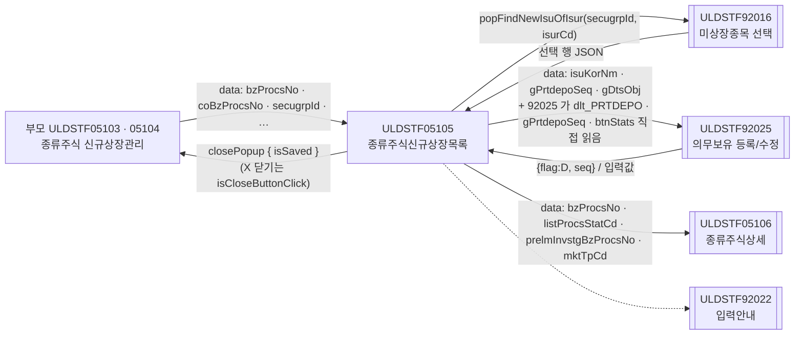
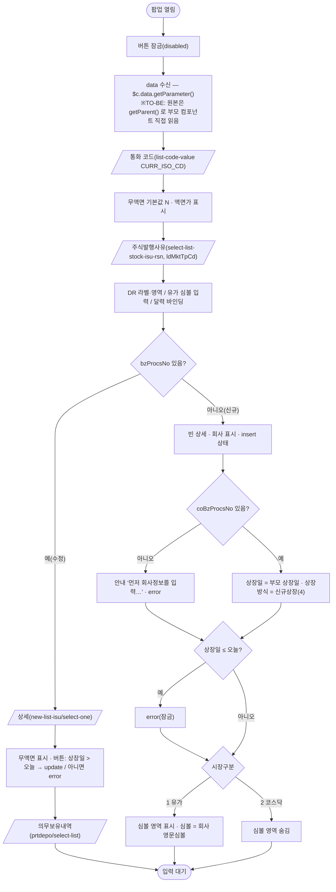
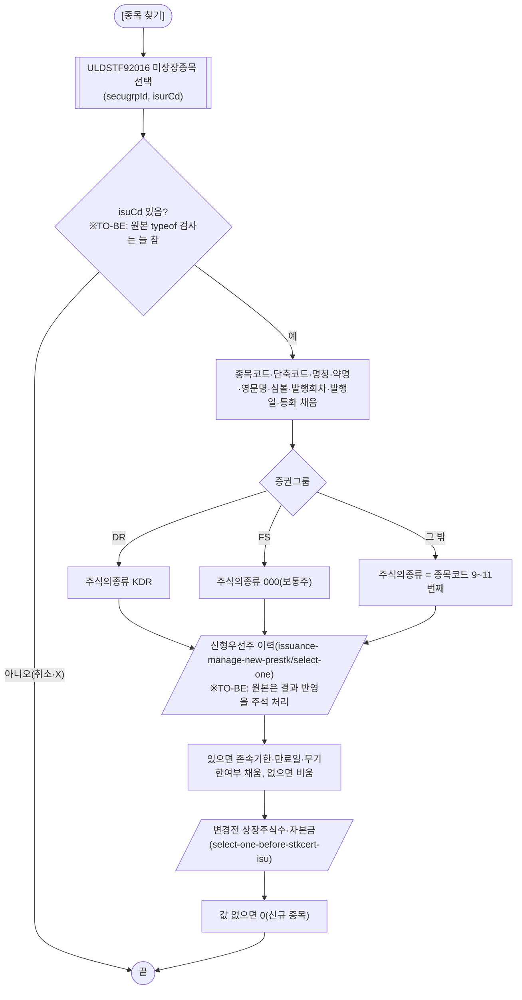
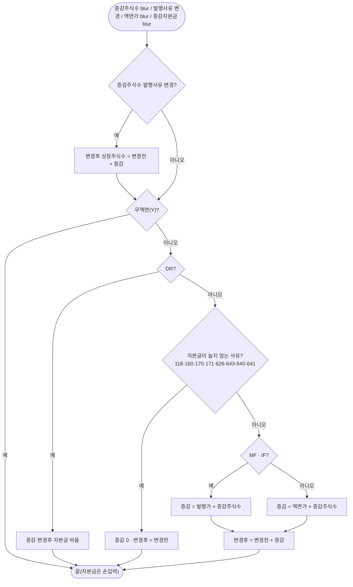
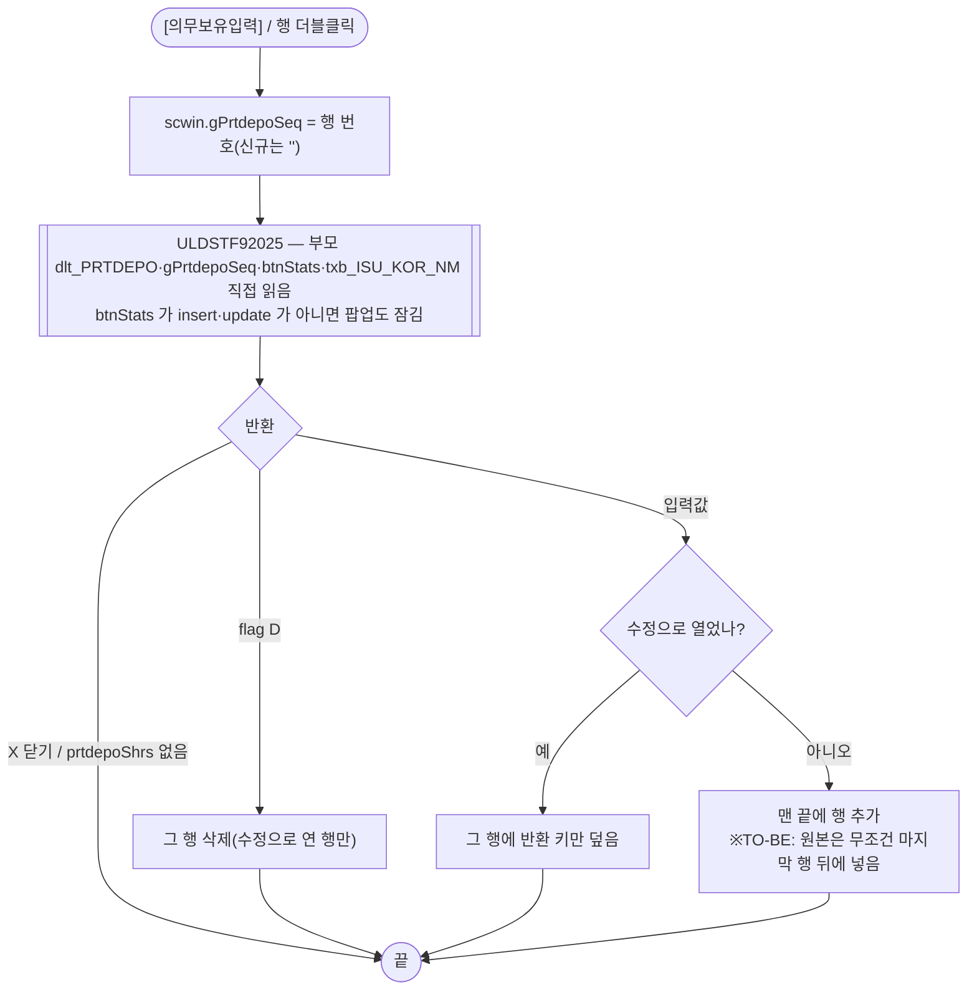
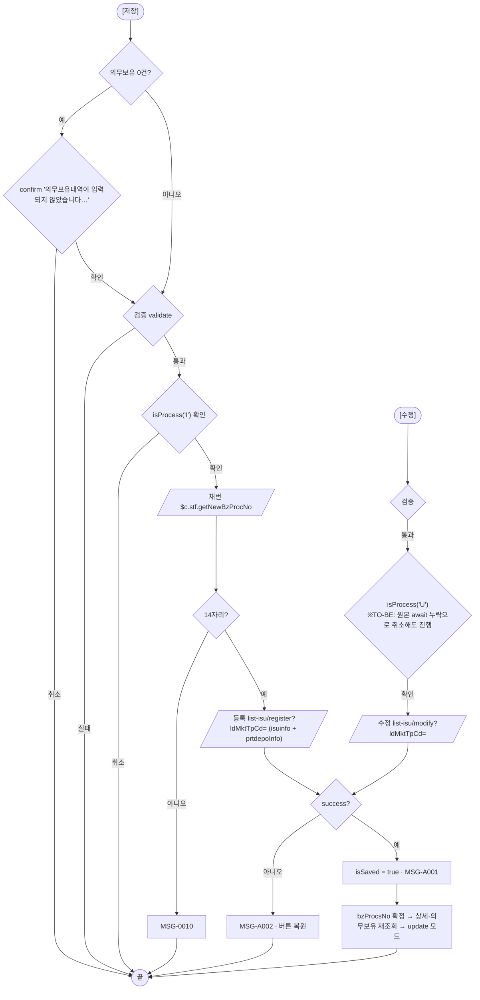
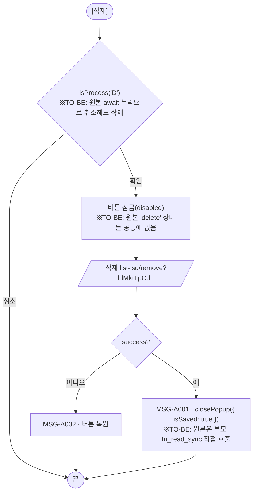
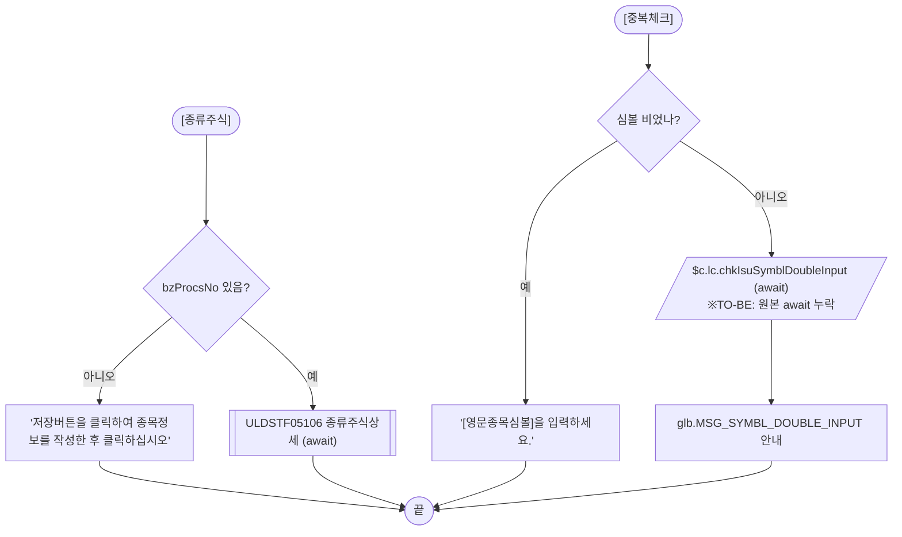
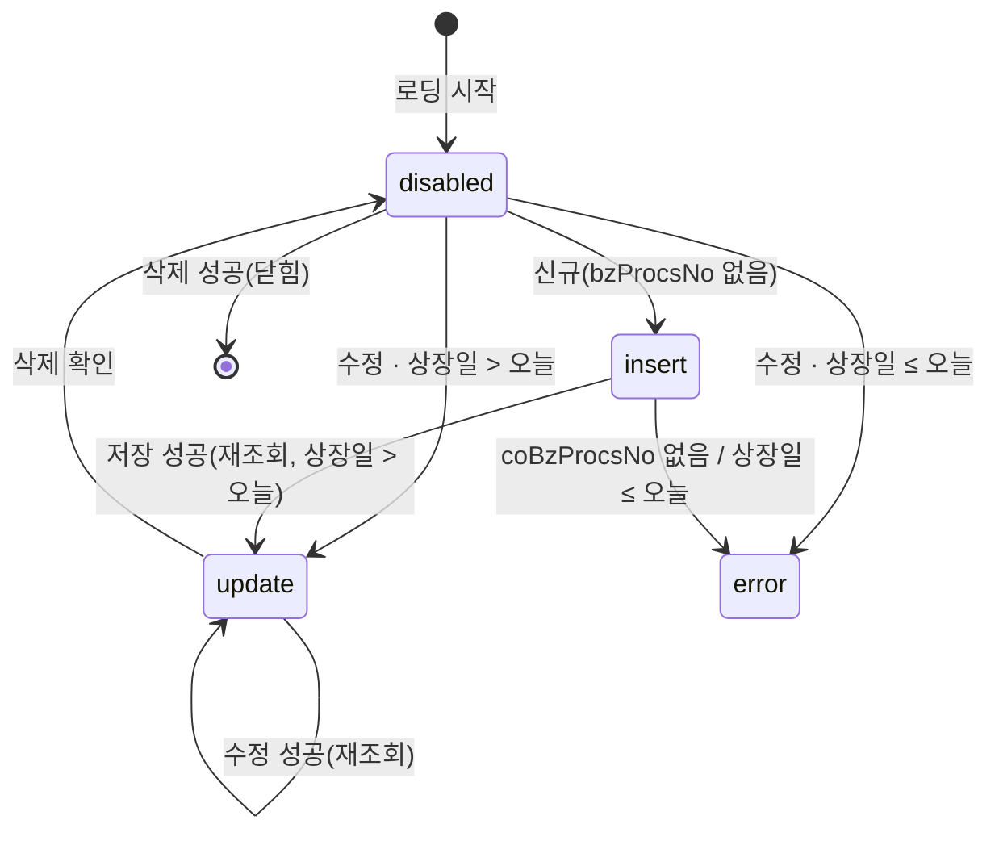

# ULDSTF05105 (팝업)종류주식신규상장목록 — 업무 분석 및 전환 내역

| 항목 | 내용 |
|---|---|
| AS-IS 원본 | `ULDSTF05105.xml` — W-Craft 1차 변환본(`meta_asisFileNm="ULDSTF05105.gfm"`, 원본 gfm 은 저장소에 없음)에 **API 적용까지 마친 개발 사본**. 업무 로직은 이 스크립트와 남은 옛 코드 주석(`/KindStk.do?…`·`/Listing.do?…` 등)으로 분석했다. 반입 `conversion/conversion-front/ui/ULDSTF05105/ULDSTF05105.xml` |
| 신규 API 명세 | 없음 — **화면에 적용된 `/api/...` 경로·method·dataCollection keyInfo 를 명세로 간주**(사용자 결정 2026-10-29). §5 는 "화면 적용 API ↔ AS-IS(주석에 남은 옛 호출)" 대응표로 쓴다. `api_spec_check` 는 SKIP(A07·A08 형식 검사만) |
| 화면 캡처 | 없음 |
| 퍼블리싱 파일 | 화면 폴더 `ULDSTF05105.xml` 의 body(이미 퍼블리싱 반영됨)를 1단계 기준으로 했다(선례 ULDBNS30400 「캡처 없음, 기존 마크업 정비」). publish 원본 `conversion/publish/상장/상장처리(대내)/ULDSTF05105.xml` 은 참고만 했다 |
| TO-BE | `conversion/conversion-front/ui-tobe/ULDSTF05105.xml` (배포 경로 `/ui/lst/kindstk/ULDSTF05105.xml` — 부모의 원본 리터럴, 공통 계약서 §2) |
| 공통 계약서 | kindstk 13본 공통 계약서(작업 묶음 공유본) §2 「05105 / 05113」·§3 「92025」·§4 공통 결정 — 부모·하위 팝업과의 data·반환 키는 이 문서 기준 |
| 업무공통 | `$c.lc`(`popFindNewIsuOfIsur`·`isProcess`·`chkIsuSymblDoubleInput`·`openDetailInputGuide`·`getSecuGrpNm`·`getGlbValue`)·`$c.stf`(`getNewBzProcNo`·`getMessageParam`·`checkMaxLength`) — `cm/pcc/stf`. 게이트는 `--pcc stf` |
| 작성 | Inswave / 2026-10-29 |

참고 양식: [websquare_gfm_conversion.md](../../../md/websquare_gfm_conversion.md) — §1.4 업무 프로세스 흐름, §6.5 getPar/setPar 전환. Gauce 대응은 [gfm_business_analysis_guide.md](../../../md/gfm_business_analysis_guide.md) 를 함께 따랐다. 짝 화면: ULDSTF05113(주권 종류주식 신규상장목록등록 — 같은 종목 상세, 의무보유 없음).

---

## 1. 화면 개요

상장 담당자가 **종류주식 신규상장관리(ULDSTF05103 주권 / ULDSTF05104 외국주권·DR)** 에서 회사를 정한 뒤, 신규상장할 **종목 1건**의 상세(종목코드·명칭·심볼, 상장일·발행일·발행회차, 주식의종류·발행사유, 액면가·발행가, 증감·변경후 상장주식수/자본금, 배당기산일, 우선주 존속기한)와 **의무보유내역**을 등록·수정·삭제하는 팝업이다.

1. 부모가 회사·종목 키를 data 로 넘겨 연다. 종목 업무처리번호(`bzProcsNo`)가 없으면 신규, 있으면 수정이다.
2. 신규: 회사 업무처리번호(`coBzProcsNo`)가 없으면 "먼저 회사정보를 입력후 종목정보를 입력바랍니다." 를 안내하고 처리 버튼을 잠근다. 있으면 상장일(부모 값)·상장방식(신규상장 4)을 채운다. 유가(1)는 회사 영문심볼을 종목 심볼 기본값으로 둔다. 상장일이 오늘 이전이면 처리 버튼을 잠근다.
3. [종목 찾기]로 발행기관의 미상장종목(ULDSTF92016)을 고르면 종목 정보·주식의종류를 채우고, 신형우선주 이력(존속기한·만료일 등)과 변경전 상장주식수·자본금을 조회해 채운다.
4. 증감주식수·액면가·발행사유·증감 자본금을 바꾸면 변경후 상장주식수와 증감·변경후 상장자본금을 다시 계산한다(무액면이면 자본금은 계산하지 않는다).
5. [의무보유입력]·의무보유 행 더블클릭으로 의무보유 등록/수정 팝업(ULDSTF92025)을 열고, 돌려받은 값으로 행을 추가·수정·삭제한다(저장은 종목 저장 때 함께).
6. [저장](신규)은 의무보유 미입력 확인 → 검증 → 확인 → 업무처리번호 채번 → 등록 순서로 처리하고, 성공하면 그 번호로 다시 조회해 수정 모드가 된다. [수정]·[삭제]는 상장일이 오늘 이후인 건만 할 수 있다. 삭제에 성공하면 팝업을 닫는다.
7. [종류주식]은 저장된 종목만 종류주식상세(ULDSTF05106)를 연다.

### 1.1 호출 화면 (2본)

- `ULDSTF05103` 주권 종류주식 신규상장관리 — `fn_OpenKindStkDetailCorpIsu_protect`(원본 `U/ULDSTF05103/ULDSTF05103.xml:835-859`)
- `ULDSTF05104` 외국주권·DR 종류주식 신규상장관리 — 같은 함수(`:811-834`)
- 원본은 `$c.win.openPopup("/ui/lst/kindstk/ULDSTF05105.xml", { …1180×880 }, {})` 로 빈 data 를 넘기고, 이 팝업이 `$c.win.getParent()` 로 부모 컴포넌트를 직접 읽었다. 저장 뒤에는 부모의 `fn_read_sync()` 를 불러 부모를 다시 조회했다(`fn_parentRefresh`).

### 1.2 호출 규약 (부모 → 이 화면) / 반환 규약

AS-IS 수신(원본 `init`)과 TO-BE data 키(공통 계약서 §2 「05105 / 05113」):

| TO-BE 키 | 값(부모 05103/05104) | AS-IS 직접 접근 | 이 화면에서 |
|---|---|---|---|
| `bzProcsNo` | 선택 종목 행 업무처리번호, 신규 `""` | `parentWin.clickBzProcsNo` — 부모에 없는 경로라 늘 `""`(§8 #1) | **비면 신규**, 있으면 수정 |
| `coBzProcsNo` | 부모 `scwin.vBzProcsNo`(회사 업무처리번호) | `parentWin.scwin.vBzProcsNo` | 신규에서 비면 등록 불가 안내·잠금 |
| `secugrpId` | `sbx_secugrpId` | `parentWin.sbx_secugrpId` | DR·FS·MF·IF 분기 |
| `prelmInvstgBzProcsNo` | `dma_corpInfoRes.prelmInvstgBzProcsNo` | 동일 | 종류주식상세(05106)에 넘김 |
| `spotIsuTrdMktTpCd` | `sbx_spotIsuTrdMktTpCd`(1 유가 / 2 코스닥) | 동일 | 심볼 입력·발행사유 목록·저장 쿼리 |
| `isurCd` · `comNm` | `ibx_isurCd` · `ibx_comNm` | 동일 | 법인코드(명) 표시 |
| `listDd` | `cal_listDd` | `parentWin.cal_listDd` | 신규 상장일 기본값 |
| `listClssCd` | `sbx_listClssCd` | `parentWin.sbx_listClssCd` | 원본은 읽고 쓰지 않았다(상장방식은 늘 신규상장 4) — TO-BE 도 받지 않는다 |
| `isurSymbl` | `ibx_isurSymbl` | `parentWin.ibx_isurSymbl` | 유가 신규의 영문심볼 기본값 |

- 원본 `scwin.rowPos = parentWin.grd_issList.getFocusedRowIndex()` 와 저장 뒤 `parentWin.grd_issList.setFocusedCell(scwin.rowPos, 0)` 은 **부모가 자기가 기억한 행으로** 되돌린다(공통 계약서 §2) — 이 화면에서는 지운다.
- **반환**: `{ isSaved }`. 저장·수정·삭제에 한 번이라도 성공하면 `scwin.isSaved = true`. 삭제 성공은 `closePopup({ isSaved : true })` 로 바로 닫는다. 하단 [닫기]는 팝업 규칙으로 없앴으므로 그 밖의 닫기는 X 버튼(`{ isCloseButtonClick : true }`)이다.
- 부모 동작(부모 묶음 몫): `res?.isSaved === true || res?.isCloseButtonClick === true` 이면 상세(`fn_read_sync` 대응)를 다시 조회하고 `grd_issList` 행을 되돌린다.

```javascript
// 부모 ULDSTF05103 / 05104 (공통 계약서 §2)
const data = { bzProcsNo, coBzProcsNo : scwin.vBzProcsNo, secugrpId : sbx_secugrpId.getValue(),
               prelmInvstgBzProcsNo : dma_corpInfoRes.get("prelmInvstgBzProcsNo"),
               spotIsuTrdMktTpCd : sbx_spotIsuTrdMktTpCd.getValue(), isurCd : ibx_isurCd.getValue(), comNm : ibx_comNm.getValue(),
               listDd : cal_listDd.getValue(), listClssCd : sbx_listClssCd.getValue(), isurSymbl : ibx_isurSymbl.getValue() };
const res = await $c.win.openPopup("/ui/lst/kindstk/ULDSTF05105.xml", { id : "ULDSTF05105", popupName : "종류주식신규상장목록", width : 1180, height : 880, frameModal : "top" }, data);
if (res?.isSaved === true || res?.isCloseButtonClick === true) await scwin.readSync();   // 행 포커스는 부모가 복원
```

### 1.3 이 화면이 여는 하위 팝업

| 팝업 | AS-IS 호출 | 넘기는 `data` (TO-BE) | 받는 결과 / 취소 판정 |
|---|---|---|---|
| `ULDSTF92016` 종목선택(발행기관의 미상장종목) | `img_ISU_CD_onclick` 이 `fn_GetPar/fn_SetPar` 를 `fn_GetParIsuCd/fn_SetParIsuCd` 로 바꿔 끼운 뒤 `$c.lc.popFindNewIsuOfIsur(vSecugrpID, isurCd)` | pcc 가 `{ secugrpId, isurCd }` 를 만든다 | 선택 행 JSON(`isuCd`·`isuSrtCd`·`isuNm`·`isuSnm`·`isuEngNm`·`isuEngSnm`·`isuEngSymbl`·`isuRnd`·`isuDd`·`currIsoCd`) — 취소는 `isCloseButtonClick` 또는 `isuCd` 비어 있음 |
| `ULDSTF92025` 의무보유 등록/수정 | `fn_OpenDetailPrtdepo(row)` — data `{}` 로 열고 결과를 마지막 행 뒤에 넣음(§8 #5) | `{ isuKorNm, gPrtdepoSeq, gDtsObj }`(92026 선례). **92025 는 부모의 `dlt_PRTDEPO`·`scwin.gPrtdepoSeq`·`scwin.btnStats`·`txb_ISU_KOR_NM` 을 직접 읽으므로 이 이름을 유지**(공통 계약서 §3) | 삭제 `{ flag:"D", seq }`, 저장 입력값 객체(`prtdepo*`·`nm`·`resdbzRegNo`·`misc*`·`prtdepoYn`), 취소는 `isCloseButtonClick` 또는 `prtdepoShrs` 비어 있음 |
| `ULDSTF05106` 종류주식상세 | `btn_KIND_STK_DTL_onclick` — data `{}`, 1000×800 | `{ bzProcsNo, listProcsStatCd, prelmInvstgBzProcsNo, mktTpCd }`, 1135×840 (공통 계약서 §2 「05106」 통일 크기) | 반환 없음(`await` 만) |
| `ULDSTF92022` 회사명/종목명 입력안내 | `$c.lc.openDetailInputGuide()` | 없음 | 없음 |

- 원본 `fn_PopFindKindStkExamIsu`(ULDSTF05107 종목선택)는 본문이 주석뿐인 빈 함수이고 부르는 곳도 없어 옮기지 않는다.

### 1.4 업무 프로세스 흐름

흐름은 AS-IS 동작을 기준으로 그렸다. `※TO-BE` 는 전환본에서 바뀌는 곳이다(근거는 §8).

| # | 업무 | 시작 (사용자 동작·진입 조건) | 끝 (결과) | 주요 함수 | 관련 절 |
|---|---|---|---|---|---|
| 1 | 진입·로딩 | 부모가 팝업을 엶(업무처리번호 유무로 신규/수정) | 입력 대기(모드별 버튼) | `scwin.onpageload` → `init` → `selectDetail`·`selectPrtdepoList` / `initNewForm` | §3, §5.1~5.4 |
| 2 | 종목 찾기 | [종목 찾기] `img_ISU_CD` (신규 모드) | 종목 정보·존속기한·변경전 주식수/자본금 채움 | `openIsuPopup` → `selectNewPrefstk` → `selectBfStkcertIsu` | §5.5, §5.6, §6.5 |
| 3 | 자본금 자동 계산 | 증감주식수·액면가·증감자본금 입력 마침, 발행사유 변경 | 변경후 주식수·증감/변경후 자본금 갱신 | `calcAccIsuShrs`·`calcIsuCap`·`calcAccIsuCap` | §6.3 |
| 4 | 의무보유 입력·수정·삭제 | [의무보유입력] / 행 더블클릭 | 행 추가·덮어쓰기·삭제(화면 안) | `openPrtdepoPopup` → `applyPrtdepo` | §6.6 |
| 5 | 신규 저장 | [저장] (신규 모드) | 성공 안내 후 수정 모드로 재조회 | `save` → `saveTrs("I")` | §5.7, §6.8 |
| 6 | 수정 | [수정] (수정 모드, 상장일 > 오늘) | 성공 안내 후 재조회 | `update` → `saveTrs("U")` | §5.7, §6.9 |
| 7 | 삭제 | [삭제] (수정 모드, 상장일 > 오늘) | 성공 안내 후 팝업 닫힘(`isSaved`) | `remove` → `saveTrs("D")` | §5.7, §6.10 |
| 8 | 종류주식상세 | [종류주식] | 05106 팝업이 닫힐 때까지 대기 | `openKindStkDetail` | §6.7 |
| 9 | 심볼 중복체크 | [중복체크] (유가) | 결과 문구 안내 | `checkSymbl` | §6.4 |

#### 화면 간 흐름



#### 업무 1: 진입·로딩



| 단계 | 내용 | AS-IS | TO-BE |
|---|---|---|---|
| 1 | 수신 | `parentWin.*` 직접 읽기 | `$c.data.getParameter()` 키(§1.2) |
| 2 | 공통 코드 | `setCommonCode` 에 action 지정(동작 안 함 — §8 #11) | `dma_codReq` + `executeDynamic` 1회(공통 계약서 §4.5) |
| 3 | 발행사유 | `executeDynamic` await 없음 | `await` |
| 4 | 수정 조회 | `fn_read_sync`·`fn_prtdepo_read_sync` 를 await 없이 동시에 | 차례로 `await` |
| 5 | 신규 버튼 | Gauce `dts_Isu.reset()` → `OnLoadCompleted` 에서 insert 상태 | `applyButtonState()` 로 insert 후 조건별 error |

#### 업무 2: 종목 찾기



#### 업무 3: 자본금 자동 계산



- 이벤트별로 부르는 계산은 원본 그대로다: 발행사유 변경은 변경후 주식수 + 변경후 자본금, 증감주식수 blur 는 변경후 주식수 + 증감·변경후 자본금, 액면가 blur 는 증감·변경후 자본금, 증감자본금 blur 는 변경후 자본금만.

#### 업무 4: 의무보유 입력·수정·삭제



#### 업무 5: 신규 저장 · 업무 6: 수정



#### 업무 7: 삭제



#### 업무 8: 종류주식상세 · 업무 9: 심볼 중복체크



#### 화면 모드 상태 전이



- `insert` = [저장]만, `update` = [수정]·[삭제](공통 `BTN_STATE_MAP` — 저장 제외 전부), `error`·`disabled` = 전부 잠금. 의무보유 팝업은 `scwin.btnStats` 가 `insert`·`update` 일 때만 입력할 수 있다.

---

## 2. 화면 구성 및 데이터 정의

### 2.1 화면 구성

팝업 `pop_contents` > `pfmContentHeader`(공통 화면 머리) > 안내문 목록(`txt_list` — `label_45` 「항목 앞에 * 표시는 필수 항목 입니다.」, `label_42` 「상장자본금은 종목을 기준으로 기재 !!!」, `label_21` 「외국주의 금액단위는 나라별 통화 참조」) > 입력표 `panel_Item`(6열 colgroup, table/th/td/tr 구조, 안쪽 표 `panel_ISU_ENG_SYMBL`·`panel_KindStk`·`panel_PARVAL`·`panel_ISU_CAP`) > 소제목(`titbox` h3 `label_15` 「의무보유내역」 + [의무보유입력]) > 그리드 `grd_PRTDEPO` > 하단 버튼 `grp_btnBox`.

| 영역 | 라벨 | AS-IS 요소 | TO-BE 컴포넌트 · 바인딩 | 비고 |
|---|---|---|---|---|
| 회사 | `label_1` 법인코드(명) | `ibx_ISUR_CD`·`ibx_COM_NM` | `ibx_ISUR_CD` ← `dma_isuRes.isurCd`(읽기전용), `ibx_COM_NM`(바인딩 없음 — data `comNm`) | |
| 종목 | `label_59` 종목코드 | `ibx_ISU_CD` + `img_ISU_CD` | `ibx_ISU_CD` ← `isuCd`(읽기전용) + [찾기] | 수정 모드에서 [찾기] 잠금 |
| | `label_2` 종목단축코드 | `ibx_ISU_SRT_CD` | ← `isuSrtCd`(읽기전용) | |
| | `label_61` 한글종목명 · `label_56` (한글30자) | `ibx_ISU_KOR_NM`, 숨김 `txb_ISU_KOR_NM` | 둘 다 ← `isuKorNm` | 숨김 `txb_ISU_KOR_NM` 은 **92025 가 부모의 이 id 로 종목명을 읽으므로 유지** |
| | 안내 `label_51`·`label_52`·`label_53` | 텍스트 | 그대로 | |
| | `label_62` 한글종목약명 · `label_57` | `ibx_ISU_KOR_ABBRV` + `img_IsuNmGuide` | ← `isuKorAbbrv` + [종목명 입력기준안내] | |
| | `label_74` 영문종목명 · `label_55` | `ibx_ISU_ENG_NM` | ← `isuEngNm` | |
| | `label_14` 영문종목약명 · `label_54` | `ibx_ISU_ENG_ABBRV` | ← `isuEngAbbrv` | |
| | `label_4` 종목심볼 (`panel_ISU_ENG_SYMBL`) | `ibx_ISU_ENG_SYMBL` + `img_ISU_ENG_SYMBL` | ← `isuEngSymbl` + [중복체크] | 유가만 입력·버튼, 코스닥 신규는 영역 숨김 |
| | `label_20` 통화표시 | `sbx_CURR_ISO_CD` (disabled) | ← `currIsoCd`, itemset `dlt_currIsoCd` | |
| 발행 | `label_3` 상장방식 | `sbx_LIST_METHD_TP_CD` (disabled, 4 신규상장) | ← `listMethdTpCd` | Gauce `item` 속성 삭제(choices 유지) |
| | `label_63` 발행회차 | `ibx_ISU_RND` | ← `isuRnd` | |
| | `label_8` 존속기한 (`panel_KindStk`) · `label_9` 년 · `label_10` 월 · `label_11` 일 | `ibx_PREFSTK_CONTIN_DEADLINE_YYS`·`ibx_PREFSTK_CONTIN_DEADLINE_MM`·`ibx_PREFSTK_CONTIN_DEADLINE_DYS` | ← `prefstkContinDeadlineYys`·`prefstkContinDeadlineMm`·`prefstkContinDeadlineDys` | |
| | `label_12` 만료일 | `ibx_PREFSTK_END_DD`(inputReadOnly) + `chk_INDEFINPD_YN` 무기한여부 | ← `prefstkEndDd`, `chk_INDEFINPD_YN` ← `indefinpdYn` | 달력의 빈 onclick(`btn_PREFSTK_END_DD_onclick`) 바인딩 삭제 |
| | [종류주식] | `btn_KIND_STK_DTL` | 그대로 | |
| | `label_64` 상장일 | `ibx_LIST_DD` (readOnly) | ← `listDd` | |
| | `label_17` 주식의종류 | `ibx_STKCERT_KIND_CD` (disabled, 000·100~900·KDR·K01~K05) | ← `stkcertKindCd` | Gauce `item` 속성 삭제 |
| | `label_65` 발행일 | `ibx_ISU_DD` | ← `isuDd` | |
| | `label_5` 주식발행사유 | `ibx_STK_ISU_RSN_CD` | ← `stkIsuRsnCd`, itemset `dlt_listStockIsuRsn` | |
| | `label_6` 무액면주식 | `ibx_NPARVALSTK_YN` (원본 `CBData "N^아니오,Y^예"`) | ← `nparvalstkYn`, choices N 아니오 / Y 예 | 원본은 바인딩·항목이 없었다(§8 #12) |
| 금액 | `label_67` 발행가(원) | `ibx_ISU_PRC` | ← `isuPrc` | |
| | `lb_PARVAL` 액면가/개별주당자본금 (`panel_PARVAL`) | `ibx_PER1STK_CAP`·`edt_PARVAL` | ← `per1stkCap`·`parval` | 무액면 여부로 하나만 보임 |
| | `label_69`·`label_70`·`label_71`·`label_72` 배당기산일_1~4 | `ibx_DIV_RECK_DD1`·`ibx_DIV_RECK_DD2`·`ibx_DIV_RECK_DD3`·`ibx_DIV_RECK_DD4` | ← `divReckDd1`·`divReckDd2`·`divReckDd3`·`divReckDd4` | 1만 필수 |
| | `lb_BF_ACC_ISU_SHRS` 변경전 상장주식수 | `ibx_BF_ACC_ISU_SHRS` (readOnly) | ← `bfAccIsuShrs` | DR 은 라벨이 DR수 |
| | `lb_ISU_SHRS` 증감주식수 | `ibx_ISU_SHRS` | ← `isuShrs` | |
| | `lb_ACC_ISU_SHRS` 변경후 상장주식수 | `ibx_ACC_ISU_SHRS` (readOnly) | ← `accIsuShrs` | |
| | `label_49` 변경전 상장자본금 (`panel_ISU_CAP`) | `ibx_BF_ACC_ISU_CAP` (readOnly) | ← `bfAccIsuCap` | DR 은 영역 숨김 |
| | `label_68` 증감상장자본금 | `ibx_ISU_CAP` | ← `isuCap` | |
| | `label_44` 변경후 상장자본금 | `ibx_ACC_ISU_CAP` | ← `accIsuCap` | |
| 기타 | `label_73` 주금납입처 | `txa_SKTAMT_PAYLOC_NM` | ← `sktamtPaylocNm` | |
| | `label_75` 비고 | `txa_REMK` | ← `remk` | |
| 의무보유 | `label_15` 의무보유내역 | `btn_PRTDEPO_Input` | [의무보유입력] | |
| | 그리드 | `grd_PRTDEPO` (`dataList dlt_isuPrtdeRes`, header `header1`·gBody `gBody1`·caption `caption1`) | `dataList="data:dlt_PRTDEPO"`, `ev:oncelldblclick` | 원본은 더블클릭이 `userData2`(Gauce) 에만 있어 동작하지 않았다(§8 #13) |
| 버튼 | 하단 | `grp_btnBox`: `btn_Close`·`btn_Update`·`btn_Delete`·`btn_Save` (+ 빈 `grp_group1`) | [삭제]·[수정]·[저장] `btn_cm pt`(규칙 41 순서) | [닫기]·`grp_group1` 삭제(팝업 하단 닫기 금지) |

그리드 `grd_PRTDEPO` 열(머리글 id 는 `h_` + camelCase 로 개명 — 원본 `NO`·`PRTDEPO_PRN_TP_NM`·`NM`·`RESDBZ_REG_NO`·`PRTDEPO_RSN_NM`·`PRTDEPO_SHRS`·`PRTDEPO_STRT_DD`·`PRTDEPO_END_DD`·`PRTDEPO_OBJ_KIND_NM`·`PRTDEPO_OBJ_TP_NM`·`PRTDEPO_OBJ_TP_MISC_CONTN`·`PRTDEPO_RSN_MNGRGHT_TP_NM`·`PRTDEPO_RSN_FNC_TP_NM`):

| 머리글 | 열 id | 비고 |
|---|---|---|
| 번호 | `seq` | 원본은 `{CurRow}`(현재 행 번호) — TO-BE 는 저장 때 1부터 매기는 일련번호(§10 #7) |
| 대상자구분 · 성명 · 생년월일(사업자번호) · 의무보유사유 | `prtdepoPrnTpNm`·`nm`·`resdbzRegNo`·`prtdepoRsnNm` | |
| 의무보유주식수 | `prtdepoShrs` | |
| 의무보유시작일 · 의무보유종료일 | `prtdepoStrtDd`·`prtdepoEndDd` | AS-IS `mask:XXXX-XX-XX` → `dataType="date" displayFormat="yyyy-MM-dd"`(규칙 46) |
| 의무보유대상종류 · 대상구분 · 대상구분기타내용 · 사유경영권구분 · 사유재무구분 | `prtdepoObjKindNm`·`prtdepoObjTpNm`·`prtdepoObjTpMiscContn`·`prtdepoRsnMngrghtTpNm`·`prtdepoRsnFncTpNm` | |

### 2.2 데이터 정의

| DataCollection | 종류 | 키 (camelCase, 화면 적용 keyInfo 기준) | 용도 |
|---|---|---|---|
| `dma_codReq` | dataMap | `codeList`(코드정보 List) | 공통 코드 요청(신설 — 공통 계약서 §4.5) |
| `dlt_currIsoCd` | dataList | `value`(코드값)·`text`(코드명) | 통화 콤보(신설) |
| `dlt_listStockIsuRsn` | dataList | `cdId`(코드ID)·`value`(코드값)·`text`(코드명) | 주식발행사유 콤보 |
| `dma_bfStkcertIsuOneReq` / `Res` | dataMap | 요청 `isuCd`(종목코드)·`listDd`(상장일) / 응답 `bfAccIsuShrs`(누적발행주식수)·`bfAccIsuCap`(누적종목자본금) | 변경전 상장주식수·자본금. 원본은 같은 정의가 두 번 있었다(WS120, §8 #2) → 한 벌만 |
| `dma_isuRes` | dataMap | `bzProcsNo`(업무처리번호)·`isurCd`(회사코드)·`isuCd`(종목코드)·`prefstkTpCd`(우선주구분코드)·`stkcertIsuSeq`(주권발행일련번호)·`listDd`(상장일)·`stkcertKindCd`(주식종류)·`stkIsuRsnCd`(주식발행사유코드)·`listMethdTpCd`(상장방식유형코드)·`prefstkTpNm`(우선주구분)·`stkIsuRsnNm`(주식발행사유)·`stkcertKindNm`·`listMethdTpNm`(상장방식유형)·`isuDd`(발행일자)·`isuRnd`(발행회차)·`parval`(액면가)·`per1stkCap`(1주당자본금)·`isuPrc`(발행가격)·`isuShrs`(발행주식수)·`bfAccIsuShrs`(변경전 상장주식수)·`accIsuShrs`(변경후 상장주식수)·`isuCap`(자본금)·`bfAccIsuCap`(변경전 상장자본금)·`accIsuCap`(변경후 상장자본금)·`sktamtPaylocNm`(주금납입처명)·`divReckDd1`(배당기산일자1)·`divReckDd2`(배당기산일자2)·`divReckDd3`(배당기산일자3)·`divReckDd4`(배당기산일자4)·`stkcertMixFlowStrtDd`(주권혼용유통개시일자)·`stkcertMixFlowEndDd`(주권혼용유통종료일자)·`stkcertSinglFlowStrtDd`(주권단일유통개시일자)·`remk`(비고)·`prefstkIsuDd`(신형우선주상장일)·`prefstkDivRt`(우선주배당률)·`prefstkContinDeadlineYys`(우선주존속기한년수)·`prefstkContinDeadlineMm`(우선주존속기한개월)·`prefstkContinDeadlineDys`(우선주존속기한일수)·`prefstkEndDd`(우선주만료일자)·`indefinpdYn`(무기한여부)·`partctpYn`(참가형여부)·`acctpYn`(누적형여부)·`newprefstkRemk`(신형우선주비고 — 원본 name 이 `filelawstDd` 로 잘못 적혀 있어 고침)·`string`(swagger 잔재 키, 그대로 둠)·`isuKorNm`(종목명)·`isuEngNm`(종목영문명)·`isuKorAbbrv`(종목약어)·`isuEngAbbrv`(종목영문약어)·`isuEngSymbl`(종목영문심볼)·`isuSrtCd`(종목단축코드)·`draftYn`(기안여부)·`disclsYn`(공시여부)·`mktactYn`(시장조치여부)·`fnlEmpNm`(최종승인자)·`currIsoCd`(통화코드)·`corpbndIsuRnd`(사채발행회차)·`paidcapincIsuTpCd`(유상증자발행구분코드)·`sktamtPayDd`(주금납입일자)·`nparvalstkYn`(무액면여부)·**`listProcsStatCd`(상장처리상태코드 — 추가)** | 화면 바인딩 + 상세 조회 응답. `listProcsStatCd` 는 05106 에 넘기는 값(원본 `dts_Isu` 의 `LIST_PROCS_STAT_CD`)이라 키를 더했다(§10 #5) |
| `dlt_PRTDEPO` | dataList | `bzProcsNo`·`rsnOccrDdtm`(사유발생일시)·`seq`(일련번호)·`nm`(성명및법인명)·`resdbzRegNo`(주민사업자등록번호)·`prtdepoPrnTpCd`(보호예수대상자구분코드)·`prtdepoPrnTpNm`(보호예수대상자구분명)·`prtdepoShrs`(보호예수주식수)·`prtdepoObjKindCd`(보호예수대상종류코드)·`prtdepoObjKindNm`(보호예수대상종류명)·`prtdepoObjTpCd`(보호예수대상구분코드)·`prtdepoObjTpNm`(보호예수대상구분명)·`prtdepoObjTpMiscContn`(보호예수대상구분기타내용)·`prtdepoRsnMngrghtTpCd`(보호예수사유경영권구분코드)·`prtdepoRsnMngrghtTpNm`(보호예수사유경영권구분명)·`prtdepoStrtDd`(보호예수개시일자)·`prtdepoEndDd`(보호예수종료일자)·`prtdepoRsnCd`(보호예수사유코드)·`prtdepoRsnNm`(보호예수사유명)·`prtdepoRsnFncTpCd`(보호예수사유재무구분코드)·`prtdepoRsnFncTpNm`(보호예수사유재무구분명)·`miscPrtdepoRsnCd`(기타보호예수사유코드)·`miscPrtdepoStrtDd`(기타보호예수개시일자)·`miscPrtdepoEndDd`(기타보호예수종료일자) | 의무보유내역 그리드·저장. **id 를 `dlt_isuPrtdeRes` → `dlt_PRTDEPO` 로 개명** — 92025 가 부모의 이 id(원본 `dts_PRTDEPO`)를 직접 읽는다(공통 계약서 §3) |
| `dma_isuReq` | dataMap | `isuinfo`(주권 종류주식 신규상장관리 저장 요청 DTO, json)·`prtdepoInfo`(종류주식상세 저장 요청 DTO, json) | 등록·수정·삭제 요청 본문 |
| `dma_isuinfo` | dataMap | `bzProcsNo`·`isurCd`·`isuCd`·`isuRnd`·`prefstkTpCd`·`stkcertKindCd`·`stkIsuRsnCd`·`listMethdTpCd`·`listDd`·`isuDd`·`parval`·`isuPrc`·`isuShrs`(증감주식수)·`isuCap`·`accIsuShrs`·`accIsuCap`·`divReckDd1`~`4`·`errCorrctCapDiffamt`(오류보정자본금차액)·`sktamtPaylocNm`·`stkcertMixFlowStrtDd`·`stkcertMixFlowEndDd`·`stkcertSinglFlowStrtDd`·`remk`·`prefstkDivRt`·`prefstkContinDeadlineYys`·`Mm`·`Dys`·`prefstkEndDd`·`indefinpdYn`·`partctpYn`·`acctpYn`·`ndivtmVoterghtYn`(무배당시의결권여부)·`newprefstkRemk`·`filelawstDd`(소송제기일자)·`newstkRelLawstYn`(신주관련소송여부)·`paidcapincIsuTpCd`·`sktamtPayDd`·`backlistYn`(우회상장여부)·`per1stkCap`·`nparvalstkYn`·`isuSrtCd`·`isuKorNm`·`isuKorAbbrv`(종목약명)·`isuEngNm`·`isuEngAbbrv`(종목영문약명)·`isuEngSymbl`·`spotIsuTrdMktTpCd`(시장구분) | 저장 요청 `isuinfo` 의 키 목록 — `dma_isuRes` 에서 이 키만 옮긴다(개발 사본 방식 유지) |
| `dma_newprefstkReq` / `Res` | dataMap | 요청 `isuCd` / 응답 `isuCd`·`isuDd`·`prefstkDivRt`·`prefstkContinDeadlineYys`·`Mm`·`Dys`·`prefstkEndDd`·`indefinpdYn`·`partctpYn`·`acctpYn`·`ndivtmVoterghtYn`·`newprefstkRemk`(비고) | 신형우선주 이력 |

- **삭제한 정의**: `dlt_prtdepoInfo`(의무보유 저장 DTO 열 — `bzProcsNo`·`rsnOccrDdtm`·`nm`·`resdbzRegNo`·`prtdepoPrnTpCd`(의무보유대상자구분코드)·`prtdepoShrs`(의무보유주식수)·`prtdepoObjTpCd`(의무보유대상구분코드)·`prtdepoStrtDd`(의무보유개시일자)·`prtdepoEndDd`(의무보유종료일자)·`prtdepoObjKindCd`(의무보유대상종류코드)·`prtdepoRsnCd`(의무보유사유코드)·`prtdepoId`(의무보유ID)·`prtdepoObjTpMiscContn`(의무보유대상구분기타내용)·`prtdepoRsnMngrghtTpCd`(의무보유사유경영권구분코드)·`prtdepoRsnFncTpCd`(의무보유사유재무구분코드)·`miscPrtdepoRsnCd`(기타의무보유사유코드)·`miscPrtdepoStrtDd`(기타의무보유개시일자)·`miscPrtdepoEndDd`(기타의무보유종료일자)). 개발 사본에서 정의만 하고 쓰지 않았고(`prtdepoInfo` 는 `dlt_isuPrtdeRes.getAllJSON()` 을 보냄), `seq` 가 없어 이것으로 걸러 보내면 일련번호가 빠진다. 저장 DTO 에만 있는 `prtdepoId` 는 §10 #8 에 확인으로 올린다.
- AS-IS 변수 → TO-BE: `vBzProcsNo` → `scwin.bzProcsNo`, `vListProcsStatCd` → (05106 data 로만), `vSecugrpID` → `scwin.secugrpId`, `vSPOT_ISU_TRD_MKT_TP_CD` → `scwin.mktTpCd`, `vPRELM_INVSTG_BZ_PROCS_NO` → `scwin.prelmInvstgBzProcsNo`, `TR_JOB` → `scwin.trJob`, `visuShrsLabelNm` → `scwin.isuShrsLabelNm`, `gPrtdepoSeq`·`btnStats`·`BTN_MAP` → 이름 유지(92025 계약·공통 함수), `rowPos` → 삭제(부모가 복원), `vScrenID`(`"ULDSTF92026.xml"` 잔재) → 삭제, `strCbd_NPARVALSTK_YN` → 콤보 choices 로, `fn_GetPar`·`fn_SetPar` → 삭제(§6.5).

---

## 3. 로딩 (`scwin.onpageload` → `scwin.init`)

`scwin.onpageload` 는 `scwin.init()` 만 부른다(try/catch + `$c.exception.handleError`). `scwin.init` 단계:

1. 버튼 잠금 — `scwin.setButtonState("disabled")`(조회가 예외로 끝나도 XML 기본값 전부 활성으로 남지 않게).
2. data 수신(§1.2) — `coBzProcsNo`·`bzProcsNo`·`secugrpId`·`prelmInvstgBzProcsNo`·`spotIsuTrdMktTpCd`.
3. 공통 코드 `selectCode`(통화) → 무액면 기본값 `initNparval` → 주식발행사유 `selectStkIsuRsn` — 콤보 목록이 상세 조회보다 먼저 있어야 바인딩 값이 표시되므로 `await`.
4. `setInitLabel`(DR 라벨·영역) · `setSymblComponent`(유가 심볼 입력).
5. 달력 검사 바인딩(규칙 37, 단일 달력 7개) — `ibx_LIST_DD`·`ibx_ISU_DD`·`ibx_PREFSTK_END_DD`·`ibx_DIV_RECK_DD1`·`ibx_DIV_RECK_DD2`·`ibx_DIV_RECK_DD3`·`ibx_DIV_RECK_DD4` 에 `$c.date.checkCalendarFormat(…, "yyyyMMdd")`. 기간 쌍(시작/종료 토큰 짝)은 없다. 조회 버튼이 있는 `schbox`·`tbl_search` 영역이 없어 Enter 바인딩(규칙 22)은 해당 없음.
6. 모드 분기 — 수정: `ibx_COM_NM` ← `comNm` → `selectDetail` → `selectPrtdepoList`(차례로 await). 신규: `initNewForm(param)`(§1.4 업무 1).

원본 `resizeToWin`(`$c.stf.MoveCenterOfParent`)·`buttonSet.set*Info`·`$c.libRoundPanel.PanelToGroupBox` 주석은 옮기지 않는다(openPopup 이 위치를 정하고, 버튼은 `BTN_MAP` 으로 다룬다).

---

## 4. 컴포넌트 이벤트

| 컴포넌트 | AS-IS 이벤트 · 핸들러 | TO-BE 핸들러 | 동작 |
|---|---|---|---|
| `body` | `onpageload` / `onpageunload`(빈 함수) | `scwin.onpageload` | unload 는 빈 함수라 지움 |
| `img_ISU_CD` | onclick `img_ISU_CD_onclick` | `scwin.img_ISU_CD_onclick` → `openIsuPopup` | 업무 2 |
| `img_IsuNmGuide` | onclick | `scwin.img_IsuNmGuide_onclick` | `$c.lc.openDetailInputGuide()` |
| `img_ISU_ENG_SYMBL` | onclick | `scwin.img_ISU_ENG_SYMBL_onclick` → `checkSymbl` | 업무 9 |
| `edt_PARVAL` | OnKillFocus(`ev:onblur`) `edt_PARVAL_OnKillFocus` | `scwin.edt_PARVAL_onblur` | 업무 3 |
| `ibx_STK_ISU_RSN_CD` | OnSelChange(`ev:onchange`) | `scwin.ibx_STK_ISU_RSN_CD_onviewchange` | 사용자 변경에만 반응하도록 onviewchange(조회 바인딩 때 재계산하지 않게) |
| `ibx_ISU_SHRS` | OnKillFocus | `scwin.ibx_ISU_SHRS_onblur` | 업무 3 |
| `ibx_ISU_CAP` | OnKillFocus | `scwin.ibx_ISU_CAP_onblur` | 업무 3 |
| `ibx_NPARVALSTK_YN` | OnSelChange | `scwin.ibx_NPARVALSTK_YN_onviewchange` | DR 은 무시, 액면가/개별주당자본금 전환 |
| `chk_INDEFINPD_YN` | oncheckboxclick `chk_INDEFINPD_YN_onclick` | `scwin.chk_INDEFINPD_YN_oncheckboxclick` | 존속기한·만료일 비움 |
| `btn_KIND_STK_DTL` | onclick | `scwin.btn_KIND_STK_DTL_onclick` | 업무 8 |
| `btn_PRTDEPO_Input` | onclick | `scwin.btn_PRTDEPO_Input_onclick` | 업무 4(신규) |
| `grd_PRTDEPO` | OnDblClick `grd_PRTDEPO_OnDblClick`(Gauce `userData2` 에만) | `scwin.grd_PRTDEPO_oncelldblclick` | 업무 4(수정) — 바인딩 신설 |
| `btn_Save` · `btn_Update` · `btn_Delete` | onclick | `scwin.btn_Save_onclick`·`btn_Update_onclick`·`btn_Delete_onclick` | 업무 5·6·7 |
| `btn_Close` | onclick `btn_Close_onclick` | (삭제) | 팝업 하단 닫기 금지 — X 로 닫음 |
| `ibx_PREFSTK_END_DD` | onclick `btn_PREFSTK_END_DD_onclick`(본문 주석뿐) | (삭제) | |
| `img_ISU_DD`·`img_DIV_RECK_DD1`~`4` | onclick `img_ISU_DD_onclick`·`img_DIV_RECK_DD1_onclick`·`img_DIV_RECK_DD2_onclick`·`img_DIV_RECK_DD3_onclick`·`img_DIV_RECK_DD4_onclick` (`popUpCalendar2`) | (삭제) | body 에 없는 컴포넌트 — 달력은 `inputCalendar` 가 대신한다. 원본 `img_DIV_RECK_DD2_onclick` 은 `ibx_BF_ACC_ISU_SHRS` 를 달력으로 열던 결함도 있었다 |
| `dts_KINDSTK`·`dts_DoubleChk`·`dts_BfData`·`dts_Isu`·`dts_PRTDEPO`·`trs_Save` | OnLoadError·OnFail(`dts_KINDSTK_OnLoadError`·`dts_DoubleChk_OnLoadError`·`dts_BfData_OnLoadError`·`dts_Isu_OnLoadError`·`dts_PRTDEPO_OnLoadError`·`trs_Save_OnFail`) | (삭제) | `$c.stf.alert_error` 는 pcc 에 없다 — 통신 실패는 `$c.sbm` 공통 처리 + `MSG-A002`(공통 계약서 §4.1) |
| `dts_Isu` OnLoadCompleted | `dts_Isu_OnLoadCompleted` | `scwin.applyButtonState` | |
| `trs_Save` OnSuccess | `trs_Save_OnSuccess` | `scwin.saveTrs` 후처리 | |

- 마크업 끝의 Gauce 이벤트 목록 `<xf:events>`(`for:edt_PARVAL; eventname:OnKillFocus();` 등)는 동작하지 않는 잔재라 지웠다.

---

## 5. 서버 통신

모든 통신은 `$c.sbm.executeDynamic` 이고, action 은 전체 경로 리터럴이다(규칙 38). GET 의 쿼리 값은 `requestData`(또는 `ref`)로 넘겨 공통이 쿼리를 만든다.

#### 화면 적용 API ↔ AS-IS 대응

| # | 용도 | 화면 적용 API (명세 대용) | method · 요청 → 응답 | AS-IS(주석에 남은 옛 호출) | TO-BE 함수 |
|---|---|---|---|---|---|
| 5.1 | 통화 코드 | `/api/listing/common/code/list-code-value` | GET `ref dma_codReq`(`codeList=CURR_ISO_CD`) → `dlt_currIsoCd=body.CURR_ISO_CD` | `/CodeAction.do?method=listCodeValueNameM&…CD_ID_M='CURR_ISO_CD'` | `selectCode` |
| 5.2 | 주식발행사유 | `/api/listing/common/code/select-list-stock-isu-rsn` | GET `{ ldMktTpCd }` → `dlt_listStockIsuRsn=body` | `/CodeAction.do?method=listStkIsuRsnCd&LD_MKT_TP_CD=` | `selectStkIsuRsn` |
| 5.3 | 종목 상세 | `/api/listing/lstproc/kind/listing-review/new-list-isu/select-one` | GET `{ bzProcsNo }` → `dma_isuRes=body` | `/KindStk.do?method=readKindStkIsuDtl&BZ_PROCS_NO=` | `selectDetail` |
| 5.4 | 의무보유내역 | `/api/listing/lstproc/kind/listing-review/new-list-isu/prtdepo/select-list` | GET `{ bzProcsNo }` → `dlt_PRTDEPO=body` | `/Listing.do?method=searchIsuIssChgList&DIV_IDX=DIV_IDX_ISS_PRTDEPO_STK_HIST` | `selectPrtdepoList` |
| 5.5 | 변경전 주식수·자본금 | `/api/listing/lstproc/newlist-isu/select-one-before-stkcert-isu` | GET `ref dma_bfStkcertIsuOneReq` → `dma_bfStkcertIsuOneRes=body` | `/Newlisting.do?method=selectManagement&DIV_IDX=DIV_R_LISTING_BF_ISU` | `selectBfStkcertIsu` |
| 5.6 | 신형우선주 이력 | `/api/listing/lstproc/stock/issuance-manage-new-prestk/select-one` | GET `ref dma_newprefstkReq` → `dma_newprefstkRes=body` | `/Listing.do?method=searchIsuIssChgList&DIV_IDX=DIV_IDX_ISS_NEWPREFSTK_STK_HIST&TRS_IDX=TRS_IDX_NEWSEL` | `selectNewPrefstk` |
| 5.7 | 등록·수정·삭제 | `/api/listing/lstproc/kind/listing-review/stock/list-isu/register` · `/modify` · `/remove` (`?ldMktTpCd=`) | POST `ref dma_isuReq`(`isuinfo`·`prtdepoInfo`) → 응답 정의 없음 | `/KindStk.do?method=saveKindStkIsu&SCREN_PROCES_TP_CD=` + `JSP(I:pInput_1=dts_Isu, I:pInput_2=dts_PRTDEPO)` | `saveTrs` |
| 5.8 | 채번 | (pcc) `/api/listing/lstproc/stock/chglisting/new-bzprocsno` | GET → `responseJSON` | `fn_getNewBzProcNo(dts_BzProcsNo)` | `save`(`$c.stf.getNewBzProcNo`) |

#### 화면 적용 API ↔ AS-IS 차이 (→ §10)

- 5.7 의 `ldMktTpCd` 쿼리: 개발 사본은 `actionUrl + "?ldMktTpCd=" + 시장` 으로 이어 붙였다. 규칙 38(A07)이 `+` 조립을 막고 POST 는 공통이 쿼리를 만들지 않으므로, 부모 시장구분 값이 `1`·`2` 둘뿐인 것(05103/05104 `sbx_spotIsuTrdMktTpCd` 항목)을 근거로 **처리구분 × 시장구분 6개 전체 경로 리터럴 중 하나를 고른다**. 코스닥(2)이 아니면 `=1` 이다(§10 #2).
- 5.7 응답 정의가 없다: 개발 사본은 `scwin.vBzProcsNo = result.responseJSON` 으로 응답 전체를 번호로 덮었다(결함, §8 #14). TO-BE 는 `success` 로 판정하고, body 가 문자열이거나 `{ bzProcsNo }` 이면 그 번호를 쓰고 없으면 채번한 번호를 쓴다(§10 #4).
- 5.7 `isuinfo` 에 원본 `fn_trs` 가 덧붙이던 `listBzTpCd`(LIST_BZ_TP_CD_100 신규상장)·`isurCd`·`indefinpdYn`(Y/N)·`listProcsStatCd`(I 20 / U "" / D 50)·`spotIsuTrdMktTpCd` 를 더한다. 개발 사본은 `listProcsStatCd` 대입을 주석 처리해 `undefined` 를 보냈다 — AS-IS 값으로 복원(§8 #15, §10 #3).
- 5.8 채번 응답 모양(문자열 / `{ bzProcsNo }`)이 확인되지 않았다 — 선례 05918 처럼 둘 다 받는다(§10 #4).
- 원본의 `SCREN_ID`·`SCREN_PROCES_TP_CD`(`$c.stf.glb.SCREN_PROCS_TP_CD_02/03/04`) 는 화면 적용 API 에 없어 보내지 않는다.

### 5.1 통화 코드 (`scwin.selectCode`)
- 개발 사본은 `$c.data.setCommonCode([{ code, action, labelColumn, valueColumn, compID }])` 였는데, 공통 함수는 `action`·`labelColumn` 을 무시하고 gcc 공통 코드 URL 로 간다(공통 계약서 §4.5) → 동작하지 않았다. TO-BE 는 `dma_codReq.codeList = "CURR_ISO_CD"` + 한 번의 GET, 응답 `body.CURR_ISO_CD` 를 `dlt_currIsoCd` 로 받는다.

### 5.2 주식발행사유 (`scwin.selectStkIsuRsn`)
- 개발 사본은 `"…?ldMktTpCd=" + 시장` 조립(A07)이었다 → `requestData { ldMktTpCd }`.

### 5.3 종목 상세 (`scwin.selectDetail`)
- `"…?bzProcsNo=" + 번호` 조립 → `requestData { bzProcsNo }`. 성공하면 무액면 표시(`applyNparval`) → 버튼 상태(`applyButtonState`).
- 원본 `fn_setCheckboxData(chk_INDEFINPD_YN, dma_isuRes.get("nparvalstkYn"))` 는 무기한여부에 **무액면여부**를 넣던 결함이다(§8 #16). TO-BE 는 `chk_INDEFINPD_YN` 을 `indefinpdYn` 에 바인딩해 그대로 보인다.

### 5.4 의무보유내역 (`scwin.selectPrtdepoList`)
- 지우고(`removeAll`) 다시 받는다. 원본 `fn_prtdepo_read_sync_setHeader`(빈 헤더 조회)는 신규 준비의 `dlt_PRTDEPO.removeAll()` 로 대신한다.

### 5.5 변경전 상장주식수·자본금 (`scwin.selectBfStkcertIsu`)
- 화면 적용 방식(ref + target) 그대로. 두 값이 모두 있으면 채우고, 아니면 0(신규 종목).

### 5.6 신형우선주 이력 (`scwin.selectNewPrefstk`)
- 개발 사본은 조회만 하고 결과 반영(원본 `dts_Isu.setCellData(1, "PREFSTK_*", …)`)을 주석 처리했다 → AS-IS 대로 복원: 이력이 있으면(응답 `isuCd` 가 있으면) `prefstkIsuDd`(= 응답 `isuDd`)·`prefstkDivRt`·존속기한 3종·`prefstkEndDd`·`indefinpdYn` 을 `dma_isuRes` 에 채우고, 없으면 비운다(§10 #9 — 응답 0건 모양 확인).

### 5.7 등록·수정·삭제 (`scwin.saveTrs(trJob, bzProcsNo)`)
- 요청: `dma_isuReq.isuinfo` = `dma_isuinfo`(=`dma_isuRes` 의 저장 DTO 키) + 덧붙임 값, `dma_isuReq.prtdepoInfo` = `dlt_PRTDEPO.getAllJSON()`(행마다 `bzProcsNo`·`seq`=1부터).
- 원본 반복문 `for (i = 0; i <= getTotalRow(); i++)` 은 선언 없는 `i` 와 한 칸 넘침 결함이다(§8 #17) → `for (let i = 0; i < rowCnt; i++)`.
- 후처리: `skipped` 면 끝. `success` 가 아니면 `MSG-A002`(저장/수정/삭제) 후 버튼 복원. 성공하면 `isSaved = true` → `MSG-A001` → 삭제는 `closePopup({ isSaved : true })`, 등록은 번호 확정, 등록·수정은 상세·의무보유 재조회.
- 원본 성공 처리의 `fn_parentRefresh`(부모 `fn_read_sync` 직접 호출)·부모 그리드 행 포커스는 부모 몫으로 넘긴다(§1.2).
- 중복 실행: `$c.sbm` 기본 정책(진행 중이면 건너뜀, `skipped`).

---

## 6. 일반 함수

### 6.1 버튼 상태 (`scwin.applyButtonState` · `scwin.setButtonState`) — 원본 `dts_Isu_OnLoadCompleted` · `fn_initForm`
- 신규: [종목 찾기] 가능 + `insert`. 수정: [종목 찾기] 잠금 + 상장일 > 오늘이면 `update`, 아니면 `error`.
- `scwin.setButtonState(state)` 는 `$c.util.setButtonState("grp_btnBox", state, BTN_MAP)` 와 함께 `scwin.btnStats` 를 같은 값으로 둔다(92025 계약).
- 원본 `fn_initForm('C')` 는 'I'·'X' 만 처리해 아무것도 하지 않았고, `img_ISU_CD.src` 이미지 교체는 Gauce 잔재다.
- 증권그룹별 라벨(`scwin.setInitLabel` — 원본 `fn_setInitLabel`): DR 이면 `lb_PARVAL` DR당액면가, `lb_BF_ACC_ISU_SHRS`·`lb_ISU_SHRS`·`lb_ACC_ISU_SHRS` DR수, `panel_PARVAL`·`panel_ISU_CAP` 숨김. 시장별 심볼(`scwin.setSymblComponent` — 원본 `fn_setSumblComponent`): 유가만 입력·[중복체크].

### 6.2 무액면 (`scwin.initNparval` · `scwin.applyNparval` · `scwin.isNparval`) — 원본 `fn_SetComboCode` 앞부분 · `fn_read_sync` · `ibx_NPARVALSTK_YN_OnSelChange`
- 기본 N, 액면가 표시 + 개별주당자본금 숨김·0. Y 면 액면가 숨김·0 + 개별주당자본금 표시. 자본금 계산은 값이 N 이거나 빈 값일 때만(원본 조건 그대로).

### 6.3 자본금 계산 (`scwin.calcAccIsuShrs` · `scwin.calcIsuCap` · `scwin.calcAccIsuCap` · `scwin.isNoCapRsn`) — 원본 `calcuAccIsuShrs` · `calcusuCap` · `calcuAccIsuCap`
- §1.4 업무 3. 빈 값은 0 으로 본다(원본은 `parseFloat("")` 로 `NaN` 을 넣을 수 있었다 — §8 #18).

### 6.4 심볼 중복체크 (`scwin.checkSymbl`)
- `await $c.lc.chkIsuSymblDoubleInput(심볼, 종목코드, dma_isuRes)` 후 `$c.lc.getGlbValue("MSG_SYMBL_DOUBLE_INPUT")` 를 안내한다. 검증(`validate`)에서는 결과가 false 면 그 문구를 안내하고 멈춘다(원본은 문자열 `"MSG_SYMBL_DOUBLE_INPUT"` 자체를 안내하던 결함 — §8 #7).

### 6.5 종목 찾기 (`scwin.openIsuPopup`) — getPar/setPar → `openPopup` 반환값
- 원본은 `scwin.fn_GetPar = scwin.fn_GetParIsuCd; scwin.fn_SetPar = scwin.fn_SetParIsuCd;` 로 바꿔 끼운 뒤 pcc `popFindNewIsuOfIsur` 를 불렀다. `fn_GetParIsuCd`(arr[0] 증권그룹, arr[1] 회사코드)는 pcc 의 인자 `(secugrpId, isurCd)` 로, `fn_SetParIsuCd`(대문자 `ISU_CD`·`ISU_KOR_NM`… 키)는 **반환 행 JSON(camelCase)** 처리로 대체한다. 두 함수는 남기지 않는다(가이드 §6.5).
- 반환 키 대응: `isuNm`→한글종목명, `isuSnm`→한글약명, `isuEngSnm`→영문약명, `isuEngSymbl`, `isuRnd`, `isuDd`, `currIsoCd`, `isuSrtCd`.

### 6.6 의무보유 (`scwin.openPrtdepoPopup` · `scwin.applyPrtdepo`) — 원본 `fn_OpenDetailPrtdepo`
- §1.4 업무 4. 반환 처리는 공통 계약서 §3 대로: 삭제 `removeRow(row)`, 수정은 반환 키만 덮기, 신규는 `insertRow()` + `setRowJSON`. 92025 의 삭제는 신규로 연 경우(`gPrtdepoSeq ""`)에는 지울 행이 없으므로 무시한다.

### 6.7 종류주식상세 (`scwin.openKindStkDetail`)
- 저장 전(`bzProcsNo ""`)이면 원본 안내 후 멈춘다. data 는 공통 계약서 §2 「05106」 키. `listProcsStatCd` 는 원본이 없는 객체(`dts_Isu.getCellData(1, "LIST_PROCS_STAT_CD")`)를 읽던 결함이라 `dma_isuRes.listProcsStatCd` 로 고쳤다(§8 #10).

### 6.8 저장 (`scwin.save`) — 원본 `fn_save`
- 의무보유 0건이면 `window.confirm` → `$c.win.confirm`(await). 검증 → `isProcess("I")` → 채번(14자리 아니면 `MSG-0010`) → `dma_isuRes.bzProcsNo` 설정 → `saveTrs("I", 번호)`. 채번이 확인보다 뒤라 취소한 건에 번호가 소비되지 않는다(원본 순서 그대로).

### 6.9 수정 (`scwin.update`) — 원본 `fn_update`
- 검증 → `await isProcess("U")` → `saveTrs("U", bzProcsNo)`.

### 6.10 삭제 (`scwin.remove`) — 원본 `fn_delete`
- `await isProcess("D")` → 버튼 `disabled` → `saveTrs("D", bzProcsNo)`.

### 6.11 입력 검증 (`scwin.validate`) — 원본 `fn_CheckForm`
- 순서·문구는 원본 그대로: 법인코드 → 상장방식 → 종목 → (종목단축코드 — 안내만, 진행) → 한글종목명(필수·60byte) → 한글약명(필수·30byte) → 영문종목명(필수·60byte) → 영문약명(필수·30byte) → 유가면 심볼(필수·중복) → 상장일(필수·오늘 이후) → 발행일 → 발행회차 → 주식의종류 → 주식발행사유 → MF·IF·DR 이 아니면 액면가 → 발행가 → 증감주식수 → DR 이 아니면 증감자본금·변경후 주식수(빈 값·0)·변경후 자본금(빈 값·0) → 배당기산일1 → 무액면 Y 면 개별주당자본금이 발행가의 50% 이상 ~ 발행가 이하.
- 공통 `$c.validate.validateDataCollect` 로 옮기지 않은 이유: 증권그룹·시장·무액면에 따라 필수 항목이 바뀌고, 0 값 검사·byte 길이·심볼 서버 검사·비율 검사가 섞여 있어 검사 순서와 문구를 그대로 지키는 쪽을 택했다.
- 보조: `scwin.getCheckboxYn`(원본 `fn_getCheckboxData`) — 무기한여부를 Y/N 으로. `scwin.getBzProcsNoOf` — 응답 body 에서 번호 추출.
- 원본 `fn_setCheckboxData`(체크박스에 1/0 넣기)·`fn_getCheckboxNprefStk`(신형우선주 구분 0/1/2, 부르는 곳 없음)는 옮기지 않는다.

---

## 7. 업무 코드 · 메시지 목록

### 7.1 코드

| 코드 | 값 | 쓰는 곳 |
|---|---|---|
| 시장구분 `spotIsuTrdMktTpCd` | 1 유가 / 2 코스닥 | 심볼 입력, 발행사유 목록, 저장 쿼리 `ldMktTpCd` |
| 증권그룹 `SECUGRP_ID_DR` · `_FS` · `_MF` · `_IF` | `$c.lc.getGlbValue` | 라벨·자본금 계산·주식의종류·액면가 필수 |
| 주식의종류 | `KDR`(DR), `000` 보통주(FS), 그 밖 종목코드 9~11번째 | 종목 찾기 |
| 상장방식 `LIST_METHD_TP_CD_4` | 4 신규상장 | 신규 기본값 |
| 상장업무구분 `LIST_BZ_TP_CD_100` | 신규상장 | 저장 `listBzTpCd` |
| 상장처리상태 `listProcsStatCd` | I 20 / U "" / D 50 | 저장 |
| 자본금 불변 발행사유 | 유가 118 이익소각·160 상호변경·170 액면병합·171 액면분할 / 코스닥 626·643·640·641 | 자본금 계산 |
| 무액면 `nparvalstkYn` | N 아니오 / Y 예 | 액면가·개별주당자본금 전환 |
| 버튼 상태 | insert / update / error / disabled | `BTN_STATE_MAP` |

### 7.2 메시지

| 위치 | 문구 |
|---|---|
| 신규 진입 | 먼저 회사정보를 입력후 종목정보를 입력바랍니다. |
| 저장 전 | 의무보유내역이 입력되지 않았습니다!\n의무보유대상이 있으면 취소를 누르고 해당내역을 입력하여 주십시오.\n그대로 진행하기를 원하시면 확인을 누르십시오. |
| 검증 | [법인코드] 항목값이  없습니다. · [상장방식]을 선택하세요. · [종목]을 선택하세요. · [종목단축코드]항목값이  없습니다. · [한글종목명]을 입력하세요. · [한글종목약명]을 입력하세요. · [영문종목명]을 입력하세요. · [영문종목약명]을 입력하세요. · [영문종목심볼]을 입력하세요. · [상장일]을 입력하세요. · [상장일]을 현재일이후로 입력하세요. · [발행일]을 입력하세요. · [발행회차]를 입력하세요. · [주식의종류]를 선택하세요. · [주식발행사유]를 선택하세요. · [액면가]을 입력하세요. · [발행가]을 입력하세요. · [증감{주식/DR}수]을 입력하세요. · [증감 상장자본금]을 입력하세요. · [변경후 상장{주식/DR}수]을 입력하세요. · [변경후 상장{…}수]값이 '0' 입니다. … · [변경후 상장자본금]을 입력하세요. · [변경후 상장자본금]값이 '0' 입니다. … · [배당기산일1]을 입력하세요. · 개별주당자본금은  발행가 이하로 입력해 주십시오. · 개별주당자본금은 발행가의 50% 이상으로 입력해 주십시오 · byte 초과(`$c.stf.checkMaxLength`) |
| 심볼 | `glb.MSG_SYMBL_DOUBLE_INPUT`(pcc 가 채움 — "이미 지정되어 있는 영문종목심볼…" / "입력한 영문종목심볼을 사용할 수 있습니다") |
| 종류주식 | 저장버튼을 클릭하여 종목정보를 작성한 후 클릭하십시오 |
| 처리 | `MSG-A006`(isProcess 확인 — 저장/수정/삭제), `MSG-A001`(성공), `MSG-A002`(실패), `MSG-0010`(채번 실패) |

---

## 8. 원본 특이사항 · 결함

| # | 내용 | 결정 |
|---|---|---|
| 1 | `parentWin.clickBzProcsNo` — 부모에 그런 전역이 없어(부모는 `scwin.clickBzProcsNo`) 수정 건도 늘 신규로 열렸다 | 고침(data `bzProcsNo`) |
| 2 | `dma_bfStkcertIsuOneReq/Res` 이중 정의(WS120 오류) | 고침(한 벌) |
| 3 | `fn_update`·`fn_delete` 가 async `$c.lc.isProcess` 를 await 없이 불러, 확인을 취소해도 수정·삭제가 진행됐다 | 고침(await) |
| 4 | 삭제 중 `setButtonState(…, "delete", …)` — 공통 `BTN_STATE_MAP` 에 없는 상태라 아무것도 하지 않았다 | 고침(`disabled`) |
| 5 | 92025 결과를 늘 마지막 행 뒤에 넣었다(수정·삭제·취소 구분 없음, 취소 객체도 행으로 들어감) | 고침(§6.6) |
| 6 | 종목 찾기 결과 판정 `typeof res.isuCd != undefined` — 늘 참이라 취소해도 빈 값으로 덮었다 | 고침(필드 판정) |
| 7 | 심볼 중복 검사 — async pcc 를 await 없이 불러 판정이 늘 통과했고, 실패 문구로 문자열 `"MSG_SYMBL_DOUBLE_INPUT"` 을 안내했다 | 고침(await + glb 문구) — pcc 판정은 §10 #1 확인 |
| 8 | 종목단축코드가 비어도 안내만 하고 진행(주석으로 return 이 빠짐) | 유지(원본 동작) |
| 9 | DR·FS 의 소수 3자리 지정 `MaxDecimalPlace` — Gauce 속성이라 TO-BE 에서 효과 없음 | 옮기지 않음(§10 #6) |
| 10 | 종류주식상세에 넘기는 상장처리상태를 없는 객체 `dts_Isu` 에서 읽었다 | 고침(`dma_isuRes.listProcsStatCd`) |
| 11 | `setCommonCode` 에 action 을 준 공통 코드 조회 — 공통이 action 을 무시해 통화 목록이 오지 않았다 | 고침(§5.1) |
| 12 | 무액면 콤보 `CBData` 문자열 — WebSquare 에 없는 속성이라 항목이 없었고 바인딩도 없어 저장에 빠졌다 | 고침(choices + 바인딩) |
| 13 | 의무보유 그리드 더블클릭이 Gauce `userData2` 에만 있어 수정 팝업이 열리지 않았다 | 고침(`ev:oncelldblclick`) |
| 14 | 저장 뒤 `scwin.vBzProcsNo = result.responseJSON` — 응답 객체 전체로 번호를 덮었다 | 고침(§5.7) |
| 15 | `listProcsStatCd` 대입을 주석 처리해 `undefined` 를 보냈다 | 고침(AS-IS I 20 / U "" / D 50) |
| 16 | 조회 뒤 무기한여부 체크에 무액면여부(`nparvalstkYn`)를 넣었다 | 고침(바인딩) |
| 17 | 의무보유 일련번호 반복문의 선언 없는 `i` 와 `<=` 한 칸 넘침 | 고침 |
| 18 | 자본금 계산에서 빈 값이 `NaN` 으로 들어갈 수 있었다 | 고침(빈 값 0) |
| 19 | `fn_bf_read_sync`·`fn_nprefstk_read_sync`·`fn_read_sync`·`fn_prtdepo_read_sync` 를 await 없이 불러 순서가 보장되지 않았다 | 고침(await) |
| 20 | `vScrenID = "ULDSTF92026.xml"`(다른 화면 이름)·`fn_PopFindKindStkExamIsu`(빈 함수)·`img_*` 달력 핸들러(없는 컴포넌트) | 옮기지 않음 |

---

## 9. 전환 내역 (AS-IS → TO-BE)

| AS-IS | TO-BE | 비고 |
|---|---|---|
| `onpageload` · `init` | `scwin.onpageload` · `scwin.init` (+ `scwin.initNewForm`) | §3 |
| `onpageunload` | 삭제 | 빈 함수 |
| `fn_searchCode` | `scwin.selectCode` | §5.1 |
| `resizeToWin` | 삭제 | openPopup 이 위치 처리 |
| `fn_initForm` | `scwin.applyButtonState` 안 `img_ISU_CD.setDisabled` | §6.1 |
| `fn_setSumblComponent` | `scwin.setSymblComponent` | |
| `fn_setInitLabel` | `scwin.setInitLabel` | |
| `fn_SetComboCode` | `scwin.initNparval` + `scwin.selectStkIsuRsn` | |
| `fn_GetParIsuCd` · `fn_SetParIsuCd` | 삭제 → `scwin.openIsuPopup` 반환값 처리 | §6.5 |
| `fn_bf_read_sync` | `scwin.selectBfStkcertIsu` | |
| `fn_nprefstk_read_sync` | `scwin.selectNewPrefstk` | 결과 반영 복원 |
| `fn_setCheckboxData` · `fn_getCheckboxData` | 바인딩 / `scwin.getCheckboxYn` | |
| `fn_read_sync` | `scwin.selectDetail` | |
| `fn_CheckForm` | `scwin.validate` | §6.11 |
| `fn_save` · `fn_update` · `fn_delete` | `scwin.save` · `scwin.update` · `scwin.remove` | |
| `fn_getCheckboxNprefStk` | 삭제 | 부르는 곳 없음 |
| `fn_trs` · `trs_Save_OnSuccess` · `trs_Save_OnFail` | `scwin.saveTrs` | |
| `fn_parentRefresh` | 삭제 → `closePopup({ isSaved })` + 부모 재조회 | §1.2 |
| `calcuAccIsuShrs` · `calcusuCap` · `calcuAccIsuCap` | `scwin.calcAccIsuShrs` · `scwin.calcIsuCap` · `scwin.calcAccIsuCap` (+ `scwin.isNoCapRsn`·`scwin.isNparval`·`scwin.applyNparval`) | |
| `fn_OpenDetailPrtdepo` | `scwin.openPrtdepoPopup` + `scwin.applyPrtdepo` | |
| `fn_prtdepo_read_sync_setHeader` · `fn_prtdepo_read_sync` | `dlt_PRTDEPO.removeAll()` · `scwin.selectPrtdepoList` | |
| `fn_PopFindKindStkExamIsu` | 삭제 | 빈 함수 |
| `edt_PARVAL_OnKillFocus` · `ibx_ISU_SHRS_OnKillFocus` · `ibx_ISU_CAP_OnKillFocus` | `scwin.edt_PARVAL_onblur` · `scwin.ibx_ISU_SHRS_onblur` · `scwin.ibx_ISU_CAP_onblur` | 규칙 3 |
| `ibx_STK_ISU_RSN_CD_OnSelChange` · `ibx_NPARVALSTK_YN_OnSelChange` | `scwin.ibx_STK_ISU_RSN_CD_onviewchange` · `scwin.ibx_NPARVALSTK_YN_onviewchange` | |
| `img_ISU_CD_onclick` · `img_IsuNmGuide_onclick` · `img_ISU_ENG_SYMBL_onclick` | 같은 이름 (+ `scwin.checkSymbl`) | |
| `img_ISU_DD_onclick` · `img_DIV_RECK_DD1_onclick`~`4` · `btn_PREFSTK_END_DD_onclick` | 삭제 | 없는 컴포넌트 / 빈 함수 |
| `dts_*_OnLoadError` 5종 | 삭제 | §4 |
| `dts_Isu_OnLoadCompleted` | `scwin.applyButtonState` | |
| `btn_Close_onclick` | 삭제 | 하단 [닫기] 금지 |
| `grd_PRTDEPO_OnDblClick` | `scwin.grd_PRTDEPO_oncelldblclick` | |
| `btn_PRTDEPO_Input_onclick` · `btn_KIND_STK_DTL_onclick` | 같은 이름 (+ `scwin.openKindStkDetail`) | |
| `chk_INDEFINPD_YN_onclick` | `scwin.chk_INDEFINPD_YN_oncheckboxclick` | |
| `btn_Save_onclick` · `btn_Update_onclick` · `btn_Delete_onclick` | 같은 이름(try/catch) | |
| (신설) | `scwin.setButtonState` · `scwin.getBzProcsNoOf` | btnStats 동기화·응답 번호 추출 |

- 게이트(2026-10-29): `gate_screen --pcc stf` OK · `scan_mixed_compare` A 2(`getRowCount() === 0`·`length !== 14` — 숫자끼리 비교, 의도) / B 0 · `publish_gate --before {1단계} --allow P20` OK(P22~P24 는 스크립트 전환으로 추가한 바인딩·핸들러·itemset) · `api_spec_check` SKIP(명세 없음, A07·A08 0) · `init_binding_check` OK · `wsxml_lint` 0/0 · `convert.py` 고정점.

---
- **규칙 48(2026-10-30) 숫자·금액 입력 오른쪽 정렬**: 상장주식수 3종(`ibx_BF_ACC_ISU_SHRS`·`ibx_ISU_SHRS`·`ibx_ACC_ISU_SHRS`) 정수형(`number`·`#,###`), 발행가·액면가·1주당자본금·상장자본금 3종(`ibx_ISU_PRC`·`edt_PARVAL`·`ibx_PER1STK_CAP`·`ibx_BF_ACC_ISU_CAP`·`ibx_ISU_CAP`·`ibx_ACC_ISU_CAP`) 소수형(`float`·`#,###.###[floor]`·`applyFormat="display"`) — 모두 `class="tar"`.

## 10. 남은 작업 (TODO)

1. **pcc `chkSymblDoubleInput` 판정** — 응답 `cd` 가 종목코드와 다르면 중복으로 본다. 아무도 쓰지 않는 심볼(cd 없음)도 "이미 지정되어 있는…" 으로 판정될 수 있어, 유가 신규 저장이 막히는지 확인이 필요하다(원본은 await 누락으로 검사가 사실상 꺼져 있었다).
2. **저장 쿼리 `ldMktTpCd`** — 시장구분이 1·2 외 값이면 `=1` 로 간다. 서버가 쿼리 대신 본문 `spotIsuTrdMktTpCd` 만 봐도 되는지, 다른 시장이 오는지 확인.
3. **`isuinfo` 덧붙임 값** — `listBzTpCd`·`listProcsStatCd`(20/""/50)·`indefinpdYn`(Y/N) 을 서버가 받는지(`dma_isuinfo` keyInfo 에 없는 키).
4. **채번·등록 응답 모양** — `getNewBzProcNo` 와 `register` 응답 body 가 문자열인지 `{ bzProcsNo }` 인지, 등록 실패를 `success` 만으로 판정해도 되는지(`completeYn` 등).
5. **`listProcsStatCd`** — 상세 조회 응답에 오는지(추가한 키). 오지 않으면 05106 이 상태를 모른다.
6. **소수 자릿수** — 규칙 48(2026-10-30)로 표시는 정했다: 가격·액면가·자본금은 `dataType="float"` + `displayFormat="#,###.###[floor]"`, 주식수는 `number` + `#,###`. 남은 것은 DR·FS 의 소수 3자리 **입력 제한**(`maxLength="정수.3"`)까지 둘지 확인.
7. **의무보유 번호 열** — 원본은 현재 행 번호(`{CurRow}`)를 보였다. TO-BE 는 `seq`(저장 때 1부터) — 조회 직후 서버 `seq` 와 다르면 표시용 행 번호 열로 바꿀지.
8. **의무보유 저장 DTO** — 개발 사본에 정의만 있던 `dlt_prtdepoInfo` 에는 `prtdepoId` 가 있고 `seq` 가 없다. 서버가 `prtdepoInfo` 에 무엇을 기대하는지 확인.
9. **신형우선주 이력 0건 응답** — body 가 null 인지 빈 객체인지(현재는 `isuCd` 유무로 판정).
10. **부모 05103·05104 계약** — data 키(§1.2)와 `isSaved` 재조회·행 복원은 부모 묶음이 맞춘다(공통 계약서 §2). 05105 크기는 원본 1180×880.
11. **배포 경로** — `/ui/lst/kindstk/ULDSTF05105.xml`(부모 원본 리터럴). 92025 경로 `/ui/lst/common/ULDSTF92025.xml` 은 개발 사본·92026 선례 기준.
12. **publish 원본과의 차이** — 1단계는 화면 폴더 xml(개발 사본 body)을 기준으로 했고 publish 원본은 참고만 했다. 차이(안내문 목록·버튼 배치 등)는 화면 캡처를 받으면 다시 대조한다.
