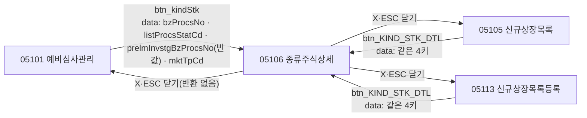
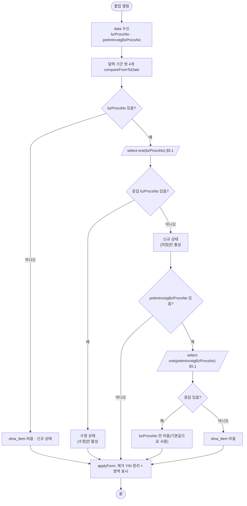
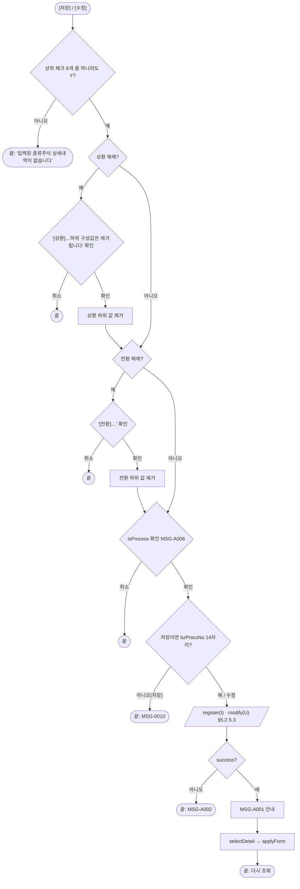
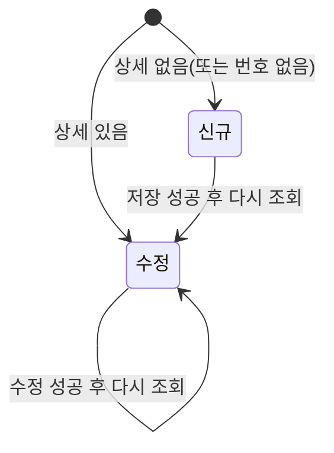

# ULDSTF05106 종류주식상세 — 업무 분석 및 전환 내역

| 항목 | 내용 |
|---|---|
| AS-IS 원본 | `ULDSTF05106.xml` — W-Craft 1차 변환본(meta_asisFileNm `ULDSTF05106_read.gfm` 로 잘못 적혀 있음, 원본 gfm 은 저장소에 없음)에 **API 적용까지 마친 개발 사본**(kindstk 묶음). 업무 로직은 이 스크립트와 남은 옛 코드 주석으로 분석했고, 개발 사본에서 빠진 원본 로직은 `conversion/publish/상장/상장처리(대내)/ULDSTF05106.xml`(W-Craft 1차 스크립트 원형)로 대조했다(§8) |
| 신규 API 명세 | 없음 — **화면에 적용된 `/api/...` 경로·method·dataCollection keyInfo 를 명세로 간주**(사용자 결정 2026-10-29). 이 화면 API 3종: `GET /api/listing/lstproc/stock/issuance-manage-kindstk-detail/select-one`·`POST /api/listing/lstproc/kind/listing-review/kind-stk/register`·`POST /api/listing/lstproc/kind/listing-review/kind-stk/modify`. §5 는 "화면 적용 API ↔ AS-IS(주석에 남은 옛 호출)" 대응표. api_spec_check 는 SKIP |
| TO-BE | `conversion/conversion-front/ui-tobe/ULDSTF05106.xml` (배포 경로 `/ui/lst/kindstk/ULDSTF05106.xml` — 원본 호출 리터럴, kindstk 공통 계약서 §2). **2026-10-29 재전환** — 1단계: 캡처 없음 → 선례 ULDBNS30400 처럼 기존 마크업 정비(마크업 전용, 사본 `$CLAUDE_JOB_DIR/tmp/ULDSTF05106_stage1.xml`), 2단계: 이 결과서대로 스크립트 전환. 게이트: `gate_screen --pcc stf`·`scan_mixed_compare`(A 1건 `length !== 14` 의도)·`publish_gate --pcc stf --before {1단계} --allow P20`·`api_spec_check`(SKIP)·`init_binding_check`·`wsxml_lint` 0/0, `convert.py` 고정점 |
| 화면 캡처 | 없음 |
| 퍼블리싱 파일 | 화면 폴더 `ULDSTF05106.xml` 의 body(이미 퍼블리싱 반영 — `pop_contents` + contentHeader, `lybox` 안 체크 제목(`titbox`) + 표(`tblbox`) 반복)를 1단계 기준으로 했다. publish 원본과의 차이는 §10 #5 |
| 업무공통 | pcc(`cm/pcc/stf`): `$c.lc.isProcess`·`$c.stf.getMessageParam`. gcc: `$c.data.getParameter`·`$c.date.compareFromToDate`·`$c.util.setButtonState`·`$c.util.isEmpty`·`$c.sbm.executeDynamic`·`$c.win.alert/confirm`·`$c.exception.handleError`. 게이트는 `--pcc stf` 로 돌린다 |
| 작성 | Inswave / 2026-10-29 |

참고 양식: [websquare_gfm_conversion.md](../../../md/websquare_gfm_conversion.md) — §1.4 업무 흐름, §6.5 getPar/setPar 전환. Gauce 대응은 [gfm_business_analysis_guide.md](../../../md/gfm_business_analysis_guide.md). 묶음 공통 결정은 kindstk 공통 계약서(§2 05106 계약, §4 공통 결정)를 따랐다. 조회 전용 쌍둥이는 [ULDSTF05106_read.md](ULDSTF05106_read.md)(분리 유지 — 계약서 §4.3).

---

## 1. 화면 개요

상장 담당자가 **종류주식(우선주 등) 한 건의 상세 조건**을 보고 등록·수정하는 팝업이다. 이익배당(배당유형·배당률·비고), 의결권 제한, 상환(회사·주주 상환권, 상환기간·현금상환·비고), 잔여재산분배, 의결권배제, 전환(회사·주주 전환권, 전환비율·대상주식·전환기간·비고)을 체크와 입력으로 다룬다.

1. 부모가 넘긴 업무처리번호로 상세를 조회한다. 있으면 **수정 상태**([수정]만 활성).
2. 없으면 **신규 상태**([저장]만 활성)가 되고, 부모가 예비심사 업무처리번호를 넘겼으면 그 상세를 기본값으로 불러온다(업무처리번호는 비운다).
3. 상위 체크(이익배당·의결권 제한·상환·잔여재산분배·의결권배제·전환)와 하위 체크(회사/주주 상환권·전환권)에 따라 입력 영역을 펼치고 접는다.
4. [저장]/[수정] 은 검증(상위 체크 하나 이상, 상환·전환 해제 시 하위 값 제거 확인) → 처리 확인 → 서버 저장 → 안내 → 다시 조회 순서다.

### 1.1 호출 화면 (3본, kindstk 묶음)

| 부모 | 여는 곳 | 비고 |
|---|---|---|
| `ULDSTF05101` 주권 종류주식 예비심사관리 | `btn_kindStk` (05101:1069-1092) | 예비심사 단계 — 예비심사 업무처리번호는 넘기지 않음("") |
| `ULDSTF05105` 종류주식신규상장목록 | `btn_KIND_STK_DTL` (05105:1194-1215) | 신규상장 단계 |
| `ULDSTF05113` 주권종류주식 신규상장목록등록 | `btn_KIND_STK_DTL` (05113:955-974) | 신규상장 단계 |

크기는 원본마다 달랐다(05101 800×900 / 05105 1000×800 / 05113 1135×840) → 계약서 권고 **1135×840**(부모 묶음 몫).

### 1.2 호출 규약 (부모 → 이 화면) / 반환 규약

AS-IS(개발 사본 05106:482-486)는 `$c.win.getParent().scwin.{vBzProcsNo, vListProcsStatCd, vPRELM_INVSTG_BZ_PROCS_NO, mktTpCd}` 를 직접 읽었다(원형은 `$c.frame.path("../")`). TO-BE 는 부모가 `await $c.win.openPopup("/ui/lst/kindstk/ULDSTF05106.xml", opts, data)` 로 열고 이 화면은 `$c.data.getParameter()` 로 받는다(가이드 §6.5).

| 키 | 의미 | 빈 값일 때 / 분기 |
|---|---|---|
| `bzProcsNo` | 업무처리번호(원본 `vBzProcsNo`) | 비면 조회 없이 빈 신규 상태. 저장 시 14자리가 아니면 MSG-0010 |
| `prelmInvstgBzProcsNo` | 예비심사 업무처리번호(원본 `vPRELM_INVSTG_BZ_PROCS_NO`) — 상세가 없을 때 기본값 원천 | 비면 기본값 조회를 건너뛴다(05101) |
| `listProcsStatCd` | 상장처리상태코드(원본 `vListProcsStatCd`) | **받기만 하고 쓰지 않는다** — 원본도 읽은 뒤 쓰지 않음(원형 buttonSet 내부용 추정) |
| `mktTpCd` | 거래시장구분 1 유가 / 2 코스닥(원본 `mktTpCd`) | **받기만 하고 쓰지 않는다** — 원본도 미사용 |

- **반환 없음** — 원본 `trs_Save_OnSuccess` 는 `buttonSet.status == "U"` 일 때 부모 경로만 얻고 아무것도 하지 않았다(재조회 없음). TO-BE 부모는 `await` 만 한다. 하단 [닫기]가 없으므로 팝업 X·ESC 로 닫는다.
- 원본 전역 `scwin.fn_GetPar, scwin.fn_SetPar;` 는 선언만 남은 것 — 계약 없음.

### 1.3 이 화면이 여는 하위 팝업

해당 없음. 원본의 달력 이미지 버튼 핸들러 8개(`img_*_onclick` → `popUpCalendar2`)는 컴포넌트가 이미 없고 `popUpCalendar2` 도 정의되지 않은 잔재다 → `w2:inputCalendar` 의 달력 버튼으로 대체(§8 #7).

### 1.4 업무 프로세스 흐름

| # | 업무 | 시작 | 끝 | 주요 함수 | 관련 절 |
|---|---|---|---|---|---|
| 1 | 진입·상세 조회 | 부모가 팝업을 연다 | 수정 상태(상세 있음) / 신규 상태(기본값 또는 빈 값) | `scwin.init` → `scwin.selectDetail` → `scwin.selectOne` → `scwin.applyForm` | §3, §5.1, §6.1 |
| 2 | 신규 저장 | [저장] | 등록 성공 → 다시 조회(수정 상태) / 검증·확인 탈락 / 실패 MSG-A002 | `scwin.save` → `scwin.checkForm` → `$c.lc.isProcess("I")` → `scwin.saveTrs("I")` | §5.2, §6.2, §6.3 |
| 3 | 수정 | [수정] | 수정 성공 → 다시 조회 / 탈락 / 실패 | `scwin.update` → `scwin.checkForm` → `$c.lc.isProcess("U")` → `scwin.saveTrs("U")` | §5.3, §6.2, §6.4 |
| 4 | 영역 펼침·접힘 | 체크 10종 변경 | 해당 영역 표시/숨김 | `scwin.chk_*_onviewchange` → `scwin.showPanel` | §4, §6.5 |

#### 화면 간 흐름

#### 업무 1: 진입·상세 조회

| # | 단계 | 주체 | 내용 | 분기 · 메시지 | 관련 절 |
|---|---|---|---|---|---|
| 1 | 파라미터 수신 | 화면 | `$c.data.getParameter()` → `scwin.bzProcsNo`·`scwin.prelmInvstgBzProcsNo` | — | §1.2, §3 |
| 2 | 달력 바인딩 | 화면 | 상환·전환 기간 쌍 4개 `compareFromToDate` | 잘못된 날짜·순서 안내(공통) | §3 |
| 3 | 상세 조회 | 서버 | `select-one` → `dma_Item` | 통신 실패는 `$c.sbm` 공통 안내 | §5.1 |
| 4 | 상태 결정 | 화면 | 응답 `bzProcsNo` 유무로 수정/신규 | `setButtonState("grpBtnBox", "update"\|"insert")` | §6.1 |
| 5 | 기본값 | 서버 | 신규 + 예비심사 번호 있음 → 그 상세를 불러와 `bzProcsNo` 비움 | 없으면 빈 값 | §5.1 |
| 6 | 화면 정리 | 화면 | `scwin.applyForm` | — | §6.1 |

#### 업무 2·3: 저장·수정

| # | 단계 | 주체 | 내용 | 분기 · 메시지 | 관련 절 |
|---|---|---|---|---|---|
| 1 | 검증 ① | 화면 | 상위 체크 6개 모두 해제 | "입력된 종류주식 상세내역이 없습니다.\n입력 데이터를 확인해 주십시오." | §6.2 |
| 2 | 검증 ②③ | 화면 | 상환·전환 해제 → 확인 후 하위 값 제거 | 취소 시 중단 | §6.2 |
| 3 | 처리 확인 | pcc | `$c.lc.isProcess("I"\|"U")` | MSG-A006 [저장]/[수정] | §6.3, §6.4 |
| 4 | 번호 확인 | 화면 | 저장만 — `bzProcsNo.length !== 14` | MSG-0010 | §6.3 |
| 5 | 서버 | 서버 | `register`/`modify`, ref `dma_Item` | 실패 MSG-A002 | §5.2, §5.3 |
| 6 | 후처리 | 화면 | MSG-A001 → `selectDetail` → `applyForm` | — | §5.2 |

#### 화면 모드 상태 전이

## 2. 화면 구성 및 데이터 정의

### 2.1 화면 구성

| 영역 | AS-IS 요소 | TO-BE 컴포넌트 (바인딩) | 설명 |
|---|---|---|---|
| 머리 | `pfmContentHeader` | 그대로 | 팝업 contentHeader 필수 |
| 전체 | `panel_Item`(`lybox`, 원본 `PanelToGroupBox`) | 그대로 | `$c.libRoundPanel.PanelToGroupBox` 잔재 삭제 |
| 이익배당 | `chk_PROFT_DIV_YN` + `panel_1` | `chk_PROFT_DIV_YN`(`proftDivYn`) / `panel_1` | 체크 → 영역 표시 |
| 　배당유형 | `label_10`, `chk_CMSTK_PCT1_DIV_YN`(보통주+1%)·`chk_LWST_DIV_RT_DSC_YN`(최저배당률 기재)·`chk_MISC_DIV_YN`(기타)·`chk_CASH_DIV_YN`(현금배당여부)·`chk_PARTCTP_YN`(참가형여부)·`chk_ACCTP_YN`(누적형여부)·`chk_NDIVTM_VOTERGHT_YN`(무배당시 의결권 여부) | 같은 id(`cmstkPct1DivYn`·`lwstDivRtDscYn`·`miscDivYn`·`cashDivYn`·`partctpYn`·`acctpYn`·`ndivtmVoterghtYn`) | `chk_CMSTK_PCT1_DIV_YN` 의 항목 값이 빈 문자열이라 체크되지 않던 결함 → `Y`(§8 #3) |
| 　배당률·비고 | `label_32` `tbx_DIV_RT`, `label_5` `tbx_PROFT_DIV_REMK` | 같은 id(`divRt`·`proftDivRemk`) | |
| 의결권 제한 | `chk_VOTERGHT_LMT_YN` + `panel_4`: `label_14` `tbx_VOTERGHT_LMT_CONTN`, `label_12` `tbx_VOTERGHT_LMT_REMK` | 같은 id(`voterghtLmtYn`·`voterghtLmtContn`·`voterghtLmtRemk`) | |
| 상환 | `chk_REDMPT_YN` + `panel_5`(`pl10`) | 같은 id(`redmptYn`) | panel_6·panel_7 을 품는다 |
| 　회사 상환권 | `chk_COM_REDMPT_RGHT_YN` + `panel_6`: `label_36` 상환기간 `tbx_COM_REDMPT_PD_STRT_DD` `label_21`(~) `tbx_COM_REDMPT_PD_END_DD`, `chk_COM_CASH_REDMPT_YN`, `label_37` `tbx_COM_REDMPT_REMK` | 같은 id(`comRedmptRghtYn`·`comRedmptPdStrtDd`·`comRedmptPdEndDd`·`comCashRedmptYn`·`comRedmptRemk`) | 달력 `readOnly` 해제(§8 #7) |
| 　주주 상환권 | `chk_SHRHD_REDMPT_RGHT_YN` + `panel_7`: `label_7` `tbx_SHRHD_REDMPT_PD_STRT_DD` `label_22` `tbx_SHRHD_REDMPT_PD_END_DD`, `chk_SHRHD_CASH_REDMPT_YN`, `label_40` `tbx_SHRHD_REDMPT_REMK` | 같은 id(`shrhdRedmptRghtYn`·`shrhdRedmptPdStrtDd`·`shrhdRedmptPdEndDd`·`shrhdCashRedmptYn`·`shrhdRedmptRemk`) | 〃 |
| 잔여재산분배 | `chk_REMAIN_PROPRT_DISTR_YN` + `panel_2`: `label_6` `tbx_REMAIN_PROPRT_DISTR_REMK` | 같은 id(`remainProprtDistrYn`·`remainProprtDistrRemk`) | |
| 의결권배제 | `chk_VOTERGHT_EXCLD_YN` + `panel_3`: `label_35` `tbx_VOTERGHT_EXCLD_REMK`, `label_16`(숨은 중복 「비고」) | `label_16` **(옮기지 않음)** — `display:none` 인 중복 라벨 | (`voterghtExcldYn`·`voterghtExcldRemk`) |
| 전환 | `chk_CONV_YN` + `panel_8`(`pl10`) | 같은 id(`convYn`) | panel_9·panel_10 을 품는다 |
| 　회사 전환권 | `chk_COM_CONV_RGHT_YN` + `panel_9`: `label_41` `tbx_COM_CONV_RTO`, `label_42` `tbx_COM_CONV_OBJ_STK_CONTN`, `label_43` `tbx_COM_CONV_PD_STRT_DD` `label_23` `tbx_COM_CONV_PD_END_DD`, `label_44` `tbx_COM_CONV_REMK` | 같은 id(`comConvRghtYn`·`comConvRto`·`comConvObjStkContn`·`comConvPdStrtDd`·`comConvPdEndDd`·`comConvRemk`) | |
| 　주주 전환권 | `chk_SHRHD_CONV_RGHT_YN` + `panel_10`: `label_28` `tbx_SHRHD_CONV_RTO`, `label_29` `tbx_SHRHD_CONV_OBJ_STK_CONTN`, `label_30` `tbx_SHRHD_CONV_PD_STRT_DD` `label_24` `tbx_SHRHD_CONV_PD_END_DD`, `label_31` `tbx_SHRHD_CONV_REMK` | 같은 id(`shrhdConvRghtYn`·`shrhdConvRto`·`shrhdConvObjStkContn`·`shrhdConvPdStrtDd`·`shrhdConvPdEndDd`·`shrhdConvRemk`) | |
| 버튼 | `btn_Close`(닫기)·`btn_Update`(수정)·`btn_Save`(저장, pt) | `grpBtnBox` > `rt`: `btn_Update`·`btn_Save` 모두 `btn_cm pt` | `btn_Close` **(옮기지 않음)** — 팝업 하단 [닫기] 금지(규칙). 규칙 41 순서 [수정]-[저장] |

- 체크박스 19개 모두 `trueValue="Y" falseValue="N"`(sample-front ULDFIL52100 선례) — 체크 "Y" / 해제 "N".
- 1단계 정비: W-Craft 잡음 속성(`orgid`·`hierarchy`·`userData2`·`meta_snippet*`·`tabIndex`·`item`) 제거.

### 2.2 데이터 정의

| TO-BE | 종류 | 키 | 출처 / 용도 |
|---|---|---|---|
| `dma_Item` | dataMap | 아래 44키 — 개발 사본 keyInfo 그대로(명세 대용) | `select-one` 응답 body(target) · `register`/`modify` 요청(ref) |

`dma_Item` 키(id — name): `bzProcsNo` 업무처리번호 · `proftDivYn` 이익배당여부 · `cmstkPct1DivYn` 보통주1PCT배당여부 · `lwstDivRtDscYn` 최저배당율기재여부 · `miscDivYn` 기타배당여부 · `cashDivYn` 현금배당여부 · `partctpYn` 참가형여부 · `divRt` 배당률(number) · `acctpYn` 누적형여부 · `ndivtmVoterghtYn` 무배당시의결권여부 · `proftDivRemk` 이익배당비고 · `remainProprtDistrYn` 잔여재산분배여부 · `remainProprtDistrRemk` 잔여재산분배비고 · `voterghtExcldYn` 의결권배제여부 · `voterghtExcldRemk` 의결권배제비고 · `voterghtLmtYn` 의결권제한여부 · `voterghtLmtContn` 의결권제한사항 · `voterghtLmtRemk` 의결권제한비고 · `redmptYn` 상환여부 · `comRedmptRghtYn` 회사상환권리여부 · `comRedmptPdEndDd` 회사상환기간종료일자 · `comRedmptPdStrtDd` 회사상환기간시작일자 · `comCashRedmptYn` 회사현금상환여부 · `comRedmptRemk` 회사상환비고 · `shrhdRedmptRghtYn` 주주상환권리여부 · `shrhdRedmptPdEndDd` 주주상환기간종료일자 · `shrhdRedmptPdStrtDd` 주주상환기간시작일자 · `shrhdCashRedmptYn` 주주현금상환여부 · `shrhdRedmptRemk` 주주상환비고 · `convYn` 전환여부 · `comConvRghtYn` 회사전환권리여부 · `comConvRto` 회사전환비율(number) · `comConvObjStkContn` 회사전환대상주식내용 · `comConvPdStrtDd` 회사전환기간시작일자 · `comConvPdEndDd` 회사전환기간종료일자 · `comConvRemk` 회사전환비고 · `shrhdConvRghtYn` 주주전환권리여부 · `shrhdConvRto` 주주전환비율(number) · `shrhdConvObjStkContn` 주주전환대상주식내용 · `shrhdConvPdStrtDd` 주주전환기간시작일자 · `shrhdConvPdEndDd` 주주전환기간종료일자 · `shrhdConvRemk` 주주전환비고 · `continDeadlineEndDd` 존속기한종료일자 · `continDeadlineStrtDd` 존속기한시작일자.

- `continDeadline*`(존속기한)은 화면에 입력란이 없다 — 응답 값을 그대로 다시 보낸다.
- 여부 키 19개(`scwin.YN_KEYS`)는 TO-BE 에서 "Y"/"N" 으로 맞춘다(§6.1, §10 #1).

## 3. 로딩 (`scwin.onpageload` → `scwin.init`)

`scwin.onpageload` 는 `scwin.init()` 만 부른다(try/catch → `$c.exception.handleError`). 원본 `scwin.onpageunload`(빈 함수)는 옮기지 않는다.

1. **파라미터 수신** — `$c.data.getParameter() ?? {}` → `scwin.bzProcsNo`·`scwin.prelmInvstgBzProcsNo`(§1.2).
2. **달력 바인딩(1회, 규칙 37)** — 기간 쌍 4개 `compareFromToDate`: 회사 상환기간(`tbx_COM_REDMPT_PD_STRT_DD`~`END_DD`), 주주 상환기간(`tbx_SHRHD_REDMPT_PD_*`), 회사 전환기간(`tbx_COM_CONV_PD_*`), 주주 전환기간(`tbx_SHRHD_CONV_PD_*`). 조회 영역(schbox)이 없어 `setEnterKeyEvent` 는 해당 없음.
3. **상세 조회** — 번호가 없으면 `dma_Item.setEmptyValue()` + 신규 상태, 있으면 `await scwin.selectDetail()`(§6.1). await 근거: 다음 단계가 응답 값으로 화면을 정리한다.
4. **화면 정리** — `scwin.applyForm()`(§6.1).

## 4. 컴포넌트 이벤트

| TO-BE 컴포넌트 | 이벤트 | TO-BE 핸들러 | 동작 | AS-IS |
|---|---|---|---|---|
| `chk_PROFT_DIV_YN` | onviewchange | `scwin.chk_PROFT_DIV_YN_onviewchange` | `showPanel(panel_1, getValue())` | `scwin.chk_PROFT_DIV_YN_onclick`(ev:onchange) |
| `chk_REMAIN_PROPRT_DISTR_YN` | onviewchange | `scwin.chk_REMAIN_PROPRT_DISTR_YN_onviewchange` | panel_2 | `scwin.chk_REMAIN_PROPRT_DISTR_YN_onclick` |
| `chk_VOTERGHT_EXCLD_YN` | onviewchange | `scwin.chk_VOTERGHT_EXCLD_YN_onviewchange` | panel_3 | `scwin.chk_VOTERGHT_EXCLD_YN_onclick` |
| `chk_VOTERGHT_LMT_YN` | onviewchange | `scwin.chk_VOTERGHT_LMT_YN_onviewchange` | panel_4 | `scwin.chk_VOTERGHT_LMT_YN_onclick` |
| `chk_REDMPT_YN` | onviewchange | `scwin.chk_REDMPT_YN_onviewchange` | panel_5 | `scwin.chk_REDMPT_YN_onclick` |
| `chk_COM_REDMPT_RGHT_YN` | onviewchange | `scwin.chk_COM_REDMPT_RGHT_YN_onviewchange` | panel_6 | `scwin.chk_COM_REDMPT_RGHT_YN_onclick` |
| `chk_SHRHD_REDMPT_RGHT_YN` | onviewchange | `scwin.chk_SHRHD_REDMPT_RGHT_YN_onviewchange` | panel_7 | `scwin.chk_SHRHD_REDMPT_RGHT_YN_onclick` |
| `chk_CONV_YN` | onviewchange | `scwin.chk_CONV_YN_onviewchange` | panel_8 | `scwin.chk_CONV_YN_onclick` |
| `chk_COM_CONV_RGHT_YN` | onviewchange | `scwin.chk_COM_CONV_RGHT_YN_onviewchange` | panel_9 | `scwin.chk_COM_CONV_RGHT_YN_onclick` |
| `chk_SHRHD_CONV_RGHT_YN` | onviewchange | `scwin.chk_SHRHD_CONV_RGHT_YN_onviewchange` | panel_10 | `scwin.chk_SHRHD_CONV_RGHT_YN_onclick` |
| `btn_Update` | onclick | `scwin.btn_Update_onclick` | `scwin.update` | `scwin.btn_Update_onclick` → `fn_update` |
| `btn_Save` | onclick | `scwin.btn_Save_onclick` | `scwin.save` | `scwin.btn_Save_onclick` → `fn_save` |
| (없음) | — | — | — | `scwin.btn_Close_onclick`(`closePopup`) 삭제 · `img_COM_REDMPT_PD_STRT_DD_onclick`·`img_COM_REDMPT_PD_END_DD_onclick`·`img_SHRHD_REDMPT_PD_STRT_DD_onclick`·`img_SHRHD_REDMPT_PD_END_DD_onclick`·`img_COM_CONV_PD_STRT_DD_onclick`·`img_COM_CONV_PD_END_DD_onclick`·`img_SHRHD_CONV_PD_STRT_DD_onclick`·`img_SHRHD_CONV_PD_END_DD_onclick` 삭제(§8 #7) |

- 체크 핸들러 이벤트를 `onchange` → `onviewchange`(사용자 조작) 로 바꾸고, 값은 `info.newValue` 대신 컴포넌트 `getValue()` 로 읽는다(checkboxgroup 관용구).

## 5. 서버 통신

| # | 용도 | AS-IS (주석에 남은 옛 호출) | TO-BE (화면 적용 API = 명세 대용) |
|---|---|---|---|
| 5.1 | 상세 1건 조회 | `dts_Item.DataID = /KindStk.do?method=selectKindStkDtl&inputMessageId=KIND_STK_PREEXAM_SEARCH_OUT&BZ_PROCS_NO=…` + `Reset()` | `GET /api/listing/lstproc/stock/issuance-manage-kindstk-detail/select-one` |
| 5.2 | 등록 | `trs_Save.Action = /KindStk.do?…&SCREN_PROCES_TP_CD=SCREN_PROCS_TP_CD_02&method=saveKindStkDtl`, `KeyValue JSP(I:pInput=dts_Item)` | `POST /api/listing/lstproc/kind/listing-review/kind-stk/register` |
| 5.3 | 수정 | 같은 Action, `SCREN_PROCS_TP_CD_03` | `POST /api/listing/lstproc/kind/listing-review/kind-stk/modify` |

### 5.1 상세 1건 조회 (`scwin.selectOne`)

| 항목 | 내용 |
|---|---|
| `id` | `sbm_selectOne` |
| `method` / `action` | `get` / `/api/listing/lstproc/stock/issuance-manage-kindstk-detail/select-one` |
| `ref` / `requestData` | requestData `{ bzProcsNo }` (쿼리) |
| `target` | `dma_Item=body` |
| 선행 / 순서 | 받기 전 `dma_Item.setEmptyValue()`(앞 건 값 잔존 방지). `selectDetail` 이 업무처리번호 → (없으면) 예비심사 업무처리번호 순서로 최대 2회 부른다 |
| 후처리 | `selectDetail` 이 응답 `bzProcsNo` 유무로 상태 결정(§6.1) |
| 실패 처리 | 통신 실패 안내는 `$c.sbm` 공통. 실패면 빈 `dma_Item` → 신규 상태로 보인다 |
| 중복 실행 | `result.skipped` 면 false |

### 5.2 등록 / 5.3 수정 (`scwin.saveTrs(trJob)`)

| 항목 | 내용 |
|---|---|
| `id` | `sbm_saveTrs` |
| `method` / `action` | `post` / I `/api/listing/lstproc/kind/listing-review/kind-stk/register`, U `/api/listing/lstproc/kind/listing-review/kind-stk/modify` (전체 경로 리터럴 — 규칙 38) |
| `ref` | `dma_Item` (보내기 전 `bzProcsNo` = `scwin.bzProcsNo`) |
| `target` | 없음 — 개발 사본에 응답 정의가 없다(§10 #2) |
| 후처리 | `$c.win.alert(MSG-A001, 저장\|수정)` → `scwin.selectDetail()` → `scwin.applyForm()` (원본 `trs_Save_OnSuccess` 의 `fn_alertMsg('S')` + `fn_read_sync`) |
| 실패 처리 | `responseJSON.success !== true` → MSG-A002 (원본 `trs_Save_OnFail` 의 `fn_alertMsg('F')`) |
| 중복 실행 | `result.skipped` 면 아무것도 하지 않음 |

- 원본이 보내던 `SCREN_ID`·`SCREN_PROCES_TP_CD`(02/03) 는 화면 적용 API 에 없어 보내지 않는다(개발 사본도 주석).

## 6. 일반 함수

### 6.1 상세 조회·화면 정리 (`scwin.selectDetail` · `scwin.applyForm`)

* **selectDetail:** `selectOne(bzProcsNo)` → 응답 `bzProcsNo` 있으면 `setButtonState("grpBtnBox", "update", BTN_MAP)`(수정만 활성) 후 끝. 없으면 `"insert"`(저장만 활성) → `prelmInvstgBzProcsNo` 가 있으면 `selectOne(prelm)` → 응답 있으면 `bzProcsNo` 만 비우고, 없으면 `setEmptyValue()`. (원본 `fn_read_sync`, `buttonSet.setInsertStatus/setUpdateStatus`)
* **applyForm:** 여부 키 19개를 `"Y"`(값이 "Y" 또는 "1") / `"N"` 으로 맞추고, 영역 10개를 체크 값으로 `showPanel`. (원본 `initForm` — 빈 값을 0 으로 채우고 `$c.stf.showObj`)
* **BTN_MAP:** `{ save : "btn_Save", modify : "btn_Update" }` — gcc 상태 `insert`(save 만) / `update`(전체 활성, save 제외).

### 6.2 저장 전 검증 (`scwin.checkForm`)

* **Return:** `Promise<Boolean>`.
* **로직:** ① 상위 체크 6개(`proftDivYn`·`remainProprtDistrYn`·`voterghtExcldYn`·`voterghtLmtYn`·`redmptYn`·`convYn`)가 모두 "Y" 가 아니면 안내 후 false(원형 `fn_checkForm` 의 검사 — 개발 사본에서 빠져 복원, §8 #4). ② `redmptYn` 해제 → `await $c.win.confirm` 후 회사/주주 상환 하위 값(권리·기간 시작/종료·현금상환·비고) 제거, 취소면 false. ③ `convYn` 해제 → 확인 후 회사/주주 전환 하위 값(권리·비율·대상주식·기간·비고) 제거.

### 6.3 신규 저장 (`scwin.save`)

`checkForm` → `$c.lc.isProcess("I")`(MSG-A006 [저장]) → `bzProcsNo.length !== 14` 면 MSG-0010 → `saveTrs("I")`. (원본 `fn_save`, 원형 순서: 검증 → 확인 → 번호)

### 6.4 수정 (`scwin.update`)

`checkForm` → `$c.lc.isProcess("U")` → `saveTrs("U")`. (원본 `fn_update`)

### 6.5 영역 표시 (`scwin.showPanel`)

`(panel, yn)` — "Y" 면 `panel.show("")`, 아니면 `panel.hide()`. (원본 `$c.stf.showObj` — 규칙 V29)

## 7. 업무 코드 · 메시지 목록

| 코드 / 메시지 | 쓰는 곳 |
|---|---|
| 체크 "Y" / 해제 "N" (원형 Gauce 1/0) | 여부 키 19개 |
| MSG-A006 "[저장/수정] 하시겠습니까?" 계열 | `$c.lc.isProcess` |
| MSG-0010 | 저장 시 업무처리번호 14자리 아님 |
| MSG-A001 "[저장/수정] …" 성공 | `saveTrs` 성공 |
| MSG-A002 "[저장/수정] 처리 실패하였습니다." | `saveTrs` 실패 |
| "입력된 종류주식 상세내역이 없습니다.\n입력 데이터를 확인해 주십시오." | `checkForm` ① |
| "[상환]이 체크되지 않았기 때문에 하위 구성값은 제거됩니다.\n계속 하시겠습니까?" | `checkForm` ② |
| "[전환]이 체크되지 않았기 때문에 하위 구성값은 제거됩니다.\n계속 하시겠습니까?" | `checkForm` ③ |

## 8. 원본 특이사항 · 결함

| # | 원본에서 실제로 일어나는 일 (근거) | 전환본 처리 |
|---|---|---|
| 1 | 부모 scwin 변수를 `getParent()` 로 직접 읽음(05106:483-486) | **고침** — openPopup data(§1.2) |
| 2 | 여부 값이 섞임: 마크업 체크 값 "Y", `initForm` 은 빈 값을 0 으로 채우고 `proftDivYn == "1"` 만 "1" 비교, `fn_CheckForm` 은 `== 0` 비교. 원형 Gauce 는 1/0 | **고침** — 마크업 `trueValue="Y" falseValue="N"`, 조회 뒤 "Y"/"1" → "Y", 나머지 "N" 으로 통일(§10 #1) |
| 3 | `chk_CMSTK_PCT1_DIV_YN`(보통주+1%) 항목 값이 빈 문자열 — 체크해도 값이 생기지 않음(05106 마크업, publish 원본 동일) | **고침** — 값 "Y" |
| 4 | 개발 사본 `fn_CheckForm` 에서 원형의 "상위 체크 모두 'N' 이면 안내" 검사가 빠짐(publish 원본 `fn_checkForm`) | **고침(복원)** |
| 5 | 상환 해제 시 `COM_REDMPT_PD_END_DD`(회사 상환기간 종료일)만 지우지 않음(원형·개발 사본 동일) | **고침** — 함께 지움 |
| 6 | 전환 해제 시 개발 사본이 없는 키 `comConvRdStrtDd`·`comConvRdEndDd` 를 지움(오타) → 회사 전환기간이 남음 | **고침** — `comConvPdStrtDd`·`comConvPdEndDd` |
| 7 | 달력 `readOnly="true"` + 이미지 버튼(`img_*`) 핸들러가 정의되지 않은 `popUpCalendar2` 를 부르고 이미지 컴포넌트는 없음 → 날짜 입력 불가 | **고침** — `readOnly` 해제(달력 버튼·직접 입력), `img_*` 핸들러 삭제, 기간 쌍 검사 바인딩 |
| 8 | `$c.win.confirm` 을 await 없이 if 조건에 씀(Promise 는 항상 참 → 취소해도 진행) | **고침** — `await` |
| 9 | `initForm` 이 `proftDivRemk`(비고 문자열)에도 0 을 채움 | **고침** — 여부 키만 정리 |
| 10 | `setButtonState("grp_btnBox", …)` 인데 버튼 그룹에 id 가 없음 | **고침** — `grpBtnBox` id 부여 |
| 11 | `fn_save`·`fn_update` 가 `fn_trs()` 를 await 없이 부름, `trs_Save_OnSuccess` 는 응답 판정 없이 성공 안내 | **고침** — `saveTrs` 가 응답 판정 후 안내·재조회 |
| 12 | `vScrenID = "ULDSTF05106_read.xml"`(다른 화면 ID), meta_asisFileNm 도 `_read.gfm` | **옮기지 않음**(로그 전용 잔재) — head meta 는 이 화면 ID |
| 13 | 상환·전환이 해제돼 있으면 하위 값이 비어 있어도 저장할 때마다 확인창이 뜸(원형 동작) | **유지** |

## 9. 전환 내역 (AS-IS → TO-BE)

| AS-IS | TO-BE |
|---|---|
| `scwin.onpageload` | `scwin.onpageload` → `scwin.init` |
| `scwin.onpageunload`(빈 함수) | 삭제 |
| `scwin.init`(getParent 읽기) | `scwin.init`(openPopup data) |
| `scwin.fn_read_sync` | `scwin.selectDetail` + `scwin.selectOne` |
| `scwin.initForm` | `scwin.applyForm` + `scwin.showPanel` |
| `scwin.fn_CheckForm` | `scwin.checkForm` |
| `scwin.fn_save` | `scwin.save` |
| `scwin.fn_update` | `scwin.update` |
| `scwin.fn_trs` + `scwin.trs_Save_OnSuccess` (+ 주석 `trs_Save_OnFail`) | `scwin.saveTrs` |
| 주석 `dma_Item_OnLoadError`·`dma_Item_OnLoadCompleted` | 삭제(`$c.stf.alert_error` 대체 — 계약서 §4.1) |
| `scwin.chk_*_onclick` 10종 | `scwin.chk_*_onviewchange` 10종 |
| `scwin.img_*_onclick` 8종 | 삭제(§8 #7) |
| `scwin.btn_Close_onclick` | 삭제(하단 [닫기] 금지) |
| `scwin.btn_Save_onclick` / `scwin.btn_Update_onclick` | 같은 이름(async + try/catch) |
| 전역 `fn_GetPar, fn_SetPar`·`vScrenID`·`TR_JOB`·`vListProcsStatCd`·`mktTpCd`·`vPRELM_INVSTG_BZ_PROCS_NO`·`vBzProcsNo` | `scwin.bzProcsNo`·`scwin.prelmInvstgBzProcsNo` 만(나머지 삭제 — §1.2) |
| `scwin.BTN_MAP`(`save`·`modify`) | 그대로 + `scwin.YN_KEYS` |
| `$c.lc.isProcess`(await) | 그대로 |
| `buttonSet.setInsertStatus/setUpdateStatus` | `$c.util.setButtonState("grpBtnBox", "insert"\|"update", scwin.BTN_MAP)` |

## 10. 남은 작업 (TODO)

1. **여부 값 형식** — 서버가 여부 키를 "Y"/"N" 으로 주고받는지 확인(원형 Gauce 는 1/0). TO-BE 는 "1" 도 체크로 읽지만 보낼 때는 "Y"/"N" 이다.
2. **register·modify 응답** — 응답 구조(completeYn 등)가 개발 사본에 정의돼 있지 않아 `success` 만으로 판정한다.
3. **`listProcsStatCd`·`mktTpCd`** — 계약상 받지만 쓰지 않는다. 원형 `buttonSet.js`(저장소 없음)가 상장처리상태로 버튼을 잠갔는지 확인 필요.
4. **팝업 크기** — 부모 3본이 1135×840 으로 맞추는지(부모 묶음 몫).
5. **publish 원본과의 차이** — 1단계 기준은 개발 사본 body 다. publish 원본 대비 개발 사본이 바꾼 마크업(테이블 정렬 등)은 그대로 두었고, 이 화면에서 추가로 바꾼 것은 §2.1(체크 값·숨은 라벨·달력 readOnly·버튼 영역)뿐이다.
