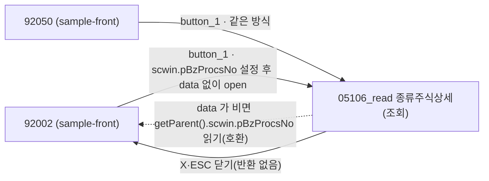
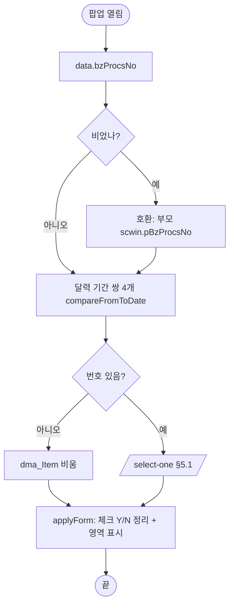

# ULDSTF05106_read 종류주식상세(조회) — 업무 분석 및 전환 내역

| 항목 | 내용 |
|---|---|
| AS-IS 원본 | `ULDSTF05106_read.xml` — W-Craft 1차 변환본(meta_asisFileNm `ULDSTF05106_read.gfm`, 원본 gfm 은 저장소에 없음)에 **API 적용까지 마친 개발 사본**(kindstk 묶음). 저장 관련 함수(`fn_CheckForm`·`fn_save`·`fn_update`·`fn_trs` 등)는 개발 사본에서 주석 처리됨. 원형 대조는 `conversion/publish/상장/상장처리(대내)/ULDSTF05106_read.xml` |
| 신규 API 명세 | 없음 — **화면에 적용된 `/api/...` 경로·method·dataCollection keyInfo 를 명세로 간주**(사용자 결정 2026-10-29). 이 화면 API 1종: `GET /api/listing/lstproc/stock/issuance-manage-kindstk-detail/select-one`(주석으로 남은 `issuance-manage-kindstk-bzprocsno/select-one` 은 쓰지 않음). api_spec_check 는 SKIP |
| TO-BE | `conversion/conversion-front/ui-tobe/ULDSTF05106_read.xml` (배포 경로: 호출자 92002 는 `/ui/lst/lstproc/ULDSTF05106_read.xml`, 92050 은 `/ui/lstproc/ULDSTF05106_read.xml` — 불일치, §10 #4). **2026-10-29 재전환** — 1단계: 캡처 없음 → 기존 마크업 정비(사본 `$CLAUDE_JOB_DIR/tmp/ULDSTF05106_read_stage1.xml`), 2단계: 스크립트 전환. 게이트: `gate_screen --pcc stf`·`scan_mixed_compare`·`publish_gate --pcc stf --before {1단계} --allow P20`·`api_spec_check`(SKIP)·`init_binding_check`·`wsxml_lint` 0/0, `convert.py` 고정점 |
| 화면 캡처 | 없음 |
| 퍼블리싱 파일 | 화면 폴더 `ULDSTF05106_read.xml` 의 body(05106 과 같은 구성에 [수정]·[저장] 없이 [닫기]만)를 1단계 기준으로 했다 |
| 업무공통 | gcc: `$c.data.getParameter`·`$c.win.getParent`(호환 분기)·`$c.date.compareFromToDate`·`$c.util.isEmpty`·`$c.sbm.executeDynamic`·`$c.exception.handleError`. 게이트는 `--pcc stf` |
| 작성 | Inswave / 2026-10-29 |

참고 양식: [websquare_gfm_conversion.md](../../../md/websquare_gfm_conversion.md). 묶음 공통 결정은 kindstk 공통 계약서(§2 05106_read 계약, §4.3 분리 유지). 편집 쌍둥이는 [ULDSTF05106.md](ULDSTF05106.md) — 화면 구성·데이터·영역 표시 로직은 같고, 이 문서는 차이 위주로 적는다.

---

## 1. 화면 개요

종류주식 관련 공통 화면(92002·92050)에서 **종류주식 상세를 조회만** 하는 팝업이다. 구성(이익배당·의결권 제한·상환·잔여재산분배·의결권배제·전환과 하위 입력)은 [ULDSTF05106](ULDSTF05106.md) §2.1 과 같고 저장·수정 버튼이 없다.

1. 부모가 정한 업무처리번호로 상세를 조회한다.
2. 체크 상태에 따라 하위 영역을 펼치고 접는다(사용자가 체크를 바꾸면 영역만 바뀌고 저장되지 않는다 — 원본 동작, §8 #4).

### 1.1 호출 화면 (2본, 범위 밖 sample-front)

| 부모 | 여는 곳 | 비고 |
|---|---|---|
| `ULDSTF92002` (`conversion/sample-front/ui/stf/lst/common/ULDSTF92002.xml:984-996`) | `button_1_onclick` — `select-apfm-by-acptno` 로 번호를 얻어 `scwin.pBzProcsNo` 에 두고 data 없이 `openPopup("/ui/lst/lstproc/ULDSTF05106_read.xml", {id, popupName, 1135×840, frameModal:"top"})` | 범위 밖 — 아직 getParent 계약 |
| `ULDSTF92050` (`…/ULDSTF92050.xml:875-889`) | 같은 방식, 경로 `/ui/lstproc/ULDSTF05106_read.xml` | 〃 |

### 1.2 호출 규약 (부모 → 이 화면) / 반환 규약

| 키 | 의미 | 빈 값일 때 / 분기 |
|---|---|---|
| data `bzProcsNo` | 업무처리번호 — 05106 과 같은 키(계약서 §2) | 비면 아래 호환 분기 |
| (호환) 부모 `scwin.pBzProcsNo` | 92002·92050 이 열기 직전에 채우는 값 | data 가 비었을 때만 `$c.win.getParent()?.scwin?.pBzProcsNo` 로 읽는다. 그것도 비면 조회 없이 빈 화면 |
| data `listProcsStatCd`·`mktTpCd` | 05106 과 같은 키 | 받아도 쓰지 않는다(원본도 읽기만 하고 미사용, 호출자 92002·92050 은 이 값을 두지도 않는다) |

- **원본 결함**: 개발 사본 init(05106_read:402-403)은 `pBzProcsNo` 를 읽은 직후 `scwin.vBzProcsNo = getParent().scwin.vBzProcsNo` 로 **덮어써** 92002 가 준 번호를 버렸다(92002·92050 에는 `vBzProcsNo` 가 없다 → undefined) → 고침(§8 #1). 원형(publish 원본 `gform_onload`)은 `parentWin.pBzProcsNo` 만 읽었다.
- **반환 없음.** 하단 [닫기]는 옮기지 않으므로 팝업 X·ESC 로 닫는다.

### 1.3 이 화면이 여는 하위 팝업

해당 없음(`img_*_onclick` 8종은 정의되지 않은 `popUpCalendar2` 를 부르는 잔재 — 삭제).

### 1.4 업무 프로세스 흐름

| # | 업무 | 시작 | 끝 | 주요 함수 | 관련 절 |
|---|---|---|---|---|---|
| 1 | 진입·상세 조회 | 부모가 팝업을 연다 | 상세 표시(없으면 빈 화면) | `scwin.init` → `scwin.selectOne` → `scwin.applyForm` | §3, §5.1 |
| 2 | 영역 펼침·접힘 | 체크 10종 변경 | 영역 표시/숨김(저장 없음) | `scwin.chk_*_onviewchange` → `scwin.showPanel` | §4 |

#### 화면 간 흐름

#### 업무 1: 진입·상세 조회

| # | 단계 | 주체 | 내용 | 분기 · 메시지 | 관련 절 |
|---|---|---|---|---|---|
| 1 | 번호 수신 | 화면 | data 우선, 비면 부모 `pBzProcsNo` | — | §1.2 |
| 2 | 달력 바인딩 | 화면 | 기간 쌍 4개(읽기 전용 달력이지만 init 1회 원칙) | — | §3 |
| 3 | 조회 | 서버 | `select-one` → `dma_Item` | 통신 실패는 공통 안내 | §5.1 |
| 4 | 화면 정리 | 화면 | `scwin.applyForm` | — | ULDSTF05106 §6.1 |

## 2. 화면 구성 및 데이터 정의

### 2.1 화면 구성

[ULDSTF05106](ULDSTF05106.md) §2.1 과 같다(같은 id: `pfmContentHeader`·`panel_Item`·`panel_1`·`panel_2`·`panel_3`·`panel_4`·`panel_5`·`panel_6`·`panel_7`·`panel_8`·`panel_9`·`panel_10`, 체크 19개 `chk_PROFT_DIV_YN`·`chk_CMSTK_PCT1_DIV_YN`·`chk_LWST_DIV_RT_DSC_YN`·`chk_MISC_DIV_YN`·`chk_CASH_DIV_YN`·`chk_PARTCTP_YN`·`chk_ACCTP_YN`·`chk_NDIVTM_VOTERGHT_YN`·`chk_VOTERGHT_LMT_YN`·`chk_REDMPT_YN`·`chk_COM_REDMPT_RGHT_YN`·`chk_COM_CASH_REDMPT_YN`·`chk_SHRHD_REDMPT_RGHT_YN`·`chk_SHRHD_CASH_REDMPT_YN`·`chk_REMAIN_PROPRT_DISTR_YN`·`chk_VOTERGHT_EXCLD_YN`·`chk_CONV_YN`·`chk_COM_CONV_RGHT_YN`·`chk_SHRHD_CONV_RGHT_YN`, 입력 `tbx_DIV_RT`·`tbx_PROFT_DIV_REMK`·`tbx_VOTERGHT_LMT_CONTN`·`tbx_VOTERGHT_LMT_REMK`·`tbx_COM_REDMPT_PD_STRT_DD`·`tbx_COM_REDMPT_PD_END_DD`·`tbx_COM_REDMPT_REMK`·`tbx_SHRHD_REDMPT_PD_STRT_DD`·`tbx_SHRHD_REDMPT_PD_END_DD`·`tbx_SHRHD_REDMPT_REMK`·`tbx_REMAIN_PROPRT_DISTR_REMK`·`tbx_VOTERGHT_EXCLD_REMK`·`tbx_COM_CONV_RTO`·`tbx_COM_CONV_OBJ_STK_CONTN`·`tbx_COM_CONV_PD_STRT_DD`·`tbx_COM_CONV_PD_END_DD`·`tbx_COM_CONV_REMK`·`tbx_SHRHD_CONV_RTO`·`tbx_SHRHD_CONV_OBJ_STK_CONTN`·`tbx_SHRHD_CONV_PD_STRT_DD`·`tbx_SHRHD_CONV_PD_END_DD`·`tbx_SHRHD_CONV_REMK`, 라벨 `label_5`·`label_6`·`label_7`·`label_10`·`label_12`·`label_14`·`label_21`·`label_22`·`label_23`·`label_24`·`label_28`·`label_29`·`label_30`·`label_31`·`label_32`·`label_35`·`label_36`·`label_37`·`label_40`·`label_41`·`label_42`·`label_43`·`label_44`). 차이:

| 영역 | AS-IS 요소 | TO-BE | 설명 |
|---|---|---|---|
| 달력 | `tbx_*_PD_*` `readOnly="true"` | **유지** | 조회 전용이라 원본대로 읽기 전용 |
| 숨은 라벨 | `label_16`(`display:none` 중복 「비고」) | **(옮기지 않음)** | 05106 과 같음 |
| 버튼 | `btn_Close`(닫기)만 | **(옮기지 않음)** — 버튼 영역째 삭제 | 팝업 하단 [닫기] 금지(규칙) |
| 체크 값 | "Y"(보통주+1% 는 빈 값) | `trueValue="Y" falseValue="N"`, 항목 값 "Y" | 05106 §8 #2·#3 과 같음 |

### 2.2 데이터 정의

`dma_Item` — [ULDSTF05106](ULDSTF05106.md) §2.2 와 같은 44키(개발 사본 keyInfo 가 05106 과 동일): `bzProcsNo` 업무처리번호 · `proftDivYn` 이익배당여부 · `cmstkPct1DivYn` 보통주1PCT배당여부 · `lwstDivRtDscYn` 최저배당율기재여부 · `miscDivYn` 기타배당여부 · `cashDivYn` 현금배당여부 · `partctpYn` 참가형여부 · `divRt` 배당률 · `acctpYn` 누적형여부 · `ndivtmVoterghtYn` 무배당시의결권여부 · `proftDivRemk` 이익배당비고 · `remainProprtDistrYn` 잔여재산분배여부 · `remainProprtDistrRemk` 잔여재산분배비고 · `voterghtExcldYn` 의결권배제여부 · `voterghtExcldRemk` 의결권배제비고 · `voterghtLmtYn` 의결권제한여부 · `voterghtLmtContn` 의결권제한사항 · `voterghtLmtRemk` 의결권제한비고 · `redmptYn` 상환여부 · `comRedmptRghtYn` 회사상환권리여부 · `comRedmptPdEndDd` 회사상환기간종료일자 · `comRedmptPdStrtDd` 회사상환기간시작일자 · `comCashRedmptYn` 회사현금상환여부 · `comRedmptRemk` 회사상환비고 · `shrhdRedmptRghtYn` 주주상환권리여부 · `shrhdRedmptPdEndDd` 주주상환기간종료일자 · `shrhdRedmptPdStrtDd` 주주상환기간시작일자 · `shrhdCashRedmptYn` 주주현금상환여부 · `shrhdRedmptRemk` 주주상환비고 · `convYn` 전환여부 · `comConvRghtYn` 회사전환권리여부 · `comConvRto` 회사전환비율 · `comConvObjStkContn` 회사전환대상주식내용 · `comConvPdStrtDd` 회사전환기간시작일자 · `comConvPdEndDd` 회사전환기간종료일자 · `comConvRemk` 회사전환비고 · `shrhdConvRghtYn` 주주전환권리여부 · `shrhdConvRto` 주주전환비율 · `shrhdConvObjStkContn` 주주전환대상주식내용 · `shrhdConvPdStrtDd` 주주전환기간시작일자 · `shrhdConvPdEndDd` 주주전환기간종료일자 · `shrhdConvRemk` 주주전환비고 · `continDeadlineEndDd` 존속기한종료일자 · `continDeadlineStrtDd` 존속기한시작일자. 용도는 `select-one` 응답(target)뿐.

## 3. 로딩 (`scwin.onpageload` → `scwin.init`)

`scwin.onpageload` 는 `scwin.init()` 만 부른다. 원본 `scwin.onpageunload`(빈 함수)는 옮기지 않는다.

1. **번호 수신** — `$c.data.getParameter() ?? {}` 의 `bzProcsNo`, 비면 `$c.win.getParent()?.scwin?.pBzProcsNo`(§1.2).
2. **달력 바인딩(1회, 규칙 37)** — 05106 과 같은 기간 쌍 4개 `compareFromToDate`.
3. **조회** — 번호가 없으면 `dma_Item.setEmptyValue()`, 있으면 `await scwin.selectOne(bzProcsNo)`.
4. **화면 정리** — `scwin.applyForm()`(여부 키 Y/N 정리 + 영역 표시, 05106 §6.1 과 같은 함수).

## 4. 컴포넌트 이벤트

| TO-BE 컴포넌트 | 이벤트 | TO-BE 핸들러 | 동작 | AS-IS |
|---|---|---|---|---|
| 체크 10종(`chk_PROFT_DIV_YN`·`chk_REMAIN_PROPRT_DISTR_YN`·`chk_VOTERGHT_EXCLD_YN`·`chk_VOTERGHT_LMT_YN`·`chk_REDMPT_YN`·`chk_COM_REDMPT_RGHT_YN`·`chk_SHRHD_REDMPT_RGHT_YN`·`chk_CONV_YN`·`chk_COM_CONV_RGHT_YN`·`chk_SHRHD_CONV_RGHT_YN`) | onviewchange | `scwin.{id}_onviewchange` | `showPanel(panel_n, getValue())` | `scwin.chk_PROFT_DIV_YN_onclick`·`scwin.chk_REMAIN_PROPRT_DISTR_YN_onclick`·`scwin.chk_VOTERGHT_EXCLD_YN_onclick`·`scwin.chk_VOTERGHT_LMT_YN_onclick`·`scwin.chk_REDMPT_YN_onclick`·`scwin.chk_COM_REDMPT_RGHT_YN_onclick`·`scwin.chk_SHRHD_REDMPT_RGHT_YN_onclick`·`scwin.chk_CONV_YN_onclick`·`scwin.chk_COM_CONV_RGHT_YN_onclick`·`scwin.chk_SHRHD_CONV_RGHT_YN_onclick`(ev:onchange) |
| (없음) | — | — | — | `scwin.btn_Close_onclick` 삭제, `img_COM_REDMPT_PD_STRT_DD_onclick`·`img_COM_REDMPT_PD_END_DD_onclick`·`img_SHRHD_REDMPT_PD_STRT_DD_onclick`·`img_SHRHD_REDMPT_PD_END_DD_onclick`·`img_COM_CONV_PD_STRT_DD_onclick`·`img_COM_CONV_PD_END_DD_onclick`·`img_SHRHD_CONV_PD_STRT_DD_onclick`·`img_SHRHD_CONV_PD_END_DD_onclick` 삭제 |

## 5. 서버 통신

| # | 용도 | AS-IS (원형) | TO-BE (화면 적용 API = 명세 대용) |
|---|---|---|---|
| 5.1 | 상세 1건 조회 | `dts_Item.DataID = /KindStk.do?method=selectKindStkDtl&BZ_PROCS_NO=…` + `Reset()` | `GET /api/listing/lstproc/stock/issuance-manage-kindstk-detail/select-one` |

### 5.1 상세 1건 조회 (`scwin.selectOne`)

| 항목 | 내용 |
|---|---|
| `id` | `sbm_selectOne` |
| `method` / `action` | `get` / `/api/listing/lstproc/stock/issuance-manage-kindstk-detail/select-one` |
| `requestData` | `{ bzProcsNo }` |
| `target` | `dma_Item=body` |
| 선행 | 받기 전 `dma_Item.setEmptyValue()` |
| 후처리 | `scwin.applyForm` |
| 실패 처리 | `$c.sbm` 공통 안내, 빈 화면 |
| 중복 실행 | `result.skipped` 면 false |

- 개발 사본이 `dma_Item.set("bzProcsNo", …)` 를 조회 전에 하던 것은 target 덮어쓰기라 의미가 없어 옮기지 않았다.

## 6. 일반 함수

`scwin.applyForm`·`scwin.showPanel` — [ULDSTF05106](ULDSTF05106.md) §6.1·§6.5 와 같은 구현(화면마다 정의).

## 7. 업무 코드 · 메시지 목록

체크 "Y" / 해제 "N"(원형 Gauce 1/0). 화면 고유 메시지 없음.

## 8. 원본 특이사항 · 결함

| # | 원본에서 실제로 일어나는 일 (근거) | 전환본 처리 |
|---|---|---|
| 1 | `pBzProcsNo` 를 읽고 바로 부모 `vBzProcsNo`(92002·92050 에 없음)로 덮어씀 → 번호 undefined → 조회 안 됨(05106_read:402-403) | **고침** — data 우선 + `pBzProcsNo` 호환 |
| 2 | 여부 값 형식 혼재(마크업 "Y", 빈 값 0 채움, `proftDivYn == "1"`) | **고침** — 05106 §8 #2 와 같음 |
| 3 | `chk_CMSTK_PCT1_DIV_YN` 항목 값 빈 문자열 | **고침** — "Y" |
| 4 | 조회 전용인데 체크·입력을 바꿀 수 있음(저장 수단 없음, 원형 동일) | **유지** — §10 #2 |
| 5 | `img_*` 핸들러가 정의되지 않은 `popUpCalendar2` 호출(컴포넌트도 없음) | **삭제** |
| 6 | `initForm` 이 `proftDivRemk` 에 0 을 채움 | **고침** |
| 7 | 저장 관련 함수 전부 주석(`fn_CheckForm`·`fn_save`·`fn_update`·`fn_trs`·`dma_Item_OnLoadError`·`dma_Item_OnLoadCompleted`·`trs_Save_OnSuccess`·`trs_Save_OnFail`) | **옮기지 않음** — 조회 전용 |

## 9. 전환 내역 (AS-IS → TO-BE)

| AS-IS | TO-BE |
|---|---|
| `scwin.onpageload` | `scwin.onpageload` → `scwin.init` |
| `scwin.onpageunload` | 삭제 |
| `scwin.init` | `scwin.init`(data 우선 + 호환) |
| `scwin.fn_read_sync` | `scwin.selectOne` |
| `scwin.initForm` | `scwin.applyForm` + `scwin.showPanel` |
| `scwin.chk_*_onclick` 10종 | `scwin.chk_*_onviewchange` 10종 |
| `scwin.img_*_onclick` 8종 · `scwin.btn_Close_onclick` | 삭제 |
| 주석 처리된 저장 함수들 | 삭제 |
| 전역 `fn_GetPar, fn_SetPar`·`vScrenID`·`TR_JOB`·`vListProcsStatCd`·`mktTpCd`·`vBzProcsNo` | `scwin.bzProcsNo` + `scwin.YN_KEYS` |
- **규칙 48(2026-10-30) 숫자·금액 입력 오른쪽 정렬**: 배당률·회사/주주 전환비율(`tbx_DIV_RT`·`tbx_COM_CONV_RTO`·`tbx_SHRHD_CONV_RTO`) 소수형(`float`·`#,###.###[floor]`·`applyFormat="display"`) + `class="tar"` — 05106 과 같은 형식.

## 10. 남은 작업 (TODO)

1. **여부 값 형식** — 05106 §10 #1 과 같음.
2. **조회 전용 잠금** — 체크·입력을 바꿀 수 있는 원본 동작을 유지했다. 잠글지(입력 `readOnly`/체크 `disabled`) 업무 확인.
3. **호출자 전환** — 92002·92050(sample-front, 범위 밖)이 openPopup data `{ bzProcsNo }` 로 넘기게 바뀌면 init 의 `getParent()` 호환 분기를 지운다.
4. **배포 경로** — 92002 `/ui/lst/lstproc/`, 92050 `/ui/lstproc/`, kindstk 묶음은 `/ui/lst/kindstk/` — 실제 배치 확인.
5. **배당률·전환비율 소수 자리** — 05106 과 같이 소수 3자리 표시로 두었다. 실제 소수 자리 수·단위를 확인해 두 화면을 함께 맞춘다.
