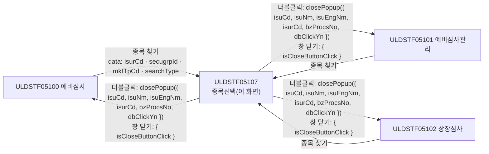
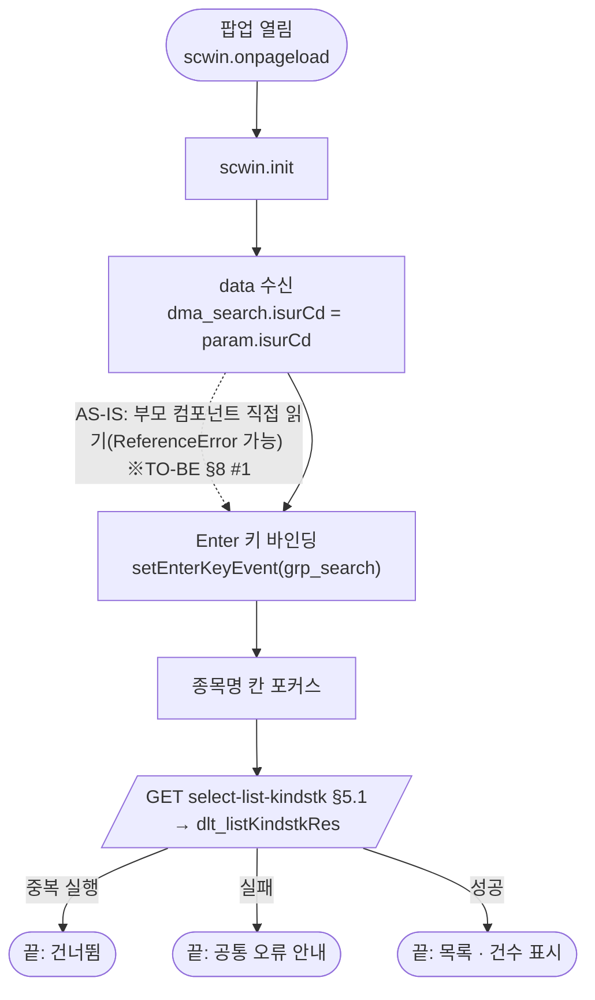
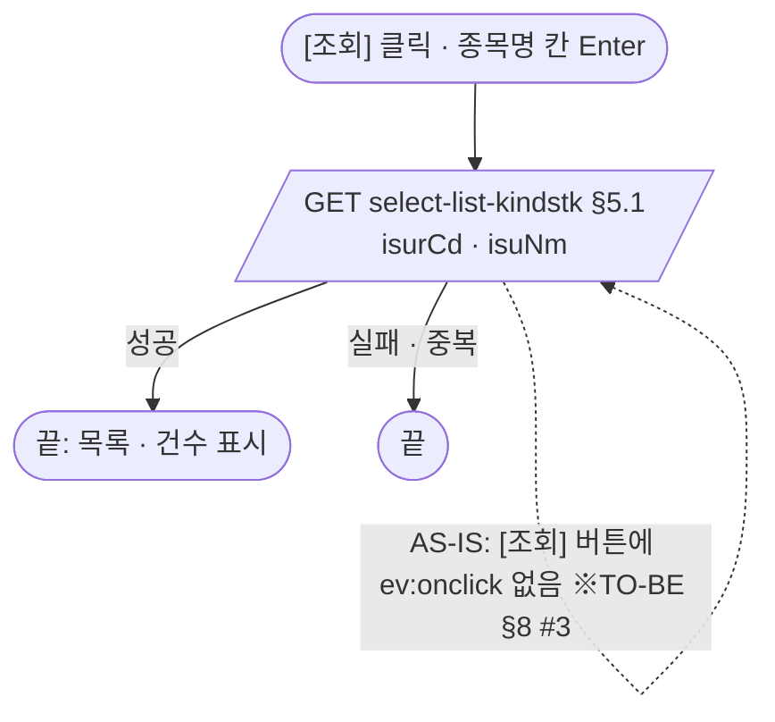
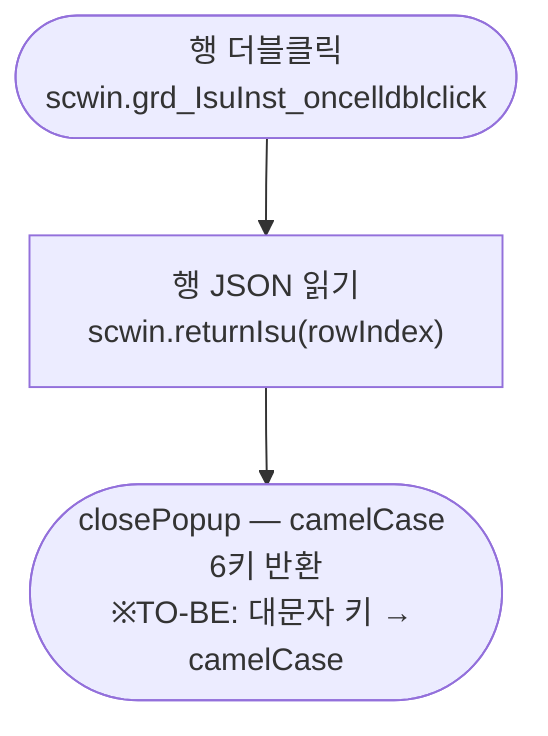

# ULDSTF05107 (팝업)종류주식 예비심사 종목선택 — 업무 분석 및 전환 내역

| 항목 | 내용 |
|---|---|
| AS-IS 원본 | `ULDSTF05107.xml` — W-Craft 1차 변환본(`meta_asisFileNm="ULDSTF05107.gfm"`, 원본 gfm 은 저장소에 없음)에 **API 적용까지 마친 개발 사본**. 업무 로직은 이 스크립트와 남은 옛 코드 주석으로 분석했다. 반입 `conversion/conversion-front/ui/ULDSTF05107/ULDSTF05107.xml` (kindstk 묶음 13본 중 하나) |
| 신규 API 명세 | 없음 — **화면에 적용된 `/api/...` 경로·method·dataCollection keyInfo 를 명세로 간주**(사용자 결정 2026-10-29). §5 는 "화면 적용 API ↔ AS-IS(주석에 남은 옛 호출)" 대응표로 쓴다. `api_spec_check` 는 SKIP(형식 검사 A07·A08 만) |
| TO-BE | `conversion/conversion-front/ui-tobe/ULDSTF05107.xml` (배포 경로 `/ui/lst/kindstk/ULDSTF05107.xml` — 부모 3본이 여는 원본 리터럴, kindstk 공통 계약서 §2). **2026-10-29 전환** — 1단계: 캡처 없음 → 기존 마크업 정비(마크업 전용, 사본 `$CLAUDE_JOB_DIR/tmp/ULDSTF05107_stage1.xml`), 2단계: 이 결과서대로 스크립트 재전환. 게이트: `gate_screen --pcc stf`·`scan_mixed_compare`·`publish_gate --pcc stf --before {1단계} --allow P20`·`api_spec_check`(SKIP)·`init_binding_check`·`wsxml_lint` 0/0, `convert.py` 고정점 |
| 퍼블리싱 파일 | 화면 폴더 `ULDSTF05107.xml` 의 body(이미 퍼블리싱 반영)를 1단계 기준으로 했다. publish 원본 `conversion/publish/상장/상장처리(대내)/ULDSTF05107.xml` 은 참고만 — 원본은 그리드 `dataList="data:dts"`·높이 153px·종목영문명/발행기관코드 열 숨김(`hidden="true"`), 개발 사본은 두 열을 보이게 바꿨다. 개발 사본을 따랐다(§10 #4) |
| 화면 캡처 | 없음 — 가이드 §13.2 1단계는 선례 ULDBNS30400 처럼 "캡처 없음, 기존 마크업 정비" |
| 업무공통 | gcc: `$c.data.getParameter`·`$c.win.setEnterKeyEvent`·`$c.win.closePopup`·`$c.sbm.executeDynamic`·`$c.exception.handleError`. pcc 호출 없음. 게이트는 `--pcc stf` 로 돌린다 |
| 작성 | Inswave / 2026-10-29 |

참고 양식: [websquare_gfm_conversion.md](../../../md/websquare_gfm_conversion.md) — 특히 §1.4 업무 프로세스 흐름, §6.5 getPar/setPar 전환. Gauce 대응은 [gfm_business_analysis_guide.md](../../../md/gfm_business_analysis_guide.md) 를 함께 따랐다. 호출·반환 키는 kindstk 13본 공통 계약서(§2 05107)를 따른다. 같은 꼴의 선례는 `sample-front/ui/stf/lst/common/ULDSTF05011.xml`(법인선택 팝업).

---

## 1. 화면 개요

상장 심사 담당자가 종류주식 예비심사·상장심사 화면에서 **종목을 고를 때 여는 선택 팝업**이다. 부모가 넘긴 발행기관의 종류주식 종목 목록(종목코드·종목명·종목영문명·발행기관코드)을 보여 준다.

1. 열리면 부모가 넘긴 발행기관코드로 바로 조회한다.
2. 종목명을 입력하고 [조회](또는 Enter)하면 다시 조회한다.
3. 행을 더블클릭하면 그 종목을 부모에 돌려주고 닫는다. 창을 닫으면 취소다.

### 1.1 호출 화면 (3본)

| 부모 | 여는 함수 | 크기(원본) | 근거 |
|---|---|---|---|
| ULDSTF05100 예비심사(메뉴) | `fn_PopFindKindStkExamIsu` | 800×780 | `ui/ULDSTF05100/ULDSTF05100.xml:438-459` |
| ULDSTF05101 주권 종류주식 예비심사관리 | `fn_PopFindKindStkExamIsu` | 800×750 | `ui/ULDSTF05101/ULDSTF05101.xml:1022-1041` |
| ULDSTF05102 상장심사(메뉴) | `fn_PopFindKindStkExamIsu` | 1180×880 | `ui/ULDSTF05102/ULDSTF05102.xml:333-353` |

- 크기는 계약서 권고 **800×780**(1단 목록 팝업)으로 부모가 맞춘다 — 부모 쪽 작업 묶음 B·C 몫이다.

### 1.2 호출 규약 (부모 → 이 화면) / 반환 규약

**받는 값** — `$c.data.getParameter()` (계약서 §2 05107)

| 키 | 의미 | 부모별 출처 | 이 화면에서 |
|---|---|---|---|
| `isurCd` | 발행기관코드 | 05100 `txb_ISUR_CD` / 05101 `txb_ISUR_CD` / 05102 `ibx_isurCd` | 조회 조건 `dma_search.isurCd`. 비어도 그대로 조회한다(API 가 판단) |
| `secugrpId` | 증권그룹ID | 05100 `rdo_SECUGRP_ID` / 05101 `cmb_SECUGRP_ID` / 05102 `rdo_secugrpId` | **쓰지 않음** — 조회 API 가 받지 않는다(§10 #1) |
| `mktTpCd` | 시장구분 | 05100 `rdo_SPOT_ISU_TRD_MKT_TP_CD` / 05101 `scwin.mktTpCd` / 05102 `rdo_spotIsuTrdMktTpCd` | 쓰지 않음(§10 #1) |
| `searchType` | 조회구분 | `$c.lc.getGlbValue("SEARCH_TYP_SER")` / 05102 는 `"SEARCH_TYP_SLR"` | 쓰지 않음(§10 #1) |

- AS-IS: 개발 사본은 `secugrpId`·`mktTpCd`·`searchType` 를 `getParameter` 로 받아 전역 `scwin.fr_SecuGrpId`·`scwin.fr_mktTpCd`·`scwin.fr_SearchType` 에 담기만 했고(쓰지 않음), 발행기관코드는 **부모 컴포넌트를 직접** 읽었다 — `parentWin.ibx_isurCd ? parentWin.ibx_isurCd : parentWin.txb_ISU_CD` → `scwin.fr_IsurCd`. 05100 에는 둘 다 없어 `tr_Isur_Cd = ""`(선언 안 된 전역) ReferenceError, 05101 은 종목코드 `txb_ISU_CD` 를 회사코드로 읽었다(§8 #1).
- 더 옛 방식(주석): `scwin.fn_GetPar = parentWin.scwin.fn_GetParForIsuCd` / `fn_SetPar = fn_SetParForIsuCd` 로 부모 함수를 빌려 `arrPar[0]`(초기 검색어)·`[2]` 증권그룹·`[3]` 시장·`[4]` 조회구분을 받았다. 전역 선언 `scwin.fn_GetPar, scwin.fn_SetPar, scwin.strCdSch` 는 그 잔재다.

**반환** — `await $c.win.closePopup(result)`

| 키 | 값 | AS-IS 키 |
|---|---|---|
| `isuCd` | 표준종목코드 | `ISU_CD` |
| `isuNm` | 종목명 | `ISU_NM` |
| `isuEngNm` | 종목영문명 | `ISU_ENG_NM` |
| `isurCd` | 발행기관코드 | `ISUR_CD` |
| `bzProcsNo` | 업무처리번호(신규상장에서 쓰는 값) | `BZPROCSNO` |
| `dbClickYn` | `"Y"` 고정 | `DBCLICKYN` |

- 취소(창 닫기)는 공통이 `{ isCloseButtonClick : true }` 만 돌려준다 → 부모는 **`$c.util.isEmpty(res?.isuCd)` 로 판정**한다(계약서 §2 공통 규칙).
- 개발 사본은 대문자 키로 돌려줬다 → TO-BE 는 camelCase(계약서).

### 1.3 이 화면이 여는 하위 팝업

해당 없음.

### 1.4 업무 프로세스 흐름

흐름은 AS-IS(개발 사본) 동작을 기준으로 그렸다. 점선과 `※TO-BE` 는 전환본에서 바뀌는 곳이다(근거는 §8).

| # | 업무 | 시작 (사용자 동작·진입 조건) | 끝 (결과) | 주요 함수 | 관련 절 |
|---|---|---|---|---|---|
| 1 | 진입·첫 조회 | 부모가 팝업을 엶 | 발행기관의 종목 목록 표시 | `scwin.onpageload` → `scwin.init` → `scwin.selectList` | §3, §5.1 |
| 2 | 종목명 조회 | [조회] `img_Search` / 종목명 칸 Enter | 목록 다시 표시 | `scwin.img_Search_onclick` → `scwin.selectList` | §4, §5.1 |
| 3 | 종목 선택 | 목록 더블클릭 `grd_IsuInst` | 부모에 종목 반환·닫힘 | `scwin.grd_IsuInst_oncelldblclick` → `scwin.returnIsu` | §6.1 |

#### 화면 간 흐름

#### 업무 1: 진입·첫 조회

| # | 단계 | 주체 | 내용 | 분기 · 메시지 | 관련 절 |
|---|---|---|---|---|---|
| 1 | 스크롤 끄기 | 화면 | AS-IS `window.document.body.scroll = "no"` | 삭제 — 팝업 프레임이 처리 | §8 #6 |
| 2 | 파라미터 | 화면 | `isurCd` 만 조회 조건으로 쓴다 | 비어도 조회 | §1.2 |
| 3 | Enter 키 | 화면 | 조회 영역 `grp_search` → `scwin.img_Search_onclick` (규칙 22) | — | §3 |
| 4 | 조회 | 서버 | `select-list-kindstk` | — | §5.1 |

#### 업무 2: 종목명 조회

| # | 단계 | 주체 | 내용 | 분기 · 메시지 | 관련 절 |
|---|---|---|---|---|---|
| 1 | 조건 | 사용자 | 종목명 `txb_Search`(→ `dma_search.isuNm`) | — | §2.2 |
| 2 | 조회 | 서버 | 업무 1 과 같은 API | — | §5.1 |

#### 업무 3: 종목 선택

| # | 단계 | 주체 | 내용 | 분기 · 메시지 | 관련 절 |
|---|---|---|---|---|---|
| 1 | 선택 | 사용자 | 행 더블클릭 | — | §4 |
| 2 | 반환 | 화면 | `closePopup({ isuCd, isuNm, isuEngNm, isurCd, bzProcsNo, dbClickYn:"Y" })` | — | §6.1 |

#### 화면 모드 상태 전이

해당 없음 — 조회·선택 전용.

---

## 2. 화면 구성 및 데이터 정의

### 2.1 화면 구성 (AS-IS 요소 → TO-BE 컴포넌트)

| 영역 | AS-IS 요소 (id) | TO-BE 컴포넌트 (바인딩) | 비고 |
|---|---|---|---|
| 머리 | `pfmContentHeader` (pageFrame) | `w2:pageFrame#pfmContentHeader` | 팝업 contentHeader 필수 |
| 조회조건 | 이름 없는 `schbox` | `xf:group.schbox#grp_search` (신설 id) | Enter 키 바인딩 대상 |
| | `label_1` "종목명" | `w2:textbox#label_1` | |
| | `txb_Search` (input, `ev:onkeydown`) | `xf:input#txb_Search` (`dma_search.isuNm`) | `ev:onkeydown` 은 Enter 키 바인딩으로 대체 |
| | `img_Search` [조회] (ev 없음) | `xf:trigger#img_Search` `btn_cm sch` (`ev:onclick`) | §8 #3 |
| 목록 머리 | `txb_TotCnt` (textbox 건수) | `w2:span.num#txb_TotCnt` | 총/건 라벨은 `w2:span` |
| 목록 | `grd_IsuInst` (gridView, `dlt_listKindstkRes`, 높이 500px) | `w2:gridView#grd_IsuInst` `gvw row15` readOnly, `ev:oncelldblclick` | `caption1`·`header1`·`gBody1` 유지 |
| | 머리 `h_ISU_CD` 종목코드 / 본문 `isuCd` | 같음 | |
| | `h_ISU_NM` 종목명 / `isuNm` | 같음(본문 왼쪽 정렬) | |
| | `h_ISU_ENG_NM` 종목영문명 / `isuEngNm` | 같음 | publish 원본은 숨김(§10 #4) |
| | `h_ISUR_CD` 발행기관코드 / 본문 **`ISUR_CD`**(대문자) | 본문 `isurCd` | dataList 에 없는 대문자 id 라 빈 열이었다(§8 #2) |
| 하단 | `img_Close` [닫기] (`img_Close_onclick` — 마크업에 ev 없음) | **(옮기지 않음)** | 팝업 하단 닫기 금지(퍼블리싱 규칙). 창 닫기 = 취소 |

### 2.2 데이터 정의 (DataCollection)

| TO-BE | 종류 | 키(컬럼) | 출처 / 용도 |
|---|---|---|---|
| `dma_search` (신설) | dataMap | `isurCd` 발행기관코드 · `isuNm` 종목명 | 조회 요청(GET 쿼리). 개발 사본은 `ref` 주석(`dlt_listKindstkReq`) 상태로 URL 문자열을 이어 붙였다 |
| `dlt_listKindstkRes` | dataList | `isuCd` 표준종목코드 · `isuSrtCd` 단축종목코드 · `secugrpId` 증권그룹 · `isuNm` 종목명 · `isuSnm` 종목약명 · `isuEngNm` 종목영문명 · `isuEngSnm` 종목영문약명 · `isuEngSymbl` 심볼 · **`isurCd` 발행기관코드 · `bzProcsNo` 업무처리번호**(추가) | `select-list-kindstk` 응답. 그리드 열과 반환 계약이 읽는 `isurCd`·`bzProcsNo` 가 개발 사본 columnInfo 에 없어 더했다 — 응답에 있는지 §10 #2 |

---

## 3. 로딩 (`scwin.onpageload` → `scwin.init`)

1. **파라미터 수신** — `const param = $c.data.getParameter() ?? {}` → `dma_search.set("isurCd", param.isurCd ?? "")`. AS-IS 의 부모 컴포넌트 직접 읽기·`fr_*` 전역은 없앴다(§1.2).
2. **Enter 키** — `$c.win.setEnterKeyEvent(grp_search, scwin.img_Search_onclick)` (규칙 22). AS-IS `scwin.txb_Search_onkeydown`(`e.keyCode == 13` → `fn_list_sync`)을 대신한다.
3. **포커스·조회** — `txb_Search.focus()` → `await scwin.selectList()`.
- 달력 없음(규칙 37 해당 없음). 원본 `scwin.onpageunload`(빈 함수)는 옮기지 않았다.

## 4. 컴포넌트 이벤트

| TO-BE 컴포넌트 | 이벤트 | TO-BE 핸들러 | 동작 (호출 함수) | AS-IS |
|---|---|---|---|---|
| `body` | onpageload | `scwin.onpageload` | `scwin.init` | `scwin.onpageload` |
| `img_Search` | onclick | `scwin.img_Search_onclick` | `scwin.selectList` | `scwin.img_Search_onclick`(마크업 미연결 — §8 #3) |
| `grp_search` | Enter | (setEnterKeyEvent) | `scwin.img_Search_onclick` | `scwin.txb_Search_onkeydown` |
| `grd_IsuInst` | oncelldblclick | `scwin.grd_IsuInst_oncelldblclick` | `scwin.returnIsu` | `scwin.grd_IsuInst_OnDblClick` |
| — | — | (삭제) | — | `scwin.img_Close_onclick` — 닫기 버튼 삭제 |
| — | — | (삭제) | — | `scwin.dts_OnLoadError`(`$c.stf.alert_error(dts)` — 바인딩 없음, 계약서 §4.1) |

## 5. 서버 통신

| # | 용도 | AS-IS (주석·옛 호출) | TO-BE (화면 적용 API = 명세 간주) |
|---|---|---|---|
| 5.1 | 종목 목록 조회 | `dts` 데이터셋 `OnLoadCompleted` (주석 `scwin.dts_OnLoadCompleted`) | `GET /api/listing/common/pop/isu/select-list-kindstk` |

### 5.1 종목 목록 조회 (`scwin.selectList`)

| 항목 | 내용 |
|---|---|
| `id` | `sbm_selectListKindstk` (개발 사본 `sbm_select_list_kindstk`) |
| `method` / `action` | `get` / `/api/listing/common/pop/isu/select-list-kindstk` — 개발 사본은 `"...?isurCd="+scwin.fr_IsurCd+"&isuNm="+txb_Search.getValue()` 로 이어 붙였다(인코딩 없음) |
| `ref` / `requestData` | `ref : "dma_search"` — GET 이면 공통이 dataMap 을 쿼리스트링으로 만들고 값을 인코딩한다(`cm/gcc/sbm.xml` GET 처리) |
| `target` | `dlt_listKindstkRes=body` |
| 선행 / 순서 | 진입 시 `scwin.init` 끝, 이후 [조회]·Enter |
| 후처리 | `txb_TotCnt.setValue(dlt_listKindstkRes.getRowCount())`. 개발 사본의 `scwin.strCdSch` 행 찾기 루프는 옮기지 않았다(§8 #5) |
| 실패 처리 | `executeDynamic` 공통 오류 안내. 개발 사본의 `res.responseJSON.errors` 검사는 주석이었다 |
| 중복 실행 | 공통 ignore 정책 — `res?.skipped` 면 후처리 없이 끝 |

## 6. 일반 함수

### 6.1 종목 반환 (`scwin.returnIsu`)

* **파라미터:** `rowIndex` 더블클릭한 행 / **Return:** 없음(팝업 닫힘)
* **로직:** `dlt_listKindstkRes.getRowJSON(rowIndex)` → §1.2 반환 6키로 `await $c.win.closePopup(...)`. 개발 사본의 `const result = { ISU_CD … DBCLICKYN }` 대문자 키와, 더 옛 `arrPar[0] = {…}; scwin.fn_SetPar()` 주석 방식을 대신한다.

### 6.2 부모 ↔ 팝업 파라미터 전달 (getPar/setPar → `openPopup` data + `await`)

- 이 화면은 받는 쪽이다. `fn_GetPar`/`fn_SetPar`(`fn_GetParForIsuCd`/`fn_SetParForIsuCd`) 빌려 쓰기는 모두 없애고 `$c.data.getParameter()` 수신 + `closePopup(result)` 반환만 남겼다(가이드 §6.5).

## 7. 업무 코드 · 메시지 목록

- 코드·메시지 없음. `dbClickYn` 은 `"Y"` 고정.

## 8. 원본 특이사항 · 결함

| # | 원본에서 실제로 일어나는 일 (근거) | 전환본 처리 |
|---|---|---|
| 1 | `init` 이 부모 컴포넌트 `ibx_isurCd`·`txb_ISU_CD` 를 직접 읽는다. 05100 에는 둘 다 없어 `tr_Isur_Cd = ""`(미선언 변수) 대입 → strict 가 아니면 전역 생성, 회사코드는 `undefined` 로 조회. 05101 은 `txb_ISU_CD`(종목코드)를 회사코드로 읽는다 | **고침** — 부모가 `data.isurCd` 로 넘긴다(계약서) |
| 2 | 그리드 본문 마지막 열 id 가 대문자 `ISUR_CD` — dataList 에 없는 컬럼이라 빈 열 | **고침** — `isurCd`, dataList 에도 추가(§2.2) |
| 3 | [조회] `img_Search` 에 `ev:onclick` 이 없어 `scwin.img_Search_onclick` 이 불리지 않는다(Enter 만 동작) | **고침** — 연결 |
| 4 | 조회 URL 을 문자열로 이어 붙여 종목명이 인코딩되지 않는다(`&`·`%` 가 들어가면 깨짐) | **고침** — `dma_search` ref 로 공통이 인코딩 |
| 5 | `scwin.strCdSch` 는 어디서도 값을 받지 않는다 → `!= ""` 이 늘 참이라 1부터 도는 Gauce 식 루프(`getCellData(i, 1)`)가 `undefined` 와 비교만 하고 끝난다 | **옮기지 않음** — 동작 없는 코드 |
| 6 | `window.document.body.scroll = "no"` 는 IE 전용 | **옮기지 않음** |
| 7 | `vScrenID = "ULDSTF05107.xml"` — 쓰이지 않음 | **옮기지 않음** |
| 8 | 반환 객체 대문자 키 | **고침** — camelCase(계약서) |

## 9. 전환 내역 (AS-IS → TO-BE)

| AS-IS | TO-BE |
|---|---|
| `scwin.onpageload` → `scwin.init` | `scwin.onpageload`(try/catch) → `scwin.init` |
| `scwin.init` 의 부모 컴포넌트 읽기·`$c.data.getParameter()` | `scwin.init` — `getParameter().isurCd` 만 |
| `scwin.fn_list_sync` | `scwin.selectList` |
| `scwin.txb_Search_onkeydown` | `$c.win.setEnterKeyEvent(grp_search, …)` |
| `scwin.img_Search_onclick` | `scwin.img_Search_onclick` (마크업 연결) |
| `scwin.grd_IsuInst_OnDblClick` | `scwin.grd_IsuInst_oncelldblclick` → `scwin.returnIsu` |
| `scwin.img_Close_onclick` | 삭제(닫기 버튼 없음) |
| `scwin.dts_OnLoadError` · 주석 `scwin.dts_OnLoadCompleted` | 삭제(공통 오류 안내) |
| `scwin.onpageunload` | 삭제(빈 함수) |
| 전역 `scwin.fn_GetPar`·`scwin.fn_SetPar`·`scwin.strCdSch`·`scwin.fr_SecuGrpId`·`scwin.fr_IsurCd`·`scwin.fr_SearchType`·`scwin.fr_mktTpCd`·`scwin.vScrenID` | 삭제(`dma_search` 로 대체) |

## 10. 남은 작업 (TODO)

1. **`secugrpId`·`mktTpCd`·`searchType`** — 부모 3본이 넘기지만 `select-list-kindstk` 는 `isurCd`·`isuNm` 만 받는다. 서버가 증권그룹·시장·예비심사/신규상장 구분으로 거를 필요가 없는지 확인(원본 gfm 이 없어 옛 조회 조건을 대조하지 못함).
2. **응답 키 `isurCd`·`bzProcsNo`** — 그리드 발행기관코드 열과 반환 계약이 읽는다. `select-list-kindstk` 응답에 이 두 키가 있는지 확인(개발 사본 columnInfo 에는 없었다).
3. **`isurCd` 가 빈 호출** — 부모 회사가 정해지지 않은 채 열면 빈 값으로 조회한다. 서버가 전체를 주는지 빈 목록을 주는지 확인.
4. **열 표시** — publish 원본은 종목영문명·발행기관코드 열이 숨김이었다. 개발 사본을 따라 보이게 두었다 — 확정 필요.
5. **부모 쪽 반영** — 부모(05100·05101·05102)는 반환을 camelCase 로 읽고 `isEmpty(res?.isuCd)` 로 취소를 판정해야 한다(계약서, 묶음 B·C).
