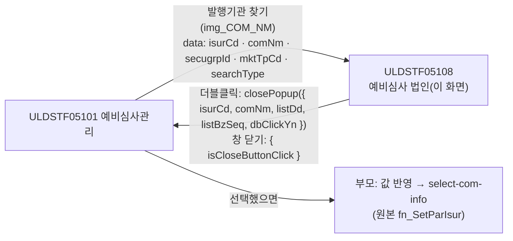
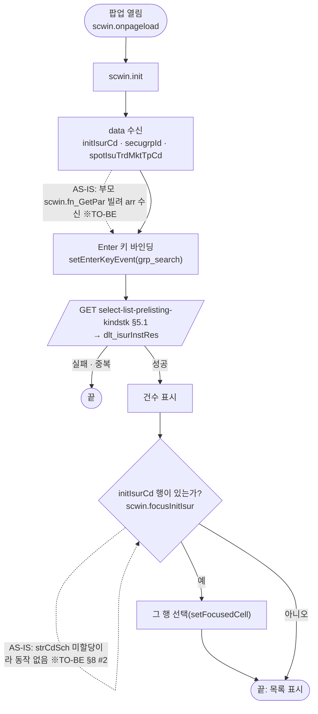
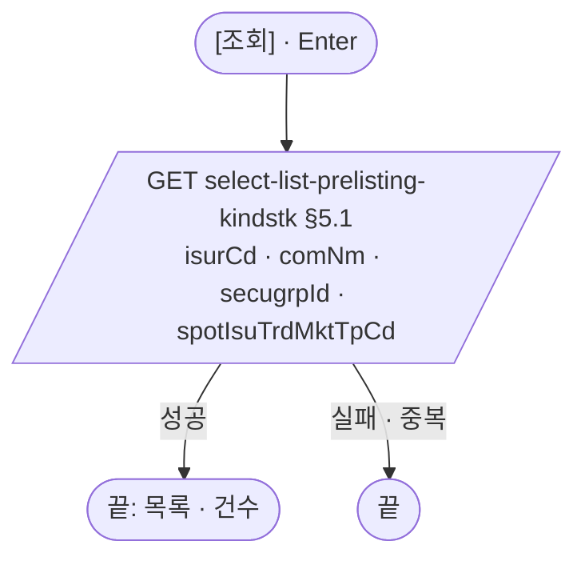
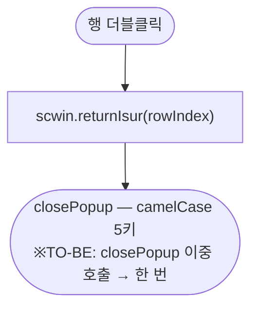

# ULDSTF05108 (팝업)종류주식 예비심사 법인 — 업무 분석 및 전환 내역

| 항목 | 내용 |
|---|---|
| AS-IS 원본 | `ULDSTF05108.xml` — W-Craft 1차 변환본(`meta_asisFileNm="ULDSTF05108.gfm"`, 원본 gfm 은 저장소에 없음)에 **API 적용까지 마친 개발 사본**. 업무 로직은 이 스크립트와 남은 옛 코드 주석(`/KindStk.do?…method=listIsurInst`)으로 분석했다. 반입 `conversion/conversion-front/ui/ULDSTF05108/ULDSTF05108.xml` (kindstk 묶음) |
| 신규 API 명세 | 없음 — **화면에 적용된 `/api/...` 경로·method·dataCollection keyInfo 를 명세로 간주**(사용자 결정 2026-10-29). §5 는 "화면 적용 API ↔ AS-IS(주석에 남은 옛 호출)" 대응표. `api_spec_check` 는 SKIP |
| TO-BE | `conversion/conversion-front/ui-tobe/ULDSTF05108.xml` (배포 경로 `/ui/lst/kindstk/ULDSTF05108.xml` — 원본 리터럴, 계약서 §2). **2026-10-29 전환** — 1단계: 캡처 없음 → 기존 마크업 정비(사본 `$CLAUDE_JOB_DIR/tmp/ULDSTF05108_stage1.xml`), 2단계: 스크립트 재전환. 게이트: `gate_screen --pcc stf`·`scan_mixed_compare`·`publish_gate --before {1단계} --allow P20`·`api_spec_check`(SKIP)·`init_binding_check`·`wsxml_lint` 0/0, `convert.py` 고정점 |
| 퍼블리싱 파일 | 화면 폴더 `ULDSTF05108.xml` 의 body 를 1단계 기준으로 했다. publish 원본 `conversion/publish/상장/상장처리(대내)/ULDSTF05108.xml` 은 참고만(원본은 W-Craft `xf:events`·`mxdataset` 주석 잔재가 남은 같은 배치) |
| 화면 캡처 | 없음 — 선례 ULDBNS30400 처럼 "캡처 없음, 기존 마크업 정비" |
| 업무공통 | gcc: `$c.data.getParameter`·`$c.win.setEnterKeyEvent`·`$c.win.closePopup`·`$c.sbm.executeDynamic`·`$c.util.isEmpty`·`$c.exception.handleError`. pcc 호출 없음. 게이트는 `--pcc stf` |
| 작성 | Inswave / 2026-10-29 |

참고 양식: [websquare_gfm_conversion.md](../../../md/websquare_gfm_conversion.md) — §1.4 업무 프로세스 흐름, §6.5 getPar/setPar 전환. 호출·반환 키는 kindstk 공통 계약서(§2 05108)를 따른다.

---

## 1. 화면 개요

예비심사 담당자가 **종류주식 예비심사관리(ULDSTF05101)에서 발행기관(법인)을 고를 때 여는 선택 팝업**이다. 증권그룹·시장구분에 맞는 예비심사 대상 발행기관 목록(발행기관코드·발행기관명·보통주상장일)을 보여 준다.

1. 열리면 부모가 넘긴 증권그룹·시장구분으로 바로 조회한다. 첫 조회에서는 부모의 현재 발행기관 행을 골라 둔다.
2. 발행기관명·발행기관코드를 입력하고 [조회](또는 Enter)하면 다시 조회한다.
3. 행을 더블클릭하면 그 법인을 부모에 돌려주고 닫는다. 창을 닫으면 취소다.

### 1.1 호출 화면 (1본)

| 부모 | 여는 함수 | 크기 | 근거 |
|---|---|---|---|
| ULDSTF05101 주권 종류주식 예비심사관리 | `img_COM_NM_onclick` → `fn_PopFindKindStkExamCorp`(`fn_GetPar = fn_GetParIsur`, `fn_SetPar = fn_SetParIsur` 로 바꿔 끼움) | 1180×880 | `ui/ULDSTF05101/ULDSTF05101.xml:999-1016`, `:1043-1050` |

### 1.2 호출 규약 (부모 → 이 화면) / 반환 규약

**받는 값** — `$c.data.getParameter()` (계약서 §2 05108, 원본 `fn_GetParIsur` arr — `ULDSTF05101.xml:441-448`)

| 키 | AS-IS arr | 05101 출처 | 이 화면에서 |
|---|---|---|---|
| `isurCd` | [0] | `txb_ISUR_CD` | 첫 조회 뒤 그 행을 한 번 고른다(`scwin.initIsurCd`, §6.1). 조회 조건에는 넣지 않는다(원본과 같음) |
| `comNm` | [1] | `txb_COM_NM` | **쓰지 않음** — 원본도 읽지 않았다(§10 #1) |
| `secugrpId` | [2] | `cmb_SECUGRP_ID` | 조회 조건 `dma_search.secugrpId` |
| `mktTpCd` | [3] | `scwin.mktTpCd` | 조회 조건 `dma_search.spotIsuTrdMktTpCd` |
| `searchType` | [4] | `$c.lc.getGlbValue("SEARCH_TYP_SEC")`(원본 `$c.lc.SEARCH_TYP_SEC` 는 미정의) | 쓰지 않음 — 원본도 arr[4] 를 읽지 않았다(§10 #1) |

- AS-IS: `init` 이 `parentWin.scwin.fn_GetPar`/`fn_SetPar` 를 빌려 `scwin.fn_GetPar(arrPar)` 로 받고 `scwin.strSch = arr[0]`, `scwin.fr_SecuGrpId = arr[2]`, `scwin.fr_mktTpCd = arr[3]` 에 담았다.

**반환** — `await $c.win.closePopup(result)`

| 키 | 값 | AS-IS 키 (`fn_SetPar(arrPar)` 의 `arrPar[0]`) |
|---|---|---|
| `isurCd` | 발행기관코드 | `ISUR_CD` |
| `comNm` | 발행기관명 | `COM_NM` |
| `listDd` | 보통주상장일 | `LIST_DD` |
| `listBzSeq` | 상장처리 상장업무일련번호 | `LIST_BZ_SEQ` |
| `dbClickYn` | `"Y"` 고정 | `DBCLICKYN` |

- 취소(창 닫기)는 `{ isCloseButtonClick }` 만 온다 → 부모는 `$c.util.isEmpty(res?.isurCd)` 로 판정(계약서).
- `dlt_isurInstRes` 에는 영문명이 없다 — 05101 이 받던 `COM_ENG_NM` 은 부모가 `select-com-info` 로 채운다(계약서 §2, 묶음 C).

### 1.3 이 화면이 여는 하위 팝업

해당 없음.

### 1.4 업무 프로세스 흐름

| # | 업무 | 시작 (사용자 동작·진입 조건) | 끝 (결과) | 주요 함수 | 관련 절 |
|---|---|---|---|---|---|
| 1 | 진입·첫 조회 | 05101 이 팝업을 엶 | 발행기관 목록 표시, 부모의 현재 발행기관 행 선택 | `scwin.onpageload` → `scwin.init` → `scwin.selectList` → `scwin.focusInitIsur` | §3, §5.1, §6.1 |
| 2 | 조건 조회 | [조회] `img_Search` / 조회 영역 Enter | 목록 다시 표시 | `scwin.img_Search_onclick` → `scwin.selectList` | §4, §5.1 |
| 3 | 법인 선택 | 목록 더블클릭 `grd_IsuInst` | 부모에 법인 반환·닫힘 | `scwin.grd_IsuInst_oncelldblclick` → `scwin.returnIsur` | §6.2 |

#### 화면 간 흐름

#### 업무 1: 진입·첫 조회

| # | 단계 | 주체 | 내용 | 분기 · 메시지 | 관련 절 |
|---|---|---|---|---|---|
| 1 | 파라미터 | 화면 | `isurCd` → `scwin.initIsurCd`, `secugrpId`·`mktTpCd` → `dma_search` | — | §1.2 |
| 2 | Enter 키 | 화면 | `grp_search` → `scwin.img_Search_onclick` (규칙 22) | — | §3 |
| 3 | 조회 | 서버 | `select-list-prelisting-kindstk` | — | §5.1 |
| 4 | 행 선택 | 화면 | 첫 조회 한 번만 부모 발행기관 행을 고른다 | 없으면 그대로 | §6.1 |

#### 업무 2: 조건 조회

| # | 단계 | 주체 | 내용 | 분기 · 메시지 | 관련 절 |
|---|---|---|---|---|---|
| 1 | 조건 | 사용자 | 발행기관명 `txb_COM_NM`·발행기관코드 `txb_ISUR_CD` | — | §2.2 |
| 2 | 조회 | 서버 | 업무 1 과 같은 API | — | §5.1 |

#### 업무 3: 법인 선택

| # | 단계 | 주체 | 내용 | 분기 · 메시지 | 관련 절 |
|---|---|---|---|---|---|
| 1 | 반환 | 화면 | `closePopup({ isurCd, comNm, listDd, listBzSeq, dbClickYn:"Y" })` | — | §6.2 |

#### 화면 모드 상태 전이

해당 없음.

---

## 2. 화면 구성 및 데이터 정의

### 2.1 화면 구성 (AS-IS 요소 → TO-BE 컴포넌트)

| 영역 | AS-IS 요소 (id) | TO-BE 컴포넌트 (바인딩) | 비고 |
|---|---|---|---|
| 머리 | `pfmContentHeader` | `w2:pageFrame#pfmContentHeader` | |
| 조회조건 | 이름 없는 `schbox` | `xf:group.schbox#grp_search` (신설 id) | Enter 키 바인딩 대상 |
| | `label_1` "발행기관명" / `txb_COM_NM` (`ev:onkeydown`) | `xf:input#txb_COM_NM` (`dma_search.comNm`) | onkeydown → Enter 키 바인딩 |
| | `label_2` "발행기관코드" / `txb_ISUR_CD` | `xf:input#txb_ISUR_CD` (`dma_search.isurCd`) | |
| | `img_Search` [조회] (`src="../img/btn_select.gif"`) | `xf:trigger#img_Search` `btn_cm sch` | 이미지 속성 정리 |
| 목록 머리 | `txb_TotCnt` | `w2:span.num#txb_TotCnt` | |
| 목록 | `grd_IsuInst` (`dlt_isurInstRes`, 높이 500px) | `w2:gridView#grd_IsuInst` `gvw row15` readOnly | `caption1`·`header1`·`gBody1` |
| | 머리 `ISUR_CD` 발행기관코드 / 본문 `isurCd` | 머리 `h_ISUR_CD` | 머리 id `h_` 접두 |
| | 머리 `COM_NM` 발행기관명 / 본문 `comNm` | 머리 `h_COM_NM` | |
| | 머리 `LIST_BZ_SEQ` 업무일련번호(머리만 숨김) / 본문 `listBzSeq` | 머리 `h_LIST_BZ_SEQ`·본문 모두 `hidden="true"` | 원본은 머리만 숨겨 본문 칸이 어긋났다(§8 #5) |
| | 머리 `LIST_DD` 보통주상장일 / 본문 `listDd` | 머리 `h_LIST_DD`, 본문 `dataType="date" displayFormat="yyyy-MM-dd"` | 규칙 46 확장(id `…Dd` + 명칭 `…일`) — AS-IS 원시 표시 → 날짜 형식(§10 #2) |
| 하단 | `img_Close` [닫기] | **(옮기지 않음)** | 팝업 하단 닫기 금지 |

### 2.2 데이터 정의 (DataCollection)

| TO-BE | 종류 | 키(컬럼) | 출처 / 용도 |
|---|---|---|---|
| `dma_search` (신설) | dataMap | `isurCd` 발행기관코드 · `comNm` 발행기관명 · `secugrpId` 증권그룹ID · `spotIsuTrdMktTpCd` 시장구분코드 | 조회 요청(GET 쿼리). 개발 사본의 `var param = { isurCd, comNm, secugrpId, spotIsuTrdMktTpCd }` requestData 와 같은 키 |
| `dlt_isurInstRes` | dataList | `listDd` 상장일 · `isurCd` 회사코드 · `comNm` 회사명 · `listBzSeq` 상장처리상장업무일련번호 | `select-list-prelisting-kindstk` 응답(개발 사본 그대로) |

---

## 3. 로딩 (`scwin.onpageload` → `scwin.init`)

1. **파라미터 수신** — `isurCd` → `scwin.initIsurCd`, `secugrpId` → `dma_search.secugrpId`, `mktTpCd` → `dma_search.spotIsuTrdMktTpCd`.
2. **Enter 키** — `$c.win.setEnterKeyEvent(grp_search, scwin.img_Search_onclick)` (규칙 22, AS-IS `scwin.txb_COM_NM_onkeydown` 대체).
3. **조회** — `await scwin.selectList()` (끝에 `scwin.focusInitIsur`).
- 달력 없음. `window.document.body.scroll = "no"`·빈 `scwin.onpageunload` 는 옮기지 않았다.

## 4. 컴포넌트 이벤트

| TO-BE 컴포넌트 | 이벤트 | TO-BE 핸들러 | 동작 (호출 함수) | AS-IS |
|---|---|---|---|---|
| `body` | onpageload | `scwin.onpageload` | `scwin.init` | `scwin.onpageload` |
| `img_Search` | onclick | `scwin.img_Search_onclick` | `scwin.selectList` | `scwin.img_Search_onclick` |
| `grp_search` | Enter | (setEnterKeyEvent) | `scwin.img_Search_onclick` | `scwin.txb_COM_NM_onkeydown` |
| `grd_IsuInst` | oncelldblclick | `scwin.grd_IsuInst_oncelldblclick` | `scwin.returnIsur` | `scwin.grd_IsuInst_OnDblClick` |
| — | — | (삭제) | — | `scwin.img_Close_onclick` |
| — | — | (삭제) | — | `scwin.dts_IsurInst_OnLoadError`(`$c.stf.alert_error` — 계약서 §4.1), 주석 `scwin.dts_IsurInst_OnLoadCompleted` |

## 5. 서버 통신

| # | 용도 | AS-IS (주석·옛 호출) | TO-BE (화면 적용 API = 명세 간주) |
|---|---|---|---|
| 5.1 | 예비심사 발행기관 목록 | `/KindStk.do?SCREN_ID=…&SCREN_PROCES_TP_CD=01&method=listIsurInst&inputMessageId=KIND_STK_PRELIST_ISUR_INST_OUT` + `ISUR_CD`·`COM_NM`·`SECUGRP_ID`·`SPOT_ISU_TRD_MKT_TP_CD` (`dts_IsurInst`) | `GET /api/listing/common/pop/issur/select-list-prelisting-kindstk` |

### 5.1 예비심사 발행기관 목록 (`scwin.selectList`)

| 항목 | 내용 |
|---|---|
| `id` | `sbm_selectListPreListingKindstk` (개발 사본 그대로) |
| `method` / `action` | `get` / `/api/listing/common/pop/issur/select-list-prelisting-kindstk` |
| `ref` / `requestData` | `ref : "dma_search"` — 개발 사본은 `ref : "dlt_isurInstRes"`(응답 dataList)를 주고 요청은 `executeDynamic(sbmOptions, param)` 로 따로 넘겼다(§8 #3) |
| `target` | `dlt_isurInstRes=body` |
| 선행 / 순서 | 진입 시 `scwin.init` 끝, 이후 [조회]·Enter |
| 후처리 | `txb_TotCnt.setValue(getRowCount())`(개발 사본은 `getTotalRow()`), `scwin.focusInitIsur()` |
| 실패 처리 | 공통 오류 안내 |
| 중복 실행 | `res?.skipped` 면 끝 |

## 6. 일반 함수

### 6.1 부모 발행기관 행 선택 (`scwin.focusInitIsur`)

* **파라미터:** 없음(전역 `scwin.initIsurCd`) / **Return:** 없음
* **로직:** `initIsurCd` 가 있으면 `dlt_isurInstRes` 에서 같은 `isurCd` 행을 찾아 `grd_IsuInst.setFocusedCell(i, 0)` 하고, 찾든 못 찾든 `initIsurCd` 를 비운다(첫 조회 한 번만). 원본 주석 "초기1회 초기값으로 설정된 회사코드를 검색한다"의 의도를 살린 것이다(§8 #2).

### 6.2 법인 반환 (`scwin.returnIsur`)

* **파라미터:** `rowIndex` / **Return:** 없음(팝업 닫힘)
* **로직:** `getRowJSON(rowIndex)` → §1.2 반환 5키로 `await $c.win.closePopup(...)`. 원본 `scwin.fn_SetPar(arrPar)` + `closePopup` 이중 호출을 대신한다.

### 6.3 부모 ↔ 팝업 파라미터 전달 (getPar/setPar → `openPopup` data + `await`)

- 받는 쪽이다. `parentWin.scwin.fn_GetPar`/`fn_SetPar` 빌려 쓰기는 없애고 `$c.data.getParameter()` + `closePopup(result)` 만 남겼다(가이드 §6.5).

## 7. 업무 코드 · 메시지 목록

- 코드·메시지 없음. `dbClickYn` 은 `"Y"` 고정.

## 8. 원본 특이사항 · 결함

| # | 원본에서 실제로 일어나는 일 (근거) | 전환본 처리 |
|---|---|---|
| 1 | 부모 scwin 의 `fn_GetPar`/`fn_SetPar` 를 빌려 부모 화면의 입력란을 팝업이 직접 채웠다 | **고침** — data + 반환값(가이드 §6.5) |
| 2 | 받은 회사코드는 `scwin.strSch` 에 담지만 행 찾기 루프는 값을 받은 적 없는 `scwin.strCdSch` 를 본다 → 늘 `undefined` 비교로 끝나 아무것도 고르지 않는다(1부터 도는 Gauce 식 루프) | **고침** — `scwin.focusInitIsur` 로 의도대로 한 번 고른다 |
| 3 | `ref` 에 응답 dataList(`dlt_isurInstRes`)를 줬다 — GET 이라 dataList ref 는 쿼리에 실리지 않고, 실제 요청은 requestData `param` 이다 | **고침** — 요청 dataMap `dma_search` 하나로 |
| 4 | 더블클릭에서 `await $c.win.closePopup();$c.win.closePopup();` 두 번 호출 | **고침** — 한 번 |
| 5 | 그리드 `LIST_BZ_SEQ` 열을 머리만 `hidden="true"` 로 숨겨 본문 칸과 어긋난다 | **고침** — 머리·본문 모두 숨김 |
| 6 | `vScrenID = "ULDSTF05108.xml"` 미사용, `window.document.body.scroll` IE 전용 | **옮기지 않음** |

## 9. 전환 내역 (AS-IS → TO-BE)

| AS-IS | TO-BE |
|---|---|
| `scwin.onpageload` → `scwin.init` | `scwin.onpageload`(try/catch) → `scwin.init` |
| `scwin.fn_list_sync` | `scwin.selectList` |
| (strCdSch 루프) | `scwin.focusInitIsur` |
| `scwin.txb_COM_NM_onkeydown` | `$c.win.setEnterKeyEvent(grp_search, …)` |
| `scwin.img_Search_onclick` | `scwin.img_Search_onclick` |
| `scwin.grd_IsuInst_OnDblClick` | `scwin.grd_IsuInst_oncelldblclick` → `scwin.returnIsur` |
| `scwin.img_Close_onclick` | 삭제(닫기 버튼 없음) |
| `scwin.dts_IsurInst_OnLoadError` · 주석 `scwin.dts_IsurInst_OnLoadCompleted` | 삭제 |
| `scwin.onpageunload` | 삭제(빈 함수) |
| 전역 `scwin.fn_GetPar`·`scwin.fn_SetPar`·`scwin.strCdSch`·`scwin.strSch`·`scwin.fr_SecuGrpId`·`scwin.fr_mktTpCd`·`scwin.vScrenID` | `scwin.initIsurCd` + `dma_search` |

## 10. 남은 작업 (TODO)

1. **`comNm`·`searchType`** — 부모가 넘기지만 원본도 쓰지 않았다(arr[1]·arr[4]). 서버가 `searchType`(SEC 유가예비심사신규등록)으로 거를 필요가 없는지 확인.
2. **보통주상장일 값 형식** — 규칙 46 확장으로 날짜 형식(`yyyy-MM-dd`)을 붙였다. 서버 값이 8자리 `yyyyMMdd` 인지 확인.
3. **부모 쪽 반영** — 05101 은 반환을 camelCase 로 읽고 `isEmpty(res?.isurCd)` 로 취소를 판정해야 한다(계약서, 묶음 C).
