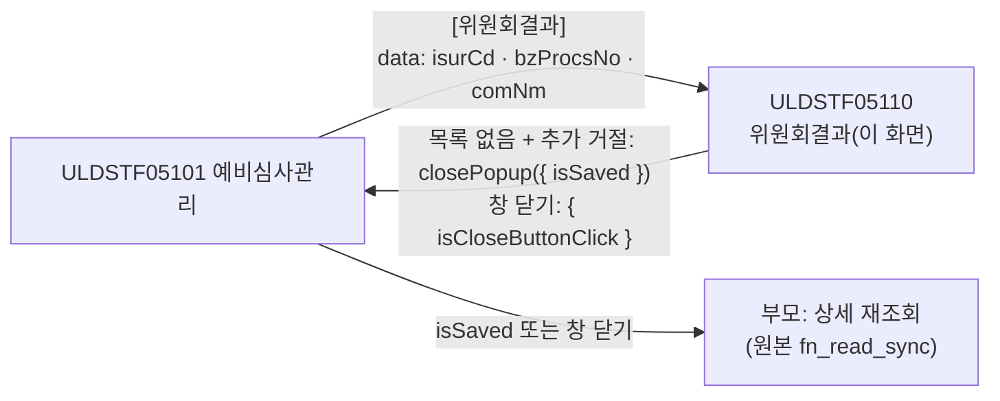
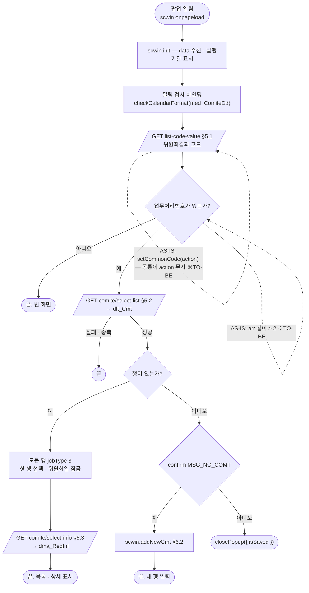
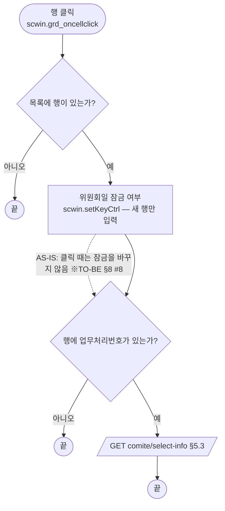
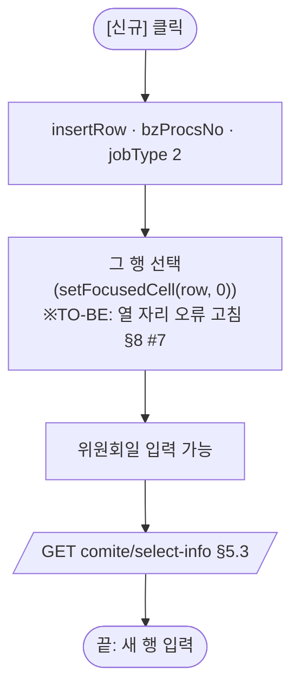
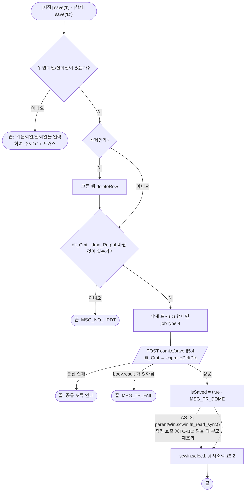
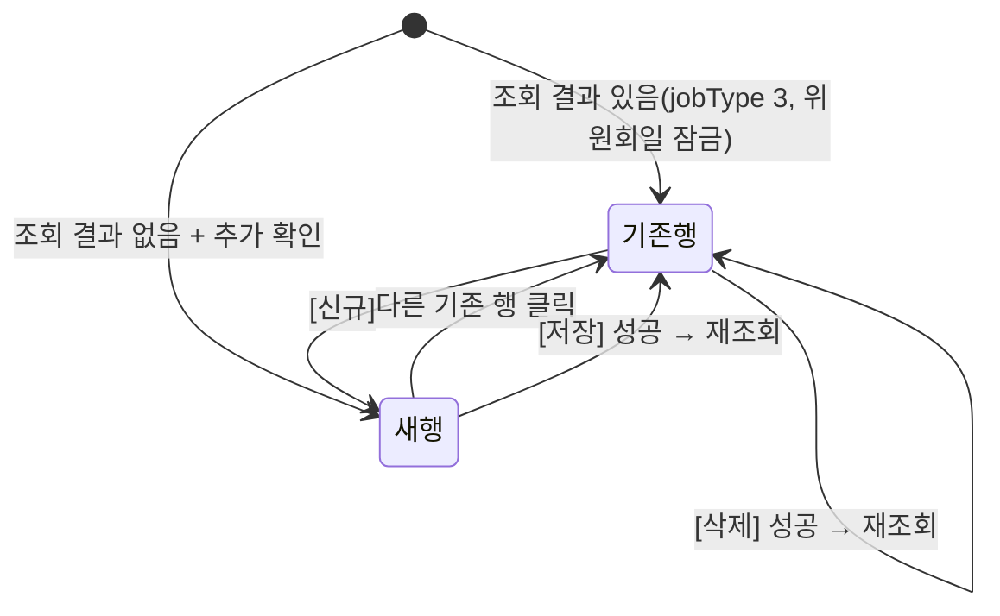

# ULDSTF05110 (팝업)종류주식 위원회결과 — 업무 분석 및 전환 내역

| 항목 | 내용 |
|---|---|
| AS-IS 원본 | `ULDSTF05110.xml` — W-Craft 1차 변환본(`meta_asisFileNm="ULDSTF05110.gfm"`, 원본 gfm 은 저장소에 없음)에 **API 적용까지 마친 개발 사본**. 업무 로직은 이 스크립트와 남은 주석으로 분석했다. 반입 `conversion/conversion-front/ui/ULDSTF05110/ULDSTF05110.xml` (kindstk 묶음) |
| 신규 API 명세 | 없음 — **화면에 적용된 `/api/...` 경로·method·dataCollection keyInfo 를 명세로 간주**(사용자 결정 2026-10-29). `api_spec_check` 는 SKIP |
| TO-BE | `conversion/conversion-front/ui-tobe/ULDSTF05110.xml` (배포 경로 `/ui/lst/kindstk/ULDSTF05110.xml` — 원본 리터럴, 계약서 §2). **2026-10-29 전환** — 1단계: 캡처 없음 → 기존 마크업 정비(사본 `$CLAUDE_JOB_DIR/tmp/ULDSTF05110_stage1.xml`), 2단계: 스크립트 재전환. 게이트: `gate_screen --pcc stf`·`scan_mixed_compare`(A 1건 `getRowCount() === 0` 숫자 비교 — 의도)·`publish_gate --before {1단계} --allow P20`·`api_spec_check`(SKIP)·`init_binding_check`·`wsxml_lint` 0/0, `convert.py` 고정점 |
| 퍼블리싱 파일 | 화면 폴더 `ULDSTF05110.xml` 의 body 를 1단계 기준으로 했다. publish 원본 `conversion/publish/상장/상장처리(대내)/ULDSTF05110.xml` 은 참고만 — 원본은 `txb_IsurCd` 가 `w2:autoComplete`(45px)·청구서제출일 70px, 개발 사본은 `xf:input` 과 날짜 형식으로 바꿨다. 개발 사본을 따랐다 |
| 화면 캡처 | 없음 — 선례 ULDBNS30400 처럼 "캡처 없음, 기존 마크업 정비" |
| 업무공통 | pcc(`cm/pcc/stf`): `$c.stf.glb.SCREN_PROCS_TP_CD_04`. gcc: `$c.data.getParameter`·`$c.data.isModified`·`$c.date.checkCalendarFormat`·`$c.win.alert`·`$c.win.confirm`·`$c.win.closePopup`·`$c.sbm.executeDynamic`·`$c.util.isEmpty`·`$c.exception.handleError`. 게이트는 `--pcc stf` |
| 작성 | Inswave / 2026-10-29 |

참고 양식: [websquare_gfm_conversion.md](../../../md/websquare_gfm_conversion.md) — §1.4, §6.5. 호출·반환 키는 kindstk 공통 계약서(§2 05110, 공통 규칙의 재조회 규약)를 따른다.

---

## 1. 화면 개요

예비심사 담당자가 **종류주식 예비심사관리(ULDSTF05101)에서 [위원회결과]로 여는 입력 팝업**이다. 발행기관의 상장위원회 심사결과 이력(청구서제출일·위원회일/철회일·철회여부·위원회결과·비고)을 보고, 새 결과를 추가하거나 지운다.

1. 열리면 부모가 넘긴 발행기관코드로 심사결과 목록을 조회하고 첫 행을 보여 준다. 목록이 없으면 "새로 추가하시겠습니까?" 를 묻고, 아니면 닫는다.
2. [신규]로 새 행을 더해 위원회일/철회일(필수)·철회여부·위원회결과·비고를 입력하고 [저장]한다. 위원회일은 새 행만 입력할 수 있다.
3. 고른 행을 [삭제]하면 지우고 바로 저장한다.
4. 저장에 성공하면 목록을 다시 조회하고, 닫을 때 부모가 상세(상장위원회일·심사구분)를 다시 읽는다.

### 1.1 호출 화면 (1본)

| 부모 | 여는 함수 | 크기 | 근거 |
|---|---|---|---|
| ULDSTF05101 주권 종류주식 예비심사관리 | `fn_OpenInvRst`(`fn_GetPar = fn_GetParDtl`) | 800×580 | `ui/ULDSTF05101/ULDSTF05101.xml:976-993` |

### 1.2 호출 규약 (부모 → 이 화면) / 반환 규약

**받는 값** — `$c.data.getParameter()` (계약서 §2 05110, 원본 `fn_GetParDtl` arr)

| 키 | AS-IS arr | 05101 출처 | 이 화면에서 |
|---|---|---|---|
| `isurCd` | [0] | `txb_ISUR_CD` | 목록 조회 키 `scwin.isurCd`(AS-IS `scwin.strKeyIsurCd`), `txb_IsurCd` 표시 |
| `bzProcsNo` | [1] | `scwin.vBzProcsNo` | 새 행의 업무처리번호 `scwin.bzProcsNo`(AS-IS `scwin.strKeyLstBzProcsNo`). **비어 있으면 조회하지 않는다** |
| `comNm` | [2] | `txb_COM_NM` | `txb_CoNm` 표시 |

- AS-IS: `init` 이 `$c.win.getParent().scwin.fn_GetPar`/`fn_SetPar` 를 빌려 `scwin.fn_GetPar(arr)` 로 받았다. `arr.length > 2`(세 값 모두 받음)일 때만 `fn_search` — 05101 은 늘 세 값을 채우므로 사실상 늘 조회했다. TO-BE 는 업무처리번호가 있을 때만 조회한다(계약서) — 빈 번호로 새 행을 저장하지 않게.

**반환** — `await $c.win.closePopup({ isSaved })` (계약서 §2 재조회 규약)

| 키 | 값 | 부모 동작 |
|---|---|---|
| `isSaved` | 이 팝업에서 저장에 한 번이라도 성공했으면 `true` | 부모는 `res?.isSaved === true \|\| res?.isCloseButtonClick === true` 면 상세를 다시 읽는다(원본: 저장 직후 `parentWin.scwin.fn_read_sync()` 직접 호출) |

- 명시적으로 닫는 곳은 "새로 추가하시겠습니까?" 를 거절할 때 하나다. 창 닫기(X·ESC)는 공통이 `{ isCloseButtonClick : true }` 를 주므로 부모가 안전하게 재조회한다.

### 1.3 이 화면이 여는 하위 팝업

해당 없음.

### 1.4 업무 프로세스 흐름

흐름은 AS-IS(개발 사본) 동작을 기준으로 그렸다. 점선과 `※TO-BE` 는 전환본에서 바뀌는 곳이다(근거는 §8).

| # | 업무 | 시작 (사용자 동작·진입 조건) | 끝 (결과) | 주요 함수 | 관련 절 |
|---|---|---|---|---|---|
| 1 | 진입·목록 조회 | 05101 이 팝업을 엶 | 목록·첫 행 표시 / 새 행 / 닫힘 | `scwin.onpageload` → `scwin.init` → `scwin.selectCode` → `scwin.selectList` | §3, §5.1, §5.2 |
| 2 | 행 보기 | 목록 행 클릭 `grd` | 상세 표시, 위원회일 잠금 여부 | `scwin.grd_oncellclick` → `scwin.setKeyCtrl` → `scwin.selectReqInf` | §4, §5.3, §6.3 |
| 3 | 신규 | [신규] `img_Regist` | 새 행(위원회일 입력 가능) | `scwin.img_Regist_onclick` → `scwin.addNewCmt` | §6.2 |
| 4 | 저장 | [저장] `img_Save` | 저장 → 재조회 | `scwin.img_Save_onclick` → `scwin.save("I")` → `scwin.saveTrs` | §5.4, §6.1 |
| 5 | 삭제 | [삭제] `img_Delete` | 행 삭제 저장 → 재조회 | `scwin.img_Delete_onclick` → `scwin.save("D")` → `scwin.saveTrs` | §5.4, §6.1 |

#### 화면 간 흐름

#### 업무 1: 진입·목록 조회

| # | 단계 | 주체 | 내용 | 분기 · 메시지 | 관련 절 |
|---|---|---|---|---|---|
| 1 | 사용자 정보 | 화면 | AS-IS `onpageload` 의 `scwin.userInfo = $c.session.getUserInfo()` | 삭제 — 쓰는 곳(부서 검사·저장 사번)이 동작하지 않는다(§8 #6·#3) | §3 |
| 2 | 파라미터 | 화면 | `isurCd`·`bzProcsNo`·`comNm` | — | §1.2 |
| 3 | 달력 | 화면 | `med_ComiteDd` 단일 달력 검사(규칙 37) | — | §3 |
| 4 | 코드 | 서버 | `COMITE_INVSTG_RSLT_CD` → 콤보 `cmb_ComiteInvstgRsltCd` | — | §5.1 |
| 5 | 목록 | 서버 | `select-list(isurCd)` | 0건이면 `MSG_NO_COMT` 확인 | §5.2 |

#### 업무 2: 행 보기

| # | 단계 | 주체 | 내용 | 분기 · 메시지 | 관련 절 |
|---|---|---|---|---|---|
| 1 | 표시 | 화면 | 상세 입력란이 `dlt_Cmt` 현재 행에 바인딩돼 있어 자동 표시 | — | §2.1 |
| 2 | 잠금 | 화면 | `jobType !== "2"` 면 위원회일 읽기 전용 | — | §6.3 |
| 3 | 심사청구 정보 | 서버 | `select-info(bzProcsNo)` | — | §5.3 |

#### 업무 3: 신규

| # | 단계 | 주체 | 내용 | 분기 · 메시지 | 관련 절 |
|---|---|---|---|---|---|
| 1 | 새 행 | 화면 | `bzProcsNo = scwin.bzProcsNo`, `jobType = "2"` | — | §6.2 |
| 2 | 입력 | 사용자 | 위원회일/철회일(필수)·철회여부·결과·비고 | — | §2.1 |

#### 업무 4·5: 저장 · 삭제

| # | 단계 | 주체 | 내용 | 분기 · 메시지 | 관련 절 |
|---|---|---|---|---|---|
| 1 | 필수 | 화면 | `med_ComiteDd` 빈 값 | "위원회일/철회일을 입력하여 주세요" | §6.1 |
| 2 | 삭제 | 화면 | `dlt_Cmt.deleteRow(현재 행)` — 확인 없이 바로(원본 그대로) | — | §6.1 |
| 3 | 변경 확인 | 화면 | `$c.data.isModified([dlt_Cmt, dma_ReqInf])` | `MSG_NO_UPDT` | §6.1, §8 #5 |
| 4 | jobType | 화면 | 삭제 행 `Number($c.stf.glb.SCREN_PROCS_TP_CD_04)` = 4 | — | §6.1 |
| 5 | 저장 | 서버 | `save` | 실패 `MSG_TR_FAIL` | §5.4 |
| 6 | 후처리 | 화면 | `MSG_TR_DOME` → 재조회 | — | §5.2 |

#### 화면 모드 상태 전이

---

## 2. 화면 구성 및 데이터 정의

### 2.1 화면 구성 (AS-IS 요소 → TO-BE 컴포넌트)

| 영역 | AS-IS 요소 (id) | TO-BE 컴포넌트 (바인딩) | 비고 |
|---|---|---|---|
| 머리 | `pfmContentHeader` | `w2:pageFrame#pfmContentHeader` | |
| 발행기관 | `pan_Cnd` (tblbox) | `tblbox#pan_Cnd` | |
| | `label_2` "발행기관코드" / `txb_IsurCd` (readOnly 70px) · `txb_CoNm` (readOnly 210px) | `xf:input#txb_IsurCd`·`#txb_CoNm` readOnly, 한 칸 `flex flex_no` | 바인딩 없이 `setValue` |
| 상세 | `pan_Cmt` (tblbox) | `tblbox#pan_Cmt` | |
| | `label_1` "청구서제출일" / `med_BillSubmitDd` (`dlt_Cmt.billSubmitDd`, readOnly, date `yyyyMMddHHmmss`→`yyyy-MM-dd`) | 같음, ioFormat `yyyyMMddHHmmSS`(규칙 46 대문자 통일) | |
| | `label_5` "철회여부" / `rdo_RetrYn` (`dlt_Cmt.retrYn`, 예 Y / 아니오 N) | `xf:select1#rdo_RetrYn` radiogroup `cols="2"` | 원본 `item="Y^예,N^아니오"` 속성은 choices 와 중복이라 정리 |
| | `label_7` "위원회일/철회일" / `med_ComiteDd` (inputCalendar, `dlt_Cmt.comiteDd`) | 같음, 라벨 `req`(필수) | 새 행만 입력(§6.3) |
| | `label_84` "위원회결과" / `cmb_ComiteInvstgRsltCd` (`dlt_Cmt.comiteInvstgRsltCd`) | 같음, `itemset` = `dlt_comiteInvstgRsltCd`(text/value) + `chooseOption`(빈 첫 항목 — 원본 `firstRow ["",""]`) | §5.1 |
| | `label_3` "비고" / `txa_Remk` (`dlt_Cmt.remk`, 408px) | `xf:textarea#txa_Remk` 폭 100% | |
| 목록 | `grd` (`dlt_Cmt`, 높이 153px, `ev:oncellclick`) | `w2:gridView#grd` `gvw row5` readOnly | `caption1`·`header1`·`gBody1` |
| | 머리 `column1` 청구서제출일 / 본문 `billSubmitDd` (date `yyyyMMddHHmmss`) | 머리 `h_BILL_SUBMIT_DD`, 본문 ioFormat `yyyyMMddHHmmSS` | 머리 id `h_` 접두 |
| | 머리 `column2` 위원회일/철회일 / 본문 `comiteDd` (`displayFormat="####-##-##"`) | 머리 `h_COMITE_DD`, 본문 `dataType="date" displayFormat="yyyy-MM-dd"` | 규칙 46 — `####-##-##` 금지 |
| | 머리 `h_COMITE_INVSTG_RSLT_NM` 위원회결과 / 본문 `comiteInvstgRsltNm` | 같음 | |
| 하단 | `panel_1` (btnbox) | `btnbox#panel_1` | |
| | `label_9` "위원회일은 수정할 수 없습니다." · `label_10` "위원회 결과 추가시 '신규' 버튼을 선택하고 입력합니다." (`ul.txt_list` 가 버튼과 같은 줄) | `lt` > `ul.txt_list` > `li` | 버튼이 아닌 요소라 `lt`(규칙 41) |
| | `btn_Close` [닫기] · `img_Delete` [삭제] · `img_Regist` [신규] · `img_Save` [저장](pt) | `rt` > [삭제]-[저장]-[신규] 모두 `btn_cm pt` | 규칙 41 순서. [닫기] **(옮기지 않음)** — 팝업 하단 닫기 금지 |
| 숨김 | `file_name` (hide 그룹의 input) | **(옮기지 않음)** | 쓰는 곳 없는 W-Craft 잔재 |

### 2.2 데이터 정의 (DataCollection)

| TO-BE | 종류 | 키(컬럼) | 출처 / 용도 |
|---|---|---|---|
| `dma_codReq` (신설) | dataMap | `codeList` 코드정보 List | 공통 코드 조회 요청(계약서 §4.5) |
| `dlt_comiteInvstgRsltCd` (신설) | dataList | `value` 코드 · `text` 코드명 | `COMITE_INVSTG_RSLT_CD` 응답 — 콤보 항목 |
| `dlt_Cmt` | dataList | `billSubmitDd` 청구서 제출일 · `comiteDd` 위원회일자 · `retrYn` 철회여부 · `comiteInvstgRsltCd` 심사결과코드 · `remk` 비고 · `bzProcsNo` 업무처리번호 · `comiteInvstgRsltNm` 심사결과 · `jobType` jobType | `select-list` 응답 = `save` 요청(`copmiteDlrltDto`). 개발 사본 그대로. 그리드 `comiteDd`(위원회일/철회일)는 규칙 46 날짜 형식 — AS-IS `####-##-##` 자리 마스크 → 날짜 형식(§10 #6) |
| `dma_ReqInf` | dataMap | `billSubmitDd` 심사청구서접수일자 · `lstComiteRsltSaveEmpNo` 최종위원회결과저장사원번호 · `lstComiteRsltSaveDdtm` 최종위원회결과저장일시 · `bzProcsNo` 업무처리번호 · `lstComiteRsltSaveEmpNm` 최종위원회결과저장사원이름 | `select-info` 응답. **화면 어디에도 바인딩되지 않고 저장에도 보내지 않는다** — 변경 확인에만 쓰인다(§10 #3) |

---

## 3. 로딩 (`scwin.onpageload` → `scwin.init`)

1. **파라미터 수신** — `scwin.isurCd`·`scwin.bzProcsNo` 보관, `txb_IsurCd`·`txb_CoNm` 표시(§1.2).
2. **달력 검사** — `$c.date.checkCalendarFormat(med_ComiteDd, "yyyyMMdd")` (규칙 37).
3. **위원회결과 코드** — `await scwin.selectCode()` (목록 바인딩 전에 콤보 항목을 채운다 — 원본도 `await fn_searchCode()` 가 먼저).
4. **목록** — 업무처리번호가 있으면 `await scwin.selectList()`.
- 조회 영역(`schbox`)이 없어 Enter 키 바인딩은 해당 없음. AS-IS `onpageload` 의 `scwin.userInfo = $c.session.getUserInfo()` 는 옮기지 않았다(§8 #3·#6). 빈 `scwin.onpageunload` 도 옮기지 않았다.

## 4. 컴포넌트 이벤트

| TO-BE 컴포넌트 | 이벤트 | TO-BE 핸들러 | 동작 (호출 함수) | AS-IS |
|---|---|---|---|---|
| `body` | onpageload | `scwin.onpageload` | `scwin.init` | `scwin.onpageload` |
| `grd` | oncellclick | `scwin.grd_oncellclick` | `scwin.setKeyCtrl` → `scwin.selectReqInf` | `scwin.grd_oncellclick` |
| `img_Delete` | onclick | `scwin.img_Delete_onclick` | `scwin.save("D")` | `scwin.img_Delete_onclick` → `scwin.fn_DeleteRow` → `scwin.fn_save("D")` |
| `img_Save` | onclick | `scwin.img_Save_onclick` | `scwin.save("I")` | `scwin.img_Save_onclick` → `scwin.fn_save("I")` |
| `img_Regist` | onclick | `scwin.img_Regist_onclick` | `scwin.addNewCmt` | `scwin.img_Regist_onclick` → `scwin.fn_addNewCmt` |
| — | — | (삭제) | — | `scwin.btn_Close_onclick` — 닫기 버튼 삭제 |

## 5. 서버 통신

| # | 용도 | AS-IS | TO-BE (화면 적용 API = 명세 간주) |
|---|---|---|---|
| 5.1 | 위원회결과 코드 | `setCommonCode([{ code:"COMITE_INVSTG_RSLT_CD", action:"…/list-code-value?codeList=COMITE_INVSTG_RSLT_CD", firstRow, labelColumn:"text", valueColumn:"value", compID }])` | `GET /api/listing/common/code/list-code-value` |
| 5.2 | 심사결과 목록 | `sbm_prelisting-kindstk-comite` | `GET /api/listing/lstproc/kind/prelisting-kindstk-comite/select-list` |
| 5.3 | 심사청구 정보 | `sbm_prelisting-kindstk-comite-select-info` | `GET /api/listing/lstproc/kind/prelisting-kindstk-comite/select-info` |
| 5.4 | 심사결과 저장 | `sbm_prelisting-kindstk-comite`(POST) | `POST /api/listing/lstproc/kind/prelisting-kindstk-comite/save` |

### 5.1 위원회결과 코드 (`scwin.selectCode`)

| 항목 | 내용 |
|---|---|
| `id` | `sbm_listCodeValue` |
| `method` / `action` | `get` / `/api/listing/common/code/list-code-value` |
| `ref` | `dma_codReq` (`codeList = "COMITE_INVSTG_RSLT_CD"`) |
| `target` | `dlt_comiteInvstgRsltCd=body.COMITE_INVSTG_RSLT_CD` |
| 선행 / 순서 | `scwin.init` 3단계, 목록 조회보다 먼저 |
| 후처리 | 콤보가 `itemset` 으로 자동 갱신 |
| 실패 처리 | 공통 오류 안내(콤보 비어 있음) |
| 비고 | 원본 `$c.data.setCommonCode` 는 `action`·`labelColumn` 을 무시하고 gcc 공통 코드 URL 로 가서 이 코드를 받지 못한다(계약서 §4.5) → 05103 과 같은 (B) 꼴로 바꿨다 |

### 5.2 심사결과 목록 (`scwin.selectList`)

| 항목 | 내용 |
|---|---|
| `id` | `sbm_selectListComite` (개발 사본 `sbm_prelisting-kindstk-comite` — 저장과 같은 id 라 나눴다) |
| `method` / `action` | `get` / `…/prelisting-kindstk-comite/select-list` |
| `requestData` | `{ isurCd : scwin.isurCd }` — "발행기관코드가 키값이다"(원본 주석) |
| `target` | `dlt_Cmt=body` |
| 선행 / 순서 | `scwin.init` 4단계(업무처리번호가 있을 때), 저장 성공 뒤 |
| 후처리 | 행이 있으면: 모든 행 `jobType = "3"`(`setBroadcast` 로 묶음, 규칙 28) → `grd.setFocusedCell(0, 0)` → `scwin.setKeyCtrl(0)` → `scwin.selectReqInf(0)`. 없으면: `confirm(MSG_NO_COMT)` → 예 `scwin.addNewCmt` / 아니오 `closePopup({ isSaved })` |
| 실패 처리 | `responseJSON.success !== true` 면 후처리 없이 끝(공통 오류 안내) — 원본도 `success` 일 때만 후처리 |
| 중복 실행 | `res?.skipped` 면 끝 |

### 5.3 심사청구 정보 (`scwin.selectReqInf`)

| 항목 | 내용 |
|---|---|
| `id` | `sbm_selectInfoComite` |
| `method` / `action` | `get` / `…/prelisting-kindstk-comite/select-info` |
| `requestData` | `{ bzProcsNo : dlt_Cmt.getCellData(rowIndex, "bzProcsNo") }` — 원본은 `getRowPosition()` 행. 호출한 곳이 행 번호를 넘긴다 |
| `target` | `dma_ReqInf=body` |
| 후처리 | 없음(원본 `if (res.responseJSON.success) { }` 빈 블록) — §10 #3 |

### 5.4 심사결과 저장 (`scwin.saveTrs`)

| 항목 | 내용 |
|---|---|
| `id` | `sbm_saveComite` |
| `method` / `action` | `post` (`mediatype: application/json`) / `…/prelisting-kindstk-comite/save` |
| `ref` | `'data:json,[{"id":"dlt_Cmt","key":"copmiteDlrltDto"}]'` — 목록 전체를 `copmiteDlrltDto` 키로. 키 철자(`copmite`)는 개발 사본 그대로(§10 #5) |
| `target` | `data:json` |
| 행 처리구분 | `jobType` — 조회 행 `"3"`, 새 행 `"2"`, 삭제 행 숫자 `4`(`Number($c.stf.glb.SCREN_PROCS_TP_CD_04)`). 원본 `vScrenProcTpCd` 는 `"02"`/`"03"`/`"04"` 를 계산하지만 실제로는 삭제 행에만 쓰였다(§10 #4) |
| 성공 판정 | `responseJSON.success === true` **이고** `body.result === "S"` |
| 실패 처리 | 판정이 거짓이면 `MSG_TR_FAIL` 알림(원본 그대로). 실패해도 지운 행은 화면에서 지워진 채 남는다(원본과 같음) |
| 중복 실행 | `res?.skipped` 면 `false` |

## 6. 일반 함수

### 6.1 저장·삭제 (`scwin.save`)

* **파라미터:** `jobType` `"I"` 저장 / `"D"` 삭제 / **Return:** 없음
* **로직:** 위원회일/철회일 필수 → (삭제면 현재 행 `deleteRow`) → `$c.data.isModified([dlt_Cmt, dma_ReqInf])` 아니면 `MSG_NO_UPDT` → (삭제 표시 `D` 로 남은 행이면 `jobType` 4) → `scwin.saveTrs()` → 성공이면 `scwin.isSaved = true`, `MSG_TR_DOME`, `scwin.selectList()`.
* 원본의 부서 검사(`scwin.userInfo.depCd.substring(0, 2) !== '25'` — 안내가 주석이라 동작 없음)와 `dma_ReqInf.set("lstComiteRsltSaveEmpNo", scwin.fn_getUserId())`(변경 확인 뒤에 넣고 저장에 보내지도 않음)는 옮기지 않았다(§8 #3·#6).

### 6.2 새 행 (`scwin.addNewCmt`)

* **로직:** `insertRow()` → `bzProcsNo = scwin.bzProcsNo`, `jobType = "2"` → `grd.setFocusedCell(row, 0)` → `scwin.setKeyCtrl(row)` → `scwin.selectReqInf(row)`.
* 원본은 `setRowPosition` 후 `scwin.rowIdx` 전역에 행을 담고 `grd.setFocusedCell(rowIdx, rowIdx, true)`(열 자리에 행 번호)였다(§8 #7).

### 6.3 위원회일 잠금 (`scwin.setKeyCtrl`)

* **파라미터:** `rowIndex` / **로직:** `med_ComiteDd.setReadOnly(jobType !== "2")` — 새 행만 위원회일을 입력한다("위원회일은 수정할 수 없습니다").
* 원본 `scwin.fn_setKeyCtrOnAdd`(readOnly false)·`scwin.fn_setKeyCtrOnUpd`(readOnly true)를 조회·신규 때만 불러, 새 행을 만든 뒤 기존 행을 눌러도 입력 가능 상태가 남았다(§8 #8).

### 6.4 부모 ↔ 팝업 파라미터 전달 (getPar/setPar → `openPopup` data + `await`)

- 받는 쪽이다. 부모 `fn_GetPar`/`fn_SetPar` 빌려 쓰기와 `parentWin.scwin.fn_read_sync()` 직접 호출을 없애고, `$c.data.getParameter()` 수신 + `closePopup({ isSaved })` 반환으로 바꿨다(가이드 §6.5, 계약서 재조회 규약).

## 7. 업무 코드 · 메시지 목록

| 구분 | 값 | 의미 |
|---|---|---|
| 공통 코드 | `COMITE_INVSTG_RSLT_CD` | 위원회 심사결과 |
| `jobType` | `"2"` / `"3"` / `4` | 신규 / 기존(조회) / 삭제 |
| 저장 응답 | `body.result === "S"` | 서버 처리 성공 |
| 철회여부 | `Y` / `N` | 예 / 아니오 |
| `MSG_TR_DOME` | "작업이 정상적으로 처리되었습니다." | 저장 성공 |
| `MSG_TR_FAIL` | "처리 중 오류가 발생하였습니다." | 저장 실패 |
| `MSG_NO_UPDT` (AS-IS `MGS_NO_UPDT` 오타) | "저장할 수정내용이 없습니다." | 변경 없음 |
| `MSG_NO_COMT` | "위원회심사결과 내역이 없습니다. 새로 추가하시겠습니까?" | 목록 0건 확인 |
| (리터럴) | "위원회일/철회일을 입력하여 주세요" | 필수 검사 |

## 8. 원본 특이사항 · 결함

| # | 원본에서 실제로 일어나는 일 (근거) | 전환본 처리 |
|---|---|---|
| 1 | 저장 성공 뒤 `$c.win.getParent().scwin.fn_read_sync()` 로 부모를 직접 부른다 | **고침** — `closePopup({ isSaved })` + 부모 재조회(계약서) |
| 2 | `setCommonCode` 에 `action` 을 줬지만 공통은 무시한다 → 위원회결과 콤보가 비거나 다른 코드가 들어간다 | **고침** — `list-code-value` 직접 조회(§5.1) |
| 3 | `dma_ReqInf.set("lstComiteRsltSaveEmpNo", fn_getUserId())` 는 변경 확인 **뒤**에 넣고, 저장 `ref` 는 `dlt_Cmt` 만이라 서버로 가지 않는다. `scwin.dateFormat`(저장일시 서식)도 쓰는 곳이 없다 | **옮기지 않음** — §10 #3 |
| 4 | 목록 조회와 저장이 같은 서브미션 id(`sbm_prelisting-kindstk-comite`)를 쓴다 → 공통 중복 방지가 서로를 막을 수 있다 | **고침** — id 분리 |
| 5 | 조회 직후 모든 행에 `jobType` 을 넣어 행 상태가 수정(U)으로 바뀐다 → 고친 것이 없어도 `isModified` 가 참이라 "저장할 수정내용이 없습니다" 가 사실상 나오지 않고, 저장하면 목록 전체가 다시 간다 | **유지** — 서버가 행마다 `jobType` 으로 처리하는 계약으로 본다(§10 #4) |
| 6 | 부서 검사 `depCd.substring(0, 2) !== '25'` 의 안내·`return` 이 주석이라 아무것도 하지 않는다 | **옮기지 않음** |
| 7 | 신규 행 포커스 `grd.setFocusedCell(rowIdx, rowIdx, true)` — 열 자리에 행 번호 | **고침** — 첫 열 |
| 8 | 위원회일 잠금을 조회·신규 때만 바꿔, 새 행 뒤 기존 행을 눌러도 위원회일을 고칠 수 있다(안내 "위원회일은 수정할 수 없습니다"와 어긋남) | **고침** — 행 클릭 때도 `jobType` 으로 정한다 |
| 9 | 삭제 시 `deleteRow` 뒤 같은 행 번호에 `jobType` 4 를 넣는다 — 저장 전 새 행을 지우면 그 행이 목록에서 빠져 같은 번호의 다른 행(또는 없는 행)에 4 가 들어간다 | **고침** — 삭제 표시(`D`) 행에만 |
| 10 | 삭제에 확인 창이 없다 | **유지**(원본 그대로) — §10 #7 |
| 11 | `vScrenID`·`scwin.rowIdx` 전역, `fn_DeleteRow` 는 `fn_save("D")` 한 줄 | **정리** — 지역 변수·직접 호출 |

## 9. 전환 내역 (AS-IS → TO-BE)

| AS-IS | TO-BE |
|---|---|
| `scwin.onpageload`(`userInfo` + `init`) | `scwin.onpageload`(try/catch) → `scwin.init` |
| `scwin.init`(부모 `fn_GetPar` arr) | `scwin.init`(`getParameter`) |
| `scwin.fn_searchCode` | `scwin.selectCode` |
| `scwin.fn_search` | `scwin.selectList` |
| `scwin.fn_searchReqInf` | `scwin.selectReqInf(rowIndex)` |
| `scwin.fn_save` (통신부) | `scwin.saveTrs` |
| `scwin.fn_save` (검사·후처리) | `scwin.save` |
| `scwin.fn_DeleteRow` | 삭제 — `scwin.img_Delete_onclick` 이 `scwin.save("D")` 직접 |
| `scwin.fn_addNewCmt` | `scwin.addNewCmt` |
| `scwin.fn_setKeyCtrOnAdd` · `scwin.fn_setKeyCtrOnUpd` | `scwin.setKeyCtrl(rowIndex)` |
| `scwin.fn_getUserId` · `scwin.dateFormat` | 삭제(§8 #3) |
| `scwin.btn_Close_onclick` | 삭제(닫기 버튼 없음) |
| `scwin.img_Save_onclick` · `scwin.img_Regist_onclick` · `scwin.img_Delete_onclick` · `scwin.grd_oncellclick` | 같은 이름(try/catch) |
| `scwin.onpageunload` | 삭제(빈 함수) |
| 전역 `scwin.MSG_TR_DOME`·`scwin.MSG_TR_FAIL`·`scwin.MGS_NO_UPDT`·`scwin.MSG_NO_COMT` | 같은 상수(`MGS_` 오타 → `scwin.MSG_NO_UPDT`) |
| 전역 `scwin.fn_GetPar`·`scwin.fn_SetPar`·`scwin.strKeyIsurCd`·`scwin.strKeyLstBzProcsNo`·`scwin.vScrenID`·`scwin.rowIdx`·`scwin.userInfo` | `scwin.isurCd`·`scwin.bzProcsNo`·`scwin.isSaved` (+ `scwin.JOB_TYPE_NEW`·`scwin.JOB_TYPE_OLD`) |

## 10. 남은 작업 (TODO)

1. **부모 쪽 반영** — 05101 `fn_OpenInvRst` 는 `{ isurCd, bzProcsNo, comNm }` 를 data 로 넘기고, 닫힌 뒤 `res?.isSaved === true || res?.isCloseButtonClick === true` 면 상세를 다시 읽어야 한다(묶음 C).
2. **업무처리번호 없는 진입** — 원본은 사실상 늘 조회했지만 TO-BE 는 업무처리번호가 비면 조회하지 않는다(계약서). 예비심사 저장 전에는 위원회결과를 못 쓰는 것이 맞는지 확인.
3. **`select-info`(`dma_ReqInf`) 용도** — 응답을 받기만 하고 화면·저장 어디에도 쓰지 않는다. 원본 gfm 에서 최종 저장자·일시(`lstComiteRsltSave*`)를 보여 주거나 새 행의 청구서제출일(`billSubmitDd`)을 채웠을 가능성이 있다 — 확인 후 표시/복사를 정한다. 저장 사번(`lstComiteRsltSaveEmpNo`)을 서버가 세션으로 채우는지도 확인.
4. **`jobType` 값** — 신규 `"2"`·기존 `"3"`(문자)·삭제 `4`(숫자)를 서버가 그대로 받는지, 기존 행 전체를 매번 다시 보내도 되는지 확인(§8 #5).
5. **요청 키 `copmiteDlrltDto`** — 철자가 이상하지만 개발 사본(=명세 간주) 그대로 두었다. 서버 DTO 키와 같은지 확인.
6. **날짜 값 형식** — 그리드 위원회일/철회일에 규칙 46 날짜 형식(8자리 가정), 청구서제출일은 개발 사본대로 14자리 `yyyyMMddHHmmSS` 로 두었다. 서버 값 길이 확인.
7. **삭제 확인** — 원본은 확인 없이 지우고 바로 저장한다. 확인 창을 넣을지 결정.
