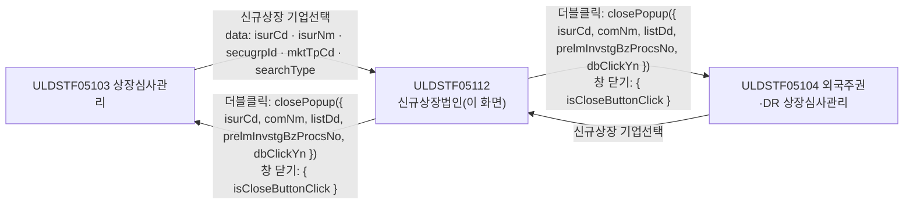
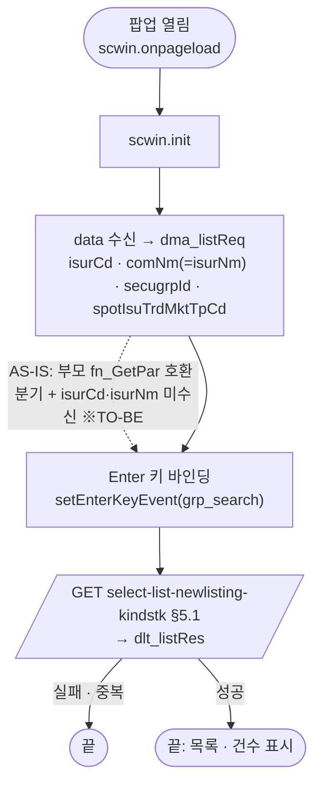
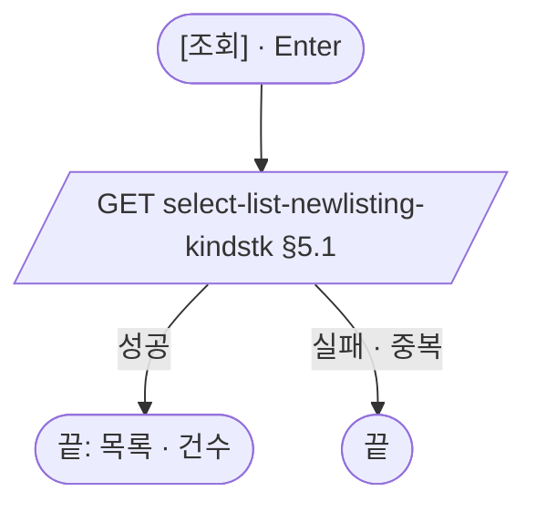
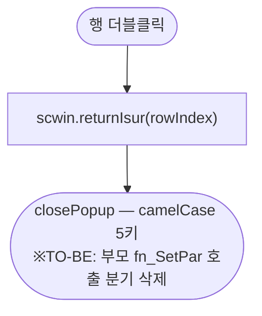

# ULDSTF05112 (팝업)종류주식 신규상장법인 — 업무 분석 및 전환 내역

| 항목 | 내용 |
|---|---|
| AS-IS 원본 | `ULDSTF05112.xml` — W-Craft 1차 변환본(`meta_asisFileNm="ULDSTF05112.gfm"`, 원본 gfm 은 저장소에 없음)에 **API 적용까지 마친 개발 사본**. 업무 로직은 이 스크립트와 남은 옛 코드 주석(`/KindStk.do?…method=listIsurInstForNewList`)으로 분석했다. 반입 `conversion/conversion-front/ui/ULDSTF05112/ULDSTF05112.xml` (kindstk 묶음) |
| 신규 API 명세 | 없음 — **화면에 적용된 `/api/...` 경로·method·dataCollection keyInfo 를 명세로 간주**(사용자 결정 2026-10-29). `api_spec_check` 는 SKIP |
| TO-BE | `conversion/conversion-front/ui-tobe/ULDSTF05112.xml` (배포 경로 `/ui/lst/kindstk/ULDSTF05112.xml` — 원본 리터럴, 계약서 §2). **2026-10-29 전환** — 1단계: 캡처 없음 → 기존 마크업 정비(사본 `$CLAUDE_JOB_DIR/tmp/ULDSTF05112_stage1.xml`), 2단계: 스크립트 재전환. 게이트: `gate_screen --pcc stf`·`scan_mixed_compare`·`publish_gate --before {1단계} --allow P20`·`api_spec_check`(SKIP)·`init_binding_check`·`wsxml_lint` 0/0, `convert.py` 고정점 |
| 퍼블리싱 파일 | 화면 폴더 `ULDSTF05112.xml` 의 body 를 1단계 기준으로 했다. publish 원본 `conversion/publish/상장/상장처리(대내)/ULDSTF05112.xml` 은 참고만(W-Craft `xf:events`·`mxdataset` 주석 잔재가 남은 같은 배치) |
| 화면 캡처 | 없음 — 선례 ULDBNS30400 처럼 "캡처 없음, 기존 마크업 정비" |
| 업무공통 | gcc: `$c.data.getParameter`·`$c.win.setEnterKeyEvent`·`$c.win.closePopup`·`$c.sbm.executeDynamic`·`$c.exception.handleError`. pcc 호출 없음. 게이트는 `--pcc stf` |
| 작성 | Inswave / 2026-10-29 |

참고 양식: [websquare_gfm_conversion.md](../../../md/websquare_gfm_conversion.md) — §1.4, §6.5. 호출·반환 키는 kindstk 공통 계약서(§2 05112)를 따른다.

---

## 1. 화면 개요

상장 심사 담당자가 **종류주식 상장심사관리(ULDSTF05103·05104)에서 신규상장할 발행기관(법인)을 고를 때 여는 선택 팝업**이다. 증권그룹·시장구분에 맞는 신규상장 대상 발행기관 목록(발행기관코드·명, 업무일련번호, 보통주상장일, 상장예정일, 예비심사업무처리번호)을 보여 준다.

1. 열리면 부모 검색 칸의 발행기관코드·명을 검색어 초기값으로 넣고 바로 조회한다.
2. 발행기관명·코드를 고쳐 [조회](또는 Enter)하면 다시 조회한다.
3. 행을 더블클릭하면 그 법인을 부모에 돌려주고 닫는다. 창을 닫으면 취소다.

### 1.1 호출 화면 (2본)

| 부모 | 여는 함수 | 크기(원본) | 근거 |
|---|---|---|---|
| ULDSTF05103 주권 종류주식 상장심사관리 | `fn_PopFindKindStkExamCorp` | 880×700 (`frameModal:"top"`) | `ui/ULDSTF05103/ULDSTF05103.xml:802-829` |
| ULDSTF05104 외국주권·DR 종류주식 상장심사관리 | `fn_PopFindKindStkExamCorp` | 1180×880 | `ui/ULDSTF05104/ULDSTF05104.xml:775-800` |

- 크기는 계약서 권고 **880×700** 으로 부모가 맞춘다(묶음 D).

### 1.2 호출 규약 (부모 → 이 화면) / 반환 규약

**받는 값** — `$c.data.getParameter()` (부모가 이미 TO-BE 형태로 넘긴다 — `ULDSTF05103.xml:805-811`)

| 키 | 의미 | 05103 출처 | 이 화면에서 |
|---|---|---|---|
| `isurCd` | 부모 검색 칸 발행기관코드 | `ibx_searchCd` | 검색어 초기값 `dma_listReq.isurCd`(→ `txb_ISUR_CD`) |
| `isurNm` | 부모 검색 칸 발행기관명 | `ibx_searchNm` | 검색어 초기값 `dma_listReq.comNm`(→ `txb_COM_NM`) |
| `secugrpId` | 증권그룹ID | `sbx_secugrpId` | 조회 조건 `dma_listReq.secugrpId` |
| `mktTpCd` | 시장구분 | `sbx_spotIsuTrdMktTpCd` | 조회 조건 `dma_listReq.spotIsuTrdMktTpCd` |
| `searchType` | 조회구분 `getGlbValue("SEARCH_TYP_SLC")` | — | **쓰지 않음** — 조회 API 가 받지 않는다(§10 #1) |

- AS-IS: 개발 사본은 `getParameter` 로 `secugrpId`·`mktTpCd` 만 받고 `isurCd`·`isurNm` 은 받지 않았다. 앞에 남은 부모 `fn_GetPar` 호환 분기(`parentWin.scwin.fn_GetPar` → `strSch = arr[0]` — 선언 안 된 전역 `strSch`, `scwin.fr_SecuGrpId = arr[2]`, `scwin.fr_mktTpCd = arr[3]`)는 05103·05104 가 이미 data 로 바뀌어 동작하지 않는다 → 삭제하고, 원본 `strSch`(초기 검색) 의도대로 부모 검색 칸 값을 검색어 초기값으로 쓴다(계약서 §2).

**반환** — `await $c.win.closePopup(result)`

| 키 | 값 | AS-IS 키 |
|---|---|---|
| `isurCd` | 발행기관코드 | `ISUR_CD` |
| `comNm` | 발행기관명 | `COM_NM` |
| `listDd` | 상장예정일 | `LIST_DD` |
| `prelmInvstgBzProcsNo` | 예비심사 업무처리번호 | `PRELM_INVSTG_BZ_PROCS_NO` |
| `dbClickYn` | `"Y"` 고정 | `DBCLICKYN` |

- 취소(창 닫기)는 `{ isCloseButtonClick }` 만 온다 → 부모는 `$c.util.isEmpty(res?.isurCd)` 로 판정. 부모 원본은 `res.isCloseButtonClick` 만 보고 대문자 `res.ISUR_CD` 를 읽었다 → 부모 쪽에서 camelCase 로 바꾼다(묶음 D).
- 부모 동작(원본 `ULDSTF05103.xml:822-828`): 검색 칸 반영 → `fn_readKindStkNewRegNewList(isurCd)` → `fn_read_sync`.

### 1.3 이 화면이 여는 하위 팝업

해당 없음.

### 1.4 업무 프로세스 흐름

| # | 업무 | 시작 (사용자 동작·진입 조건) | 끝 (결과) | 주요 함수 | 관련 절 |
|---|---|---|---|---|---|
| 1 | 진입·첫 조회 | 05103·05104 가 팝업을 엶 | 검색어 초기값으로 목록 표시 | `scwin.onpageload` → `scwin.init` → `scwin.selectList` | §3, §5.1 |
| 2 | 조건 조회 | [조회] `img_Search` / 조회 영역 Enter | 목록 다시 표시 | `scwin.img_Search_onclick` → `scwin.selectList` | §4, §5.1 |
| 3 | 법인 선택 | 목록 더블클릭 `grd_IsuInst` | 부모에 법인 반환·닫힘 | `scwin.grd_IsuInst_oncelldblclick` → `scwin.returnIsur` | §6.1 |

#### 화면 간 흐름

#### 업무 1: 진입·첫 조회

| # | 단계 | 주체 | 내용 | 분기 · 메시지 | 관련 절 |
|---|---|---|---|---|---|
| 1 | 파라미터 | 화면 | 4키를 `dma_listReq` 에 넣는다(입력란에 바로 보인다) | 빈 값이면 빈 검색어 | §1.2 |
| 2 | Enter 키 | 화면 | `grp_search` → `scwin.img_Search_onclick` (규칙 22, 개발 사본에도 있었다) | — | §3 |
| 3 | 조회 | 서버 | `select-list-newlisting-kindstk` | — | §5.1 |

#### 업무 2: 조건 조회

| # | 단계 | 주체 | 내용 | 분기 · 메시지 | 관련 절 |
|---|---|---|---|---|---|
| 1 | 조건 | 사용자 | 발행기관명 `txb_COM_NM`·코드 `txb_ISUR_CD` | — | §2.2 |
| 2 | 조회 | 서버 | 업무 1 과 같은 API | — | §5.1 |

#### 업무 3: 법인 선택

| # | 단계 | 주체 | 내용 | 분기 · 메시지 | 관련 절 |
|---|---|---|---|---|---|
| 1 | 반환 | 화면 | `closePopup({ isurCd, comNm, listDd, prelmInvstgBzProcsNo, dbClickYn:"Y" })` | — | §6.1 |

#### 화면 모드 상태 전이

해당 없음.

---

## 2. 화면 구성 및 데이터 정의

### 2.1 화면 구성 (AS-IS 요소 → TO-BE 컴포넌트)

| 영역 | AS-IS 요소 (id) | TO-BE 컴포넌트 (바인딩) | 비고 |
|---|---|---|---|
| 머리 | `pfmContentHeader` pageFrame **2개**(174·175행) | `w2:pageFrame#pfmContentHeader` 1개 | 중복 id 결함(WS120) — 계약서 §4.4 |
| 조회조건 | `grp_search` (schbox) | 같음 | |
| | `label_1` "발행기관명" / `txb_COM_NM` (`ev:onkeydown="scwin.txb_COM_NM_onkeydown"` — 함수 없음) | `xf:input#txb_COM_NM` (`dma_listReq.comNm`) | 없는 핸들러 참조 제거(§8 #2) |
| | `label_2` "발행기관코드" / `txb_ISUR_CD` | `xf:input#txb_ISUR_CD` (`dma_listReq.isurCd`) | |
| | `img_Search` [조회] | `xf:trigger#img_Search` `btn_cm sch` | |
| 목록 머리 | `txb_TotCnt` | `w2:span.num#txb_TotCnt` | |
| 목록 | `grd_IsuInst` (`gvw row10`, `ev:oncellclick=""`) | `w2:gridView#grd_IsuInst` `gvw row10` readOnly | 빈 `oncellclick` 제거. `caption1`·`header1`·`gBody1` |
| | 머리 `ISUR_CD` / 본문 `isurCd` | 머리 `h_ISUR_CD` | 머리 id `h_` 접두 |
| | 머리 `COM_NM` / 본문 `comNm` | 머리 `h_COM_NM` | |
| | 머리 `LIST_BZ_SEQ` 업무일련번호 / 본문 `listBzSeq` | 머리 `h_LIST_BZ_SEQ` | |
| | 머리 `CMSTK_LIST_DD` 보통주상장일 / 본문 `cmstkListDd` | 머리 `h_CMSTK_LIST_DD`, 본문 날짜 형식 | 규칙 46 확장(§10 #3) |
| | 머리 `LIST_DD` 상장예정일 / 본문 `listDd` | 머리 `h_LIST_DD`, 본문 날짜 형식 | 규칙 46 확장 |
| | 머리 `PRELM_INVSTG_BZ_PROCS_NO` / 본문 `prelmInvstgBzProcsNo` (폭 없음) | 머리 `h_PRELM_INVSTG_BZ_PROCS_NO`, 폭 140 | |
| 하단 | 빈 `btnbox`(버튼 없는 `rt`) | **(옮기지 않음)** | 남는 버튼이 없으면 btnbox 를 두지 않는다(퍼블리싱 규칙) |

### 2.2 데이터 정의 (DataCollection)

| TO-BE | 종류 | 키(컬럼) | 출처 / 용도 |
|---|---|---|---|
| `dma_listReq` | dataMap | `isurCd` 발행기관코드 · `comNm` 회사명 · `secugrpId` 증권그룹ID · `spotIsuTrdMktTpCd` 시장구분코드 | 조회 요청(GET 쿼리, 개발 사본 그대로) |
| `dlt_listRes` | dataList | `isurCd` 발행기관코드 · `comNm` 회사명 · `comAbbrv` 회사약명 · `comEngNm` 영문명 · `comEngAbbrv` 영문약명 · `spotIsuTrdMktTpCd` 시장구분코드 · `ceoNm` 대표이사명 · `corpRegNo` 법인등록번호 + **`listBzSeq` 업무일련번호 · `cmstkListDd` 보통주상장일 · `listDd` 상장예정일 · `prelmInvstgBzProcsNo` 예비심사업무처리번호**(추가) | `select-list-newlisting-kindstk` 응답. 그리드 4열과 반환 계약이 읽는 4키가 개발 사본 columnInfo 에 없어(빈 열·빈 반환) 더했다 — 응답에 있는지 §10 #2 |

---

## 3. 로딩 (`scwin.onpageload` → `scwin.init`)

1. **파라미터 수신** — `isurCd`·`isurNm`(→ `comNm`)·`secugrpId`·`mktTpCd`(→ `spotIsuTrdMktTpCd`) 를 `dma_listReq` 에 넣는다.
2. **Enter 키** — `$c.win.setEnterKeyEvent(grp_search, scwin.img_Search_onclick)` (규칙 22).
3. **조회** — `await scwin.selectList()`.
- 달력 없음. `window.document.body.scroll = "no"`·빈 `scwin.onpageunload` 는 옮기지 않았다.

## 4. 컴포넌트 이벤트

| TO-BE 컴포넌트 | 이벤트 | TO-BE 핸들러 | 동작 (호출 함수) | AS-IS |
|---|---|---|---|---|
| `body` | onpageload | `scwin.onpageload` | `scwin.init` | `scwin.onpageload` |
| `img_Search` | onclick | `scwin.img_Search_onclick` | `scwin.selectList` | `scwin.img_Search_onclick` |
| `grp_search` | Enter | (setEnterKeyEvent) | `scwin.img_Search_onclick` | 같음(개발 사본 `init`) |
| `txb_COM_NM` | — | (삭제) | — | `ev:onkeydown="scwin.txb_COM_NM_onkeydown"` — 정의 없음(§8 #2) |
| `grd_IsuInst` | oncelldblclick | `scwin.grd_IsuInst_oncelldblclick` | `scwin.returnIsur` | `scwin.grd_IsuInst_OnDblClick` |

## 5. 서버 통신

| # | 용도 | AS-IS (주석·옛 호출) | TO-BE (화면 적용 API = 명세 간주) |
|---|---|---|---|
| 5.1 | 신규상장 발행기관 목록 | `/KindStk.do?SCREN_ID=…&SCREN_PROCES_TP_CD=01&method=listIsurInstForNewList&inputMessageId=KIND_STK_NEWLIST_ISUR_INST_OUT` + `ISUR_CD`·`COM_NM`·`SECUGRP_ID`·`SPOT_ISU_TRD_MKT_TP_CD` (`dts_IsurInst`) | `GET /api/listing/common/pop/issur/select-list-newlisting-kindstk` |

### 5.1 신규상장 발행기관 목록 (`scwin.selectList`)

| 항목 | 내용 |
|---|---|
| `id` | `sbm_selectListNewlistingKindstk` (개발 사본 그대로) |
| `method` / `action` | `get` / `/api/listing/common/pop/issur/select-list-newlisting-kindstk` |
| `ref` | `dma_listReq` — 입력란이 이 dataMap 에 바인딩돼 있어 개발 사본의 `dma_listReq.set(...)` 4줄(입력란 → dataMap 복사)은 필요 없다 |
| `target` | `dlt_listRes=body` |
| 선행 / 순서 | 진입 시 `scwin.init` 끝, 이후 [조회]·Enter |
| 후처리 | `txb_TotCnt.setValue(dlt_listRes.getRowCount())`. 개발 사본 `scwin.dts_IsurInst_OnLoadCompleted` 의 `dlt_listRes.errorMsg` 검사(dataList 에 없는 속성)와 `strCdSch` 루프는 옮기지 않았다(§8 #3·#4) |
| 실패 처리 | 공통 오류 안내 |
| 중복 실행 | `res?.skipped` 면 끝 |

## 6. 일반 함수

### 6.1 법인 반환 (`scwin.returnIsur`)

* **파라미터:** `rowIndex` / **Return:** 없음(팝업 닫힘)
* **로직:** `dlt_listRes.getRowJSON(rowIndex)` → §1.2 반환 5키로 `await $c.win.closePopup(...)`. 개발 사본은 더블클릭한 행이 아니라 `getRowPosition()` 행을 읽었고, 앞에 부모 `fn_SetPar(arrPar)` 호출 분기("부모창들이 맞춰서 TO-BE로 전환되면 필요없어짐")가 있었다 → 둘 다 정리.

### 6.2 부모 ↔ 팝업 파라미터 전달 (getPar/setPar → `openPopup` data + `await`)

- 받는 쪽이다. 부모 `fn_GetPar`/`fn_SetPar` 호환 분기를 지우고 `$c.data.getParameter()` + `closePopup(result)` 만 남겼다(가이드 §6.5).

## 7. 업무 코드 · 메시지 목록

- 코드·메시지 없음. `dbClickYn` 은 `"Y"` 고정.

## 8. 원본 특이사항 · 결함

| # | 원본에서 실제로 일어나는 일 (근거) | 전환본 처리 |
|---|---|---|
| 1 | `pfmContentHeader` pageFrame 이 두 번(174·175행) — wsxml_lint WS120 오류, 머리가 두 번 그려진다 | **고침** — 하나만 |
| 2 | `txb_COM_NM` 의 `ev:onkeydown="scwin.txb_COM_NM_onkeydown"` — 함수가 없다(키를 누를 때마다 핸들러 없음 오류 가능). Enter 는 `setEnterKeyEvent` 가 이미 처리 | **고침** — 속성 삭제 |
| 3 | `dts_IsurInst_OnLoadCompleted` 가 `dlt_listRes.errorMsg` 를 본다 — dataList 에 없는 속성이라 늘 거짓 | **옮기지 않음** — 공통 오류 안내 |
| 4 | `scwin.strCdSch` 는 값을 받지 않아 행 찾기 루프가 동작하지 않는다. 호환 분기의 `strSch = arr[0]` 은 선언 안 된 전역에 대입 | **옮기지 않음** — 검색어 초기값으로 대신(§1.2) |
| 5 | 그리드 4열(`listBzSeq`·`cmstkListDd`·`listDd`·`prelmInvstgBzProcsNo`)과 반환 2키가 dataList 에 없는 컬럼을 읽는다 → 빈 열·빈 반환 | **고침** — columnInfo 에 추가(§10 #2) |
| 6 | 더블클릭이 `getRowPosition()` 행을 읽는다(보통 같은 행이지만 보장 안 됨) | **고침** — 이벤트의 `rowIndex` |
| 7 | `vScrenID = "ULDSTF05108.xml"` — 05108 에서 복사한 채 남은 값(미사용) | **옮기지 않음** |
| 8 | 반환 객체 대문자 키 | **고침** — camelCase(계약서) |

## 9. 전환 내역 (AS-IS → TO-BE)

| AS-IS | TO-BE |
|---|---|
| `scwin.onpageload` → `scwin.init` | `scwin.onpageload`(try/catch) → `scwin.init` |
| `scwin.init` 의 부모 `fn_GetPar` 호환 분기 + `getParameter` 2키 | `scwin.init` — `getParameter` 4키 → `dma_listReq` |
| `scwin.fn_list_sync` + `scwin.dts_IsurInst_OnLoadCompleted` | `scwin.selectList` |
| `scwin.img_Search_onclick` | `scwin.img_Search_onclick` |
| `scwin.grd_IsuInst_OnDblClick` | `scwin.grd_IsuInst_oncelldblclick` → `scwin.returnIsur` |
| `scwin.onpageunload` | 삭제(빈 함수) |
| 전역 `scwin.fn_GetPar`·`scwin.fn_SetPar`·`scwin.strCdSch`·`scwin.fr_SecuGrpId`·`scwin.fr_mktTpCd`·`scwin.vScrenID` | 삭제(`dma_listReq` 로 대체) |

## 10. 남은 작업 (TODO)

1. **`searchType`** — 부모가 `SLC`(유가신규상장신규등록)를 넘기지만 `select-list-newlisting-kindstk` 는 받지 않는다. 서버가 구분 없이 신규상장 대상만 주는지 확인.
2. **응답 키 4종** — `listBzSeq`·`cmstkListDd`·`listDd`·`prelmInvstgBzProcsNo` 가 `select-list-newlisting-kindstk` 응답에 있는지 확인(그리드 4열과 부모 반환 `listDd`·`prelmInvstgBzProcsNo` 가 쓴다).
3. **날짜 값 형식** — 보통주상장일·상장예정일에 규칙 46 날짜 형식을 붙였다. 서버 값이 8자리 `yyyyMMdd` 인지 확인.
4. **부모 쪽 반영** — 05103·05104 는 반환을 camelCase(`res.isurCd`·`res.comNm`)로 읽고 `isEmpty(res?.isurCd)` 로 취소를 판정해야 한다(묶음 D).
