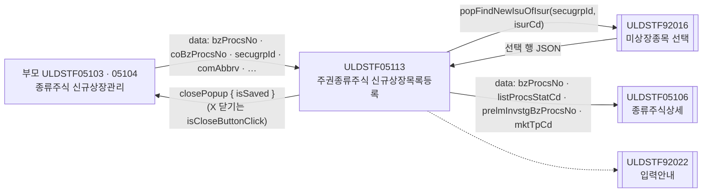
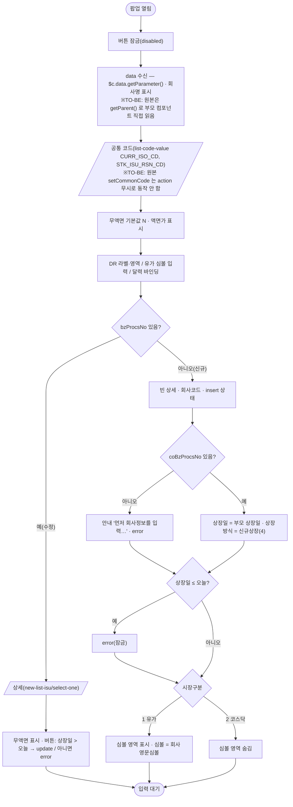
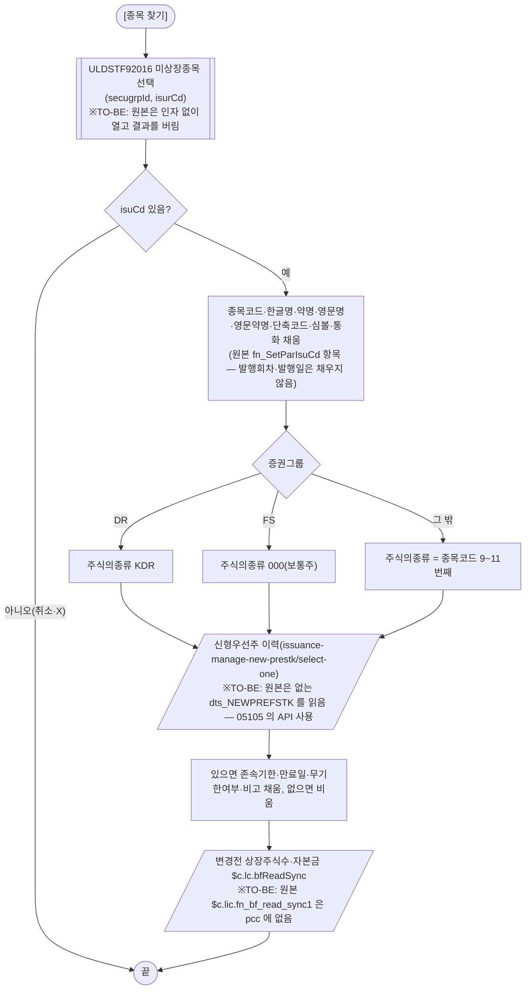
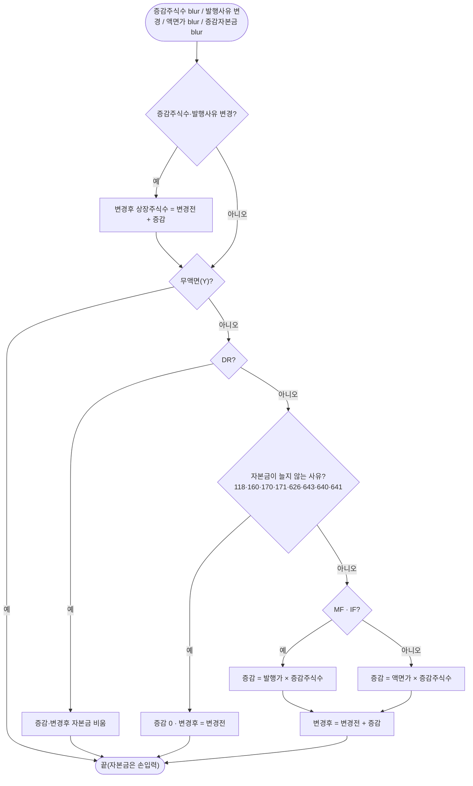
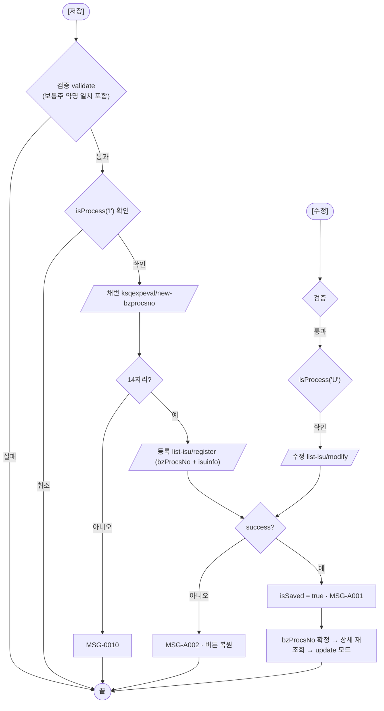
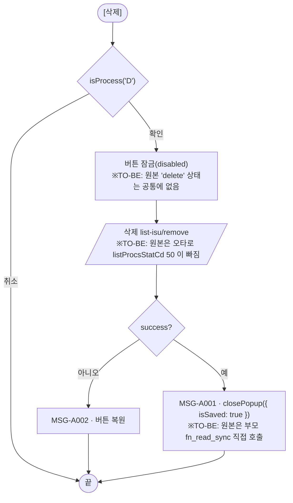
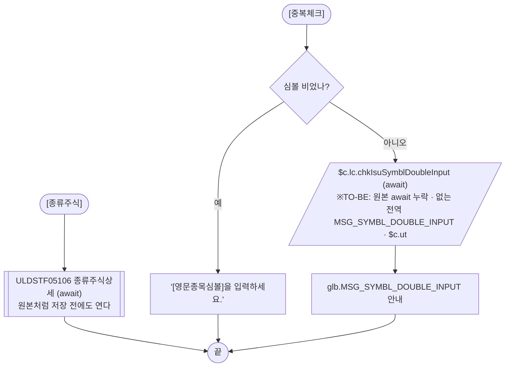
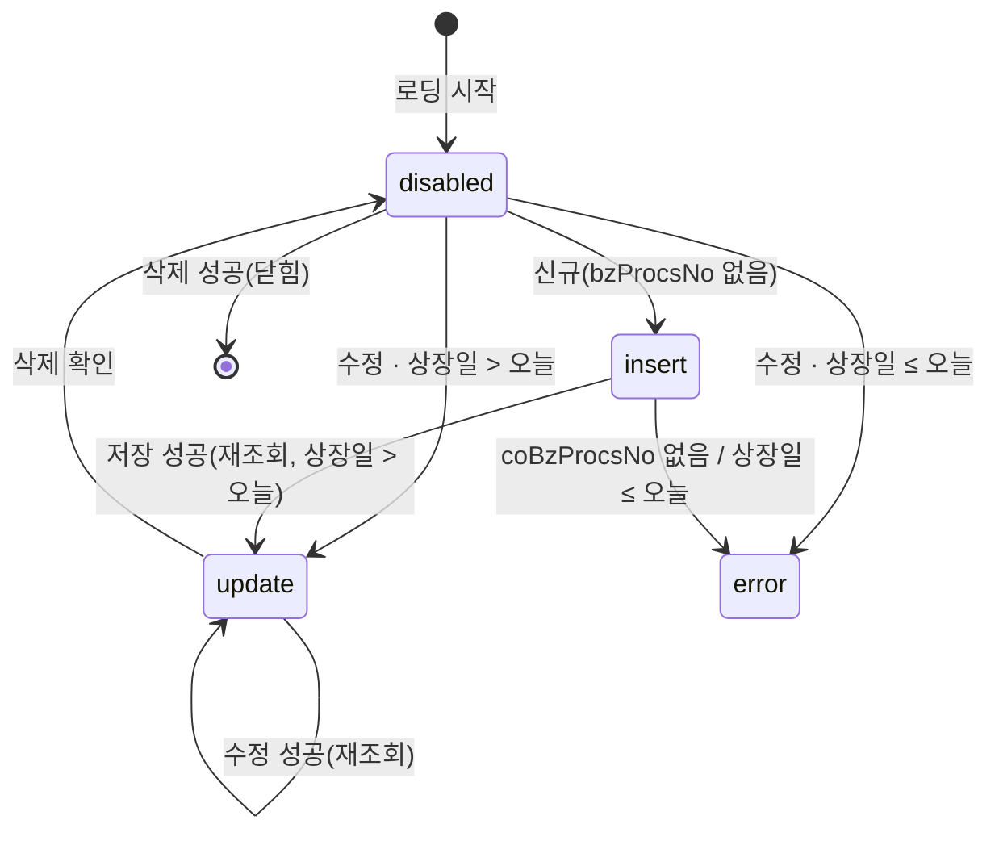

# ULDSTF05113 (팝업)주권종류주식 신규상장목록등록 — 업무 분석 및 전환 내역

| 항목 | 내용 |
|---|---|
| AS-IS 원본 | `ULDSTF05113.xml` — W-Craft 1차 변환본(`meta_asisFileNm="ULDSTF05113.gfm"`, 원본 gfm 은 저장소에 없음)에 **API 적용까지 마친 개발 사본**. 업무 로직은 이 스크립트와 남은 옛 코드 주석(`/KindStk.do?…`·`/Listing.do?…` 등)으로 분석했다. 반입 `conversion/conversion-front/ui/ULDSTF05113/ULDSTF05113.xml` |
| 신규 API 명세 | 없음 — **화면에 적용된 `/api/...` 경로·method·dataCollection keyInfo 를 명세로 간주**(사용자 결정 2026-10-29). §5 는 "화면 적용 API ↔ AS-IS(주석에 남은 옛 호출)" 대응표로 쓴다. `api_spec_check` 는 SKIP(A07·A08 형식 검사만) |
| 화면 캡처 | 없음 |
| 퍼블리싱 파일 | 화면 폴더 `ULDSTF05113.xml` 의 body(이미 퍼블리싱 반영됨)를 1단계 기준으로 했다(선례 ULDBNS30400 「캡처 없음, 기존 마크업 정비」). publish 원본 `conversion/publish/상장/상장처리(대내)/ULDSTF05113.xml` 은 참고만 했다 |
| TO-BE | `conversion/conversion-front/ui-tobe/ULDSTF05113.xml` (배포 경로 `/ui/lst/kindstk/ULDSTF05113.xml` — 부모의 원본 리터럴, 공통 계약서 §2) |
| 공통 계약서 | kindstk 13본 공통 계약서(작업 묶음 공유본) §2 「05105 / 05113」·§4 공통 결정 — 부모·하위 팝업과의 data·반환 키는 이 문서 기준 |
| 업무공통 | `$c.lc`(`popFindNewIsuOfIsur`·`bfReadSync`·`isProcess`·`chkIsuSymblDoubleInput`·`openDetailInputGuide`·`getSecuGrpNm`·`getGlbValue`)·`$c.stf`(`getMessageParam`·`checkMaxLength`) — `cm/pcc/stf`. 게이트는 `--pcc stf` |
| 작성 | Inswave / 2026-10-29 |

참고 양식: [websquare_gfm_conversion.md](../../../md/websquare_gfm_conversion.md) — §1.4 업무 프로세스 흐름, §6.5 getPar/setPar 전환. Gauce 대응은 [gfm_business_analysis_guide.md](../../../md/gfm_business_analysis_guide.md) 를 함께 따랐다. 짝 화면: ULDSTF05105(종류주식신규상장목록 — 같은 종목 상세 + 의무보유내역).

---

## 1. 화면 개요

상장 담당자가 **종류주식 신규상장관리(ULDSTF05103 주권 / ULDSTF05104 외국주권·DR)** 에서 회사를 정한 뒤, 신규상장할 **종목 1건**의 상세(종목코드·명칭·심볼, 상장일·발행일·발행회차, 주식의종류·발행사유, 액면가·발행가, 증감·변경후 상장주식수/자본금, 배당기산일, 우선주 존속기한)를 등록·수정·삭제하는 팝업이다. ULDSTF05105 와 같은 업무지만 의무보유내역이 없고, **보통주는 한글종목약명이 회사 약명과 같아야** 한다.

1. 부모가 회사·종목 키를 data 로 넘겨 연다. 종목 업무처리번호(`bzProcsNo`)가 없으면 신규, 있으면 수정이다.
2. 신규: 회사 업무처리번호(`coBzProcsNo`)가 없으면 "먼저 회사정보를 입력후 종목정보를 입력바랍니다." 를 안내하고 처리 버튼을 잠근다. 있으면 상장일(부모 값)·상장방식(신규상장 4)을 채운다. 유가(1)는 회사 영문심볼을 종목 심볼 기본값으로 둔다. 상장일이 오늘 이전이면 처리 버튼을 잠근다.
3. [종목 찾기]로 발행기관의 미상장종목(ULDSTF92016)을 고르면 종목 정보·주식의종류를 채우고, 신형우선주 이력과 변경전 상장주식수·자본금을 조회해 채운다.
4. 증감주식수·액면가·발행사유·증감 자본금을 바꾸면 변경후 상장주식수와 증감·변경후 상장자본금을 다시 계산한다(무액면이면 자본금은 계산하지 않는다).
5. [저장](신규)은 검증 → 확인 → 업무처리번호 채번 → 등록 순서로 처리하고, 성공하면 그 번호로 다시 조회해 수정 모드가 된다. [수정]·[삭제]는 상장일이 오늘 이후인 건만 할 수 있다. 삭제에 성공하면 팝업을 닫는다.
6. [종류주식]은 종류주식상세(ULDSTF05106)를 연다(원본처럼 저장 전에도 열린다).

### 1.1 호출 화면 (2본)

- `ULDSTF05103` 주권 종류주식 신규상장관리 — `fn_OpenKindStkDetailCorpIsu`(원본 `U/ULDSTF05103/ULDSTF05103.xml:865-888`, 1350×900)
- `ULDSTF05104` 외국주권·DR 종류주식 신규상장관리 — 같은 함수(`:839-862`, 1180×880). 공통 계약서는 **1350×900 으로 통일**을 권고한다.
- 원본은 data `{}` 로 열고, 이 팝업이 `$c.win.getParent()` 로 부모 컴포넌트·전역을 직접 읽었다. 저장 뒤에는 부모의 `fn_read_sync()` 를 불러 부모를 다시 조회했다(`fn_parentRefresh`).

### 1.2 호출 규약 (부모 → 이 화면) / 반환 규약

AS-IS 수신(원본 `init`·`fn_CheckForm`)과 TO-BE data 키(공통 계약서 §2 「05105 / 05113」):

| TO-BE 키 | 값(부모 05103/05104) | AS-IS 직접 접근 | 이 화면에서 |
|---|---|---|---|
| `bzProcsNo` | 선택 종목 행 업무처리번호, 신규 `""` | `parentWin.scwin.clickBzProcsNo` | **비면 신규**, 있으면 수정 |
| `coBzProcsNo` | 부모 `scwin.vBzProcsNo`(회사 업무처리번호) | `parentWin.scwin.vBzProcsNo` | 신규에서 비면 등록 불가 안내·잠금 |
| `secugrpId` | `sbx_secugrpId` | `parentWin.sbx_secugrpId` | DR·FS·MF·IF 분기 |
| `prelmInvstgBzProcsNo` | `dma_corpInfoRes.prelmInvstgBzProcsNo` | 동일 | 종류주식상세(05106)에 넘김 |
| `spotIsuTrdMktTpCd` | `sbx_spotIsuTrdMktTpCd`(1 유가 / 2 코스닥) | 동일 | 심볼 입력 |
| `isurCd` · `comNm` | `ibx_isurCd` · `ibx_comNm` | 동일 | 법인코드(명) 표시 |
| `listDd` | `cal_listDd` | `parentWin.cal_listDd` | 신규 상장일 기본값 |
| `listClssCd` | `sbx_listClssCd` | `parentWin.sbx_listClssCd` | 원본은 읽고 쓰지 않았다(상장방식은 늘 신규상장 4) — TO-BE 도 받지 않는다 |
| `isurSymbl` | `ibx_isurSymbl` | `parentWin.ibx_isurSymbl` | 유가 신규의 영문심볼 기본값 |
| `comAbbrv` | `dma_corpInfoRes.comAbbrv` | `parentWin.txb_COM_ABBRV` — 05103·05104 에 없는 id(§8 #4) | 보통주 약명 일치 검사 |

- 원본 `scwin.rowPos = parentWin.grd_issList.getFocusedRowIndex()` 와 저장 뒤 `parentWin.grd_issList.setFocusedCell(scwin.rowPos, 0)` 은 **부모가 자기가 기억한 행으로** 되돌린다(공통 계약서 §2) — 이 화면에서는 지운다.
- **반환**: `{ isSaved }`. 저장·수정·삭제에 한 번이라도 성공하면 `scwin.isSaved = true`. 삭제 성공은 `closePopup({ isSaved : true })` 로 바로 닫는다. 하단 [닫기]는 팝업 규칙으로 없앴으므로 그 밖의 닫기는 X 버튼(`{ isCloseButtonClick : true }`)이다.
- 부모 동작(부모 묶음 몫): `res?.isSaved === true || res?.isCloseButtonClick === true` 이면 상세(`fn_read_sync` 대응)를 다시 조회하고 `grd_issList` 행을 되돌린다.

```javascript
// 부모 ULDSTF05103 / 05104 (공통 계약서 §2)
const data = { bzProcsNo, coBzProcsNo : scwin.vBzProcsNo, secugrpId : sbx_secugrpId.getValue(),
               prelmInvstgBzProcsNo : dma_corpInfoRes.get("prelmInvstgBzProcsNo"),
               spotIsuTrdMktTpCd : sbx_spotIsuTrdMktTpCd.getValue(), isurCd : ibx_isurCd.getValue(), comNm : ibx_comNm.getValue(),
               listDd : cal_listDd.getValue(), listClssCd : sbx_listClssCd.getValue(), isurSymbl : ibx_isurSymbl.getValue(),
               comAbbrv : dma_corpInfoRes.get("comAbbrv") };
const res = await $c.win.openPopup("/ui/lst/kindstk/ULDSTF05113.xml", { id : "ULDSTF05113", popupName : "주권종류주식 신규상장목록등록", width : 1350, height : 900, frameModal : "top" }, data);
if (res?.isSaved === true || res?.isCloseButtonClick === true) await scwin.readSync();   // 행 포커스는 부모가 복원
```

### 1.3 이 화면이 여는 하위 팝업

| 팝업 | AS-IS 호출 | 넘기는 `data` (TO-BE) | 받는 결과 / 취소 판정 |
|---|---|---|---|
| `ULDSTF92016` 종목선택(발행기관의 미상장종목) | `img_ISU_CD_onclick` 이 `fn_GetPar/fn_SetPar` 를 `fn_GetParIsuCd/fn_SetParIsuCd` 로 바꿔 끼운 뒤 `$c.lc.popFindNewIsuOfIsur()` — **인자 없이 열고 결과를 버림**(§8 #5) | pcc 가 `{ secugrpId, isurCd }` 를 만든다 | 선택 행 JSON(`isuCd`·`isuSrtCd`·`isuNm`·`isuSnm`·`isuEngNm`·`isuEngSnm`·`isuEngSymbl`·`currIsoCd`) — 취소는 `isCloseButtonClick` 또는 `isuCd` 비어 있음 |
| `ULDSTF05106` 종류주식상세 | `btn_KIND_STK_DTL_onclick` — data 없이 1135×840 | `{ bzProcsNo, listProcsStatCd, prelmInvstgBzProcsNo, mktTpCd }` (공통 계약서 §2 「05106」) | 반환 없음(`await` 만) |
| `ULDSTF92022` 회사명/종목명 입력안내 | `$c.lc.openDetailInputGuide()` | 없음 | 없음 |

### 1.4 업무 프로세스 흐름

흐름은 AS-IS 동작을 기준으로 그렸다. `※TO-BE` 는 전환본에서 바뀌는 곳이다(근거는 §8).

| # | 업무 | 시작 (사용자 동작·진입 조건) | 끝 (결과) | 주요 함수 | 관련 절 |
|---|---|---|---|---|---|
| 1 | 진입·로딩 | 부모가 팝업을 엶(업무처리번호 유무로 신규/수정) | 입력 대기(모드별 버튼) | `scwin.onpageload` → `init` → `selectDetail` / `initNewForm` | §3, §5.1, §5.2 |
| 2 | 종목 찾기 | [종목 찾기] `img_ISU_CD` (신규 모드) | 종목 정보·존속기한·변경전 주식수/자본금 채움 | `openIsuPopup` → `selectNewPrefstk` → `$c.lc.bfReadSync` | §5.3, §6.5 |
| 3 | 자본금 자동 계산 | 증감주식수·액면가·증감자본금 입력 마침, 발행사유 변경 | 변경후 주식수·증감/변경후 자본금 갱신 | `calcAccIsuShrs`·`calcIsuCap`·`calcAccIsuCap` | §6.3 |
| 4 | 신규 저장 | [저장] (신규 모드) | 성공 안내 후 수정 모드로 재조회 | `save` → `selectNewBzProcsNo` → `saveTrs("I")` | §5.4, §5.5, §6.7 |
| 5 | 수정 | [수정] (수정 모드, 상장일 > 오늘) | 성공 안내 후 재조회 | `update` → `saveTrs("U")` | §5.5, §6.8 |
| 6 | 삭제 | [삭제] (수정 모드, 상장일 > 오늘) | 성공 안내 후 팝업 닫힘(`isSaved`) | `remove` → `saveTrs("D")` | §5.5, §6.9 |
| 7 | 종류주식상세 | [종류주식] | 05106 팝업이 닫힐 때까지 대기 | `openKindStkDetail` | §6.6 |
| 8 | 심볼 중복체크 | [중복체크] (유가) | 결과 문구 안내 | `checkSymbl` | §6.4 |

#### 화면 간 흐름



#### 업무 1: 진입·로딩



| 단계 | 내용 | AS-IS | TO-BE |
|---|---|---|---|
| 1 | 수신 | `parentWin.*` 직접 읽기 | `$c.data.getParameter()` 키(§1.2) |
| 2 | 공통 코드 | `fn_searchCode`(통화)·`fn_SetComboCode`(발행사유) 가 각각 `setCommonCode`(action 무시) | `dma_codReq` + `executeDynamic` 1회로 두 코드(공통 계약서 §4.5) |
| 3 | 신규 버튼 | Gauce `dts_Isu.reset()` → `OnLoadCompleted` 에서 insert 상태 | `applyButtonState()` 로 insert 후 조건별 error |

#### 업무 2: 종목 찾기



#### 업무 3: 자본금 자동 계산



#### 업무 4: 신규 저장 · 업무 5: 수정



#### 업무 6: 삭제



#### 업무 7: 종류주식상세 · 업무 8: 심볼 중복체크



#### 화면 모드 상태 전이



- `insert` = [저장]만, `update` = [수정]·[삭제](공통 `BTN_STATE_MAP` — 저장 제외 전부), `error`·`disabled` = 전부 잠금.

---

## 2. 화면 구성 및 데이터 정의

### 2.1 화면 구성

팝업 `pop_contents` > `pfmContentHeader`(공통 화면 머리) > 안내문 목록(`txt_list` ul/li — `label_45` 「항목 앞에 * 표시는 필수 항목 입니다.」, `label_42` 「상장자본금은 종목을 기준으로 기재 !!!」, `label_21` 「외국주의 금액단위는 나라별 통화 참조」) > 입력표 `panel_Item`(6열 colgroup/col, table/th/td/tr 구조, 안쪽 표 `panel_ISU_ENG_SYMBL`·`panel_PREFSTK`·`panel_PARVAL`·`panel_ISU_CAP`) > 하단 버튼 `grp_btnBox`.

| 영역 | 라벨 | AS-IS 요소 | TO-BE 컴포넌트 · 바인딩 | 비고 |
|---|---|---|---|---|
| 회사 | `label_1` 법인코드(명) | `txb_ISUR_CD`·`txb_COM_NM` | `txb_ISUR_CD` ← `dma_isuRes.isurCd`(읽기전용), `txb_COM_NM`(바인딩 없음 — data `comNm`) | |
| | `label_20` 통화표시 | `cmb_CURR_ISO_CD` (disabled) | ← `currIsoCd`, itemset `dlt_currIsoCd` | |
| 종목 | `label_59` 종목코드 | `txb_ISU_CD` + `img_ISU_CD` | ← `isuCd`(읽기전용) + [찾기] | 수정 모드에서 [찾기] 잠금 |
| | `label_2` 종목단축코드 | `txb_ISU_SRT_CD` | ← `isuSrtCd`(읽기전용) | |
| | `label_61` 한글종목명 · `label_56` (한글30자) | `txb_ISU_KOR_NM` | ← `isuKorNm` | |
| | 안내 `label_51`·`label_52`·`label_53` | 텍스트 | 그대로 | |
| | `label_62` 한글종목약명 · `label_57` | `txb_ISU_KOR_ABBRV` + `img_IsuNmGuide` | ← `isuKorAbbrv` + [종목명 입력기준안내] | 보통주는 회사 약명과 같아야 함 |
| | `label_74` 영문종목명 · `label_55` | `txb_ISU_ENG_NM` | ← `isuEngNm` | |
| | `label_14` 영문종목약명 · `label_54` | `txb_ISU_ENG_ABBRV` | ← `isuEngAbbrv` | |
| | `label_4` 종목심볼 (`panel_ISU_ENG_SYMBL`) | `txb_ISU_ENG_SYMBL` + `img_ISU_ENG_SYMBL` | ← `isuEngSymbl` + [중복체크] | 유가만 입력·버튼, 코스닥 신규는 영역 숨김 |
| 발행 | `label_3` 상장방식 | `cmb_LIST_METHD_TP_CD` (disabled, 4 신규상장) | ← `listMethdTpCd` | Gauce `item` 속성 삭제 |
| | `label_63` 발행회차 | `edt_ISU_RND` | ← `isuRnd` | |
| | `label_8` 존속기한 (`panel_PREFSTK`) · `label_9` 년 · `label_10` 월 · `label_11` 일 | `edt_PREFSTK_CONTIN_DEADLINE_YYS`·`edt_PREFSTK_CONTIN_DEADLINE_MM`·`edt_PREFSTK_CONTIN_DEADLINE_DYS` | ← `prefstkContinDeadlineYys`·`prefstkContinDeadlineMm`·`prefstkContinDeadlineDys` | |
| | `label_12` 만료일 | `edt_PREFSTK_END_DD`(readOnly) + `chk_INDEFINPD_YN` 무기한여부(`ref=""`) | ← `prefstkEndDd`, `chk_INDEFINPD_YN` ← `indefinpdYn` | 원본 체크박스는 바인딩이 없었다(§8 #9) |
| | [종류주식] | `btn_KIND_STK_DTL` | 그대로 | |
| | `label_64` 상장일 | `edt_LIST_DD` (readOnly) | ← `listDd` | |
| | `label_17` 주식의종류 | `cmb_STKCERT_KIND_CD` (disabled, 000·100~900·KDR·K01~K23) | ← `stkcertKindCd` | 중복 항목 `K17` 하나 삭제, Gauce `item` 속성 삭제 |
| | `label_65` 발행일 | `edt_ISU_DD` | ← `isuDd` | |
| | `label_5` 주식발행사유 | `cmb_STK_ISU_RSN_CD` (`ref="data:dts_STK_ISU_RSN_CD"` — 없는 객체) | ← `stkIsuRsnCd`, itemset `dlt_stkIsuRsnCd` | §8 #10 |
| | `label_6` 무액면주식 | `cmb_NPARVALSTK_YN` (N 아니요 / Y 예) | ← `nparvalstkYn` | |
| 금액 | `lb_PARVAL` 액면가/개별주당자본금 (`panel_PARVAL`) | `edt_PER1STK_CAP`·`edt_PARVAL` | ← `per1stkCap`·`parval` | 무액면 여부로 하나만 보임 |
| | `label_67` 발행가(원) | `edt_ISU_PRC` | ← `isuPrc` | |
| | `lb_BF_ACC_ISU_SHRS` 변경전 상장주식수 | `edt_BF_ACC_ISU_SHRS` (readOnly) | ← `bfAccIsuShrs` | DR 은 라벨이 DR수 |
| | `lb_ISU_SHRS` 증감주식수 | `edt_ISU_SHRS` | ← `isuShrs` | |
| | `label_69` 배당기산일_1 | `edt_DIV_RECK_DD1` | ← `divReckDd1` | 필수 |
| | `lb_ACC_ISU_SHRS` 변경후 상장주식수 | `edt_ACC_ISU_SHRS` (readOnly) | ← `accIsuShrs` | |
| | `label_70` 배당기산일_2 · `label_71` 배당기산일_3 · `label_72` 배당기산일_4 | `edt_DIV_RECK_DD2`·`edt_DIV_RECK_DD3`·`edt_DIV_RECK_DD4` | ← `divReckDd2`·`divReckDd3`·`divReckDd4` | |
| | `label_49` 변경전 상장자본금 (`panel_ISU_CAP`) | `edt_BF_ACC_ISU_CAP` (readOnly) | ← `bfAccIsuCap` | DR 은 영역 숨김 |
| | `label_68` 증감상장자본금 | `edt_ISU_CAP` | ← `isuCap` | |
| | `label_44` 변경후 상장자본금 | `edt_ACC_ISU_CAP` | ← `accIsuCap` | |
| 기타 | `label_73` 주금납입처 | `txb_SKTAMT_PAYLOC_NM` | ← `sktamtPaylocNm` | |
| | `label_75` 비고 | `txa_REMK` | ← `remk` | |
| 버튼 | 하단 | `grp_btnBox`: `btn_Close`·`btn_Delete`·`btn_Update`·`btn_Save` | [삭제]·[수정]·[저장] `btn_cm pt`(규칙 41 순서) | [닫기] 삭제(팝업 하단 닫기 금지) |

### 2.2 데이터 정의

| DataCollection | 종류 | 키 (camelCase, 화면 적용 keyInfo 기준) | 용도 |
|---|---|---|---|
| `dma_codReq` | dataMap | `codeList`(코드정보 List) | 공통 코드 요청(신설 — 공통 계약서 §4.5) |
| `dlt_currIsoCd` | dataList | `value`(코드값)·`text`(코드명) | 통화 콤보(신설) |
| `dlt_stkIsuRsnCd` | dataList | `value`·`text` (원본 name 이 `name1`·`name2` — 코드값·코드명으로 고침) | 주식발행사유 콤보(원본은 정의만 하고 바인딩·조회가 없었다) |
| `dma_isuReq` | dataMap | `bzProcsNo`(업무처리번호) | 상세 조회 요청 |
| `dma_isuRes` | dataMap | `bzProcsNo`(업무처리번호)·`isurCd`(회사코드)·`isuCd`(종목코드)·`prefstkTpCd`(우선주구분코드)·`stkcertIsuSeq`(주권발행일련번호)·`listDd`(상장일)·`stkcertKindCd`(주식종류)·`stkIsuRsnCd`(주식발행사유코드)·`listMethdTpCd`(상장방식유형코드)·`prefstkTpNm`(우선주구분)·`stkIsuRsnNm`(주식발행사유)·`stkcertKindNm`·`listMethdTpNm`(상장방식유형)·`isuDd`(발행일자)·`isuRnd`(발행회차)·`parval`(액면가)·`per1stkCap`(1주당자본금)·`isuPrc`(발행가격)·`isuShrs`(발행주식수)·`bfAccIsuShrs`(변경전 상장주식수)·`accIsuShrs`(변경후 상장주식수)·`isuCap`(자본금)·`bfAccIsuCap`(변경전 상장자본금)·`accIsuCap`(변경후 상장자본금)·`sktamtPaylocNm`(주금납입처명)·`divReckDd1`(배당기산일자1)·`divReckDd2`(배당기산일자2)·`divReckDd3`(배당기산일자3)·`divReckDd4`(배당기산일자4)·`stkcertMixFlowStrtDd`(주권혼용유통개시일자)·`stkcertMixFlowEndDd`(주권혼용유통종료일자)·`stkcertSinglFlowStrtDd`(주권단일유통개시일자)·`remk`(비고)·`prefstkIsuDd`(신형우선주상장일)·`prefstkDivRt`(우선주배당률)·`prefstkContinDeadlineYys`(우선주존속기한년수)·`prefstkContinDeadlineMm`(우선주존속기한개월)·`prefstkContinDeadlineDys`(우선주존속기한일수)·`prefstkEndDd`(우선주만료일자)·`indefinpdYn`(무기한여부)·`partctpYn`(참가형여부)·`acctpYn`(누적형여부)·`newprefstkRemk`·`filelawstDd`·`newstkRelLawstYn`(원본 name 이 `&quot;&quot;` 빈 문자열 — 신형우선주비고·소송제기일자·신주관련소송여부로 고침)·`isuKorNm`(종목명)·`isuEngNm`(종목영문명)·`isuKorAbbrv`(종목약어)·`isuEngAbbrv`(종목영문약어)·`isuEngSymbl`(종목영문심볼)·`isuSrtCd`(종목단축코드)·`draftYn`(기안여부)·`disclsYn`(공시여부)·`mktactYn`(시장조치여부)·`fnlEmpNm`(최종승인자)·`currIsoCd`(통화코드)·`corpbndIsuRnd`(사채발행회차)·`paidcapincIsuTpCd`(유상증자발행구분코드)·`sktamtPayDd`(주금납입일자)·`nparvalstkYn`(무액면여부)·**`listProcsStatCd`(상장처리상태코드 — 추가)** | 화면 바인딩 + 상세 조회 응답. `listProcsStatCd` 는 05106 에 넘기는 값이라 키를 더했다(§10 #5) |
| `dma_saveReq` | dataMap | `bzProcsNo`(업무처리번호)·`isuinfo`(주권 종류주식 신규상장관리 저장 요청 DTO, json). 원본 주석 키 `prtdepoInfo`(종류주식상세 저장 요청 DTO)는 이 화면에 의무보유가 없어 그대로 뺀다 | 등록·수정·삭제 요청 본문 |
| `dma_newprefstkReq` / `Res` | dataMap | 요청 `isuCd` / 응답 `isuCd`·`isuDd`·`prefstkDivRt`·`prefstkContinDeadlineYys`·`prefstkContinDeadlineMm`·`prefstkContinDeadlineDys`·`prefstkEndDd`·`indefinpdYn`·`newprefstkRemk` | 신형우선주 이력(신설 — 같은 업무 ULDSTF05105 의 정의에서 이 화면이 쓰는 키만, §10 #3) |

- AS-IS 변수 → TO-BE: `vBzProcsNo` → `scwin.bzProcsNo`, `vSecugrpID` → `scwin.secugrpId`, `vSPOT_ISU_TRD_MKT_TP_CD` → `scwin.mktTpCd`, `vPRELM_INVSTG_BZ_PROCS_NO` → `scwin.prelmInvstgBzProcsNo`, `TR_JOB` → `scwin.trJob`, `visuShrsLabelNm` → `scwin.isuShrsLabelNm`, `BTN_MAP` → 이름 유지, `rowPos` → 삭제(부모가 복원), `vScrenID`(`"ULDSTF92001.xml"` 잔재) → 삭제, `strCbd_NPARVALSTK_YN` → 콤보 choices(이미 있음), `fn_GetPar`·`fn_SetPar` → 삭제(§6.5), (신설) `scwin.comAbbrv`·`scwin.coBzProcsNo`·`scwin.isSaved`.

---

## 3. 로딩 (`scwin.onpageload` → `scwin.init`)

`scwin.onpageload` 는 `scwin.init()` 만 부른다(try/catch + `$c.exception.handleError`). `scwin.init` 단계:

1. 버튼 잠금 — `$c.util.setButtonState("grp_btnBox", "disabled", BTN_MAP)`.
2. data 수신(§1.2) — `coBzProcsNo`·`bzProcsNo`·`secugrpId`·`prelmInvstgBzProcsNo`·`spotIsuTrdMktTpCd`·`comAbbrv`, 회사명 `txb_COM_NM`.
3. 공통 코드 `selectCode`(통화·주식발행사유를 한 번에) → 무액면 기본값 `initNparval` — 콤보 목록이 상세 조회보다 먼저 있어야 바인딩 값이 표시되므로 `await`.
4. `setInitLabel`(DR 라벨·영역) · `setSymblComponent`(유가 심볼 입력).
5. 달력 검사 바인딩(규칙 37, 단일 달력 7개) — `edt_LIST_DD`·`edt_ISU_DD`·`edt_PREFSTK_END_DD`·`edt_DIV_RECK_DD1`·`edt_DIV_RECK_DD2`·`edt_DIV_RECK_DD3`·`edt_DIV_RECK_DD4` 에 `$c.date.checkCalendarFormat(…, "yyyyMMdd")`. 기간 쌍은 없다. 조회 버튼이 있는 `schbox`·`tbl_search` 영역이 없어 Enter 바인딩(규칙 22)은 해당 없음.
6. 모드 분기 — 수정: `selectDetail`. 신규: `initNewForm(param)`(§1.4 업무 1).

원본 `resizeToWin`(`$c.stf.MoveCenterOfParent`)·`buttonSet.set*Info`·`$c.libRoundPanel.PanelToGroupBox` 주석은 옮기지 않는다.

---

## 4. 컴포넌트 이벤트

| 컴포넌트 | AS-IS 이벤트 · 핸들러 | TO-BE 핸들러 | 동작 |
|---|---|---|---|
| `body` | `onpageload` / `onpageunload`(빈 함수) | `scwin.onpageload` | unload 는 빈 함수라 지움 |
| `img_ISU_CD` | onclick `img_ISU_CD_onclick` | `scwin.img_ISU_CD_onclick` → `openIsuPopup` | 업무 2 |
| `img_IsuNmGuide` | onclick | `scwin.img_IsuNmGuide_onclick` | `$c.lc.openDetailInputGuide()` |
| `img_ISU_ENG_SYMBL` | onclick | `scwin.img_ISU_ENG_SYMBL_onclick` → `checkSymbl` | 업무 8 |
| `edt_PARVAL` | OnKillFocus(`ev:onblur`) `edt_PARVAL_OnKillFocus` | `scwin.edt_PARVAL_onblur` | 업무 3 |
| `cmb_STK_ISU_RSN_CD` | OnSelChange(`ev:onchange`) `cmb_STK_ISU_RSN_CD_OnSelChange` | `scwin.cmb_STK_ISU_RSN_CD_onviewchange` | 사용자 변경에만 반응(조회 바인딩 때 재계산하지 않게) |
| `edt_ISU_SHRS` | OnKillFocus `edt_ISU_SHRS_OnKillFocus` | `scwin.edt_ISU_SHRS_onblur` | 업무 3 |
| `edt_ISU_CAP` | OnKillFocus `edt_ISU_CAP_OnKillFocus` | `scwin.edt_ISU_CAP_onblur` | 업무 3 |
| `cmb_NPARVALSTK_YN` | OnSelChange `cmb_NPARVALSTK_YN_OnSelChange` | `scwin.cmb_NPARVALSTK_YN_onviewchange` | 액면가/개별주당자본금 전환, 개별주당자본금 0(원본 그대로 — 05105 와 달리 DR 예외 없음) |
| `chk_INDEFINPD_YN` | oncheckboxclick `chk_INDEFINPD_YN_onclick` | `scwin.chk_INDEFINPD_YN_oncheckboxclick` | 존속기한·만료일 비움 |
| `btn_KIND_STK_DTL` | onclick | `scwin.btn_KIND_STK_DTL_onclick` | 업무 7 |
| `btn_Save` · `btn_Update` · `btn_Delete` | onclick | `scwin.btn_Save_onclick`·`btn_Update_onclick`·`btn_Delete_onclick` | 업무 4·5·6 |
| `btn_Close` | onclick `btn_Close_onclick` | (삭제) | 팝업 하단 닫기 금지 — X 로 닫음 |
| (없는 컴포넌트) | `btn_PREFSTK_END_DD_onclick`·`img_ISU_DD_onclick`·`img_DIV_RECK_DD1_onclick`·`img_DIV_RECK_DD2_onclick`·`img_DIV_RECK_DD3_onclick`·`img_DIV_RECK_DD4_onclick` (`popUpCalendar2`) | (삭제) | 달력은 `inputCalendar` 가 대신한다 |
| `dts_NEWPREFSTK`·`dts_DoubleChk`·`dts_BfData`·`dts_Isu`·`trs_Save` | `dts_NEWPREFSTK_OnLoadError`·`dts_DoubleChk_OnLoadError`·`dts_BfData_OnLoadError`·`dts_Isu_OnLoadError`·`trs_Save_OnFail` (데이터셋 객체를 alert) | (삭제) | 통신 실패는 `$c.sbm` 공통 처리 + `MSG-A002`(공통 계약서 §4.1) |
| `dts_Isu` OnLoadCompleted | `dts_Isu_OnLoadCompleted` | `scwin.applyButtonState` (+ 조회 뒤 `applyNparval`) | |
| `trs_Save` OnSuccess | `trs_Save_OnSuccess` | `scwin.saveTrs` 후처리 | |

---

## 5. 서버 통신

모든 통신은 `$c.sbm.executeDynamic` 이고, action 은 전체 경로 리터럴이다(규칙 38).

#### 화면 적용 API ↔ AS-IS 대응

| # | 용도 | 화면 적용 API (명세 대용) | method · 요청 → 응답 | AS-IS(주석에 남은 옛 호출) | TO-BE 함수 |
|---|---|---|---|---|---|
| 5.1 | 통화·주식발행사유 코드 | `/api/listing/common/code/list-code-value` | GET `ref dma_codReq`(`codeList="CURR_ISO_CD, STK_ISU_RSN_CD"`) → `dlt_currIsoCd=body.CURR_ISO_CD, dlt_stkIsuRsnCd=body.STK_ISU_RSN_CD` | 통화 `listCodeValueNameM`, 발행사유 `/CodeAction.do?method=listStkIsuRsnCd&LD_MKT_TP_CD=` | `selectCode` |
| 5.2 | 종목 상세 | `/api/listing/lstproc/kind/listing-review/new-list-isu/select-one` | GET `ref dma_isuReq` → `dma_isuRes=body` | `/KindStk.do?method=readKindStkIsuDtl&BZ_PROCS_NO=` | `selectDetail` |
| 5.3 | 신형우선주 이력 | `/api/listing/lstproc/stock/issuance-manage-new-prestk/select-one` (**ULDSTF05105 에 적용된 API**) | GET `ref dma_newprefstkReq` → `dma_newprefstkRes=body` | `/Listing.do?method=searchIsuIssChgList&DIV_IDX=DIV_IDX_ISS_NEWPREFSTK_STK_HIST&TRS_IDX=TRS_IDX_NEWSEL` | `selectNewPrefstk` |
| 5.3' | 변경전 주식수·자본금 | (pcc) `/api/listing/lstproc/newlist-isu/select-one-before-stkcert-isu` | `$c.lc.bfReadSync(종목, 상장일, 변경전주식수, 변경전자본금)` | `$c.lic.fn_bf_read_sync1(dts_BfData, …)` | `openIsuPopup` 안 |
| 5.4 | 채번 | `/api/listing/lstproc/ksqexpeval/new-bzprocsno` | GET → `responseJSON` | `$c.stf.fn_getNewBzProcNo(dts_BzProcsNo)` | `selectNewBzProcsNo` |
| 5.5 | 등록·수정·삭제 | `/api/listing/lstproc/kind/listing-review/stock/list-isu/register` · `/modify` · `/remove` | POST `ref dma_saveReq`(`bzProcsNo`·`isuinfo`) → 응답 정의 없음 | `/KindStk.do?method=saveKindStkIsu` + `JSP(I:pInput_1=dts_Isu)` | `saveTrs` |

#### 화면 적용 API ↔ AS-IS 차이 (→ §10)

- 5.1 주식발행사유: AS-IS 는 **시장별** 목록(`LD_MKT_TP_CD`)이었고 짝 화면 05105 는 `select-list-stock-isu-rsn?ldMktTpCd=` 를 쓴다. 이 화면에 적용된 API 는 공통 코드 `STK_ISU_RSN_CD`(시장 구분 없음)라 그대로 두되, 유가·코스닥 사유가 섞여 보일 수 있다(§10 #2).
- 5.3 이 화면에는 신형우선주 이력 API 가 적용되지 않았다(원본은 없는 `dts_NEWPREFSTK` 를 읽어 늘 오류) → 같은 업무·같은 원본 함수(`fn_nprefstk_read_sync`)인 05105 의 API 를 쓴다(§10 #3).
- 5.5 `isuinfo` = `dma_isuRes` 전체 + 원본 `fn_trs` 가 덧붙이던 `listBzTpCd`(LIST_BZ_TP_CD_100)·`isurCd`·`listProcsStatCd`(I 20 / U "" / D 50)·`spotIsuTrdMktTpCd`. 개발 사본은 이 값들을 `dma_isuRes.set()` 으로 넣었는데 keyInfo 에 없는 키라 실리지 않을 수 있고, 삭제는 오타(`vScrenPrsocTpCd`·`listProcStatCd`)로 50 이 빠졌다(§8 #7) → 평범한 객체로 합쳐 보낸다.
- 5.4 채번 응답 모양(문자열 / `{ bzProcsNo }`)이 확인되지 않았다 — 둘 다 받는다(§10 #4).
- 원본의 `SCREN_ID`·`SCREN_PROCES_TP_CD`(`SCREN_PROCS_TP_CD_02/03/04`) 는 화면 적용 API 에 없어 보내지 않는다.

### 5.1 공통 코드 (`scwin.selectCode`)
- 개발 사본의 `fn_searchCode`·`fn_SetComboCode` 는 `setCommonCode` 에 action 을 주었는데 공통이 무시한다(공통 계약서 §4.5). `cmb_STK_ISU_RSN_CD` 는 바인딩도 없는 객체(`dts_STK_ISU_RSN_CD`)를 가리켰다. TO-BE 는 한 번의 GET 으로 두 코드를 받고 itemset 으로 바인딩한다.

### 5.2 종목 상세 (`scwin.selectDetail`)
- 성공하면 무액면 표시(`applyNparval`) → 버튼 상태(`applyButtonState`). 원본 `fn_setCheckboxData(chk_INDEFINPD_YN, …)`(체크박스에 1/0)는 바인딩으로 대신한다.

### 5.3 신형우선주 이력 (`scwin.selectNewPrefstk`)
- 이력이 있으면(응답 `isuCd` 가 있으면) `prefstkIsuDd`(= 응답 `isuDd`)·`prefstkDivRt`·존속기한 3종·`prefstkEndDd`·`indefinpdYn`·`newprefstkRemk` 를 `dma_isuRes` 에 채우고, 없으면 비운다(원본 `dts_Isu.setCellData(1, "PREFSTK_*"/"NEWPREFSTK_REMK", …)`).

### 5.4 채번 (`scwin.selectNewBzProcsNo`)
- 개발 사본은 `result.responseJSON` 전체를 번호로 받고 `.length != 14` 로 검사했다(객체면 `length` 가 없어 늘 실패 — §8 #8). TO-BE 는 body 에서 번호를 꺼낸다(`getBzProcsNoOf`).

### 5.5 등록·수정·삭제 (`scwin.saveTrs(trJob, bzProcsNo)`)
- action 은 처리구분별 전체 경로 리터럴 삼항(규칙 38). 쿼리는 없다.
- 후처리: `skipped` 면 끝. `success` 가 아니면 `MSG-A002` 후 버튼 복원. 성공하면 `isSaved = true` → `MSG-A001` → 삭제는 `closePopup({ isSaved : true })`, 등록은 번호 확정, 등록·수정은 상세 재조회.
- 원본 성공 처리의 `fn_parentRefresh`·부모 그리드 행 포커스는 부모 몫으로 넘긴다(§1.2). 원본 삭제 뒤 `$c.win.closePopup()` 은 await 가 없었다.

---

## 6. 일반 함수

### 6.1 버튼 상태 (`scwin.applyButtonState`) — 원본 `dts_Isu_OnLoadCompleted` · `fn_initForm`
- 신규: [종목 찾기] 가능 + `insert`. 수정: [종목 찾기] 잠금 + 상장일 > 오늘이면 `update`, 아니면 `error`. 원본 `fn_initForm('C')` 는 아무것도 하지 않았고 `img_ISU_CD.src` 교체는 Gauce 잔재다.
- 증권그룹별 라벨(`scwin.setInitLabel` — 원본 `fn_setInitLabel`), 시장별 심볼(`scwin.setSymblComponent` — 원본 `fn_setSumblComponent`, `ReadOnlyBackgroundColor` 는 Gauce 속성이라 뺐다).

### 6.2 무액면 (`scwin.initNparval` · `scwin.applyNparval` · `scwin.isNparval` · `scwin.cmb_NPARVALSTK_YN_onviewchange`)
- 기본 N, 액면가 표시 + 개별주당자본금 숨김·0. 조회 결과가 Y 면 액면가 숨김·0 + 개별주당자본금 표시. 사용자가 바꾸면 보이는 칸만 바꾸고 개별주당자본금을 0 으로 둔다(원본 그대로). 원본 `dts_Isu_OnLoadCompleted` 의 표시 전환은 `applyNparval` 로 합쳤다.

### 6.3 자본금 계산 (`scwin.calcAccIsuShrs` · `scwin.calcIsuCap` · `scwin.calcAccIsuCap` · `scwin.isNoCapRsn`) — 원본 `calcuAccIsuShrs` · `calcusuCap` · `calcuAccIsuCap`
- §1.4 업무 3. 빈 값은 0 으로 본다(원본 `parseInt("")` 는 `NaN` — §8 #11).

### 6.4 심볼 중복체크 (`scwin.checkSymbl`)
- `await $c.lc.chkIsuSymblDoubleInput(심볼, 종목코드)` 후 `$c.lc.getGlbValue("MSG_SYMBL_DOUBLE_INPUT")` 를 안내한다. 원본은 await 없이 불렀고, 없는 전역 `MSG_SYMBL_DOUBLE_INPUT` 과 없는 `$c.ut.isEmpty` 를 읽었다(§8 #6).

### 6.5 종목 찾기 (`scwin.openIsuPopup`) — getPar/setPar → `openPopup` 반환값
- 원본은 `fn_GetParIsuCd`(arr[0] 증권그룹, arr[1] 회사코드)·`fn_SetParIsuCd`(대문자 `ISU_CD`… 키)를 바꿔 끼운 뒤 pcc `popFindNewIsuOfIsur()` 를 **인자 없이** 부르고 결과를 버렸다. TO-BE 는 `(secugrpId, isurCd)` 를 넘기고 반환 행 JSON(camelCase)으로 원본 `fn_SetParIsuCd` 가 채우던 항목(종목코드·한글명·약명·영문명·영문약명·단축코드·심볼·통화)만 채운다. 이어서 주식의종류, 신형우선주 이력(`await`), 변경전 주식수·자본금(`await $c.lc.bfReadSync`). 두 함수는 남기지 않는다(가이드 §6.5).

### 6.6 종류주식상세 (`scwin.openKindStkDetail`)
- 원본처럼 저장 전에도 연다(05105 와 달리 안내가 없다 — §10 #7). data 는 공통 계약서 §2 「05106」 키. 원본은 data 없이 열었고 05106 이 부모 전역을 직접 읽었다.

### 6.7 저장 (`scwin.save`) — 원본 `fn_save`
- 검증 → `isProcess("I")` → 채번(14자리 아니면 `MSG-0010`) → `dma_isuRes.bzProcsNo` 설정 → `saveTrs("I", 번호)`.

### 6.8 수정 (`scwin.update`) — 원본 `fn_update`
- 검증 → `isProcess("U")` → `saveTrs("U", bzProcsNo)`.

### 6.9 삭제 (`scwin.remove`) — 원본 `fn_delete`
- `isProcess("D")` → 버튼 `disabled` → `saveTrs("D", bzProcsNo)`.

### 6.10 입력 검증 (`scwin.validate`) — 원본 `fn_CheckForm`
- 순서·문구는 원본 그대로: 법인코드 → 상장방식 → 종목 → (종목단축코드 — 안내만, 진행) → 한글종목명(필수·60byte) → 한글약명(필수·30byte) → 영문종목명(필수·60byte) → 영문약명(필수·30byte) → 유가면 심볼(필수·중복) → 상장일(필수·오늘 이후) → 발행일 → 발행회차 → 주식의종류 → 주식발행사유 → MF·IF·DR 이 아니면 액면가 → 발행가 → 증감주식수 → DR 이 아니면 증감자본금·변경후 주식수(빈 값·0)·변경후 자본금(빈 값·0) → 배당기산일1 → **보통주(000)면 한글종목약명 = 회사 한글약명** → 무액면 Y 면 개별주당자본금이 발행가의 50% 이상 ~ 발행가 이하.
- 원본의 신규 중복 입력 검사(`fn_checkDoubleInput`, 주석)와 `fn_checkNumber`(본문이 주석뿐, 늘 true)는 옮기지 않는다.
- 공통 `$c.validate.validateDataCollect` 로 옮기지 않은 이유는 05105 §6.11 과 같다(조건부 필수·0 값·byte·서버 검사·비율·약명 비교가 섞여 순서·문구 유지).
- 보조: `scwin.getBzProcsNoOf` — 응답 body 에서 번호 추출. 원본 `fn_getCheckboxData`(Y/N)·`fn_setCheckboxData`·`fn_getCheckboxNprefStk`(부르는 곳 없음)는 바인딩으로 대신하거나 옮기지 않는다.

---

## 7. 업무 코드 · 메시지 목록

### 7.1 코드

| 코드 | 값 | 쓰는 곳 |
|---|---|---|
| 시장구분 `spotIsuTrdMktTpCd` | 1 유가 / 2 코스닥 | 심볼 입력 |
| 증권그룹 `SECUGRP_ID_DR` · `_FS` · `_MF` · `_IF` | `$c.lc.getGlbValue` | 라벨·자본금 계산·주식의종류·액면가 필수 |
| 주식의종류 | `KDR`(DR), `000` 보통주(FS·약명 일치 검사), 그 밖 종목코드 9~11번째 | 종목 찾기·검증 |
| 상장방식 `LIST_METHD_TP_CD_4` | 4 신규상장 | 신규 기본값 |
| 상장업무구분 `LIST_BZ_TP_CD_100` | 신규상장 | 저장 `listBzTpCd` |
| 상장처리상태 `listProcsStatCd` | I 20 / U "" / D 50 | 저장 |
| 자본금 불변 발행사유 | 유가 118·160·170·171 / 코스닥 626·643·640·641 | 자본금 계산 |
| 무액면 `nparvalstkYn` | N 아니요 / Y 예 | 액면가·개별주당자본금 전환 |
| 버튼 상태 | insert / update / error / disabled | `BTN_STATE_MAP` |

### 7.2 메시지

| 위치 | 문구 |
|---|---|
| 신규 진입 | 먼저 회사정보를 입력후 종목정보를 입력바랍니다. |
| 검증 | 05105 §7.2 의 검증 문구와 같고, 추가로 「보통주일경우 한글회사약명 과 종목약명이 동일해야 합니다. 확인하시기 바랍니다.」 |
| 심볼 | `glb.MSG_SYMBL_DOUBLE_INPUT`(pcc 가 채움) · [영문종목심볼]을 입력하세요. |
| 처리 | `MSG-A006`(isProcess 확인), `MSG-A001`(성공), `MSG-A002`(실패), `MSG-0010`(채번 실패) |

---

## 8. 원본 특이사항 · 결함

| # | 내용 | 결정 |
|---|---|---|
| 1 | 부모 컴포넌트·전역을 `$c.win.getParent()` 로 직접 읽음(`sbx_secugrpId`·`dma_corpInfoRes`·`cal_listDd`·`grd_issList` 등) | 고침(data 키, 공통 계약서 §2) |
| 2 | 저장 뒤 부모 `fn_read_sync` 직접 호출·부모 그리드 포커스 | 고침(`closePopup({ isSaved })`, 부모가 재조회·복원) |
| 3 | 삭제 중 `setButtonState(…, "delete", …)` 는 공통에 없는 상태 | 고침(`disabled`) |
| 4 | 보통주 약명 검사가 부모의 없는 id `txb_COM_ABBRV` 를 읽어 오류(05103·05104 에는 `dma_corpInfoRes.comAbbrv` 만 있음) | 고침(data `comAbbrv`) |
| 5 | 종목 찾기 — `popFindNewIsuOfIsur()` 를 인자 없이 열고 결과를 버림 | 고침(§6.5) |
| 6 | 심볼 검사 — async pcc await 누락, 없는 전역 `MSG_SYMBL_DOUBLE_INPUT`, 없는 `$c.ut.isEmpty` | 고침 — pcc 판정은 §10 #1 확인 |
| 7 | 저장 값을 keyInfo 에 없는 키로 `dma_isuRes.set()` · 삭제 분기의 오타 변수(`vScrenPrsocTpCd`·`listProcStatCd`)로 상태 50 누락 | 고침(평범한 객체로 합침, AS-IS 20/""/50) |
| 8 | 채번 결과 `result.responseJSON` 전체를 번호로 받아 길이 검사 | 고침(§5.4) |
| 9 | 무기한여부 체크박스 바인딩 없음(`ref=""`), `fn_setCheckboxData` 가 1/0 을 넣음 | 고침(`indefinpdYn` 바인딩) |
| 10 | 주식발행사유 콤보가 없는 객체 `dts_STK_ISU_RSN_CD` 를 ref 로 가리킴, 목록 조회도 동작 안 함 | 고침(`ref dma_isuRes.stkIsuRsnCd` + itemset) |
| 11 | 자본금 계산 `parseInt("")`·`parseFloat("")` 로 `NaN` | 고침(빈 값 0) |
| 12 | 신형우선주 이력 — 조회 없이 없는 `dts_NEWPREFSTK`·`dts_Isu` 를 읽음 | 고침(05105 API, §10 #3) |
| 13 | 변경전 주식수 — 없는 `$c.lic.fn_bf_read_sync1(dts_BfData, …)` | 고침(`$c.lc.bfReadSync`) |
| 14 | 종목단축코드가 비어도 안내만 하고 진행 | 유지(원본 동작) |
| 15 | DR·FS 의 소수 3자리 지정 `MaxDecimalPlace`(Gauce 속성) | 옮기지 않음(§10 #6) |
| 16 | 주식의종류 콤보에 `K17` 항목 중복 · `dma_isuRes` 키 3개의 name 이 `&quot;&quot;` | 고침 |
| 17 | `vScrenID = "ULDSTF92001.xml"`(다른 화면 이름)·`img_*`·`btn_PREFSTK_END_DD` 달력 핸들러(없는 컴포넌트)·`fn_checkNumber`(빈 검사) | 옮기지 않음 |
| 18 | 원본에 주석 처리된 `fn_initForm` 두 번째 정의 | 옮기지 않음 |

---

## 9. 전환 내역 (AS-IS → TO-BE)

| AS-IS | TO-BE | 비고 |
|---|---|---|
| `onpageload` · `init` | `scwin.onpageload` · `scwin.init` (+ `scwin.initNewForm`) | §3 |
| `onpageunload` | 삭제 | 빈 함수 |
| `fn_searchCode` · `fn_SetComboCode` | `scwin.selectCode` + `scwin.initNparval` | §5.1 |
| `resizeToWin` | 삭제 | |
| `fn_initForm` | `scwin.applyButtonState` 안 `img_ISU_CD.setDisabled` | |
| `fn_setSumblComponent` · `fn_setInitLabel` | `scwin.setSymblComponent` · `scwin.setInitLabel` | |
| `fn_GetParIsuCd` · `fn_SetParIsuCd` | 삭제 → `scwin.openIsuPopup` 반환값 처리 | §6.5 |
| `fn_bf_read_sync` | `$c.lc.bfReadSync`(openIsuPopup 안) | |
| `fn_nprefstk_read_sync` | `scwin.selectNewPrefstk` | |
| `fn_setCheckboxData` · `fn_getCheckboxData` · `fn_getCheckboxNprefStk` | 바인딩 / 삭제 | |
| `fn_read_sync` | `scwin.selectDetail` | |
| `fn_CheckForm` · `fn_checkNumber` | `scwin.validate` / 삭제 | §6.10 |
| `fn_save` · `fn_update` · `fn_delete` | `scwin.save`(+ `scwin.selectNewBzProcsNo`) · `scwin.update` · `scwin.remove` | |
| `fn_trs` · `trs_Save_OnSuccess` · `trs_Save_OnFail` | `scwin.saveTrs` | |
| `fn_parentRefresh` | 삭제 → `closePopup({ isSaved })` | §1.2 |
| `calcuAccIsuShrs` · `calcusuCap` · `calcuAccIsuCap` | `scwin.calcAccIsuShrs` · `scwin.calcIsuCap` · `scwin.calcAccIsuCap` (+ `scwin.isNoCapRsn`·`scwin.isNparval`·`scwin.applyNparval`) | |
| `edt_PARVAL_OnKillFocus` · `edt_ISU_SHRS_OnKillFocus` · `edt_ISU_CAP_OnKillFocus` | `scwin.edt_PARVAL_onblur` · `scwin.edt_ISU_SHRS_onblur` · `scwin.edt_ISU_CAP_onblur` | 규칙 3 |
| `cmb_STK_ISU_RSN_CD_OnSelChange` · `cmb_NPARVALSTK_YN_OnSelChange` | `scwin.cmb_STK_ISU_RSN_CD_onviewchange` · `scwin.cmb_NPARVALSTK_YN_onviewchange` | |
| `img_ISU_CD_onclick` · `img_IsuNmGuide_onclick` · `img_ISU_ENG_SYMBL_onclick` | 같은 이름 (+ `scwin.checkSymbl`) | |
| `chk_INDEFINPD_YN_onclick` | `scwin.chk_INDEFINPD_YN_oncheckboxclick` | |
| `img_ISU_DD_onclick` · `img_DIV_RECK_DD1_onclick`~`img_DIV_RECK_DD4_onclick` · `btn_PREFSTK_END_DD_onclick` | 삭제 | 없는 컴포넌트 |
| `dts_NEWPREFSTK_OnLoadError` · `dts_DoubleChk_OnLoadError` · `dts_BfData_OnLoadError` · `dts_Isu_OnLoadError` | 삭제 | |
| `dts_Isu_OnLoadCompleted` | `scwin.applyButtonState` | |
| `btn_Close_onclick` | 삭제 | 하단 [닫기] 금지 |
| `btn_KIND_STK_DTL_onclick` | 같은 이름 (+ `scwin.openKindStkDetail`) | |
| `btn_Save_onclick` · `btn_Update_onclick` · `btn_Delete_onclick` | 같은 이름(try/catch) | |
| (신설) | `scwin.getBzProcsNoOf` | 응답 번호 추출 |

- 게이트(2026-10-29): `gate_screen --pcc stf` OK · `scan_mixed_compare` A 1(`length !== 14` — 숫자끼리 비교, 의도) / B 0 · `publish_gate --before {1단계} --allow P20` OK(P22~P24 는 스크립트 전환으로 추가한 바인딩·핸들러·itemset) · `api_spec_check` SKIP(명세 없음, A07·A08 0) · `init_binding_check` OK · `wsxml_lint` 0/0 · `convert.py` 고정점.

---

## 10. 남은 작업 (TODO)

1. **pcc `chkSymblDoubleInput` 판정** — 응답 `cd` 가 종목코드와 다르면 중복으로 본다. 쓰지 않는 심볼도 중복으로 판정될 수 있어 유가 신규 저장이 막히는지 확인(원본은 await 누락으로 검사가 꺼져 있었다).
2. **주식발행사유 목록** — 이 화면 API 는 공통 코드 `STK_ISU_RSN_CD`(시장 구분 없음). AS-IS·05105 처럼 시장별(`select-list-stock-isu-rsn?ldMktTpCd=`)이어야 하는지 확인.
3. **신형우선주 이력 API** — 05105 에 적용된 `issuance-manage-new-prestk/select-one` 을 이 화면에서도 쓰는 것이 맞는지(응답 0건 모양 포함).
4. **채번·등록 응답 모양** — `ksqexpeval/new-bzprocsno` 와 `register` 응답 body 가 문자열인지 `{ bzProcsNo }` 인지, 등록 실패를 `success` 만으로 판정해도 되는지. 짝 화면 05105 는 다른 채번 경로(`chglisting/new-bzprocsno`)를 쓴다 — 같은 업무라 하나로 맞출지.
5. **`listProcsStatCd`** — 상세 조회 응답에 오는지(추가한 키). `isuinfo` 덧붙임 값(`listBzTpCd`·`listProcsStatCd`·`spotIsuTrdMktTpCd`)을 서버가 받는지.
6. **소수 자릿수** — DR·FS 의 액면가·증감자본금 소수 3자리 입력 제한 방식.
7. **종류주식상세 저장 전 열기** — 원본은 저장 전에도 열었다(05105 는 안내 후 멈춤). 맞출지.
8. **부모 05103·05104 계약** — data 키(§1.2, `comAbbrv` 포함)·크기(1350×900 통일 권고)·`isSaved` 재조회·행 복원은 부모 묶음이 맞춘다.
9. **배포 경로** — `/ui/lst/kindstk/ULDSTF05113.xml`(부모 원본 리터럴).
10. **publish 원본과의 차이** — 1단계는 화면 폴더 xml(개발 사본 body)을 기준으로 했다. 화면 캡처를 받으면 다시 대조한다.
