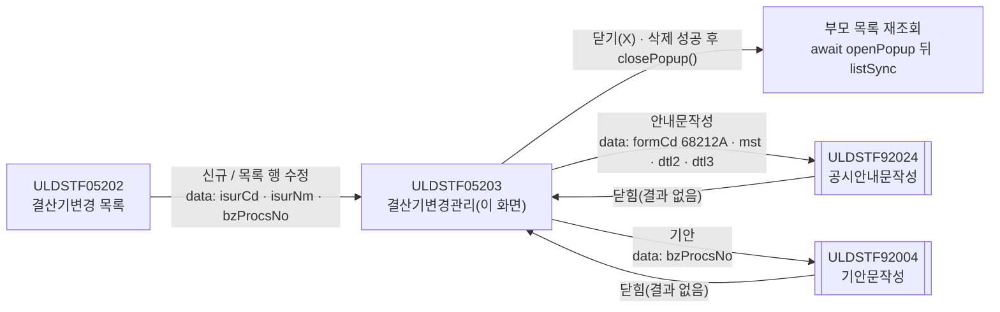
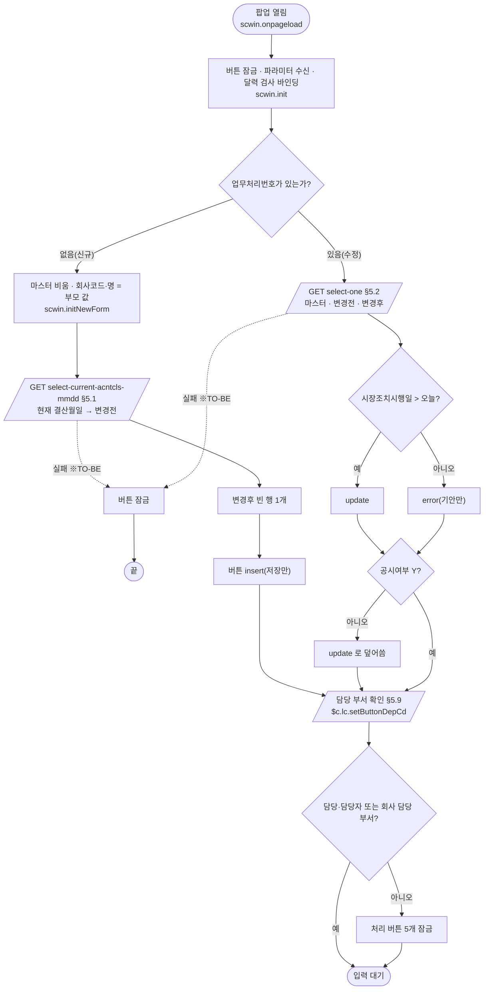
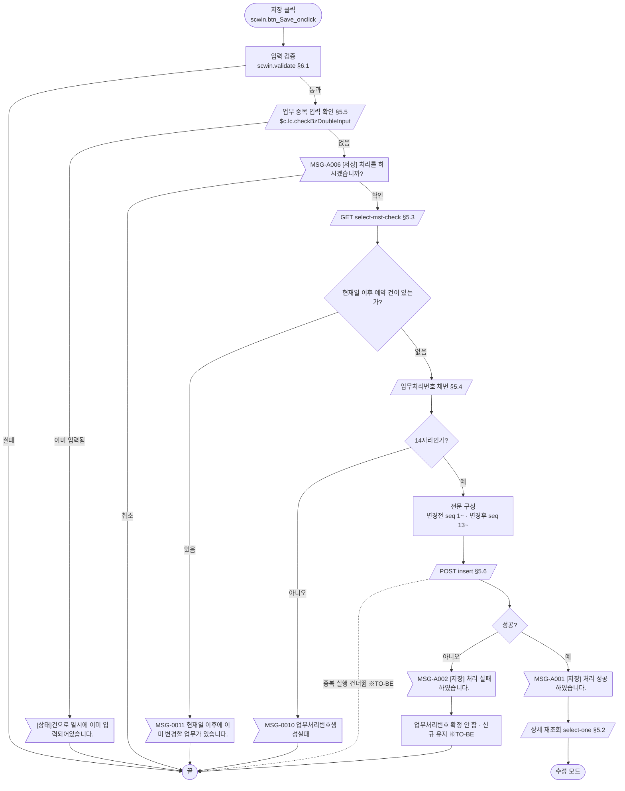
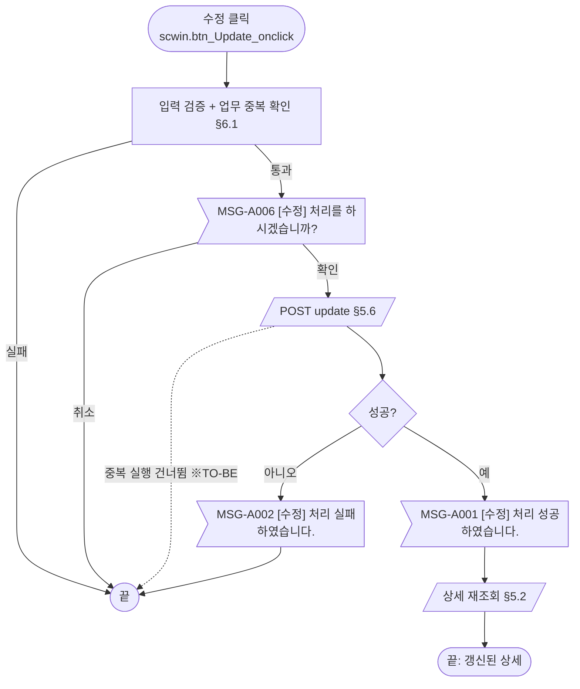
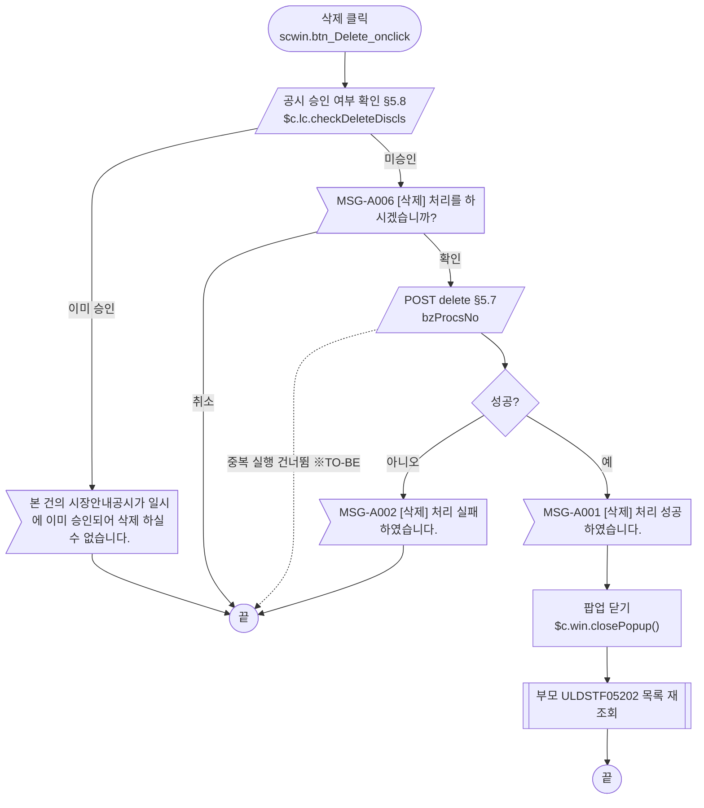
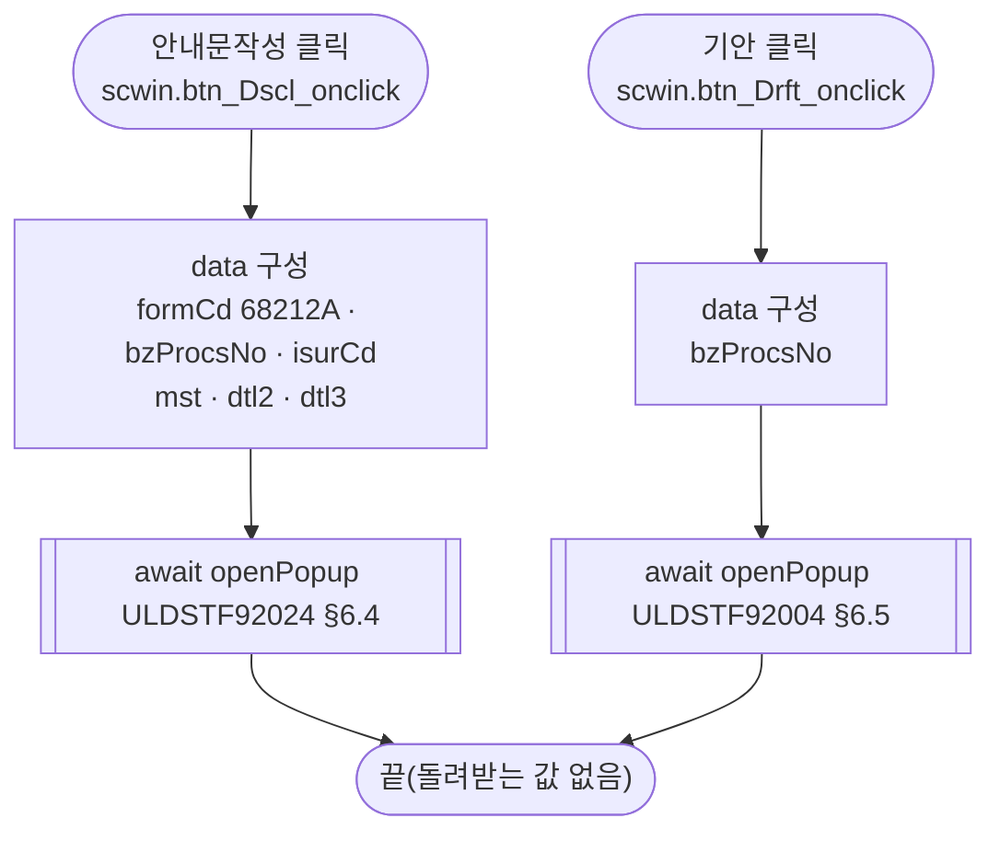
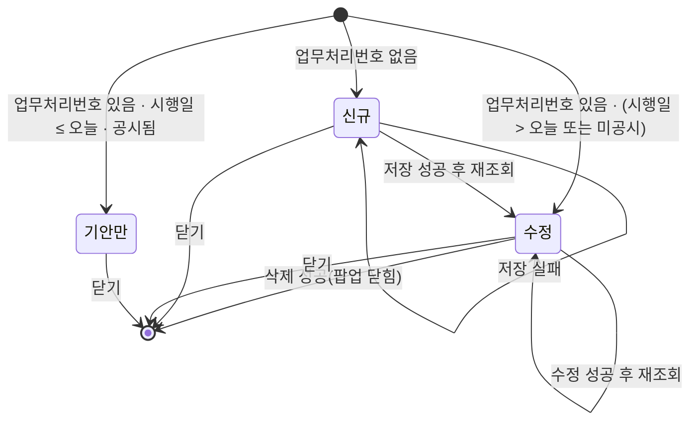

# ULDSTF05203 (팝업)결산기변경관리 — 업무 분석 및 전환 내역

| 항목 | 내용 |
|---|---|
| AS-IS | `/lstproc/ULDSTF05203.gfm` (Gauce/X-Internet, 610×380 모달 창 — 부모가 615×425 `window` 로 연다) — 반입 `conversion/conversion-front/ui/completed/ULDSTF05203/ULDSTF05203.gfm` |
| 신규 API 명세 | `conversion/conversion-front/ui/completed/ULDSTF05203/ULDSTF05203_API.md` — 블록 6종(모두 이 화면), 경로 `/api/listing/lstproc/stock/fiscal-year-change/…`. **명세 결함이 많다** — 3번 `select-one` 요청·응답이 다른 화면(ELW 행사가격 `dlt_experprc`) 것으로 붙어 있고, 2번 `select-mst-check` 응답이 상세 마스터(`dma_one`, `dtlBfList`·`dtlAfList` 포함)이며, 5·6번 요청 keyInfo 의 `id`·`name` 이 뒤섞였고, 6번 제목이 "삭제"(실제는 `update`)다. 처리 방침은 §5 「명세 ↔ AS-IS 차이」, 확인 요청은 §10 #1 |
| TO-BE | `conversion/conversion-front/ui-tobe/ULDSTF05203.xml` (배포 경로 `/ui/lst/lstproc/ULDSTF05203.xml` — 가정, §10 #11). 가이드 §13.2 대로 캡처 기준 퍼블리싱본(마크업 전용)을 먼저 만들고 그 위에 스크립트를 전환함 (2026-11-03) |
| 퍼블리셔 XML | 없음 (`conversion/publish` 에 ULDSTF05203 없음 — 부모 `ULDSTF05202.xml` 만 있음). 마크업은 캡처와 자매 화면 `ULDSTF05621`(분배기준일변경관리) TO-BE 를 기준으로 만들었다 |
| 화면 캡처 | `ULDSTF05203.png` (수정 모드 — 회사 09557, 변경전 12월31일·변경후 12월11일, 날짜·사유·기타 입력, [저장] 비활성·나머지 활성) — TO-BE 퍼블리싱 기준 |
| 업무공통 | `$c.lc`(`isProcess`·`checkBzDoubleInput`·`checkDeleteDiscls`·`setButtonDepCd`·`glb.LIST_BZ_TP_CD_231`)·`$c.stf`(`getNewBzProcNo`·`getMessageParam`·`setButtonSetWithDate`·`setButtonSetWithDate2`) — `cm/pcc/stf`. 게이트는 `--pcc stf` 로 돌린다 |
| 전환 규칙 | 컴포넌트 id 는 **전환 규칙 51**(2026-11-03, TO-BE 컴포넌트 종류로 접두)을 처음 적용한 화면 — `txb_`→`ibx_`, 날짜 `edt_`→`ica_`, 월일 `edt_`→`ibx_`, `cmb_`→`sbx_`, `panel_`→`grp_` (§2.1). 그리드가 없어 규칙 49·50 은 해당 없음, `fn_jongMok` 이 없어 규칙 52 도 해당 없음 |
| 작성 | Inswave / 2026-11-03 |

참고 양식: [websquare_gfm_conversion.md](../../../../md/websquare_gfm_conversion.md). Gauce 대응은 [gfm_business_analysis_guide.md](../../../../md/gfm_business_analysis_guide.md) §5·§6 을 함께 따랐다. 자매 화면 결과서 [ULDSTF05621.md](../ULDSTF05621/ULDSTF05621.md)(같은 `/fiscalYearChange.do` 업무, 분배기준일판)와 구조가 같고, 다른 점은 §1 끝에 모았다.

---

## 1. 화면 개요

상장 담당자가 **결산기변경 목록(ULDSTF05202)** 에서 회사를 고른 뒤, 상장법인의 **결산기(결산월일) 변경**을 신규 등록하거나, 등록한 건을 수정·삭제하는 팝업이다. 공시안내문을 작성하고 기안문을 띄우는 일도 이 화면에서 한다.

1. 부모가 회사(발행기관)와 업무처리번호를 넘겨 팝업을 연다. 업무처리번호가 없으면 신규, 있으면 수정이다.
2. 신규이면 그 회사의 **현재 결산월일**을 "변경전"에 채우고, "변경후"는 비워 둔다.
3. 변경후 월일, 변경일, 시장조치시행일, 변경 후 최초 사업연도(시작·종료일), 변경사유, 기타를 입력해 저장한다. 저장 전에 입력 검증(같은 업무 중복 입력 확인 포함), 확인, 현재일 이후 예약 건 확인, 업무처리번호 채번을 거친다.
4. 수정이면 업무처리번호로 마스터와 변경전·변경후를 조회한다. 시장조치시행일이 지났고 이미 공시된 건이면 기안만 할 수 있다.
5. 저장·수정에 성공하면 다시 조회하고, 삭제에 성공하면 팝업을 닫는다. 부모는 팝업이 닫히면 스스로 목록을 다시 조회한다.
6. 회사 담당 부서가 아닌 사용자는 처리 버튼이 모두 잠긴다.

**자매 화면 ULDSTF05621 과 다른 점**: 변경전·후가 그리드(월·일 여러 행)가 아니라 **월일 입력칸 하나씩**이다 / 저장 검증에 **업무 중복 입력 확인**(`fn_check_bz_doubleinput`)이 있다 / 삭제 전에 **공시 승인 여부 확인**(`fn_check_delete_discls`)이 있다 / 수정 모드 버튼에 **공시여부**(`setButtonSetWithDate2`)가 더해진다 / **부서별 버튼 잠금**(`setButtonDepCd`)이 있다 / 수정 때 "변경된 내용 없음" 확인이 없다 / 안내문 서식은 `68212A`, 넘기는 배열은 3칸이다.

### 1.1 호출 화면 (1본)

- `ULDSTF05202` 결산기변경 목록 — 퍼블리싱본 `conversion/publish/상장/상장처리(대내)/ULDSTF05202.xml`(W-Craft 1차 스크립트 포함, 아직 TO-BE 전환 전).
  - 신규(`fn_GetParNew`) / 목록 선택 행 수정(`fn_GetParUpdate`) 모두 `scwin.fn_newpre_create_frame` 에서 `CreateDialogFrame("DLG_FSCCHG", "../lstproc/ULDSTF05203.gfm", 제목, 200, 200, 615, 425, "window")`.
  - 창 제목: `$c.lc.getSecuGrpNm(증권그룹ID) + " 결산기변경관리"` (캡처: "주권 결산기변경관리").
  - 팝업이 닫히면 부모가 `fn_list_sync()` 로 다시 조회한다(모달 대기 전제).

### 1.2 호출 규약 (부모 → 이 화면) / 반환 규약

AS-IS 는 부모가 `fn_GetPar` 를 `fn_GetParNew`/`fn_GetParUpdate` 로 바꿔 두면, 팝업이 로딩 때 `frame.Provider("../").fn_GetPar(arrPar)` 로 불러 배열을 받는다.

| arr | TO-BE 키 (제안) | 의미 | 빈 값일 때 / 분기 |
|---|---|---|---|
| `arr[0]` | `isurCd` | 발행기관코드 | 신규 현재 결산월일 조회·예약 건 확인·저장 전문·부서 확인 |
| `arr[1]` | `isurNm` | 발행기관명 | 신규 회사명 표시 |
| `arr[2]` | `secugrpId` | 증권그룹ID | 이 화면에서는 쓰지 않음 |
| `arr[3]` | `mktId` | 시장구분코드 | 이 화면에서는 쓰지 않음 |
| `arr[4]` | `bzProcsNo` | 업무처리번호 | **비면 신규**, 있으면 수정 |
| `arr[5]` | `fiscyyDistrBasddTpCd` | 결산기분배기준일구분코드 | 부모는 항상 `"1"`(결산기). 화면은 이 값을 읽지 않고 신규 저장 때 `"1"` 을 직접 넣음(원본 변수명 `haltTpCd`) |

- **TO-BE** ([가이드 §6.5](../../../../md/websquare_gfm_conversion.md)): 부모는 `fn_GetPar` 바꿔 끼우기 없이 위 키의 객체를 `data` 로 넘기고, 이 화면은 `$c.data.getParameter()` 로 받는다. 부모(05202)가 전환 전이라 키 이름은 제안이다(§10 #6).

  ```javascript
  // 부모 ULDSTF05202 (신규: bzProcsNo "", 수정: 목록 선택 행의 업무처리번호)
  const data = { isurCd, isurNm, secugrpId, mktId, bzProcsNo, fiscyyDistrBasddTpCd : "1" };
  await $c.win.openPopup("/ui/lst/lstproc/ULDSTF05203.xml",
      { id : "DLG_FSCCHG", popupName : $c.lc.getSecuGrpNm(secugrpId) + " 결산기변경관리", width : 615, height : 425, type : "pageFramePopup" }, data);
  await scwin.listSync();   // AS-IS: CreateDialogFrame(…) 뒤 fn_list_sync() — 닫힌 뒤 재조회
  ```

- **반환**: 없음. 원본은 `frame.CloseFrame()` 만 한다 → TO-BE 는 `$c.win.closePopup()`(인자 없음).

### 1.3 이 화면이 여는 하위 팝업

| 팝업 | AS-IS 호출 (getPar/setPar) | 넘기는 `data` (TO-BE) | 받는 결과 (`closePopup`) / 취소 판정 |
|---|---|---|---|
| `ULDSTF92024` 공시안내문작성 (735×815) | `fn_GetPar` 바꿔 끼우기 → `arr[0..2]` + `CopyDataSet(dts_Mst/DtlBf/DtlAf → param_dts_mst/dts2/dts3)` → `frame.CreateDialogFrame(…, "window")` | `{ formCd : "68212A", bzProcsNo, isurCd, mst : [마스터], dtl2 : 변경전, dtl3 : 변경후 }` — §6.4 | 없음(원본 `fn_SetPar` 는 빈 함수) |
| `ULDSTF92004` 기안문작성 (888×730) | `fn_GetPar` 바꿔 끼우기 → `arr[0]` = 업무처리번호 → `fn_PopFindDraft()` | `{ bzProcsNo }` — §6.5 | 없음 |

### 1.4 업무 프로세스 흐름

흐름은 AS-IS 동작을 기준으로 그렸다. 점선과 `※TO-BE` 는 전환본에서 바뀌는 곳이다(근거는 §8).

| # | 업무 | 시작 (사용자 동작·진입 조건) | 끝 (결과) | 주요 함수 | 관련 절 |
|---|---|---|---|---|---|
| 1 | 진입·로딩 | 부모가 팝업을 엶 (업무처리번호 유무로 신규/수정) | 입력 대기 (모드·부서별 버튼) | `scwin.onpageload` → `scwin.init` → `scwin.initNewForm` / `scwin.selectOne` | §3, §5.1, §5.2 |
| 2 | 신규 저장 | [저장] (신규 모드) | 저장 성공 안내 후 수정 모드로 재조회 | `scwin.save` → `validate` → `checkMst` → 채번 → `saveTrs("I")` | §5.3~5.5, §6.1, §6.6 |
| 3 | 수정 | [수정] (수정 모드) | 수정 성공 안내 후 재조회 | `scwin.update` → `saveTrs("U")` | §5.6, §6.7 |
| 4 | 삭제 | [삭제] (수정 모드) | 삭제 성공 안내 후 팝업 닫힘 → 부모 재조회 | `scwin.remove` → `checkDeleteDiscls` → `deleteTrs` | §5.7, §5.8, §6.8 |
| 5 | 공시안내문작성 | [안내문작성] (수정 모드) | 92024 팝업에서 작성 후 닫힘 | `scwin.writeDscl` | §6.4 |
| 6 | 기안 | [기안] (수정 모드 — 시행일·공시 여부와 무관) | 92004 팝업에서 기안 후 닫힘 | `scwin.writeDraft` | §6.5 |

#### 화면 간 흐름



AS-IS 는 `fn_GetPar` 를 바꿔 끼우고 모달 창이 닫힐 때까지 기다렸다. TO-BE 는 모든 화살표가 `await $c.win.openPopup(url, options, data)` 이고 결과를 돌려받는 팝업은 없다(가이드 §6.5).

#### 업무 1: 진입·로딩



| # | 단계 | 주체 | 내용 | 분기 · 메시지 | 관련 절 |
|---|---|---|---|---|---|
| 1 | 파라미터 수신 | 화면 | `$c.data.getParameter()` → `isurCd`·`isurNm`·`bzProcsNo` | `bzProcsNo` 가 비면 신규 | §1.2, §3 |
| 2a | 신규 준비 | 화면·서버 | 마스터 빈 값 + 부모 회사, 현재 결산월일 조회 → 변경전, 변경후 빈 행 1개(원본 `dts_DtlAf OnLoadCompleted` 의 `AddRow`) | 조회 실패면 버튼 잠금(※TO-BE) | §5.1 |
| 2b | 수정 조회 | 서버 | AS-IS 는 같은 URL 을 `DIV_IDX` 0·1·2 로 **동기** 3회, TO-BE 는 `select-one` 1회 | 실패 시 버튼 잠금(※TO-BE) | §5.2 |
| 3 | 버튼 상태 | 화면 | 신규 `insert`. 수정은 `setButtonSetWithDate(시장조치시행일, false)` 뒤 `setButtonSetWithDate2(disclsYn)` | 시행일 ≤ 오늘이면 `error`(기안만), 그래도 미공시면 `update` | §4 |
| 4 | 부서 잠금 | 서버 | `$c.lc.setButtonDepCd(회사, 사용자, [버튼 5개])` — 원본 로딩 마지막 줄 | 담당·담당자가 아니고 회사 담당 부서가 아니면 잠금 | §5.9 |

#### 업무 2: 신규 저장



| # | 단계 | 주체 | 내용 | 분기 · 메시지 | 관련 절 |
|---|---|---|---|---|---|
| 1 | 입력 검증 | 화면 | 변경후 필수, 변경일 8자리, 시장조치시행일 익일 이후, 변경사유 필수, 기타 2000 byte | 각 안내 + 포커스 후 끝 | §6.1 |
| 2 | 업무 중복 확인 | 서버 | `$c.lc.checkBzDoubleInput(회사, 변경일, 업무처리번호, "231")` — 원본 `fn_CheckForm` 마지막 단계 | 이미 입력된 건이면 pcc 문구 후 끝 | §5.5 |
| 3 | 저장 확인 | 사용자 | `await $c.lc.isProcess("I")` | 취소면 끝 | §6.6 |
| 4 | 예약 건 확인 | 서버 | `select-mst-check` (AS-IS `fn_mst_check(dts_BZ_CHECK, "1")`) | 있으면 `MSG-0011` 후 끝. 응답 형식 확인 필요 | §5.3, §10 #4 |
| 5 | 채번 | 서버 | `$c.stf.getNewBzProcNo()` → `body` 를 문자열로 | 14자리 아니면 `MSG-0010` 후 끝 | §5.4, §10 #2 |
| 6 | 전문 구성 | 화면 | 마스터 값 + `fiscyyDistrBasddTpCd "1"` + 변경전·변경후 목록(일련번호·구분 부여) | — | §5.6 |
| 7 | 저장 | 서버 | `POST insert` | `skipped` 면 끝, 실패 `MSG-A002` + 신규 유지 | §5.6, §8 #6·#9 |
| 8 | 결과 반영 | 화면 | `MSG-A001` → 상세 재조회 → 수정 모드 버튼 | — | §5.2 |

#### 업무 3: 수정



- 원본 순서는 검증 → 확인 → 전송이다. 자매 화면(05621)과 달리 "변경된 내용이 없습니다" 확인이 없고, 예약 건 확인·채번도 하지 않는다.

#### 업무 4: 삭제



- 삭제는 입력 검증을 하지 않는다. AS-IS 는 데이터셋 3개를 그대로 보냈고, TO-BE 는 업무처리번호만 보낸다(명세).

#### 업무 5·6: 공시안내문작성 · 기안



- 안내문작성은 확인 메시지 없이 바로 연다(원본에 `fn_isProcess('DSCL')` 없음).
- 92024 가 `getParameter` 수신으로 바뀌기 전까지는 호환용 `scwin.getPar` 가 필요하다(§6.4, §10 #7).

#### 화면 모드 상태 전이



| 상태 | 활성 버튼 | 근거 |
|---|---|---|
| 신규 | 저장 | `insert` |
| 수정 | 수정 · 삭제 · 기안 · 안내문작성 | `update` |
| 기안만 | 기안 | `error` |
| (모든 상태) 담당 부서 아님 | 없음 | `setButtonDepCd` 가 5개를 잠금 |

---

## 2. 화면 구성 및 데이터 정의

### 2.1 화면 구성

컴포넌트 id 는 전환 규칙 51(TO-BE 컴포넌트 종류로 접두, 접두 뒤 camelCase)을 따른다.

| 영역 | AS-IS 요소 | TO-BE 컴포넌트 (바인딩) | 설명 |
|---|---|---|---|
| 1. 회사코드(명) | `txb_IsurCd`·`txb_IsurNm` (readonly) | `ibx_isurCd` · `ibx_isurNm` (`xf:input` readOnly, `dma_one.isurCd`·`isurNm`) | 읽기 전용 |
| 2. 결산기 변경내역 (머리) | `label_2` | 라벨만(입력 없음) | — |
| 가. 변경전(월) | `edt_BasMmDdBf` (readonly, 형식 `MM월DD일`, 4자리) | `ibx_basMmDdBf` (`xf:input` readOnly `displayFormat="##월##일"`, `dma_mmdd.basMmddBf`) | 신규: 현재 결산월일, 수정: 등록된 변경전. 날짜가 아닌 월일이라 `inputCalendar` 가 아님(규칙 51) |
| 나. 변경후(월) (*) | `edt_BasMmDdAf` (입력, 형식 `MM월DD일`, 4자리) | `ibx_basMmDdAf` (`xf:input` `allowChar="0-9" maxlength="4" displayFormat="##월##일"`, `dma_mmdd.basMmddAf`) | 필수 |
| 3. 변경일 (*) | `edt_ChgDd` + `img_ChgDd` | `ica_chgDd` (`inputCalendar`, `dma_one.chgDd`) | 달력 이미지 **(옮기지 않음)** — 내장 달력 |
| 4. 시장조치시행일 (*) | `edt_MktactEnforceDd` + `img_MktactEnforceDd`, `label_13` 안내 | `ica_mktactEnforceDd` (`dma_one.mktactEnforceDd`) + "(시스템 반영일자를 입력)" | 수정 모드 버튼 상태의 기준일 |
| 5. 변경 후 최초 사업연도 (*) | `edt_ChgStatDd`·`edt_ChgEndDd` + `img_ChgStatDd`·`img_ChgEndDd` | `ica_chgStatDd` (`dma_one.fiscyyChgStrtDd`) · `ica_chgEndDd` (`dma_one.fiscyyChgEndDd`) | 필수 표시가 있으나 원본은 검증하지 않음 — §8 #8 |
| 6. 변경사유 (*) | `cmb_FiscyyChgRsnCd` (고정 목록) | `sbx_fiscyyChgRsnCd` (`xf:select1`, `dma_one.fiscyyChgRsnCd`) | 1 임시주주총회에서 결의 / 2 정기주주총회에서 결의 / 9 기타 — §7 |
| 7. 기타 | `txa_Remk` | `txa_remk` (`xf:textarea`, `dma_one.remk`) | 2000 byte 제한 |
| 버튼 | `btn_Save`·`btn_Update`·`btn_Delete`·`btn_Drft`·`btn_Dscl`·`btn_Close` (이미지) | `btn_Drft`(기안)·`btn_Dscl`(안내문작성) · `btn_Delete`(삭제, pt)·`btn_Update`(수정, pt)·`btn_Save`(저장, pt) `xf:trigger` (`btnbox#grpBtnBox` 의 `rt` — 규칙 41 순서. 캡처의 저장·수정·삭제·기안·안내문작성 순서와 다름). `btn_Close` 는 **옮기지 않음** — 팝업 하단 닫기 금지 | 활성 상태는 `buttonSet` → `$c.util.setButtonState` — §4 |
| (장식) | `panel_Item` + `PanelToGroupBox`, 항목 라벨 `label_11`·`label_2`·`label_1`·`label_5`·`label_12`·`label_6`·`label_15`·`label_16`·`label_17`·`label_10`·`label_7`, 필수 표시 "*" `label_3`·`label_4`·`label_8`·`label_9`·`label_14` | `grp_item`(`tblbox`, 검증 범위) · 항목 라벨은 `th` 의 `w2:textbox` · 필수는 라벨 `class="req"` | 퍼블리싱 마크업이 대신함 |

### 2.2 데이터 정의

| AS-IS | TO-BE | 종류 | 키(컬럼) | 출처 / 용도 |
|---|---|---|---|---|
| `dts_Mst` (1행) | `dma_one` | dataMap | 명세 2번 블록의 응답 정의(`dma_one`) 그대로 — `bzProcsNo`, `isurCd`, `chgListMktactAdmNo`(number), `fiscyyDistrBasddTpCd`, `isurNm`, `comNm`, `chgDd`, `mktactEnforceDd`, `fiscyyChgRsnCd`, `fiscyyChgRsnNm`, `remk`, `fiscyyChgStrtDd`, `fiscyyChgEndDd`, `fiscyyStrt/End(Yy·Mm·Dd)`, `disclsYn`, `draftYn` (목록 키 `dtlBfList`·`dtlAfList` 는 아래 dataList 로) | 화면 바인딩·상세 조회 응답(§5.2 — 명세상 2번 블록에 붙은 정의를 3번 상세 조회 응답으로 본다, §10 #1). 저장 요청의 머리 값 |
| `dts_DtlBf` | `dlt_dtlBfList` | dataList | `bzProcsNo`, `bybzprocsSeq`(number), `isurCd`, `chgBfafTpCd`, `basMmdd` — **명세에 열 정의가 없어** 자매 화면(05621) 명세의 같은 목록 열과 AS-IS 저장 루프(`BZ_PROCS_NO`·`BYBZPROCS_SEQ`·`ISUR_CD`·`CHG_BFAF_TP_CD`·`BAS_MMDD`)로 정했다(§10 #1) | 신규: §5.1 응답에서 옮김 / 수정: `select-one` `body.dtlBfList` |
| `dts_DtlAf` | `dlt_dtlAfList` | dataList | (위와 같음) | 신규: 빈 행 1개 / 수정: `select-one` `body.dtlAfList` |
| (응답 전용) | `dlt_mmdd` | dataList | 명세 1번 응답 정의 그대로 — `basMmdd`(결산월일1), `basMmdd2`(결산월일2) | 신규 현재 결산월일. 명세 target 은 `dlt_listbasyymmdd=body` 로 정의 id 와 달라 정의 id 로 받는다(§10 #1) |
| (화면 전용) | `dma_mmdd` | dataMap | `basMmddBf`, `basMmddAf` | 변경전·후 월일 입력칸 바인딩. AS-IS binder 가 `dts_DtlBf`·`dts_DtlAf` 의 **현재 행**(1행) `BAS_MMDD` 를 잡던 것을 대신한다 — 조회 뒤 목록 첫 행 값을 넣고, 저장 때 변경후 값을 목록 첫 행에 되돌린다(§6.2) |
| `dts_BZ_CHECK` | `dma_bzCheck` | dataMap | `disclsProcsDdtm` | pcc `$c.lc.checkDeleteDiscls` 의 응답 자리(id 문자열로 넘김, §5.8). 업무 중복 확인·예약 건 확인은 응답을 직접 읽는다 |
| `dts_BzProcsNo` | (삭제) | — | — | 채번은 `$c.stf.getNewBzProcNo()` 반환값을 바로 쓴다 |
| `dts_ByCorpDepCd` | (삭제) | — | — | 부서 확인은 pcc `setButtonDepCd` 가 응답을 직접 읽는다 |
| `trs` | (삭제) | — | — | 저장·수정·삭제 통신 → `executeDynamic` |

- AS-IS 컬럼은 대문자다. TO-BE 키는 명세 camelCase 를 쓴다: `ISUR_CD→isurCd`, `ISUR_NM→isurNm`, `MKTACT_ENFORCE_DD→mktactEnforceDd`, `CHG_DD→chgDd`, `REMK→remk`, `FISCYY_CHG_RSN_CD→fiscyyChgRsnCd`, `FISCYY_CHG_STRT_DD→fiscyyChgStrtDd`, `FISCYY_CHG_END_DD→fiscyyChgEndDd`, `BAS_MMDD→basMmdd`, `BYBZPROCS_SEQ→bybzprocsSeq`, `CHG_BFAF_TP_CD→chgBfafTpCd`, `FISCYY_DISTR_BASDD_TP_CD→fiscyyDistrBasddTpCd`.
- 명세 2번 응답의 `dtlBfList`·`dtlAfList` 는 dataType 이 `text` 로 적혀 있으나 이름("변경전/후 결산기 목록")과 자매 화면 명세로 보아 배열이다 — `select-one` target 에서 dataList 로 나눠 받는다.

---

## 3. 로딩 (`gform onload` → `scwin.onpageload` → `scwin.init`)

원본 `gform onload` 순서(모든 조회는 **동기**):

1. **파라미터 수신** — AS-IS `frame.Provider("../").fn_GetPar(arrPar)` → `Isur_cd`·`Isur_nm`·`Secugrp_id`·`Mkt_id`·`fr_bz_procs_no`·`haltTpCd`. TO-BE `const param = $c.data.getParameter() ?? {};` → `scwin.isurCd`·`scwin.isurNm`·`scwin.bzProcsNo` (§1.2).
2. **버튼 매핑** — AS-IS `buttonSet.setSaveInfo(btn_Save, fn_save)` 등 5종. TO-BE 는 `ev:onclick`(§4) + 역할 매핑 `scwin.BTN_MAP = { save : "btn_Save", modify : "btn_Update", "delete" : "btn_Delete", draft : "btn_Drft", guide : "btn_Dscl" }`. 로딩 동안은 `disabled` 로 잠근다(※TO-BE — 조회가 예외로 끝나도 XML 기본값(전부 활성)이 남지 않게).
3. **신규·수정 분기** — 업무처리번호가 있으면 `await scwin.selectOne()`(§5.2), 없으면 `await scwin.initNewForm()`:
   1. `dma_one.setEmptyValue()`, `dma_mmdd.setEmptyValue()`, 목록 비우기. 회사코드·명은 부모 값.
   2. 현재 결산월일 조회 → `dlt_dtlBfList`(§5.1, 원본 `TRS_IDX_NEWSEL`).
   3. 변경후 빈 행 1개(원본 `dts_DtlAf OnLoadCompleted` 의 `AddRow`) → 월일 칸 표시(§6.2).
   4. 버튼 `insert` (원본 `dts_Mst OnLoadCompleted` 의 `buttonSet.setInsertStatus()`).
4. **회사코드·명** — AS-IS 는 조회 뒤 수정 모드에서도 `ISUR_CD`·`ISUR_NM` 을 부모 값으로 덮어쓴다. TO-BE 는 신규만 부모 값, 수정은 조회 응답(§8 #7).
5. `PanelToGroupBox(panel_Item)` — 삭제(퍼블리싱 마크업).
6. **부서 잠금** — `await $c.lc.setButtonDepCd(scwin.isurCd, $c.session.getUserInfo() ?? {}, [btn_Save, btn_Update, btn_Delete, btn_Drft, btn_Dscl])` (원본 마지막 줄 `buttonSet.setButtonDepCd(dts_ByCorpDepCd, Isur_cd, js_dep_cd)`). 버튼 상태를 정한 뒤에 둬야 잠금이 남는다.
7. **달력 검사 바인딩** (TO-BE 신설, 전환 규칙 37 — `scwin.init` 에서 1회) — 단일 달력 `ica_chgDd`·`ica_mktactEnforceDd` 는 `$c.date.checkCalendarFormat(…, "yyyyMMdd")`, 기간 쌍 「5. 변경 후 최초 사업연도」 `ica_chgStatDd`~`ica_chgEndDd` 는 `$c.date.compareFromToDate(…, ["최초 사업연도 시작일", "최초 사업연도 종료일"])`. AS-IS 는 시작·종료일 선후를 검사하지 않았다(§8 #8).

```javascript
scwin.onpageload = async function () {
    try {
        await scwin.init();
    } catch (ex) {
        await $c.exception.handleError(ex, { context : "ULDSTF05203.onpageload" });
    }
};

scwin.init = async function () {
    $c.util.setButtonState("grpBtnBox", "disabled", scwin.BTN_MAP);   // 1) 로딩 동안 잠금
    // 2) 파라미터 수신 · 달력 검사 바인딩 · 서버 현재일
    // 3) 신규 준비 또는 수정 조회
    // 4) 담당 부서가 아니면 처리 버튼 잠금 (원본 마지막 줄)
};
```

`onpageload` 는 `scwin.init()` 만 호출하고, 로딩 로직은 `scwin.init` 하나에 둔다(2026-10-26). 신규 준비는 5구역 `scwin.initNewForm`.

---

## 4. 컴포넌트 이벤트

| TO-BE 컴포넌트 | 이벤트 | TO-BE 핸들러 | 동작 (호출 함수) | AS-IS |
|---|---|---|---|---|
| `btn_Save` (저장) | `onclick` | `scwin.btn_Save_onclick` | `scwin.save()` — §6.6 | `buttonSet.setSaveInfo(btn_Save, fn_save)` |
| `btn_Update` (수정) | `onclick` | `scwin.btn_Update_onclick` | `scwin.update()` — §6.7 | `buttonSet.setUpdateInfo(btn_Update, fn_update)` |
| `btn_Delete` (삭제) | `onclick` | `scwin.btn_Delete_onclick` | `scwin.remove()` — §6.8 | `buttonSet.setDeleteInfo(btn_Delete, fn_delete)` |
| `btn_Dscl` (안내문작성) | `onclick` | `scwin.btn_Dscl_onclick` | `scwin.writeDscl()` — §6.4 | `buttonSet.setDsclInfo(btn_Dscl, fn_dscl)` |
| `btn_Drft` (기안) | `onclick` | `scwin.btn_Drft_onclick` | `scwin.writeDraft()` — §6.5 | `buttonSet.setDrftInfo(btn_Drft, fn_drft)` |
| `btn_Close` (닫기) | — | **(옮기지 않음)** | 팝업 창의 닫기(X)를 쓴다(팝업 하단 닫기 금지) | `frame.CloseFrame()` |
| `img_ChgDd`·`img_MktactEnforceDd`·`img_ChgStatDd`·`img_ChgEndDd` | `onclick` | **(옮기지 않음)** | inputCalendar 내장 달력 | `popUpCalendar2(edt_…)` |

**버튼 상태 (모드 × 버튼)**

| 상태 | 저장 | 수정 | 삭제 | 기안 | 안내문작성 | TO-BE |
|---|---|---|---|---|---|---|
| 신규 | O | | | | | `setButtonState("grpBtnBox", "insert", BTN_MAP)` |
| 수정 (시행일 > 오늘, 또는 미공시) | | O | O | O | O | `$c.stf.setButtonSetWithDate(ica_mktactEnforceDd, false, …)` → `update` / `setButtonSetWithDate2(disclsYn, …)` → `update` |
| 수정 (시행일 ≤ 오늘 · 공시됨) | | | | O | | `setButtonSetWithDate` → `error`, `setButtonSetWithDate2("Y")` 는 상태 유지 |
| 담당 부서 아님 | | | | | | `$c.lc.setButtonDepCd` 가 5개 `setDisabled(true)` |

- 닫기 버튼은 `BTN_MAP` 에 넣지 않는다. `insert` 의 활성 목록은 `["new", "save"]` — 이 화면에 `new` 가 없어 [저장]만 켜진다.

---

## 5. 서버 통신

공통: AS-IS 는 모든 URL 에 `SCREN_ID=ULDSTF05203.gfm`·`SCREN_PROCES_TP_CD`(01 조회 / 02 입력 / 03 수정 / 04 삭제)를 붙이고, 저장 `trs.Action` 은 `fn_encodeNSession` 으로 세션 정보를 붙인다. 명세에는 없으므로 **TO-BE 는 넘기지 않는다**(§10 #10). 모든 통신은 응답을 쓰기 전에 `if (result?.skipped) return;` 을 둔다. 통신 함수는 4구역이다.

| # | 용도 | AS-IS | TO-BE |
|---|---|---|---|
| 5.1 | 신규: 현재 결산월일 | `/fiscalYearChange.do?method=searchFiscalYearChange&DIV_IDX=1(DTL_FSC_BF)&TRS_IDX=4(NEWSEL)&ISUR_CD=` → `dts_DtlBf` | `GET …/select-current-acntcls-mmdd` (`isurCd`) |
| 5.2 | 수정: 상세 조회 | `fn_read_sync` — 같은 URL `DIV_IDX` 0(FSC_MST)·1(DTL_FSC_BF)·2(DTL_FSC_AF) 로 3번 → `dts_Mst`·`dts_DtlBf`·`dts_DtlAf` | `GET …/select-one` (`bzProcsNo`) 1번 |
| 5.3 | 예약(미래일자) 중복 확인 | `fn_mst_check(dts_BZ_CHECK, "1")` (공통, `GUBUN_CD=1`) | `GET …/select-mst-check` (`isurCd`) |
| 5.4 | 채번 | `fn_getNewBzProcNo(dts_BzProcsNo)` | `$c.stf.getNewBzProcNo()` (`GET /api/listing/lstproc/stock/chglisting/new-bzprocsno`) |
| 5.5 | 업무 중복 입력 확인 | `fn_check_bz_doubleinput(dts_BZ_CHECK, 회사, 변경일, 업무처리번호, LIST_BZ_TP_CD_231)` | `$c.lc.checkBzDoubleInput(…, "231")` (`GET …/stock/chglisting/check-double-input`) |
| 5.6 | 신규 저장 / 수정 | `trs` `/fiscalYearChange.do?method=saveFiscalYearChange` `TRS_IDX=1/2` `KeyValue: dtsParm1=dts_Mst, dtsParm2=dts_DtlAf, dtsParm3=dts_DtlBf` | `POST …/insert` · `POST …/update` |
| 5.7 | 삭제 | 같은 `trs` `TRS_IDX=3` (데이터셋 3개 전송) | `POST …/delete` (`bzProcsNo`) |
| 5.8 | 삭제 가능(공시 승인) 확인 | `fn_check_delete_discls(dts_BZ_CHECK, 업무처리번호)` | `$c.lc.checkDeleteDiscls("dma_bzCheck", bzProcsNo)` (`GET /api/listing/common/discls/select-procs-ddtm`) |
| 5.9 | 담당 부서 확인 | `buttonSet.setButtonDepCd(dts_ByCorpDepCd, Isur_cd, js_dep_cd)` | `$c.lc.setButtonDepCd(isurCd, userInfo, [버튼])` (`GET /api/listing/common/stock/select-corp-dep-cd`) |

(`…` = `/api/listing/lstproc/stock/fiscal-year-change`)

#### API 명세 대응 (`ULDSTF05203_API.md`)

| # | 명세 블록 | method · 경로 | 요청 (명세) | 응답 (명세) | AS-IS 대응 | TO-BE 함수 |
|---|---|---|---|---|---|---|
| 1 | 신규 등록 시 현재 결산월일 조회 | `GET …/select-current-acntcls-mmdd` | `isurCd` | `dlt_mmdd` (`basMmdd`·`basMmdd2`), target `dlt_listbasyymmdd=body` | `fn_new_onload` | `scwin.selectCurrentMmdd` → `dlt_mmdd` → `dlt_dtlBfList` |
| 2 | 예약(미래일자) 등록 중복 체크 | `GET …/select-mst-check` | `isurCd` | `dma_one` (상세 마스터 정의 + `dtlBfList`·`dtlAfList`), target `dma_one=body` | `fn_mst_check` | `scwin.checkMst` |
| 3 | 상세 조회(마스터 + 변경전/후 결산기) | `GET …/select-one` | `basYymm`·`rghtTpCd` (**다른 화면 것**) | `dlt_experprc` (**다른 화면 것** — ELW 행사가격) | `fn_read_sync` | `scwin.selectOne` — 요청 `bzProcsNo`, 응답은 2번 블록 정의(`dma_one`) |
| 4 | 삭제 | `POST …/delete` | `bzProcsNo` | (없음) | `fn_delete` | `scwin.deleteTrs` |
| 5 | 신규 저장 | `POST …/insert` | `dma_in` (keyInfo 의 id·name 이 뒤섞임 — 읽으면 `bzProcsNo`, `isurCd`*, `chgDd`(변경일)*, `mktactEnforceDd`*, `fiscyyChgRsnCd`*, `remk`(기타), 최초 사업연도 시작·종료일, 변경전·변경후 결산기 목록) | (없음) | `fn_save` → `fn_save_trs` | `scwin.saveTrs("I")` |
| 6 | 수정 (블록 제목은 "삭제") | `POST …/update` | 5 와 같음 | (없음) | `fn_update` → `fn_save_trs` | `scwin.saveTrs("U")` |

명세에 없는 AS-IS 통신: 채번(§5.4), 업무 중복 확인(§5.5), 삭제 가능 확인(§5.8), 담당 부서 확인(§5.9) → 모두 업무공통(pcc) 함수.

#### 명세 ↔ AS-IS 차이 (→ §10)

| # | 차이 | 처리 | §10 |
|---|---|---|---|
| 1 | 3번 `select-one` 의 요청(`basYymm`·`rghtTpCd`)·응답(`dlt_experprc` 패리티 행사가격)이 다른 화면(ELW) 것이다 | 요청은 AS-IS 대로 `{ bzProcsNo }`, 응답은 2번 블록의 `dma_one` 정의(마스터 + `dtlBfList`·`dtlAfList`)로 본다. target `dma_one=body, dlt_dtlBfList=body.dtlBfList, dlt_dtlAfList=body.dtlAfList` | #1 |
| 2 | 2번 `select-mst-check` 응답이 상세 마스터 정의(`dma_one`)다. 자매 화면(05621) 같은 API 는 `boolean` | 둘 다 받는다 — 응답이 `true`/`"true"` 이거나, 객체이면서 `bzProcsNo` 가 있으면(예약 건 레코드) "예약 건 있음" | #4 |
| 3 | 1번 target(`dlt_listbasyymmdd`)이 정의 id(`dlt_mmdd`)와 다르다. 응답은 한 행에 결산월일 두 개(`basMmdd`·`basMmdd2`) | 정의 id `dlt_mmdd` 로 받고, 변경전 목록은 `basMmdd`(있으면 `basMmdd2` 도 둘째 행)로 만든다. 화면은 첫 행만 표시(AS-IS binder 도 현재 행 1개) | #1 |
| 4 | 5·6번 요청 keyInfo 가 깨져 있다(`id` 자리에 "변경일"·"기타", `name` 자리에 `mktactEnforceDd *` 등). 목록 열 정의가 없다 | 위 읽기대로 키를 골라 보낸다(마스터 값 + `fiscyyDistrBasddTpCd` + 목록 2개). 목록 열은 자매 화면 기준(§2.2) | #1 |
| 5 | 저장·삭제 응답 정의가 없다(자매 화면은 `result`·`resultMessage`) | `success` 로만 판정. 응답에 `resultMessage` 가 오면 실패 안내에 쓴다 | #5 |
| 6 | AS-IS 가 보내던 `LIST_BZ_TP_CD=231`·`DIV_IDX`·`COUNT`·`TRS_IDX` 는 요청에 없다 | 보내지 않음(API 경로로 대체). `LIST_BZ_TP_CD` 는 서버가 정하는 것으로 본다 | #3 |
| 7 | AS-IS 공통 파라미터 `SCREN_ID`·`SCREN_PROCES_TP_CD`·세션이 명세에 없다 | 보내지 않음 | #10 |
| 8 | 명세에만 있는 키(`chgListMktactAdmNo`·`comNm`·`fiscyyChgRsnNm`·`fiscyyStrt/End(Yy·Mm·Dd)`·`draftYn`) | 정의에 두되 화면에 표시하지 않음. `disclsYn` 은 버튼 상태에 쓴다 | — |

### 5.1 현재 결산월일 조회 (`scwin.selectCurrentMmdd`)

| 항목 | 내용 |
|---|---|
| `id` | `sbm_selectCurrentMmdd` |
| `method` / `action` | `get` / `…/select-current-acntcls-mmdd` |
| `requestData` | `{ isurCd : scwin.isurCd }` |
| `target` | `dlt_mmdd=body` — 명세 target `dlt_listbasyymmdd` 는 정의 id 와 달라 정의 id 로(§5 차이 #3) |
| 후처리 | `dlt_mmdd` 각 행의 `basMmdd`(·`basMmdd2`)를 `dlt_dtlBfList` 행으로 옮긴다(`scwin.toBfRows`) |
| 실패 처리 | `skipped` 면 false, `success:false` 면 "현재 결산월일을 조회하지 못했습니다." 안내(※TO-BE) 후 false — `initNewForm` 은 버튼을 잠근다(변경전이 빈 채로 저장되지 않게) |
| 중복 실행 | 기본(건너뜀) |

### 5.2 상세 조회 (`scwin.selectOne`)

| 항목 | 내용 |
|---|---|
| `id` | `sbm_selectOne` |
| `method` / `action` | `get` / `…/select-one` |
| `requestData` | `{ bzProcsNo : scwin.bzProcsNo }` — 명세 요청(`basYymm`·`rghtTpCd`)은 다른 화면 것(§5 차이 #1) |
| `target` | `dma_one=body`, `dlt_dtlBfList=body.dtlBfList`, `dlt_dtlAfList=body.dtlAfList` |
| 후처리 | ① 변경후가 0행이면 빈 행 1개 ② 월일 칸 표시(§6.2) ③ 버튼 `setButtonSetWithDate(ica_mktactEnforceDd, false, …)` → `setButtonSetWithDate2(disclsYn, …)` (원본 `dts_Mst OnLoadCompleted`) |
| 실패 처리 | `success:false` 면 버튼을 모두 잠근다 — 저장 뒤 재조회 실패에서 신규 상태([저장] 활성)가 남아 같은 건을 다시 저장하지 않게 |
| 중복 실행 | 기본(건너뜀) |

### 5.3 예약(미래일자) 중복 확인 (`scwin.checkMst`)

| 항목 | 내용 |
|---|---|
| `id` / `method` / `action` | `sbm_checkMst` / `get` / `…/select-mst-check` |
| `requestData` | `{ isurCd : scwin.getIsurCd() }` — 원본 `GUBUN_CD=1`(결산기)은 명세에 없음 |
| Return | `Promise<Boolean>` — 진행해도 되면 true |
| 후처리 | 응답 `body` 가 `true`/`"true"` 이거나, 객체이고 `bzProcsNo` 가 있으면 `MSG-0011` 안내 후 false (§5 차이 #2, §10 #4) |
| 비고 | pcc `$c.lc.mstCheck` 는 AS-IS URL·미선언 전역 `Isur_cd`·1-base `getCellData(1, …)` 를 쓰므로 쓰지 않는다(§8 #11) |

### 5.4 업무처리번호 채번

- `const res = await $c.stf.getNewBzProcNo();` → `res?.body ?? res` 를 문자열로 바꿔 14자리인지 본다. 아니면 `MSG-0010` "업무처리번호생성실패" 안내 후 중단(자매 화면과 같음). 서버가 채번하는지는 §10 #2.

### 5.5 업무 중복 입력 확인 (`$c.lc.checkBzDoubleInput`)

- `await $c.lc.checkBzDoubleInput(scwin.getIsurCd(), chgDd, scwin.bzProcsNo, $c.lc.glb.LIST_BZ_TP_CD_231)` — `scwin.validate` 마지막 단계(원본 `fn_CheckForm` 순서). 처리 중인 업무가 있으면 pcc 가 "[{상태}]건으로 {일시}에  이미 입력되어있습니다." 를 안내하고 false.
- 원본은 둘째 인자로 **변경일**(`getObjectValue(edt_ChgDd)`)을 넘긴다 — pcc 는 이를 `mktactEnforceDd` 키로 보낸다(원본 그대로 유지, §10 #9).
- pcc 결함(선례 05232 §10 #9): 회사코드를 `isuCd` 키로 보내고, 응답에 `disclsProcsDdtm` 이 없으면(undefined) 항상 false 가 된다.

### 5.6 신규 저장·수정 (`scwin.saveTrs(trJob, bzProcsNo)`)

| 항목 | 내용 |
|---|---|
| `id` | `sbm_saveTrs` |
| `method` / `action` | `post` / `…/insert` (I) · `…/update` (U), `mediatype : "application/json"` |
| `requestData` | `{ bzProcsNo, isurCd, fiscyyDistrBasddTpCd, chgDd, mktactEnforceDd, fiscyyChgRsnCd, remk, fiscyyChgStrtDd, fiscyyChgEndDd, dtlBfList, dtlAfList }` — 명세 5·6번 키(읽기 §5 차이 #4). `fiscyyDistrBasddTpCd` 는 신규 `"1"`(원본 `dts_Mst` 에 넣던 값), 수정은 조회 값 |
| 목록 가공 (원본 `fn_save_trs`) | 저장 직전 변경후 월일 칸 값을 `dlt_dtlAfList` 첫 행 `basMmdd` 에 넣고(§6.2), 변경전: 각 행 `bzProcsNo`·`bybzprocsSeq = 행번호(1부터)`·`isurCd`·`chgBfafTpCd = "1"`, 변경후: 각 행 `bybzprocsSeq = 행번호 + 12`·`chgBfafTpCd = "2"`. 원본은 빈 행을 빼지 않는다(그대로). **dataList 는 고치지 않고 복사본으로 만든다**(§8 #6) |
| 후처리 | 성공: `MSG-A001` "[저장/수정] 처리 성공하였습니다." → 업무처리번호 확정 → `await scwin.selectOne()` |
| 실패 처리 | `success:false` 면 응답 `resultMessage`(있으면) 또는 `MSG-A002` "[…] 처리 실패하였습니다." 신규 실패면 업무처리번호를 확정하지 않아 신규 상태 유지(§8 #9) |
| 중복 실행 | 기본(건너뜀) — `skipped` 면 안내 없이 끝 |

### 5.7 삭제 (`scwin.deleteTrs`)

| 항목 | 내용 |
|---|---|
| `id` / `method` / `action` | `sbm_deleteTrs` / `post` / `…/delete` |
| `requestData` | `{ bzProcsNo : scwin.bzProcsNo }` |
| 후처리 | 성공: `MSG-A001` "[삭제] 처리 성공하였습니다." → `$c.win.closePopup()` (원본 `buttonSet.status == "D"` 분기) |
| 실패 처리 | `resultMessage` 또는 `MSG-A002` "[삭제] 처리 실패하였습니다." |
| 중복 실행 | 기본(건너뜀) |

### 5.8 삭제 가능 확인 (`$c.lc.checkDeleteDiscls`)

- `await $c.lc.checkDeleteDiscls("dma_bzCheck", scwin.bzProcsNo)` — `scwin.remove` 첫 단계(원본 `fn_delete` 순서: 공시 확인 → 처리 확인). 시장안내공시가 승인됐으면 "본 건의 시장안내공시가 {일시}에  이미 승인되어 삭제 하실 수 없습니다." 후 false.
- pcc 는 `target : dtsObj + "=body"` 로 조립하므로 **dataMap id 문자열**을 넘긴다(2026-11-03 pcc 는 응답을 직접 읽어 `dtsObj.get` 을 부르지 않는다 — 선례 05232 의 객체 전달은 target 이 깨졌다). 통신 실패면 pcc 가 `undefined` 를 돌려줘 삭제가 진행되지 않는다(false 와 같음).

### 5.9 담당 부서 확인 (`$c.lc.setButtonDepCd`)

- `await $c.lc.setButtonDepCd(scwin.getIsurCd(), $c.session.getUserInfo() ?? {}, [btn_Save, btn_Update, btn_Delete, btn_Drft, btn_Dscl])` — 담당(`duty`)·담당자(`dutyChrg`)가 아니고 회사 담당 부서와 사용자 부서(`depCd`)가 다르면 5개 버튼을 잠근다. 로딩 마지막에 한 번(원본도 로딩 때만). 세션 키 이름은 pcc 가정(§10 #12).

---

## 6. 일반 함수

### 6.1 입력 검증 (`scwin.validate`) — 원본 `fn_CheckForm`

- **Return:** `Promise<Boolean>`
- **순서 (원본 그대로):**
  1. 변경후 월일이 비면 "[변경후]를  선택해주세요" + 포커스. 4자리가 아니면 "[변경후]를 월·일 4자리로 입력하세요." + 포커스(※TO-BE — 원본은 마스크가 4자리를 강제, §8 #5).
  2. 변경일 8자리 아니면 "[변경일]을 정확히 입력하세요." + 포커스 — 공통 검증 `validateDataCollect`(필수·날짜).
  3. 시장조치시행일: 공통 검증(필수·날짜) 뒤 **서버 현재일 이하이면 "[시장조치시행일]을 익일 이후로 입력하세요."** (원본 `checkDdTm("DD", …, "시장조치시행", false)`).
  4. 변경사유 미선택이면 공통 검증(필수) — 원본 문구 "[변경사유]를  선택해주세요".
  5. 기타 2000 byte 초과 — 공통 검증 `maxLengthB : 2000`(원본 `checkMaxLength`).
  6. 업무 중복 입력 확인(§5.5).
- **공통 검증으로 옮길 항목** (`$c.validate.validateDataCollect`, 규칙 24): 변경일·시장조치시행일(필수·날짜), 변경사유(필수), 기타(최대 2000 byte). 범위 `grp_item`.
- **업무 검증으로 남길 항목**: 1(원본 문구 유지), 3 의 "익일 이후", 6.
- pcc `$c.lc.checkDdTm` 은 Gauce 속성 `obj.text` 를 읽으므로 쓰지 않는다(§8 #11).

### 6.2 변경전·후 월일 표시와 되돌리기 (`scwin.showMmdd`·`scwin.applyAfMmdd`)

- AS-IS binder(`bnd_DtlBf`·`bnd_DtlAf`)는 데이터셋의 **현재 행**(로딩 직후 1행) `BAS_MMDD` 를 입력칸에 잇는다.
- TO-BE 는 화면 전용 `dma_mmdd` 에 잇는다: 조회·신규 준비 뒤 `scwin.showMmdd()` 가 두 목록 첫 행의 `basMmdd` 를 `basMmddBf`·`basMmddAf` 로 옮기고, 저장 직전 `scwin.applyAfMmdd()` 가 `basMmddAf` 를 `dlt_dtlAfList` 첫 행으로 되돌린다(행이 없으면 1행 추가).
- 변경전·변경후가 여러 행이면 둘째 행부터는 화면에 보이지 않고 저장 때 그대로 다시 보낸다(원본과 같음).

### 6.3 저장 목록 만들기 (`scwin.buildDtlList`)

- 원본 `fn_save_trs` 의 두 루프 — 변경전 `BYBZPROCS_SEQ = i`, 변경후 `i + 12`, `CHG_BFAF_TP_CD` 1/2, 각 행 `BZ_PROCS_NO`·`ISUR_CD`. 원본 `eval(i + 0)`·`eval(i + 12)` 는 숫자 덧셈일 뿐이라 `eval` 없이 계산한다(§8 #2).
- dataList 는 고치지 않고 `getAllJSON()` 복사본에 값을 더한다(§8 #6).

### 6.4 공시안내문작성 (`scwin.writeDscl`) — getPar → `openPopup` data + `await`

- 원본 `fn_dscl`: `fn_GetPar` 를 잠깐 바꿔 끼우고 `CreateDialogFrame("ULDSTF92024", "/listingcommon/ULDSTF92024.gfm", "공시안내문작성", 중앙, 735, 815, "window")` 로 연 다음 되돌린다. 바꿔 끼운 함수는 `arr[0] = "68212A"`(서식코드 — 결산기변경 안내공시), `arr[1] = 업무처리번호`, `arr[2] = 발행기관코드`, `CopyDataSet(dts_Mst/DtlBf/DtlAf → param_dts_mst/dts2/dts3)`, `return arr.length`(3). 시장구분(`arr[3]`)은 넘기지 않는다(자매 화면은 `'1'`).
- **TO-BE**: 같은 값을 `data` 로 넘긴다 — `{ formCd : "68212A", bzProcsNo, isurCd, mst : [dma_one.getJSON()], dtl2 : dlt_dtlBfList.getAllJSON(), dtl3 : dlt_dtlAfList.getAllJSON() }`. `mst` 에는 목록 키(`dtlBfList`·`dtlAfList`)를 넣지 않는다(dataMap 정의에 없음).
- **92024 쪽 변경 필요** — 현재 전환본(`sample-front/ui/ULDSTF92024.xml`)은 부모의 `scwin.getPar(arr, dlt_Isu, dlt_Mst, dlt_2, dlt_3, …)` 를 이름으로 부른다. 수신부가 `$c.data.getParameter()` 로 바뀌기 전까지 **호환용 `scwin.getPar` 를 임시로 둔다**(가이드 §6.5 예외, 자매 화면과 같은 구현 — 컬럼 정의가 빈 dataList 는 `scwin.fillDataList` 로 채움). §10 #7.

### 6.5 기안 (`scwin.writeDraft`)

- 원본 `fn_drft`: `fn_GetPar` 를 `arr[0] = 업무처리번호` 로 바꿔 끼우고 `fn_PopFindDraft()` 를 부른다. pcc `$c.lc.popFindDraft()` 는 업무처리번호를 넘기지 않는 콜백형이라 쓰지 않고 `await $c.win.openPopup("/ui/listingcommon/ULDSTF92004.xml", { id : "ULDSTF92004", popupName : "기안문작성", width : 888, height : 730, type : "pageFramePopup" }, { bzProcsNo })` 를 직접 부른다(자매 화면과 같음, 경로·수신 키는 가정 — §10 #8).

### 6.6 저장 (`scwin.save`) — 원본 `fn_save`

1. `await scwin.validate()` (업무 중복 확인 포함) 실패면 끝.
2. `await $c.lc.isProcess("I")` — `MSG-A006`. 취소면 끝.
3. `await scwin.checkMst()` (§5.3) — 예약 건이 있으면 끝.
4. 채번(§5.4). 실패면 `MSG-0010` 후 끝.
5. `await scwin.saveTrs("I", 새 번호)` — 전문에 `isurCd`·`fiscyyDistrBasddTpCd "1"` 을 넣는다(원본 `dts_Mst` 에 `BZ_PROCS_NO`·`ISUR_CD`·`FISCYY_DISTR_BASDD_TP_CD="1"`).

- 순서(검증 → 확인 → 예약 확인 → 채번)는 원본을 유지한다. 원본은 `fn_CheckForm` 안에서 업무 중복 확인을 하므로 확인 메시지보다 앞이다.

### 6.7 수정 (`scwin.update`) — 원본 `fn_update`

1. `await scwin.validate()` 실패면 끝. 2. `await $c.lc.isProcess("U")`. 3. `await scwin.saveTrs("U", scwin.bzProcsNo)`.

### 6.8 삭제 (`scwin.remove`) — 원본 `fn_delete`

1. `await $c.lc.checkDeleteDiscls("dma_bzCheck", scwin.bzProcsNo)` (§5.8) — 승인된 공시가 있으면 끝.
2. `await $c.lc.isProcess("D")`.
3. `await scwin.deleteTrs()` (§5.7). 원본의 `buttonSet.setDeleteStatus()` 는 응답 이벤트에서 삭제 여부를 가르기 위한 것이라 TO-BE 는 필요 없다.

---

## 7. 업무 코드 · 메시지 목록

### 7.1 코드

| 용도 | 값 | 출처 |
|---|---|---|
| 결산기분배기준일구분 | `1` 결산기 (이 화면), `2` 분배기준일 | 원본 저장, 부모 `arr[5]`. 명세 주석: TO-BE 컬럼 `CHG_LIST_MKTACT_TP_CD`, 결산기 = `'13'` (§10 #3) |
| 변경전후구분 `chgBfafTpCd` | `1` 변경전, `2` 변경후 | 저장 가공 |
| 업무처리별일련번호 | 변경전 1~n, 변경후 13~(12+n) | 저장 가공 |
| 변경사유 `fiscyyChgRsnCd` | `1` 임시주주총회에서 결의, `2` 정기주주총회에서 결의, `9` 기타 | 원본 콤보 `cbdata` (명세 주석도 같음) |
| 상장업무유형 | `LIST_BZ_TP_CD_231` = `"231"` 결산기변경 | `$c.lc.glb` |
| 안내공시 서식 | `68212A` | `fn_dscl` |
| 공시여부 `disclsYn` | `Y` 공시됨 | 수정 모드 버튼 |
| 화면처리구분 | `01` 조회, `02` 입력, `03` 수정, `04` 삭제 | `SCREN_PROCS_TP_CD_0x` (TO-BE 미전송) |

### 7.2 메시지

| 코드 / 문구 | 등장 위치 | TO-BE |
|---|---|---|
| `MSG-A006` "[^] 처리를 하시겠습니까?" | 저장·수정·삭제 확인 (`fn_isProcess`) | `$c.lc.isProcess("I"/"U"/"D")` |
| `MSG-0011` "현재일 이후에 이미 변경할 업무가 있습니다." | 예약 건 확인 | `$c.stf.getMessageParam("MSG-0011", "")` |
| `MSG-0010` "업무처리번호생성실패" | 채번 실패 | `$c.stf.getMessageParam("MSG-0010", "")` |
| `fn_alertMsg('S'/'F')` | `trs OnSuccess`/`OnFail` | `$c.stf.getMessageParam("MSG-A001"/"MSG-A002", 처리명)` |
| "[변경후]를  선택해주세요" | 검증 1 | 그대로 |
| "[변경일]을 정확히 입력하세요." | 검증 2 | 공통 검증 날짜 문구(원본과 다를 수 있음) |
| "[시장조치시행일]을 익일 이후로 입력하세요." | 검증 3 (`checkDdTm` 문구) | 그대로 |
| "[변경사유]를  선택해주세요" | 검증 4 | 공통 검증 필수 문구 |
| "[ 기타 ] 항목의 최대입력은 [ 2000 ] byte 입니다. …" | 검증 5 | `validateDataCollect` 최대 byte 문구 |
| "[{상태}]건으로 {일시}에  이미 입력되어있습니다." | 업무 중복 확인 | pcc `checkBzDoubleInput` |
| "본 건의 시장안내공시가 {일시}에  이미 승인되어 삭제 하실 수 없습니다." | 삭제 가능 확인 | pcc `checkDeleteDiscls` |
| `alert_error(ds)` | `dts_Mst`·`dts_DtlBf`·`dts_BZ_CHECK` `OnLoadError` | 공통 오류 핸들러(`executeDynamic`) |
| "현재 결산월일을 조회하지 못했습니다." | 신규 조회 실패 | ※TO-BE 신설 |

---

## 8. 원본 특이사항 · 결함

| # | 원본에서 실제로 일어나는 일 (근거) | 전환본 처리 |
|---|---|---|
| 1 | `fn_save_trs` 첫 루프의 `i` 는 `var` 로 두 번 선언된다(함수 범위 공유) | 고침 — `let`/배열 메서드 |
| 2 | 일련번호를 `eval(i + 0)`·`eval(i + 12)` 로 계산한다(숫자 덧셈에 `eval`) | 고침 — 일반 덧셈 |
| 3 | 모든 행 루프가 1-base(`i = 1; i <= CountRow`) | 고침 — 0-base 배열 (규칙 29) |
| 4 | 변경전·후는 binder 로 데이터셋 **현재 행 하나**만 화면에 잇는다. 여러 행이면 나머지는 보이지 않고 저장 때 그대로 다시 보낸다 | 그대로 유지(첫 행만 표시) — §6.2 |
| 5 | 변경후 월일은 마스크(4자리)만 있고 월·일 범위(13월·32일)를 검사하지 않는다 | 범위는 그대로 유지. 4자리는 마스크가 강제하던 것을 TO-BE `maxlength` 가 상한만 걸므로 `scwin.validate` 에서 4자리가 아니면 "[변경후]를 월·일 4자리로 입력하세요." 안내(※TO-BE, 코드 리뷰 반영) |
| 6 | `fn_save_trs` 가 전송 전에 그리드 데이터셋 값을 직접 바꾼다(업무처리번호·일련번호 등) | 고침 — 복사본으로 전문을 만든다 |
| 7 | 로딩 끝에 수정 모드에서도 `ISUR_CD`·`ISUR_NM` 을 부모 값으로 덮어쓴다 | 고침 — 신규만 부모 값, 수정은 조회 응답 |
| 8 | "5. 변경 후 최초 사업연도" 시작·종료일에 필수 표시(*)가 있지만 검증하지 않고, 선후도 보지 않는다 | 필수는 그대로 유지(§10 #9), 선후는 TO-BE 에서 `compareFromToDate` 로 검사(규칙 37) |
| 9 | 신규 저장이 실패해도 채번한 `fr_bz_procs_no` 가 남아, 안내문·기안이 실패한 번호를 쓸 수 있다 | 고침 — 성공한 뒤에만 `scwin.bzProcsNo` 확정 |
| 10 | 쓰지 않는 것: 전역 `Secugrp_id`·`Mkt_id`·`haltTpCd`·`vScrenID`, 빈 함수 `fn_makt`, 빈 이벤트 `dts_DtlBf OnLoadCompleted`(주석만), `fn_dscl` 의 주석 `CopyDataSet(dts_Isu, …)` | 옮기지 않음 (`vScrenID` 규칙 1, 주석 코드 규칙 0) |
| 11 | pcc 대응 함수에 Gauce 잔재: `$c.lc.mstCheck`(AS-IS URL·미선언 `Isur_cd`), `$c.lc.checkDdTm`(`obj.text`) | 쓰지 않음 — 신규 API 직접 호출(§5.3), 날짜 비교는 `getValue()` |
| 12 | 원본은 동기 처리라 연속 클릭이 막혔다 | 고침 — `executeDynamic` 중복 실행 건너뜀 + `skipped` 확인 |
| 13 | 시행일이 지났는데 미공시면 `setButtonSetWithDate2` 가 `update` 로 덮어써 지난 건도 수정·삭제할 수 있다 | 그대로 유지(원본 업무 규칙) |
| 14 | 부서 잠금(`setButtonDepCd`)은 로딩 때만 한다 — 저장 뒤 재조회로 버튼 상태가 다시 정해지면 잠금이 풀린다 | 그대로 유지(원본과 같음), §10 #12 |

---

## 9. 전환 내역 (AS-IS → TO-BE)

| AS-IS | TO-BE |
|---|---|
| `gform onload` | `scwin.onpageload` → `scwin.init`(버튼 잠금 → 파라미터 → 달력 바인딩 → `initNewForm`/`selectOne` → 부서 잠금) |
| `frame.Provider("../").fn_GetPar(arrPar)` | `$c.data.getParameter()` (§1.2) |
| 전역 `Isur_cd`·`Isur_nm`·`fr_bz_procs_no`·`trsIdx`·`TR_JOB` | `scwin.isurCd`·`scwin.isurNm`·`scwin.bzProcsNo`·`scwin.trJob` (`trsIdx` 는 API 경로로 대체) |
| `fn_new_onload` | `scwin.initNewForm` + `scwin.selectCurrentMmdd` + `scwin.toBfRows` |
| `fn_read_sync` (동기 3회) | `scwin.selectOne` (`select-one` 1회) |
| `dts_Mst OnLoadCompleted` | `scwin.initNewForm`(insert) / `scwin.selectOne`(`setButtonSetWithDate`·`setButtonSetWithDate2`) |
| `dts_DtlAf OnLoadCompleted` (`AddRow`) | `scwin.fillAfRow` — `scwin.initNewForm`·`scwin.selectOne`·`scwin.applyAfMmdd` 에서 빈 행 보충 |
| `bnd_Mst` (마스터 바인딩) | 컴포넌트 `ref="data:dma_one.…"` |
| `bnd_DtlBf`·`bnd_DtlAf` (현재 행 바인딩) | `dma_mmdd` + `scwin.showMmdd`·`scwin.applyAfMmdd` |
| `dts_* OnLoadCompleted(rowcount)` 3종 (`dts_DtlBf` 는 주석만) | 각 조회 함수의 `await` 뒤 후처리 |
| `dts_Mst`·`dts_DtlBf`·`dts_BZ_CHECK` `OnLoadError()` → `alert_error(ds)` | 공통 오류 핸들러(`executeDynamic`) |
| `trs OnSuccess()` / `OnFail()` | `scwin.saveTrs`·`scwin.deleteTrs` 의 `await` 뒤 성공·실패 분기(`scwin.checkResult`) |
| `fn_CheckForm` | `scwin.validate` (+ `validateDataCollect`, `$c.lc.checkBzDoubleInput`) |
| `fn_save` / `fn_update` / `fn_delete` | `scwin.save` / `scwin.update` / `scwin.remove` |
| `fn_save_trs` + `trs.Post()` + `OnSuccess`/`OnFail` | `scwin.saveTrs(trJob, bzProcsNo)` / `scwin.deleteTrs` — `await $c.sbm.executeDynamic` (규칙 16) + `scwin.buildDtlList`·`scwin.checkResult` |
| `fn_mst_check(dts_BZ_CHECK, "1")` | `scwin.checkMst` (신규 API) |
| `fn_getNewBzProcNo(dts_BzProcsNo)` | `scwin.getNewBzProcsNo` (`$c.stf.getNewBzProcNo()` + 봉투 `body` 추출) |
| `fn_check_bz_doubleinput(…, LIST_BZ_TP_CD_231)` | `$c.lc.checkBzDoubleInput(…, $c.lc.glb.LIST_BZ_TP_CD_231)` |
| `fn_check_delete_discls(dts_BZ_CHECK, …)` | `$c.lc.checkDeleteDiscls("dma_bzCheck", …)` |
| `fn_isProcess('I'/'U'/'D')` | `await $c.lc.isProcess(...)` |
| `fn_alertMsg('S'/'F')` | `$c.win.alert($c.stf.getMessageParam("MSG-A001"/"MSG-A002", 처리명))` |
| `checkDdTm("DD", edt, "시장조치시행", false)` | 화면 업무 검증 (`dma_one` 값과 서버 현재일 비교) |
| `checkMaxLength(txa_Remk, 2000, "기타")` | `validateDataCollect` 의 `maxLengthB : 2000` |
| `buttonSet.set*Info` / `setInsertStatus` | `ev:onclick` + `$c.util.setButtonState("grpBtnBox", "insert", scwin.BTN_MAP)` |
| `setButtonSetWithDate(edt_MktactEnforceDd, false)` / `setButtonSetWithDate2(DISCLS_YN)` | `$c.stf.setButtonSetWithDate(ica_mktactEnforceDd, false, "grpBtnBox", BTN_MAP)` / `$c.stf.setButtonSetWithDate2(disclsYn, "grpBtnBox", BTN_MAP)` |
| `buttonSet.setButtonDepCd(dts_ByCorpDepCd, Isur_cd, js_dep_cd)` | `$c.lc.setButtonDepCd(isurCd, $c.session.getUserInfo(), [버튼 5개])` |
| `fn_dscl` + `fn_GetPar` 바꿔 끼우기 + `CopyDataSet` + `CreateDialogFrame` | `scwin.writeDscl` — `await $c.win.openPopup(…ULDSTF92024…, options, scwin.getDsclData())` + 호환용 `scwin.getPar`·`scwin.fillDataList`(92024 수신부 변경 전까지, §10 #7) |
| `fn_drft` + `fn_PopFindDraft` | `scwin.writeDraft` — `await $c.win.openPopup(…ULDSTF92004…, options, { bzProcsNo })` |
| `btn_Close onclick` → `frame.CloseFrame()` | 삭제 — 팝업 창 닫기(X). 삭제 성공 시 `$c.win.closePopup()` |
| `popUpCalendar2(...)` 4종, `img_*` 달력 | 삭제 (inputCalendar 내장) |
| `alert(...)` | `await $c.win.alert(...)` |
| `ds.NameString(i, "COL")` / `CountRow` / `AddRow` | `getAllJSON`·`setCellData` / `getRowCount` / `insertRow` (규칙 29) |
| `#include(...)` 7종, `PanelToGroupBox`, `vScrenID`, `fn_makt` | 삭제 (규칙 11·1, 동작 없음) |
| (없음 — 화면 보조) | `scwin.getIsurCd`(조회 값 우선 회사코드), `scwin.getDsclData`(92024 data) |

---

## 10. 남은 작업 (TODO)

1. **API 명세 수정 요청** — ① 3번 `select-one` 의 요청(`basYymm`·`rghtTpCd`)·응답(`dlt_experprc`)이 다른 화면(ELW 행사가격) 것이다. TO-BE 는 요청 `{ bzProcsNo }`, 응답은 2번 블록 정의(`dma_one` + `dtlBfList`·`dtlAfList`)로 가정했다. ② 1번 target `dlt_listbasyymmdd` ↔ 정의 `dlt_mmdd`, 결산월일이 한 행의 두 열(`basMmdd`·`basMmdd2`)인지 두 행인지. ③ 5·6번 요청 keyInfo 의 `id`·`name` 이 뒤섞였고 목록(`dtlBfList`·`dtlAfList`)의 열 정의가 없다 — 자매 화면 기준(`bzProcsNo`·`bybzprocsSeq`·`isurCd`·`chgBfafTpCd`·`basMmdd`)으로 보냈다. ④ 6번 블록 제목이 "삭제"다(경로는 `update`).
2. **업무처리번호 채번 주체** — 원본은 화면이 채번한다(§5.4). 명세 5번은 `bzProcsNo` 를 "수정 시 필수, 신규 시 서버 채번"이라 적었다 → 서버가 채번하면 화면 채번을 빼고 응답 번호로 재조회해야 하는데, 저장 응답 정의가 없다(§10 #5).
3. **서버가 정하는 값** — `fiscyyDistrBasddTpCd`(원본 `"1"`, 명세 주석은 TO-BE 값 `'13'`)와 `LIST_BZ_TP_CD 231`. 지금은 신규에 `"1"` 을 보낸다.
4. **`select-mst-check` 응답 형식** — 명세는 `dma_one`(예약 건 레코드), 자매 화면은 boolean. 둘 다 "예약 건 있음"으로 판정하게 했다(§5.3). 원본 `GUBUN_CD=1` 을 서버가 쓰는지도 확인.
5. **저장·삭제 응답** — 정의가 없어 `success` 로만 판정한다. `result`·`resultMessage`·`bzProcsNo` 가 오는지 확인.
6. **부모(ULDSTF05202) 계약** — 부모 전환 때 `fn_GetParNew`/`fn_GetParUpdate` 를 §1.2 의 `data` 객체로 바꾸고, `await openPopup` 뒤 `fn_list_sync` 로 재조회.
7. **공시안내문(ULDSTF92024) 연동** — 92024 수신부를 `$c.data.getParameter()` 로 바꾸면 호환용 `scwin.getPar`·`scwin.fillDataList` 를 지운다. 경로(`/ui/listingcommon/ULDSTF92024.xml`)는 가정, 서식 `68212A` 가 받는 컬럼 이름(대문자/camelCase) 확인. 시장구분을 넘기지 않는 것(원본 3칸)이 맞는지.
8. **기안(ULDSTF92004) 연동** — 전환본이 없어 경로·수신 키(`bzProcsNo`)는 가정.
9. **검증 범위** — 변경 후 최초 사업연도 시작·종료일의 필수 여부(필수 표시가 있으나 원본 미검증). 업무 중복 확인에 **변경일**을 넘기는 것(pcc 키는 `mktactEnforceDd`)이 맞는지. pcc `checkBzDoubleInput` 결함(회사코드 키 `isuCd`, 응답에 `disclsProcsDdtm` 이 없으면 항상 false) — **배포 전 확인**(선례 05232 §10 #9). 그 밖의 pcc 후속(코드 리뷰 2026-11-03): `checkBzDoubleInput` 은 중복 안내를 `await` 없이 띄운다(`list_common.xml` — 안내가 닫히기 전에 검증이 끝남), `checkDeleteDiscls` 는 응답 `success:false` 면 안내 없이 `undefined` 를 돌려줘 삭제가 조용히 멈춘다(공통 오류 핸들러가 `success:false` 본문도 안내하는지 확인).
10. **화면 이력·세션 파라미터** — `SCREN_ID`·`SCREN_PROCES_TP_CD`·`fn_encodeNSession` 을 서버가 대신 처리하는지.
11. **TO-BE 배포 경로·창 크기** — `/ui/lst/lstproc/ULDSTF05203.xml`(가정), 부모가 여는 크기 615×425 (TO-BE 마크업 행 높이로 더 커질 수 있음).
12. **부서 잠금** — 세션 키(`duty`·`dutyChrg`·`depCd`)는 pcc 가정. 저장 뒤 재조회에서 잠금이 풀리는 원본 동작(§8 #14)을 유지할지.
