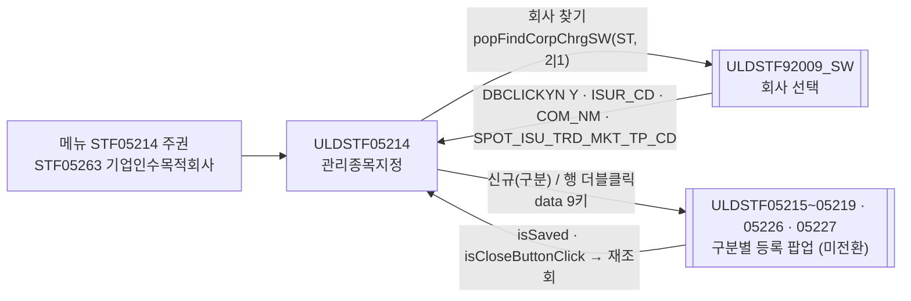
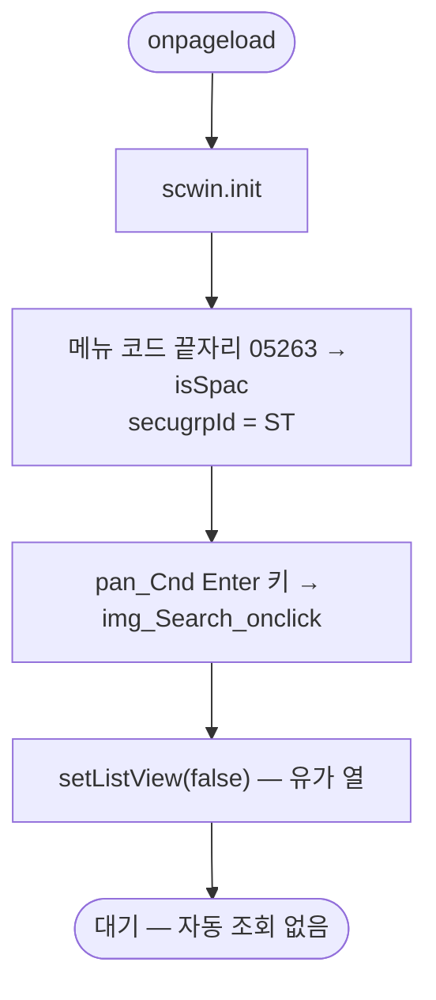
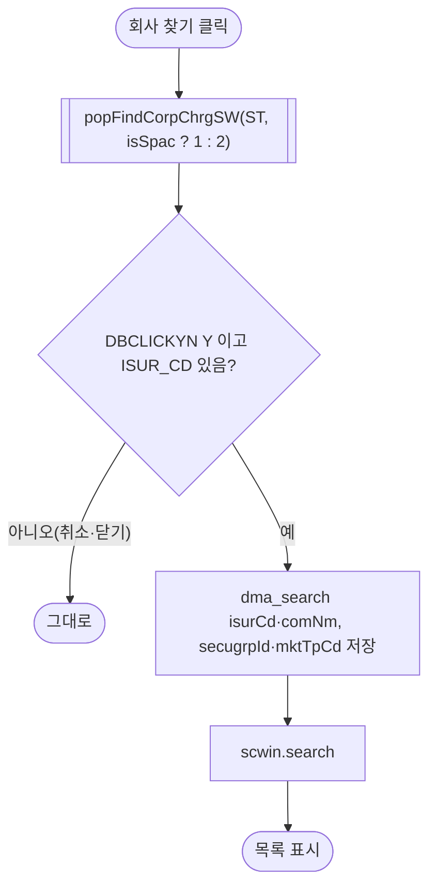
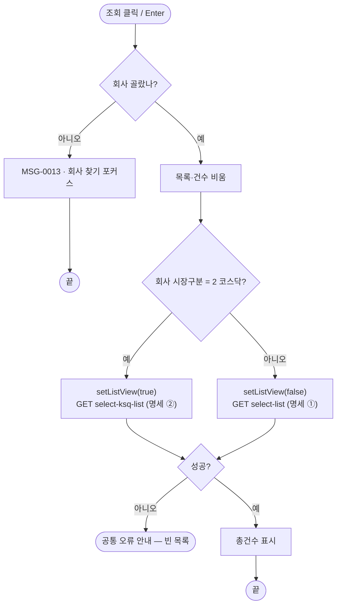
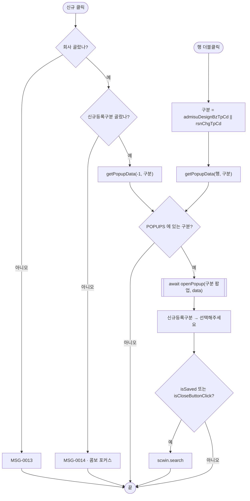
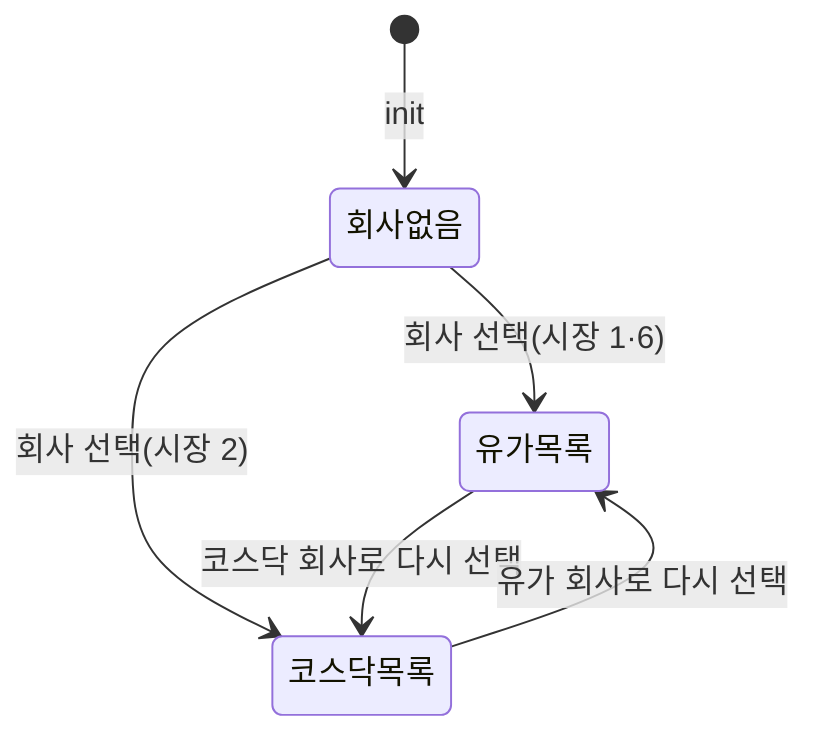

# ULDSTF05214 관리종목지정 — 업무 분석 및 전환 내역

| 항목 | 내용 |
|---|---|
| AS-IS | `ULDSTF05214.gfm` (Gauce/X-Internet, 1270×750 메인 화면, 원본 폴더 `/lstproc/` — 캡처 창 제목 「관리종목지정(유)_STF05214」) — 반입 `conversion/conversion-front/ui/ULDSTF05214/ULDSTF05214.gfm`. 메뉴 STF05214(주권)와 STF05263(기업인수목적회사)이 같은 화면을 쓴다 |
| 신규 API 명세 | `ULDSTF05214_API.md` — 블록 3종, **블록 머리에 화면ID 가 없다**(`## 1. [관리종목지정] 목록 조회`). `api_spec_check` 가 화면 자신의 `{화면ID}_API` 파일 안의 화면ID 없는 블록을 이 화면 블록으로 인식하도록 보강돼(2026-10-30) 명세 파일은 고치지 않았다. ① 목록 `GET /api/listing/lstproc/stock/administrative-issue/select-list`(AS-IS `searchAdministrativeIssue` `DIV_IDX_ADMISU_LIST`, requestData `isurCd`, target `dlt_list`) ② 코스닥 목록 `GET …/administrative-issue/select-ksq-list`(AS-IS 없음, requestData `isurCd`, target `dlt_ksqList`) ③ 발행기관별 건수 목록 `GET …/administrative-issue/isurcd-cnt/select-list`(AS-IS 없음, 요청 없음, target `dlt_list2`). §2.2·§5 는 명세 기준(가이드 §0.3·§5) |
| TO-BE | `conversion/conversion-front/ui-tobe/ULDSTF05214.xml` (배포 경로 미정 — 원본 `/lstproc/`). **2026-10-30 전환** — 1단계: 캡처+gfm 기준 퍼블리싱(마크업 전용, 사본 `$CLAUDE_JOB_DIR/tmp/ULDSTF05214_stage1.xml`), 2단계: 이 결과서대로 스크립트 전환. 게이트: `gate_screen --pcc stf`·`scan_mixed_compare`(A 0·B 0)·`publish_gate --pcc stf --before {1단계} --allow P20`·`api_spec_check --allow-unused …/isurcd-cnt/select-list`(③ 미호출 WARN, §10 #4)·`init_binding_check`·`wsxml_lint` 0/0 통과, `convert.py` 고정점 |
| 퍼블리셔 XML | 없음 — 화면 폴더에도 `conversion/publish/` 에도 없다. **캡처와 gfm 으로 1단계 마크업을 만들었다**(§2.1) |
| 화면 캡처 | `ULDSTF05214.png` (회사 00684 AK홀딩스 조회 결과 1건 — 유의사항변경 행, 하단 안내 문구 2줄·신규등록구분 콤보·[신규]·[닫기]·[엑셀저장]) → TO-BE 는 가이드 §13.2 퍼블리싱본부터 만들었다 |
| 업무공통 | pcc(`cm/pcc/stf`): `$c.lc.popFindCorpChrgSW`(ULDSTF92009_SW)·`$c.lc.getSecuGrpNm`·`$c.lc.glb.SECUGRP_ID_ST`, `$c.stf.getMessageParam`(MSG-0013·0014). gcc: `$c.sbm.executeDynamic`(requestData 2번째 인자)·`$c.win`(`setEnterKeyEvent`·`openPopup`·`alert`·`getProgramId`)·`$c.data`(`getParameter`·`downloadGridViewExcel`)·`$c.date.getServerDateTime`·`$c.session.getUserInfo`·`$c.util.isEmpty`·`$c.exception.handleError`. 게이트는 `--pcc stf` |
| 작성 | Inswave / 2026-10-30 |

참고 양식: [websquare_gfm_conversion.md](../../../md/websquare_gfm_conversion.md) — §1.4 업무 프로세스 흐름, §5 「API 명세 적용」, §6.5 getPar/setPar 전환. Gauce 대응은 [gfm_business_analysis_guide.md](../../../md/gfm_business_analysis_guide.md) §5·§6. 같은 주권·SPAC 두 메뉴 화면은 선례 [ULDSTF05232.md](../completed/ULDSTF05232/ULDSTF05232.md)(회사 찾기 `popFindCorpChrgSW`·메뉴 코드 판정), 목록·미전환 등록 팝업 규약은 [ULDSTF08035.md](../completed/ULDSTF08035/ULDSTF08035.md)(`isSaved || isCloseButtonClick` 재조회)를 따랐다.

---

## 1. 화면 개요

상장 담당자가 **주권 회사별 관리종목지정 내역**(지정·사유변경·유의사항변경·해제·상장폐지기준 적용 유예 등)을 조회하고, 구분별 등록 팝업으로 신규 건을 작성하거나 기존 건을 고치는 메인 화면이다.

1. [회사 찾기]로 회사를 고르면 바로 그 회사의 관리종목지정 내역을 조회한다. 그 뒤에는 [조회](또는 조회 영역 Enter)로 다시 조회한다. 회사를 안 고르고 [조회]·[신규]를 누르면 MSG-0013 을 띄운다.
2. 기업인수목적회사 메뉴(STF05263)면 회사 찾기가 SPAC 회사 목록("1")을, 주권 메뉴(STF05214)면 주권 회사 목록("2")을 연다. 팝업 제목·크기도 메뉴에 따라 조금 다르다.
3. 하단 [신규등록구분](0 관리종목지정 ~ 6 상장폐지기준 적용 유예기간 변경)을 고르고 [신규]를 누르면 그 구분의 등록 팝업을 연다. 구분을 안 골랐으면 MSG-0014. 목록 행 더블클릭은 그 행 구분의 팝업을 수정으로 연다.
4. **TO-BE 추가** — 고른 회사가 코스닥이면 명세 ② 코스닥 목록을 부르고, 그리드를 지정일·사유변경일·사유변동 열로 바꿔 보인다(§5.2, §10 #2).
5. [엑셀다운로드]로 목록을 내려받는다. 하단 안내 문구 2줄(반기 검토의견 미달 → 관리종목 지정사유 변경 조치)은 그대로 둔다.

### 1.1 호출 화면 (0본)

- 이 화면을 여는 화면은 저장소에 없다. 메뉴(STF05214·STF05263)에서 바로 여는 **메인 화면**이다. 원본 [닫기](`img_Close` → `window.close()`)는 메뉴 창 닫기라 옮기지 않았다(§8 #4).

### 1.2 호출 규약 (부모 → 이 화면) / 반환 규약

- 해당 없음 — 메뉴 화면이라 받는 파라미터·돌려주는 값이 없다. 원본 전역 `pMenuID = InfoMenuID()`·`fr_SecuGrpId = fn_getSecuGrpId(InfoMenuID())`·`fr_MktId = fn_getMktId()` 는 `$c.data.getParameter("menuInfo").menuCode`·`$c.lc.glb.SECUGRP_ID_ST`·`$c.session.getUserInfo("market")` 로 바꿨다(§3, §9).

### 1.3 이 화면이 여는 하위 팝업

| 팝업 | AS-IS 호출 (getPar/setPar) | 넘기는 `data` (TO-BE) | 받는 결과 (`closePopup`) / 취소 판정 |
|---|---|---|---|
| `ULDSTF92009_SW` 회사 선택 (700×950) | `fn_GetPar = fn_GetParIsur`(arr[0] 회사코드, arr[1] 회사명, arr[2] 증권그룹) · `fn_SetPar = fn_SetParIsur` 를 바꿔 끼우고 메뉴별로 `fn_PopFindCorpChrgSW(fr_SecuGrpId, "2"|"1")`, 그 밖의 메뉴는 `fn_PopFindCorpChrg(fr_SecuGrpId)` | pcc `$c.lc.popFindCorpChrgSW(secugrpId, isSpac ? "1" : "2")` — pcc 가 `{ STYPE, SECU_GRP_STR, SECJ_GRP_ID }` 로 연다 | 행 더블클릭 시 `{ DBCLICKYN : "Y", ISUR_CD, COM_NM, SPOT_ISU_TRD_MKT_TP_CD, SECUGRP_ID … }`. 취소·닫기는 `{ isCloseButtonClick }` → **`DBCLICKYN !== "Y"` 이거나 `ISUR_CD` 가 비면 그대로 둔다**(선례 05232) |
| `ULDSTF05215` 관리종목지정 (620×450 / SPAC 615×430) | `fn_GetPar = fn_GetParNew`(신규) 또는 `fn_GetParUpdate`(수정) · `fn_SetPar = undefined` 후 `fn_newpre_create_frame(구분)` → `frame.CreateDialogFrame("DLG_0", "../lstproc/ULDSTF05215.gfm", 증권그룹명 + " 관리종목지정", …, "window")` | 아래 **등록 팝업 data** | **제안**: 저장 성공은 `scwin.isSaved` 표시, 삭제 성공은 `closePopup({ isSaved : true })` — `isSaved` 이거나 X 로 닫히면(`isCloseButtonClick`) 재조회(§10 #1) |
| `ULDSTF05216` 관리종목지정 사유변경 (620×520) | 같은 방식 `"DLG_1"` | 〃 | 〃 |
| `ULDSTF05217` 관리종목지정 사유 및 유의사항 변경 (620×650 / SPAC 615×650) | `"DLG_2"` | 〃 | 〃 |
| `ULDSTF05218` 유의사항 변경 (620×520 / SPAC 615×450) | `"DLG_3"` | 〃 | 〃 |
| `ULDSTF05219` 관리종목지정 해제 (615×450) | `"DLG_4"` | 〃 | 〃 |
| `ULDSTF05226` 상장폐지기준 적용 유예 (620×450 / SPAC 615×450) | `"DLG_5"` | 〃 | 〃 |
| `ULDSTF05227` 상장폐지기준 적용 유예기간 변경 (620×450 / SPAC 615×450) | `"DLG_6"` | 〃 | 〃 |

**등록 팝업 data** (원본 `fn_GetParNew` / `fn_GetParUpdate` 의 arrPar 순서 → camelCase 키, 제안 — §10 #1):

| arr | TO-BE 키 | 신규 | 수정(더블클릭 행) |
|---|---|---|---|
| [0] | `isurCd` | 조회조건 회사코드 | 〃 |
| [1] | `isurNm` | 조회조건 회사명 | 〃 |
| [2] | `secugrpId` | `ST`(회사 선택 결과 `SECUGRP_ID` 가 있으면 그 값) | 〃 |
| [3] | `mktId` | 로그인 사용자 시장(원본 `fn_getMktId()`) | 〃 |
| [4] | `bzProcsNo` | `""` | 행 `bzProcsNo` |
| [5] | `admisuDesignBzTpCd` | 신규등록구분 0~6 | 행 `admisuDesignBzTpCd`(코스닥 목록은 `rsnChgTpCd` — §10 #3) |
| [6] | `spacYn` | 기업인수목적회사 메뉴면 `"Y"` | 〃 |
| [7] | `isuCd` | `""`(원본 신규는 채우지 않음) | 행 `isuCd` |
| [8] | `isuNm` | `""` | 행 `isuNm` |

배포 경로는 원본 `../lstproc/{ID}.gfm` 기준 `/ui/lst/lstproc/{ID}.xml`(선례 05101 의 05003_FILE 과 같은 계열, 가정 — §10 #1). 팝업 7종은 저장소에 원본·전환본이 없다.

### 1.4 업무 프로세스 흐름

#### 화면 간 흐름

#### 업무 1: 진입·로딩

| 단계 | 처리 | 근거 |
|---|---|---|
| 1 | 메뉴로 기업인수목적회사 여부를 정한다 | 원본 `pMenuID`·`spacYN`(원본은 회사 찾기를 누를 때 정함 — §8 #2) |
| 2 | 조회 영역 Enter 키 바인딩 | 규칙 22 |
| 3 | 그리드를 유가 열로 둔다 | §6.3 |

#### 업무 2: 회사 찾기 → 조회

#### 업무 3: 조회

#### 업무 4·5: 신규 · 수정

#### 업무 6: 엑셀

| 단계 | 처리 |
|---|---|
| 1 | `$c.data.downloadGridViewExcel(grd_List, { fileName : {menuId}_{증권그룹명}관리종목지정내역_{yyyyMMddHHmmss}.xlsx })` — 0건 안내는 공통 함수(원본 `NO_EXCEL_DATA`) |

#### 화면 모드 상태 전이

## 2. 화면 구성 및 데이터 정의

### 2.1 화면 구성 (AS-IS 요소 → TO-BE 컴포넌트)

| AS-IS | 종류 | TO-BE | 비고 |
|---|---|---|---|
| `panel_Top` | panel(조회 영역, `PanelToGroupBox`) | `pan_Cnd`(`schbox`) | 1행 표 |
| `label_6` "회사코드(명)" | label | `label_6` (`w2:textbox class="req"`) | |
| `txb_IsurCd` | textbox(readonly) | `txb_IsurCd` (`ref dma_search.isurCd`, readOnly) | |
| `txb_IsurNm` | textbox(readonly) | `txb_IsurNm` (`ref dma_search.comNm`, readOnly) | |
| `btn_IsuCdSearch` | image(돋보기) | `btn_IsuCdSearch` (`btn_cm icon search`) | |
| `img_Search` | image(조회) | `img_Search` (`btn_cm sch`) | |
| `image_1` | image(구분선) | (옮기지 않음) | 장식 |
| `grd_List` | mxgrid | `grd_List` (gridView, `dataList="data:dlt_list"`, 행번호 열 "번호") | §2.2 열 대응 |
| `panel_page` | panel(총건수 `FillGridHeaderTotalCnt`) | `titbox` 의 `txb_TotCnt` | |
| `img_Excel` | image(엑셀저장, 하단) | `img_Excel` (`btn_cm download`, 목록 머리 오른쪽) | 위치는 conversion-front 선례(08035·05700) |
| `img_Close` | image(닫기) | (옮기지 않음) | 본화면 — §8 #4 |
| `label_3` "신규등록구분" | label | `label_3` (`class="req"`, 하단 `btnbox rt`) | |
| `cmb_RegistTyp` | mxcombo(cbdata `(null)^선택해주세요,0^…,6^…`) | `cmb_RegistTyp` (select1, `chooseOption` "선택해주세요", 항목 0~6) | `(null)` 항목은 chooseOption 으로 |
| `img_Regist` | image(신규) | `img_Regist` (`btn_cm pt`, rt 오른쪽 끝 — 규칙 41) | |
| `label_42`·`label_1` | label(안내 문구 2줄) | `label_42`·`label_1` (`w2:textbox class="txt_info"`, `btnbox lt`) | 문구 그대로 |

그리드 열 (원본 `grd_List` fcolumn/column → TO-BE gBody, AS-IS 대문자 id → 명세 camelCase):

| AS-IS 열 | 명칭 | TO-BE 열 | 비고 |
|---|---|---|---|
| `NO` (`{CurRow}`) | 번호 | 행번호 열(`rowNumVisible`) | |
| `DSC_YN` | 공시검토여부 | `dscYn` | |
| `MKTACT_ENFORCE_DD` (mask `XXXX-XX-XX`) | 시행일 | `mktactEnforceDd` `dataType="date" displayFormat="yyyy-MM-dd"` | 규칙 46. 유가 열 |
| `ADMISU_DESIGN_BZ_TP_NM` | 구분 | `admisuDesignBzTpNm` | 유가 열 |
| `ISU_NM` | 종목명 | `isuNm` | |
| `ADMISU_RSN_NM` | 지정사유 | `admisuRsnNm` | |
| `BFCHG_DELIST_BAS_DD_CONTN` | 변경전 유의사항 | `bfchgDelistBasDdContn` | 유가 열 |
| `AFCHG_DELIST_BAS_DD_CONTN` | 변경후 유의사항 | `afchgDelistBasDdContn` | 유가 열 |
| `CHG_RSN_CONTN` | 변경/해제 사유 | `chgRsnContn` | 유가 열 |
| `ADMISU_DESIGN_GRND_REGUL_NM` | 근거규정 | `admisuDesignGrndRegulNm` | |
| `REMK` | 기타 | `remk` | |
| `LST_EMP_NM` | 최종처리자 | `lstEmpNm` | |
| `BZ_PROCS_NO` | 업무처리번호 | `bzProcsNo` | |
| (없음) | 지정일 | `admisuDesnrelsDd` `dataType="date"` | 명세 ② 코스닥 열(id `…Dd` + 명칭 `…일` — 규칙 46 확장) |
| (없음) | 사유변경일 | `admisuRsnChgDd` `dataType="date"` | 명세 ② 코스닥 열(규칙 46 확장) |
| (없음) | 사유변동 | `rsnChgTpNm` | 명세 ② 코스닥 열 |

### 2.2 데이터 정의 (DataCollection)

| AS-IS | TO-BE | 종류 | 키 | 비고 |
|---|---|---|---|---|
| (화면 값 `txb_IsurCd`·`txb_IsurNm`) | `dma_search` | dataMap | `isurCd`(명세 ①·② requestData), `comNm`(화면 표시용) | |
| `dts_List` | `dlt_list` | dataList | 명세 ① `dlt_list` 16열 `dftYn·dscYn·bzProcsNo·isurCd·mktactEnforceDd·admisuDesignBzTpCd·admisuDesignBzTpNm·isuCd·isuNm·admisuRsnNm·bfchgDelistBasDdContn·afchgDelistBasDdContn·chgRsnContn·admisuDesignGrndRegulNm·remk·lstEmpNm` + 명세 ② `dlt_ksqList` 전용 4열 `admisuRsnChgDd·admisuDesnrelsDd·rsnChgTpCd·rsnChgTpNm` | ①·② 응답을 그리드 목록 하나로 받는다(두 명세 target 을 `dlt_list=body` 로) — 그리드가 하나이고 공통 열이 대부분이라서. 명세 ③ `dlt_list2` 는 정의하지 않는다(§10 #4) |

- AS-IS 키 `bz_procs_no`(원본 `fn_GetParUpdate` 의 소문자 이름) → `bzProcsNo`, `ADMISU_DESIGN_BZ_TP_CD` → `admisuDesignBzTpCd`, `ISU_CD` → `isuCd`, `ISU_NM` → `isuNm`.

## 3. 로딩 (`scwin.onpageload` → `scwin.init`) — 2구역

- `scwin.onpageload` 는 `scwin.init()` 호출만(try/catch + `handleError`).
- `scwin.init` 단계:
  1. **메뉴** — `$c.data.getParameter("menuInfo").menuCode` 가 `05263` 으로 끝나면 `scwin.isSpac = true`(원본 `pMenuID == "STF05263"`). `scwin.secugrpId = $c.lc.glb.SECUGRP_ID_ST`(원본 `fn_getSecuGrpId(InfoMenuID())` — pcc 표에서 STF05214·STF05263 모두 ST).
  2. **Enter 키** — `$c.win.setEnterKeyEvent(pan_Cnd, scwin.img_Search_onclick)`(규칙 22). 날짜 달력이 없어 규칙 37 바인딩은 없다.
  3. **그리드 열** — `scwin.setListView(false)`(유가 열).
- 자동 조회 없음(원본과 같음 — 회사를 골라야 조회).

## 4. 컴포넌트 이벤트 — 3구역

| AS-IS 이벤트 | TO-BE 핸들러 | 처리 |
|---|---|---|
| `btn_IsuCdSearch` onclick | `scwin.btn_IsuCdSearch_onclick` | `scwin.openCompanyPopup` |
| `img_Search` onclick | `scwin.img_Search_onclick` | `validateCompany` → `search` |
| `grd_List` OnDblClick(row, colid) | `scwin.grd_List_oncelldblclick` | `openDetail(rowIndex)` |
| `img_Excel` onclick | `scwin.img_Excel_onclick` | `excelDown` |
| `img_Regist` onclick | `scwin.img_Regist_onclick` | `writeNew` |
| `img_Close` onclick (`window.close()`) | (옮기지 않음) | 본화면 — §8 #4 |
| `dts_List` OnLoadCompleted(rowcount) | (`scwin.search` 안) | 총건수 표시. `CloseWin`·`ShowWin`(로딩 표시)은 공통 처리 |
| `dts_List` OnLoadError | (공통 오류 핸들러) | 원본 `alert_error(dts_List)` |
| gform onload (`PanelToGroupBox(panel_Top)`) | (마크업 `schbox`) | 스타일 처리 — 스크립트 없음 |

## 5. 서버 통신 — 4구역

| AS-IS | 명세 TO-BE | TO-BE 함수 | requestData / target |
|---|---|---|---|
| `/administrativeIssue.do?…method=searchAdministrativeIssue&DIV_IDX=DIV_IDX_ADMISU_LIST&TRS_IDX=TRS_IDX_SELECT&ISUR_CD=…` (`fn_search`) | ① `GET /api/listing/lstproc/stock/administrative-issue/select-list` | `scwin.selectList` | `{ isurCd }` / `dlt_list=body` |
| (없음) | ② `GET /api/listing/lstproc/stock/administrative-issue/select-ksq-list` | `scwin.selectKsqList` | `{ isurCd }` / `dlt_list=body`(명세 target `dlt_ksqList` 를 같은 목록으로) |
| (없음) | ③ `GET /api/listing/lstproc/stock/administrative-issue/isurcd-cnt/select-list` | (부르지 않음) | 명세 target `dlt_list2` — §10 #4 |

### 5.1 목록 조회 (`scwin.selectList`)

- `$c.sbm.executeDynamic({ id : "sbm_selectList", method : "get", action : "/api/listing/lstproc/stock/administrative-issue/select-list", target : "dlt_list=body", gridview : "grd_List", isProcessMsg : false }, { isurCd })`.
- 원본은 지역 변수 `url` 에 쿼리스트링을 이어 붙여 `dts_List.DataID = encodeURI(url); dts_List.reset();` 으로 조회했다 — TO-BE 는 전체 경로 리터럴 action + requestData(규칙 38).
- 원본 URL 인자 `SCREN_ID`·`SCREN_PROCES_TP_CD`·`DIV_IDX`·`TRS_IDX` 는 명세에 없어 보내지 않는다(§10 #5).
- 실패 안내는 공통 오류 핸들러. `skipped`(진행 중 중복 조회)면 false.

### 5.2 코스닥 목록 조회 (`scwin.selectKsqList`)

- 같은 꼴로 `select-ksq-list`. **고른 회사의 시장구분(`SPOT_ISU_TRD_MKT_TP_CD`)이 `2` 코스닥일 때만** 부른다(가정 — §10 #2). 응답 열이 ①과 달라(시행일·구분·유의사항·변경/해제 사유 없음, 지정일·사유변경일·사유변동 있음) `scwin.setListView(true)` 로 그리드 열을 바꾼다.

### 5.3 발행기관별 건수 목록 (명세 ③) — 부르지 않음

- 요청 없이 발행기관별 관리종목 건수(`isurCd·spotIsuTrdMktTpCd·comAbbrv·cnt`)를 돌려주는 API 다. **AS-IS 화면에 대응하는 요소가 없고**, 캡처에도 이 목록을 보일 자리가 없다. 화면을 새로 지어내지 않기 위해 부르지 않았다 — `api_spec_check --allow-unused …/isurcd-cnt/select-list` 로 WARN(§10 #4). 응답 `name` 이 4열 모두 「발행기관코드」로 적힌 것도 명세 오기로 보인다.

## 6. 일반 함수 — 5구역

### 6.1 조회 (`scwin.search` · `scwin.validateCompany`)

- `validateCompany` — `dma_search.isurCd` 가 비면 MSG-0013 「[회사코드(명)]을 선택해주세요.」 + `btn_IsuCdSearch` 포커스(원본 `txb_IsurCd.focus()` 는 읽기 전용 칸이라 찾기 버튼으로).
- `search` — 목록·건수를 먼저 비우고(조회 실패 시 앞 회사 행으로 팝업을 여는 일 방지), 시장구분으로 ①/② 를 고르고 열을 맞춘 뒤 조회, 성공이면 총건수.

### 6.2 회사 찾기 (`scwin.openCompanyPopup` · `scwin.setCompany`)

- `openCompanyPopup` — `$c.lc.popFindCorpChrgSW(secugrpId, isSpac ? "1" : "2")`, `DBCLICKYN === "Y"` 와 `ISUR_CD` 로 선택 판정.
- `setCompany` — `isurCd`·`comNm`·`secugrpId`(결과에 있으면)·`mktTpCd` 를 넣고 바로 조회(원본 `fn_SetParIsur` → `fn_search`).
- 원본의 「그 밖의 메뉴면 `fn_PopFindCorpChrg`」 분기는 이 화면을 쓰는 메뉴가 둘뿐이라 옮기지 않았다(§8 #5).

### 6.3 그리드 열 (`scwin.setListView`)

- 유가 등: `mktactEnforceDd·admisuDesignBzTpNm·bfchgDelistBasDdContn·afchgDelistBasDdContn·chgRsnContn` 보임 / 코스닥: `admisuDesnrelsDd·admisuRsnChgDd·rsnChgTpNm` 보임. `grd_List.setColumnVisible` 로 바꾼다.

### 6.4 신규 · 수정 (`scwin.writeNew` · `scwin.openDetail` · `scwin.getPopupData` · `scwin.openRegPopup`)

- `writeNew` — 회사 → 신규등록구분 순으로 검사(MSG-0013 / MSG-0014 「[신규등록구분]을 선택해주세요.」 + 콤보 포커스), `getPopupData(-1, 구분)` 으로 연다.
- `openDetail` — 행의 `admisuDesignBzTpCd`(코스닥 목록은 없어서 `rsnChgTpCd`)로 연다.
- `openRegPopup` — `scwin.POPUPS[구분]` 의 id·제목·크기(SPAC 메뉴 크기 따로)로 `await $c.win.openPopup("/ui/lst/lstproc/{id}.xml", options, data)`. 연 뒤 신규등록구분을 「선택해주세요」로 되돌리고(원본 `cmb_RegistTyp.index = 0`), `isSaved` 이거나 X 로 닫히면 재조회. 모르는 구분이면 원본 `switch` 처럼 아무것도 하지 않는다.
- 제목: 주권 메뉴 `$c.lc.getSecuGrpNm(secugrpId) + " " + 구분명`(예: 「주권 관리종목지정」), SPAC 메뉴 「기업인수목적회사 {구분명}」.

### 6.5 부모 ↔ 팝업 파라미터 전달 (getPar/setPar → `$c.win.openPopup` + `await`)

- 원본은 `fn_GetPar`·`fn_SetPar` 전역 변수에 `fn_GetParIsur`/`fn_SetParIsur`·`fn_GetParNew`·`fn_GetParUpdate` 를 바꿔 끼우고 팝업이 부모 함수를 이름으로 불렀다. TO-BE 는 **넘길 값을 `openPopup` 의 data 로 넘기고 `await` 반환값으로 결과를 받는다** — 회사 찾기는 pcc `popFindCorpChrgSW` 반환, 등록 팝업은 §1.3 data 9키 + 반환 `{ isSaved }`(제안). 호환용 `fn_GetPar` 는 남기지 않았다(등록 팝업이 미전환이라 전환 때 data 수신으로 만든다 — §10 #1).

### 6.6 엑셀 (`scwin.excelDown`)

- `$c.data.downloadGridViewExcel(grd_List, { fileName : $c.win.getProgramId() + "_" + 증권그룹명 + "관리종목지정내역_" + yyyyMMddHHmmss + ".xlsx", sheetName : "sheet1" })` — 규칙 42. 원본 파일명 오타 「괸리」 정정, `doLogSave(vScrenID, SCREN_PROCS_TP_CD_07)` 는 옮기지 않음(선례). 숨김 열은 공통 함수 기준.

## 7. 업무 코드 · 메시지 목록

| 구분 | 값 | 의미 |
|---|---|---|
| 신규등록구분(관리종목지정업무구분코드) | 0 / 1 / 2 / 3 / 4 / 5 / 6 | 관리종목지정 / 관리종목지정사유변경 / 사유 및 유의사항변경 / 유의사항변경 / 관리종목지정해제 / 상장폐지기준 적용 유예 / 유예기간 변경 |
| 회사 찾기 구분(STYPE) | "2" / "1" | 주권 / 기업인수목적회사 |
| 회사 시장구분 | 1 / 2 / 6 | 유가 / 코스닥 / 코넥스 — 2 면 명세 ② |
| 메뉴 | STF05214 / STF05263 | 주권 / 기업인수목적회사 |
| 메시지 | MSG-0013 | [회사코드(명)]을 선택해주세요. |
| 메시지 | MSG-0014 | [신규등록구분]을 선택해주세요. |
| 메시지 | `NO_EXCEL_DATA` | 엑셀 0건 — 공통 함수 안내로 대체 |

## 8. 원본 특이사항 · 결함

| # | 내용 | 결정 |
|---|---|---|
| 1 | 등록 팝업이 닫혀도 재조회하지 않음(`//fn_search()` 주석) — 저장 결과가 목록에 바로 안 보인다 | **고침** — `isSaved` 이거나 X 로 닫히면 재조회(선례 08035) |
| 2 | `spacYN` 을 회사 찾기 버튼을 누를 때만 `"Y"` 로 정함 — SPAC 메뉴에서 회사 찾기 없이 [신규]를 누를 수는 없지만(회사 필수), 값이 메뉴가 아니라 클릭에 달려 있었다 | **고침** — init 에서 메뉴로 정한다 |
| 3 | `img_Regist` 가 `dts_List` 에 없는 `CHECK` 열을 `"F"` 로 지움 | **옮기지 않음**(죽은 코드) |
| 4 | 본화면에 [닫기](`window.close()`) | **옮기지 않음**(본화면 — 선례) |
| 5 | 회사 찾기 「그 밖의 메뉴」 분기 `fn_PopFindCorpChrg` | **옮기지 않음** — 이 화면을 쓰는 메뉴는 둘뿐 |
| 6 | `chkRowIndex`·`hist_bz_procs_no`·`vScrenID` 전역 — 쓰는 곳 없음(`vScrenID` 는 `doLogSave` 인자) | **옮기지 않음** |
| 7 | 엑셀 파일명 오타 「괸리종목지정내역」 | **고침** — 규칙 42 파일명 |
| 8 | `fn_GetParUpdate` 가 업무처리번호를 소문자 `bz_procs_no` 로 읽음(Gauce 는 대소문자 무시) | TO-BE `bzProcsNo` |

## 9. 전환 내역 (AS-IS → TO-BE)

| AS-IS | TO-BE |
|---|---|
| `pMenuID = InfoMenuID()` | `scwin.init` — `menuInfo.menuCode` 끝자리 `scwin.MENU_CD_SPAC` 판정 |
| `fr_SecuGrpId = fn_getSecuGrpId(InfoMenuID())` | `scwin.secugrpId = $c.lc.glb.SECUGRP_ID_ST`(회사 선택 결과로 갱신) |
| `fr_MktId = fn_getMktId()` | `getPopupData` 의 `mktId = $c.session.getUserInfo("market")` |
| `fn_GetPar`, `fn_SetPar` | 삭제 — openPopup data + await 반환(§6.5) |
| `spacYN` | `scwin.isSpac`(data `spacYn`) |
| `vScrenID`·`chkRowIndex`·`hist_bz_procs_no` | 삭제(§8 #6) |
| `fn_search()` | `scwin.search` + `scwin.selectList`(명세 ①)·`scwin.selectKsqList`(명세 ②) |
| `fn_GetParIsur` / `fn_SetParIsur` | `scwin.openCompanyPopup` / `scwin.setCompany` |
| `fn_GetParUpdate` / `fn_GetParNew` | `scwin.getPopupData(rowIndex, bzTpCd)` |
| `fn_newpre_create_frame(arg)` | `scwin.openRegPopup(bzTpCd, data)` + `scwin.POPUPS` 표 |
| `img_Search` onclick | `scwin.img_Search_onclick` + `scwin.validateCompany` |
| `btn_IsuCdSearch` onclick | `scwin.btn_IsuCdSearch_onclick` |
| `img_Regist` onclick | `scwin.img_Regist_onclick` → `scwin.writeNew` |
| `grd_List` OnDblClick | `scwin.grd_List_oncelldblclick` → `scwin.openDetail` |
| `img_Excel` onclick (`doLogSave`·`GridToExcel`) | `scwin.img_Excel_onclick` → `scwin.excelDown` |
| `img_Close` onclick | 삭제(§8 #4) |
| `dts_List` OnLoadCompleted / OnLoadError | `scwin.search` 의 건수 표시 / 공통 오류 핸들러 |
| gform onload `PanelToGroupBox` | 마크업 `schbox` |
| (신규) | `scwin.setListView` — 명세 ② 열 전환 |
| (신규) | `scwin.onpageload`·`scwin.init` |

- 1구역 상수·상태: `scwin.MENU_CD_SPAC`("05263"), `scwin.MKT_TP_KOSDAQ`("2" — 명세 ② 사용 조건), `scwin.POPUP_PATH`("/ui/lst/lstproc/"), `scwin.POPUPS`(구분 0~6 → 팝업 id·제목·크기), `scwin.COLS_KSE`·`scwin.COLS_KOSDAQ`(시장별 보이는 열), `scwin.isSpac`, `scwin.secugrpId`, `scwin.mktTpCd`(고른 회사 시장구분), `scwin.isKsqList`(지금 목록이 명세 ② 인지).
- publicInfo: 정의한 19함수 전부. 상수·상태 전역은 등재하지 않는다.
- 게이트: `gate_screen --pcc stf` OK · `scan_mixed_compare` A 0·B 0 · `publish_gate --before {1단계} --allow P20` OK(P22·P24 는 스크립트 전환분) · `api_spec_check --allow-unused /api/listing/lstproc/stock/administrative-issue/isurcd-cnt/select-list` OK(③ WARN — 화면ID 없는 3블록 모두 이 화면 것으로 인식) · `init_binding_check` OK · `wsxml_lint` 0/0 · `convert.py` 고정점(한 줄 선언 위치를 변환기 출력에 맞춤).

## 10. 남은 작업 (TODO)

1. **등록 팝업 7종 계약** — ULDSTF05215~05219·05226·05227 은 저장소에 원본·전환본이 없다. 경로 `/ui/lst/lstproc/{ID}.xml`, data 9키(§1.3), 반환 `{ isSaved }` 는 제안이다. 팝업 전환 때 이 키로 받게 맞추거나, 다르면 `scwin.getPopupData`·`scwin.POPUPS` 를 고친다.
2. **코스닥 목록(명세 ②) 사용 조건** — AS-IS 에 없는 API 라 「고른 회사의 시장구분이 2 코스닥이면 ②」로 가정했다. 사용자 시장(`market`) 기준이어야 하는지, 코스닥 회사도 ①을 써야 하는지 확인.
3. **코스닥 목록 행의 팝업 구분** — 명세 ② 응답에 `admisuDesignBzTpCd` 가 없어 더블클릭 시 `rsnChgTpCd`(사유변동구분)를 구분으로 쓴다. 같은 코드 체계(0~6)인지 확인 — 다르면 코스닥 행은 팝업이 열리지 않는다.
4. **발행기관별 건수 목록(명세 ③)** — AS-IS·캡처에 대응 요소가 없어 부르지 않는다(`--allow-unused`). 어떤 화면 요소(예: 회사 선택 보조 목록)에 쓰려는 API 인지 확인. 응답 4열 `name` 이 모두 「발행기관코드」인 명세 오기도 함께 확인.
5. **명세에 없는 원본 인자** — `SCREN_ID`·`SCREN_PROCES_TP_CD`·`DIV_IDX`·`TRS_IDX` 를 보내지 않아도 되는지.
6. **메뉴 코드 체계** — SPAC 판정을 `menuInfo.menuCode` 끝자리 `05263` 으로 한다(선례 05232 와 같은 가정). TO-BE 메뉴 코드가 다르면 `scwin.MENU_CD_SPAC` 수정.
7. **날짜 열 값** — `mktactEnforceDd`·`admisuDesnrelsDd`·`admisuRsnChgDd` 가 8자리 `yyyyMMdd` 인지(규칙 46 — 아니면 원시 값이 그대로 보인다).
8. **엑셀 버튼 위치** — 캡처는 하단 「엑셀저장」, TO-BE 는 목록 머리 「엑셀다운로드」(conversion-front 선례). 퍼블리싱 확정 시 확인.

## 11. 화면 함수 목록 (TO-BE)

| 구역 | 함수 |
|---|---|
| 2. 초기화 | `scwin.onpageload`, `scwin.init` |
| 3. 이벤트 | `scwin.btn_IsuCdSearch_onclick`, `scwin.img_Search_onclick`, `scwin.grd_List_oncelldblclick`, `scwin.img_Excel_onclick`, `scwin.img_Regist_onclick` |
| 4. 서브미션 | `scwin.selectList`, `scwin.selectKsqList` |
| 5. 일반 | `scwin.search`, `scwin.validateCompany`, `scwin.openCompanyPopup`, `scwin.setCompany`, `scwin.setListView`, `scwin.getPopupData`, `scwin.openRegPopup`, `scwin.writeNew`, `scwin.openDetail`, `scwin.excelDown` |
