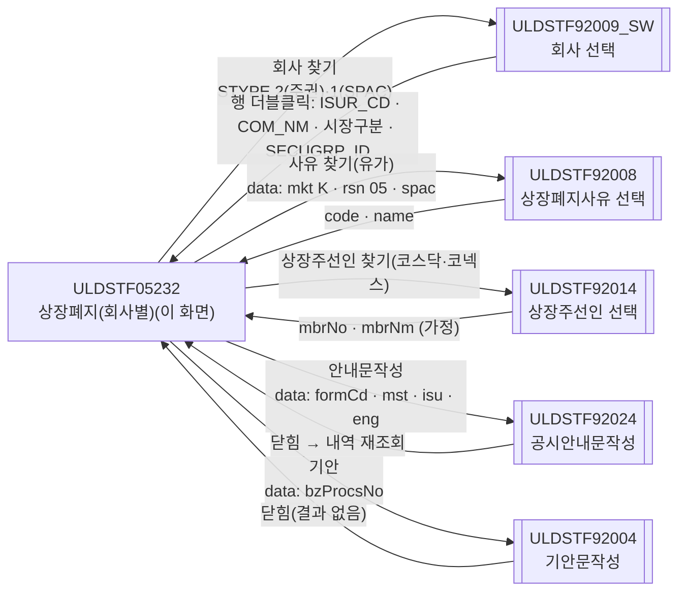
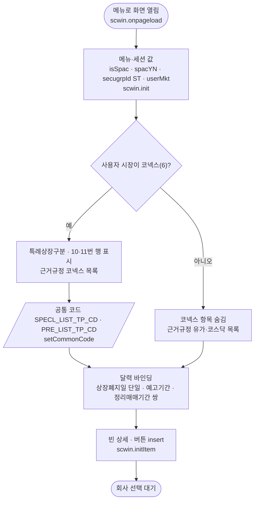
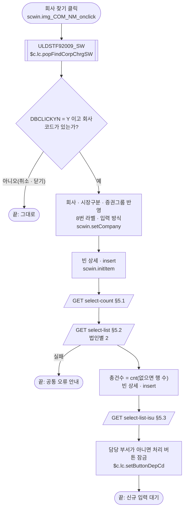
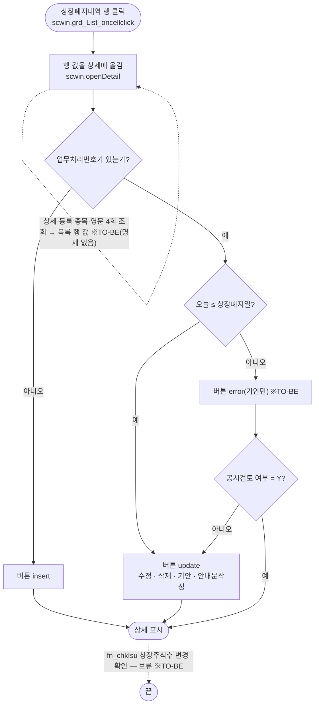
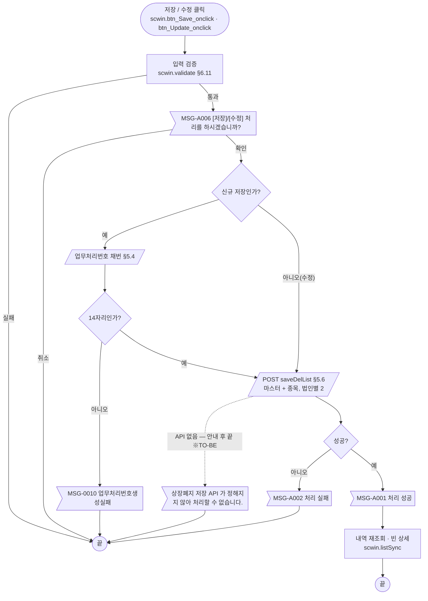
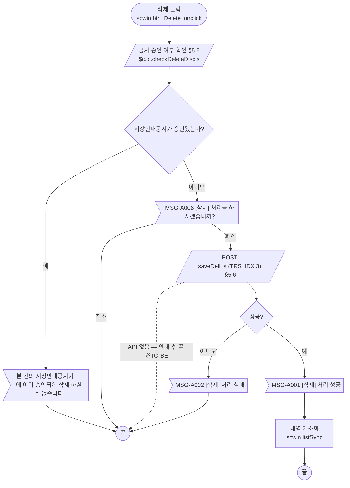
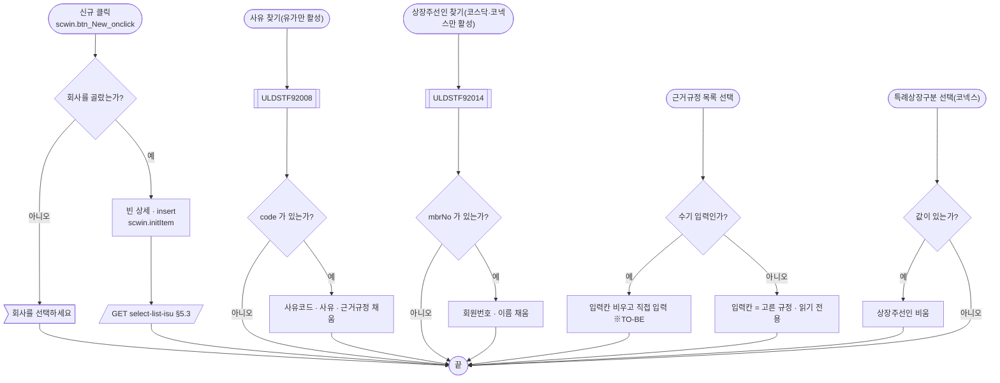
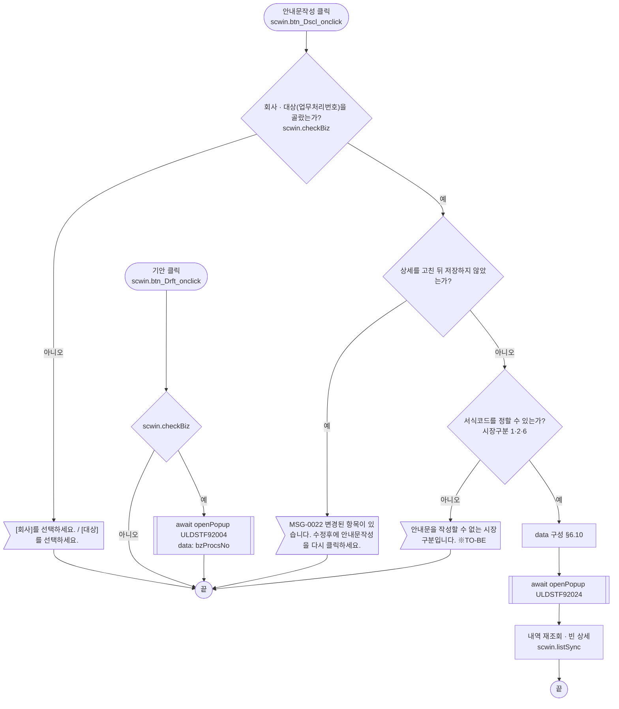
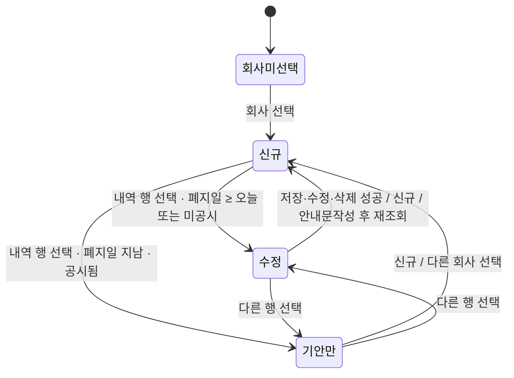

# ULDSTF05232 상장폐지(회사별) — 업무 분석 및 전환 내역

| 항목 | 내용 |
|---|---|
| AS-IS | `/lstproc/ULDSTF05232.gfm` (Gauce/X-Internet, 1020×605 **메인 화면** — 메뉴 `STF05232`(주권)와 `STF05265`(기업인수목적회사)가 같은 화면을 연다) — 반입 `conversion/conversion-front/ui/completed/ULDSTF05232/ULDSTF05232.gfm` |
| 신규 API 명세 | `conversion/conversion-front/ui/completed/ULDSTF05232/ULDSTF05232_API.md` — 블록 3종(이 화면 3종, 다른 화면 0종), 모두 `GET /api/listing/lstproc/stock/delisting-com/…`(`select-count`·`select-list-isu`·`select-list`). 블록마다 `* **AS-IS** :` 줄이 빈칸이라 AS-IS 대응은 이 결과서 §5 에서 `.gfm` 기준으로 채웠다. **조회 3종뿐이고 상세(`masterDetail`·`listMarket`)·영문(`masterDetailEng`·`listMarketEng`)·저장/수정/삭제(`saveDelList`) API 가 없다**(§10 #1·#2). §2.2·§5 는 명세 기준(가이드 §0.3·§5) |
| TO-BE | `conversion/conversion-front/ui-tobe/ULDSTF05232.xml` (배포 경로 `/ui/lst/lstproc/ULDSTF05232.xml` — 가정, §10 #12). 2026-10-28 전환 — **1단계** 캡처 기준 퍼블리싱(마크업 전용, 기준본 `$CLAUDE_JOB_DIR/tmp/stage1/ULDSTF05232.xml`), **2단계** 이 결과서대로 스크립트 전환. 게이트: `gate_screen --pcc stf`·`scan_mixed_compare`·`publish_gate --pcc stf --before {1단계본} --allow P20`·`api_spec_check`(명세 3종 모두 사용)·`init_binding_check`·`wsxml_lint` 0/0·`convert.py` 고정점 통과. **저장·수정·삭제는 API 가 없어 서버를 부르지 않는다 — 배포 전 차단(§10 #1)** |
| 퍼블리셔 XML | `conversion/publish/상장/상장처리(대내)/ULDSTF05232.xml` (사본 `conversion/publish/publish-tobe/상장/상장처리(대내)/ULDSTF05232.xml`) — 컴포넌트 id 는 AS-IS 와 같음(날짜 5종 `w2:inputCalendar`, 콤보 3종 `xf:select1`, 이미지 버튼 → `xf:trigger`, 달력 이미지 `img_*_DD` 없음). `txb_ISUR_CD` 는 itemset 없는 `w2:autoComplete`, `label_24`(지정자문인)가 보이고 `label_18`(상장주선인)이 숨김이라 캡처와 반대, 상단에 `pgtbox`(페이지 제목·breadcrumb) 견본, 그리드 컬럼 id 대문자 — 1단계에서 캡처 기준으로 바로잡음(§2.1) |
| 화면 캡처 | `ULDSTF05232.png` (빈 입력 상태 — 회사 미선택, 코넥스 아닌 사용자: 10·11번 항목 없음, 8번 "상장주선인(코)", 하단 [신규]·[저장] 활성) → **TO-BE 는 가이드 §13.2 퍼블리싱본부터 만들었다**. 캡처 하단 [닫기]는 **(옮기지 않음)** — §2.1 |
| 업무공통 | pcc(`cm/pcc/stf`): `$c.lc`(`popFindCorpChrgSW`·`popFindClssLstRsnCd`·`isProcess`·`checkBzDoubleInput`·`checkDeleteDiscls`·`setButtonDepCd`·`glb.SECUGRP_ID_ST`·`glb.SECUGRP_ID_MF`·`glb.LIST_BZ_TP_CD_200`)·`$c.stf`(`getNewBzProcNo`·`getMessageParam`·`setButtonSetWithDate2`·`fillGridHeaderTotalCnt`). gcc: `$c.data`(`getParameter`·`setCommonCode`)·`$c.session.getUserInfo`·`$c.date`(`getServerDateTime`·`checkCalendarFormat`·`compareFromToDate`)·`$c.validate.validateDataCollect`·`$c.util`(`setButtonState`·`isEmpty`)·`$c.win`(`alert`·`openPopup`)·`$c.sbm.executeDynamic`·`$c.exception.handleError`. 게이트는 `--pcc stf` 로 돌린다 |
| 작성 | Inswave / 2026-10-28 |

참고 양식: [websquare_gfm_conversion.md](../../../md/websquare_gfm_conversion.md). Gauce 대응은 [gfm_business_analysis_guide.md](../../../md/gfm_business_analysis_guide.md) 를 함께 따랐다. 선례: `ui/completed/ULDSTF05710`·`ULDSTF05621`(같은 공시안내문·기안 계약), `ULDBNS30400`(명세 없는 API 처리).

---

## 1. 화면 개요

상장 담당자가 **회사 단위(법인별)로 상장폐지**를 등록·수정·삭제하는 메인 화면이다. 회사를 고르면 그 회사의 상장 종목·주식수와 지금까지의 상장폐지내역이 나오고, 상장폐지사유·예고기간·정리매매기간·상장폐지일·근거규정·상장주선인을 입력해 저장한다. 공시안내문을 작성하고 기안문을 띄우는 일도 이 화면에서 한다.

1. [회사 찾기]로 회사를 고른다. 메뉴가 기업인수목적회사(STF05265)면 SPAC 회사 목록, 아니면 주권 회사 목록에서 고른다.
2. 회사의 상장폐지내역(법인별 `MKTACT_APPL_OBJ_TP_CD=2`)과 상장 종목·주식수를 조회하고 상세를 빈 상태(신규)로 둔다. 회사 시장구분(1 유가 / 2 코스닥 / 6 코넥스)에 따라 상장폐지사유 입력 방식·예고기간·상장주선인 찾기가 바뀐다.
3. 새로 등록하면 입력 → 검증 → 확인 → 업무처리번호 채번 → 저장. 내역 행을 누르면 그 건을 상세로 불러 수정·삭제·안내문작성·기안한다(상장폐지일이 지났고 공시된 건은 기안만).
4. 저장·수정·삭제에 성공하면 내역을 다시 조회한다(상세는 빈 상태로 돌아간다). 안내문작성 창이 닫혀도 다시 조회한다.
5. 사용자 시장이 코넥스(6)면 지정자문인(특례상장구분)·이전상장구분·비고(코넥스) 항목이 더 보인다.

### 1.1 호출 화면 (메뉴)

- 메인 화면이다. 부모 화면이 값을 넘기지 않는다(AS-IS `fn_GetPar` 수신 없음).
- 메뉴 두 개가 같은 화면을 연다 — `STF05232` 상장폐지(회사별, 주권), `STF05265` 기업인수목적회사 상장폐지. 화면은 `InfoMenuID()` 로 메뉴를 구분해 회사 찾기 구분(`"2"`/`"1"`)과 사유 찾기의 기업인수목적회사 구분(`spacYN`)을 정한다. 두 메뉴 모두 증권그룹은 주권(`ST` — `fn_getSecuGrpId`).
- 화면 ID 와 메뉴 ID 는 pcc `$c.lc.getSecuGrpId` 표의 `STF05232`·`STF05265` 행과 같다.

### 1.2 호출 규약 (진입 값) / 반환 규약

| AS-IS | TO-BE | 의미 | 빈 값일 때 / 분기 |
|---|---|---|---|
| `pMenuID = InfoMenuID()` | `$c.data.getParameter("menuInfo").menuCode` 가 `05265` 로 끝나는가 → `scwin.isSpac` | 기업인수목적회사 메뉴 | 아니면(빈 값 포함) 주권 메뉴로 본다 — TO-BE 메뉴 코드 체계 미확정(§8 #2, §10 #6) |
| `fr_SecuGrpId = fn_getSecuGrpId(InfoMenuID())` | `scwin.secugrpId = $c.lc.glb.SECUGRP_ID_ST` | 증권그룹ID | 두 메뉴 모두 `ST`. 회사를 고르면 회사의 증권그룹(`SECUGRP_ID`)으로 바뀐다 |
| `js_market` (세션) | `$c.session.getUserInfo("market")` → `scwin.userMkt` | 사용자 시장구분 | `6`(코넥스)이면 코넥스 항목 표시(§6.1) |
| `js_dep_cd` (세션) | `$c.session.getUserInfo()` 객체를 `$c.lc.setButtonDepCd` 에 넘김 | 사용자 부서 | 담당 부서가 아니면 처리 버튼 잠금(§6.2) |

- **반환**: 없음(메인 화면).

### 1.3 이 화면이 여는 하위 팝업

| 팝업 | AS-IS 호출 (getPar/setPar) | 넘기는 `data` (TO-BE) | 받는 결과 (`closePopup`) / 취소 판정 |
|---|---|---|---|
| `ULDSTF92009_SW` 회사 선택 (pcc 700×950) | `fn_GetPar = fn_GetParIsur`(arr[0] 회사코드, arr[1] 회사명) · `fn_SetPar = fn_SetParIsur` → `fn_PopFindCorpChrgSW(fr_SecuGrpId, "2"|"1")` (그 밖 메뉴는 `fn_PopFindCorpChrg`) | `$c.lc.popFindCorpChrgSW(scwin.secugrpId, isSpac ? "1" : "2")` — pcc 가 `{ STYPE, SECU_GRP_STR, SECJ_GRP_ID }` 로 넘김 | `{ ISUR_CD, COM_NM, SPOT_ISU_TRD_MKT_TP_CD, ACNTCLS_MM, SECUGRP_ID, SECT_TP_CD, DBCLICKYN : "Y" }`(행 더블클릭 때만). **`DBCLICKYN !== "Y"` 또는 `ISUR_CD` 빈 값이면 취소**(AS-IS 도 `DBCLICKYN == "Y"` 일 때만 반영) — §6.2 |
| `ULDSTF92008` 상장폐지사유 선택 (pcc 520×700) | `fn_GetPar = fn_GetParRsn`(arr[0] `"K"`, arr[1] `"05"`, arr[5] `spacYN`) · `fn_SetPar = fn_SetParRsn` → `fn_PopFindClssLstRsnCd(RSNCD_DELIST)` | `$c.lc.popFindClssLstRsnCd("4", { mkt : "K", rsn : "05", spac : spacYN })` — 인덱스 → 키 대응은 가정(§10 #7) | 92008 전환본 `closePopup(행)` = `{ code, name }`. **`code` 빈 값이면 취소**. AS-IS arr[2](근거규정)는 92008 이 돌려주지 않음 — `regl` 가정(§10 #7) |
| `ULDSTF92014` 상장주선인(지정자문인) 선택 (350×545) | `fn_SetPar = fn_SetParMbrNo`(arr[0] 회원번호, arr[1] 이름) → `fn_PopFindLeadCom2(fr_SecuGrpId)`(인수는 쓰지 않음) | `$c.win.openPopup("/ui/lst/common/ULDSTF92014.xml", …, { secugrpId })` — pcc `popFindLeadComSingle` 은 콜백형이라 쓰지 않음(가이드 §6.5 예외) | **전환본 없음** — `{ mbrNo, mbrNm }` 가정, `mbrNo` 빈 값이면 취소(§10 #7) |
| `ULDSTF92024` 공시안내문작성 (755×815) | `fn_GetPar` 바꿔 끼우기 → arr[0..3] + `CopyDataSet(dts_Isu/Mst/Isu_Eng/Mst_Eng → param_dts_isu/mst/isu_eng/mst_eng)` → `frame.CreateDialogFrame(…, "window")` → 닫힌 뒤 `fn_list_sync()` | `{ formCd, bzProcsNo, isurCd, mktId, isu, mst, isuEng, mstEng }` — §6.10 | 없음(원본 `fn_SetPar` 는 빈 함수). `await` 뒤 내역 재조회 |
| `ULDSTF92004` 기안문작성 (888×730) | `fn_GetPar` 바꿔 끼우기 → arr[0] 업무처리번호 → `fn_PopFindDraft()` | `{ bzProcsNo }` — §6.13 | 없음 |

### 1.4 업무 프로세스 흐름

흐름은 AS-IS 동작을 기준으로 그렸다. 점선과 `※TO-BE` 는 전환본에서 바뀌는 곳이다(근거는 §8·§10).

| # | 업무 | 시작 (사용자 동작·진입 조건) | 끝 (결과) | 주요 함수 | 관련 절 |
|---|---|---|---|---|---|
| 1 | 진입·로딩 | 메뉴로 화면을 엶 | 회사 선택 대기(빈 상세, [신규]·[저장] 활성) | `scwin.onpageload` → `scwin.init` → `setUserMktView` → `initItem` | §3, §6.1 |
| 2 | 회사 선택 | [회사 찾기] → 행 더블클릭 | 내역·총건수·종목 표시, 빈 상세(신규) | `openCompanyPopup` → `setCompany` → `listSync` | §5.1~5.3, §6.2·6.3 |
| 3 | 상장폐지 건 선택 | 상장폐지내역 행 클릭 | 상세 표시, 상태별 버튼 | `grd_List_oncellclick` → `openDetail` → `applyButtonState` | §6.5 |
| 4 | 신규 저장 | [저장] (신규 상태) | 저장 성공 안내 후 내역 재조회 | `save` → `validate` → 채번 → `saveTrs("I")` | §5.4·5.6, §6.11·6.12 |
| 5 | 수정 | [수정] (선택 건, 폐지일 ≥ 오늘 또는 미공시) | 수정 성공 안내 후 내역 재조회 | `update` → `validate` → `saveTrs("U")` | §5.6, §6.11·6.12 |
| 6 | 삭제 | [삭제] (선택 건) | 삭제 성공 안내 후 내역 재조회 | `remove` → `checkDeleteDiscls` → `saveTrs("D")` | §5.5·5.6, §6.12 |
| 7 | 신규(빈 상세) | [신규] | 빈 상세 + 종목 재조회 | `newItem` → `initItem` → `selectIsuList` | §5.3, §6.4 |
| 8 | 입력 보조 | 사유 찾기 / 상장주선인 찾기 / 근거규정 목록 / 특례상장구분 | 상세 값 채움 | `openRsnPopup`·`openLeadComPopup`·`applyGrndRegul`·`cmb_SPECL_LIST_TP_CD_onviewchange` | §6.6~6.8 |
| 9 | 공시안내문작성 | [안내문작성] | 92024 에서 작성·전송 후 닫힘 → 내역 재조회 | `writeDscl` | §6.10 |
| 10 | 기안 | [기안] | 92004 에서 기안 후 닫힘 | `writeDraft` | §6.13 |

#### 화면 간 흐름

AS-IS 는 팝업마다 `fn_GetPar`/`fn_SetPar` 를 바꿔 끼우고 모달이 닫힐 때까지 기다렸다. TO-BE 는 모든 화살표가 `await $c.win.openPopup(url, options, data)`(회사·사유는 pcc 함수 경유)이고, 결과는 반환값으로 받는다(가이드 §6.5).

#### 업무 1: 진입·로딩

| # | 단계 | 주체 | 내용 | 분기 · 메시지 | 관련 절 |
|---|---|---|---|---|---|
| 1 | 메뉴·세션 | 화면 | `menuInfo.menuCode`·`market` | 메뉴 코드를 못 읽으면 주권 메뉴로(§8 #2) | §1.2, §3 |
| 2 | 사용자 시장별 화면 | 화면·서버 | 코넥스면 특례상장구분·이전상장구분·비고 표시 + 공통 코드 2종 | 코드 조회 실패는 공통 오류 핸들러 | §6.1 |
| 3 | 달력 바인딩 | 화면 | `checkCalendarFormat`·`compareFromToDate` 2쌍 | — | §3 |
| 4 | 빈 상세 | 화면 | `initItem` — 버튼 `insert`([저장]만, [신규]는 늘 활성) | — | §6.4 |

#### 업무 2: 회사 선택

| # | 단계 | 주체 | 내용 | 분기 · 메시지 | 관련 절 |
|---|---|---|---|---|---|
| 1 | 회사 선택 | 사용자 | 메뉴별 `STYPE` — SPAC `"1"` / 주권 `"2"` | 행 더블클릭 외(취소·X)는 끝 | §6.2 |
| 2 | 화면 반영 | 화면 | 회사코드·명, `scwin.mktTpCd`, `scwin.secugrpId`, 8번 라벨(코넥스 → 지정자문인), 시장별 입력 방식 | — | §6.2·6.3 |
| 3 | 내역 조회 | 서버 | `select-count` → `select-list` (AS-IS 는 `listMarketDetail` 1회 — 갯수 조회는 명세 신설) | `select-list` 실패면 끝(원본 OnLoadError) | §5.1·5.2 |
| 4 | 총건수 · 빈 상세 · 종목 | 화면·서버 | `fillGridHeaderTotalCnt` → `initItem` → `select-list-isu`(원본 `dts_List OnLoadCompleted`) | — | §5.3, §6.4 |
| 5 | 부서 잠금 | 서버 | 담당 부서·담당자가 아니면 5개 처리 버튼 잠금 | 상태 지정 뒤에 둠(§8 #9) | §6.2 |

#### 업무 3: 상장폐지 건 선택

| # | 단계 | 주체 | 내용 | 분기 · 메시지 | 관련 절 |
|---|---|---|---|---|---|
| 1 | 상세 채우기 | 화면 | AS-IS 는 `masterDetail`·`listMarket`·`masterDetailEng`·`listMarketEng` 를 **동기 4회** 조회. TO-BE 는 API 가 없어 목록 행(`dlt_list2`)의 같은 이름 키만 옮긴다 | 예고·정리매매 기간·주석·특례·이전상장·비고는 비고, 종목은 회사 현재 종목 그대로(§10 #2) | §6.5 |
| 2 | 버튼 상태 | 화면 | 원본 `dts_Mst OnLoadCompleted` | 폐지일이 지났고 공시된 건은 AS-IS 가 이전 상태를 남겼다 → TO-BE `error`(§8 #5) | §6.5 |
| 3 | 상장주식수 변경 확인 | 화면·사용자 | AS-IS `fn_chkIsu`: 공시된 건이면 등록 종목 주식수와 현재 주식수를 비교해 다르면 "상장주식수가 변경되었습니다. [수정] 처리를 하시겠습니까?" → 확인이면 종목을 다시 읽고 `fn_update2`(확인 없이 수정) | **보류** — 등록 종목 API 가 없어 비교할 수 없다(§10 #3) | §6.9 |

#### 업무 4·5: 신규 저장 · 수정

| # | 단계 | 주체 | 내용 | 분기 · 메시지 | 관련 절 |
|---|---|---|---|---|---|
| 1 | 입력 검증 | 화면·서버 | 회사·종목·사유·예고/정리매매 기간·폐지일·근거규정·상장주선인·업무 중복·이전상장구분 | 각 안내 + 포커스 후 끝 | §6.11, §7.2 |
| 2 | 확인 | 사용자 | `await $c.lc.isProcess("I"|"U")` | 취소면 끝 | §6.12 |
| 3 | 채번(저장만) | 서버 | `$c.stf.getNewBzProcNo()` → 14자리 | 아니면 `MSG-0010` | §5.4 |
| 4 | 전송 | 서버 | AS-IS `trs_Save` (`saveDelList`, `TRS_IDX` 1/2, `LIST_BZ_TP_CD=200`, 마스터 `MKTACT_APPL_OBJ_TP_CD=2`, 종목마다 `BZ_PROCS_NO`) | **TO-BE 는 API 가 없어 안내 후 끝**(§10 #1) | §5.6 |
| 5 | 결과 | 화면 | AS-IS OnSuccess → `fn_alertMsg('S')` + `fn_list_sync()`, OnFail → `fn_alertMsg('F')` + `alert_error` | — | §5.6 |

- 수정은 변경 여부를 확인하지 않는다(원본 그대로).

#### 업무 6: 삭제

- 삭제는 입력 검증을 하지 않는다. AS-IS 의 `buttonSet.setDeleteStatus()` 는 TR 응답 처리용 상태라 TO-BE 에 없다.

#### 업무 7·8: 신규(빈 상세) · 입력 보조

#### 업무 9·10: 공시안내문작성 · 기안

- 안내문작성은 확인 메시지 없이 바로 연다(원본에 `fn_isProcess('DSCL')` 없음).
- 92024 가 `getParameter` 수신으로 바뀌기 전까지는 호환용 `scwin.getPar` 가 필요하다(§6.10, §10 #8).

#### 화면 모드 상태 전이

| 상태 | 활성 버튼 | 근거 |
|---|---|---|
| 회사미선택 · 신규 | 저장 (+ 신규) | `insert` — 회사가 없으면 저장 검증이 "[회사]를 선택하세요." 로 막는다 |
| 수정 | 수정 · 삭제 · 기안 · 안내문작성 (+ 신규) | `update` (저장만 제외) |
| 기안만 | 기안 (+ 신규) | `error` (§8 #5) |

- [신규]는 원본 `buttonSet` 밖의 버튼이라 늘 활성이다. 담당 부서가 아니면 회사 선택 직후 처리 버튼 5개가 잠긴다(§6.2).

---

## 2. 화면 구성 및 데이터 정의

### 2.1 화면 구성

| 영역 | AS-IS 요소 | TO-BE 컴포넌트 (바인딩) | 설명 |
|---|---|---|---|
| (장식) | `panel_Top` + `PanelToGroupBox` | `panel_Top` (`xf:group.tblbox` — 입력 표 컨테이너, 공통 검증 범위) | 2열 표(`col` 200px / 나머지) |
| (필수 표시) | `label_14`·`label_19`·`label_15`·`label_20`·`label_16`·`label_17`·`label_22`·`label_23` (`*` 라벨 8개, 겹쳐 둠) | **(옮기지 않음)** → 라벨 `class="req"` | 캡처의 `*` 위치(3·6·7·8번)대로 `label_5`·`label_6`·`label_8`·`label_18` 에 `req`. `label_23`(8번 `*`)의 코넥스 토글은 `label_18`(req)↔`label_24`(req 없음) 전환으로 대신 |
| 1. 회사코드(명) | `label_13` · `txb_ISUR_CD`·`txb_COM_NM` (readonly) · `img_COM_NM` | `txb_ISUR_CD`·`txb_COM_NM` (`xf:input` readOnly, `dma_search.isurCd`·`comNm` — 퍼블리셔의 itemset 없는 `w2:autoComplete` 는 값이 안 보일 수 있어 바꿈) · `img_COM_NM` (`xf:trigger.btn_cm icon search`) | §6.2 |
| 2. 상장폐지 종목 및 주식수 | `label_2` · `grd_Isu` (편집 불가, 열 `ISU_KOR_NM` 종목명 / `ISU_CD` 종목코드 / `LIST_SHRS` 주식수 / `PARVAL` "액면가;(1주당자본금)" / `ISU_PRC` 발행가, `decao=3`) | `grd_Isu` (`dlt_list`, 열 `isuKorNm`·`isuCd`·`listShrs`(`#,###`)·`parval`·`isuPrc`(`#,##0.###`), 머리글 `h_*`, `readOnly`, 3행) | 명세 `select-list-isu` 응답 |
| 3. 상장폐지사유 (*) | `label_5` · `txb_DELIST_RSN_DSC` · `img_DELIST_RSN_DSC` | `txb_DELIST_RSN_DSC` (`dma_mst.delistRsnDsc`) · `img_DELIST_RSN_DSC` | 유가: 찾기로만(읽기 전용), 코스닥·코넥스: 직접 입력·찾기 잠금 — §6.3 |
| 4. 상장폐지 예고기간(유) | `label_3` · `edt_DELIST_ADVNOTI_STRT_DD` + `img_DELIST_ADVNOTI_STRT_DD` · `label_9` "~" · `edt_DELIST_ADVNOTI_END_DD` + `img_DELIST_ADVNOTI_END_DD` · `label_1` "주석" · `txb_DELIST_ADVNOTI_PD_DSC` | `edt_DELIST_ADVNOTI_STRT_DD`·`edt_DELIST_ADVNOTI_END_DD` (`inputCalendar`, `dma_mst.delistAdvnotiStrtDd`·`EndDd`) · `label_9`·`label_1` (`w2:span`) · `txb_DELIST_ADVNOTI_PD_DSC` (`dma_mst.delistAdvnotiPdDsc`) | 달력 이미지 **(옮기지 않음)** — inputCalendar 내장. 코스닥·코넥스는 비우고 잠금 |
| 5. 정리매매 허용기간 | `label_4` · `edt_ARRANTRD_MKTACT_ENFORCE_DD` + `img_ARRANTRD_MKTACT_ENFORCE_DD` · `label_10` · `edt_ARRANTRD_END_DD` + `img_ARRANTRD_END_DD` · `label_12` "주석" · `txb_ARRANTRD_PERMI_PD_DSC` | `edt_ARRANTRD_MKTACT_ENFORCE_DD`·`edt_ARRANTRD_END_DD` (`dma_mst.arrantrdMktactEnforceDd`·`arrantrdEndDd`) · `label_10`·`label_12` · `txb_ARRANTRD_PERMI_PD_DSC` (`dma_mst.arrantrdPermiPdDsc`) | 달력 이미지 **(옮기지 않음)** |
| 6. 상장폐지일 (*) | `label_6` · `edt_DELIST_DD` + `img_DELIST_DD` · `label_21` 안내 | `edt_DELIST_DD` (`dma_mst.delistDd`) · `label_21` (`w2:textbox.txt_info` span) | "미정이면 9999-12-31" 안내 유지 |
| 7. 근거규정 (*) | `label_8` · `cmb_GRND_REGUL_NM` (CBData 고정 목록, 바인딩 없음) · `txb_GRND_REGUL_NM` | `cmb_GRND_REGUL_NM` (`xf:select1`, itemset `dlt_grndRegul`, 바인딩 없음) · `txb_GRND_REGUL_NM` (`dma_mst.grndRegulNm`) | 목록에서 고르면 입력칸에 옮김 — §6.8. 마크업의 고정 목록(코스닥 47조 등)은 AS-IS 가 onload 에서 덮어써 쓰이지 않으므로 옮기지 않음 |
| 8. 상장주선인(코) / 지정자문인(코넥스) (*) | `label_18` · `label_24` · `label_23`(*) · `txb_MKTPARTC_KOR_NM` · `img_MKTPARTC_KOR_NM` · `cmb_SPECL_LIST_TP_CD`(코넥스 사용자만) | `label_18`(req)·`label_24`(코넥스 회사면 이것을 보임) · `txb_MKTPARTC_KOR_NM` (`dma_mst.mktpartcKorNm`, readOnly) · `img_MKTPARTC_KOR_NM` · `cmb_SPECL_LIST_TP_CD` (`dma_mst.speclListTpCd`, 공통 코드 `SPECL_LIST_TP_CD`) | 캡처는 "* 8. 상장주선인(코)" — 퍼블리셔 XML 은 반대로 숨김 |
| 9. 기타 | `label_7` · `txa_REMK` | `txa_REMK` (`dma_mst.remk`) | |
| 10. 이전상장구분(코넥스) (*) | `label_25` "* 10. …" · `cmb_PRE_LIST_TP_CD` | `tr_PRE_LIST_TP_CD`(행, 코넥스 사용자만 보임) · `label_25`(req, 글자 `*` 는 class 로) · `cmb_PRE_LIST_TP_CD` (`dma_mst.preListTpCd`, 공통 코드 `PRE_LIST_TP_CD`) | 캡처(코넥스 아닌 사용자)에는 없음 |
| 11. 비고(코넥스) | `label_26` · `txa_DSC` | `tr_DSC`(행) · `label_26` · `txa_DSC` (`dma_mst.dsc`) | 〃 |
| 상장폐지내역 | `label_11` · `panel_page`(건수) · `grd_List` (열 `NO` 번호 `{CurRow}` / `DISCLS_YN` "공시검토;여부" / `DELIST_DD` 상장폐지일 `XXXX-XX-XX` / `DELIST_RSN_DSC` 상장폐지사유 / `GRND_REGUL_NM` 근거 / `REMK` 기타 / `FNL_EMP_NM` 최종담당자 / `BZ_PROCS_NO` 업무처리번호) | `titbox` > h3 `label_11` + `count` > `panel_page`(`w2:span.num`) · `grd_List` (`dlt_list2`, 번호 열 `expression rowIndex()+1`, `delistDd` `dataType="date"`, 머리글 `h_*`, `row5`) | 명세 `select-list` 응답. 행 클릭 = 상세 |
| 버튼 | `btn_New`·`btn_Save`·`btn_Update`·`btn_Delete`·`btn_Drft`·`btn_Dscl`·`btn_close` (이미지) | `btnbox#grpBtnBox` > `rt` — `btn_Drft`(기안)·`btn_Dscl`(안내문작성) · `btn_Delete`·`btn_Update`·`btn_Save`·`btn_New` (`btn_cm pt`, 규칙 41 순서 [삭제]-[수정]-[저장]-[신규]) | 캡처 순서(신규·저장·수정·삭제·기안·안내문작성·닫기)는 규칙 41 로 바꿈 |
| (닫기) | `btn_close` → `frame.CloseFrame()` | **(옮기지 않음)** | 본화면은 windowContainer 탭의 닫기(X)를 쓴다. gcc 에 현재 탭을 닫는 공통함수가 없다(§10 #11) |
| (퍼블리셔 견본) | — | **(옮기지 않음)** `pgtbox`(페이지 제목·breadcrumb·즐겨찾기) | 본화면 제목은 `w2:pageFrame#pfmContentHeader`(`/cm/xml/contentHeader.xml`)의 몫 |

### 2.2 데이터 정의

| AS-IS | TO-BE | 종류 | 키(컬럼) | 출처 / 용도 |
|---|---|---|---|---|
| (없음 — 명세 신설) | `dma_cnt` | dataMap | `isurCd`, `comAbbrv`, `spotIsuTrdMktTpCd`, `cnt` | 명세 `select-count` 응답(`target` `dma_cnt=body`). `cnt` 를 상장폐지내역 총건수로 쓴다(§5.1, §10 #4) |
| `dts_Isu` (종목) · `dts_Secu` (현재 종목 사본) | `dlt_list` | dataList | `isuCd`, `isuSrtCd`, `isuKorNm`, `listShrs`(number), `parval`(number), `isuPrc`(number), `listDd`, `stkcertKindNm` | 명세 `select-list-isu` 응답. `grd_Isu` 표시, 저장 전문의 종목 목록·안내문 `isu`. `dts_Secu` 는 `fn_chkIsu` 비교용 사본이라 보류와 함께 두지 않음(§6.9) |
| `dts_List` | `dlt_list2` | dataList | `bzProcsNo`, `draftYn`, `disclsYn`, `mktactYn`, `delistDd`, `delistRsnCd`, `delistRsnDsc`, `grndRegulNm`, `remk`, `listAgnccomMbrNo`, `mktpartcKorNm`, `fnlEmpNm` | 명세 `select-list` 응답. `grd_List` 표시, 행 클릭 시 상세 값의 출처(§6.5) |
| `txb_ISUR_CD`·`txb_COM_NM` (바인딩 없음) | `dma_search` | dataMap | `isurCd`, `comNm` | **화면 전용(명세 없음)** — 선택한 회사 표시. 요청 값은 `scwin.isurCd` |
| `dts_Mst` (+ `bnd_Mst`) | `dma_mst` | dataMap | `bzProcsNo`, `isurCd`, `mktactApplObjTpCd`, `delistRsnCd`, `delistRsnDsc`, `delistAdvnotiStrtDd`, `delistAdvnotiEndDd`, `delistAdvnotiPdDsc`, `arrantrdMktactEnforceDd`, `arrantrdEndDd`, `arrantrdPermiPdDsc`, `delistDd`, `grndRegulNm`, `listAgnccomMbrNo`, `mktpartcKorNm`, `remk`, `speclListTpCd`, `preListTpCd`, `dsc`, `draftYn`, `disclsYn`, `mktactYn` | **화면 전용(명세 없음)** — 상세 입력. 키는 AS-IS 컬럼의 camelCase 가정(목록 응답과 같은 이름은 명세 표기와 일치). 상세·저장 API 가 오면 명세대로 바꾼다(§10 #1·#2) |
| `cmb_GRND_REGUL_NM.CBData` | `dlt_grndRegul` | dataList | `label`, `value` | 화면 전용 — 근거규정 목록(사용자 시장별 고정값 `scwin.GRND_REGUL_LIST(_KONEX)`) |
| `dts_BZ_CHECK` | `dma_bzCheck` | dataMap | `disclsProcsDdtm` | pcc `$c.lc.checkDeleteDiscls` 응답 자리(§5.5). 업무 중복 확인은 pcc `checkBzDoubleInput` 이 응답을 직접 읽어 자리 불필요 |
| `dts_Mst_Eng`·`dts_Isu_Eng` | (없음) | — | — | 영문 마스터·종목 API 가 명세에 없다 — 안내문에 빈 목록으로 넘김(§10 #2) |
| `dts_BzProcsNo` | (삭제) | — | — | 채번 결과는 `$c.stf.getNewBzProcNo()` 반환값을 바로 쓴다(§5.4) |
| `dts_ByCorpDepCd` | (삭제) | — | — | 부서 확인은 pcc `setButtonDepCd` 가 응답을 직접 읽는다 |
| `dts_getParval` | (삭제) | — | — | `fn_getParval` 호출부가 주석이라 쓰이지 않음(§8 #10) |
| `dts_Cod` | (삭제) | — | — | 공통 코드는 `$c.data.setCommonCode` (§6.1) |
| `trs_Save` | (삭제) | — | — | 저장·수정·삭제 전송 → `scwin.saveTrs`(API 없음, §5.6) |

- **AS-IS 대문자 → TO-BE 키**: `DELIST_ADVNOTI_STRT_DD`→`delistAdvnotiStrtDd`, `DELIST_ADVNOTI_END_DD`→`delistAdvnotiEndDd`, `ARRANTRD_MKTACT_ENFORCE_DD`→`arrantrdMktactEnforceDd`, `ARRANTRD_END_DD`→`arrantrdEndDd`, `DELIST_DD`→`delistDd`, `REMK`→`remk`, `GRND_REGUL_NM`→`grndRegulNm`, `DELIST_ADVNOTI_PD_DSC`→`delistAdvnotiPdDsc`, `ARRANTRD_PERMI_PD_DSC`→`arrantrdPermiPdDsc`, `DELIST_RSN_DSC`→`delistRsnDsc`, `DELIST_RSN_CD`→`delistRsnCd`, `MKTPARTC_KOR_NM`→`mktpartcKorNm`, `LIST_AGNCCOM_MBR_NO`→`listAgnccomMbrNo`, `SPECL_LIST_TP_CD`→`speclListTpCd`, `PRE_LIST_TP_CD`→`preListTpCd`, `DSC`→`dsc`, `BZ_PROCS_NO`→`bzProcsNo`, `ISUR_CD`→`isurCd`, `MKTACT_APPL_OBJ_TP_CD`→`mktactApplObjTpCd`, `DISCLS_YN`→`disclsYn`; 종목 `ISU_KOR_NM`→`isuKorNm`, `ISU_CD`→`isuCd`, `LIST_SHRS`→`listShrs`, `PARVAL`→`parval`, `ISU_PRC`→`isuPrc`; 내역 `FNL_EMP_NM`→`fnlEmpNm`.
- **명세에만 있는 키**: `dma_cnt` 전체, `dlt_list` 의 `isuSrtCd`·`listDd`·`stkcertKindNm`, `dlt_list2` 의 `draftYn`·`mktactYn`·`delistRsnCd`·`listAgnccomMbrNo`·`mktpartcKorNm`(그리드 밖) — 화면 표시에는 쓰지 않고 상세 채우기·안내문 데이터로만 쓴다.
- **명세에 없는 AS-IS 컬럼**: 상세의 예고기간·정리매매기간·두 주석·특례상장구분·이전상장구분·비고(코넥스) — 상세 API 가 없어 받을 곳이 없다(§10 #2).

---

## 3. 로딩 (`scwin.onpageload` → `scwin.init`)

AS-IS `gform onload` 는 `PanelToGroupBox` → `buttonSet` 등록·`setInsertStatus` → `dts_Mst` 머리(`getGauceDataHeader`)·`AddRow` → `js_market` 분기(코넥스 항목 표시·`fn_searchCode`·근거규정 CBData) → `label_24` 숨김·`label_18` 표시 순서다. 회사를 고르기 전이라 조회는 없다.

1. **메뉴·세션 값** — `menuInfo.menuCode` 가 `05265` 로 끝나면 `scwin.isSpac = true`, `scwin.spacYN = "Y"`(AS-IS 는 SPAC 메뉴에서 회사 찾기를 누를 때 `spacYN = "Y"` — 사유 찾기는 회사를 고른 뒤에만 쓰므로 같은 결과). `scwin.secugrpId = $c.lc.glb.SECUGRP_ID_ST`, `scwin.userMkt = $c.session.getUserInfo("market")`.
2. **사용자 시장별 화면** — §6.1 `scwin.setUserMktView()` 를 `await`(공통 코드 조회가 끝나야 콤보가 채워진다).
3. **init 바인딩(규칙 22·37)**

   | 대상 | 적용 |
   |---|---|
   | 단일 달력 `edt_DELIST_DD` | `$c.date.checkCalendarFormat(edt_DELIST_DD, "yyyyMMdd")` |
   | 기간 쌍 `edt_DELIST_ADVNOTI_STRT_DD` ~ `edt_DELIST_ADVNOTI_END_DD` | `$c.date.compareFromToDate(…, ["상장폐지예고 시작일", "상장폐지예고 종료일"])` |
   | 기간 쌍 `edt_ARRANTRD_MKTACT_ENFORCE_DD` ~ `edt_ARRANTRD_END_DD` | `$c.date.compareFromToDate(…, ["정리매매허용 시작일", "정리매매허용 종료일"])` |
   | 조회 영역 | 해당 없음 — `schbox`·`tbl_search` 가 없다(조회는 회사 선택으로 시작) |

   달력 이미지 `img_*_DD` 의 `onclick`(`popUpCalendar2`)은 inputCalendar 내장 달력이 대신한다. 달력에 업무 `onviewchange` 는 없다.
4. **빈 상세** — §6.4 `scwin.initItem()` (버튼 `insert`, `dma_mst` 비움 — AS-IS `setInsertStatus` + `dts_Mst.AddRow()`).

- `PanelToGroupBox(panel_Top)` 은 퍼블리싱 마크업이 대신한다. `label_24`·`label_18` 초기 표시는 마크업 기본값(`label_24` `display:none`)이다.

---

## 4. 컴포넌트 이벤트

| TO-BE 컴포넌트 | 이벤트 | TO-BE 핸들러 | 동작 (호출 함수) | AS-IS |
|---|---|---|---|---|
| `img_COM_NM` (회사 찾기) | `onclick` | `scwin.img_COM_NM_onclick` | `scwin.openCompanyPopup()` | `img_COM_NM` `onclick` (`fn_GetPar = fn_GetParIsur` … `fn_PopFindCorpChrgSW`) |
| `img_DELIST_RSN_DSC` (사유 찾기) | `onclick` | `scwin.img_DELIST_RSN_DSC_onclick` | `scwin.openRsnPopup()` | `img_DELIST_RSN_DSC` `onclick` |
| `img_MKTPARTC_KOR_NM` (상장주선인 찾기) | `onclick` | `scwin.img_MKTPARTC_KOR_NM_onclick` | `scwin.openLeadComPopup()` | `img_MKTPARTC_KOR_NM` `onclick` |
| `cmb_GRND_REGUL_NM` (근거규정 목록) | `onviewchange` | `scwin.cmb_GRND_REGUL_NM_onviewchange` | `scwin.applyGrndRegul(값)` | `cmb_GRND_REGUL_NM` `OnSelChange` |
| `cmb_SPECL_LIST_TP_CD` (특례상장구분) | `onviewchange` | `scwin.cmb_SPECL_LIST_TP_CD_onviewchange` | 값이 있으면 `mktpartcKorNm`·`listAgnccomMbrNo` 비움 | `cmb_SPECL_LIST_TP_CD` `OnSelChange()` |
| `grd_List` (상장폐지내역) | `oncellclick` | `scwin.grd_List_oncellclick` | `scwin.openDetail(rowIndex)` (`fn_chkIsu` 보류 — §6.9) | `grd_List` `OnClick(row, colid)` |
| `btn_New` | `onclick` | `scwin.btn_New_onclick` | `scwin.newItem()` | `btn_New` `onclick` |
| `btn_Save` | `onclick` | `scwin.btn_Save_onclick` | `scwin.save()` | `buttonSet.setSaveInfo(btn_Save, fn_save)` |
| `btn_Update` | `onclick` | `scwin.btn_Update_onclick` | `scwin.update()` | `buttonSet.setUpdateInfo(btn_Update, fn_update)` |
| `btn_Delete` | `onclick` | `scwin.btn_Delete_onclick` | `scwin.remove()` | `buttonSet.setDeleteInfo(btn_Delete, fn_delete)` |
| `btn_Dscl` | `onclick` | `scwin.btn_Dscl_onclick` | `scwin.writeDscl()` | `buttonSet.setDsclInfo(btn_Dscl, fn_dscl)` |
| `btn_Drft` | `onclick` | `scwin.btn_Drft_onclick` | `scwin.writeDraft()` | `buttonSet.setDrftInfo(btn_Drft, fn_drft)` |
| (없음) | — | — | **(옮기지 않음)** — §2.1 | `btn_close` `onclick` (`frame.CloseFrame()`) |
| (없음) | — | — | inputCalendar 내장 달력 | `img_DELIST_ADVNOTI_STRT_DD`·`img_DELIST_ADVNOTI_END_DD`·`img_ARRANTRD_MKTACT_ENFORCE_DD`·`img_ARRANTRD_END_DD`·`img_DELIST_DD` `onclick` (`popUpCalendar2`) |
| (없음) | — | — | `scwin.onpageload` → `scwin.init` (§3) | `gform` `onload` |
| (없음) | — | — | 공통 오류 핸들러(`executeDynamic` 실패 시 안내) | `dts_BZ_CHECK`·`dts_Mst`·`dts_Isu`·`dts_List` `OnLoadError()` → `alert_error` |
| (없음) | — | — | `scwin.listSync` 후처리 | `dts_List` `OnLoadCompleted(rowcount)` |
| (없음) | — | — | `scwin.applyButtonState` | `dts_Mst` `OnLoadCompleted(rowcount)` |
| (없음) | — | — | `scwin.saveTrs` 결과 처리(API 없음) | `trs_Save` `OnSuccess()`·`OnFail()` |

**버튼 역할 매핑** (`scwin.BTN_MAP`, `$c.util.setButtonState("grpBtnBox", 상태, BTN_MAP)`): `save`→`btn_Save`, `modify`→`btn_Update`, `delete`→`btn_Delete`, `draft`→`btn_Drft`, `guide`→`btn_Dscl`. `btn_New` 은 매핑하지 않는다(원본 buttonSet 밖 — 늘 활성).

| AS-IS buttonSet | TO-BE 상태 | 활성 |
|---|---|---|
| `setInsertStatus()` | `insert` | 저장 |
| `setUpdateStatus()` | `update` | 수정·삭제·기안·안내문작성 |
| `setButtonSetWithDate2(DISCLS_YN)` | `$c.stf.setButtonSetWithDate2(disclsYn, "grpBtnBox", BTN_MAP)` — `Y` 가 아니면 `update` | (앞서 `error` 를 둔다 — §8 #5) |
| `setDeleteStatus()` | (없음) | TR 응답 처리용 |
| `setButtonDepCd(dts_ByCorpDepCd, 회사, js_dep_cd)` | `$c.lc.setButtonDepCd(회사, userInfo, [5개 버튼])` | 담당 부서가 아니면 5개 잠금 |

---

## 5. 서버 통신

| # | 용도 | AS-IS | TO-BE (API 명세) |
|---|---|---|---|
| 5.1 | 회사별 상장폐지 갯수 | (없음 — 명세 신설) | `GET /api/listing/lstproc/stock/delisting-com/select-count` |
| 5.2 | 상장폐지내역 | `fn_list_sync` — `/Delisting.do?method=listMarketDetail&inputMessageId=DELISTING_INOUT&ISUR_CD=…&MKTACT_APPL_OBJ_TP_CD=2` (동기) | `GET /api/listing/lstproc/stock/delisting-com/select-list` |
| 5.3 | 상장폐지 대상 종목·주식수 | `fn_new_read_sync` — `/Delisting.do?method=listMarketNew&inputMessageId=DELISTING_ISU_INOUT&ISUR_CD=…` (동기, `CopyDataSet(dts_Isu, dts_Secu)`) | `GET /api/listing/lstproc/stock/delisting-com/select-list-isu` |
| 5.4 | 업무처리번호 채번 | `fn_getNewBzProcNo(dts_BzProcsNo)` | 업무공통 `$c.stf.getNewBzProcNo()` (pcc 내부 `GET …/chglisting/new-bzprocsno`) |
| 5.5 | 삭제 가능 확인 · 업무 중복 확인 · 부서 확인 | `fn_check_delete_discls(dts_BZ_CHECK, …)` · `fn_check_bz_doubleinput(dts_BZ_CHECK, …, LIST_BZ_TP_CD_200)` · `buttonSet.setButtonDepCd(dts_ByCorpDepCd, …)` | 업무공통 `$c.lc.checkDeleteDiscls` · `$c.lc.checkBzDoubleInput` · `$c.lc.setButtonDepCd` |
| 5.6 | 저장·수정·삭제 | `fn_trs` — `trs_Save` `/Delisting.do?method=saveDelList` (`I:dtsParm1=dts_Mst, I:dtsParm2=dts_Isu`, `TRS_IDX`·`BZ_PROCS_NO`·`COUNT=2`·`LIST_BZ_TP_CD=200`·`DIV_IDX[0..1]`) | **명세 없음** — 서버를 부르지 않고 안내(§10 #1) |
| 5.7 | 상세 · 등록 종목 · 영문 | `fn_OpenDetail` — `masterDetail`·`listMarket`·`masterDetailEng`·`listMarketEng` (동기 4회, `BZ_PROCS_NO`) | **명세 없음** — 목록 행 값으로 상세를 채움(§6.5, §10 #2) |
| 5.8 | 공통 코드 | `fn_searchCode` — `/CodeAction.do?method=listCodeValueNameM&CD_ID_M='SPECL_LIST_TP_CD','PRE_LIST_TP_CD'` | `$c.data.setCommonCode` (gcc 공통 코드 경로) |
| — | 액면가 조회 | `fn_getParval` — `/listingCommon.do?…queryId=lds.stf.lstproc.delist.parval.isuinst.select` | **삭제** — 호출부(`fn_dscl`)가 주석(§8 #10) |
| — | 세션 보조 | `trs_Save.Action = fn_encodeNSession(…)` · `SCREN_ID`·`SCREN_PROCES_TP_CD` | 보내지 않음 — 서버 세션·화면 이력 방침 확인(§10 #13) |

**명세 표기와 TO-BE 표기** — 명세 `[REQUEST]` 는 `{ target: "…=body" }` + `const requestData = {…}` 형식이다. TO-BE 는 `ref` 없이 `requestData` 객체를 두 번째 인자로 보낸다(GET 쿼리). 명세 1·3 의 `mktactApplObjTpCd` 는 AS-IS `MKTACT_APPL_OBJ_TP_CD=2`(법인별) 고정값을 넣는다.

### 5.1 회사별 상장폐지 갯수 (`scwin.selectCount`)

| 항목 | 내용 |
|---|---|
| `id` | `sbm_selectCount` |
| `method` / `action` | `get` / `/api/listing/lstproc/stock/delisting-com/select-count` *(AS-IS 대응 없음)* |
| `requestData` | `{ isurCd : scwin.isurCd, mktactApplObjTpCd : "2" }` |
| `target` / `gridview` | `dma_cnt=body` / 없음 |
| 선행 / 순서 | 회사 선택 뒤 `listSync` 첫 단계, `select-list` 앞 |
| 후처리 | `cnt` 를 상장폐지내역 총건수(`panel_page`)로 — 비거나 실패면 목록 행 수. `comAbbrv`·`spotIsuTrdMktTpCd` 는 쓰지 않음(회사 선택 결과로 이미 있음) |
| 실패 처리 | 공통 오류 핸들러. 실패해도 목록 조회는 계속(총건수만 행 수로) |
| 중복 실행 | 기본(건너뜀) — `skipped` 면 false |

- 명세 제목 "회사별 상장폐지 갯수 조회" 와 요청 키가 5.2 와 같아 **목록 총건수**로 해석했다. 회사코드 직접 입력(퍼블리셔의 autoComplete) 때 회사명·시장구분을 얻는 용도일 수도 있다 — 용도 확인(§10 #4).

### 5.2 상장폐지내역 (`scwin.selectList`)

| 항목 | 내용 |
|---|---|
| `id` | `sbm_selectList` |
| `method` / `action` | `get` / `/api/listing/lstproc/stock/delisting-com/select-list` *(AS-IS `/Delisting.do?method=listMarketDetail`)* |
| `requestData` | `{ isurCd, mktactApplObjTpCd : "2" }` |
| `target` / `gridview` | `dlt_list2=body` / `grd_List` |
| 선행 / 순서 | AS-IS 동기 `Reset` → `OnLoadCompleted` 에서 건수·`fn_initItem`·`fn_new_read_sync`. TO-BE `scwin.listSync` 가 `await` 순서로 같은 일을 한다 |
| 후처리 | `$c.stf.fillGridHeaderTotalCnt(cnt, panel_page)` → `initItem()` → `await selectIsuList()` |
| 실패 처리 | `success:false` 면 `listSync` 를 끝냄(원본 `OnLoadError` 는 `alert_error` 만 하고 `OnLoadCompleted` 가 없다) |
| 중복 실행 | 기본(건너뜀) |

### 5.3 상장폐지 대상 종목·주식수 (`scwin.selectIsuList`)

| 항목 | 내용 |
|---|---|
| `id` | `sbm_selectIsuList` |
| `method` / `action` | `get` / `/api/listing/lstproc/stock/delisting-com/select-list-isu` *(AS-IS `/Delisting.do?method=listMarketNew`)* |
| `requestData` | `{ isurCd }` |
| `target` / `gridview` | `dlt_list=body` / `grd_Isu` |
| 선행 / 순서 | `listSync`(5.2 뒤) · `newItem`([신규]) |
| 후처리 | 없음. AS-IS `CopyDataSet(dts_Isu, dts_Secu)`(비교용 사본)는 `fn_chkIsu` 보류로 두지 않음(§6.9) |
| 실패 처리 | 공통 오류 핸들러 |
| 중복 실행 | 기본(건너뜀) |

### 5.4 업무처리번호 채번 (`scwin.getNewBzProcsNo`)

- `const res = await $c.stf.getNewBzProcNo();` — pcc 가 응답 봉투(`responseJSON`)를 그대로 돌려줄 수 있어 `res?.body ?? res` 를 꺼내 문자열이면 그대로, 객체면 `bzProcsNo` 를 쓴다(선례 05710·05621). 14자리가 아니면 `MSG-0010` "업무처리번호생성실패" 후 중단. 응답 모양 미확정(§10 #5).
- 원본 순서대로 **확인 뒤** 채번한다. 저장 API 가 없는 지금은 채번한 번호가 쓰이지 않는다(§10 #1).

### 5.5 업무공통 확인 3종

| 함수 | 쓰는 곳 | 내용 | 비고 |
|---|---|---|---|
| `$c.lc.checkDeleteDiscls(dma_bzCheck, bzProcsNo)` | `scwin.remove` 첫 단계 | `GET /api/listing/common/discls/select-procs-ddtm` — `disclsProcsDdtm` 이 있으면 "본 건의 시장안내공시가 {일시}에  이미 승인되어 삭제 하실 수 없습니다." 후 false | **pcc 결함**: `target : dtsObj + "=body"` 로 dataMap 객체를 문자열에 붙여 target 이 깨진다(§10 #9) |
| `$c.lc.checkBzDoubleInput(isurCd, delistDd, bzProcsNo, "200")` | `scwin.validate` 8단계 | `GET …/stock/chglisting/check-double-input` — 처리 중인 업무가 있으면 "[{상태}]건으로 {일시}에  이미 입력되어있습니다." 후 false | pcc 가 회사코드를 `isuCd` 키로 보내고, 응답에 `disclsProcsDdtm` 이 없으면(undefined) 늘 false(§10 #9) |
| `$c.lc.setButtonDepCd(isurCd, userInfo, [btn…])` | `scwin.setCompany` 끝 | 담당(`duty`)·담당자(`dutyChrg`)가 아니고 회사 담당 부서와 사용자 부서(`depCd`)가 다르면 버튼 잠금 | 세션 키 이름은 pcc 가정 |

### 5.6 저장·수정·삭제 (`scwin.saveTrs`) — 명세 없음

| 항목 | 내용 |
|---|---|
| `id` | (예정) `sbm_saveTrs` |
| `method` / `action` | (예정) `post` / **명세 없음** *(AS-IS `/Delisting.do?method=saveDelList`, `TRS_IDX` 1 저장·2 수정·3 삭제, `SCREN_PROCES_TP_CD` 02/03/04)* |
| 요청 | (예정) `dma_mst`(`bzProcsNo`·`isurCd`·`mktactApplObjTpCd "2"`) + 종목 목록 `dlt_list`(행마다 `bzProcsNo` — AS-IS `dts_Isu.BZ_PROCS_NO = vBzProcsNo`) + 업무구분 `LIST_BZ_TP_CD 200`(서버가 받는지 확인) |
| 후처리 | 성공: `MSG-A001`(`fn_alertMsg('S')`) → `await scwin.listSync()`(빈 상세로). 실패: `MSG-A002`(`fn_alertMsg('F')`) |
| **지금 동작** | `mktactApplObjTpCd` 를 `"2"` 로 둔 뒤 "상장폐지 {저장/수정/삭제} API 가 정해지지 않아 처리할 수 없습니다."(가정 문구) 안내 후 false. 가정 경로를 넣으면 `api_spec_check` A01, AS-IS URL 은 A04 FAIL 이라 둘 다 넣지 않았다(선례 ULDBNS30400 §10 #3) |
| 중복 실행 | (예정) 기본(건너뜀) |

- 이 함수는 `executeDynamic` 을 부르지 않아 `convert.py` 규칙 4 가 5구역(일반 함수)으로 분류한다. API 를 받으면 4구역으로 옮긴다.

### 5.7 상세·등록 종목·영문 조회 — 명세 없음

- AS-IS `fn_OpenDetail` 은 같은 `/Delisting.do` 를 `method` 만 바꿔 동기 4회 부른다: `masterDetail`(→ `dts_Mst`), `listMarket`(→ `dts_Isu`, 그 건에 등록된 종목), `masterDetailEng`(→ `dts_Mst_Eng`), `listMarketEng`(→ `dts_Isu_Eng`) — 영문 2종은 "2009.06.08 영문공시관련 추가".
- TO-BE 는 API 가 없어 §6.5 처럼 **목록 행 값**으로 상세를 채운다. 등록 종목·영문은 받지 못한다(§10 #2·#3).

---

## 6. 일반 함수

### 6.1 사용자 시장별 화면 (`scwin.setUserMktView`)

* **Return:** `Promise<void>`
* **로직** (AS-IS `gform onload` 의 `js_market` 분기 + `fn_searchCode`):
  * 사용자 시장이 `"6"`(코넥스)이면 `cmb_SPECL_LIST_TP_CD`·`tr_PRE_LIST_TP_CD`·`tr_DSC` 를 보이고, 아니면 숨긴다(AS-IS 는 `cmb_SPECL_LIST_TP_CD`·`cmb_PRE_LIST_TP_CD`·`txa_DSC`·`label_25`·`label_26` 을 각각 `showObj` — TO-BE 는 행 단위).
  * 근거규정 목록 `dlt_grndRegul` — 코넥스: "코넥스시장상장규정 제28조 및 제33조" + "수기 입력", 그 밖: "유가증권시장상장규정 제48조" · "코스닥시장상장규정 제23조 및 제54조" · "코스닥시장상장규정 제23조 및 제82조" · "코스닥시장상장규정 제54조 및 제73조" + "수기 입력". 「수기 입력」의 값은 `"직접 입력하세요"`(AS-IS CBData `직접 입력하세요^수기 입력`).
  * 코넥스면 `await $c.data.setCommonCode([{ code : ["SPECL_LIST_TP_CD", "PRE_LIST_TP_CD"], compID : ["cmb_SPECL_LIST_TP_CD", "cmb_PRE_LIST_TP_CD"], firstRow : ["", "선택"] }])` — AS-IS `fn_searchCode` 의 `^선택` 첫 항목. 코드 그룹(`004048` 특례상장구분, `04108` 이전상장구분 — 원본 주석)이 gcc 공통 코드 키 `cdEngNm` 로 조회되는지 확인(§10 #14).

### 6.2 회사 찾기 · 회사 반영 (`scwin.openCompanyPopup`, `scwin.setCompany`, `scwin.setLeadComLabel`)

* `openCompanyPopup`: `await $c.lc.popFindCorpChrgSW(scwin.secugrpId, scwin.isSpac ? "1" : "2")`. 결과 `DBCLICKYN !== "Y"` 이거나 `ISUR_CD` 가 비면 끝(취소·X). AS-IS 의 "그 밖 메뉴 → `fn_PopFindCorpChrg`" 분기는 두 메뉴만 이 화면을 쓰므로 옮기지 않았다(§8 #2).
* `setCompany(res)` (AS-IS `fn_SetParIsur`): `scwin.isurCd`·`secugrpId`(`SECUGRP_ID`, 비면 유지)·`mktTpCd`(`SPOT_ISU_TRD_MKT_TP_CD`) → `dma_search` 표시 → `setLeadComLabel()` → `setComponentByMkt()`(§6.3) → `initItem()` → `await listSync()` → `await $c.lc.setButtonDepCd(…)`.
  * AS-IS 순서는 `fn_list_sync` → `setButtonDepCd` → `setInsertStatus`. TO-BE 는 `listSync` 안에서 이미 `insert` 를 두므로 마지막의 `setInsertStatus` 를 빼고 부서 잠금을 맨 뒤에 둔다(§8 #9).
* `setLeadComLabel`: 코넥스 회사(`6`)면 `label_24` 보임·`label_18` 숨김, 그 밖은 반대(AS-IS 는 `label_23` `*` 도 함께 토글 — TO-BE 는 `label_18` 의 `req` 로 대신).

### 6.3 시장구분별 입력 방식 (`scwin.setComponentByMkt`) — AS-IS `fn_setComponent`

| 회사 시장 | 사유 찾기 | 사유 입력칸 | 상장주선인 찾기 | 예고기간·주석 | 이전상장구분·비고(코넥스) |
|---|---|---|---|---|---|
| `1` 유가 | 활성 | 읽기 전용(찾기로만) | 잠금 | 입력 가능(TO-BE 고침 §8 #4) | 그대로 |
| `2` 코스닥 | 잠금 | 직접 입력 | 활성 | **비우고 잠금** | 비우고 잠금 |
| `6` 코넥스 | 잠금 | 직접 입력 | 활성 | **비우고 잠금** | 비우고 활성 |
| 그 밖 | (변화 없음) | | | | |

- 배경색(`#b9d4f7`·`#ffffff`)·이미지(`btn_search_d.gif`·`icn_calendar_d.gif`) 변경은 `setReadOnly`·`setDisabled` 의 CSS 상태가 대신한다(인라인 색 금지 — 규칙 40).

### 6.4 빈 상세 · 신규 (`scwin.initItem`, `scwin.newItem`, `scwin.listSync`)

* `initItem` (AS-IS `fn_initItem`): `setButtonState("insert")` → `dlt_list.removeAll()` → `dma_mst.setEmptyValue()` → `bzProcsNo = ""` → `cmb_GRND_REGUL_NM.setValue("")` → (TO-BE) `txb_GRND_REGUL_NM` 을 다시 입력 가능으로, `savedState = ""`.
* `newItem` (AS-IS `btn_New` `onclick`): 회사가 없으면 "회사를 선택하세요" 안내, 있으면 `initItem()` → `await selectIsuList()`.
* `listSync` (AS-IS `fn_list_sync` + `dts_List OnLoadCompleted`): `selectCount` → `selectList`(실패면 끝) → 총건수 → `initItem` → `selectIsuList`. 저장 성공·안내문작성 뒤에도 부른다.

### 6.5 상세 채우기 · 버튼 상태 (`scwin.openDetail`, `scwin.applyButtonState`)

* **파라미터:** `rowIndex` (상장폐지내역 화면 행 번호 — 필터·정렬이 없어 실제 행과 같다)
* `openDetail` (AS-IS `fn_OpenDetail`): `dlt_list2.getRowJSON(rowIndex)` 의 `bzProcsNo` 를 `scwin.bzProcsNo` 로, `dma_mst` 의 키와 같은 이름의 값만 옮기고 `isurCd` 는 선택 회사로 둔다 → `applyButtonState()` → `savedState = getEditState()`.
  * 옮겨지는 값: `bzProcsNo`·`delistDd`·`delistRsnCd`·`delistRsnDsc`·`grndRegulNm`·`remk`·`listAgnccomMbrNo`·`mktpartcKorNm`·`draftYn`·`disclsYn`·`mktactYn`. 나머지(예고·정리매매 기간과 주석, 특례·이전상장구분, 비고)는 빈 값 — **TODO 상세 API**(§10 #2).
  * 종목 그리드는 그 건의 등록 종목(AS-IS `listMarket`)이 아니라 회사의 현재 종목이 그대로 남는다(§10 #3).
* `applyButtonState` (AS-IS `dts_Mst OnLoadCompleted`): 업무처리번호 없음 → `insert`; `오늘(서버) ≤ delistDd` → `update`; 그 밖 → `error` 뒤 `$c.stf.setButtonSetWithDate2(disclsYn, …)`(미공시면 `update`).

### 6.6 상장폐지사유 찾기 (`scwin.openRsnPopup`) — AS-IS `fn_GetParRsn`/`fn_SetParRsn` + `fn_PopFindClssLstRsnCd(RSNCD_DELIST)`

* `await $c.lc.popFindClssLstRsnCd("4", { mkt : "K", rsn : "05", spac : scwin.spacYN })` — AS-IS arr[0] `"K"`, arr[1] `"05"`, arr[5] `spacYN`(인덱스 → 92008 수신 키 대응은 가정, §10 #7).
* 결과 `code` 가 비면 끝. `delistRsnCd = code`, `delistRsnDsc = name`, `grndRegulNm = regl ?? ""`(AS-IS arr[2] — 없으면 원본처럼 비움).
* AS-IS `fn_GetParRsn` 은 `return arrPar,length;`(쉼표 연산자 — §8 #11)였다.

### 6.7 상장주선인 찾기 (`scwin.openLeadComPopup`) — AS-IS `fn_SetParMbrNo` + `fn_PopFindLeadCom2`

* `await $c.win.openPopup("/ui/lst/common/ULDSTF92014.xml", { id : "ULDSTF92014", popupName : 코넥스 사용자면 "지정자문인 선택" 아니면 "상장주선인 선택", width : 350, height : 545, type : "pageFramePopup" }, { secugrpId })`.
* 결과 `mbrNo` 가 비면 끝. `listAgnccomMbrNo = mbrNo`(arr[0]), `mktpartcKorNm = mbrNm`(arr[1]). 92014 전환본이 없어 경로·키 가정(§10 #7).
* AS-IS 는 이 버튼에서 `fn_GetPar` 를 바꿔 끼우지 않아 직전 팝업의 `fn_GetPar` 가 남아 있었다(92014 가 읽는다면 엉뚱한 값 — §8 #12). TO-BE 는 `data` 를 따로 넘긴다.

### 6.8 근거규정 선택 (`scwin.applyGrndRegul`) — AS-IS `cmb_GRND_REGUL_NM OnSelChange`

* **파라미터:** `value` (고른 값)
* `"직접 입력하세요"` 이면 `grndRegulNm = ""`, 입력칸 입력 가능 + 포커스. 그 밖은 `grndRegulNm = value`, 입력칸 읽기 전용.
* AS-IS 는 「수기 입력」에서도 입력칸에 `"직접 입력하세요"` 를 넣어 두었다(지우지 않으면 그 문구가 근거규정으로 저장됨 — §8 #6).

### 6.9 상장주식수 변경 확인 — AS-IS `fn_chkIsu` · `fn_update2` (보류)

* AS-IS: 행 클릭 직후, 그 건이 공시됐으면(`DISCLS_YN == 'Y'`) 등록 종목(`dts_Isu`, `listMarket`)과 현재 종목(`dts_Secu`)의 `LIST_SHRS` 를 **같은 행 번호끼리** 비교해 하나라도 다르면 `window.confirm("상장주식수가 변경되었습니다. \n[수정] 처리를 하시겠습니까?")` → 확인이면 `LastJob = '수정'`, `fn_new_read_sync()`(현재 종목을 다시 읽음), `fn_update2()`(검증 후 **확인 없이** 수정 전송).
* TO-BE: 등록 종목 API(§5.7)와 저장 API(§5.6)가 없어 **보류**. `grd_List_oncellclick` 에 `// TODO:` 로 남겼다. API 를 받으면 `scwin.checkIsuShrsChange(regList)` + `scwin.update(…확인 생략)` 으로 옮긴다(§10 #3). 비교는 행 번호가 아니라 `isuCd` 로 맞추는 것이 안전하다(§8 #13).

### 6.10 공시안내문작성 (`scwin.writeDscl`, `scwin.getDsclFormCd`, `scwin.getDsclData`, `scwin.getPar`, `scwin.fillDataList`) — AS-IS `fn_dscl`

* 선행: `checkBiz()`(§6.13) → 상세가 바뀌었으면(`getEditState() !== savedState`, AS-IS `dts_Mst.IsUpdated || dts_Isu.IsUpdated`) `MSG-0022` 안내 후 끝.
* **서식코드** (`getDsclFormCd`, AS-IS arr[0]):

  | 회사 시장 | 증권그룹 | 서식코드 |
  |---|---|---|
  | `1` 유가 | — | `68051A` |
  | `2`·`6` | `MF`(투자) — 첫 종목 액면가 ≠ 0 | `70794` |
  | `2`·`6` | `MF` — 액면가 0·없음(무액면) | `70794_P` |
  | `2` 코스닥 | 그 밖 | `70769` |
  | `6` 코넥스 | 그 밖 | `32007` |
  | 그 밖 | — | (없음) → "안내문을 작성할 수 없는 시장구분입니다."(가정, §8 #7) |

* **data** (`getDsclData`): `{ formCd, bzProcsNo(arr[1]), isurCd(arr[2]), mktId : 회사 시장(arr[3]), isu : dlt_list 전체(CopyDataSet dts_Isu), mst : [dma_mst](CopyDataSet dts_Mst), isuEng : [], mstEng : [] }`. 코넥스 회사에서 특례상장구분을 골랐으면 `mst[0].mktpartcKorNm` 을 그 이름(`cmb_SPECL_LIST_TP_CD.getText()`)으로 바꿔 넘긴다(AS-IS 는 화면 값을 바꿨다 — §8 #8).
* 열기: `await $c.win.openPopup("/ui/listingcommon/ULDSTF92024.xml", { id : "ULDSTF92024", popupName : "공시안내문작성", width : 755, height : 815, type : "pageFramePopup" }, data)` → 닫히면 `await scwin.listSync()`(AS-IS `fn_list_sync()`).
* **호환용 `scwin.getPar(arr, dltIsu, dltMst, dlt2, dlt3, dlt4, dltIsuEng, dltMstEng)`**: sample-front 92024 전환본이 부모 `scwin.getPar` 를 이름으로 불러 값을 받으므로 임시로 둔다 — arr[0..3] 과 `dltIsu`·`dltMst`·`dltIsuEng`·`dltMstEng` 를 `fillDataList` 로 채운다(컬럼이 없는 dataList 에 첫 행 키로 컬럼을 만든 뒤 `setJSON`). 92024 가 `getParameter()` 수신으로 바뀌면 지운다(§10 #8).
* AS-IS 의 `fn_GetPar`/`fn_SetPar` 바꿔 끼우기·`OldGet`/`OldSet` 되돌리기는 삭제(가이드 §6.5).

### 6.11 입력 검증 (`scwin.validate`, `scwin.validatePeriod`) — AS-IS `fn_CheckForm`

* **Return:** `Promise<Boolean>`. 원본 순서를 지킨다. 필수는 원본 문구로 직접 안내(포커스 포함), byte 길이는 `$c.validate.validateDataCollect(panel_Top, { fields : { … : { maxLengthB } } })`(한글 2byte — AS-IS `checkMaxLength` 와 같은 기준, 문구는 공통 문구).

| # | 검사 | 실패 안내 (포커스) |
|---|---|---|
| 1 | 회사 선택 | "[회사]를 선택하세요." |
| 2 | 종목 1건 이상(`dlt_list`) | "[상장폐지 종목]을선택하세요" |
| 3a | 유가: `delistRsnCd` 필수 | "[상장폐지사유]를 선택하세요." (`txb_DELIST_RSN_DSC`) |
| 3b | 코스닥·코넥스: `delistRsnDsc` 필수 + 2000 byte | "[상장폐지사유]를 입력하세요." / 공통 byte 문구 |
| 4 | 예고기간 — 하나라도 있으면 둘 다 필수, 시작 ≤ 종료 | "[상장폐지예고 시작일]을 입력하세요." / "[상장폐지예고 종료일]을 입력하세요." / "상장폐지예고 시작일을(를) 상장폐지예고 종료일 이전으로 선택하세요." (`validatePeriod` — AS-IS `compareFromToDate`, 같은 날 통과) |
| 5 | 정리매매 허용기간 — 〃 | "[정리매매허용 시작일]을 입력하세요." 등 |
| 6 | 상장폐지일 필수 · 오늘(서버) 이후 | "[상장폐지일]을 입력하세요." / "[상장폐지일]을 현재일이후로 입력하세요." (`edt_DELIST_DD`) |
| 7 | 근거규정 필수 + 200 byte | "[근거규정]을 입력하세요." (`txb_GRND_REGUL_NM`) / 공통 byte 문구 |
| 8 | 코스닥(`2`)만: 상장주선인 필수 | "[상장주선인]를 선택하세요." (`txb_MKTPARTC_KOR_NM`) |
| 9 | 업무 중복 — `$c.lc.checkBzDoubleInput(isurCd, delistDd, bzProcsNo, LIST_BZ_TP_CD_200)` | pcc 문구(§5.5) |
| 10 | 코넥스(`6`)만: 이전상장구분 필수 (2022-06-24 추가) | "[이전상장구분(코넥스)]를 선택하세요." (`cmb_PRE_LIST_TP_CD`) |

- 날짜 비교의 "현재일" 은 AS-IS `cGetToday("yyyymmdd")`(클라이언트) → TO-BE `$c.date.getServerDateTime("yyyyMMdd")`(서버).

### 6.12 저장 · 수정 · 삭제 (`scwin.save`, `scwin.update`, `scwin.remove`)

* `save` (AS-IS `fn_save`): `trJob = "I"` → `validate` → `await $c.lc.isProcess("I")` → 채번(§5.4, 14자리 아니면 `MSG-0010`) → `dma_mst.bzProcsNo`·`isurCd` → `saveTrs("I")`.
* `update` (AS-IS `fn_update`): `trJob = "U"` → `validate` → `isProcess("U")` → `saveTrs("U")`. 변경 여부 확인 없음(원본 그대로).
* `remove` (AS-IS `fn_delete`): `checkDeleteDiscls` → `trJob = "D"` → `isProcess("D")` → `saveTrs("D")`. 검증 없음.
* `fn_update2`(확인 없는 수정)는 `fn_chkIsu` 전용이라 함께 보류(§6.9).

### 6.13 업무 선택 확인 · 기안 (`scwin.checkBiz`, `scwin.writeDraft`)

* `checkBiz` (AS-IS `fn_CheckBiz`): 회사가 없으면 "[회사]를 선택하세요.", 업무처리번호가 없으면 "[대상]를 선택하세요." 후 false. (AS-IS 는 실패에 `return;`(undefined), 성공에 `true` 를 돌려줬다 — TO-BE 는 boolean.)
* `writeDraft` (AS-IS `fn_drft`): `checkBiz` → `await $c.win.openPopup("/ui/listingcommon/ULDSTF92004.xml", { id : "ULDSTF92004", popupName : "기안문작성", width : 888, height : 730, type : "pageFramePopup" }, { bzProcsNo })`. pcc `$c.lc.popFindDraft` 는 값을 넘기지 않는 콜백형(`browserPopup`, `.gfm` 경로)이라 쓰지 않는다(선례 05621). 경로·수신 키 가정(§10 #8).

### 6.14 상세 변경 여부 (`scwin.getEditState`)

* `JSON.stringify(dma_mst.getJSON())`. `openDetail` 직후 값을 `savedState` 에 두고, 안내문작성 전에 비교한다. 종목 그리드는 읽기 전용이라 비교하지 않는다(AS-IS `dts_Isu` 는 `usechangeinfo=False`).

---

## 7. 업무 코드 · 메시지 목록

### 7.1 분기 코드

| 구분 | 값 | 의미 / 쓰는 곳 |
|---|---|---|
| 회사 시장구분 `SPOT_ISU_TRD_MKT_TP_CD` | `1` 유가 / `2` 코스닥 / `6` 코넥스 | 입력 방식(§6.3)·검증(§6.11)·서식코드(§6.10)·8번 라벨 |
| 사용자 시장 `market`(`js_market`) | `6` 코넥스 | 코넥스 항목·근거규정 목록(§6.1)·상장주선인 팝업 제목 |
| 메뉴 | `STF05232` 주권 / `STF05265` 기업인수목적회사 | 회사 찾기 `STYPE` `"2"`/`"1"`, 사유 찾기 `spac` `N`/`Y` |
| 증권그룹 | `ST` 주권, `MF` 투자 | `MF` 면 서식코드 70794(_P) |
| 시장조치적용대상구분 `MKTACT_APPL_OBJ_TP_CD` | `1` 종목별 / `2` 법인별 | 이 화면은 `2` — 조회 조건·저장 전문 |
| 상장업무구분 `LIST_BZ_TP_CD_200` | `200` 상장폐지 | 업무 중복 확인·저장 전문 |
| 사유 찾기 구분 `RSNCD_DELIST` | `4` | 사유 팝업 제목 "상장폐지사유 선택" |
| 사유 팝업 인수 | `"K"`, `"05"` | AS-IS arr[0]·arr[1] (§6.6) |
| 처리구분 `trsIdx`/`TRS_IDX_*` | `1` 저장 / `2` 수정 / `3` 삭제 → TO-BE `I`/`U`/`D` | `isProcess`·`saveTrs` |
| 화면처리구분 `SCREN_PROCS_TP_CD_0x` | `01` 조회 / `02` 저장 / `03` 수정 / `04` 삭제 | 보내지 않음(§10 #13) |
| 근거규정 수기 입력 값 | `"직접 입력하세요"` | §6.8 |
| 공시검토 여부 `DISCLS_YN` | `Y` 공시됨 | 버튼 상태(§6.5)·`fn_chkIsu` |
| 서식코드 | `68051A`·`70769`·`32007`·`70794`·`70794_P` | §6.10 |
| 상장폐지일 미정 | `9999-12-31` | 안내 문구(`label_21`) |

### 7.2 메시지

| 코드 / 문구 | 쓰는 곳 |
|---|---|
| `MSG-A006` "[^] 처리를 하시겠습니까?" (저장·수정·삭제) | `$c.lc.isProcess` |
| `MSG-A001` "[^] 처리 성공하였습니다." / `MSG-A002` "[^] 처리 실패하였습니다." | 저장 API 연결 후(AS-IS `fn_alertMsg('S'/'F')`) |
| `MSG-0010` "업무처리번호생성실패" | `scwin.save` |
| `MSG-0022` "변경된  항목이 있습니다.\n\n수정후에 안내문작성을 다시 클릭하세요." | `scwin.writeDscl` |
| "[회사]를 선택하세요." / "[대상]를 선택하세요." | `checkBiz`·`validate` |
| "회사를 선택하세요" | `newItem` |
| "[상장폐지 종목]을선택하세요" · "[상장폐지사유]를 선택하세요." · "[상장폐지사유]를 입력하세요." · "[상장폐지예고 시작일]을 입력하세요." · "[상장폐지예고 종료일]을 입력하세요." · "[정리매매허용 시작일]을 입력하세요." · "[정리매매허용 종료일]을 입력하세요." · "{시작}을(를) {종료} 이전으로 선택하세요." · "[상장폐지일]을 입력하세요." · "[상장폐지일]을 현재일이후로 입력하세요." · "[근거규정]을 입력하세요." · "[상장주선인]를 선택하세요." · "[이전상장구분(코넥스)]를 선택하세요." | `validate` (§6.11) |
| "[ 상장폐지사유 ] 항목의 최대입력은 [ 2000 ] byte 입니다. …" (AS-IS `checkMaxLength`) | → 공통 `maxLengthB` 문구 |
| "본 건의 시장안내공시가 {일시}에  이미 승인되어 삭제 하실 수 없습니다." | pcc `checkDeleteDiscls` |
| "[{상태}]건으로 {일시}에  이미 입력되어있습니다." | pcc `checkBzDoubleInput` |
| "상장주식수가 변경되었습니다. \n[수정] 처리를 하시겠습니까?" | `fn_chkIsu`(보류) |
| "상장폐지 {저장/수정/삭제} API 가 정해지지 않아 처리할 수 없습니다." | **TO-BE 가정 문구** — `saveTrs`(§10 #1) |
| "안내문을 작성할 수 없는 시장구분입니다." | **TO-BE 가정 문구** — `writeDscl`(§8 #7) |

---

## 8. 원본 특이사항 · 결함

| # | 원본에서 실제로 일어나는 일 (근거) | 전환본 처리 |
|---|---|---|
| 1 | 그리드·라벨 `*` 를 패널 밖에 절대 좌표로 겹쳐 둠(`label_14`/`label_19`, `label_15`/`label_20`, `label_17`/`label_22` 가 같은 자리), `label_18`·`label_24` 도 같은 자리에 겹쳐 `showObj` 로 토글 | 옮기지 않음 — `req` class + 라벨 토글(§2.1) |
| 2 | 메뉴 분기에 `STF05232`·`STF05265` 외 "그 밖" 분기(`fn_PopFindCorpChrg`)가 있으나 이 화면을 여는 메뉴는 둘뿐(pcc `getSecuGrpId` 표) | 옮기지 않음 — 메뉴 코드를 못 읽으면 주권(`"2"`)으로. TO-BE 메뉴 코드 체계 확인(§10 #6) |
| 3 | `spacYN` 은 SPAC 메뉴에서 **회사 찾기를 누를 때**(선택 여부와 무관) `"Y"` 가 된다 | 고침(동작 동일) — `init` 에서 메뉴로 정한다. 사유 찾기는 회사 선택 뒤에만 활성이라 결과가 같다 |
| 4 | `fn_setComponent` 의 유가(`1`) 분기는 예고기간·주석을 다시 풀지 않는다 — 코스닥 회사를 고른 뒤 유가 회사를 고르면 예고기간을 입력할 수 없다 | 고침 — 유가면 예고기간 3개를 입력 가능으로(화면 상태만, 업무 결과 영향 없음) |
| 5 | 상장폐지일이 지났고 공시된 건(`DISCLS_YN=Y`)은 `setButtonSetWithDate2` 가 아무것도 하지 않아 **직전 상태가 남는다**(목록 직후면 `insert` — [저장] 활성, 다른 행 뒤면 `update` — 지난 공시 건 수정·삭제 가능) | 고침 — 먼저 `error`(기안만)를 두고 미공시면 `update`(선례 05710 `setButtonSetWithDate`→`setButtonSetWithDate2`). 업무 확인(§10 #10) |
| 6 | 「수기 입력」을 고르면 근거규정 입력칸에 `"직접 입력하세요"` 가 들어가 지우지 않으면 그대로 저장된다. 목록에서 고른 뒤 입력칸이 읽기 전용으로 남고 [신규]·회사 변경에도 풀리지 않는다 | 고침 — 수기 입력이면 입력칸을 비우고 포커스, `initItem` 에서 입력 가능으로 되돌림 |
| 7 | `fn_dscl` 은 회사 시장이 1·2·6 이 아니면 `fn_GetPar` 를 바꾸지 않고 창을 연다(직전 팝업의 `fn_GetPar` 로 엉뚱한 값) | 고침 — 서식코드를 못 정하면 안내 후 끝(가정 문구, §10 #10) |
| 8 | 코넥스 회사 안내문작성 때 `setObjectValue(txb_MKTPARTC_KOR_NM, 특례상장구분명)` 으로 **화면 값(바인딩된 dts_Mst)을 바꾼 뒤** 복사한다 — 창이 닫힌 뒤 재조회로 사라지지만 그 사이 상세가 "변경됨" 이 된다 | 고침 — 넘기는 `mst` 사본만 바꾼다 |
| 9 | 회사 선택 뒤 `setButtonDepCd` → `setInsertStatus` 순서 — buttonSet 내부에 따라 부서 잠금이 바로 풀릴 수 있다. 또 이후 행 클릭(`update` 등)으로 버튼이 다시 켜진다 | 순서 고침(잠금을 맨 뒤) — 행 클릭 뒤 잠금 유지 여부는 pcc 에 상태가 없어 원본처럼 풀린다(§10 #10) |
| 10 | `fn_getParval`(액면가 조회)은 호출부(`fn_dscl` 의 `//fn_getParval();`)가 주석이라 쓰이지 않고, `dts_getParval` 도 읽히지 않는다. `//function fn_makt() { }` 도 주석 | 옮기지 않음(규칙 0 — 주석은 근거로 쓰지 않음) |
| 11 | `fn_GetParRsn` 이 `return arrPar,length;` — 쉼표 연산자라 전역 `length`(undefined)를 돌려준다 | 해당 없음 — 반환값을 쓰지 않는 계약이 사라짐(§6.6) |
| 12 | 상장주선인 찾기는 `fn_SetPar` 만 바꾸고 `fn_GetPar` 는 직전 값(회사·사유용)을 남긴다 | 해당 없음 — `data` 를 따로 넘김(§6.7) |
| 13 | `fn_chkIsu` 는 등록 종목과 현재 종목을 **같은 행 번호끼리** 비교해, 종목 순서·수가 다르면 잘못 판정한다. 비교 뒤 `window.confirm` 확인이면 검증만 하고 **확인 없이** 수정 전송(`fn_update2`) | 보류(§6.9) — 옮길 때 `isuCd` 기준 비교를 제안 |
| 14 | 저장에 실패해도 `vBzProcsNo` 에 새 번호가 남는다(다음 [수정]·[안내문작성]이 저장 안 된 번호를 씀) — 성공하면 재조회로 비워진다 | 고침 — 새 번호는 `dma_mst` 에만 두고 `scwin.bzProcsNo` 는 바꾸지 않는다(성공 시 `listSync` 가 비움) |
| 15 | 저장·수정·삭제 버튼을 연달아 누르면 `trs_Save.Post()` 가 겹친다 | API 연결 때 `executeDynamic` 중복 실행 건너뜀 + `skipped` 확인으로(§5.6) |
| 16 | `dts_Mst` 머리를 서버 어댑터(`getGauceDataHeader&messageId=DELISTING_INOUT`)로 받아 `AddRow` | 옮기지 않음 — `dma_mst` 정의가 대신함 |

---

## 9. 전환 내역 (AS-IS → TO-BE)

| AS-IS | TO-BE |
|---|---|
| `gform` `onload` | `scwin.onpageload` → `scwin.init` (§3) |
| `#include(libRoundPanel·PopupCalendar·stf·utils·list_common·buttonSet·session)` | 삭제 — `$c.lc`·`$c.stf`·gcc 공통으로 대체 |
| 전역 `vScrenID`·`vScrenTpCD` | 삭제 — 화면 이력 파라미터를 보내지 않음(§10 #13). `scwin.screenId` 는 오류 맥락용 |
| 전역 `pMenuID`·`fr_SecuGrpId`·`spacYN`·`vSPOT_ISU_TRD_MKT_TP_CD`·`vBzProcsNo`·`trsIdx`·`fn_GetPar, fn_SetPar` | `scwin.isSpac`·`scwin.secugrpId`·`scwin.spacYN`·`scwin.mktTpCd`·`scwin.bzProcsNo`·`scwin.trJob` / getPar·setPar 는 삭제(§6.5 가이드) |
| `js_market`·`js_dep_cd` (세션 전역) | `$c.session.getUserInfo("market")`·`$c.session.getUserInfo()` |
| `fn_searchCode()` | `scwin.setUserMktView()` 안의 `$c.data.setCommonCode` (§6.1) |
| `fn_GetParIsur` / `fn_SetParIsur` + `fn_PopFindCorpChrgSW` / `fn_PopFindCorpChrg` | `scwin.openCompanyPopup` + `scwin.setCompany` + `scwin.setLeadComLabel` (§6.2) |
| `fn_setComponent()` | `scwin.setComponentByMkt()` (§6.3) |
| `fn_GetParRsn` / `fn_SetParRsn` + `fn_PopFindClssLstRsnCd` | `scwin.openRsnPopup` → `$c.lc.popFindClssLstRsnCd` (§6.6) |
| `fn_SetParMbrNo` + `fn_PopFindLeadCom2` | `scwin.openLeadComPopup` → `$c.win.openPopup` (§6.7) |
| `fn_new_read_sync()` | `scwin.selectIsuList()` (§5.3) |
| `fn_list_sync()` + `dts_List OnLoadCompleted` | `scwin.listSync()` → `selectCount`·`selectList` (§5.1·5.2, §6.4) |
| `fn_OpenDetail(row)` + `dts_Mst OnLoadCompleted` | `scwin.openDetail(rowIndex)` + `scwin.applyButtonState()` (§6.5) — 상세 4회 조회는 TODO |
| `fn_initItem()` | `scwin.initItem()` (§6.4) |
| `btn_New` `onclick` | `scwin.btn_New_onclick` → `scwin.newItem()` |
| `fn_CheckForm()` | `scwin.validate()` + `scwin.validatePeriod()` (§6.11) |
| `fn_save()`·`fn_update()`·`fn_delete()` | `scwin.save()`·`scwin.update()`·`scwin.remove()` (§6.12) |
| `fn_update2()` | **보류** — `fn_chkIsu` 전용(§6.9, §10 #3) |
| `fn_trs()` + `trs_Save OnSuccess/OnFail` | `scwin.saveTrs(trJob)` — API 없음(§5.6, §10 #1) |
| `fn_CheckBiz()` | `scwin.checkBiz()` (§6.13) |
| `fn_dscl()` | `scwin.writeDscl()` + `scwin.getDsclFormCd()` + `scwin.getDsclData()` + 호환용 `scwin.getPar()`·`scwin.fillDataList()` (§6.10) |
| `fn_drft()` + `fn_PopFindDraft()` | `scwin.writeDraft()` → `$c.win.openPopup(ULDSTF92004, data)` (§6.13) |
| `fn_chkIsu(row)` | **보류** — 등록 종목 API 없음(§6.9, §10 #3) |
| `fn_getParval()` | 삭제 — 호출 없음(§8 #10) |
| `fn_makt()` (주석) | 해당 없음 — 원본에서도 주석 |
| `cmb_GRND_REGUL_NM OnSelChange` | `scwin.cmb_GRND_REGUL_NM_onviewchange` → `scwin.applyGrndRegul()` (§6.8) |
| `cmb_SPECL_LIST_TP_CD OnSelChange()` | `scwin.cmb_SPECL_LIST_TP_CD_onviewchange` |
| `grd_List OnClick(row, colid)` | `scwin.grd_List_oncellclick` |
| `buttonSet.set*Info(btn, fn)`·`set*Status()` | `ev:onclick` + `$c.util.setButtonState("grpBtnBox", 상태, scwin.BTN_MAP)` (§4) |
| `setButtonSetWithDate2(…)`·`buttonSet.setButtonDepCd(…)` | `$c.stf.setButtonSetWithDate2(…, "grpBtnBox", BTN_MAP)`·`$c.lc.setButtonDepCd(…)` |
| `fn_isProcess('I'|'U'|'D')` | `await $c.lc.isProcess(…)` |
| `fn_getNewBzProcNo(dts_BzProcsNo)` | `scwin.getNewBzProcsNo()` → `$c.stf.getNewBzProcNo()` (§5.4) |
| `fn_check_bz_doubleinput(…)`·`fn_check_delete_discls(…)` | `$c.lc.checkBzDoubleInput(…)`·`$c.lc.checkDeleteDiscls(…)` (§5.5) |
| `getMessageParam("MSG-…")` | `$c.stf.getMessageParam(…)` |
| `FillGridHeaderTotalCnt(rowcount, panel_page)` | `$c.stf.fillGridHeaderTotalCnt(cnt, panel_page)` |
| `checkMaxLength(obj, n, 이름)` | `$c.validate.validateDataCollect(panel_Top, { fields : { id : { maxLengthB : n, name } } })` |
| `compareFromToDate(…)` (검증) / `popUpCalendar2(…)` | `scwin.validatePeriod` + init 의 `$c.date.compareFromToDate`·`checkCalendarFormat` / inputCalendar 내장 달력 |
| `cGetToday("yyyymmdd")` | `$c.date.getServerDateTime("yyyyMMdd")` |
| `alert(…)`·`window.confirm(…)` | `await $c.win.alert(…)` / (`fn_chkIsu` 보류) |
| `alert_error(dts…)` (`OnLoadError()`) | 공통 오류 핸들러(`executeDynamic`) |
| `showObj(obj, flag)` | `comp.show("")`/`comp.hide()` |
| `obj.readOnly = …`·`obj.Enable2 = …`·`img.disabled = …`·`style.backgroundColor`·`ReadOnlyBackColor`·`img.src` | `setReadOnly`·`setDisabled` (CSS 상태 — 규칙 40) |
| `getObjectValue`·`setObjectValue`·`obj.value`·`dts.NameString(…) = …` | `dma_*` 바인딩 `get`/`set` |
| `CopyDataSet(dts_X, param_dts_X)` | `data` 의 JSON(`getAllJSON`/`getJSON`) |
| `frame.CreateDialogFrame(…)` | `await $c.win.openPopup(url, options, data)` |
| `frame.CloseFrame()` (`btn_close`) | 삭제 — 본화면 탭 닫기(§2.1, §10 #11) |
| `PanelToGroupBox(panel_Top)` | 삭제 — 퍼블리싱 마크업 |
| `CBData` 문자열 | `dlt_grndRegul` + `xf:itemset` / 공통 코드 |
| `LastJob` 전역 | 삭제 — `isProcess`·`JOB_NM` 이 처리명을 정함 |

---

## 10. 남은 작업 (TODO)

1. **저장·수정·삭제 API 없음 — 배포 전 차단** — 명세 3종은 조회뿐이다. AS-IS `saveDelList`(`TRS_IDX` 1/2/3, 마스터 `dts_Mst` + 종목 `dts_Isu`, `LIST_BZ_TP_CD=200`, `COUNT=2`, `DIV_IDX_DELLIST_MST/DTL`)에 대응하는 API(경로·method·요청 구조·응답 결과 코드)를 받아 `scwin.saveTrs` 를 4구역 `executeDynamic` 으로 바꾼다(§5.6 「예정」 칸). 지금은 [저장]·[수정]·[삭제]가 검증·확인(·채번)까지 하고 "API 가 정해지지 않아 처리할 수 없습니다."(가정 문구)로 끝난다. 채번은 원본 순서대로 확인 뒤에 하므로 API 를 받기 전 실사용 시 번호가 소비된다.
2. **상세·영문 조회 API 없음** — AS-IS `masterDetail`·`masterDetailEng`·`listMarketEng`(업무처리번호 기준) 대응 API 가 없다. 지금은 목록 행(`select-list`)의 키만 상세에 옮겨 **예고기간·정리매매기간·두 주석·특례상장구분·이전상장구분·비고(코넥스)가 빈 채** 보이고, 안내문작성에 영문 마스터·종목을 빈 목록으로 넘긴다. 상세 API 를 받으면 `dma_mst` 키를 명세대로 바꾸고 `openDetail` 을 async 조회로 바꾼다(§5.7, §6.5). `select-list` 응답에 상세 키를 더해 달라는 방법도 있다.
3. **등록 종목 조회(`listMarket`) API 없음 → `fn_chkIsu`·`fn_update2` 보류** — 행 클릭 뒤 종목 그리드가 그 건의 등록 종목이 아니라 회사의 현재 종목이다(안내문 `isu`·저장 종목도 현재 종목). API 를 받으면 등록 종목을 보여 주고, 공시된 건의 상장주식수 변경 확인(§6.9)을 `isuCd` 기준 비교로 옮긴다.
4. **`select-count` 용도** — 명세 제목("갯수")과 요청 키가 `select-list` 와 같아 상장폐지내역 총건수로 썼다(받지 못하면 행 수). 응답의 `comAbbrv`·`spotIsuTrdMktTpCd` 로 보아 회사코드 직접 입력(퍼블리셔 `autoComplete`) 때 회사 정보를 얻는 용도일 수 있다 — 용도와 `cnt` 가 목록 행 수와 같은지 확인(§5.1).
5. **채번 응답 모양** — `$c.stf.getNewBzProcNo()` 가 문자열인지 `{ bzProcsNo }` 인지, 저장 API 가 서버 채번을 하는지 확인(§5.4). 서버 채번이면 `scwin.save` 의 채번 단계를 지운다.
6. **메뉴 코드 체계** — SPAC 판정을 `menuInfo.menuCode` 가 `"05265"` 로 끝나는지로 했다(AS-IS `InfoMenuID()` = `STF05265`). TO-BE 메뉴 코드가 다르면 `scwin.MENU_CD_SPAC` 를 바꾼다. 같은 XML 을 두 메뉴에 등록하는지(별도 화면 ID 를 쓰는지)도 확인(§1.1).
7. **하위 팝업 계약(가정)** — ① `ULDSTF92008`: AS-IS arr[0] `"K"`·arr[1] `"05"`·arr[5] `spacYN` → `mkt`·`rsn`·`spac` 대응, 근거규정(arr[2]) 반환 키(`regl` 가정 — 92008 전환본은 `code`·`name` 만 돌려줘 지금은 근거규정이 비워진다). ② `ULDSTF92014`: **전환본 없음** — 경로 `/ui/lst/common/ULDSTF92014.xml`, 넘기는 `{ secugrpId }`, 반환 `{ mbrNo, mbrNm }` 를 전환 때 확정. pcc `popFindLeadComSingle` 을 `pageFramePopup` + 반환형으로 고치면 그것으로 바꾼다.
8. **공시안내문작성·기안 팝업** — `ULDSTF92024` 전환본(sample-front)은 아직 부모 `scwin.getPar` 를 이름으로 불러 값을 받는다 → 호환용 `scwin.getPar`·`fillDataList` 를 두었다. 92024 가 `$c.data.getParameter()`(`formCd`·`bzProcsNo`·`isurCd`·`mktId`·`isu`·`mst`·`isuEng`·`mstEng`)로 바뀌면 두 함수를 지운다. 경로 `/ui/listingcommon/ULDSTF92024.xml`·`ULDSTF92004.xml` 은 가정(선례 05621·05710), 92004 는 전환본이 없어 수신 키 `bzProcsNo` 가정.
9. **pcc 결함 — 업무공통 수정 요청** — ① `$c.lc.checkDeleteDiscls(dtsObj, …)`: `target : dtsObj + "=body"` 로 dataMap 객체를 문자열에 붙여 target 이 `"[object Object]=body"` 가 되고, 같은 인자로 `dtsObj.get(...)` 도 부른다 → id 문자열과 객체 중 하나로 정리 필요(지금은 삭제 확인이 동작하지 않을 수 있음 — **배포 전 차단**). `res.responseJSON.success` 가 false 면 `undefined` 를 돌려줘 삭제가 조용히 멈춘다. ② `$c.lc.checkBzDoubleInput`: 주식 변경상장 경로(`stock/chglisting/check-double-input`)이고 첫 인자를 `isuCd` 로 보낸다(이 화면은 회사코드) — 상장폐지(200)·회사코드로 맞는지, 응답에 `disclsProcsDdtm` 이 없을 때(undefined) 늘 false 로 막히는 결함(선례 05710 §10 #4 와 같음). ③ `$c.lc.setButtonDepCd`: 세션 키(`duty`·`dutyChrg`·`depCd`) 확인.
10. **버튼 상태 정책 확인** — 상장폐지일이 지났고 공시된 건을 `error`(기안만)로 둔 것(§8 #5), 부서 잠금이 이후 행 클릭으로 풀리는 것(§8 #9), 시장구분 1·2·6 외 회사의 안내문작성 안내(§8 #7) — 업무 담당 확인.
11. **본화면 [닫기]** — AS-IS `btn_close`(`frame.CloseFrame()`)를 옮기지 않았다. gcc 에 현재 windowContainer 탭을 닫는 공통함수가 없다 — 하단 닫기가 필요하면 공통함수 신설 후 추가.
12. **TO-BE 배포 경로** — `/ui/lst/lstproc/ULDSTF05232.xml`(가정, 원본 `/lstproc/`·pcc 팝업 경로 `/ui/lst/…` 근거).
13. **화면 이력·세션 파라미터** — AS-IS `SCREN_ID=ULDSTF05232.gfm`·`SCREN_PROCES_TP_CD`·`fn_encodeNSession` 이 명세에 없어 보내지 않는다. 서버가 화면 이력을 따로 남기는지 확인.
14. **공통 코드 키** — 원본 `fn_searchCode` 는 `CD_ID_M='SPECL_LIST_TP_CD','PRE_LIST_TP_CD'`(코드영문명)로 조회했다. gcc `setCommonCode` 의 배열 조회(`cdEngNmList`)가 같은 키로 목록을 돌려주는지, 첫 항목 "선택" 이 배열 조회에도 붙는지 실화면 확인.
15. **실화면 확인** — `tr_PRE_LIST_TP_CD`·`tr_DSC` 행 `show("")` 표시, `grd_Isu` 3행 높이(`visibleRowNum`), `label_24`/`label_18` 토글, `cmb_GRND_REGUL_NM.setValue("")` 가 선택을 지우는지(빈 항목이 목록에 없음), 92024 `getPar` 호환 경로.
