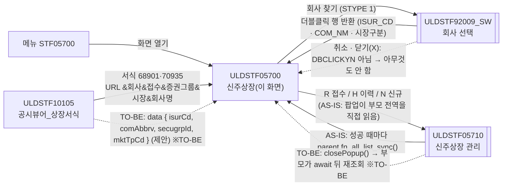
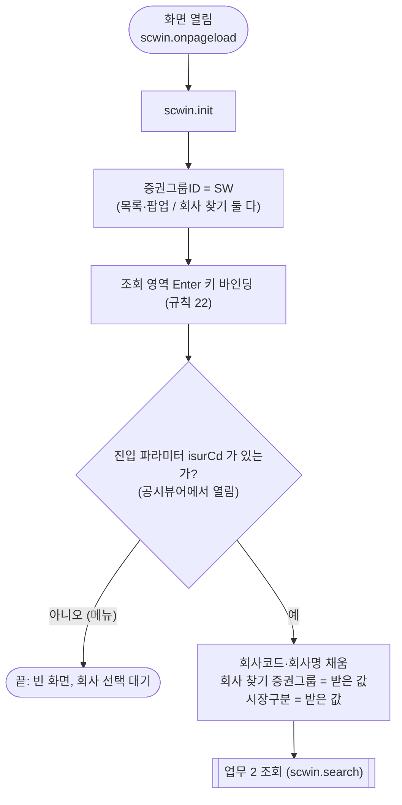
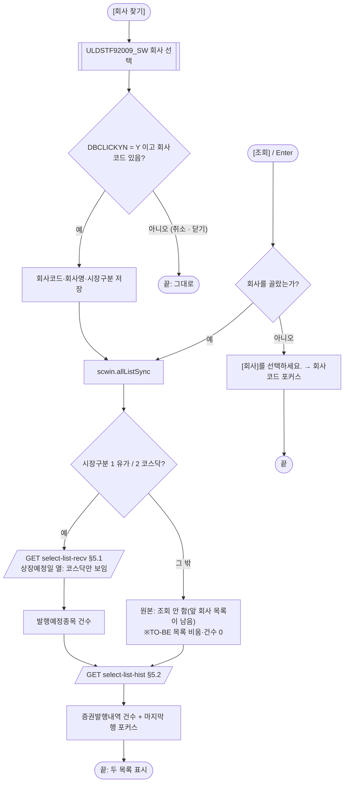
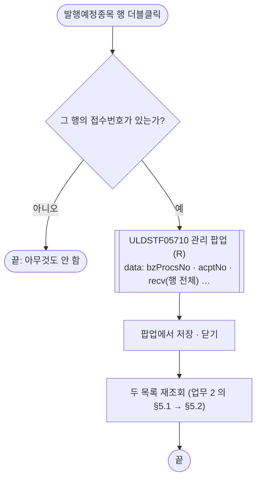
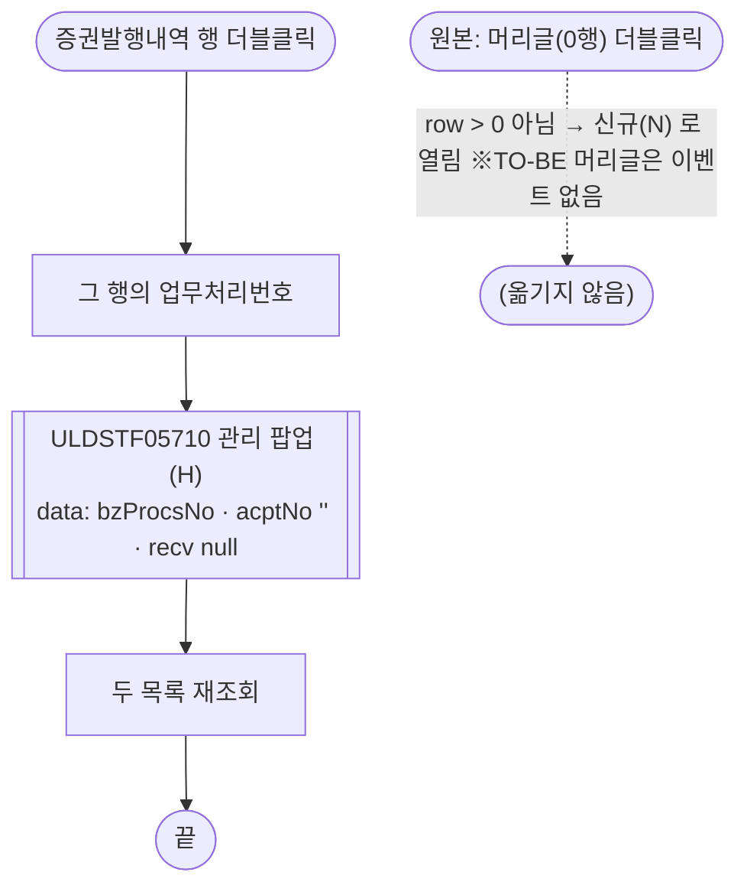
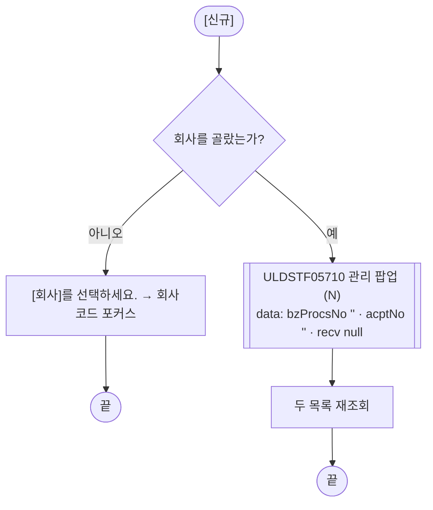
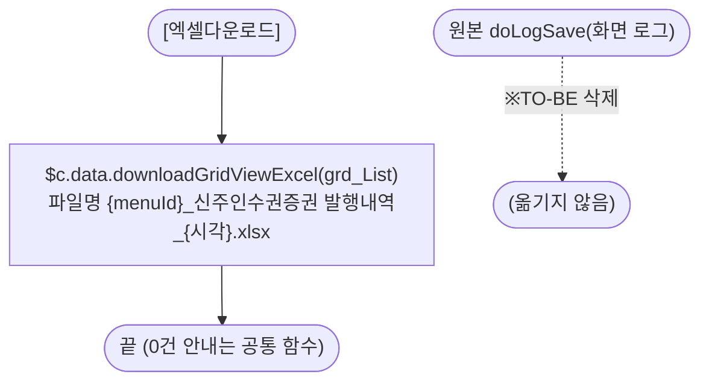

# ULDSTF05700 신주상장(신주인수권증권) — 업무 분석 및 전환 내역

| 항목 | 내용 |
|---|---|
| AS-IS | `/lstproc/ULDSTF05700.gfm` (Gauce/X-Internet, 1270×750 **메인 화면** — 메뉴 `STF05700` 으로 열거나, 공시뷰어 `ULDSTF10105` 가 회사를 넘겨 연다) — 반입 `conversion/conversion-front/ui/completed/ULDSTF05700/ULDSTF05700.gfm` |
| 신규 API 명세 | `conversion/conversion-front/ui/completed/ULDSTF05700/ULDSTF05700_API.md` — 블록 2종: `[ULDSTF05700]` `GET select-list-recv`(발행예정종목), `[ULDSTF05700/ULDSTF05710]` `GET select-list-hist`(증권발행내역 — 팝업 05710 과 공유). 둘 다 `/api/listing/lstproc/warrant/listing/` 아래. §2.2·§5 는 명세 기준(가이드 §0.3·§5) |
| TO-BE | `conversion/conversion-front/ui-tobe/ULDSTF05700.xml` (배포 경로 `/ui/lst/lstproc/ULDSTF05700.xml` — 가정, §10 #5). **2026-10-28 전환** — 1단계: 캡처·퍼블리싱 파일 기준 마크업(본화면 `sub_contents` + contentHeader, 조회조건 `schbox`, 목록 그리드 2개 + 총건수, 하단 [신규] — [닫기] 없음), 2단계: 이 결과서대로 스크립트 전환. 게이트 통과: `gate_screen --pcc stf`, `scan_mixed_compare`(A 0·B 0), `publish_gate --pcc stf --before {1단계 사본} --allow P20`, `api_spec_check`(명세 2종 모두 사용), `init_binding_check`, `wsxml_lint` 0/0, `convert.py` 고정점 |
| 퍼블리싱 파일 | 화면 폴더 `ULDSTF05700.xml`(가이드 §0.3 — W-Craft 1차 스크립트 포함). 컴포넌트 id 는 AS-IS 와 같음. 다른 점: `txb_ISUR_CD` 를 `w2:autoComplete` 로, 그리드 높이 둘 다 153px, [엑셀다운로드]를 **두 목록 제목줄 모두**에(둘째는 id 없음), 하단 [신규]·[닫기]. TO-BE 는 캡처·AS-IS 를 따라 읽기전용 입력, 그리드 5행/20행, 엑셀은 증권발행내역 하나, [닫기] 없음(§2.1, §10 #8) |
| 화면 캡처 | `ULDSTF05700.png` (회사 미선택 빈 상태 — 두 목록 비어 있음, 하단 [신규]·[닫기]·[엑셀저장]) → TO-BE 는 가이드 §13.2 퍼블리싱본부터 만들었다. 캡처 하단 [닫기]는 **(옮기지 않음)** — §2.1 |
| 업무공통 | pcc(`cm/pcc/stf`): `$c.lc`(`popFindCorpChrgSW`·`glb.SECUGRP_ID_SW`)·`$c.stf`(`fillGridHeaderTotalCnt`). gcc: `$c.data`(`getParameter`·`downloadGridViewExcel`)·`$c.date.getServerDateTime`·`$c.util.isEmpty`·`$c.win`(`alert`·`openPopup`·`setEnterKeyEvent`·`getProgramId`)·`$c.sbm.executeDynamic`·`$c.exception.handleError`. 게이트는 `--pcc stf` 로 돌린다 |
| 작성 | Inswave / 2026-10-28 |

참고 양식: [websquare_gfm_conversion.md](../../../../md/websquare_gfm_conversion.md) — 특히 §1.4 업무 프로세스 흐름, §5 「API 명세 적용」, §6.5 getPar/setPar 전환. Gauce 대응은 [gfm_business_analysis_guide.md](../../../../md/gfm_business_analysis_guide.md) 를 함께 따랐다. 하위 팝업 [ULDSTF05710.md](../ULDSTF05710/ULDSTF05710.md)(먼저 전환 — §1.2 호출 규약을 이 화면이 지킨다), 같은 회사 찾기를 쓰는 [ULDSTF05232.md](../ULDSTF05232/ULDSTF05232.md), 같은 꼴의 메인 화면 [ULDSTF05702.md](../ULDSTF05702/ULDSTF05702.md) 의 결정을 따랐다.

---

## 1. 화면 개요

상장 담당자가 **신주인수권증권(SW) 신주상장**을 처리하는 메인 화면이다. 회사를 고르면 그 회사의 **발행예정종목**(공시 접수로 들어온 상장 신청 건)과 이미 처리한 **증권발행내역**을 보여 주고, 건마다 신주상장 관리 팝업(ULDSTF05710)을 열어 등록·수정·삭제한다. 이 화면 자체는 저장하지 않는다.

1. [회사 찾기](돋보기)로 회사를 고른다 → 발행예정종목과 증권발행내역을 차례로 조회한다. 공시뷰어(ULDSTF10105)에서 넘어오면 그 회사로 바로 조회한다.
2. 발행예정종목 행을 **더블클릭**하면 그 접수 건을 미리 채운 **접수(R)** 모드로 관리 팝업을 연다(접수번호가 있는 행만).
3. 증권발행내역 행을 **더블클릭**하면 그 업무처리번호의 **이력(H)** 모드로 관리 팝업을 연다.
4. [신규]는 빈 **신규(N)** 모드로 관리 팝업을 연다.
5. 팝업에서 저장·수정·삭제하고 닫으면 두 목록을 다시 조회한다. 증권발행내역은 [엑셀다운로드]로 내려받는다.

### 1.1 호출 화면 (1본 + 메뉴)

- 메뉴 `STF05700`(업무공통 메뉴→증권그룹 표 `{ mid: "STF05700", sid: ["SW"] }` — `cm/pcc/stf/list_common.xml`).
- `ULDSTF10105` 공시뷰어_상장서식 — 서식코드 `68901`·`70935` 이면 `fn_MoveBizProcPage` 가 `WinOpen("STF05200", "/lstproc/ULDSTF05700.gfm?" + FrameID + "&회사코드&접수번호&증권그룹ID&시장구분&회사약명", "신주인수권증권 신주상장", 1275, 785)` 로 연다. 이 화면은 `fn_GetRecvDocProvider()` 로 URL 을 `&` 위치로 잘라 `gIsurCd`·`gAcptNo`·`gSecugrpId`·`gMktTpCd`·`gComAbbrv` 에 넣는다. 저장소의 `ULDSTF10105` 는 퍼블리셔 사본(`conversion/publish/공시/공시처리(대내)/ULDSTF10105.xml`)뿐이고 아직 전환되지 않았다.

### 1.2 호출 규약 (부모 → 이 화면) / 반환 규약

메뉴로 열면 파라미터가 없다. 공시뷰어가 열 때만 아래 값을 받는다. TO-BE 는 위치 기반 URL 파싱 대신 `$c.data.getParameter()` 키로 받는다 — 키 이름은 **제안**이다(§10 #4).

| AS-IS (URL 위치 → 전역) | TO-BE 키 (제안) | 의미 | 빈 값일 때 / 분기 |
|---|---|---|---|
| `arr2[1]` → `gIsurCd` | `isurCd` | 발행회사코드 | 비면 메뉴 진입과 같음(조회 안 함). 있으면 회사를 채우고 바로 조회(§3) |
| `arr2[5]` → `gComAbbrv` | `comAbbrv` | 회사약명 → 회사명 칸 | 원본은 회사명에 `&` 가 있으면 잘렸다(공통 함수 주석) — 키 방식이라 해소 |
| `arr2[3]` → `gSecugrpId` | `secugrpId` | 증권그룹ID → **회사 찾기 조건만**(`fr_SecuGrpId`) | 비면 SW. 목록 조회·팝업은 늘 SW(`pSecuGrpId`) — §8 #1 |
| `arr2[4]` → `gMktTpCd` | `mktTpCd` | 시장구분 1 유가 / 2 코스닥 | 발행예정종목 조회 분기(§5.1) |
| `arr2[2]` → `gAcptNo` | (받지 않음) | 접수번호 | 이 화면은 쓰지 않는다(전역도 선언하지 않음) — §8 #8 |

- **반환**: 없음. 메인 화면이다. AS-IS [닫기](`frame.CloseFrame()`)는 MDI 창 닫기 — TO-BE 는 창 탭의 닫기를 쓴다(§2.1).

### 1.3 이 화면이 여는 하위 팝업

| 팝업 | AS-IS 호출 (getPar/setPar) | 넘기는 `data` (TO-BE) | 받는 결과 (`closePopup`) / 취소 판정 |
|---|---|---|---|
| `ULDSTF92009_SW` 회사 선택(신주인수권, 700×950) | `img_COM_NM onclick` → `fn_GetPar = fn_GetParIsur`(`arr[0]` 회사코드, `arr[1]` 회사명), `fn_SetPar = fn_SetParIsur` → `fn_PopFindCorpChrgSW(fr_SecuGrpId, "1")`("1" 신주상장) | `await $c.lc.popFindCorpChrgSW(scwin.findSecugrpId, "1")` — pcc 가 `{ STYPE, SECU_GRP_STR, SECJ_GRP_ID }` 로 연다. 원본 `arr[0]`·`arr[1]`(현재 회사)은 pcc 계약에 없어 넘기지 않음 | 행 더블클릭 때만 `{ DBCLICKYN : "Y", ISUR_CD, COM_NM, SPOT_ISU_TRD_MKT_TP_CD, … }`. **`DBCLICKYN !== "Y"` 이거나 `ISUR_CD` 가 비면 취소**(취소·X 닫기는 `{ isCloseButtonClick }` 객체 — 가이드 §12 #8a) — §6.3 |
| `ULDSTF05710` 신주인수권증권 신주상장 관리(860×490) | `fn_OpenPopup` → `frame.CreateDialogFrame("ULDSTF05711.gfm", "/lstproc/ULDSTF05710.gfm", "신주인수권증권 신주상장 관리", 200, 200, 860, 490, "window")`. 넘기는 값은 없고 **팝업이 부모 전역을 직접 읽는다**(`frame.Provider("../")` → `vOpenTyp`·`clickBzProcsNo`·`vAcptNo`·`txb_ISUR_CD`·`pSecuGrpId`·`vSPOT_ISU_TRD_MKT_TP_CD`·`dts_Recv`) | `{ openTyp, bzProcsNo, acptNo, isurCd, secugrpId, spotIsuTrdMktTpCd, recv }` — ULDSTF05710 결과서 §1.2 계약 그대로(`recv` 는 R 일 때 접수 행 `dlt_recv.getRowJSON(row)`, 그 밖은 `null`) — §6.5 | 없음(팝업은 `closePopup()` 인자 없음). **`await` 가 끝나면 늘 두 목록을 다시 조회**한다(원본은 팝업이 성공 때마다 `parent.fn_all_list_sync()`) — §8 #5 |

### 1.4 업무 프로세스 흐름

흐름은 AS-IS 동작을 기준으로 그렸다. 점선과 `※TO-BE` 는 전환본에서 바뀌는 곳이다(근거는 §8).

| # | 업무 | 시작 (사용자 동작·진입 조건) | 끝 (결과) | 주요 함수 | 관련 절 |
|---|---|---|---|---|---|
| 1 | 진입·로딩 | 메뉴 또는 공시뷰어에서 화면 열기 | 빈 화면 / (회사를 받았으면) 두 목록 조회 | `scwin.onpageload` → `scwin.init` → (`scwin.search`) | §3 |
| 2 | 회사 선택·조회 | [회사 찾기] / [조회] / 조회 영역 Enter | 두 목록·건수 표시 | `scwin.openCompanyPopup` / `scwin.search` → `scwin.allListSync` | §6.1~§6.3, §5.1·§5.2 |
| 3 | 접수 건 처리(R) | 발행예정종목 행 더블클릭 | 관리 팝업(접수) → 닫힌 뒤 재조회 | `scwin.grd_Recv_oncelldblclick` → `scwin.openDetailRecv` → `scwin.openDetailPopup` | §6.4·§6.5 |
| 4 | 이력 건 처리(H) | 증권발행내역 행 더블클릭 | 관리 팝업(이력) → 닫힌 뒤 재조회 | `scwin.grd_List_oncelldblclick` → `scwin.openDetailHist` → `scwin.openDetailPopup` | §6.4·§6.5 |
| 5 | 신규(N) | [신규] | 관리 팝업(신규) → 닫힌 뒤 재조회 | `scwin.btn_New_onclick` → `scwin.openNew` → `scwin.openDetailPopup` | §6.4·§6.5 |
| 6 | 엑셀 | [엑셀다운로드] | 증권발행내역 xlsx | `scwin.btn_Excel_onclick` → `scwin.excelDown` | §6.6 |

#### 화면 간 흐름



#### 업무 1: 진입·로딩



| # | 단계 | 주체 | 내용 | 분기 · 메시지 | 관련 절 |
|---|---|---|---|---|---|
| 1 | 증권그룹ID | 화면 | `secugrpId`·`findSecugrpId` = `$c.lc.glb.SECUGRP_ID_SW` (원본 `pSecuGrpId`·`fr_SecuGrpId` = `SECUGRP_ID_SW`) | — | §3 |
| 2 | Enter 키 | 화면 | `$c.win.setEnterKeyEvent(panel_Top, scwin.btn_Search_onclick)` | — | §3 |
| 3 | 진입 파라미터 | 화면 | `isurCd` 가 있으면 회사 채우고 `scwin.search()` (원본 `btn_Search.onclick()`) | 없으면 끝 | §1.2, §3 |

#### 업무 2: 회사 선택·조회



| # | 단계 | 주체 | 내용 | 분기 · 메시지 | 관련 절 |
|---|---|---|---|---|---|
| 1 | 회사 확인 | 화면 | `dma_search.isurCd` 가 비면 안내 | "[회사]를 선택하세요." → `txb_ISUR_CD` 포커스 | §6.1 |
| 2 | 발행예정종목 | 서버 | 시장구분 1·2 만 `GET select-list-recv { isurCd, spotIsuTrdMktTpCd }` → `dlt_recv`, 건수 | 그 밖 시장: 원본은 조회 안 함 → TO-BE 비움(§8 #2). 실패: 공통 오류 안내, 건수 그대로 | §5.1 |
| 3 | 증권발행내역 | 서버 | `GET select-list-hist { isurCd, secugrpId }` → `dlt_hist`, 건수, 마지막 행 포커스 | 실패: 공통 오류 안내 | §5.2 |

#### 업무 3: 접수 건 처리(R)



| # | 단계 | 주체 | 내용 | 분기 · 메시지 | 관련 절 |
|---|---|---|---|---|---|
| 1 | 접수번호 | 화면 | `dlt_recv.getCellData(row, "acptNo")` | 비면 끝(원본 `if (vAcptNo != "")`) | §6.4 |
| 2 | 팝업 | 팝업 | `openTyp "R"`, `bzProcsNo`(접수 행), `acptNo`, `recv`(행 JSON) | 팝업 안 처리는 ULDSTF05710 결과서 | §6.5 |
| 3 | 재조회 | 서버 | `await` 뒤 `scwin.allListSync()` | 닫기만 해도 재조회(§8 #5) | §6.2 |

#### 업무 4: 이력 건 처리(H)



| # | 단계 | 주체 | 내용 | 분기 · 메시지 | 관련 절 |
|---|---|---|---|---|---|
| 1 | 업무처리번호 | 화면 | `dlt_hist.getCellData(row, "bzProcsNo")` (원본 `fn_setBzProcsNo(dts_List, row)`) | — | §6.4 |
| 2 | 팝업 | 팝업 | `openTyp "H"` | 원본 머리글 더블클릭 → 신규(§8 #3) | §6.5 |
| 3 | 재조회 | 서버 | `await` 뒤 `scwin.allListSync()` | — | §6.2 |

#### 업무 5: 신규(N)



| # | 단계 | 주체 | 내용 | 분기 · 메시지 | 관련 절 |
|---|---|---|---|---|---|
| 1 | 회사 확인 | 화면 | §6.1 | "[회사]를 선택하세요." | §6.1 |
| 2 | 팝업 | 팝업 | `openTyp "N"` | — | §6.5 |
| 3 | 재조회 | 서버 | `await` 뒤 `scwin.allListSync()` | — | §6.2 |

#### 업무 6: 엑셀



| # | 단계 | 주체 | 내용 | 분기 · 메시지 | 관련 절 |
|---|---|---|---|---|---|
| 1 | 내려받기 | 화면 | 증권발행내역 그리드만(원본도 `grd_List` 만) | 0건은 공통 함수 안내 | §6.6 |

---

## 2. 화면 구성 및 데이터 정의

### 2.1 화면 구성

| 영역 | AS-IS 요소 | TO-BE 컴포넌트 (바인딩) | 설명 |
|---|---|---|---|
| 제목 | (MDI 창 제목) | `w2:pageFrame` `pfmContentHeader` (`/cm/xml/contentHeader.xml`) | 본화면 헤더 표준. 퍼블리싱 파일의 `pgtbox` 대신 |
| 조회조건 | `panel_Top`(`PanelToGroupBox` 로 둥근 테두리) | `xf:group.schbox` `panel_Top` | `PanelToGroupBox` 는 스타일이라 삭제 |
| | `label_26` "회사코드(명)" | `w2:textbox` `label_26` | |
| | `txb_ISUR_CD`(읽기전용, 5자) | `xf:input` `txb_ISUR_CD` readOnly, `ref="data:dma_search.isurCd"` | 퍼블리싱 파일의 `w2:autoComplete` 는 쓰지 않음(입력·검색 기능 없음, AS-IS 읽기전용) |
| | `txb_COM_NM`(읽기전용) | `xf:input` `txb_COM_NM` readOnly, `ref="data:dma_search.comNm"` | |
| | `img_COM_NM`(돋보기) | `xf:trigger` `img_COM_NM` "회사 찾기" | §4 |
| | `img_tmp_11`(구분선 이미지) | (옮기지 않음) | 장식 |
| | `btn_Search`(조회 이미지) | `xf:trigger` `btn_Search` (`btn_schbox`) | §4 |
| 목록 1 | `label_1` "발행예정종목" | `w2:textbox` `label_1` (h3, `titbox`) | |
| | `edt_TotalCnt_1`("총 n 건" 텍스트박스) | `titbox > count` 의 `w2:span.num` `edt_TotalCnt_1` | `$c.stf.fillGridHeaderTotalCnt` |
| | `grd_Recv`(`dts_Recv`, 높이 149 ≈ 5행) | `w2:gridView` `grd_Recv` `dataList="data:dlt_recv"`, `class="gvw row5"`, 읽기전용, 행 번호 표시 | 열은 §2.2. 원본 고정열(`fcolumn` 번호·제출유형)은 옮기지 않음(§9) |
| 목록 2 | `label_11` "증권발행내역" | `w2:textbox` `label_11` (h3, `titbox`) | |
| | `edt_TotalCnt_2` | `w2:span.num` `edt_TotalCnt_2` | |
| | `btn_Excel`(하단 [엑셀저장]) | `xf:trigger` `btn_Excel` "엑셀다운로드" — **증권발행내역 제목줄**로 | 원본은 `grd_List` 만 내려받는다. 퍼블리싱 파일의 발행예정종목 제목줄 엑셀 버튼은 옮기지 않음(§10 #8) |
| | `grd_List`(`dts_List`, 높이 465 ≈ 20행) | `w2:gridView` `grd_List` `dataList="data:dlt_hist"`, `class="gvw row20"`, 정렬 가능, 행 번호 표시 | 숨김 열 4개 유지 |
| 하단 | `btn_New` [신규] | `xf:trigger` `btn_New` `btn_cm pt` (`btnbox` `grpBtnBox`) | 규칙 41 |
| | `btn_Close` [닫기] | **(옮기지 않음)** | 본화면은 창 탭의 닫기(선례 05702·05923·05950) |

### 2.2 데이터 정의

| TO-BE | 종류 | 키(컬럼) | 출처 / 용도 |
|---|---|---|---|
| `dma_search` | dataMap (화면 전용) | `isurCd` 발행회사코드, `comNm` 회사명 | 조회 영역 바인딩. 두 명세 요청의 `isurCd` 를 여기서 꺼낸다 |
| `dlt_recv` | dataList (명세 `select-list-recv` 응답, `target : "dlt_recv=body"`) | `bzProcsNo`·`disclsAcptTpNm`·`acptNo`·`isurCd`·`comAbbrv`·`isuKorNm`·`listShrs`·`rghtRto`·`exerStrtDd`·`exerEndDd`·`isuDd`·`stkcertKindNm`·`isuShrs`·`parval`·`exerPrc`·`totPar`·`totIsuPrc`·`sktamtSbPayContn`·`newstkProftDivContn`·`listDd`·`nparvalstkYn` + **`remk`(명세에 없음 — 화면이 덧붙임, §10 #2)** | `grd_Recv`, 접수 행 → 팝업 `recv` |
| `dlt_hist` | dataList (명세 `select-list-hist` 응답) | `bzProcsNo`·`acptNo`·`disclsAcptTpNm`·`isurCd`·`comNm`·`isuCd`·`tarstkIsuCd`·`tarstkIsuNm`·`listMethdTpCd`·`listMethdTpNm`·`isuRnd`·`listDd`·`delistDd`·`isuDd`·`isuRsnContn`·`bfListShrs`·`incdecListShrs`·`listShrs`·`isuShrs`·`nparvalstkYn`·`exerPrc`·`totIsuPrc`·`exerStrtDd`·`exerEndDd`·`subsrghtContn`·`subsrghtExertmPaymethdContn`·`remk`·`isuSrtCd`·`isuKorNm`·`isuKorAbbrv`·`isuEngNm`·`isuEngAbbrv`·`disclsYn`·`fnlEmpNm` | `grd_List`, 행 → 팝업 `bzProcsNo` |

**그리드 열 대응** (AS-IS 열 id → TO-BE 키, 머리글은 `h_` 접두)

| 그리드 | AS-IS 열 → TO-BE |
|---|---|
| `grd_Recv` | `NO`(`{CurRow}`) → 그리드 행 번호(`rowNumVisible`) · `DISCLS_ACPT_TP_NM` → `disclsAcptTpNm` · `ISU_KOR_NM` → `isuKorNm` · `LIST_SHRS`("신주인수권증서수") → `listShrs` · `RGHT_RTO`(소수 6) → `rghtRto` · `EXER_STRT_DD`·`EXER_END_DD`·`ISU_DD`(마스크 `XXXX-XX-XX`) → `exerStrtDd`·`exerEndDd`·`isuDd`(`yyyy-MM-dd`) · `LIST_DD`("상장예정일", **코스닥만 보임** §5.1) → `listDd` · `STKCERT_KIND_NM` → `stkcertKindNm` · `NPARVALSTK_YN` → `nparvalstkYn` · `ISU_SHRS` → `isuShrs` · `PARVAL`(소수 3) → `parval` · `EXER_PRC`("발행가", 소수 8) → `exerPrc` · `TOT_PAR`·`TOT_ISU_PRC`(소수 3) → `totPar`·`totIsuPrc` · `SKTAMT_SB_PAY_CONTN` → `sktamtSbPayContn` · `NEWSTK_PROFT_DIV_CONTN` → `newstkProftDivContn` · `REMK` → `remk` · `ACPT_NO` → `acptNo` · `BZ_PROCS_NO` → `bzProcsNo` |
| `grd_List` | `NO` → 행 번호 · `DISCLS_YN` → `disclsYn` · `ISU_KOR_NM` → `isuKorNm` · (숨김) `ISU_KOR_ABBRV`·`ISU_ENG_NM`·`ISU_ENG_ABBRV`·`ISU_RND` → `isuKorAbbrv`·`isuEngNm`·`isuEngAbbrv`·`isuRnd` · `LIST_DD`·`ISU_DD` → `listDd`·`isuDd` · `LIST_METHD_TP_NM` → `listMethdTpNm` · `ISU_RSN_CONTN` → `isuRsnContn` · `TARSTK_ISU_NM` → `tarstkIsuNm` · `LIST_SHRS`·`ISU_SHRS` → `listShrs`·`isuShrs` · `TOT_ISU_PRC`(소수 3) → `totIsuPrc` · `NPARVALSTK_YN` → `nparvalstkYn` · `EXER_PRC`(소수 8) → `exerPrc` · `EXER_STRT_DD`·`EXER_END_DD` → `exerStrtDd`·`exerEndDd` · `SUBSRGHT_CONTN` → `subsrghtContn` · `SUBSRGHT_EXERTM_PAYMETHD_CONTN` → `subsrghtExertmPaymethdContn` · `REMK` → `remk` · `FNL_EMP_NM` → `fnlEmpNm` · `ISU_CD` → `isuCd` · `DISCLS_ACPT_TP_NM` → `disclsAcptTpNm` · `ACPT_NO` → `acptNo` · `BZ_PROCS_NO` → `bzProcsNo` |

**머리글 문구** (AS-IS `name` — TO-BE 머리글 `value` 는 같게, `;` 줄바꿈은 `<br/>`)

* `grd_Recv`: 번호 · 제출유형 · 종목명 · 신주인수권증서수 · 신주인수비율 · 행사시작일 · 행사종료일 · 발행일 · 상장예정일 · 주식의종류 · `무액면주식;여부` · 발행주식수 · 액면가 · 발행가 · 액면총액 · 발행총액 · 주금대용납입의제사항 · 신주의이익배당사항 · 비고 · 접수번호 · 업무처리번호
* `grd_List`: 번호 · `공시검토;여부` · 종목명 · (숨김) 종목약명 · 종목영문명 · 종목영문약명 · 발행회차 · 상장일 · 발행일 · 상장방식 · 발행사유 · 목적주권명 · 상장증권수량 · 발행주식수(주) · 발행가액총액(원) · `무액면주식;여부` · 행사가격(원) · 행사시작일 · 행사종료일 · 신주인수권의내용 · 납입방법 · 비고 · 최종처리자 · 종목코드 · 제출유형 · 접수번호 · 업무처리번호

---

## 3. 로딩 (`gform onload` → `scwin.onpageload` → `scwin.init`)

`scwin.onpageload` 는 `await scwin.init()` 만 하고 try/catch + `$c.exception.handleError` 로 감싼다. `scwin.init` 의 단계:

1. **증권그룹ID** — `scwin.secugrpId`·`scwin.findSecugrpId` = `$c.lc.glb.SECUGRP_ID_SW` (AS-IS 전역 초기값 `pSecuGrpId = fr_SecuGrpId = SECUGRP_ID_SW`).
2. **init 바인딩**(규칙 22·37, 1회) — 조회 영역 `schbox` `panel_Top`(조회 버튼 `btn_Search`): `$c.win.setEnterKeyEvent(panel_Top, scwin.btn_Search_onclick)`. 날짜 달력은 없다.
3. **진입 파라미터**(§1.2) — `$c.data.getParameter()` 의 `isurCd` 가 있으면 `dma_search.isurCd`·`comNm`(← `comAbbrv`), `findSecugrpId`(← `secugrpId`, 비면 SW), `mktTpCd` 를 넣고 `await scwin.search()`(AS-IS `btn_Search.onclick()`). 없으면 끝.
   - AS-IS `PanelToGroupBox(panel_Top)` 은 스타일이라 없앤다. `var parentWin = fn_GetRecvDocProvider()` 의 반환값(부모 프레임)은 쓰이지 않는다.

## 4. 컴포넌트 이벤트

| TO-BE 컴포넌트 | 이벤트 | TO-BE 핸들러 | 동작 (호출 함수) | AS-IS |
|---|---|---|---|---|
| `btn_Search` (+ `panel_Top` Enter) | `onclick` | `scwin.btn_Search_onclick` | `scwin.search()` §6.1 | `btn_Search onclick` |
| `img_COM_NM` | `onclick` | `scwin.img_COM_NM_onclick` | `scwin.openCompanyPopup()` §6.3 | `img_COM_NM onclick` |
| `grd_Recv` | `oncelldblclick` | `scwin.grd_Recv_oncelldblclick` | `scwin.openDetailRecv(rowIndex)` §6.4 | `grd_Recv OnDblClick(row, colid)` |
| `grd_List` | `oncelldblclick` | `scwin.grd_List_oncelldblclick` | `scwin.openDetailHist(rowIndex)` §6.4 | `grd_List OnDblClick(row, colid)` |
| `btn_New` | `onclick` | `scwin.btn_New_onclick` | `scwin.openNew()` §6.4 | `btn_New onclick` |
| `btn_Excel` | `onclick` | `scwin.btn_Excel_onclick` | `scwin.excelDown()` §6.6 | `btn_Excel onclick` |
| — | — | (없음) | 조회 실패 안내는 공통 오류 핸들러 | `dts_Recv`·`dts_List` `OnLoadError()` → `alert_error` |
| — | — | (§5 후처리로) | 건수·포커스 | `dts_Recv`·`dts_List` `OnLoadCompleted(rowcount)` |
| (옮기지 않음) | | | | `btn_Close onclick` → `frame.CloseFrame()` |

모든 핸들러는 진입점이라 try/catch + `handleError`(규칙 26). 그리드 이벤트의 `rowIndex` 는 화면 행 번호이고 `dlt_*.getCellData`·`getRowJSON` 도 화면 번호를 받는다(정렬한 `grd_List` 에서도 같은 행).

## 5. 서버 통신

| # | 용도 | AS-IS | TO-BE (API 명세) |
|---|---|---|---|
| 5.1 | 발행예정종목(접수) 목록 | `dts_Recv.DataID = "/Listing.do?SCREN_ID=…&method=searchIsuIssChgList&DIV_IDX=" + (유가 DIV_IDX_NEW_ISS_SW_RECV_S / 코스닥 DIV_IDX_NEW_ISS_SW_RECV_K) + "&ISUR_CD=…"` → `Reset()` | `GET /api/listing/lstproc/warrant/listing/select-list-recv` |
| 5.2 | 증권발행내역 목록 | `dts_List.DataID = "…&DIV_IDX=" + DIV_IDX_NEW_ISS_SWR_HIST + "&ISUR_CD=…&SECUGRP_ID=" + pSecuGrpId` → `Reset()` | `GET /api/listing/lstproc/warrant/listing/select-list-hist` |

공통: AS-IS URL 의 `SCREN_ID`·`SCREN_PROCES_TP_CD`(화면 이력)는 명세에 없어 **넘기지 않는다**(선례와 같음). `action` 은 명세 경로 전체 리터럴(규칙 38), `getContextPath()` 없음(규칙 39). 통신 함수는 4구역이고 응답을 쓰기 전에 `skipped` 를 확인한다. `gridview` 는 id 만(규칙 44).

### 5.1 발행예정종목 목록 (`scwin.selectRecvList`)

| 항목 | 내용 |
|---|---|
| `id` | `sbm_selectRecvList` |
| `method` / `action` | `get` / `/api/listing/lstproc/warrant/listing/select-list-recv` *(AS-IS `/Listing.do` `searchIsuIssChgList`, `DIV_IDX` 유가 `RECV_S`·코스닥 `RECV_K`)* |
| `ref` / `requestData` | `{ isurCd : dma_search.isurCd, spotIsuTrdMktTpCd : scwin.mktTpCd }` — 원본 `DIV_IDX` 분기는 서버가 시장구분으로 정한다 |
| `target` / `gridview` | `dlt_recv=body` / `grd_Recv` |
| 선행 / 순서 | 시장구분이 `1`·`2` 일 때만 조회(원본과 같음). 그 밖이면 **목록을 비우고 건수 0**(원본은 그대로 둠 — §8 #2). 조회 전에 `grd_Recv.setColumnVisible("listDd", 코스닥)` (원본 `ColumnProp("LIST_DD","Show")` 유가 false·코스닥 true). 증권발행내역보다 먼저(원본 `syncload` 순서) |
| 후처리 | `$c.stf.fillGridHeaderTotalCnt(dlt_recv.getRowCount(), edt_TotalCnt_1)` (원본 `"총 " + CountRow + " 건"`) |
| 실패 처리 | 공통 오류 핸들러 안내(원본 `OnLoadError → alert_error`), 목록은 비운 채(§6.2 — 원본은 앞 데이터가 남음, §8 #11), `false` 반환. 다음 조회(§5.2)는 계속(원본도 동기 실패 뒤 다음 줄 실행) |
| 중복 실행 | `skipped` 면 그대로 끝 |

### 5.2 증권발행내역 목록 (`scwin.selectHistList`)

| 항목 | 내용 |
|---|---|
| `id` | `sbm_selectHistList` |
| `method` / `action` | `get` / `/api/listing/lstproc/warrant/listing/select-list-hist` *(AS-IS `DIV_IDX_NEW_ISS_SWR_HIST`)* |
| `ref` / `requestData` | `{ isurCd : dma_search.isurCd, secugrpId : scwin.secugrpId }`(SW 고정 — 원본 `pSecuGrpId`) |
| `target` / `gridview` | `dlt_hist=body` / `grd_List` — 명세 본문은 `target: "dma_std=body"` 로 적혔지만 응답 정의는 목록 `dlt_hist` 라 목록으로 받는다(팝업 05710 도 목록으로 받음, §10 #3) |
| 선행 / 순서 | §5.1 뒤 |
| 후처리 | 건수 `fillGridHeaderTotalCnt(…, edt_TotalCnt_2)`, 행이 있으면 **마지막 행 포커스** `grd_List.setFocusedCell(cnt - 1, 0)` (원본 `dts_List.RowPosition = countrow`) |
| 실패 처리 | 공통 오류 핸들러, `false` |
| 중복 실행 | `skipped` 면 그대로 끝 |

**명세 대응**: 명세 2종 모두 사용(`api_spec_check` OK). `select-list-hist` 블록의 둘째 `requestData`(`dma_resultDetail`·`dtlBfList`·`dtlAfList`)는 다른 화면용 예시라 이 화면과 무관하다.

## 6. 일반 함수

### 6.1 조회 / 회사 확인 (`scwin.search`, `scwin.checkCompany`) — 원본 `btn_Search onclick`·`btn_New onclick` 앞부분

* `checkCompany`: `dma_search.isurCd` 가 비면 `await $c.win.alert("[회사]를 선택하세요.")` → `txb_ISUR_CD.focus()` → `false`. 원본은 [조회]·[신규]에 같은 코드가 두 번 있었다.
* `search`: `checkCompany` 통과 시 `scwin.allListSync()`.

### 6.2 두 목록 조회 (`scwin.allListSync`) — 원본 `fn_all_list_sync`

* 먼저 `dlt_recv`·`dlt_hist` 를 비우고 두 건수를 0 으로 둔다(§8 #11) → `await scwin.selectRecvList()` → `await scwin.selectHistList()` (원본 `fn_recv_list_sync(); fn_list_sync();` — 두 데이터셋 `syncload="True"` 동기 순서).
* 부르는 곳: 조회, 회사 선택, 팝업 닫힌 뒤.

### 6.3 회사 찾기 (`scwin.openCompanyPopup`) — 원본 `img_COM_NM onclick` + `fn_GetParIsur` + `fn_SetParIsur` + `fn_PopFindCorpChrgSW`

* AS-IS: `fn_GetPar = fn_GetParIsur`(현재 회사코드·명 → `arr[0]`·`arr[1]`), `fn_SetPar = fn_SetParIsur` 로 바꿔 끼우고 `fn_PopFindCorpChrgSW(fr_SecuGrpId, "1")`. 팝업이 `fn_SetParIsur(arr)` 를 부르면 `arr[0].DBCLICKYN == "Y"` 일 때만 `txb_ISUR_CD`·`txb_COM_NM`·`vSPOT_ISU_TRD_MKT_TP_CD` 를 채우고 `fn_all_list_sync()`.
* TO-BE(가이드 §6.5): `const res = await $c.lc.popFindCorpChrgSW(scwin.findSecugrpId, "1")` → `res?.DBCLICKYN !== "Y"` 또는 `ISUR_CD` 가 비면 끝 → `dma_search.isurCd`·`comNm`, `scwin.mktTpCd`(← `SPOT_ISU_TRD_MKT_TP_CD`) → `scwin.allListSync()`. `fn_GetParIsur` 의 현재 회사 값은 pcc 계약에 없어 넘기지 않는다(05232 와 같음). 회사를 바꿔도 `findSecugrpId` 는 그대로다(원본도 `fn_SetParIsur` 가 바꾸지 않음).

### 6.4 팝업을 여는 세 경로 (`scwin.openDetailRecv`·`scwin.openDetailHist`·`scwin.openNew`) — 원본 `fn_OpenDetailRecv`·`fn_OpenDetailMng`·`fn_setBzProcsNo`

| TO-BE | AS-IS | 동작 |
|---|---|---|
| `openDetailRecv(rowIndex)` | `fn_OpenDetailRecv(row)` — `vOpenTyp = "R"`, `fn_setBzProcsNo(dts_Recv, row)`, `vAcptNo = dts_Recv.NameString(row, "ACPT_NO")`, 비어 있지 않으면 `fn_OpenPopup()` | 접수번호가 있으면 `openDetailPopup("R", 업무처리번호, 접수번호, dlt_recv.getRowJSON(rowIndex))` |
| `openDetailHist(rowIndex)` | `fn_OpenDetailMng(row)` 의 `row > 0` 분기 — `vOpenTyp = "H"`, `vAcptNo = ""`, `fn_setBzProcsNo(dts_List, row)` | `openDetailPopup("H", 업무처리번호, "", null)` |
| `openNew()` | `btn_New onclick` 회사 확인 + `fn_OpenDetailMng(-1)` — `vOpenTyp = "N"`, `clickBzProcsNo = ""`, `vAcptNo = ""` | `checkCompany` 통과 시 `openDetailPopup("N", "", "", null)` |

* `fn_setBzProcsNo(dsjObj, row)` 는 `eval(row)` 로 행 번호를 읽던 함수 — 각 경로에서 `getCellData(rowIndex, "bzProcsNo")` 한 줄로 바꿨다(규칙 31 eval 제거).
* 원본 `fn_OpenDetailMng` 의 `row > 0` 이 아니면 신규로 여는 분기는 Gauce 머리글(0행) 더블클릭도 신규로 열었다 → TO-BE 는 머리글에 `oncelldblclick` 이 오지 않아 사라진다(§8 #3).

### 6.5 신주상장 관리 팝업 (`scwin.openDetailPopup`) — getPar → `openPopup` data + `await`

* AS-IS: `fn_OpenPopup()` 이 `frame.CreateDialogFrame("ULDSTF05711.gfm", "/lstproc/ULDSTF05710.gfm", "신주인수권증권 신주상장 관리", 200, 200, 860, 490, "window")` 로 연다. 넘기는 인자는 없고 **팝업이 부모 전역을 직접 읽는다**: `vOpenTyp`·`clickBzProcsNo`·`vAcptNo`·`txb_ISUR_CD`·`pSecuGrpId`·`vSPOT_ISU_TRD_MKT_TP_CD`·`dts_Recv`(현재 행). 팝업은 저장 등에 성공하면 `parent.fn_all_list_sync()` 를 부른다.
* TO-BE — ULDSTF05710 결과서 §1.2 계약 그대로:

  ```javascript
  const data = { openTyp, bzProcsNo, acptNo, isurCd : dma_search.get("isurCd"), secugrpId : scwin.secugrpId,
                 spotIsuTrdMktTpCd : scwin.mktTpCd, recv };   // recv: R 만 접수 행 JSON, 그 밖 null
  await $c.win.openPopup("/ui/lst/lstproc/ULDSTF05710.xml",
      { id : "ULDSTF05710", popupName : "신주인수권증권 신주상장 관리", width : 860, height : 490, type : "pageFramePopup" }, data);
  await scwin.allListSync();
  ```

* 반환값은 보지 않는다(팝업 `closePopup()` 인자 없음). 닫힌 뒤 **늘** 재조회한다 — 원본처럼 "성공 때만"을 알 수 없고, 닫기만 했을 때의 재조회는 결과가 같다(§8 #5).
* `fn_getBzProcsNo()`(부모 `clickBzProcsNo` 반환) 는 저장소의 어떤 화면도 부르지 않는다(팝업도 전역을 직접 읽음) → 삭제(§8 #7).

### 6.6 엑셀 (`scwin.excelDown`) — 원본 `btn_Excel onclick`

* AS-IS: `doLogSave(vScrenID, SCREN_PROCS_TP_CD_07)` → `grd_List.GridToExcel("신주인수권증권 발행내역", "", "8")`.
* TO-BE: `$c.data.downloadGridViewExcel(grd_List, { fileName : $c.win.getProgramId() + "_신주인수권증권 발행내역_" + yyyyMMddHHmmss + ".xlsx", sheetName : "sheet1" })` — 파일명 규칙 42. `doLogSave`(화면 로그)는 제거 확정 사항이라 옮기지 않는다. 옵션 `"8"` 은 §10 #6.

## 7. 업무 코드 · 메시지 목록

| 구분 | 값 | 의미 / 쓰는 곳 |
|---|---|---|
| 증권그룹ID | `SECUGRP_ID_SW` → `$c.lc.glb.SECUGRP_ID_SW` | 신주인수권증권 — 목록 조회·팝업·회사 찾기(§3) |
| 시장구분 | `1` 유가 / `2` 코스닥 (`scwin.MKT_TP_KSE`·`MKT_TP_KOSDAQ`) | 발행예정종목 조회 여부·상장예정일 열(§5.1), 팝업 `spotIsuTrdMktTpCd` |
| 회사 찾기 구분 | `"1"` 신주상장 / `"2"` 변경상장 | `popFindCorpChrgSW` 둘째 인자 — 이 화면은 `"1"` |
| 여는 방식 | `R` 접수 / `H` 이력 / `N` 신규 | 팝업 `openTyp`(§6.4) |
| AS-IS 조회 구분 | `DIV_IDX_NEW_ISS_SW_RECV_S`(유가 접수)·`DIV_IDX_NEW_ISS_SW_RECV_K`(코스닥 접수)·`DIV_IDX_NEW_ISS_SWR_HIST`(이력) | TO-BE 명세 경로로 대체 |
| AS-IS 화면 이력 | `SCREN_PROCS_TP_CD_01`(조회)·`SCREN_PROCS_TP_CD_07`(엑셀) | 넘기지 않음 |
| 메시지 | "[회사]를 선택하세요." | [조회]·[신규] 회사 미선택(§6.1) |

## 8. 원본 특이사항 · 결함

| # | 원본에서 실제로 일어나는 일 (근거) | 전환본 처리 |
|---|---|---|
| 1 | 증권그룹ID 가 둘이다 — 공시뷰어 진입 때 `fr_SecuGrpId = gSecugrpId` 로 **회사 찾기 조건만** 바뀌고, 목록 조회·팝업은 상수 `pSecuGrpId`(SW) 를 쓴다 | 유지 — `findSecugrpId`(회사 찾기)·`secugrpId`(SW 고정) 로 나눠 둔다 |
| 2 | `fn_recv_list_sync` 는 시장구분이 1·2 가 아니면(빈 값·코넥스 등) **조회하지 않는다** → 앞 회사의 발행예정종목과 건수가 그대로 남아, 더블클릭하면 다른 회사 접수 건으로 팝업이 열린다 | **고침** — 목록 비우고 건수 0(§5.1). 그 시장에 접수 건이 있는지는 §10 #7 |
| 3 | `fn_OpenDetailMng(row)` 는 `row > 0` 이 아니면 신규 — Gauce 머리글(0행) 더블클릭이 회사 확인 없이 **신규 팝업**을 연다 | 옮기지 않음 — WebSquare `oncelldblclick` 은 데이터 행만 |
| 4 | `fn_setBzProcsNo` 가 `eval(row)` 로 행 번호를 읽는다 | `getCellData(rowIndex, …)` 로(규칙 31) |
| 5 | 팝업이 성공 때마다 부모 함수 `parent.fn_all_list_sync()` 를 이름으로 부른다(팝업 결과서 §8 #12) | 부모가 `await openPopup` 뒤 재조회 — 닫기만 해도 한 번 더 조회(결과 같음) |
| 6 | 팝업이 부모 전역(`vOpenTyp`·`clickBzProcsNo`·`vAcptNo`·`txb_ISUR_CD`·`pSecuGrpId`·`vSPOT_ISU_TRD_MKT_TP_CD`·`dts_Recv`)을 직접 읽는다 | `openPopup` `data` 로(§6.5) — 팝업은 이미 그 키로 받는다 |
| 7 | `fn_getBzProcsNo` 는 정의만 있고 부르는 곳이 없다 | 삭제 |
| 8 | 공시뷰어가 접수번호(`gAcptNo`)도 넘기지만 이 화면은 쓰지 않는다 | 받지 않음(§1.2) |
| 9 | 진입 파라미터를 URL `&` 위치로 자르므로 회사명에 `&` 가 있으면 잘린다(pcc 주석 "수정필요") | 키 방식 `getParameter` 로 해소(§10 #4) |
| 10 | `doLogSave` 엑셀 화면 로그, `PanelToGroupBox` 테두리 | 옮기지 않음 |
| 11 | 조회가 실패해도 데이터셋을 비우지 않는다 → 회사를 바꾼 뒤 조회가 실패하면 앞 회사 행이 남고, 더블클릭하면 새 회사코드 + 앞 회사 접수·업무처리번호로 팝업이 열린다(리뷰 지적) | **고침** — `allListSync` 시작에서 두 목록·건수를 비운다(§6.2) |

## 9. 전환 내역 (AS-IS → TO-BE)

| AS-IS | TO-BE |
|---|---|
| `gform onload` | `scwin.onpageload` → `scwin.init` (§3) |
| 전역 `vScrenID` | 삭제(규칙 1) |
| 전역 `fn_GetPar`·`fn_SetPar` | 삭제 — `await` 반환(§6.3) |
| 전역 `clickBzProcsNo`·`vAcptNo`·`vOpenTyp` | `openDetailPopup` 인자로(전역 없음) |
| 전역 `fr_SecuGrpId`·`pSecuGrpId` | `scwin.findSecugrpId`·`scwin.secugrpId` |
| 전역 `vSPOT_ISU_TRD_MKT_TP_CD` | `scwin.mktTpCd` |
| 전역 `gIsurCd`·`gComAbbrv`·`gSecugrpId`·`gMktTpCd` + `fn_GetRecvDocProvider()` | `$c.data.getParameter()` 의 `isurCd`·`comAbbrv`·`secugrpId`·`mktTpCd`(제안) |
| `fn_GetParIsur`·`fn_SetParIsur` + `fn_PopFindCorpChrgSW` | `scwin.openCompanyPopup` (`$c.lc.popFindCorpChrgSW`) |
| `fn_getBzProcsNo` | 삭제(§8 #7) |
| `fn_all_list_sync` | `scwin.allListSync` |
| `fn_recv_list_sync` + `dts_Recv OnLoadCompleted` | `scwin.selectRecvList` |
| `fn_list_sync` + `dts_List OnLoadCompleted` | `scwin.selectHistList` |
| `fn_setBzProcsNo` | 각 경로의 `getCellData`(§6.4) |
| `fn_OpenDetailRecv` | `scwin.openDetailRecv` |
| `fn_OpenDetailMng` | `scwin.openDetailHist`(row) / `scwin.openNew`(-1) |
| `fn_OpenPopup` | `scwin.openDetailPopup` |
| `btn_Search onclick` 의 회사 확인 | `scwin.search` + `scwin.checkCompany` |
| `btn_New onclick` | `scwin.btn_New_onclick` → `scwin.openNew` |
| `btn_Excel onclick` | `scwin.btn_Excel_onclick` → `scwin.excelDown` |
| `img_COM_NM onclick` | `scwin.img_COM_NM_onclick` |
| `grd_Recv`·`grd_List OnDblClick` | `scwin.grd_Recv_oncelldblclick`·`scwin.grd_List_oncelldblclick` |
| `dts_Recv`·`dts_List OnLoadError` → `alert_error` | 공통 오류 핸들러 |
| `btn_Close onclick` | 옮기지 않음(§2.1) |
| 그리드 고정열(`fcolumn` 번호·제출유형) | 옮기지 않음 — 행 번호는 `rowNumVisible`, 가로 스크롤 시 고정 필요하면 퍼블리싱 회신(§10 #8) |
| `dts_Recv`·`dts_List` | `dlt_recv`·`dlt_hist`(명세) + 화면 `dma_search` |

## 10. 남은 작업 (TODO)

1. **하위 팝업 계약 확정** — 이 화면은 ULDSTF05710 결과서 §1.2 의 `data` 키를 그대로 넘긴다. ULDSTF05710 의 「부모 전환 전 제안값」 TODO(그쪽 §10 #6)는 이 전환으로 키가 정해졌다 — 접수 행 `recv` 키는 `select-list-recv` 응답 키(camelCase)다.
2. **`dlt_recv.remk`** — AS-IS 발행예정종목 그리드에 [비고]가 있고 팝업 `applyRecv` 도 `recv.remk` 를 읽지만 `select-list-recv` 응답 명세에 없다. 화면은 열을 덧붙여 두었다 — 서버 응답에 `remk` 를 넣을지 확인.
3. **`select-list-hist` target** — 명세 본문은 `target: "dma_std=body"`, 응답 정의는 목록 `dlt_hist` 다. 목록(`dlt_hist=body`)으로 받았다 — 명세 정정 확인.
4. **진입 파라미터 키**(§1.2) — `isurCd`·`comAbbrv`·`secugrpId`·`mktTpCd` 는 제안이다. 공시뷰어 `ULDSTF10105` 전환 때 그 화면이 이 키로 `data` 를 넘기도록 맞춘다(지금은 URL 위치 방식).
5. **배포 경로** — 이 화면 `/ui/lst/lstproc/ULDSTF05700.xml`, 팝업 `/ui/lst/lstproc/ULDSTF05710.xml`(`scwin.POPUP_URL`) 모두 가정.
6. **엑셀 옵션** — 원본 `GridToExcel(…, "", "8")` 의 옵션(숨김 열 포함 여부 등) 확인. 지금은 공통 기본값(숨김 열 4개 제외 여부는 공통 함수 동작).
7. **유가·코스닥 밖의 시장** — 원본은 시장구분 1·2 만 발행예정종목을 조회했다. 명세 `spotIsuTrdMktTpCd` 가 그 밖 값(코넥스 등)도 받는지, 받으면 조회할지 확인(지금은 비움 — §8 #2).
8. **퍼블리싱 차이** — 퍼블리싱 파일의 발행예정종목 제목줄 [엑셀다운로드](id 없음)·`w2:autoComplete` 회사코드·그리드 153px·하단 [닫기]는 캡처·AS-IS 를 따라 바꿨다. 그리드 고정열 필요 여부도 퍼블리싱 회신.
