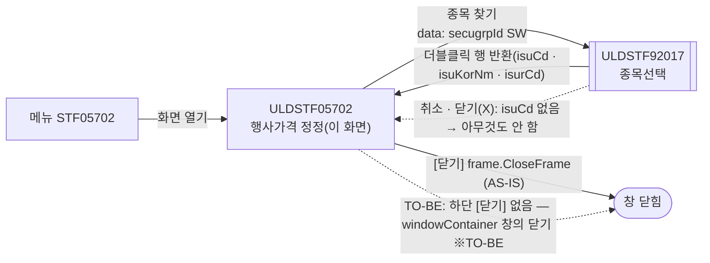
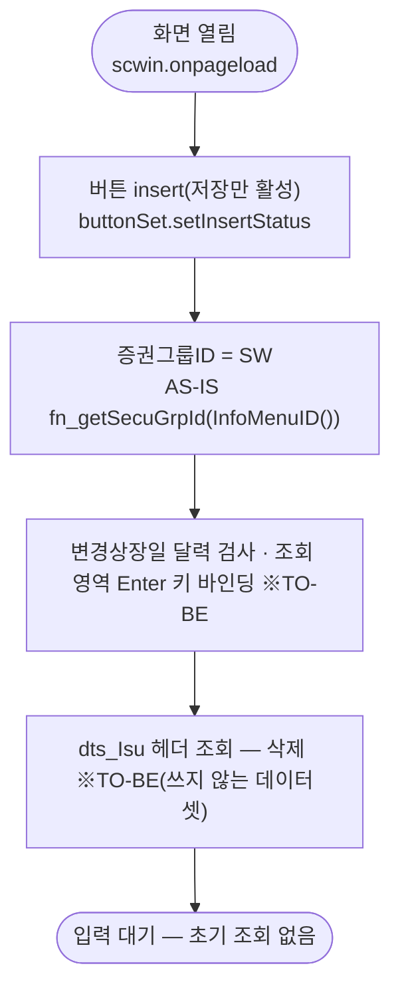
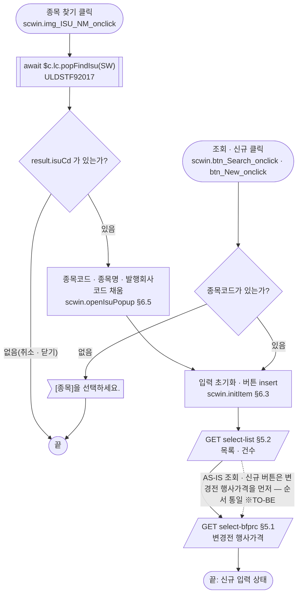
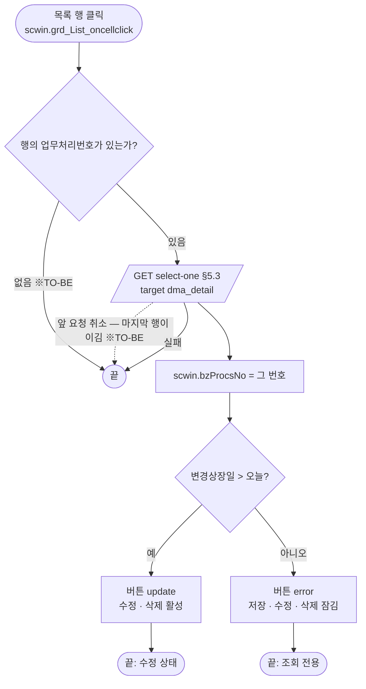
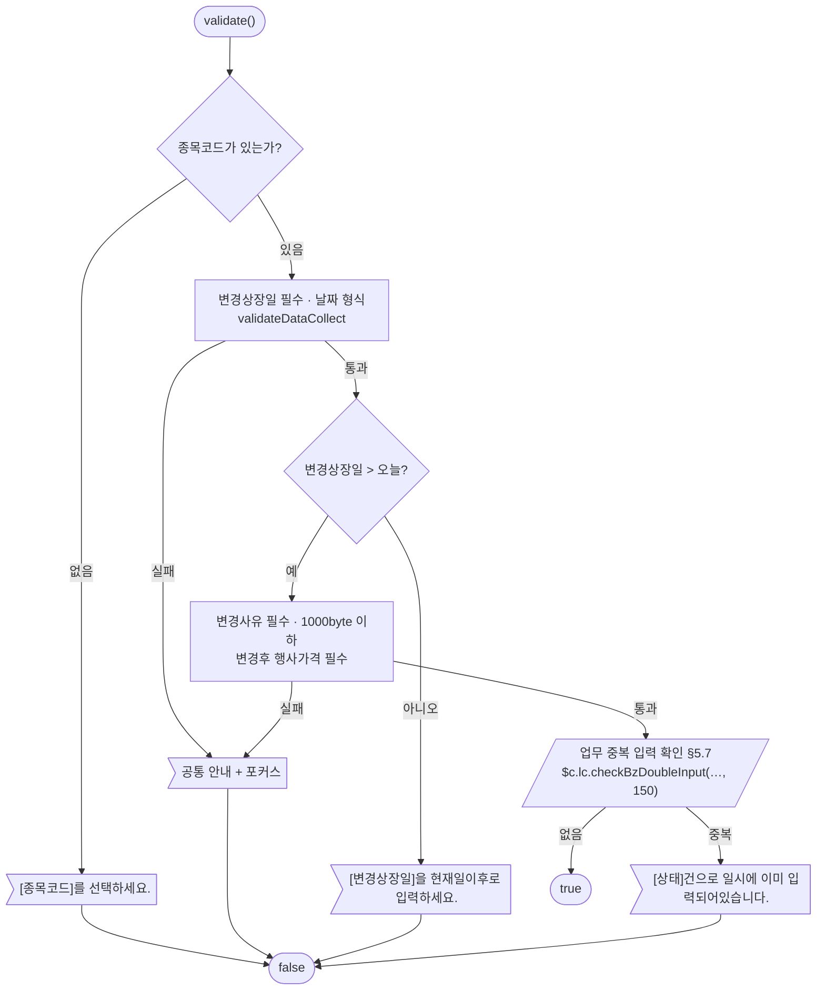
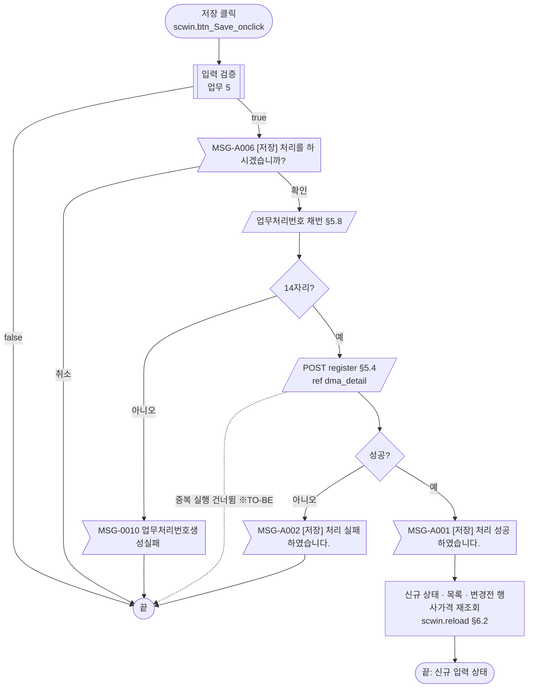
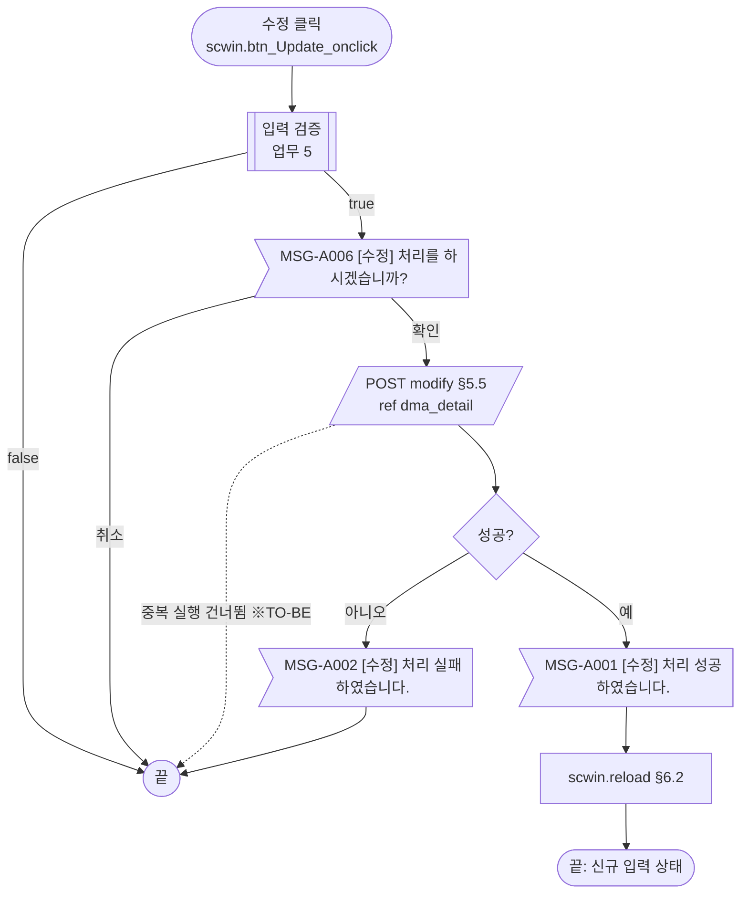
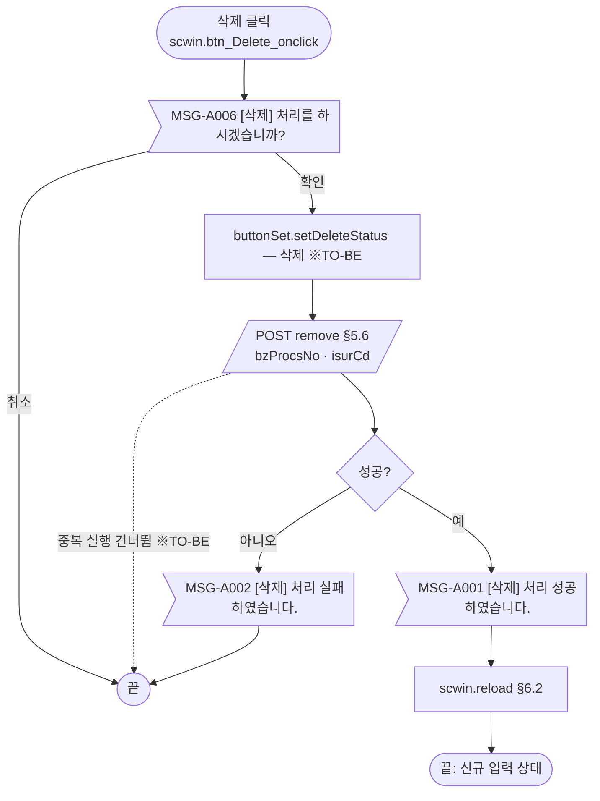
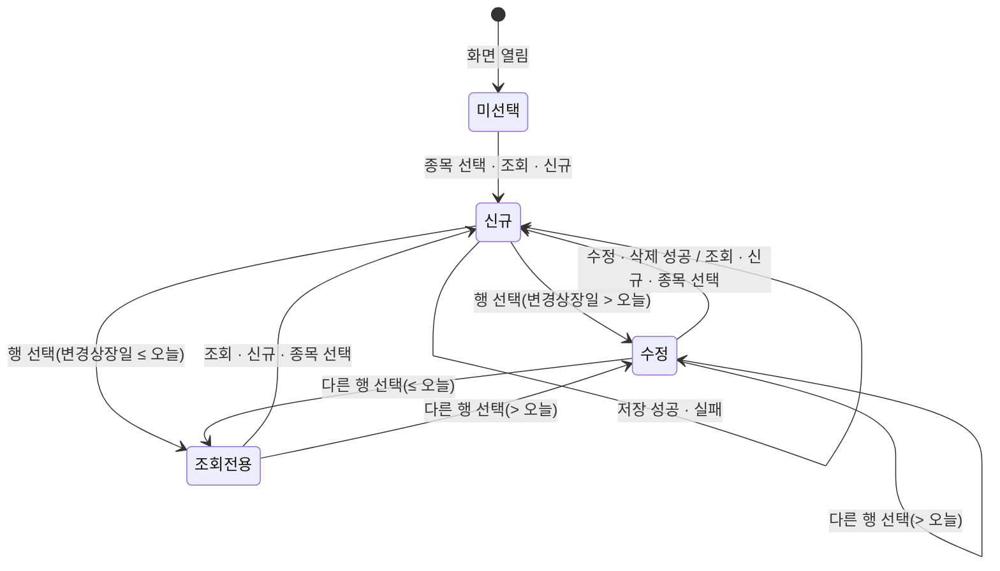

# ULDSTF05702 행사가격 정정 — 업무 분석 및 전환 내역

| 항목 | 내용 |
|---|---|
| AS-IS | `/lstproc/ULDSTF05702.gfm` (Gauce/X-Internet, 1270×785 **메인 화면** — 메뉴 `STF05702` 로 연다. 다른 화면에서 여는 곳 없음) — 반입 `conversion/conversion-front/ui/completed/ULDSTF05702/ULDSTF05702.gfm` |
| 신규 API 명세 | `conversion/conversion-front/ui/completed/ULDSTF05702/ULDSTF05702_API.md` — 블록 6종, 모두 이 화면 블록(`[ULDSTF05702][신주인수권증권][행사가격변경]`, `/api/listing/lstproc/warrant/exerprcchange/` 아래 `GET select-bfprc`·`GET select-list`·`GET select-one`·`POST modify`·`POST register`·`POST remove`). 다른 화면 블록 0종. §2.2·§5 는 명세 기준(가이드 §0.3·§5) |
| TO-BE | `conversion/conversion-front/ui-tobe/ULDSTF05702.xml` (배포 경로 `/ui/lst/lstproc/ULDSTF05702.xml` — 가정, §10 #12). **2026-10-28 전환** — 1단계: 캡처 기준 퍼블리싱(본화면 `sub_contents` + contentHeader, 조회조건 `schbox`, 입력 표 4행, 목록 그리드, 하단 버튼 — [닫기] 없음), 2단계: 이 결과서대로 스크립트 전환. 게이트 통과: `gate_screen --pcc stf`, `scan_mixed_compare`, `publish_gate --pcc stf --before {1단계 사본} --allow P20`, `api_spec_check`(명세 6종 모두 사용), `init_binding_check`, `wsxml_lint` 0/0 |
| 퍼블리셔 XML | `conversion/publish/상장/상장처리(대내)/ULDSTF05702.xml`(원본)·`conversion/publish/publish-tobe/상장/상장처리(대내)/ULDSTF05702.xml`(W-Craft 1차 스크립트 포함 사본) — 컴포넌트 id 는 AS-IS 와 같음(변경상장일 `w2:inputCalendar`, 이미지 버튼 → `xf:trigger`, 달력 이미지 `img_CHD_DD` 없음). 단 `txb_ISU_CD` 를 `w2:autoComplete` 로 바꿨고 그리드 높이 153px·[닫기] 포함 — 캡처와 달라 캡처를 따름(§10 #10) |
| 화면 캡처 | `ULDSTF05702.png` (종목 미선택 빈 상태 — [신규]·[저장] 활성, [수정]·[삭제] 잠김) → **TO-BE 는 가이드 §13.2 퍼블리싱본부터 만든다**. 캡처 하단 [닫기]는 **(옮기지 않음)** — §2.1, §10 #9 |
| 업무공통 | pcc(`cm/pcc/stf`): `$c.stf`(`getNewBzProcNo`·`getMessageParam`·`setButtonSetWithDate`)·`$c.lc`(`popFindIsu`·`isProcess`·`checkBzDoubleInput`·`glb.SECUGRP_ID_SW`·`glb.LIST_BZ_TP_CD_150`). gcc: `$c.date`(`getServerDateTime`·`checkCalendarFormat`)·`$c.validate.validateDataCollect`·`$c.util`(`setButtonState`·`isEmpty`)·`$c.win`(`alert`·`setEnterKeyEvent`)·`$c.sbm.executeDynamic`·`$c.exception.handleError`. 게이트는 `--pcc stf` 로 돌린다 |
| 작성 | Inswave / 2026-10-28 |

참고 양식: [websquare_gfm_conversion.md](../../../md/websquare_gfm_conversion.md) — 특히 §1.4 업무 프로세스 흐름, §5 「API 명세 적용」, §6.5 getPar/setPar 전환. Gauce 대응은 [gfm_business_analysis_guide.md](../../../md/gfm_business_analysis_guide.md) §5·§6 을 함께 따랐다. 같은 모듈 선례 [ULDSTF05710.md](../completed/ULDSTF05710/ULDSTF05710.md)(같은 신주인수권증권 업무·같은 pcc 함수)의 구성과 결정을 따랐다.

---

## 1. 화면 개요

상장 담당자가 **신주인수권증권(SW) 종목의 행사가격이 바뀔 때** 변경상장일·변경사유·변경후 행사가격을 등록하고, 그 종목의 **행사가격 조정내역**을 보며 등록한 건을 수정·삭제하는 메인 화면이다.

1. [종목 찾기](돋보기)로 신주인수권증권 종목을 고른다 → 행사가격 조정내역 목록과 **현재(변경전) 행사가격**을 조회하고 신규 입력 상태가 된다.
2. 변경상장일(오늘 이후)·변경사유·변경후 행사가격을 입력해 [저장]한다. 저장 전에 입력 검증, 업무 중복 입력 확인(서버), 저장 확인을 거치고 업무처리번호를 새로 받는다.
3. 목록 행을 누르면 그 건을 상세로 읽는다. 변경상장일이 오늘 이후면 [수정]·[삭제] 할 수 있고, 지났으면 모두 잠긴다.
4. 저장·수정·삭제에 성공하면 신규 입력 상태로 되돌리고 목록·변경전 행사가격을 다시 조회한다.
5. [조회]·[신규]는 같은 동작이다 — 고른 종목으로 입력을 비우고 다시 조회한다.

### 1.1 호출 화면 (0본)

- 메뉴 화면이다(`fr_SecuGrpId = fn_getSecuGrpId(InfoMenuID())` — 메뉴 ID 로 증권그룹을 정함). 저장소 전체(`conversion/**`·`cm/**`)에서 `ULDSTF05702` 를 여는 화면은 없다(이 화면 폴더와 퍼블리셔 XML 만 나옴).
- 진입 파라미터 없음.

### 1.2 호출 규약 (부모 → 이 화면) / 반환 규약

해당 없음 — 메뉴로 여는 메인 화면이라 받는 파라미터도 돌려주는 값도 없다. AS-IS `btn_close` 의 `frame.CloseFrame()` 은 MDI 창 닫기다(§2.1, §10 #9).

### 1.3 이 화면이 여는 하위 팝업

| 팝업 | AS-IS 호출 (getPar/setPar) | 넘기는 `data` (TO-BE) | 받는 결과 (`closePopup`) / 취소 판정 |
|---|---|---|---|
| `ULDSTF92017` 종목선택(상장종목 찾기, 750×800) | `img_ISU_NM onclick` → `fn_GetPar = fn_GetParIsuCd`(`arr[0] = ""` 코드, `arr[1] = ""` 명칭, `arr[2] = fr_SecuGrpId`), `fn_SetPar = fn_SetParIsuCd` → `fn_PopFindIsu(fr_SecuGrpId)` | `await $c.lc.popFindIsu(scwin.secugrpId)` — pcc 가 `{ secugrpId }` 로 `ULDSTF92017` 을 열고 결과를 돌려준다. `arr[0]`·`arr[1]` 은 늘 빈 값이라 넘길 것 없음 | 선택 행 객체(`isuCd`·`isuKorNm`·`isuKorAbbrv`·`isuEngNm`·`isuEngAbbrv`·`isurCd`·`spotIsuTrdMktTpCd` — 전환본 `sample-front/ui/stf/lst/common/ULDSTF92017.xml` 의 `dlt_listRes` 행, 더블클릭으로만 돌려줌). **`isuCd` 가 비면 취소**로 본다(원본 `if (arrPar[0].DBCLICKYN == "Y")`) — §6.5 |
| (달력) | `img_CHD_DD onclick` → `popUpCalendar2(edt_CHG_DD)` | **(옮기지 않음)** — `w2:inputCalendar` 내장 달력 | — |

### 1.4 업무 프로세스 흐름

흐름은 AS-IS 동작을 기준으로 그렸다. 점선과 `※TO-BE` 는 전환본에서 바뀌는 곳이다(근거는 §8).

| # | 업무 | 시작 (사용자 동작·진입 조건) | 끝 (결과) | 주요 함수 | 관련 절 |
|---|---|---|---|---|---|
| 1 | 진입·로딩 | 메뉴에서 화면 열기 | 빈 화면, [신규]·[저장] 활성 | `scwin.onpageload` → `scwin.init` | §3 |
| 2 | 종목 선택 | [종목 찾기](돋보기) | 종목 표시 + 목록·변경전 행사가격 조회, 신규 상태 | `scwin.img_ISU_NM_onclick` → `scwin.openIsuPopup` → `scwin.reload` | §6.5, §6.2, §5.1·§5.2 |
| 3 | 조회 · 신규 | [조회] / [신규] (같은 동작) | 입력 비움 + 목록·변경전 행사가격 재조회 | `scwin.search` → `scwin.reload` | §6.1·§6.2 |
| 4 | 상세 선택 | 목록 행 클릭 | 상세 표시, 변경상장일 기준 수정 상태 또는 잠김 | `scwin.grd_List_oncellclick` → `scwin.selectDetail` | §5.3 |
| 5 | 입력 검증 (공통 흐름) | 저장·수정 안에서 | 통과 / 안내 후 중단 | `scwin.validate` | §6.7, §5.7 |
| 6 | 신규 저장 | [저장] (신규 상태) | 성공 안내 → 신규 상태로 재조회 | `scwin.save` → 채번 → `scwin.saveTrs("I")` | §5.4, §5.8, §6.8 |
| 7 | 수정 | [수정] (수정 상태) | 성공 안내 → 신규 상태로 재조회 | `scwin.update` → `scwin.saveTrs("U")` | §5.5, §6.9 |
| 8 | 삭제 | [삭제] (수정 상태) | 성공 안내 → 신규 상태로 재조회 | `scwin.remove` → `scwin.removeTrs` | §5.6, §6.10 |

#### 화면 간 흐름



AS-IS 는 `fn_GetPar`/`fn_SetPar` 를 바꿔 끼우고 모달 창이 닫힐 때까지 기다린 뒤 `fn_SetParIsuCd` 가 화면을 채우고 조회했다. TO-BE 는 `await $c.lc.popFindIsu(...)`(pcc 가 내부에서 `$c.win.openPopup`)의 반환값으로 받아 이 화면이 채우고 조회한다(가이드 §6.5).

#### 업무 1: 진입·로딩



| # | 단계 | 주체 | 내용 | 분기 · 메시지 | 관련 절 |
|---|---|---|---|---|---|
| 1 | 버튼 상태 | 화면 | `$c.util.setButtonState("grpBtnBox", "insert", scwin.BTN_MAP)` — [저장]만 켜짐, [신규]는 매핑 밖이라 늘 활성 | — | §3, §4 |
| 2 | 증권그룹 | 화면 | `scwin.secugrpId = $c.lc.glb.SECUGRP_ID_SW` (AS-IS 메뉴 ID → `fn_getSecuGrpId` → `SW`) | — | §3, §10 #8 |
| 3 | 바인딩 | 화면 | `checkCalendarFormat(edt_CHG_DD)` · `setEnterKeyEvent(panel_Top, scwin.btn_Search_onclick)` (규칙 37·22) | — | §3 |
| 4 | (삭제) | 서버 | AS-IS `dts_Isu` 헤더 조회(`gauceSystemierAdaptor … DELISTING_ISU_INOUT`) — 화면에서 쓰지 않음 | — | §8 #2 |

#### 업무 2·3: 종목 선택 · 조회/신규



| # | 단계 | 주체 | 내용 | 분기 · 메시지 | 관련 절 |
|---|---|---|---|---|---|
| 1 | 팝업 | 사용자 | `await $c.lc.popFindIsu(scwin.secugrpId)` | 취소·닫기(X)는 `{ isCloseButtonClick }` → `isuCd` 없음으로 판정해 끝 | §6.5 |
| 2 | 반영 | 화면 | `dma_search.isuCd`·`isuNm`(= `isuKorNm`), `scwin.isurCd` | AS-IS 의 `vSPOT_ISU_TRD_MKT_TP_CD` 는 받기만 하고 쓰지 않아 옮기지 않음 | §6.5, §8 #2 |
| 3 | 종목 확인 (조회·신규) | 화면 | `dma_search.isuCd` 가 비었는지 | 비면 "[종목]을 선택하세요." + `txb_ISU_CD` 포커스 후 끝 | §6.1 |
| 4 | 초기화 | 화면 | `scwin.initItem` — 버튼 `insert`, `dma_detail` 비움, `scwin.bzProcsNo = ""` | — | §6.3 |
| 5 | 목록 | 서버 | `GET select-list` → `dlt_list`, 건수 `panel_page` | 실패면 공통 오류 안내 후 끝(목록은 비운 그대로) | §5.2 |
| 6 | 변경전 행사가격 | 서버 | `GET select-bfprc` → `dma_detail.bfchgExerPrc` | — | §5.1 |

#### 업무 4: 상세 선택



| # | 단계 | 주체 | 내용 | 분기 · 메시지 | 관련 절 |
|---|---|---|---|---|---|
| 1 | 번호 | 화면 | `dlt_list.getCellData(rowIndex, "bzProcsNo")` (화면 행 번호) | 비면 끝(AS-IS 는 머리글 클릭 row 0 에서도 빈 번호로 조회 — §8 #3) | §5.3 |
| 2 | 상세 | 서버 | `GET select-one { bzProcsNo }` → `dma_detail` | 실패면 이전 상태 그대로(※TO-BE — AS-IS 는 번호부터 바꿈, §8 #6) | §5.3 |
| 3 | 버튼 | 화면 | `$c.stf.setButtonSetWithDate(edt_CHG_DD, false, "grpBtnBox", BTN_MAP)` | 변경상장일 ≤ 오늘 → `error`, 그 밖 → `update` | §6.4 |

#### 업무 5: 입력 검증 (저장·수정 공통 — `scwin.validate`)



| # | 단계 | 주체 | 내용 | 분기 · 메시지 | 관련 절 |
|---|---|---|---|---|---|
| 1 | 종목 | 화면 | `dma_search.isuCd` 필수 | "[종목코드]를 선택하세요." + `txb_ISU_CD` 포커스 | §6.7 |
| 2 | 변경상장일 | 화면 | 필수·날짜(공통) | 공통 문구 + 포커스 | §6.7 |
| 3 | 현재일 비교 | 화면 | `chgDd <= 서버 현재일` 이면 실패 (AS-IS 클라이언트 `cGetToday`) | "[변경상장일]을 현재일이후로 입력하세요." | §6.7 |
| 4 | 변경사유·변경후 행사가격 | 화면 | 필수, 변경사유 1000byte(한글 2byte — AS-IS `checkMaxLength`) | 공통 문구 + 포커스 | §6.7 |
| 5 | 업무 중복 | 서버 | `fn_check_bz_doubleinput(dts_BZ_CHECK, 종목코드, 변경상장일, 업무처리번호, 150)` (**동기**) → `await $c.lc.checkBzDoubleInput(…)` | 이미 입력된 건이면 안내 후 false | §5.7 |

#### 업무 6: 신규 저장



| # | 단계 | 주체 | 내용 | 분기 · 메시지 | 관련 절 |
|---|---|---|---|---|---|
| 1 | 입력 검증 | 화면·서버 | 업무 5 | false 면 끝 | §6.7 |
| 2 | 저장 확인 | 사용자 | `await $c.lc.isProcess("I")` | 취소면 끝 | §6.8 |
| 3 | 채번 | 서버 | `$c.stf.getNewBzProcNo()` → 봉투에서 `body` 추출(문자열·`{ bzProcsNo }` 모두 받음) | 14자리 아니면 `MSG-0010` 후 끝 | §5.8 |
| 4 | 전문 구성 | 화면 | `dma_detail.bzProcsNo` = 새 번호, `isuCd` = 조회 영역 종목 | AS-IS `ISUR_CD`·`LIST_BZ_TP_CD=150` 등은 명세에 없어 보내지 않음(§10 #3) | §5.4 |
| 5 | 저장 | 서버 | `POST register` (`ref : "dma_detail"`) | `skipped` 면 안내 없이 끝, 실패 `MSG-A002` | §5.4 |
| 6 | 결과 반영 | 화면 | `MSG-A001` → `scwin.reload()` (AS-IS `OnSuccess`: `fn_initItem` → `fn_list_sync` → `fn_bfprc`) | — | §6.2 |

#### 업무 7: 수정



- 원본은 "변경된 내용 없음" 확인을 하지 않는다 — 그대로 유지. 수정 성공 뒤에도 **신규 상태로 돌아간다**(05710 과 다름 — 원본 `OnSuccess` 가 저장·수정·삭제 공통으로 `fn_initItem`).
- 업무 중복 확인에는 상세의 업무처리번호(`dma_detail.bzProcsNo`)를 넘긴다 — 자기 건은 서버가 빼고 본다(AS-IS 와 같음).

#### 업무 8: 삭제



| # | 단계 | 주체 | 내용 | 분기 · 메시지 | 관련 절 |
|---|---|---|---|---|---|
| 1 | 삭제 확인 | 사용자 | `await $c.lc.isProcess("D")` — 입력 검증 없음(원본과 같음) | 취소면 끝 | §6.10 |
| 2 | 삭제 | 서버 | `POST remove`, 명세 `requestData { bzProcsNo, isurCd }` | 실패 `MSG-A002` | §5.6 |
| 3 | 결과 | 화면 | `MSG-A001` → `scwin.reload()` | AS-IS `setDeleteStatus` 는 쓰는 곳이 없어 옮기지 않음(§8 #5) | §6.2 |

#### 화면 모드 상태 전이



| 상태 | 활성 버튼 | 근거 |
|---|---|---|
| 미선택 · 신규 | 저장 (+ 신규 · 조회) | `insert` — `enable: ["new", "save"]`, 이 화면 `BTN_MAP` 에 `new` 없음 → [저장]만 |
| 수정 | 수정 · 삭제 (+ 신규 · 조회) | `update` — 전체 활성 + 저장 제외 |
| 조회전용 | (신규 · 조회만) | `error` — `enable: ["draft"]`, 기안 버튼이 없어 모두 잠김 |

---

## 2. 화면 구성 및 데이터 정의

### 2.1 화면 구성

캡처(`ULDSTF05702.png`) 기준 위→아래, 왼→오른. TO-BE id 는 AS-IS·퍼블리셔 XML 과 같은 id 를 쓰고, 바인딩은 §2.2 의 camelCase 키다. 필수 표시(*)는 AS-IS 의 별도 라벨(`label_2`·`label_8`·`label_6`)을 TO-BE 라벨의 `class="req"` 로 옮긴다.

| 영역 | AS-IS 요소 | TO-BE 컴포넌트 (바인딩) | 설명 |
|---|---|---|---|
| (외곽) | `gform` 1270×785, `PanelToGroupBox(panel_Top/panel_Item)` | `sub_contents` + `w2:pageFrame pfmContentHeader`(본화면 contentHeader 필수) | `PanelToGroupBox` **(옮기지 않음)** — 퍼블리싱 마크업이 대신함 |
| 조회조건 | `panel_Top` (배경 `#d9e9fc`) · `label_2_top` "종목코드(명)" · `txb_ISU_CD`(readonly) · `txb_ISU_NM`(readonly) · `img_ISU_NM`(돋보기) | `panel_Top` (`schbox`) · `label_2_top` · `txb_ISU_CD` (`xf:input` readOnly, `dma_search.isuCd`) · `txb_ISU_NM` (readOnly, `dma_search.isuNm`) · `img_ISU_NM` (`xf:trigger btn_cm icon search`, `ev:onclick`) — 한 칸 `flex flex_no` | 종목 찾기(§6.5). 인라인 배경색 금지(규칙 40) — readOnly 기본 스타일 |
| 조회 버튼 | `btn_Search` (이미지) · `img_tmp_11`(세로 구분선 이미지) | `btn_Search` (`btn_schbox` 의 `btn_cm sch`, `ev:onclick`) · `img_tmp_11` **(옮기지 않음)** — 장식 | Enter 키는 `setEnterKeyEvent(panel_Top, …)`(§3) |
| 변경상장일 (*) | `label_2`(*) + `label_1` · `edt_CHG_DD` (`mxmaskedit`, `YYYY-MM-DD`, **readonly**) · `img_CHD_DD`(달력) | `label_1`(req) · `edt_CHG_DD` (`w2:inputCalendar`, `dma_detail.chgDd`) | 달력 이미지 **(옮기지 않음)** — 내장 달력. AS-IS readonly(달력으로만 입력) → TO-BE 직접 입력 허용 + `checkCalendarFormat`(§8 #10) |
| 변경사유 (*) | `label_8`(*) + `label_5` · `txb_CHG_RSN_CONTN` (maxlength 1000) | `label_5`(req) · `txb_CHG_RSN_CONTN` (`dma_detail.chgRsnContn`, maxlength 1000) | 저장 검증에서 1000byte(§6.7) |
| 변경전 행사가격(원) | `label_3` · `edt_BFCHG_EXER_PRC` (숫자, readonly) | `label_3` · `edt_BFCHG_EXER_PRC` (`xf:input` readOnly, `tar` `number` `#,###`, `dma_detail.bfchgExerPrc`) | 변경전 행사가격 조회(§5.1)·상세 조회로 채움 |
| 변경후 행사가격(원) (*) | `label_6`(*) + `label_4` · `edt_AFCHG_EXER_PRC` (숫자) | `label_4`(req) · `edt_AFCHG_EXER_PRC` (`tar` `number` `#,###`, `dma_detail.afchgExerPrc`) | 소수 자리 여부 §10 #13 |
| 목록 제목 | `label_7` "행사가격 조정내역" (`panel_Item` 안, top 147 — 실제로는 패널 아래에 그려짐) | `titbox` > `label_7` (h3) | — |
| 총건수 | `panel_page` (`FillGridHeaderTotalCnt(rowcount, panel_page)`) | `titbox` `rt` > `count` > `w2:span.num#panel_page` | §5.2 후처리 |
| 목록 | `grd_List` (`mxgrid`, `dts_List`) — 9열 `RNUM`·`ISU_CD`·`ISU_NM`·`CHG_DD`(mask `XXXX-XX-XX`)·`CHG_RSN_CONTN`·`BFCHG_EXER_PRC`·`AFCHG_EXER_PRC`·`EMP_NM`·`BZ_PROCS_NO` | `grd_List` (`gvwbox` > `gvw row20`, `dataList="data:dlt_list"`, readOnly, `ev:oncellclick`) — gBody 열 id 는 명세 키 `rnum`·`isuCd`·`isuNm`·`chgDd`(`date` `yyyy-MM-dd`)·`chgRsnContn`·`bfchgExerPrc`·`afchgExerPrc`(`number` `#,###`, 오른쪽)·`empNm`·`bzProcsNo`, 머리글 `h_` 접두. 머리글 "변경전/변경후 행사가격(원)" 은 2줄(`&lt;br/&gt;` — AS-IS 머리글 `변경전\\행사가격(원)`·`변경후\\행사가격(원)` 의 Gauce 줄바꿈) | 행 클릭 → 상세(§5.3). 캡처 20행 → `row20` |
| 하단 버튼 | `btn_New` · `btn_Save` · `btn_Update` · `btn_Delete` · `btn_close` (이미지) | `btnbox#grpBtnBox` 의 `rt`: `btn_Delete`(삭제) · `btn_Update`(수정) · `btn_Save`(저장) · `btn_New`(신규) — 모두 `btn_cm pt`(규칙 41 순서 [삭제]-[수정]-[저장]-[신규], 캡처 순서 신규·저장·수정·삭제와 다름) | `btn_close`(닫기) **(옮기지 않음)** — windowContainer 창 자체 닫기를 쓰고, gcc 에 메인 창 닫기 함수가 없다(§10 #9). 활성 상태 `buttonSet` → `$c.util.setButtonState`(§4) |
| (데이터 장식) | `bnd_mst` (`mxbinder` — `CHG_DD`·`CHG_RSN_CONTN`·`BFCHG_EXER_PRC`·`AFCHG_EXER_PRC` ↔ 컨트롤) | 컴포넌트 `ref="data:dma_detail.*"` | — |

- 퍼블리싱 1단계(§13.2)는 캡처 기준으로 새로 만들었다(2026-10-28): 본화면 contentHeader, 조회조건 `schbox`, 입력 표 4행(colgroup 2칸), 목록 머리 `titbox` + 총건수, 그리드 `row20`, 하단 [닫기] 없음, `readOnly` 대소문자. `publish_gate --pcc stf` 실패 0 → 사본 `$CLAUDE_JOB_DIR/tmp/stage1/ULDSTF05702.xml`.

### 2.2 데이터 정의

| AS-IS | TO-BE | 종류 | 키(컬럼) | 출처 / 용도 |
|---|---|---|---|---|
| `txb_ISU_CD`·`txb_ISU_NM` 값 (바인딩 없음) | `dma_search` | dataMap | `isuCd`, `isuNm` | **화면 전용(명세에 없음)** — 조회 영역 종목. 명세 요청 `isuCd` 를 "조회 영역의 isuCd" 로 적어 여기서 꺼낸다 |
| `dts_Mst` (1행, `bnd_mst` 로 바인딩) | `dma_detail` | dataMap | 명세 `select-one` RESPONSE 원문 6키 — `bzProcsNo`, `isuCd`, `chgDd`, `chgRsnContn`, `bfchgExerPrc`(number), `afchgExerPrc`(number) | 화면 바인딩 + 상세 조회 응답(`target "dma_detail=body"`) + **등록·수정 요청**(`ref : "dma_detail"`) + 변경전 행사가격 조회 결과(`body.bfchgExerPrc` 만 set) |
| `dts_List` | `dlt_list` | dataList | 명세 `select-list` RESPONSE 원문 9열 — `rnum`(number), `bzProcsNo`, `isuCd`, `isuNm`, `chgDd`, `chgRsnContn`, `bfchgExerPrc`(number), `afchgExerPrc`(number), `empNm` | 목록(`target "dlt_list=body"`) |
| (응답 전용) | `dma_result` | dataMap | 명세 `modify` RESPONSE 원문 — `completeYn`, `bzProcsNo` | 등록·수정·삭제 결과 판정(`target "dma_result=body"`). `register`·`remove` 는 명세에 RESPONSE 정의가 없어 같은 구조로 받는다(§10 #1) |
| `dts_BzProcsNo` | (삭제) | — | — | 채번 결과는 `$c.stf.getNewBzProcNo()` 반환값을 바로 쓴다(§5.8) |
| `dts_BZ_CHECK` | (삭제) | — | — | 업무 중복 확인 응답을 pcc 함수가 바로 판정(§5.7) |
| `dts_Isu` | (삭제) | — | — | 헤더만 읽고(`DELISTING_ISU_INOUT`) `fn_initItem` 에서 비우기·행추가만 함 — 화면에 쓰지 않음(§8 #2) |
| `trs_Save` | (삭제) | — | — | 저장·수정·삭제 통신 → `executeDynamic` |

**명세 원문 (가이드 §5 「API 명세 적용」 — id·name·dataType 그대로 옮겼다)**

`select-one` 응답 / `register`·`modify` 요청 (`ref : "dma_detail"`):

```xml
<w2:dataMap id="dma_detail" baseNode="map">
	<w2:keyInfo>
		<w2:key id="bzProcsNo" name="업무처리번호" dataType="text"></w2:key>
		<w2:key id="isuCd" name="종목코드" dataType="text"></w2:key>
		<w2:key id="chgDd" name="변경일자" dataType="text"></w2:key>
		<w2:key id="chgRsnContn" name="변경사유내용" dataType="text"></w2:key>
		<w2:key id="bfchgExerPrc" name="변경전행사가격" dataType="number"></w2:key>
		<w2:key id="afchgExerPrc" name="변경후행사가격" dataType="number"></w2:key>
	</w2:keyInfo>
</w2:dataMap>
```

`select-list` 응답 (`target : "dlt_list=body"`):

```xml
<w2:dataList id="dlt_list" baseNode="list" saveRemovedData="true" repeatNode="map">
	<w2:columnInfo>
		<w2:column id="rnum" name="순번" dataType="number"></w2:column>
		<w2:column id="bzProcsNo" name="업무처리번호" dataType="text"></w2:column>
		<w2:column id="isuCd" name="종목코드" dataType="text"></w2:column>
		<w2:column id="isuNm" name="종목명" dataType="text"></w2:column>
		<w2:column id="chgDd" name="변경일자" dataType="text"></w2:column>
		<w2:column id="chgRsnContn" name="변경사유내용" dataType="text"></w2:column>
		<w2:column id="bfchgExerPrc" name="변경전행사가격" dataType="number"></w2:column>
		<w2:column id="afchgExerPrc" name="변경후행사가격" dataType="number"></w2:column>
		<w2:column id="empNm" name="최종처리자명" dataType="text"></w2:column>
	</w2:columnInfo>
</w2:dataList>
```

`modify` 응답 (`target : "dma_result=body"` — `register`·`remove` 도 같은 target):

```xml
<w2:dataMap id="dma_result" baseNode="map">
	<w2:keyInfo>
		<w2:key id="completeYn" name="처리 완료 여부" dataType="text"></w2:key>
		<w2:key id="bzProcsNo" name="업무처리번호" dataType="text"></w2:key>
	</w2:keyInfo>
</w2:dataMap>
```

- **AS-IS 대문자 → 명세 키**: `BZ_PROCS_NO→bzProcsNo`, `ISU_CD→isuCd`, `ISU_NM→isuNm`, `CHG_DD→chgDd`, `CHG_RSN_CONTN→chgRsnContn`, `BFCHG_EXER_PRC→bfchgExerPrc`, `AFCHG_EXER_PRC→afchgExerPrc`, `EMP_NM→empNm`, `RNUM→rnum`. 종목 찾기 결과 `ISU_KOR_NM→isuKorNm`(→ `dma_search.isuNm`), `ISUR_CD→isurCd`(→ `scwin.isurCd`).
- **명세에 없는 AS-IS 값**: 저장 전문 `dts_Mst.ISUR_CD`(등록·수정), 파라미터 `TRS_IDX`·`BZ_PROCS_NO`·`COUNT=1`·`LIST_BZ_TP_CD=150`·`DIV_IDX[0]=11`(`DIV_IDX_CHGLIST_SWPRC`)·`SCREN_ID`·`SCREN_PROCES_TP_CD` → 보내지 않음(§10 #3). 삭제 요청의 `isurCd` 는 명세에 있다.
- **명세에만 있는 키**: 없음(`dma_detail` 6키 모두 화면 값).
- 변경전 행사가격 조회(`select-bfprc`)는 RESPONSE 정의 없이 `result.responseJSON.body.bfchgExerPrc` 를 `dma_detail` 에 넣으라고만 적혀 있다 — 그대로 따른다(§10 #7).

---

## 3. 로딩 (`gform onload` → `scwin.onpageload` → `scwin.init`)

원본 `gform onload` 순서:

1. `PanelToGroupBox(panel_Top)`·`PanelToGroupBox(panel_Item)` — 삭제(퍼블리싱 마크업).
2. **버튼 매핑** — `buttonSet.setSaveInfo(btn_Save, fn_save)`·`setUpdateInfo(btn_Update, fn_update)`·`setDeleteInfo(btn_Delete, fn_delete)` → TO-BE 는 `ev:onclick` 바인딩(§4) + 역할 매핑 `scwin.BTN_MAP = { save : "btn_Save", modify : "btn_Update", "delete" : "btn_Delete" }`. [신규]는 `buttonSet` 밖이라 매핑하지 않는다(늘 활성).
3. **버튼 상태** — `buttonSet.setInsertStatus()` → `$c.util.setButtonState("grpBtnBox", "insert", scwin.BTN_MAP)`.
4. **헤더 조회** — `dts_Isu.DataID = "/gauceSystemierAdaptor.do?…DELISTING_ISU_INOUT"; dts_Isu.reset();` → **삭제**(쓰지 않는 데이터셋, §8 #2).
5. (전역 선언부) `fr_SecuGrpId = fn_getSecuGrpId(InfoMenuID())` — 메뉴 `STF05702` 는 업무공통 표(`cm/pcc/stf/list_common.xml` `getSecuGrpId`)에서 `["SW"]` 하나다 → TO-BE `scwin.secugrpId = $c.lc.glb.SECUGRP_ID_SW`(§10 #8).

TO-BE 에서 더하는 init 바인딩(규칙 22·37 — `scwin.init` 에서 1회):

| 대상 | 적용 |
|---|---|
| 단일 달력 `edt_CHG_DD`(변경상장일) | `$c.date.checkCalendarFormat(edt_CHG_DD, "yyyyMMdd");` — 기간 쌍 없음. 마크업 `ev:onviewchange` 없음 |
| 조회 영역 `panel_Top`(`schbox`) + 조회 버튼 `btn_Search` | `$c.win.setEnterKeyEvent(panel_Top, scwin.btn_Search_onclick);` — 영역 입력이 모두 읽기전용이라 실제로는 버튼 포커스에서만 의미가 있다(규칙 준수용) |

```javascript
scwin.onpageload = async function () {
    try {
        await scwin.init();
    } catch (ex) {
        await $c.exception.handleError(ex, { context : "ULDSTF05702.onpageload" });
    }
};

scwin.init = async function () {
    // 1) 버튼 — 신규 상태(저장만 활성)
    $c.util.setButtonState("grpBtnBox", "insert", scwin.BTN_MAP);
    // 2) 증권그룹ID — 메뉴 STF05702 → SW
    scwin.secugrpId = $c.lc.glb.SECUGRP_ID_SW;
    // 3) 달력 검사 바인딩 · 조회 영역 Enter 키
    $c.date.checkCalendarFormat(edt_CHG_DD, "yyyyMMdd");
    $c.win.setEnterKeyEvent(panel_Top, scwin.btn_Search_onclick);
};
```

- 초기 조회는 없다(종목을 골라야 조회 — 원본과 같음). `onpageload` 는 `scwin.init()` 만 부르고 로딩 로직은 `scwin.init` 하나다(`init_*` 분리 없음). 다시 부르는 로직(입력 초기화·재조회)은 5구역 함수(§6.2·§6.3)다.
- `scwin.secugrpId` 를 1구역이 아니라 `init` 에서 넣는 것은 pcc `$c.lc.glb` 를 화면 스크립트 평가 시점이 아니라 로딩 뒤에 읽기 위해서다.

---

## 4. 컴포넌트 이벤트

| TO-BE 컴포넌트 | 이벤트 | TO-BE 핸들러 | 동작 (호출 함수) | AS-IS |
|---|---|---|---|---|
| `btn_Search` (조회) | `onclick` | `scwin.btn_Search_onclick` | `scwin.search()` — §6.1 | `btn_Search onclick` (종목 확인 → `fn_initItem` → `fn_bfprc` → `fn_list_sync`) |
| `panel_Top` (조회 영역) | Enter 키 | — | `$c.win.setEnterKeyEvent` 로 `btn_Search_onclick` 실행(§3) | 없음(※TO-BE, 규칙 22) |
| `img_ISU_NM` (종목 찾기) | `onclick` | `scwin.img_ISU_NM_onclick` | `scwin.openIsuPopup()` — §6.5 | `img_ISU_NM onclick` (`fn_GetPar = fn_GetParIsuCd`, `fn_SetPar = fn_SetParIsuCd`, `fn_PopFindIsu(fr_SecuGrpId)`) |
| `grd_List` (목록) | `oncellclick` | `scwin.grd_List_oncellclick` | `scwin.selectDetail(rowIndex)` — §5.3 | `grd_List OnClick(row, colid)` → `fn_read_sync(row)` |
| `btn_New` (신규) | `onclick` | `scwin.btn_New_onclick` | `scwin.search()` — 조회와 같은 처리 | `btn_New onclick` (조회와 같은 코드) |
| `btn_Save` (저장) | `onclick` | `scwin.btn_Save_onclick` | `scwin.save()` — §6.8 | `buttonSet.setSaveInfo(btn_Save, fn_save)` |
| `btn_Update` (수정) | `onclick` | `scwin.btn_Update_onclick` | `scwin.update()` — §6.9 | `buttonSet.setUpdateInfo(btn_Update, fn_update)` |
| `btn_Delete` (삭제) | `onclick` | `scwin.btn_Delete_onclick` | `scwin.remove()` — §6.10 | `buttonSet.setDeleteInfo(btn_Delete, fn_delete)` |
| `btn_close` (닫기) | — | **(옮기지 않음)** | windowContainer 창의 닫기를 쓴다(§10 #9) | `frame.CloseFrame()` |
| `img_CHD_DD` (달력) | — | **(옮기지 않음)** | inputCalendar 내장 달력 + init 바인딩(§3) | `popUpCalendar2(edt_CHG_DD)` |
| `dts_Mst` | `OnLoadCompleted(rowcount)` | (핸들러 없음) | 상세 조회 후처리(§5.3 — 버튼 `update`/`error`). 변경전 행사가격 조회 뒤의 `insert` 는 `initItem` 이 이미 걸었다 | `vBzProcsNo == ""` 면 `setInsertStatus`, 아니면 `cGetToday < CHG_DD` 로 `setUpdateStatus`/`setErrorStatus` |
| `dts_List` | `OnLoadCompleted(rowcount)` | (핸들러 없음) | 목록 조회 후처리(§5.2 — 건수). `insert` 는 `initItem` 이 이미 걸었다 | `FillGridHeaderTotalCnt(rowcount, panel_page)` + `vBzProcsNo == ""` 면 `setInsertStatus` |
| `dts_BZ_CHECK`·`dts_Mst`·`dts_Isu`·`dts_List` | `OnLoadError()` | (핸들러 없음) | 공통 오류 핸들러(`executeDynamic` 실패 처리) | `alert_error(dts_…)` |
| `trs_Save` | `OnSuccess()` / `OnFail()` | (핸들러 없음) | `await` 뒤 후처리(§5.4~5.6) | `fn_alertMsg('S')` + `fn_initItem` + `fn_list_sync` + `fn_bfprc` / `fn_alertMsg('F')` + `alert_error(trs_Save)` |

모든 핸들러는 try/catch + `$c.exception.handleError`(규칙 26)이고, 위임 대상이 async 라 `await` 한다(Thin Event — 로직은 4·5구역).

**버튼 상태 (모드 × 버튼)** — 원본 `buttonSet` 은 [저장]·[수정]·[삭제] 이미지 버튼의 활성을 바꾼다. [신규]·[조회]·[닫기]는 `buttonSet` 밖이라 늘 활성이다.

| 상태 | 저장 | 수정 | 삭제 | 신규 | TO-BE |
|---|---|---|---|---|---|
| 신규(미선택 포함) | O | | | O | `setButtonState("grpBtnBox", "insert", BTN_MAP)` |
| 수정 (변경상장일 > 오늘) | | O | O | O | `$c.stf.setButtonSetWithDate(edt_CHG_DD, false, "grpBtnBox", BTN_MAP)` → `update` |
| 조회전용 (변경상장일 ≤ 오늘) | | | | O | 위 함수 → `error` |
| (삭제 처리 중) | ? | ? | ? | O | AS-IS `buttonSet.setDeleteStatus()` — **(옮기지 않음)**, §8 #5 |

---

## 5. 서버 통신

공통: AS-IS 는 URL 에 `SCREN_ID=ULDSTF05702.gfm`·`SCREN_PROCES_TP_CD`(01 조회 / 02 입력 / 03 수정 / 04 삭제)를 붙이고, 저장 `trs_Save.Action` 은 `fn_encodeNSession` 으로 세션 정보를 붙인다. 신규 API 명세에는 이 파라미터가 없으므로 **TO-BE 는 넘기지 않는다**(화면 이력·세션은 서버 처리 전제 — §10 #3). 모든 통신은 응답을 쓰기 전에 `if (result?.skipped) return;` 을 둔다. `action` 은 명세 경로 **전체 리터럴**(규칙 38), `$c.sbm.getContextPath()` 는 붙이지 않는다(규칙 39). AS-IS 조회는 모두 `syncload="True"`(**동기**) — TO-BE 는 `await` 순서로 보장한다.

| # | 용도 | AS-IS | TO-BE |
|---|---|---|---|
| 5.1 | 변경전 행사가격 | `fn_bfprc` — `/Listing.do?SCREN_ID=…&SCREN_PROCES_TP_CD=01&method=searchSWPrclist&inputMessageId=CHGLIST_PRC_INOUT&ISU_CD=` → `dts_Mst` (동기, 데이터셋 통째로 바뀜) | `GET /api/listing/lstproc/warrant/exerprcchange/select-bfprc` (`isuCd`) → `dma_detail.bfchgExerPrc` |
| 5.2 | 행사가격 조정내역 목록 | `fn_list_sync` — `/Listing.do?…&method=searchChgList&DIV_IDX=10&ISU_CD=` → `dts_List` (동기) | `GET /api/listing/lstproc/warrant/exerprcchange/select-list` (`isuCd`) → `dlt_list` |
| 5.3 | 상세 | `fn_read_sync(row)` — `/Listing.do?…&method=searchChgList&DIV_IDX=12&BZ_PROCS_NO=` → `dts_Mst` (동기) | `GET /api/listing/lstproc/warrant/exerprcchange/select-one` (`bzProcsNo`) → `dma_detail` |
| 5.4 | 신규 저장 | `fn_trs` (`trsIdx = TRS_IDX_INSERT` '1') — `trs_Save` `/Listing.do?SCREN_ID=…&SCREN_PROCES_TP_CD=02&method=saveChgList`, `KeyValue: JSP(I: dtsParm1=dts_Mst)`, `Parameters: TRS_IDX, BZ_PROCS_NO, COUNT=1, LIST_BZ_TP_CD=150, DIV_IDX[0]=11` | `POST /api/listing/lstproc/warrant/exerprcchange/register` (`ref : "dma_detail"`) |
| 5.5 | 수정 | 같은 `trs_Save`, `TRS_IDX_UPDATE` '2', `SCREN_PROCES_TP_CD=03` | `POST /api/listing/lstproc/warrant/exerprcchange/modify` (`ref : "dma_detail"`) |
| 5.6 | 삭제 | 같은 `trs_Save`, `TRS_IDX_DELETE` '3', `SCREN_PROCES_TP_CD=04` (`dts_Mst` 그대로 전송) | `POST /api/listing/lstproc/warrant/exerprcchange/remove` (`requestData { bzProcsNo, isurCd }`) |
| 5.7 | 업무 중복 입력 확인 | `fn_check_bz_doubleinput(dts_BZ_CHECK, 종목코드, 변경상장일, 업무처리번호, 150)` (동기, 업무공통) | `$c.lc.checkBzDoubleInput(isuCd, chgDd, bzProcsNo, "150")` (`GET /api/listing/lstproc/stock/chglisting/check-double-input`) — **명세에 없음**, §10 #4 |
| 5.8 | 업무처리번호 채번 | `fn_getNewBzProcNo(dts_BzProcsNo)` (동기, 업무공통) | `$c.stf.getNewBzProcNo()` (`GET /api/listing/lstproc/stock/chglisting/new-bzprocsno`) — **명세에 없음**, §10 #2 |
| 5.9 | 헤더 | `dts_Isu` — `/gauceSystemierAdaptor.do?method=getGauceDataHeader&messageId=DELISTING_ISU_INOUT` | **통신 없음** — 쓰지 않는 데이터셋(§8 #2) |

#### API 명세 대응 (`ULDSTF05702_API.md`, 블록 6종 — 모두 이 화면ID)

| # | 명세 블록 | method · 경로 | 요청 (명세) | 응답 (명세) | AS-IS 대응 (명세 AS-IS 줄) | TO-BE 함수 |
|---|---|---|---|---|---|---|
| 1 | 변경전 행사가격 조회 | `GET …/select-bfprc` | `requestData { isuCd : 조회 영역의 isuCd }` | (정의 없음) `result.responseJSON.body.bfchgExerPrc` → `dma_detail` | `fn_bfprc` | `scwin.selectBfprc` |
| 2 | 목록 조회 | `GET …/select-list` | `target "dlt_list=body"`, `requestData { isuCd }` | `dlt_list` (9열) | `fn_list_sync` | `scwin.selectList` |
| 3 | 상세 조회 | `GET …/select-one` | `target "dma_detail=body"`, `requestData { bzProcsNo : dlt_list.getJSON().bzProcsNo }` | `dma_detail` (6키) | `fn_read_sync` | `scwin.selectDetail` |
| 4 | 수정 | `POST …/modify` | `{ ref : "dma_detail", target : "dma_result=body" }` | `dma_result` (`completeYn`·`bzProcsNo`) | `fn_update` | `scwin.saveTrs("U")` |
| 5 | 등록 | `POST …/register` | `{ ref : "dma_detail", target : "dma_result=body" }` | (정의 없음) | `fn_save` "신규 등록. 업무처리번호 채번 + 상장업무처리로그 반영." | `scwin.saveTrs("I")` |
| 6 | 삭제 | `POST …/remove` | `{ target : "dma_result=body" }` + `requestData { bzProcsNo: , isurCd }` | (정의 없음) | `fn_delete` | `scwin.removeTrs` |

(`…` = `/api/listing/lstproc/warrant/exerprcchange`)

명세에 없는 AS-IS 통신: 채번(§5.8) → 업무공통 `$c.stf.getNewBzProcNo()`, 업무 중복(§5.7) → `$c.lc.checkBzDoubleInput`, 헤더 조회(§5.9) → 없앰. 두 업무공통 함수는 주식 변경상장(`stock/chglisting`) 경로를 부르므로 신주인수권증권 행사가격(150)에 맞는지 §10 #2·#4 에서 확인한다.

#### 명세 ↔ AS-IS 차이 (→ §10)

| # | 차이 | 처리 | §10 |
|---|---|---|---|
| 1 | `register`·`remove` 에 RESPONSE 정의가 없고 `target : "dma_result=body"` 만 있음. `completeYn` 의 성공 값도 없음 | `dma_result`(modify 응답 정의)로 받고, `success` + (`completeYn` 이 비었거나 `"Y"`) 면 성공(가정) | #1, #5 |
| 2 | 등록 블록 AS-IS 설명이 "업무처리번호 채번 + 상장업무처리로그 반영" — 서버 채번인지 불명. 요청 `dma_detail` 에 `bzProcsNo` 가 있음 | 원본대로 화면 채번(`$c.stf.getNewBzProcNo`) 후 `dma_detail.bzProcsNo` 로 보냄 | #2 |
| 3 | AS-IS `ISUR_CD`(전문)·`LIST_BZ_TP_CD=150`·`TRS_IDX`·`DIV_IDX[0]=11`·`COUNT=1`·`SCREN_*` 가 등록·수정 요청에 없음 | 보내지 않음(임의로 넣지 않음) — 코드 `// TODO:` | #3 |
| 4 | 상세 요청을 `dlt_list.getJSON().bzProcsNo` 로 적음 — dataList 에는 `getJSON` 이 없고(전체는 `getAllJSON` 배열) 어느 행인지도 없음 | 누른 행의 `dlt_list.getCellData(rowIndex, "bzProcsNo")` | #6 |
| 5 | 삭제 요청 `requestData { bzProcsNo: , isurCd }` — 값 식이 비어 있음 | `{ bzProcsNo : scwin.bzProcsNo, isurCd : scwin.isurCd }`(상세로 고른 건·종목 찾기 결과 회사) | #6 |
| 6 | `select-bfprc` 응답 정의 없음 — `body.bfchgExerPrc` 로만 적힘 | 그대로(`body?.bfchgExerPrc ?? ""`) | #7 |
| 7 | 업무 중복 확인·채번 API 가 명세에 없음 | 업무공통 함수 사용 | #2, #4 |

### 5.1 변경전 행사가격 조회 (`scwin.selectBfprc`)

| 항목 | 내용 |
|---|---|
| `id` | `sbm_selectBfprc` |
| `method` / `action` | `get` / `"/api/listing/lstproc/warrant/exerprcchange/select-bfprc"` *(AS-IS `/Listing.do?method=searchSWPrclist&inputMessageId=CHGLIST_PRC_INOUT&ISU_CD=`)* |
| `ref` / `requestData` | 없음 / `{ isuCd : dma_search.get("isuCd") }` |
| `target` / `gridview` | 없음(명세대로 응답에서 꺼내 set) / 없음 |
| 선행 / 순서 | `scwin.reload` 안에서 `initItem` → 목록 조회 뒤(§6.2). AS-IS 는 동기 |
| 후처리 | `dma_detail.set("bfchgExerPrc", result.responseJSON.body?.bfchgExerPrc ?? "")`. AS-IS 는 `dts_Mst` 를 통째로 응답으로 바꿔 나머지 입력이 비었다 — TO-BE 는 `initItem` 이 먼저 비우므로 결과가 같다 |
| 실패 처리 | `success:false` 면 그대로 끝(공통 오류 안내) |
| 중복 실행 | 기본(건너뜀) |

### 5.2 행사가격 조정내역 목록 조회 (`scwin.selectList`)

| 항목 | 내용 |
|---|---|
| `id` | `sbm_selectList` |
| `method` / `action` | `get` / `"/api/listing/lstproc/warrant/exerprcchange/select-list"` *(AS-IS `/Listing.do?method=searchChgList&DIV_IDX=10&ISU_CD=`)* |
| `ref` / `requestData` | 없음 / `{ isuCd : dma_search.get("isuCd") }` |
| `target` / `gridview` | `dlt_list=body` / `grd_List` (id 만 — 규칙 44) |
| 선행 / 순서 | `scwin.reload` 안에서 `initItem` 뒤 |
| 후처리 | `panel_page.setValue(dlt_list.getRowCount())` (AS-IS `FillGridHeaderTotalCnt`). AS-IS 의 `vBzProcsNo == ""` 면 `setInsertStatus` 는 `initItem` 이 이미 걸어 생략 |
| 실패 처리 | `success:false` 면 끝(공통 오류 안내) |
| 중복 실행 | 기본(건너뜀). 0건 안내는 원본에 없어 붙이지 않음 |

### 5.3 상세 조회 (`scwin.selectDetail(rowIndex)`)

| 항목 | 내용 |
|---|---|
| `id` | `sbm_selectDetail` |
| `method` / `action` | `get` / `"/api/listing/lstproc/warrant/exerprcchange/select-one"` *(AS-IS `/Listing.do?method=searchChgList&DIV_IDX=12&BZ_PROCS_NO=`)* |
| `ref` / `requestData` | 없음 / `{ bzProcsNo }` — 누른 행의 `dlt_list.getCellData(rowIndex, "bzProcsNo")`(화면 행 번호 — 정렬·필터 없음). 비면 조회하지 않음 |
| `target` | `dma_detail=body` |
| 후처리 | `scwin.bzProcsNo = bzProcsNo` → `$c.stf.setButtonSetWithDate(edt_CHG_DD, false, "grpBtnBox", BTN_MAP)` (변경상장일 ≤ 오늘 `error`, 그 밖 `update` — §6.4) |
| 실패 처리 | `success:false` 면 끝 — 업무처리번호·버튼은 이전 상태 그대로(※TO-BE, §8 #6) |
| 중복 실행 | `{ onDuplicate : "abort" }` — 행을 빠르게 바꿔 누르면 마지막 행이 이긴다(취소된 앞 요청의 reject 는 `handleError` 가 무시) |

### 5.4 / 5.5 신규 저장·수정 (`scwin.saveTrs(trJob)`)

| 항목 | 내용 |
|---|---|
| `id` | `sbm_saveTrs` |
| `method` / `action` | `post` / `(trJob === "I") ? "/api/listing/lstproc/warrant/exerprcchange/register" : "/api/listing/lstproc/warrant/exerprcchange/modify"` (가지마다 전체 경로, 규칙 38), `mediatype : "application/json"` |
| `ref` / `requestData` | `ref : "dma_detail"` / 없음 |
| 전문 준비 | `dma_detail.bzProcsNo = scwin.bzProcsNo`(I: 새 번호, U: 고른 건), `dma_detail.isuCd = dma_search.isuCd` — AS-IS `fn_trs` 의 `ISU_CD`·`BZ_PROCS_NO`. `BFCHG/AFCHG_EXER_PRC` 는 바인딩 값 그대로. `ISUR_CD` 는 명세 키가 없어 넣지 않음(§10 #3) |
| `target` | `dma_result=body` (호출 전 `setEmptyValue`) |
| 후처리 | 성공: `MSG-A001` "[저장/수정] 처리 성공하였습니다." → `scwin.reload()`(신규 상태 + 목록 + 변경전 행사가격 — AS-IS `OnSuccess`) |
| 실패 처리 | `scwin.checkResult` — `success:false` 이거나 `completeYn` 이 와서 `"Y"` 가 아니면 `MSG-A002` "[…] 처리 실패하였습니다."(가정, §10 #5). AS-IS `OnFail` 은 `fn_alertMsg('F')` 뒤 `alert_error(trs_Save)` 로 안내가 두 번 — TO-BE 는 통신 오류면 공통 오류 안내, 업무 실패면 `MSG-A002` 하나 |
| 중복 실행 | 기본(건너뜀) — `skipped` 면 안내 없이 끝 |

### 5.6 삭제 (`scwin.removeTrs`)

| 항목 | 내용 |
|---|---|
| `id` / `method` / `action` | `sbm_removeTrs` / `post` / `"/api/listing/lstproc/warrant/exerprcchange/remove"` |
| `ref` / `requestData` | 없음 / `{ bzProcsNo : scwin.bzProcsNo, isurCd : scwin.isurCd }` (명세). AS-IS 는 `dts_Mst` 전체를 보냈다 |
| `target` | `dma_result=body` |
| 후처리 | 성공: `MSG-A001` "[삭제] 처리 성공하였습니다." → `scwin.reload()` |
| 실패 처리 | `scwin.checkResult` → `MSG-A002` "[삭제] 처리 실패하였습니다." |
| 중복 실행 | 기본(건너뜀) |

### 5.7 업무 중복 입력 확인 (저장·수정 검증 끝)

- AS-IS `fn_check_bz_doubleinput(dts_BZ_CHECK, 종목코드, 변경상장일, dts_Mst.NameString(1, "BZ_PROCS_NO"), fn_getListBzTpCd())` — 응답 `DISCLS_PROCS_DDTM` 이 비면 통과, 있으면 "[`DISCLS_PROCS_STAT_CD`]건으로 `DISCLS_PROCS_DDTM`에  이미 입력되어있습니다." 후 false. 업무처리번호는 신규면 빈 값(입력 초기화 뒤), 수정이면 고른 건.
- TO-BE: `return await $c.lc.checkBzDoubleInput(isuCd, chgDd, dma_detail.get("bzProcsNo"), scwin.getListBzTpCd());` — pcc 는 `{ isuCd, mktactEnforceDd, bzProcsNo, listBzTpCd }` 로 `stock/chglisting/check-double-input` 을 부른다(명세 외, §10 #4).
- **pcc 결함(§10 #4, 코드에 `// TODO:`)** — `disclsProcsDdtm === null || === ""` 일 때만 통과라 응답에 이 키가 **없으면(undefined) 중복으로 보고 `false`** → 저장·수정이 늘 막힌다. `skipped` 가드도 없다. 선례 05710 과 같은 결함 — 화면은 pcc 를 고치지 않고 수정 요청한다.

### 5.8 업무처리번호 채번

- `const res = await $c.stf.getNewBzProcNo();` — pcc 함수는 응답 봉투(`responseJSON`)를 그대로 돌려줄 수 있다. 응답 모양이 확정되지 않아(§10 #2) `scwin.getNewBzProcsNo` 는 선례 05710 과 같이 둘 다 받는다: `const body = res?.body ?? res;` → body 가 문자열이면 그대로, `{ bzProcsNo }` 객체면 그 값.
- 호출부 `scwin.save` 가 14자리인지 보고, 아니면 `MSG-0010` "업무처리번호생성실패" 안내 후 중단(원본 `vBzProcsNo.length != 14`).
- 채번 API 는 주식 변경상장 경로(`stock/chglisting/new-bzprocsno`)다. 명세 등록 블록 설명("업무처리번호 채번")이 서버 채번일 수도 있다 → §10 #2.

---

## 6. 일반 함수

### 6.1 조회·신규 (`scwin.search`)

* **파라미터:** 없음 / **Return:** `Promise<void>`
* **로직:** `dma_search.isuCd` 가 비면 `await $c.win.alert("[종목]을 선택하세요.")` + `txb_ISU_CD.focus()` 후 끝. 있으면 `await scwin.reload()`.
* AS-IS `btn_Search`·`btn_New` 의 onclick 코드가 글자까지 같다 — 하나로 합쳤다. AS-IS 는 `fn_bfprc` → `fn_list_sync` 순서였으나 `reload` 의 목록 → 변경전 행사가격 순서로 통일했다(두 조회는 서로 의존하지 않음 — §8 #12).

### 6.2 다시 조회 (`scwin.reload`)

* **로직:** `scwin.initItem()` → `await scwin.selectList()` → `await scwin.selectBfprc()`.
* 부르는 곳: 종목 선택(§6.5 — AS-IS `fn_SetParIsuCd` 순서 그대로), 조회·신규(§6.1), 저장·수정·삭제 성공(§5.4~5.6 — AS-IS `trs_Save OnSuccess` 순서 그대로).

### 6.3 입력 초기화 (`scwin.initItem`)

* **로직:** `$c.util.setButtonState("grpBtnBox", "insert", scwin.BTN_MAP)` → `dma_detail.setEmptyValue()` → `scwin.bzProcsNo = ""`.
* AS-IS `fn_initItem`: `buttonSet.setInsertStatus()`, `dts_Isu.ClearData()/AddRow()`(삭제 — §8 #2), `dts_Mst.ClearData()/AddRow()`, `vBzProcsNo = ""`.
* 조회 영역(`dma_search`)·목록은 건드리지 않는다(목록은 이어지는 조회가 바꿈).

### 6.4 상세 버튼 상태 (`$c.stf.setButtonSetWithDate` — 화면 함수 없음)

* AS-IS `dts_Mst OnLoadCompleted`: `vBzProcsNo == ""` 면 `insert`, 아니면 `cGetToday("yyyymmdd") < CHG_DD` 면 `update`, 아니면 `error`.
* TO-BE: 빈 번호 분기는 `initItem` 이 맡고, 상세 조회 뒤에는 `$c.stf.setButtonSetWithDate(edt_CHG_DD, false, "grpBtnBox", scwin.BTN_MAP)` — 현재일(서버) ≥ 변경상장일이면 `error`, 그 밖 `update`. 차이: 변경상장일이 비어 오면 pcc 는 `update`, AS-IS 는 `error`(§8 #11).

### 6.5 종목 찾기 (`scwin.openIsuPopup`) — getPar/setPar 전환(가이드 §6.5)

* **파라미터:** 없음 / **Return:** `Promise<void>`
* **로직:**
  1. `const result = await $c.lc.popFindIsu(scwin.secugrpId);` — pcc 가 `ULDSTF92017`(750×800, `pageFramePopup` 기본) 을 `{ secugrpId }` 로 연다. AS-IS `fn_GetParIsuCd` 의 `arr[0]`·`arr[1]` 은 늘 빈 값이라 넘길 것이 없다.
  2. **취소 판정** — `result?.isCloseButtonClick === true || $c.util.isEmpty(result?.isuCd)` 면 끝. 92017 전환본은 행 더블클릭에서만 `closePopup(행)` 하므로 AS-IS `DBCLICKYN == "Y"` 검사와 같은 뜻이다.
  3. 반영(AS-IS `fn_SetParIsuCd`): `dma_search.isuCd = result.isuCd`, `dma_search.isuNm = result.isuKorNm`, `scwin.isurCd = result.isurCd`. `SPOT_ISU_TRD_MKT_TP_CD` 는 원본도 받아 두기만 해서 옮기지 않는다.
  4. `await scwin.reload()` (AS-IS `fn_initItem` → `fn_list_sync` → `fn_bfprc`).
* 반환 키는 92017 전환본(`sample-front`) 기준 가정 — §10 #11.

### 6.6 상장업무구분코드 (`scwin.getListBzTpCd`)

* **Return:** `String` — `scwin.secugrpId === $c.lc.glb.SECUGRP_ID_SW` 이면 `$c.lc.glb.LIST_BZ_TP_CD_150`("150", 업무공통 주석은 "신주인수권증권 액면변경"이나 AS-IS 화면 주석은 "신주인수권증권 행사가격"), 아니면 `""`.
* AS-IS `fn_getListBzTpCd` — `fr_SecuGrpId == SECUGRP_ID_SW`(배열 `["SW"]` 과 문자열의 느슨한 비교 — §8 #8).

### 6.7 입력 검증 (`scwin.validate`)

* **Return:** `Promise<Boolean>` (통과하면 true). AS-IS `fn_CheckForm` 순서를 지킨다.
* **공통 검증으로 옮긴 항목** (`$c.validate.validateDataCollect(panel_Item, …)`, 규칙 24 — 실패 시 표준 안내·포커스는 공통이 처리, `validateType "alert"`·`checkType "single"`). 현재일 비교를 사이에 끼우려고 두 번 나눠 부른다.

  | 순서 | 컴포넌트 | 규칙 | 이름 | AS-IS 문구 |
  |---|---|---|---|---|
  | 2 | `edt_CHG_DD` | `required`, `format : "date"` | 변경상장일 | "[변경상장일]을 입력하세요." |
  | 4 | `txb_CHG_RSN_CONTN` | `required`, `maxLengthB : 1000` | 변경사유 | "[변경사유]을 입력하세요." / `checkMaxLength(txb_CHG_RSN_CONTN, 1000, "변경사유")` byte 초과 안내 |
  | 4 | `edt_AFCHG_EXER_PRC` | `required` | 변경후 행사가격(원) | "[변경후 행사가격(원)]을 입력하세요." |

* **업무 검증** (공통으로 옮기지 않는 것):
  1. 종목코드(`dma_search.isuCd`) 없음 → "[종목코드]를 선택하세요." + `txb_ISU_CD` 포커스, false (조회 영역은 검증 컨테이너 밖).
  3. `dma_detail.chgDd <= 서버 현재일` → "[변경상장일]을 현재일이후로 입력하세요." + `edt_CHG_DD` 포커스, false (AS-IS `cGetToday >= CHG_DD` — 클라이언트 시각, TO-BE 는 서버 시각).
  5. 업무 중복 입력 확인(§5.7) — 결과를 그대로 반환.
* 변경사유 byte 는 `BYTE_LENGTH_INFO.KOR_BYTE`(2) 기준 — AS-IS 안내 "( 한글 : 2 byte 숫자,영문 : 1 byte )" 와 같다. `maxlength="1000"` 은 글자 수라 byte 검사가 따로 필요하다.

### 6.8 신규 저장 (`scwin.save`)

* `scwin.trJob = "I"` → `await scwin.validate()` → `await $c.lc.isProcess("I")`(MSG-A006 "[저장] 처리를 하시겠습니까?") → `await scwin.getNewBzProcsNo()` → 14자리 아니면 `MSG-0010` 후 끝 → `scwin.bzProcsNo = 번호` → `await scwin.saveTrs("I")`.
* 채번이 확인 뒤라 취소한 건에는 번호가 소비되지 않는다(AS-IS 와 같음).

### 6.9 수정 (`scwin.update`)

* `scwin.trJob = "U"` → `validate` → `isProcess("U")` → `saveTrs("U")`. 변경 여부 확인 없음(원본과 같음).

### 6.10 삭제 (`scwin.remove`)

* `scwin.trJob = "D"` → `isProcess("D")` → `removeTrs()`. 입력 검증 없음(원본과 같음). AS-IS `buttonSet.setDeleteStatus()` 는 옮기지 않는다(§8 #5).

### 6.11 업무처리번호 받기 (`scwin.getNewBzProcsNo`) · 결과 판정 (`scwin.checkResult`)

* `getNewBzProcsNo`: §5.8. **Return** `Promise<String>`(실패면 빈 문자열).
* `checkResult(result, jobNm)`: `result.responseJSON?.success` 이고 `dma_result.completeYn` 이 `""` 또는 `"Y"`(`scwin.COMPLETE_YN_OK`)면 true. 아니면 `MSG-A002` 안내 후 false. `register`·`remove` 는 명세에 응답 정의가 없어 `completeYn` 이 비어 오는 경우를 성공으로 둔다(가정, §10 #1·#5).

---

## 7. 업무 코드 · 메시지 목록

### 7.1 코드

| 값 | 의미 | 쓰는 곳 |
|---|---|---|
| `SW` (`SECUGRP_ID_SW`) | 증권그룹 신주인수권증권 — 메뉴 `STF05702` | 종목 찾기 조건, 상장업무구분 판정 |
| `150` (`LIST_BZ_TP_CD_150`) | 상장업무구분 — 신주인수권증권 행사가격 | 업무 중복 확인(§5.7). AS-IS 저장 파라미터(명세에 없음) |
| `11` (`DIV_IDX_CHGLIST_SWPRC`) / `10` / `12` | AS-IS 구분 인덱스(저장 / 목록 / 상세) | TO-BE 없음 — API 경로가 대신 |
| `I`·`U`·`D` (`TRS_IDX` '1'·'2'·'3') | 처리구분 | `scwin.trJob`, `isProcess` 문구 |
| `SCREN_PROCS_TP_CD_01~04` | 화면 처리 유형(조회·입력·수정·삭제) | TO-BE 없음(§10 #3) |
| 14 | 업무처리번호 자리 수 | `scwin.save` |
| `Y` | `completeYn` 성공 값(가정) | `scwin.checkResult` |

### 7.2 메시지

| 코드 / 문구 | 때 | TO-BE |
|---|---|---|
| "[종목]을 선택하세요." | 조회·신규에서 종목 없음 | `$c.win.alert` (하드코딩 그대로) |
| "[종목코드]를 선택하세요." | 저장·수정 검증 — 종목 없음 | 그대로 |
| "[변경상장일]을 입력하세요." | 검증 | 공통 `validateDataCollect` 필수 문구 |
| "[변경상장일]을 현재일이후로 입력하세요." | 검증 | 그대로 |
| "[변경사유]을 입력하세요." | 검증 | 공통 필수 문구 |
| "[ 변경사유 ] 항목의 최대입력은 [ 1000 ] byte 입니다. …" (`checkMaxLength`) | 검증 | 공통 `maxLengthB` 문구 |
| "[변경후 행사가격(원)]을 입력하세요." | 검증 | 공통 필수 문구 |
| "[상태]건으로 일시에  이미 입력되어있습니다." | 업무 중복 | pcc `checkBzDoubleInput` 안내 |
| `MSG-A006` "[^] 처리를 하시겠습니까?" | 저장·수정·삭제 확인 | `await $c.lc.isProcess("I"/"U"/"D")` |
| `MSG-0010` "업무처리번호생성실패" | 채번 실패 | `$c.stf.getMessageParam("MSG-0010", "")` |
| `MSG-A001` "[^] 처리 성공하였습니다." (`fn_alertMsg('S')`) | 성공 | `$c.stf.getMessageParam("MSG-A001", "저장"/"수정"/"삭제")` |
| `MSG-A002` "[^] 처리 실패하였습니다." (`fn_alertMsg('F')`) | 실패 | `$c.stf.getMessageParam("MSG-A002", …)` |

---

## 8. 원본 특이사항 · 결함

| # | 원본에서 실제로 일어나는 일 (근거) | 전환본 처리 |
|---|---|---|
| 1 | `fn_GetParIsuCd` 가 `return arrPar, length;` — 쉼표 연산자라 전역 `length`(`window.length`)를 돌려준다. 호출하는 팝업은 배열만 쓰므로 영향 없음 | 옮기지 않음 — getPar 계약 자체를 `popFindIsu(secugrpId)` 로 바꿈(§6.5) |
| 2 | 쓰지 않는 선언·자료: `dts_Isu`(onload 에서 헤더를 서버에서 읽고 `fn_initItem` 에서 비우고 행만 추가 — 바인딩·전송 없음), 전역 `rowPos`·`vISU_ENG_NM`·`listCount`, 받아 두기만 하는 `vSPOT_ISU_TRD_MKT_TP_CD`, `vScrenID`·`vScrenTpCD`(URL 파라미터용), 장식 이미지 `img_tmp_11`, `#include` 7종 | 옮기지 않음(통신 1회 감소) |
| 3 | Gauce `grd_List OnClick(row, colid)` 은 머리글 클릭(row 0)에도 불려 `NameString(0, "BZ_PROCS_NO")`(빈 값)으로 상세를 조회하고 `vBzProcsNo` 를 비운다 | 고침 — `oncellclick` 은 본문 행에서만 불리고, 번호가 비면 조회하지 않는다 |
| 4 | 저장·수정·삭제·조회 연속 클릭 — 진행 중 가드 없음(동기 조회라 조회는 겹치지 않았으나 `trs_Save.Post()` 는 비동기) | 고침 — `executeDynamic` 중복 실행 건너뜀 + `skipped` 확인, 상세 조회는 `abort`(마지막 행이 이김) |
| 5 | `fn_delete` 가 `buttonSet.setDeleteStatus()` 를 부르지만 주석("TR의 응답event에서 사용")과 달리 `trs_Save OnSuccess` 는 이 상태를 보지 않는다. 삭제 실패 때 버튼이 삭제 상태로 남는다 | 옮기지 않음 — 삭제 실패면 버튼은 수정 상태 그대로 |
| 6 | `fn_read_sync` 가 조회 **전에** `vBzProcsNo` 를 새 행 번호로 바꾼다 — 상세 조회가 실패하면 화면은 이전 건인데 수정·삭제는 새 번호로 나간다 | 고침 — 응답 성공 뒤에만 `scwin.bzProcsNo` 를 바꾼다 |
| 7 | `fn_save` 는 채번 직후 `vBzProcsNo` 에 넣어 등록이 실패해도 번호가 남는다. 다음 [저장]이 다시 채번해 덮으므로 실제 영향은 없다 | 그대로 유지(같은 동작) — 성공하면 `reload` 가 비운다 |
| 8 | `fr_SecuGrpId` 는 `fn_getSecuGrpId` 가 돌려준 **배열** `["SW"]` 인데 `fn_getListBzTpCd` 가 `== SECUGRP_ID_SW`(문자열)로 느슨하게 비교해 참이 된다. `trsIdx == '1'` 도 느슨한 비교 | 고침 — `scwin.secugrpId` 를 문자열 `"SW"` 로 두고 `===` 비교. `trsIdx` 분기는 경로 삼항으로 대체 |
| 9 | 상세 조회 직후(수정 상태)에도 [신규]·[조회]가 활성이라 누르면 입력이 사라진다(확인 없음) | 그대로 유지 |
| 10 | `edt_CHG_DD` 는 `readonly="True"` maskedit 라 달력 팝업으로만 입력된다 | 바꿈(※TO-BE) — `inputCalendar` 직접 입력 허용 + `checkCalendarFormat` 으로 실존 날짜 검사, 현재일 이후 검사는 저장 검증 |
| 11 | 변경상장일이 비어 있는 상세가 오면 AS-IS 는 `cGetToday < ""` 가 거짓이라 `error`(잠김), pcc `setButtonSetWithDate` 는 빈 값이면 `update` | pcc 그대로 사용(정상 데이터에서는 차이 없음 — 상세에는 변경상장일이 필수) |
| 12 | 조회 순서가 경로마다 다르다 — [조회]·[신규] 는 변경전 행사가격 → 목록, 종목 선택·저장 성공은 목록 → 변경전 행사가격 | 통일(목록 → 변경전 행사가격) — 두 조회는 서로 의존하지 않아 결과 같음 |
| 13 | `trs_Save OnFail` 이 `fn_alertMsg('F')` 와 `alert_error(trs_Save)` 로 안내를 두 번 띄운다 | 고침 — 통신 오류는 공통 오류 안내, 업무 실패(`success:false`·`completeYn`)는 `MSG-A002` 하나 |
| 14 | `fn_bfprc` 는 `dts_Mst` 를 응답으로 통째로 바꿔 입력 중이던 변경상장일·사유가 사라진다(호출은 늘 `fn_initItem` 뒤라 실제로는 이미 빈 상태) | 같은 결과 — `reload` 가 `initItem` 뒤 `bfchgExerPrc` 만 넣는다 |
| 15 | 날짜 비교가 클라이언트 시각(`cGetToday`) | 바꿈 — 서버 시각 `$c.date.getServerDateTime()` |

---

## 9. 전환 내역 (AS-IS → TO-BE)

| AS-IS | TO-BE |
|---|---|
| `gform onload` | `scwin.onpageload` → `scwin.init` (§3) |
| `PanelToGroupBox(panel_Top/panel_Item)` | 삭제 — 퍼블리싱 마크업(`schbox`·`tblbox`) |
| `buttonSet.setSaveInfo/setUpdateInfo/setDeleteInfo` + `setInsertStatus`/`setUpdateStatus`/`setErrorStatus` | `ev:onclick` + `scwin.BTN_MAP` + `$c.util.setButtonState(…, "insert")` / `$c.stf.setButtonSetWithDate(…)` |
| `buttonSet.setDeleteStatus()` | 삭제(§8 #5) |
| `var fr_SecuGrpId = fn_getSecuGrpId(InfoMenuID())` | `scwin.secugrpId = $c.lc.glb.SECUGRP_ID_SW` (init, §10 #8) |
| 전역 `vBzProcsNo`·`vIsurCd`·`trsIdx` | `scwin.bzProcsNo`·`scwin.isurCd`·`scwin.trJob` |
| 전역 `vScrenID`·`vScrenTpCD`·`rowPos`·`vISU_ENG_NM`·`vSPOT_ISU_TRD_MKT_TP_CD`·`listCount` | 삭제(규칙 1·§8 #2) |
| `#include(libRoundPanel·PopupCalendar·stf·utils·list_common·buttonSet·session)` | 삭제(규칙 11) — 쓰는 함수는 `$c.stf`·`$c.lc`·gcc 로 |
| `btn_Search onclick` · `btn_New onclick` (같은 코드) | `scwin.btn_Search_onclick` · `scwin.btn_New_onclick` → `scwin.search` → `scwin.reload` |
| `img_ISU_NM onclick` (`fn_GetPar = fn_GetParIsuCd; fn_SetPar = fn_SetParIsuCd; fn_PopFindIsu(fr_SecuGrpId)`) | `scwin.img_ISU_NM_onclick` → `scwin.openIsuPopup` — `await $c.lc.popFindIsu(scwin.secugrpId)` + 반환값 처리(§6.5) |
| `fn_GetParIsuCd(arrPar)` | 삭제 — `popFindIsu` 의 `data`(`secugrpId`)로 대체(가이드 §6.5) |
| `fn_SetParIsuCd(arrPar)` | `scwin.openIsuPopup` 의 `await` 뒤 처리(`DBCLICKYN` 검사 → `isuCd` 판정) |
| `img_CHD_DD onclick` → `popUpCalendar2(edt_CHG_DD)` | 삭제 — `inputCalendar` 내장 달력 + `checkCalendarFormat` |
| `fn_initItem()` | `scwin.initItem()` (규칙 13) |
| `fn_bfprc()` (`dts_Mst.DataID … searchSWPrclist`) | `scwin.selectBfprc()` — `GET …/select-bfprc` |
| `fn_list_sync()` + `dts_List OnLoadCompleted` | `scwin.selectList()` — `GET …/select-list` + 건수 |
| `fn_read_sync(row)` + `dts_Mst OnLoadCompleted` | `scwin.selectDetail(rowIndex)` — `GET …/select-one` + 버튼 상태 |
| `grd_List OnClick(row, colid)` | `scwin.grd_List_oncellclick(rowIndex, columnIndex, columnId)` |
| `fn_getListBzTpCd()` | `scwin.getListBzTpCd()` |
| `fn_CheckForm()` | `scwin.validate()` — `validateDataCollect` 2회 + 업무 검증(§6.7) |
| `checkMaxLength(txb_CHG_RSN_CONTN, 1000, "변경사유")` | `validateDataCollect` `maxLengthB : 1000` |
| `fn_check_bz_doubleinput(dts_BZ_CHECK, …)` | `await $c.lc.checkBzDoubleInput(…)` |
| `fn_isProcess('I'/'U'/'D')` | `await $c.lc.isProcess("I"/"U"/"D")` |
| `fn_getNewBzProcNo(dts_BzProcsNo)` | `await scwin.getNewBzProcsNo()` → `$c.stf.getNewBzProcNo()` |
| `fn_save()` · `fn_update()` · `fn_delete()` | `scwin.save()` · `scwin.update()` · `scwin.remove()` |
| `fn_trs()` (`trs_Save.Action/KeyValue/Parameters/Post`) | `scwin.saveTrs(trJob)`(등록·수정) · `scwin.removeTrs()`(삭제) — `await $c.sbm.executeDynamic(...)` (규칙 16) |
| `trs_Save OnSuccess` (`fn_alertMsg('S')` + `fn_initItem` + `fn_list_sync` + `fn_bfprc`) | `await` 뒤 `MSG-A001` + `scwin.reload()` |
| `trs_Save OnFail` (`fn_alertMsg('F')` + `alert_error`) | `scwin.checkResult` → `MSG-A002` / 공통 오류 핸들러 |
| `dts_*` `OnLoadError()` → `alert_error(dts_…)` | 공통 오류 핸들러(규칙 15) |
| `FillGridHeaderTotalCnt(rowcount, panel_page)` | `panel_page.setValue(dlt_list.getRowCount())` |
| `getObjectValue(txb_ISU_CD)` / `edt_*.text` / `dts_Mst.NameString(1, "X") = …` | `dma_search.get("isuCd")` / 바인딩 / `dma_detail.set("x", …)` (규칙 19·29) |
| `cGetToday("yyyymmdd")` | `$c.date.getServerDateTime().substring(0, 8)` |
| `alert(...)` | `await $c.win.alert(...)` |
| `btn_close onclick` → `frame.CloseFrame()` | 삭제 — 하단 [닫기] 없음(§10 #9) |
| `dts_Isu` 헤더 조회·`dts_BzProcsNo`·`dts_BZ_CHECK`·`trs_Save`·`bnd_mst` | 삭제 / 바인딩 `ref` (§2.2) |
| `panel_Top`·`panel_Item` (패널) | `schbox#panel_Top`·`tblbox#panel_Item` |
| (없음) | `scwin.checkResult` — 등록·수정·삭제 응답 판정 공통(신설) |

- 함수 개명은 모두 규칙 13(`fn_` 제거 + camelCase)이고, 원래 이름을 유지한 함수는 없다. publicInfo 에는 정의된 함수 25개만 올렸다(변수·상수 없음).
- 게이트 보고 중 의도한 것: `publish_gate` WARN P22(스크립트 변경)·P24(바인딩 6·핸들러 8 추가)·허용 P20(함수 25 추가) — 모두 2단계 스크립트 전환분. `scan_mixed_compare` A 1건(`bzProcsNo.length !== 14` — 숫자끼리 비교라 문제 없음).

---

## 10. 남은 작업 (TODO)

1. **등록·삭제 응답 구조** — 명세 `register`·`remove` 블록에 RESPONSE 가 없고 `target : "dma_result=body"` 만 있다. `dma_result`(modify 응답 정의)로 받고 `completeYn` 이 비어 오면 `success` 만으로 성공 판정한다. 확정되면 `scwin.checkResult` 판정 조건을 고친다(§5.4~5.6, §6.11).
2. **채번 주체·응답 모양** — 명세 등록 블록 설명 "업무처리번호 채번 + 상장업무처리로그 반영" 이 서버 채번이면 `scwin.save` 의 `$c.stf.getNewBzProcNo()` 호출과 14자리 검사를 빼고 응답 `dma_result.bzProcsNo` 를 쓴다. 화면 채번이면 그 API(주식 변경상장 경로 `stock/chglisting/new-bzprocsno`)가 신주인수권증권에도 맞는지, 응답 body 가 문자열인지 `{ bzProcsNo }` 인지 확인(§5.8).
3. **명세에 없는 AS-IS 요청 값** — 등록·수정 전문의 `ISUR_CD`(발행회사코드), 파라미터 `LIST_BZ_TP_CD=150`·`TRS_IDX`·`DIV_IDX[0]=11`·`COUNT=1`·`SCREN_ID`·`SCREN_PROCES_TP_CD`(화면 이력)·`fn_encodeNSession` 세션을 보내지 않는다. 서버가 필요하면 명세에 키를 추가받아 `dma_detail` 에 넣는다(코드 `// TODO:` — `scwin.saveTrs`, §2.2·§5).
4. **업무 중복 확인 pcc (배포 전 차단)** — `$c.lc.checkBzDoubleInput` 은 주식 변경상장 경로(`stock/chglisting/check-double-input`)이고 명세에 없다. 150(신주인수권증권 행사가격) 업무에서 맞는지 확인. 또 응답에 `disclsProcsDdtm` 이 **없으면(undefined) 중복으로 보고 false** 라 저장·수정이 늘 막히고, `skipped` 가드가 없다 — pcc(`cm/pcc/stf/list_common.xml`) 수정 요청(선례 05710 §10 #4 와 같은 건)(§5.7).
5. **`completeYn` 성공 값** — `"Y"` 가정(`scwin.COMPLETE_YN_OK`). 명세에 값 정의 필요(§6.11).
6. **명세 요청 식 오류** — 상세 `requestData { bzProcsNo : dlt_list.getJSON().bzProcsNo }`(dataList 에 `getJSON` 없음·행 지정 없음) → 누른 행 값으로, 삭제 `requestData { bzProcsNo: , isurCd }`(값 식 없음) → `scwin.bzProcsNo`·`scwin.isurCd` 로 썼다. 명세 정정 요청(§5 차이 #4·#5).
7. **변경전 행사가격 응답 정의** — `select-bfprc` RESPONSE 정의가 없다. `body.bfchgExerPrc`(number) 단일 값 가정. 해당 종목 행사가격이 없을 때(빈 body) 동작 확인(§5.1).
8. **증권그룹ID 출처** — AS-IS 는 메뉴 ID(`InfoMenuID()`)로 `fn_getSecuGrpId` 를 불렀다. 메뉴 `STF05702` 는 업무공통 표에서 `SW` 하나뿐이라 상수로 두었다. 같은 화면을 다른 증권그룹 메뉴로 재사용하면 `$c.lc.getSecuGrpId(메뉴ID)[0]` 로 바꾼다(§3).
9. **하단 [닫기]** — 캡처·퍼블리셔 XML 에 있으나 옮기지 않았다. 메인 화면은 windowContainer 창 자체에 닫기가 있고, gcc 에 메인 창(탭)을 닫는 공통 함수가 없다(`$c.win.closePopup` 은 팝업 전용). 메인 화면 하단 [닫기] 표준(유지 여부·공통 함수)을 퍼블리싱 담당에게 확인 — 유지로 정해지면 `btnbox` 에 일반 버튼으로 추가하고 공통 함수로 연결한다(§2.1, §4).
10. **퍼블리셔 XML 과 캡처 차이** — 퍼블리셔 XML 은 `txb_ISU_CD` 를 `w2:autoComplete`(editType select)로, 그리드 높이 153px·`autoFitMinWidth`, 변경상장일 `readOnly="true"` 로 두었다. 캡처(읽기전용 입력 2칸, 그리드 약 20행)를 따랐다. 종목 자동완성을 쓸지 확인(쓰면 조회 API·바인딩이 새로 필요)(§2.1).
11. **종목선택 팝업 계약** — `$c.lc.popFindIsu` → `ULDSTF92017`. 반환 키(`isuCd`·`isuKorNm`·`isurCd`)는 `sample-front/ui/stf/lst/common/ULDSTF92017.xml` 전환본 기준 가정. 92017 이 `$c.session.getUserInfo("market")` 로 시장을 거르는 점도 AS-IS 92017 과 같은지 확인(§6.5).
12. **배포 경로** — `/ui/lst/lstproc/ULDSTF05702.xml` 가정(메뉴 등록 시 확정).
13. **행사가격 소수 자리** — AS-IS 그리드 `decao="17"`(표시 소수 설정으로 보임)·maskedit `numeric`. TO-BE 는 정수 `#,###` 로 두었다. 행사가격에 소수가 있으면 `displayFormat`·입력 제한을 `SMPFMT10000` 기준으로 바꾼다(§2.1).
14. **실화면 확인** — (a) 변경상장일 직접 입력 + `checkCalendarFormat` 동작, (b) 상세 조회 `abort` 시 취소된 요청 처리, (c) `panel_Top` Enter 키(입력이 모두 읽기전용), (d) [신규]·[조회] 가 수정 중 입력을 확인 없이 지우는 원본 동작(§8 #9)을 유지할지.
