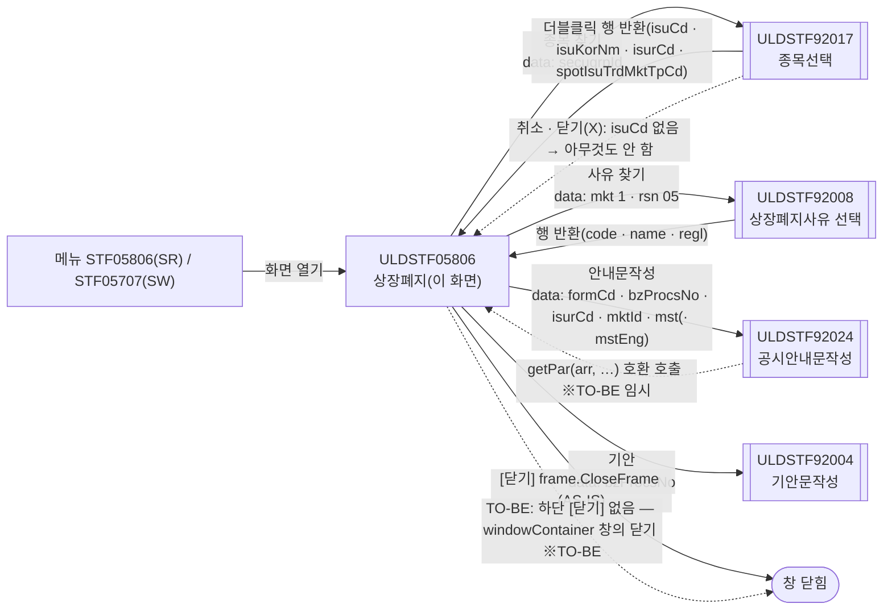
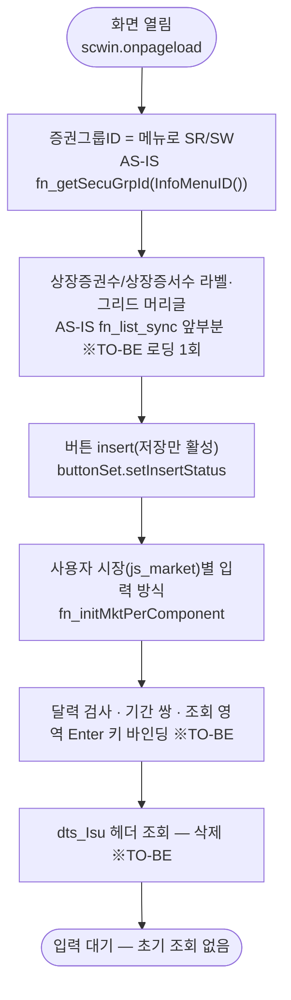
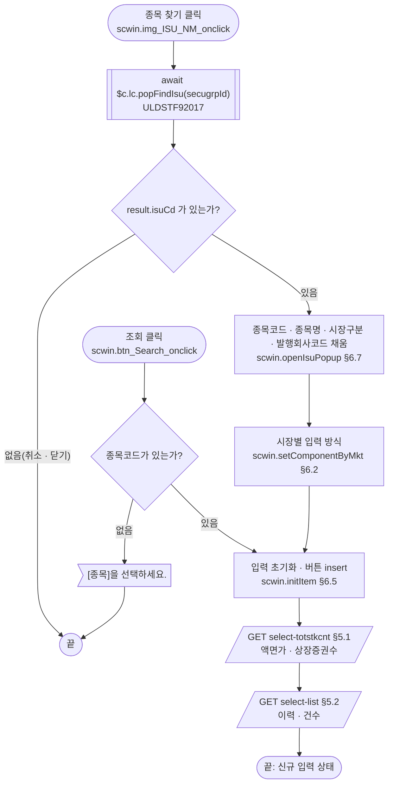
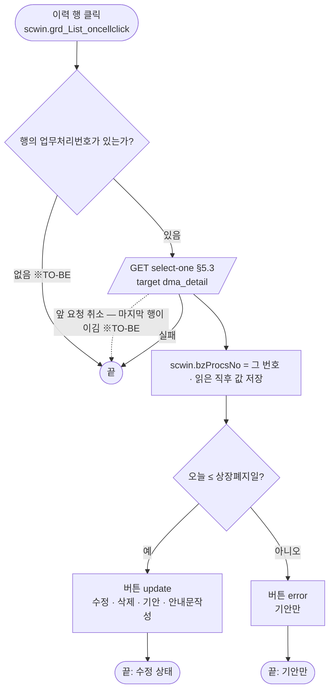
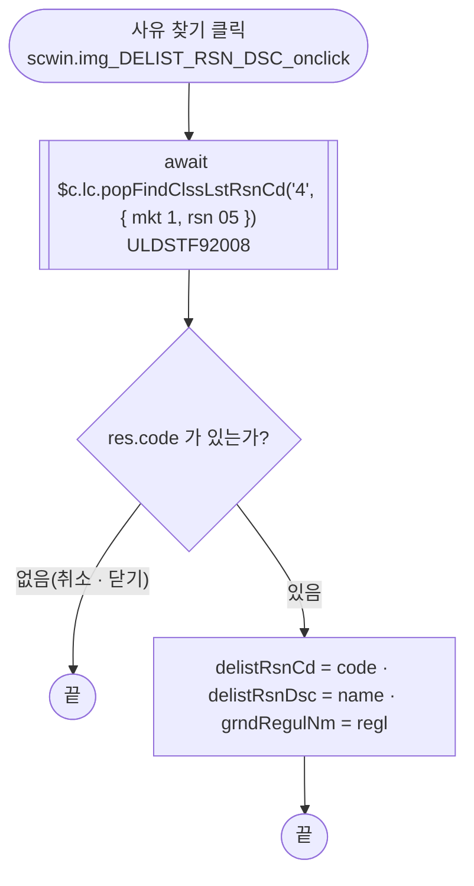
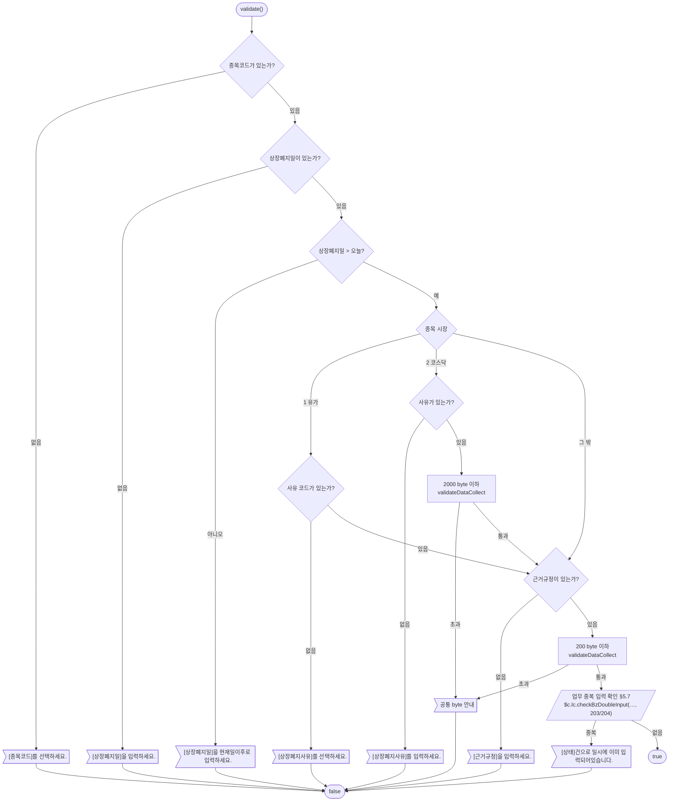
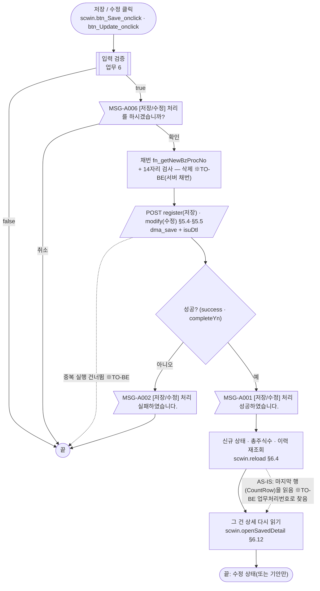
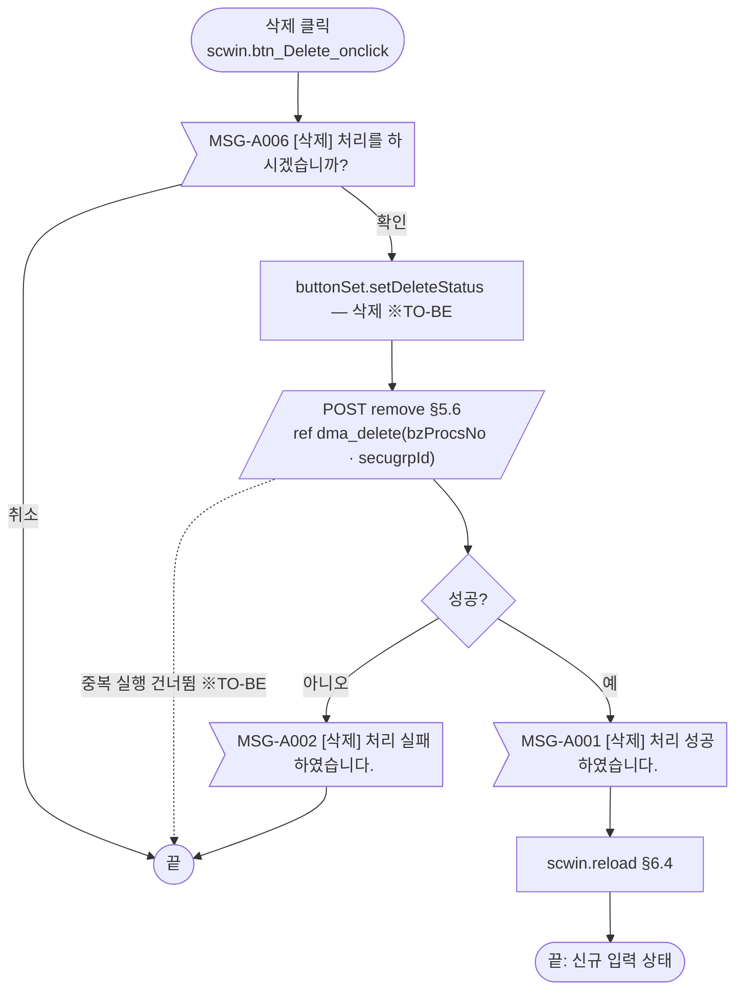
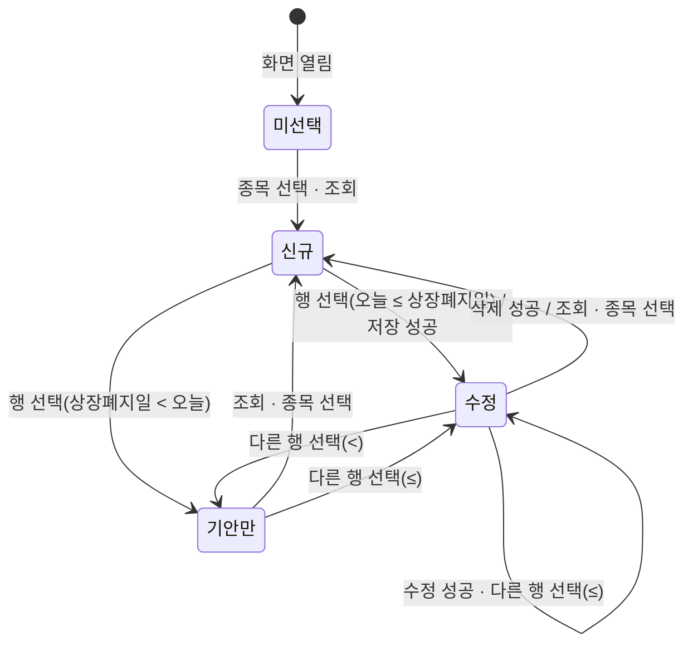

# ULDSTF05806 상장폐지 — 업무 분석 및 전환 내역

| 항목 | 내용 |
|---|---|
| AS-IS | `/lstproc/ULDSTF05806.gfm` (Gauce/X-Internet, 1270×460 **메인 화면** — 메뉴 `STF05806`(신주인수권증서 SR) 로 연다. 업무공통 표상 메뉴 `STF05707`(신주인수권증권 SW)도 같은 업무·같은 API 다) — 반입 `conversion/conversion-front/ui/ULDSTF05806/ULDSTF05806.gfm` |
| 신규 API 명세 | `ULDSTF05806_API.md` — 블록 6종, 모두 이 화면 블록(`[ULDSTF05806, ULDSTF05707][신주인수권증권/신주인수권증서][상장폐지]`, `/api/listing/lstproc/warrant/delisting/` 아래 `GET select-list`·`GET select-one`·`GET select-totstkcnt`·`POST modify`·`POST register`·`POST remove`). 다른 화면 블록 0종. §2.2·§5 는 명세 기준(가이드 §0.3·§5) |
| TO-BE | `conversion/conversion-front/ui-tobe/ULDSTF05806.xml` (배포 경로 `/ui/lst/lstproc/ULDSTF05806.xml` — 가정, §10 #12). **2026-10-29 전환** — 1단계: 캡처 기준 퍼블리싱(본화면 `sub_contents` + contentHeader, 조회조건 `schbox`, 입력 표 6행(4칸), 이력 그리드, 하단 버튼 — [닫기] 없음), 2단계: 이 결과서대로 스크립트 전환. 게이트 통과: `gate_screen --pcc stf`, `scan_mixed_compare`, `publish_gate --pcc stf --before {1단계 사본} --allow P20`, `api_spec_check`(명세 6종 모두 사용), `init_binding_check`, `wsxml_lint` 0/0, `convert.py` 고정점 |
| 퍼블리셔 XML | 화면 폴더의 `ULDSTF05806.xml`(퍼블리싱 파일, W-Craft 1차 스크립트 포함) — 컴포넌트 id 는 AS-IS 와 같음(달력 `w2:inputCalendar`, 이미지 버튼 → `xf:trigger`, 달력 이미지 없음). 단 `txb_ISU_CD` 를 `w2:autoComplete` 로, 상단에 `pgtbox`(제목·breadcrumb), 달력 `readOnly="true"`, [닫기] 포함 — 캡처·본화면 표준과 달라 캡처를 따름(§2.1, §10 #10) |
| 화면 캡처 | `ULDSTF05806.png` (종목 미선택 빈 상태 — 유가 배치: 예고기간·정리매매 허용기간 보임) → **TO-BE 는 가이드 §13.2 퍼블리싱본부터 만들었다**. 캡처 하단 [닫기]는 **(옮기지 않음)** — §2.1, §10 #9 |
| 업무공통 | pcc(`cm/pcc/stf`): `$c.stf`(`getMessageParam`)·`$c.lc`(`popFindIsu`·`popFindClssLstRsnCd`·`isProcess`·`checkBzDoubleInput`·`glb.SECUGRP_ID_SW/SR`·`glb.LIST_BZ_TP_CD_203/204`). gcc: `$c.date`(`getServerDateTime`·`checkCalendarFormat`·`compareFromToDate`)·`$c.validate.validateDataCollect`·`$c.util`(`setButtonState`·`isEmpty`)·`$c.win`(`alert`·`openPopup`·`setEnterKeyEvent`)·`$c.data.getParameter`·`$c.session.getUserInfo`·`$c.sbm.executeDynamic`·`$c.exception.handleError`. 게이트는 `--pcc stf` 로 돌린다 |
| 작성 | Inswave / 2026-10-29 |

참고 양식: [websquare_gfm_conversion.md](../../../md/websquare_gfm_conversion.md) — 특히 §1.4 업무 프로세스 흐름, §5 「API 명세 적용」, §6.5 getPar/setPar 전환. Gauce 대응은 [gfm_business_analysis_guide.md](../../../md/gfm_business_analysis_guide.md) §5·§6 을 함께 따랐다. 같은 모듈 선례 [ULDSTF05702.md](../completed/ULDSTF05702/ULDSTF05702.md)(신주인수권증권 등록·수정·삭제·종목 찾기)·[ULDSTF05232.md](../completed/ULDSTF05232/ULDSTF05232.md)(상장폐지·사유 찾기·공시안내문·기안)의 구성과 결정을 따랐다.

---

## 1. 화면 개요

상장 담당자가 **신주인수권증서(SR)·신주인수권증권(SW) 종목의 상장폐지**를 등록하고, 그 종목의 **상장폐지 이력**을 보며 등록한 건을 수정·삭제하고 공시안내문작성·기안을 여는 메인 화면이다.

1. [종목 찾기](돋보기)로 종목을 고른다 → 종목의 시장(유가 1 / 코스닥 2)에 따라 입력 방식이 바뀌고, **총주식수(상장증권수)** 와 **상장폐지 이력**을 조회해 신규 입력 상태가 된다.
2. 유가 종목은 상장폐지사유를 [사유 찾기]로 고르고(사유·근거규정이 함께 채워짐) 상장폐지 예고기간·정리매매 허용기간을 입력할 수 있다. 코스닥 종목은 사유를 직접 입력하고 두 기간 행이 숨는다.
3. 상장폐지일(오늘 이후)·사유·근거규정을 입력해 [저장]한다. 저장 전에 입력 검증, 업무 중복 입력 확인(서버), 저장 확인을 거친다. 업무처리번호는 등록 API 가 채번한다(명세).
4. 이력 행을 누르면 그 건을 상세로 읽는다. 상장폐지일이 오늘 이후(오늘 포함)면 [수정]·[삭제]·[기안]·[안내문작성], 지났으면 [기안]만 할 수 있다.
5. 저장·수정·삭제에 성공하면 신규 상태로 다시 조회하고, 저장·수정이면 그 건을 다시 상세로 읽는다.
6. [조회]는 고른 종목으로 입력을 비우고 다시 조회한다.

### 1.1 호출 화면 (0본)

- 메뉴 화면이다(`fr_SecuGrpId = fn_getSecuGrpId(InfoMenuID())` — 메뉴 ID 로 증권그룹을 정함: `STF05806` → `SR`, `STF05707` → `SW`, `cm/pcc/stf/list_common.xml` `getSecuGrpId`). 저장소 전체에서 `ULDSTF05806` 을 여는 화면은 없다(이 화면 폴더만 나옴).
- 진입 파라미터 없음. TO-BE 는 메뉴 정보(`$c.data.getParameter("menuInfo").menuCode`)로 증권그룹을 정한다(§3, §10 #6).

### 1.2 호출 규약 (부모 → 이 화면) / 반환 규약

해당 없음 — 메뉴로 여는 메인 화면이라 받는 파라미터도 돌려주는 값도 없다. AS-IS `btn_close` 의 `frame.CloseFrame()` 은 MDI 창 닫기다(§2.1, §10 #9).

### 1.3 이 화면이 여는 하위 팝업

| 팝업 | AS-IS 호출 (getPar/setPar) | 넘기는 `data` (TO-BE) | 받는 결과 (`closePopup`) / 취소 판정 |
|---|---|---|---|
| `ULDSTF92017` 종목선택(750×800) | `img_ISU_NM onclick` → `fn_GetPar = fn_GetParIsuCd`(`arr[0] = ""`, `arr[1] = ""`, `arr[2] = fr_SecuGrpId`), `fn_SetPar = fn_SetParIsuCd` → `fn_PopFindIsu(fr_SecuGrpId)` | `await $c.lc.popFindIsu(scwin.secugrpId)` — pcc 가 `{ secugrpId }` 로 연다 | 선택 행 객체(`isuCd`·`isuKorNm`·`isurCd`·`spotIsuTrdMktTpCd` … — `sample-front/ui/stf/lst/common/ULDSTF92017.xml` 의 `dlt_listRes` 행). **`isuCd` 가 비면 취소**(원본 `DBCLICKYN == "Y"` 일 때만 반영) — §6.7 |
| `ULDSTF92008` 상장폐지사유 선택(520×700) | `img_DELIST_RSN_DSC onclick` → `fn_GetPar = fn_GetParRsn`(`arr[0] = "1"`, `arr[1] = "05"`), `fn_SetPar = fn_SetParRsn` → `fn_PopFindClssLstRsnCd(RSNCD_DELIST)` | `await $c.lc.popFindClssLstRsnCd("4", { mkt : "1", rsn : "05" })` | 행 객체 `{ code, name, regl }`(`sample-front/ui/stf/lst/common/ULDSTF92008.xml`). `code` 가 비면 취소 — §6.8 |
| `ULDSTF92024` 공시안내문작성(735×815) | `btn_Dscl` → `fn_dscl` — `fn_GetPar` 를 임시 함수로 바꿔 `arr[0..5]`·`CopyDataSet(dts_Mst, …)`(코스닥은 `dts_Mst_Eng` 도) 후 `frame.CreateDialogFrame("ULDSTF92024", "/listingcommon/ULDSTF92024.gfm", …, "window")` | `$c.win.openPopup("/ui/listingcommon/ULDSTF92024.xml", …, { formCd, bzProcsNo, isurCd, mktId, isu, mst, isuEng, mstEng })` + **호환용 `scwin.getPar`**(92024 전환본이 아직 부모 getPar 를 부름 — 선례 05232·05710) | 반환 없음. 원본은 닫힌 뒤 다시 조회하지 않는다 — §6.13 |
| `ULDSTF92004` 기안문작성(888×730) | `btn_Drft` → `fn_drft` — `fn_GetPar` 로 `arr[0] = dts_List.NameValue(1, "BZ_PROCS_NO")` → `fn_PopFindDraft()` | `$c.win.openPopup("/ui/listingcommon/ULDSTF92004.xml", …, { bzProcsNo : scwin.bzProcsNo })` — 첫 행이 아니라 **고른 건**(§8 #7) | 반환 없음 — §6.14 |
| (달력 5개) | `img_DELIST_DD`·`img_DELIST_ADVNOTI_STRT_DD`·`img_DELIST_ADVNOTI_END_DD`·`img_ARRANTRD_MKTACT_ENFORCE_DD`·`img_ARRANTRD_END_DD` onclick → `popUpCalendar2(edt_…)` | **(옮기지 않음)** — `w2:inputCalendar` 내장 달력 | — |

### 1.4 업무 프로세스 흐름

흐름은 AS-IS 동작을 기준으로 그렸다. 점선과 `※TO-BE` 는 전환본에서 바뀌는 곳이다(근거는 §8).

| # | 업무 | 시작 (사용자 동작·진입 조건) | 끝 (결과) | 주요 함수 | 관련 절 |
|---|---|---|---|---|---|
| 1 | 진입·로딩 | 메뉴에서 화면 열기 | 빈 화면, [저장]만 활성, 사용자 시장별 입력 방식 | `scwin.onpageload` → `scwin.init` | §3 |
| 2 | 종목 선택 | [종목 찾기](돋보기) | 종목 표시 + 시장별 입력 방식 + 총주식수·이력 조회, 신규 상태 | `scwin.img_ISU_NM_onclick` → `scwin.openIsuPopup` → `scwin.reload` | §6.7, §6.2, §6.4 |
| 3 | 조회 | [조회] | 입력 비움 + 총주식수·이력 재조회 | `scwin.search` → `scwin.reload` | §6.3·§6.4 |
| 4 | 상세 선택 | 이력 행 클릭 | 상세 표시, 상장폐지일 기준 수정 상태 또는 기안만 | `scwin.grd_List_oncellclick` → `scwin.selectDetail` | §5.3, §6.6 |
| 5 | 사유 찾기 | [사유 찾기](유가만 활성) | 사유 코드·사유·근거규정 채움 | `scwin.img_DELIST_RSN_DSC_onclick` → `scwin.openRsnPopup` | §6.8 |
| 6 | 입력 검증 (공통 흐름) | 저장·수정 안에서 | 통과 / 안내 후 중단 | `scwin.validate` | §6.10, §5.7 |
| 7 | 신규 저장 | [저장] (신규 상태) | 성공 안내 → 재조회 → 등록 건 상세 | `scwin.save` → `scwin.saveTrs("I")` | §5.4, §6.11, §6.12 |
| 8 | 수정 | [수정] (수정 상태) | 성공 안내 → 재조회 → 그 건 상세 | `scwin.update` → `scwin.saveTrs("U")` | §5.5, §6.11 |
| 9 | 삭제 | [삭제] (수정 상태) | 성공 안내 → 신규 상태로 재조회 | `scwin.remove` → `scwin.removeTrs` | §5.6, §6.11 |
| 10 | 공시안내문작성 | [안내문작성] (수정 상태) | 92024 팝업 — 닫힐 때까지 대기 | `scwin.writeDscl` | §6.13 |
| 11 | 기안 | [기안] (수정·기안만 상태) | 92004 팝업 — 닫힐 때까지 대기 | `scwin.writeDraft` | §6.14 |

#### 화면 간 흐름



AS-IS 는 `fn_GetPar`/`fn_SetPar` 를 바꿔 끼우고 모달 창이 닫힐 때까지 기다린 뒤 `fn_SetPar…` 가 화면을 채웠다. TO-BE 는 `await` 반환값(종목·사유) 또는 `openPopup` 의 `data`(안내문·기안)로 바꾼다(가이드 §6.5). 92024 만 전환본이 아직 부모 `getPar` 를 부르므로 호환 함수를 임시로 둔다(§10 #8).

#### 업무 1: 진입·로딩



| # | 단계 | 주체 | 내용 | 분기 · 메시지 | 관련 절 |
|---|---|---|---|---|---|
| 1 | 증권그룹 | 화면 | `scwin.getSecugrpId()` — 메뉴 코드가 `05707` 로 끝나면 `SW`, 아니면 `SR` | — | §3, §10 #6 |
| 2 | 라벨 | 화면 | `scwin.setSecugrpLabel()` — `lb_LIST_SHRS`·그리드 `h_listShrs` = SW "상장증권수" / SR "상장증서수" | — | §6.1 |
| 3 | 버튼 | 화면 | `$c.util.setButtonState("grpBtnBox", "insert", scwin.BTN_MAP)` | — | §3, §4 |
| 4 | 입력 방식 | 화면 | `scwin.setComponentByMkt(사용자 시장)` | 1·2 외 값이면 마크업 기본(유가 배치) | §6.2 |
| 5 | 바인딩 | 화면 | `checkCalendarFormat(edt_DELIST_DD)` · `compareFromToDate` 2쌍 · `setEnterKeyEvent(panel_Top, …)` (규칙 37·22) | — | §3 |
| 6 | (삭제) | 서버 | AS-IS `dts_Isu` 헤더 조회(`gauceSystemierAdaptor … DELISTING_ISU_INOUT`) | — | §8 #2 |

#### 업무 2·3: 종목 선택 · 조회



| # | 단계 | 주체 | 내용 | 분기 · 메시지 | 관련 절 |
|---|---|---|---|---|---|
| 1 | 팝업 | 사용자 | `await $c.lc.popFindIsu(scwin.secugrpId)` | 취소·닫기(X)는 `isuCd` 없음으로 판정해 끝 | §6.7 |
| 2 | 반영 | 화면 | `dma_search.isuCd`·`isuNm`(= `isuKorNm`), `scwin.mktTpCd`(= `spotIsuTrdMktTpCd`), `scwin.isurCd` | — | §6.7 |
| 3 | 입력 방식 | 화면 | `scwin.setComponentByMkt(scwin.mktTpCd)` | — | §6.2 |
| 4 | 종목 확인 (조회) | 화면 | `dma_search.isuCd` 가 비었는지 | 비면 "[종목]을 선택하세요." + `txb_ISU_CD` 포커스 후 끝 | §6.3 |
| 5 | 초기화 | 화면 | `scwin.initItem` — 버튼 `insert`, `dma_detail` 비움, 업무처리번호 비움 | — | §6.5 |
| 6 | 총주식수 | 서버 | `GET select-totstkcnt` → `dma_totstkcnt` → `dma_detail.parval`·`listShrs` | 실패면 공통 오류 안내(이력 조회는 계속) | §5.1 |
| 7 | 이력 | 서버 | `GET select-list` → `dlt_list`, 건수 `panel_page` | 실패면 공통 오류 안내 후 끝 | §5.2 |

#### 업무 4: 상세 선택



| # | 단계 | 주체 | 내용 | 분기 · 메시지 | 관련 절 |
|---|---|---|---|---|---|
| 1 | 번호 | 화면 | `dlt_list.getCellData(rowIndex, "bzProcsNo")` (화면 행 번호) | 비면 끝(§8 #3) | §5.3 |
| 2 | 상세 | 서버 | `GET select-one { bzProcsNo }` → `dma_detail` | 실패면 이전 상태 그대로(※TO-BE, §8 #6) | §5.3 |
| 3 | 버튼 | 화면 | `scwin.applyButtonState()` — `서버 현재일 <= delistDd` 면 `update`, 아니면 `error` | AS-IS `cGetToday("yyyymmdd") <= DELIST_DD` | §6.6 |
| 4 | 변경 기준 | 화면 | `scwin.savedState = scwin.getEditState()` (안내문작성 전 변경 여부) | AS-IS `dts_Mst.IsUpdated` | §6.13 |

#### 업무 5: 사유 찾기 (유가)



- 코스닥 종목(또는 사용자 시장 코스닥)이면 버튼이 비활성이라 열리지 않는다(§6.2).

#### 업무 6: 입력 검증 (저장·수정 공통 — `scwin.validate`)



| # | 단계 | 주체 | 내용 | 분기 · 메시지 | 관련 절 |
|---|---|---|---|---|---|
| 1 | 종목 | 화면 | `dma_search.isuCd` 필수 | "[종목코드]를 선택하세요." + `txb_ISU_CD` 포커스 | §6.10 |
| 2 | 상장폐지일 | 화면 | 필수, `서버 현재일 >= delistDd` 면 실패 | 원본 문구 + `edt_DELIST_DD` 포커스 | §6.10 |
| 3 | 사유 | 화면 | 유가: `delistRsnCd` 필수 / 코스닥: `delistRsnDsc` 필수 + 2000 byte | 원본 문구 / 공통 byte 문구 | §6.10 |
| 4 | 근거규정 | 화면 | 필수 + 200 byte | 원본 문구 / 공통 byte 문구 | §6.10 |
| 5 | 업무 중복 | 서버 | `fn_check_bz_doubleinput(dts_BZ_CHECK, 종목코드, 상장폐지일, 업무처리번호, 203/204)` (**동기**) → `await $c.lc.checkBzDoubleInput(…)` | 이미 입력된 건이면 안내 후 false | §5.7 |

#### 업무 7·8: 신규 저장 · 수정



| # | 단계 | 주체 | 내용 | 분기 · 메시지 | 관련 절 |
|---|---|---|---|---|---|
| 1 | 입력 검증 | 화면·서버 | 업무 6 | false 면 끝 | §6.10 |
| 2 | 확인 | 사용자 | `await $c.lc.isProcess("I"/"U")` | 취소면 끝 | §6.11 |
| 3 | 전문 구성 | 화면 | `dma_save` ← `dma_detail` 같은 이름 키 + `bzProcsNo`(수정만)·`isurCd`·`secugrpId`, `dma_saveIsuDtl` ← `isuCd`·`listShrs`·`parval` | AS-IS `MKTACT_APPL_OBJ_TP_CD`·`LIST_BZ_TP_CD` 등은 명세에 없어 보내지 않음(§10 #3) | §5.4 |
| 4 | 전송 | 서버 | `POST register`/`modify`, `requestData { ...dma_save, isuDtl : [dma_saveIsuDtl] }` | `skipped` 면 끝, 실패 `MSG-A002` | §5.4·§5.5 |
| 5 | 결과 | 화면 | `MSG-A001` → `scwin.reload()` → `scwin.openSavedDetail(번호)`(등록은 응답 `bzProcsNo`, 수정은 고른 건) | 못 찾으면 마지막 행(원본) | §6.12 |

- 원본은 수정 때 변경 여부를 확인하지 않는다 — 그대로 유지.

#### 업무 9: 삭제



- 입력 검증 없음(원본과 같음). 원본은 공시 승인 여부(`checkDeleteDiscls`)도 보지 않는다 — 그대로(§10 #11).

#### 업무 10·11: 공시안내문작성 · 기안

```mermaid
flowchart TD
    S1(["안내문작성 클릭<br/>scwin.btn_Dscl_onclick"]) --> A{"읽은 직후와 상세가 같은가?"}
    A -- "아니오" --> A1>"MSG-0022 변경된 항목이 있습니다. 수정후에 안내문작성을 다시 클릭하세요."] --> E1(["끝"])
    A -- "예" --> B{"시장구분 1 · 2?"}
    B -- "아니오 ※TO-BE" --> B1>"안내문을 작성할 수 없는 시장구분입니다.(가정)"] --> E1
    B -- "예" --> P[["await openPopup ULDSTF92024<br/>formCd(68913/68917 · 70925/70930) · bzProcsNo · isurCd · mktId · mst(· mstEng)"]] --> E2(["끝 — 재조회 없음"])
    S2(["기안 클릭<br/>scwin.btn_Drft_onclick"]) --> G[["await openPopup ULDSTF92004<br/>bzProcsNo(고른 건)"]] --> E3(["끝"])
    S2 -. "AS-IS: 이력 첫 행의 번호 ※TO-BE 고른 건" .-> G
```



#### 화면 모드 상태 전이



| 상태 | 활성 버튼 | 근거 |
|---|---|---|
| 미선택 · 신규 | 저장 | `insert` — `enable: ["new", "save"]`, 이 화면 `BTN_MAP` 에 `new` 없음 |
| 수정 | 수정 · 삭제 · 기안 · 안내문작성 | `update` — 전체 활성 + 저장 제외 |
| 기안만 | 기안 | `error` — `enable: ["draft"]` |

---

## 2. 화면 구성 및 데이터 정의

### 2.1 화면 구성

캡처(`ULDSTF05806.png`) 기준 위→아래, 왼→오른. TO-BE id 는 AS-IS·퍼블리싱 파일과 같은 id 를 쓰고, 바인딩은 §2.2 의 camelCase 키다. 필수 표시(*)는 AS-IS 의 별도 라벨(`label_2`·`label_6`·`label_8`)을 TO-BE 라벨의 `class="req"` 로 옮긴다.

| 영역 | AS-IS 요소 | TO-BE 컴포넌트 (바인딩) | 설명 |
|---|---|---|---|
| (외곽) | `gform` 1270×460, `PanelToGroupBox(panel_Top/panel_Item)` | `sub_contents` + `w2:pageFrame pfmContentHeader`(본화면 contentHeader 필수) | 퍼블리싱 파일의 `pgtbox`(제목·breadcrumb 목업)는 contentHeader 로 대체. `PanelToGroupBox` **(옮기지 않음)** |
| 조회조건 | `panel_Top` · `label_2_top` "종목코드(명)" · `txb_ISU_CD`(readonly) · `txb_ISU_NM`(readonly) · `img_ISU_NM`(돋보기) | `panel_Top` (`schbox`) · `label_2_top` · `txb_ISU_CD` (`xf:input` readOnly, `dma_search.isuCd`) · `txb_ISU_NM` (readOnly, `dma_search.isuNm`) · `img_ISU_NM` (`btn_cm icon search`) | 퍼블리싱 파일의 `w2:autoComplete` 는 캡처(읽기전용 칸)를 따라 `xf:input` 으로(§10 #10). 인라인 배경색 금지(규칙 40) |
| 조회 버튼 | `btn_Search` · `img_tmp_11`(세로 구분선) | `btn_Search` (`btn_schbox` 의 `btn_cm sch`) · `img_tmp_11` **(옮기지 않음)** — 장식 | Enter 키는 `setEnterKeyEvent(panel_Top, …)`(§3) |
| 상장폐지일 (*) | `label_2`(*) + `label_1` · `edt_DELIST_DD` (`YYYY-MM-DD`, readonly) · `img_DELIST_DD`(달력) | `label_1`(req) · `edt_DELIST_DD` (`w2:inputCalendar`, `dma_detail.delistDd`) | 달력 이미지 **(옮기지 않음)**. AS-IS readonly(달력으로만 입력) → 직접 입력 허용 + `checkCalendarFormat`(§8 #11) |
| 상장증권수 | `lb_LIST_SHRS`("상장증권수" textbox) · `edt_LIST_SHRS`(숫자, readonly) | `lb_LIST_SHRS` (th 라벨 — SR 이면 "상장증서수", §6.1) · `edt_LIST_SHRS` (`xf:input` readOnly, `tar` `number` `#,###`, `dma_detail.listShrs`) | 같은 행 4칸(colgroup 4) |
| 상장폐지 예고기간 | `label_3` · `edt_DELIST_ADVNOTI_STRT_DD` · `label_9`(~) · `edt_DELIST_ADVNOTI_END_DD` · 달력 이미지 2 | `tr#tr_DELIST_ADVNOTI` — `label_3` · 두 `inputCalendar`(`delistAdvnotiStrtDd`·`delistAdvnotiEndDd`) · `label_9`(span) | 코스닥이면 행 숨김(§6.2). 행 id 는 1단계에서 새로 붙임 |
| 정리매매 허용기간 | `lbl_ArrantrdPermiPd` · `edt_ARRANTRD_MKTACT_ENFORCE_DD` · `lbl_Tilde` · `edt_ARRANTRD_END_DD` · 달력 이미지 2 | `tr#tr_ARRANTRD` — `lbl_ArrantrdPermiPd` · 두 `inputCalendar`(`arrantrdMktactEnforceDd`·`arrantrdEndDd`) · `lbl_Tilde` | 코스닥이면 행 숨김 |
| 상장폐지사유 (*) | `label_6`(*) + `label_4` · `txb_DELIST_RSN_DSC`(textarea) · `img_DELIST_RSN_DSC`(돋보기) | `label_4`(req) · `txb_DELIST_RSN_DSC` (`xf:textarea`, `dma_detail.delistRsnDsc`) · `img_DELIST_RSN_DSC` | 유가: 사유 읽기전용 + 찾기 활성, 코스닥: 직접 입력 + 찾기 비활성(§6.2). 비활성 이미지 교체(`btn_search_d.gif`)·배경색은 `setDisabled`·`setReadOnly` 기본 스타일로 |
| 근거규정 (*) | `label_8`(*) + `label_5` · `txb_GRND_REGUL_NM` (maxlength 1000) | `label_5`(req) · `txb_GRND_REGUL_NM` (`dma_detail.grndRegulNm`, maxlength 1000) | 저장 검증에서 200 byte(§6.10) |
| 기타 | `label_7` · `txb_REMK`(textarea) | `label_7` · `txb_REMK` (`dma_detail.remk`) | — |
| 총건수 | `panel_page` (`FillGridHeaderTotalCnt`) | `titbox` `rt` > `count` > `w2:span.num#panel_page` | 목록 제목 라벨은 원본에 없음 |
| 이력 | `grd_List` (`dts_List`) — 9열 `NO`(번호, `{CurRow}`)·`DISCLS_YN`(머리글 `공시검토\\여부`)·`LIST_SHRS`·`DELIST_DD`(mask `XXXX-XX-XX`)·`DELIST_RSN_DSC`·`GRND_REGUL_NM`(근거)·`REMK`(기타)·`FNL_EMP_NM`(최종처리자)·`BZ_PROCS_NO`(업무처리번호) | `grd_List` (`gvw row5`, `dataList="data:dlt_list"`, readOnly, `ev:oncellclick`) — gBody 열 id `no`(`rowIndex()+1`)·`disclsYn`·`listShrs`(`number` `#,###`)·`delistDd`(`date` `yyyy-MM-dd`, 규칙 46)·`delistRsnDsc`·`grndRegulNm`·`remk`·`fnlEmpNm`·`bzProcsNo`, 머리글 `h_` 접두, "공시검토&lt;br/&gt;여부" 2줄 | 행 클릭 → 상세(§5.3). 캡처 5행 → `row5`. `h_listShrs` 는 SR 이면 "상장증서수" |
| 하단 버튼 | `btn_Save` · `btn_Update` · `btn_Delete` · `btn_Drft` · `btn_Dscl` · `btn_close` (이미지) | `btnbox#grpBtnBox` `rt`: `btn_Drft`(기안) · `btn_Dscl`(안내문작성) · `btn_Delete` · `btn_Update` · `btn_Save` (뒤 셋 `btn_cm pt`, 규칙 41 순서 [삭제]-[수정]-[저장] 오른쪽 끝) | `btn_close` **(옮기지 않음)**(§10 #9). 활성 상태 `buttonSet` → `$c.util.setButtonState`(§4) |
| (데이터 장식) | `bnd_mst` (`mxbinder` — `PARVAL`(`edt_PARVAL`)·`LIST_SHRS`·`DELIST_DD`·`DELIST_RSN_DSC`·`ARRANTRD_*`·`DELIST_ADVNOTI_*`·`GRND_REGUL_NM`·`REMK`) | 컴포넌트 `ref="data:dma_detail.*"` | `edt_PARVAL` 은 원본에 컴포넌트가 없는 바인딩 — **(옮기지 않음)**, 값은 `dma_detail.parval` 로 유지 |

- 퍼블리싱 1단계(§13.2)는 캡처 + 퍼블리싱 파일 기준으로 새로 만들었다(2026-10-29): 본화면 contentHeader, 조회조건 `schbox`, 입력 표 6행(colgroup 4칸 — 첫 행만 2쌍, 나머지 `colspan 3`), 기간 행 id(`tr_DELIST_ADVNOTI`·`tr_ARRANTRD`), 총건수 `titbox`, 그리드 `row5`, 하단 [닫기] 없음, 달력 `readOnly` 제거, `userData2`·`src`·`cursor` 등 변환 잔재 제거. `publish_gate --pcc stf` 실패 0 → 사본 `$CLAUDE_JOB_DIR/tmp/ULDSTF05806_stage1.xml`.

### 2.2 데이터 정의

| AS-IS | TO-BE | 종류 | 키(컬럼) | 출처 / 용도 |
|---|---|---|---|---|
| `txb_ISU_CD`·`txb_ISU_NM` 값 (바인딩 없음) | `dma_search` | dataMap | `isuCd`, `isuNm` | **화면 전용(명세에 없음)** — 조회 영역 종목. 명세 요청 `isuCd` 를 여기서 꺼낸다 |
| `dts_List` | `dlt_list` | dataList | 명세 `select-list` RESPONSE 원문 12열 — `draftYn`, `disclsYn`, `mktactYn`, `fnlEmpNm`, `bzProcsNo`, `delistDd`, `parval`(number), `listShrs`(number), `delistRsnCd`, `delistRsnDsc`, `grndRegulNm`, `remk` | 이력(`target "dlt_list=body"`) |
| `dts_Mst` (1행, `bnd_mst` 로 바인딩) · `dts_Mst_Eng`(`dts_Mst` 사본) | `dma_detail` | dataMap | 명세 `select-one` RESPONSE 원문 21키 — `bzProcsNo`, `delistDd`, `delistAdvnotiStrtDd`, `delistAdvnotiEndDd`, `arrantrdMktactEnforceDd`, `arrantrdEndDd`, `parval`·`listShrs`(number), `delistRsnCd`, `delistRsnDsc`, `grndRegulNm`, `remk`, `isuKorNm`, `isuEngNm`, `isuCd`, `trstComNm`, `trdHaltDd`, `trdHaltTYy`, `trdHaltTMm`, `trdHaltTDd`, `trdHaltDdT` | 화면 바인딩 + 상세 응답(`target "dma_detail=body"`) + 총주식수 결과(`parval`·`listShrs` 만 set) + 공시안내문 마스터(`mst`·`mstEng`). `dts_Mst_Eng` 는 따로 두지 않고 같은 값을 넘긴다 |
| (`dts_Mst` 를 총주식수 응답으로 교체) | `dma_totstkcnt` | dataMap | 명세 `select-totstkcnt` RESPONSE 원문 — `parval`, `listShrs`(number) | 총주식수(`target "dma_totstkcnt=body"`) |
| `dts_Mst` (저장 전문 `dtsParm1`) | `dma_save` | dataMap | 명세 `modify` REQUEST 원문 12키 — `bzProcsNo`(수정만), `isurCd`, `secugrpId`, `delistDd`, `delistAdvnotiStrtDd`, `delistAdvnotiEndDd`, `arrantrdMktactEnforceDd`, `arrantrdEndDd`, `delistRsnCd`, `delistRsnDsc`, `grndRegulNm`, `remk` | 등록·수정 요청 마스터 — 저장 직전 `dma_detail` 에서 옮김 |
| `dts_Isu` (저장 전문 `dtsParm2`, 한 행 `BZ_PROCS_NO`·`ISU_CD`) | `dma_saveIsuDtl` | dataMap | 명세 원문 — `isuCd`, `listShrs`, `parval`, `isuPrc`(number) | 등록·수정 요청 `isuDtl`(한 건 배열 — §5 차이 #3) |
| (응답 전용) | `dma_saveResult` | dataMap | 명세 `modify` RESPONSE 원문 — `completeYn`(명세 처리: boolean), `bzProcsNo` | 등록·수정·삭제 `target`. 판정은 응답 body 의 boolean 으로(§6.11) |
| `dts_Mst` (삭제 전문) | `dma_delete` | dataMap | `bzProcsNo`, `secugrpId` — 명세 키 표가 깨져 있어 읽어 낸 값(§5 차이 #4) | 삭제 요청(`ref : "dma_delete"`) |
| `dts_BzProcsNo` | (삭제) | — | — | 등록 API 가 채번(§5.8) |
| `dts_BZ_CHECK` | (삭제) | — | — | 업무 중복 확인 응답을 pcc 함수가 판정(§5.7) |
| `trs_Save` | (삭제) | — | — | 저장·수정·삭제 통신 → `executeDynamic` |

**명세 원문 (가이드 §5 「API 명세 적용」 — id·name·dataType 그대로 옮겼다)** — `ULDSTF05806_API.md` 블록 1~5 의 `<w2:dataList id="dlt_list">`·`<w2:dataMap id="dma_detail">`·`dma_totstkcnt`·`dma_save`·`dma_saveIsuDtl`·`dma_saveResult` 를 TO-BE head 에 원문대로 넣었다(키 목록은 위 표). 블록 6 `dma_delete` 는 키 표가 `bzProcsNo *`·`Constraints: Min 1 chars`·`발행기관코드`·`string` 처럼 Swagger 화면이 섞여 깨져 있어 `bzProcsNo`·`secugrpId` 두 키로 정리했다.

- **AS-IS 대문자 → 명세 키**: `BZ_PROCS_NO→bzProcsNo`, `DISCLS_YN→disclsYn`, `LIST_SHRS→listShrs`, `PARVAL→parval`, `DELIST_DD→delistDd`, `DELIST_RSN_CD→delistRsnCd`, `DELIST_RSN_DSC→delistRsnDsc`, `GRND_REGUL_NM→grndRegulNm`, `REMK→remk`, `FNL_EMP_NM→fnlEmpNm`, `DELIST_ADVNOTI_STRT_DD→delistAdvnotiStrtDd`, `DELIST_ADVNOTI_END_DD→delistAdvnotiEndDd`, `ARRANTRD_MKTACT_ENFORCE_DD→arrantrdMktactEnforceDd`, `ARRANTRD_END_DD→arrantrdEndDd`, `ISUR_CD→isurCd`, `ISU_CD→isuCd`. 종목 찾기 결과 `ISU_KOR_NM→isuKorNm`, `SPOT_ISU_TRD_MKT_TP_CD→spotIsuTrdMktTpCd`.
- **명세에 없는 AS-IS 값**: 저장 전문 `MKTACT_APPL_OBJ_TP_CD`("1" 종목별), 파라미터 `TRS_IDX`·`BZ_PROCS_NO`·`COUNT=2`·`LIST_BZ_TP_CD`(203/204 — 명세 주석상 서버가 `secugrpId` 로 분기)·`DIV_IDX[0]`(`DIV_IDX_DELLIST_MST`)·`DIV_IDX[1]`(`DIV_IDX_DELLIST_DTL`)·`SCREN_ID`·`SCREN_PROCES_TP_CD` → 보내지 않음(§10 #3).
- **명세에만 있는 키**: `dma_detail` 의 공시안내문용 키(`isuKorNm`·`isuEngNm`·`trstComNm`·`trdHalt*`) — 화면에 표시하지 않고 92024 에 넘긴다. `dma_saveIsuDtl.isuPrc` — 화면에 출처 없음(§10 #4). `dlt_list` 의 `draftYn`·`mktactYn`·`parval`·`delistRsnCd` — 그리드에 표시하지 않음.

---

## 3. 로딩 (`gform onload` → `scwin.onpageload` → `scwin.init`)

원본 `gform onload` 순서:

1. `PanelToGroupBox(panel_Top)`·`PanelToGroupBox(panel_Item)` — 삭제(퍼블리싱 마크업).
2. **버튼 매핑** — `buttonSet.setSaveInfo(btn_Save, fn_save)`·`setUpdateInfo(btn_Update, fn_update)`·`setDeleteInfo(btn_Delete, fn_delete)`·`setDsclInfo(btn_Dscl, fn_dscl)`·`setDrftInfo(btn_Drft, fn_drft)` → TO-BE 는 `ev:onclick` 바인딩(§4) + 역할 매핑 `scwin.BTN_MAP = { save, modify, "delete", draft, guide }`.
3. **버튼 상태** — `buttonSet.setInsertStatus()` → `$c.util.setButtonState("grpBtnBox", "insert", scwin.BTN_MAP)`.
4. **헤더 조회** — `dts_Isu.DataID = "/gauceSystemierAdaptor.do?method=getGauceDataHeader&messageId=DELISTING_ISU_INOUT"; dts_Isu.reset();` → **삭제**(§8 #2).
5. `fn_initMktPerComponent(js_market)` — 사용자 시장(세션) → `scwin.setComponentByMkt(String($c.session.getUserInfo("market") ?? ""))`.
6. (전역 선언부) `fr_SecuGrpId = fn_getSecuGrpId(InfoMenuID())` → `scwin.secugrpId = scwin.getSecugrpId()` — 메뉴 코드 끝이 `05707` 이면 `SW`, 아니면 `SR`(§10 #6). AS-IS 가 조회 때마다 하던 라벨 교체(`fn_list_sync` 앞부분)는 증권그룹이 화면 동안 바뀌지 않아 로딩 때 한 번(`scwin.setSecugrpLabel`).

TO-BE 에서 더하는 init 바인딩(규칙 22·37 — `scwin.init` 에서 1회):

| 대상 | 적용 |
|---|---|
| 단일 달력 `edt_DELIST_DD`(상장폐지일) | `$c.date.checkCalendarFormat(edt_DELIST_DD, "yyyyMMdd");` |
| 기간 쌍 `edt_DELIST_ADVNOTI_STRT_DD`~`edt_DELIST_ADVNOTI_END_DD` | `$c.date.compareFromToDate(…, ["상장폐지예고 시작일", "상장폐지예고 종료일"]);` (쌍엔 이것만) |
| 기간 쌍 `edt_ARRANTRD_MKTACT_ENFORCE_DD`~`edt_ARRANTRD_END_DD` | `$c.date.compareFromToDate(…, ["정리매매허용 시작일", "정리매매허용 종료일"]);` |
| 조회 영역 `panel_Top`(`schbox`) + 조회 버튼 `btn_Search` | `$c.win.setEnterKeyEvent(panel_Top, scwin.btn_Search_onclick);` — 영역 입력이 모두 읽기전용이라 버튼 포커스에서만 의미가 있다(규칙 준수용) |

```javascript
scwin.onpageload = async function () {
    try {
        await scwin.init();
    } catch (ex) {
        await $c.exception.handleError(ex, { context : "ULDSTF05806.onpageload" });
    }
};

scwin.init = async function () {
    scwin.secugrpId = scwin.getSecugrpId();                       // 1) 증권그룹 · 라벨
    scwin.setSecugrpLabel();
    $c.util.setButtonState("grpBtnBox", "insert", scwin.BTN_MAP); // 2) 버튼
    scwin.setComponentByMkt(String($c.session.getUserInfo("market") ?? ""));   // 3) 사용자 시장
    $c.date.checkCalendarFormat(edt_DELIST_DD, "yyyyMMdd");       // 4) 바인딩
    $c.date.compareFromToDate(edt_DELIST_ADVNOTI_STRT_DD, edt_DELIST_ADVNOTI_END_DD, [...]);
    $c.date.compareFromToDate(edt_ARRANTRD_MKTACT_ENFORCE_DD, edt_ARRANTRD_END_DD, [...]);
    $c.win.setEnterKeyEvent(panel_Top, scwin.btn_Search_onclick);
};
```

- 초기 조회는 없다(종목을 골라야 조회 — 원본과 같음). `onpageload` 는 `scwin.init()` 만 부르고, 다시 부르는 로직(입력 초기화·재조회)은 5구역 함수(§6.4·§6.5)다.
- AS-IS 는 기간 선후를 검사하지 않았다 — `compareFromToDate` 는 규칙 37 로 더한 입력 시점 검사다(저장 검증에는 넣지 않음, §8 #12).

---

## 4. 컴포넌트 이벤트

| TO-BE 컴포넌트 | 이벤트 | TO-BE 핸들러 | 동작 (호출 함수) | AS-IS |
|---|---|---|---|---|
| `btn_Search` (조회) | `onclick` | `scwin.btn_Search_onclick` | `scwin.search()` — §6.3 | `btn_Search onclick` (종목 확인 → `fn_initItem` → `fn_isubook_read_sync` → `fn_list_sync`) |
| `panel_Top` (조회 영역) | Enter 키 | — | `$c.win.setEnterKeyEvent` 로 `btn_Search_onclick` 실행(§3) | 없음(※TO-BE, 규칙 22) |
| `img_ISU_NM` (종목 찾기) | `onclick` | `scwin.img_ISU_NM_onclick` | `scwin.openIsuPopup()` — §6.7 | `fn_GetPar = fn_GetParIsuCd; fn_SetPar = fn_SetParIsuCd; fn_PopFindIsu(fr_SecuGrpId)` |
| `img_DELIST_RSN_DSC` (사유 찾기) | `onclick` | `scwin.img_DELIST_RSN_DSC_onclick` | `scwin.openRsnPopup()` — §6.8 | `fn_GetPar = fn_GetParRsn; fn_SetPar = fn_SetParRsn; fn_PopFindClssLstRsnCd(RSNCD_DELIST)` |
| `grd_List` (이력) | `oncellclick` | `scwin.grd_List_oncellclick` | `scwin.selectDetail(행의 bzProcsNo)` — §5.3 | `grd_List OnClick(row, colid)` → `fn_read_sync(row)` |
| `btn_Save` (저장) | `onclick` | `scwin.btn_Save_onclick` | `scwin.save()` — §6.11 | `buttonSet.setSaveInfo(btn_Save, fn_save)` |
| `btn_Update` (수정) | `onclick` | `scwin.btn_Update_onclick` | `scwin.update()` — §6.11 | `buttonSet.setUpdateInfo(btn_Update, fn_update)` |
| `btn_Delete` (삭제) | `onclick` | `scwin.btn_Delete_onclick` | `scwin.remove()` — §6.11 | `buttonSet.setDeleteInfo(btn_Delete, fn_delete)` |
| `btn_Dscl` (안내문작성) | `onclick` | `scwin.btn_Dscl_onclick` | `scwin.writeDscl()` — §6.13 | `buttonSet.setDsclInfo(btn_Dscl, fn_dscl)` |
| `btn_Drft` (기안) | `onclick` | `scwin.btn_Drft_onclick` | `scwin.writeDraft()` — §6.14 | `buttonSet.setDrftInfo(btn_Drft, fn_drft)` |
| `btn_close` (닫기) | — | **(옮기지 않음)** | windowContainer 창의 닫기(§10 #9) | `frame.CloseFrame()` |
| 달력 이미지 5개 | — | **(옮기지 않음)** | inputCalendar 내장 달력 + init 바인딩(§3) | `popUpCalendar2(edt_…)` |
| `dts_Mst` | `OnLoadCompleted(rowcount)` | (핸들러 없음) | 상세 조회 후처리(§5.3 — `scwin.applyButtonState`). 총주식수 조회 뒤의 `insert` 는 `initItem` 이 이미 걸었다. `CopyDataSet(dts_Mst, dts_Mst_Eng)` 는 안내문 data 에서 같은 값을 넘겨 대신함 | `vBzProcsNo == ""` 면 `setInsertStatus`, 아니면 `cGetToday <= DELIST_DD` 로 `setUpdateStatus`/`setErrorStatus` + 영문 사본 |
| `dts_List` | `OnLoadCompleted(rowcount)` | (핸들러 없음) | 이력 조회 후처리(§5.2 — 건수) | `FillGridHeaderTotalCnt(rowcount, panel_page)` + `vBzProcsNo == ""` 면 `setInsertStatus` |
| `dts_BZ_CHECK`·`dts_Mst`·`dts_Isu`·`dts_List` | `OnLoadError()` | (핸들러 없음) | 공통 오류 핸들러(`executeDynamic` 실패 처리) | `alert_error(dts_…)` |
| `trs_Save` | `OnSuccess()` / `OnFail()` | (핸들러 없음) | `await` 뒤 후처리(§5.4~5.6) | `fn_alertMsg('S')` + `fn_initItem` + `fn_list_sync` + (삭제가 아니면) `fn_read_sync(dts_List.CountRow)` / `fn_alertMsg('F')` + `alert_error(trs_Save)` |

모든 핸들러는 try/catch + `$c.exception.handleError`(규칙 26)이고, 위임 대상이 async 라 `await` 한다(Thin Event — 로직은 4·5구역).

**버튼 상태 (모드 × 버튼)** — 원본 `buttonSet` 은 [저장]·[수정]·[삭제]·[기안]·[안내문작성]의 활성을 바꾼다. [조회]·[닫기]는 `buttonSet` 밖이라 늘 활성이다.

| 상태 | 저장 | 수정 | 삭제 | 기안 | 안내문작성 | TO-BE |
|---|---|---|---|---|---|---|
| 신규(미선택 포함) | O | | | | | `setButtonState("grpBtnBox", "insert", BTN_MAP)` |
| 수정 (오늘 ≤ 상장폐지일) | | O | O | O | O | `scwin.applyButtonState` → `update` |
| 기안만 (상장폐지일 < 오늘) | | | | O | | `scwin.applyButtonState` → `error` |
| (삭제 처리 중) | ? | ? | ? | ? | ? | AS-IS `buttonSet.setDeleteStatus()` — **(옮기지 않음)**, §8 #5 |

---

## 5. 서버 통신

공통: AS-IS 는 URL 에 `SCREN_ID=ULDSTF05806.gfm`·`SCREN_PROCES_TP_CD`(01 조회 / 02 입력 / 03 수정 / 04 삭제)를 붙이고, 저장 `trs_Save.Action` 은 `fn_encodeNSession` 으로 세션 정보를 붙인다. 명세에는 이 파라미터가 없으므로 **TO-BE 는 넘기지 않는다**(§10 #3). 모든 통신은 응답을 쓰기 전에 `if (result?.skipped) return;` 을 둔다. `action` 은 명세 경로 **전체 리터럴**(규칙 38), `$c.sbm.getContextPath()` 는 붙이지 않는다(규칙 39). AS-IS 조회는 모두 `syncload="True"`(**동기**) — TO-BE 는 `await` 순서로 보장한다.

| # | 용도 | AS-IS | TO-BE |
|---|---|---|---|
| 5.1 | 총주식수 | `fn_isubook_read_sync` — `/Delisting.do?…&SCREN_PROCES_TP_CD=01&method=searchTotstkcnt&inputMessageId=DELISTING_INOUT&ISU_CD=` → `dts_Mst` (동기, 데이터셋 통째로 바뀜) | `GET /api/listing/lstproc/warrant/delisting/select-totstkcnt` (`isuCd`) → `dma_totstkcnt` → `dma_detail.parval`·`listShrs` |
| 5.2 | 이력 | `fn_list_sync` — `/Delisting.do?…&method=searchlist&ISU_CD=` → `dts_List` (동기) | `GET /api/listing/lstproc/warrant/delisting/select-list` (`isuCd`) → `dlt_list` |
| 5.3 | 상세 | `fn_read_sync(row)` — `/Delisting.do?…&method=searchlistDbDetail&BZ_PROCS_NO=` → `dts_Mst` (동기) | `GET /api/listing/lstproc/warrant/delisting/select-one` (`bzProcsNo`) → `dma_detail` |
| 5.4 | 신규 저장 | `fn_trs` (`TRS_IDX_INSERT` '1') — `trs_Save` `/Delisting.do?SCREN_ID=…&SCREN_PROCES_TP_CD=02&method=saveDelList`, `KeyValue: JSP(I: dtsParm1= dts_Mst , I:dtsParm2= dts_Isu)`, `Parameters: TRS_IDX, BZ_PROCS_NO, COUNT=2, LIST_BZ_TP_CD, DIV_IDX[0], DIV_IDX[1]` | `POST /api/listing/lstproc/warrant/delisting/register` (`requestData { ...dma_save, isuDtl }`) |
| 5.5 | 수정 | 같은 `trs_Save`, `TRS_IDX_UPDATE` '2', `SCREN_PROCES_TP_CD=03` | `POST /api/listing/lstproc/warrant/delisting/modify` (같은 requestData) |
| 5.6 | 삭제 | 같은 `trs_Save`, `TRS_IDX_DELETE` '3', `SCREN_PROCES_TP_CD=04` | `POST /api/listing/lstproc/warrant/delisting/remove` (`ref : "dma_delete"`) |
| 5.7 | 업무 중복 입력 확인 | `fn_check_bz_doubleinput(dts_BZ_CHECK, 종목코드, 상장폐지일, 업무처리번호, 203/204)` (동기, 업무공통) | `$c.lc.checkBzDoubleInput(isuCd, delistDd, bzProcsNo, "203"/"204")` (`GET /api/listing/lstproc/stock/chglisting/check-double-input`) — **명세에 없음**, §10 #5 |
| 5.8 | 업무처리번호 채번 | `fn_getNewBzProcNo(dts_BzProcsNo)` (동기, 업무공통) + 14자리 검사(`MSG-0010`) | **없앰** — 명세 `register` 가 "업무처리번호 채번", `dma_save.bzProcsNo` 이름 "(수정 시 필수, 등록 시 서버채번)" |
| 5.9 | 헤더 | `dts_Isu` — `/gauceSystemierAdaptor.do?method=getGauceDataHeader&messageId=DELISTING_ISU_INOUT` | **통신 없음**(§8 #2) |

#### API 명세 대응 (`ULDSTF05806_API.md`, 블록 6종 — 모두 이 화면ID)

| # | 명세 블록 | method · 경로 | 요청 (명세) | 응답 (명세) | AS-IS 대응 (명세 AS-IS 줄) | TO-BE 함수 |
|---|---|---|---|---|---|---|
| 1 | 이력 목록 조회 | `GET …/select-list` | `[REQUEST] { target : "dlt_list=body" }`, `requestData { isuCd }` | `dlt_list` (12열) | `fn_list_sync` | `scwin.selectList` |
| 2 | 상세 조회 | `GET …/select-one` | `[REQUEST] { target : "dma_detail=body" }`, `requestData { bzProcsNo }` | `dma_detail` (21키) | `fn_read_sync` | `scwin.selectDetail` |
| 3 | 총주식수 조회 | `GET …/select-totstkcnt` | `[REQUEST] { target : "dma_totstkcnt=body" }`, `requestData { isuCd }` | `dma_totstkcnt` (2키) | `fn_isubook_read_sync` | `scwin.selectTotStkCnt` |
| 4 | 수정 | `POST …/modify` | `[REQUEST] { target : "dma_saveResult=body" }`, `requestData { ...dma_save.getJSON(), isuDtl : dma_saveIsuDtl.getAllJSON() }` | `dma_saveResult` (`completeYn` boolean·`bzProcsNo`) | `fn_update` | `scwin.saveTrs("U")` |
| 5 | 등록 | `POST …/register` | 같은 requestData | (정의 없음) | `fn_sav` "신규 등록. 업무처리번호 채번 + 상장업무처리로그 반영." | `scwin.saveTrs("I")` |
| 6 | 삭제 | `POST …/remove` | `[REQUEST] { ref : "dma_delete", target : "dma_saveResult=body" }` | (정의 없음) | `fn_delete` | `scwin.removeTrs` |

(`…` = `/api/listing/lstproc/warrant/delisting`)

명세에 없는 AS-IS 통신: 업무 중복(§5.7) → 업무공통 `$c.lc.checkBzDoubleInput`, 채번(§5.8)·헤더(§5.9) → 없앰.

#### 명세 ↔ AS-IS 차이 (→ §10)

| # | 차이 | 처리 | §10 |
|---|---|---|---|
| 1 | `register`·`remove` 에 RESPONSE 정의가 없고 `target : "dma_saveResult=body"` 만 있음 | `dma_saveResult` 로 받고, `success` + (`completeYn` 이 없거나 `true`) 면 성공(가정) | #1 |
| 2 | 등록이 서버 채번 — AS-IS 는 화면 채번 후 14자리 검사 | 화면 채번 없앰, 성공 뒤 응답 `bzProcsNo` 로 그 건을 다시 읽음 | #1 |
| 3 | `isuDtl : dma_saveIsuDtl.getAllJSON()` — `dma_saveIsuDtl` 은 dataMap 이라 `getAllJSON` 이 없다(dataList 메서드) | 한 건 배열 `[dma_saveIsuDtl.getJSON()]` 로 보냄(AS-IS `dts_Isu` 도 한 행) | #4 |
| 4 | 삭제 `dma_delete` 키 표가 깨짐(`bzProcsNo *`·`Constraints: Min 1 chars`·`발행기관코드`/`secugrpId *`·`string`) | `bzProcsNo`·`secugrpId` 두 키로 읽음 | #2 |
| 5 | AS-IS `MKTACT_APPL_OBJ_TP_CD`("1")·`LIST_BZ_TP_CD`·`TRS_IDX`·`DIV_IDX[0/1]`·`COUNT=2`·`SCREN_*` 가 요청에 없음 | 보내지 않음 — 코드 `// TODO:` | #3 |
| 6 | `isuDtl.isuPrc`(발행가격) — 화면·AS-IS 에 값 출처 없음 | 빈 값 | #4 |
| 7 | 업무 중복 확인 API 가 명세에 없음 | 업무공통 함수 사용 | #5 |
| 8 | 명세 블록 머리가 `[ULDSTF05806, ULDSTF05707]` — 같은 API 를 SW 메뉴(05707)도 쓴다 | 증권그룹을 메뉴로 정해 `secugrpId` 로 보냄 | #6 |

### 5.1 총주식수 조회 (`scwin.selectTotStkCnt`)

| 항목 | 내용 |
|---|---|
| `id` | `sbm_selectTotStkCnt` |
| `method` / `action` | `get` / `"/api/listing/lstproc/warrant/delisting/select-totstkcnt"` *(AS-IS `/Delisting.do?method=searchTotstkcnt&inputMessageId=DELISTING_INOUT&ISU_CD=`)* |
| `ref` / `requestData` | 없음 / `{ isuCd : dma_search.get("isuCd") }` |
| `target` | `dma_totstkcnt=body` (호출 전 `setEmptyValue`) |
| 선행 / 순서 | `scwin.reload` 안에서 `initItem` 뒤, 이력 조회 앞(AS-IS 순서) |
| 후처리 | `dma_detail.parval`·`listShrs` ← `dma_totstkcnt`. AS-IS 는 `dts_Mst` 를 통째로 바꿨으나 `initItem` 이 먼저 비우므로 결과가 같다(§8 #10) |
| 실패 처리 | `success:false` 면 끝(공통 오류 안내) — 이력 조회는 이어서 한다 |
| 중복 실행 | 기본(건너뜀) |

### 5.2 이력 목록 조회 (`scwin.selectList`)

| 항목 | 내용 |
|---|---|
| `id` | `sbm_selectList` |
| `method` / `action` | `get` / `"/api/listing/lstproc/warrant/delisting/select-list"` *(AS-IS `/Delisting.do?method=searchlist&ISU_CD=`)* |
| `ref` / `requestData` | 없음 / `{ isuCd : dma_search.get("isuCd") }` |
| `target` / `gridview` | `dlt_list=body` / `grd_List` (id 만 — 규칙 44) |
| 후처리 | `panel_page.setValue(dlt_list.getRowCount())` (AS-IS `FillGridHeaderTotalCnt`). `vBzProcsNo == ""` 면 `setInsertStatus` 는 `initItem` 이 이미 걸어 생략 |
| 반환 | `Promise<Boolean>` — 저장 뒤 상세 다시 읽기를 이 결과로 결정(§6.12) |
| 실패 처리 | `success:false` 면 false(공통 오류 안내) |

### 5.3 상세 조회 (`scwin.selectDetail(bzProcsNo)`)

| 항목 | 내용 |
|---|---|
| `id` | `sbm_selectDetail` |
| `method` / `action` | `get` / `"/api/listing/lstproc/warrant/delisting/select-one"` *(AS-IS `/Delisting.do?method=searchlistDbDetail&BZ_PROCS_NO=`)* |
| `ref` / `requestData` | 없음 / `{ bzProcsNo }` — 핸들러가 누른 행의 `dlt_list.getCellData(rowIndex, "bzProcsNo")`(화면 행 번호)를 넘김. 비면 조회하지 않음 |
| `target` | `dma_detail=body` |
| 후처리 | `scwin.bzProcsNo = bzProcsNo` → `scwin.applyButtonState()`(§6.6) → `scwin.savedState = scwin.getEditState()` |
| 실패 처리 | `success:false` 면 끝 — 업무처리번호·버튼은 이전 상태 그대로(※TO-BE, §8 #6) |
| 중복 실행 | `{ onDuplicate : "abort" }` — 행을 빠르게 바꿔 누르면 마지막 행이 이긴다 |

### 5.4 / 5.5 신규 저장·수정 (`scwin.saveTrs(trJob)`)

| 항목 | 내용 |
|---|---|
| `id` | `sbm_saveTrs` |
| `method` / `action` | `post` / `(trJob === "I") ? "/api/listing/lstproc/warrant/delisting/register" : "/api/listing/lstproc/warrant/delisting/modify"` (가지마다 전체 경로, 규칙 38), `mediatype : "application/json"` |
| 전문 준비 | `dma_save` 를 비우고 `dma_detail` 의 같은 이름 키를 옮긴 뒤 `bzProcsNo`(U: `scwin.bzProcsNo`, I: `""` — 서버 채번), `isurCd = scwin.isurCd`, `secugrpId = scwin.secugrpId`. `dma_saveIsuDtl` = `isuCd`(조회 영역)·`listShrs`·`parval`(상세 값)·`isuPrc`(빈 값) |
| `ref` / `requestData` | 없음 / `{ ...dma_save.getJSON(), isuDtl : [dma_saveIsuDtl.getJSON()] }` (명세 requestData — §5 차이 #3) |
| `target` | `dma_saveResult=body` (호출 전 `setEmptyValue`) |
| 후처리 | 성공: `MSG-A001` → `scwin.reload()` → `scwin.openSavedDetail(번호)` (I: 응답 `dma_saveResult.bzProcsNo`, U: 고른 건 — AS-IS `OnSuccess` 의 `fn_read_sync(dts_List.CountRow)`, §8 #4) |
| 실패 처리 | `scwin.checkResult` → `MSG-A002`. AS-IS `OnFail` 은 `fn_alertMsg('F')` + `alert_error(trs_Save)` 로 안내 두 번 — TO-BE 는 하나(§8 #9) |
| 중복 실행 | 기본(건너뜀) — `skipped` 면 안내 없이 끝 |

### 5.6 삭제 (`scwin.removeTrs`)

| 항목 | 내용 |
|---|---|
| `id` / `method` / `action` | `sbm_removeTrs` / `post` / `"/api/listing/lstproc/warrant/delisting/remove"`, `mediatype : "application/json"` |
| `ref` / `requestData` | `ref : "dma_delete"` (`bzProcsNo = scwin.bzProcsNo`, `secugrpId = scwin.secugrpId`) / 없음. AS-IS 는 `dts_Mst`·`dts_Isu` 전체를 보냈다 |
| `target` | `dma_saveResult=body` |
| 후처리 | 성공: `MSG-A001` "[삭제] 처리 성공하였습니다." → `scwin.reload()` (상세 다시 읽지 않음) |
| 실패 처리 | `scwin.checkResult` → `MSG-A002` |
| 중복 실행 | 기본(건너뜀) |

### 5.7 업무 중복 입력 확인 (저장·수정 검증 끝)

- AS-IS `fn_check_bz_doubleinput(dts_BZ_CHECK, getObjectValue(txb_ISU_CD), getObjectValue(edt_DELIST_DD), dts_Mst.NameString(1, "BZ_PROCS_NO"), fn_getListBzTpCd())` — 응답 `DISCLS_PROCS_DDTM` 이 비면 통과, 있으면 안내 후 false.
- TO-BE: `return await $c.lc.checkBzDoubleInput(isuCd, delistDd, scwin.bzProcsNo, scwin.getListBzTpCd());` — pcc 는 `{ isuCd, mktactEnforceDd, bzProcsNo, listBzTpCd }` 로 `stock/chglisting/check-double-input` 을 부른다(명세 외, §10 #5).
- **pcc 결함(§10 #5, 코드에 `// TODO:`)** — `disclsProcsDdtm === null || === ""` 일 때만 통과라 응답에 키가 없으면(undefined) 중복으로 보고 false → 저장·수정이 늘 막힌다. `skipped` 가드도 없다. 선례 05702·05710 과 같은 결함 — 화면은 pcc 를 고치지 않고 수정 요청한다.

### 5.8 업무처리번호 채번 — 없앰

- AS-IS `fn_save`: `vBzProcsNo = fn_getNewBzProcNo(dts_BzProcsNo)` → 14자리가 아니면 `MSG-0010` "업무처리번호생성실패", 맞으면 `dts_Mst.BZ_PROCS_NO` 에 넣고 `fn_trs()`.
- TO-BE: 명세 `register` 가 서버 채번이므로 화면 채번·14자리 검사를 없애고 `dma_save.bzProcsNo = ""` 로 보낸다. 응답 `bzProcsNo` 는 저장 뒤 그 건을 다시 읽는 데 쓴다(§6.12). 선례 05702 는 명세가 모호해 화면 채번을 유지했으나, 이 명세는 키 이름에 "등록 시 서버채번" 이 적혀 있다.

---

## 6. 일반 함수

### 6.1 증권그룹·라벨 (`scwin.getSecugrpId` · `scwin.setSecugrpLabel`)

* `getSecugrpId` — **Return** `String`. `$c.data.getParameter("menuInfo").menuCode` 가 `scwin.MENU_CD_SW`("05707") 로 끝나면 `$c.lc.glb.SECUGRP_ID_SW`, 아니면 `$c.lc.glb.SECUGRP_ID_SR`(이 화면 메뉴 STF05806). AS-IS `fn_getSecuGrpId(InfoMenuID())` 가 돌려주던 배열(`["SR"]`)을 문자열로(§8 #8).
* `setSecugrpLabel` — SR 이면 "상장증서수", 그 밖 "상장증권수" 를 `lb_LIST_SHRS.setValue` · `grd_List.setHeaderValue("h_listShrs", …)`. AS-IS `fn_list_sync` 앞부분(`setObjectValue(lb_LIST_SHRS, …)`, `grd_List.ColumnProp("LIST_SHRS", "Name") = …`).

### 6.2 시장구분별 입력 방식 (`scwin.setComponentByMkt(mktTpCd)`)

* AS-IS `fn_initMktPerComponent(pMkt)`.
* `"1"`(유가): `img_DELIST_RSN_DSC.setDisabled(false)`, `txb_DELIST_RSN_DSC.setReadOnly(true)`, `tr_DELIST_ADVNOTI`·`tr_ARRANTRD` `show("")`.
* `"2"`(코스닥): 찾기 `setDisabled(true)`, 사유 `setReadOnly(false)`, 두 행 `hide()`.
* 그 밖: 아무것도 바꾸지 않는다(AS-IS 와 같음).
* AS-IS 의 `img_DELIST_RSN_DSC.src` 교체(`btn_search_d.gif`), 배경색(`#b9d4f7`/`#ffffff`), `label_1`·`label_2`·`edt_DELIST_DD`·`img_DELIST_DD`·`lb_LIST_SHRS`·`edt_LIST_SHRS` 의 `style.top` 이동(7 ↔ 56 — 행이 숨으면 상장폐지일 행이 아래로 내려가던 절대 배치)은 **옮기지 않음** — 표 행 숨김과 disabled/readOnly 기본 스타일이 대신한다(규칙 40).
* 부르는 곳: 로딩(사용자 시장 `js_market`, §3), 종목 선택(종목 시장, §6.7).

### 6.3 조회 (`scwin.search`)

* `dma_search.isuCd` 가 비면 `"[종목]을 선택하세요."` + `txb_ISU_CD.focus()` 후 끝. 있으면 `await scwin.reload()`.

### 6.4 다시 조회 (`scwin.reload`)

* `scwin.initItem()` → `await scwin.selectTotStkCnt()` → `return await scwin.selectList()`.
* 부르는 곳: 종목 선택(§6.7), 조회(§6.3), 저장·수정·삭제 성공(§5.4~5.6 — AS-IS `OnSuccess` 의 `fn_initItem` → `fn_list_sync`). 저장 성공 경로는 AS-IS 에 `fn_isubook_read_sync` 가 없지만 상장증권수가 비면 다시 읽은 상세가 채우므로 결과가 같다 — 경로를 하나로 묶었다(§8 #13).

### 6.5 입력 초기화 (`scwin.initItem`)

* `$c.util.setButtonState("grpBtnBox", "insert", scwin.BTN_MAP)` → `dma_detail.setEmptyValue()` → `scwin.bzProcsNo = ""` → `scwin.savedState = ""`.
* AS-IS `fn_initItem`: `buttonSet.setInsertStatus()`, `dts_Isu.ClearData()/AddRow()`(삭제 — §8 #2), `dts_Mst.ClearData()/AddRow()`, `vBzProcsNo = ""`.

### 6.6 상세 버튼 상태 (`scwin.applyButtonState`)

* 업무처리번호가 비면 `insert`. 아니면 `$c.date.getServerDateTime("yyyyMMdd") <= delistDd` 면 `update`, 아니면 `error`.
* AS-IS `dts_Mst OnLoadCompleted` 의 `cGetToday("yyyymmdd") <= getObjectValue(edt_DELIST_DD)` 그대로 — **오늘 = 상장폐지일이면 수정 가능**(저장 검증은 오늘 이후만 허용 — §8 #14). pcc `setButtonSetWithDate` 는 같은 날을 `error` 로 보아 쓰지 않았다.

### 6.7 종목 찾기 (`scwin.openIsuPopup`) — getPar/setPar 전환(가이드 §6.5)

1. `const result = await $c.lc.popFindIsu(scwin.secugrpId);` — pcc 가 `ULDSTF92017` 을 `{ secugrpId }` 로 연다. AS-IS `fn_GetParIsuCd` 의 `arr[0]`·`arr[1]` 은 늘 빈 값.
2. 취소 판정 — `result?.isCloseButtonClick === true || $c.util.isEmpty(result?.isuCd)` 면 끝.
3. 반영(AS-IS `fn_SetParIsuCd`): `dma_search.isuCd`·`isuNm`(= `isuKorNm`), `scwin.mktTpCd = spotIsuTrdMktTpCd`, `scwin.isurCd = isurCd`.
4. `scwin.setComponentByMkt(scwin.mktTpCd)` → `await scwin.reload()` (AS-IS `fn_initMktPerComponent` → `fn_initItem` → `fn_isubook_read_sync` → `fn_list_sync`).

### 6.8 상장폐지사유 찾기 (`scwin.openRsnPopup`)

* `const res = await $c.lc.popFindClssLstRsnCd(scwin.RSNCD_DELIST, { mkt : "1", rsn : "05" });` — AS-IS `fn_GetParRsn` 의 `arr[0] = "1"`, `arr[1] = "05"` 를 92008 수신 키(`mkt`·`rsn`)로.
* 취소 — `isCloseButtonClick` 이거나 `code` 가 비면 끝.
* 반영(AS-IS `fn_SetParRsn`): `delistRsnCd = code`, `delistRsnDsc = name`, `grndRegulNm = regl`. AS-IS 는 배열 길이로 빈 값을 넣었다 — TO-BE 는 없는 값만 `""`.

### 6.9 상장업무구분코드 (`scwin.getListBzTpCd`)

* SW → `$c.lc.glb.LIST_BZ_TP_CD_203`(신주인수권증권 상장폐지), SR → `LIST_BZ_TP_CD_204`(신주인수권증서 상장폐지), 그 밖 `""`. 업무 중복 확인에 쓴다(저장 요청에는 명세상 넣지 않음).

### 6.10 입력 검증 (`scwin.validate`)

* **Return** `Promise<Boolean>`. AS-IS `fn_CheckForm` 순서를 지킨다(§1.4 업무 6).
* 필수는 원본 문구로 직접 안내(조사 "을/를" 이 원본마다 다름 — 선례 05232 와 같은 방식), byte 길이만 공통 검증 `$c.validate.validateDataCollect(panel_Item, { validateType : "alert", checkType : "single", fields : { … : { maxLengthB, name } } })`(규칙 24).

  | 순서 | 대상 | 규칙 | AS-IS |
  |---|---|---|---|
  | 1 | `dma_search.isuCd` | 필수 | "[종목코드]를 선택하세요." |
  | 2 | `delistDd` | 필수 · 서버 현재일 < 값 | "[상장폐지일]을 입력하세요." / "[상장폐지일]을 현재일이후로 입력하세요." |
  | 3 | 유가: `delistRsnCd` | 필수 | "[상장폐지사유]를 선택하세요." |
  | 3 | 코스닥: `delistRsnDsc` | 필수 · `maxLengthB : 2000` | "[상장폐지사유]를 입력하세요." / `checkMaxLength(txb_DELIST_RSN_DSC, 2000, "상장폐지사유")` |
  | 4 | `grndRegulNm` | 필수 · `maxLengthB : 200` | "[근거규정]을 입력하세요." / `checkMaxLength(txb_GRND_REGUL_NM, 200, "근거규정")` |
  | 5 | 업무 중복 | 서버(§5.7) | `fn_check_bz_doubleinput` |

* byte 는 `BYTE_LENGTH_INFO.KOR_BYTE`(2) 기준.

### 6.11 저장·수정·삭제 (`scwin.save` · `scwin.update` · `scwin.remove`) · 결과 판정 (`scwin.checkResult`)

* `save`: `trJob = "I"` → `validate` → `isProcess("I")` → `saveTrs("I")` (채번 없음 — §5.8).
* `update`: `trJob = "U"` → `validate` → `isProcess("U")` → `saveTrs("U")`. 변경 여부 확인 없음(원본과 같음).
* `remove`: `trJob = "D"` → `isProcess("D")` → `removeTrs()`. 입력 검증 없음. `buttonSet.setDeleteStatus()` 는 옮기지 않는다(§8 #5).
* `checkResult(result, jobNm)`: `result.responseJSON.success === true` 이고 응답 body 의 `completeYn` 이 없거나(register·remove) `true`(boolean — 명세 「RESPONSE & 처리」) 면 true. 아니면 `MSG-A002` 안내 후 false. dataMap(text) 을 거치면 boolean 이 문자열이 될 수 있어 body 에서 바로 본다.

### 6.12 저장 뒤 상세 다시 읽기 (`scwin.openSavedDetail(bzProcsNo)`)

* 다시 조회한 `dlt_list` 에서 `bzProcsNo` 가 같은 행을 찾아 `scwin.selectDetail` 로 읽는다. 못 찾으면(응답 번호가 비는 등) 원본처럼 마지막 행. 0건이면 끝.
* AS-IS `trs_Save OnSuccess` 의 `if (buttonSet.status != "D") fn_read_sync(dts_List.CountRow)` — 마지막 행이 방금 저장한 건이라는 가정이라, 수정한 건이 마지막 행이 아니면 다른 건을 읽었다(§8 #4).

### 6.13 공시안내문작성 (`scwin.writeDscl` · `scwin.getDsclFormCd` · `scwin.getDsclData` · `scwin.getPar` · `scwin.fillDataList`)

* `writeDscl`: `scwin.getEditState() !== scwin.savedState` 면 `MSG-0022` 안내 후 끝(AS-IS `dts_Mst.IsUpdated`). `getDsclData()` 가 null(시장구분 1·2 외)이면 가정 문구 안내(§8 #8). 아니면 `await $c.win.openPopup("/ui/listingcommon/ULDSTF92024.xml", { id : "ULDSTF92024", popupName : "공시안내문작성", width : 735, height : 815, type : "pageFramePopup" }, data)`. 닫힌 뒤 다시 조회하지 않는다(원본과 같음).
* `getDsclFormCd`: `scwin.DSCL_FORM_CD[시장구분][증권그룹]` — 유가 SW 68913·SR 68917, 코스닥 SW 70925·SR 70930.
* `getDsclData`: `{ formCd, bzProcsNo, isurCd, mktId, isu : [], mst : [dma_detail], isuEng : [], mstEng : 코스닥만 [dma_detail] }` — AS-IS 유가 `fn_GetPar`(5인자: `CopyDataSet(dts_Mst, param_dts_mst)`, `arr[4] = ""`·`arr[5] = ''`), 코스닥(11인자: + `CopyDataSet(dts_Mst_Eng, param_dts_mst_eng)`). 종목 복사(`CopyDataSet(dts_Isu, param_dts_isu)`)는 원본에서 주석이라 빈 목록.
* `getPar`·`fillDataList`: **호환용 임시** — 92024 전환본이 부모 `scwin.getPar(arr, dltIsu, dltMst, dlt2, dlt3, dlt4, dltIsuEng, dltMstEng)` 를 이름으로 부른다(선례 05232·05710 과 같은 형태). 92024 가 `getParameter()` 수신으로 바뀌면 지운다(§10 #8, 가이드 §6.5 예외).

### 6.14 기안 (`scwin.writeDraft`)

* 업무처리번호가 비면 끝. `await $c.win.openPopup("/ui/listingcommon/ULDSTF92004.xml", { id : "ULDSTF92004", popupName : "기안문작성", width : 888, height : 730, type : "pageFramePopup" }, { bzProcsNo : scwin.bzProcsNo })`.
* pcc `$c.lc.popFindDraft` 는 값을 넘기지 않는 콜백형이라 쓰지 않는다(선례 05232). AS-IS 는 이력 **첫 행**의 번호를 넘겼다 — 고른 건으로 고쳤다(§8 #7).

---

## 7. 업무 코드 · 메시지 목록

### 7.1 코드

| 값 | 의미 | 쓰는 곳 |
|---|---|---|
| `SR` (`SECUGRP_ID_SR`) / `SW` (`SECUGRP_ID_SW`) | 증권그룹 신주인수권증서(메뉴 STF05806) / 신주인수권증권(STF05707) | 종목 찾기 조건, 라벨, 상장업무구분, 서식코드, 저장·삭제 요청 `secugrpId` |
| `204` / `203` (`LIST_BZ_TP_CD_204/203`) | 상장업무구분 — 신주인수권증서 / 신주인수권증권 상장폐지 | 업무 중복 확인(§5.7). AS-IS 저장 파라미터(명세에 없음) |
| `1` / `2` (`SPOT_ISU_TRD_MKT_TP_CD`, `js_market`) | 시장구분 유가 / 코스닥 | 입력 방식(§6.2), 사유 검증, 서식코드 |
| `4` (`RSNCD_DELIST`) · `"1"`·`"05"` | 사유 찾기 구분 상장폐지사유 · 92008 `mkt`·`rsn` | §6.8 |
| `68913`·`68917` / `70925`·`70930` | 공시안내문 서식코드 유가 SW·SR / 코스닥 SW·SR | §6.13 |
| `1` (`MKTACT_APPL_OBJ_TP_CD`) | 시장조치적용대상 — 종목별 | AS-IS 저장 전문(명세에 없음, §10 #3) |
| `I`·`U`·`D` (`TRS_IDX` '1'·'2'·'3') | 처리구분 | `scwin.trJob`, `isProcess` 문구 |
| `DIV_IDX_DELLIST_MST` / `DIV_IDX_DELLIST_DTL` | AS-IS 저장 구분 인덱스 | TO-BE 없음 |
| `SCREN_PROCS_TP_CD_01~04` | 화면 처리 유형 | TO-BE 없음(§10 #3) |
| `true` | `completeYn` 성공 값(명세 boolean) | `scwin.checkResult` |

### 7.2 메시지

| 코드 / 문구 | 때 | TO-BE |
|---|---|---|
| "[종목]을 선택하세요." | 조회에서 종목 없음 | `$c.win.alert` (하드코딩 그대로) |
| "[종목코드]를 선택하세요." | 저장·수정 검증 | 그대로 |
| "[상장폐지일]을 입력하세요." / "[상장폐지일]을 현재일이후로 입력하세요." | 검증 | 그대로 |
| "[상장폐지사유]를 선택하세요." / "[상장폐지사유]를 입력하세요." | 검증(유가 / 코스닥) | 그대로 |
| "[근거규정]을 입력하세요." | 검증 | 그대로 |
| `checkMaxLength` byte 초과 안내 | 검증 | 공통 `maxLengthB` 문구 |
| "[상태]건으로 일시에  이미 입력되어있습니다." | 업무 중복 | pcc `checkBzDoubleInput` 안내 |
| `MSG-A006` "[^] 처리를 하시겠습니까?" | 저장·수정·삭제 확인 | `await $c.lc.isProcess(…)` |
| `MSG-0010` "업무처리번호생성실패" | 채번 실패 | **없앰**(서버 채번) |
| `MSG-A001` "[^] 처리 성공하였습니다." (`fn_alertMsg('S')`) | 성공 | `$c.stf.getMessageParam("MSG-A001", …)` |
| `MSG-A002` "[^] 처리 실패하였습니다." (`fn_alertMsg('F')`) | 실패 | `$c.stf.getMessageParam("MSG-A002", …)` |
| `MSG-0022` "변경된 항목이 있습니다. 수정후에 안내문작성을 다시 클릭하세요." | 안내문작성 전 변경 | `$c.stf.getMessageParam("MSG-0022", "")` |
| "안내문을 작성할 수 없는 시장구분입니다." | 시장구분 1·2 외 안내문작성 | **가정 문구**(§10 #8) |

---

## 8. 원본 특이사항 · 결함

| # | 원본에서 실제로 일어나는 일 (근거) | 전환본 처리 |
|---|---|---|
| 1 | `fn_GetParIsuCd`·`fn_GetParRsn` 이 `return arrPar, length;` — 쉼표 연산자라 전역 `length` 를 돌려준다(팝업은 배열만 씀) | 옮기지 않음 — getPar 계약 자체를 반환값 방식으로 바꿈(§6.7·§6.8) |
| 2 | 쓰지 않는 선언·자료: `dts_Isu`(헤더를 서버에서 읽고 `fn_initItem` 에서 비우고 행만 추가, `fn_trs` 가 번호·종목만 채워 전송), 전역 `rowPos`·`vISU_ENG_NM`·`vScrenID`·`vScrenTpCD`, 장식 `img_tmp_11`, `#include` 7종, 주석 `fn_makt` | 헤더 조회·전역 삭제. `dts_Isu` 의 전송 역할은 `dma_saveIsuDtl` 로(§2.2) |
| 3 | Gauce `grd_List OnClick(row, colid)` 은 머리글 클릭(row 0)에도 불려 빈 번호로 상세를 조회하고 `vBzProcsNo` 를 비운다 | 고침 — `oncellclick` 은 본문 행에서만, 번호가 비면 조회하지 않음 |
| 4 | 저장 성공 뒤 `fn_read_sync(dts_List.CountRow)` — 마지막 행을 읽는다. 수정한 건이 마지막 행이 아니면 다른 건이 상세에 뜬다. 또 `fn_initItem` 이 `setInsertStatus` 로 상태를 바꾼 뒤 `buttonSet.status != "D"` 를 보므로 삭제 뒤에도 읽었을 수 있다(buttonSet 구현은 저장소에 없음) | 고침 — 저장·수정은 업무처리번호로 그 건을 찾고(없으면 마지막 행), 삭제 뒤에는 읽지 않는다(주석 "삭제처리의 응답인 경우" 의 의도) |
| 5 | `fn_delete` 가 `buttonSet.setDeleteStatus()` 를 부른다(위 #4 판정용). 삭제 실패 때 버튼이 삭제 상태로 남는다 | 옮기지 않음 — 삭제 실패면 버튼은 수정 상태 그대로 |
| 6 | `fn_read_sync` 가 조회 **전에** `vBzProcsNo` 를 바꾼다 — 상세 조회가 실패하면 화면은 이전 건인데 수정·삭제는 새 번호로 나간다 | 고침 — 응답 성공 뒤에만 `scwin.bzProcsNo` 를 바꾼다 |
| 7 | `fn_drft` 가 `dts_List.NameValue(1, "BZ_PROCS_NO")` — 고른 건이 아니라 **이력 첫 행**의 번호로 기안을 연다(같은 업무 05232 원본은 `vBzProcsNo`) | 고침 — 고른 건(`scwin.bzProcsNo`). [기안]은 상세를 고른 뒤에만 켜진다 |
| 8 | `fn_dscl` 은 시장구분이 1·2 가 아니면(종목을 고르기 전 포함) `fn_GetPar` 를 바꾸지 않은 채 92024 를 연다 — 이전 `fn_GetPar`(없거나 다른 팝업용)가 불린다. `fr_SecuGrpId` 는 배열 `["SR"]` 인데 `== SECUGRP_ID_SR` 느슨한 비교로 참이 된다 | 고침 — 서식코드를 정할 수 없으면 안내 후 끝(가정 문구). `scwin.secugrpId` 는 문자열 + `===` |
| 9 | `trs_Save OnFail` 이 `fn_alertMsg('F')` 와 `alert_error(trs_Save)` 로 안내를 두 번 띄운다 | 고침 — 통신 오류는 공통 오류 안내, 업무 실패는 `MSG-A002` 하나 |
| 10 | `fn_isubook_read_sync` 는 `dts_Mst` 를 응답으로 통째로 바꿔 입력 중이던 값이 사라진다(호출은 늘 `fn_initItem` 뒤라 실제로는 빈 상태) | 같은 결과 — `initItem` 뒤 `parval`·`listShrs` 만 넣는다 |
| 11 | 달력 maskedit 5개가 `readonly="True"` 라 달력 팝업으로만 입력된다(퍼블리싱 파일도 `readOnly="true"`) | 바꿈(※TO-BE) — `inputCalendar` 직접 입력 허용 + `checkCalendarFormat`/`compareFromToDate` |
| 12 | 예고기간·정리매매 허용기간의 선후·짝 입력을 검사하지 않는다 | 저장 검증은 그대로(원본과 같음). 입력 시점 `compareFromToDate`(규칙 37)만 더함 |
| 13 | 조회 경로마다 총주식수 조회 여부가 다르다 — 종목 선택·[조회]는 총주식수 → 이력, 저장 성공은 이력만 | 통일(`reload` = 총주식수 → 이력). 저장 성공 뒤는 상세를 다시 읽어 값이 같다 |
| 14 | 버튼은 `오늘 <= 상장폐지일` 이면 수정 가능, 저장 검증은 `오늘 >= 상장폐지일` 이면 실패 — 상장폐지일 당일 건은 [수정]이 켜져도 저장이 막힌다 | 그대로 유지(원본 판정 둘 다 보존) — §10 #13 에서 확인 |
| 15 | 날짜 비교가 클라이언트 시각(`cGetToday`) | 바꿈 — 서버 시각 `$c.date.getServerDateTime("yyyyMMdd")` |
| 16 | 시장구분별 배치를 `style.top` 절대 좌표로 옮긴다(`label_1`·`label_2`·`edt_DELIST_DD`·`img_DELIST_DD`·`lb_LIST_SHRS`·`edt_LIST_SHRS`) | 옮기지 않음 — 표 행 숨김으로 대신(§6.2) |
| 17 | `bnd_mst` 가 화면에 없는 `edt_PARVAL` 에 `PARVAL` 을 묶는다 | 옮기지 않음 — 값은 `dma_detail.parval` 로 유지(저장 `isuDtl`·안내문 마스터) |

---

## 9. 전환 내역 (AS-IS → TO-BE)

| AS-IS | TO-BE |
|---|---|
| `gform onload` | `scwin.onpageload` → `scwin.init` (§3) |
| `PanelToGroupBox(panel_Top/panel_Item)` | 삭제 — 퍼블리싱 마크업(`schbox`·`tblbox`) |
| `buttonSet.setSaveInfo/setUpdateInfo/setDeleteInfo/setDsclInfo/setDrftInfo` + `setInsertStatus`/`setUpdateStatus`/`setErrorStatus` | `ev:onclick` + `scwin.BTN_MAP` + `$c.util.setButtonState(…)` (`scwin.initItem`·`scwin.applyButtonState`) |
| `buttonSet.setDeleteStatus()` · `buttonSet.status` | 삭제(§8 #4·#5) |
| `var fr_SecuGrpId = fn_getSecuGrpId(InfoMenuID())` | `scwin.secugrpId = scwin.getSecugrpId()` (init, §6.1) |
| 전역 `vBzProcsNo`·`vIsurCd`·`trsIdx`·`vSPOT_ISU_TRD_MKT_TP_CD` | `scwin.bzProcsNo`·`scwin.isurCd`·`scwin.trJob`·`scwin.mktTpCd` |
| 전역 `vScrenID`·`vScrenTpCD`·`rowPos`·`vISU_ENG_NM` | 삭제(규칙 1·§8 #2) |
| `#include(libRoundPanel·PopupCalendar·stf·utils·list_common·buttonSet·session)` | 삭제(규칙 11) |
| `fn_initMktPerComponent(pMkt)` (+ `showObj`·`style.top`·`src`·`readOnly`·배경색) | `scwin.setComponentByMkt(mktTpCd)` — 행 `show`/`hide`, `setDisabled`, `setReadOnly` (§6.2) |
| `fn_list_sync` 앞부분 라벨 교체(`setObjectValue(lb_LIST_SHRS, …)`, `grd_List.ColumnProp(…)`) | `scwin.setSecugrpLabel()` (init 1회, §6.1) |
| `btn_Search onclick` | `scwin.btn_Search_onclick` → `scwin.search` → `scwin.reload` |
| `img_ISU_NM onclick` + `fn_GetParIsuCd` + `fn_SetParIsuCd` + `fn_PopFindIsu` | `scwin.img_ISU_NM_onclick` → `scwin.openIsuPopup` — `await $c.lc.popFindIsu(scwin.secugrpId)` (§6.7) |
| `img_DELIST_RSN_DSC onclick` + `fn_GetParRsn` + `fn_SetParRsn` + `fn_PopFindClssLstRsnCd(RSNCD_DELIST)` | `scwin.img_DELIST_RSN_DSC_onclick` → `scwin.openRsnPopup` — `await $c.lc.popFindClssLstRsnCd(…)` (§6.8) |
| 달력 이미지 onclick → `popUpCalendar2(edt_…)` (5개) | 삭제 — `inputCalendar` 내장 달력 + init 바인딩 |
| `fn_initItem()` | `scwin.initItem()` (규칙 13) |
| `fn_isubook_read_sync()` | `scwin.selectTotStkCnt()` — `GET …/select-totstkcnt` |
| `fn_list_sync()` + `dts_List OnLoadCompleted` | `scwin.selectList()` — `GET …/select-list` + 건수 |
| `fn_read_sync(row)` + `dts_Mst OnLoadCompleted` | `scwin.selectDetail(bzProcsNo)` — `GET …/select-one` + `scwin.applyButtonState` |
| `grd_List OnClick(row, colid)` | `scwin.grd_List_oncellclick(rowIndex, columnIndex, columnId)` |
| `fn_getListBzTpCd()` | `scwin.getListBzTpCd()` |
| `fn_CheckForm()` | `scwin.validate()` (§6.10) |
| `checkMaxLength(txb_DELIST_RSN_DSC, 2000, …)` · `checkMaxLength(txb_GRND_REGUL_NM, 200, …)` | `validateDataCollect` `maxLengthB` |
| `fn_check_bz_doubleinput(dts_BZ_CHECK, …)` | `await $c.lc.checkBzDoubleInput(…)` |
| `fn_isProcess('I'/'U'/'D')` | `await $c.lc.isProcess("I"/"U"/"D")` |
| `fn_getNewBzProcNo(dts_BzProcsNo)` + 14자리 검사 | 삭제 — 등록 API 서버 채번(§5.8) |
| `fn_save()` · `fn_update()` · `fn_delete()` | `scwin.save()` · `scwin.update()` · `scwin.remove()` |
| `fn_trs()` (`trs_Save.Action/KeyName/KeyValue/Parameters/Post`) | `scwin.saveTrs(trJob)`(등록·수정) · `scwin.removeTrs()`(삭제) — `await $c.sbm.executeDynamic(...)` |
| `trs_Save OnSuccess` (`fn_alertMsg('S')` + `fn_initItem` + `fn_list_sync` + `fn_read_sync(CountRow)`) | `await` 뒤 `MSG-A001` + `scwin.reload()` + `scwin.openSavedDetail(번호)`(저장·수정) |
| `trs_Save OnFail` (`fn_alertMsg('F')` + `alert_error`) | `scwin.checkResult` → `MSG-A002` / 공통 오류 핸들러 |
| `dts_*` `OnLoadError()` → `alert_error(dts_…)` | 공통 오류 핸들러 |
| `fn_dscl()` (`fn_GetPar` 임시 교체 + `CopyDataSet` + `frame.CreateDialogFrame(…, "window")`) | `scwin.writeDscl()` — `getDsclFormCd`·`getDsclData` + `$c.win.openPopup(…, data)` + 호환 `scwin.getPar`·`scwin.fillDataList` (§6.13) |
| `dts_Mst.IsUpdated` | `scwin.getEditState() !== scwin.savedState` |
| `CopyDataSet(dts_Mst, dts_Mst_Eng)` | 삭제 — 안내문 data 의 `mstEng` 에 같은 값 |
| `fn_drft()` + `fn_PopFindDraft()` | `scwin.writeDraft()` → `$c.win.openPopup(ULDSTF92004, { bzProcsNo })` (§6.14) |
| `FillGridHeaderTotalCnt(rowcount, panel_page)` | `panel_page.setValue(dlt_list.getRowCount())` |
| `getObjectValue(txb_ISU_CD)` / `txb_….value = …` / `dts_Mst.NameString(1, "X") = …` | `dma_search.get("isuCd")` / `dma_search.set(…)` / `dma_detail.set("x", …)` |
| `cGetToday("yyyymmdd")` | `$c.date.getServerDateTime("yyyyMMdd")` |
| `alert(...)` | `await $c.win.alert(...)` |
| `btn_close onclick` → `frame.CloseFrame()` | 삭제 — 하단 [닫기] 없음(§10 #9) |
| `dts_Isu`·`dts_BzProcsNo`·`dts_BZ_CHECK`·`dts_Mst_Eng`·`trs_Save`·`bnd_mst` | `dma_saveIsuDtl` / 삭제 / 바인딩 `ref` (§2.2) |
| (없음) | `scwin.checkResult`·`scwin.openSavedDetail`·`scwin.getSecugrpId`·`scwin.setSecugrpLabel`·`scwin.getEditState` (신설) |

- 함수 개명은 모두 규칙 13(`fn_` 제거 + camelCase)이고, 원래 이름을 유지한 함수는 없다. 호환 `scwin.getPar` 는 92024 계약용 임시 함수다(§10 #8). publicInfo 에는 정의된 함수 39개만 올렸다(변수·상수 없음).
- 게이트 보고 중 의도한 것: `publish_gate` WARN P22(스크립트 변경)·P24(바인딩 11·핸들러 10 추가)·허용 P20(함수 39 추가) — 모두 2단계 스크립트 전환분. `scan_mixed_compare` A 1건(`rowCount === 0` — 숫자끼리 비교라 문제 없음).

---

## 10. 남은 작업 (TODO)

1. **등록·삭제 응답 구조** — 명세 `register`·`remove` 에 RESPONSE 가 없고 `target : "dma_saveResult=body"` 만 있다. `completeYn` 이 오지 않으면 `success` 만으로 성공 판정하고, 등록 응답 `bzProcsNo`(서버 채번 번호)가 오지 않으면 저장 뒤 마지막 행을 읽는다. 확정되면 `scwin.checkResult`·`scwin.openSavedDetail` 을 고친다(§5.4~5.6, §6.11·§6.12).
2. **삭제 요청 키** — 명세 `dma_delete` 키 표가 깨져 있다. `bzProcsNo`·`secugrpId` 로 보냈다(발행기관코드 `isurCd` 가 필요한지 포함). 명세 정정 요청(§5 차이 #4).
3. **명세에 없는 AS-IS 요청 값** — `MKTACT_APPL_OBJ_TP_CD`("1" 종목별), `LIST_BZ_TP_CD`(203/204 — 명세 주석상 서버가 `secugrpId` 로 분기), `TRS_IDX`·`DIV_IDX[0]`(`DIV_IDX_DELLIST_MST`)·`DIV_IDX[1]`(`DIV_IDX_DELLIST_DTL`)·`COUNT=2`·`SCREN_ID`·`SCREN_PROCES_TP_CD`·`fn_encodeNSession` 세션을 보내지 않는다. 서버가 필요하면 명세에 키를 추가받는다(코드 `// TODO:` — `scwin.saveTrs`).
4. **`isuDtl` 형식·발행가격** — 명세 `dma_saveIsuDtl.getAllJSON()` 은 dataMap 에 없는 메서드라 한 건 배열로 보냈다. `isuPrc`(발행가격)는 화면·AS-IS 에 출처가 없어 빈 값 — 서버가 채우는지, 총주식수 응답에 추가할지 확인(§5 차이 #3·#6).
5. **업무 중복 확인 pcc (배포 전 차단)** — `$c.lc.checkBzDoubleInput` 은 주식 변경상장 경로이고 명세에 없다. 203/204 업무에서 맞는지 확인. 응답에 `disclsProcsDdtm` 이 없으면 늘 막히고 `skipped` 가드가 없다 — pcc(`cm/pcc/stf/list_common.xml`) 수정 요청(선례 05702 §10 #4 와 같은 건)(§5.7).
6. **증권그룹 출처(메뉴 코드)** — AS-IS 는 메뉴 ID 로 `fn_getSecuGrpId` 를 불렀다(STF05806 → SR, STF05707 → SW). TO-BE 는 `menuInfo.menuCode` 가 `05707` 로 끝나는지로 정했다(`scwin.MENU_CD_SW`). TO-BE 메뉴 코드 체계·SW 메뉴가 이 화면을 여는지(별도 ULDSTF05707 화면인지) 확인(§6.1).
7. **종목선택 팝업 계약** — `$c.lc.popFindIsu` → `ULDSTF92017`. 반환 키(`isuCd`·`isuKorNm`·`isurCd`·`spotIsuTrdMktTpCd`)는 `sample-front/ui/stf/lst/common/ULDSTF92017.xml` 기준 가정(§6.7).
8. **공시안내문·기안 팝업 계약** — 92024 는 경로(`/ui/listingcommon/ULDSTF92024.xml`)·data 키 가정이고 전환본이 아직 부모 `getPar` 를 부른다 → 수신부가 `getParameter()` 로 바뀌면 `scwin.getPar`·`scwin.fillDataList` 를 지운다. 시장구분 1·2 외 안내문작성 문구는 가정. 92004 는 전환본이 없어 경로·수신 키(`bzProcsNo`) 가정(§6.13·§6.14).
9. **하단 [닫기]** — 캡처·퍼블리싱 파일에 있으나 옮기지 않았다(메인 화면 — windowContainer 창의 닫기, gcc 에 메인 창 닫기 공통 함수 없음). 선례 05702 §10 #9 와 같은 건(§2.1).
10. **퍼블리싱 파일과 캡처 차이** — 퍼블리싱 파일은 `txb_ISU_CD` 를 `w2:autoComplete`, 상단 `pgtbox`(제목·breadcrumb 목업), 달력 `readOnly="true"`, [닫기] 포함. 캡처·본화면 표준을 따라 읽기전용 입력·contentHeader·직접 입력 달력으로 했다. 종목 자동완성을 쓸지 확인(쓰면 조회 API·바인딩이 새로 필요)(§2.1).
11. **삭제 전 공시 승인 확인** — 같은 업무 05232 는 삭제 전에 `checkDeleteDiscls`(시장안내공시 승인 여부)를 보지만 이 화면 원본은 보지 않는다. 원본대로 두었다 — 업무 담당 확인(§1.4 업무 9).
12. **배포 경로** — `/ui/lst/lstproc/ULDSTF05806.xml` 가정(메뉴 등록 시 확정).
13. **상장폐지일 당일 건** — 버튼은 당일 건을 수정 가능(`update`)으로, 저장 검증은 당일을 실패로 본다(§8 #14). 원본 그대로 두었다 — 당일 수정 허용 여부 확인.
14. **실화면 확인** — (a) 코스닥 종목 선택 시 두 기간 행 숨김·사유 직접 입력, 유가로 다시 바꿀 때 복원, (b) `lb_LIST_SHRS`·`h_listShrs` 라벨 교체(`setValue`·`setHeaderValue`), (c) 상세 조회 `abort` 시 취소된 요청 처리, (d) 달력 직접 입력 + `checkCalendarFormat`·`compareFromToDate` 동작, (e) 사용자 시장(`getUserInfo("market")`)이 1·2 외일 때 기본 배치.
