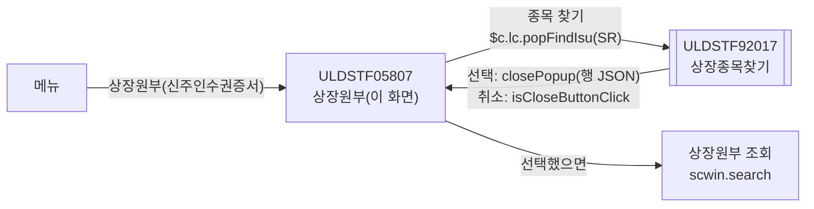
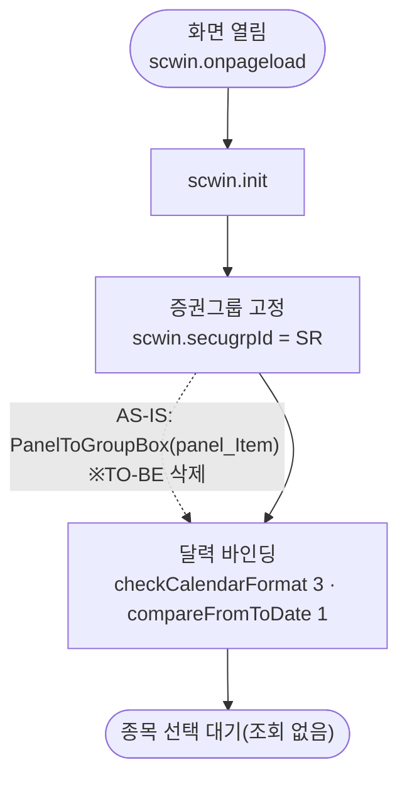
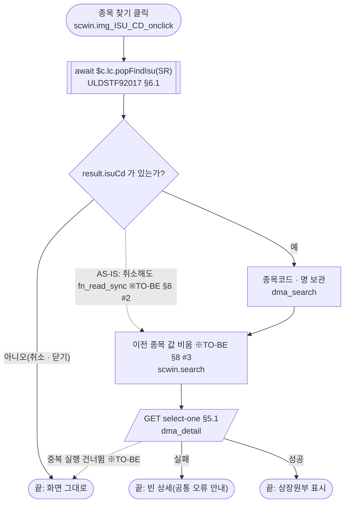

# ULDSTF05807 상장원부(신주인수권증서) — 업무 분석 및 전환 내역

| 항목 | 내용 |
|---|---|
| AS-IS | `/lstproc/ULDSTF05807.gfm` (Gauce/X-Internet, 540×365 메인 화면 — 하단 [닫기]) — 반입 `conversion/conversion-front/ui/ULDSTF05807/ULDSTF05807.gfm` |
| 신규 API 명세 | `ULDSTF05807_API.md` — 블록 2종: ① `[ULDSTF05708]` `GET /api/listing/lstproc/warrant/listedregister/select-list-swprc`(행사가격 조정내역 — **다른 화면 블록**, 이 화면은 쓰지 않음), ② `[ULDSTF05708/ULDSTF05807]` `GET /api/listing/lstproc/warrant/listedregister/select-one`(상세 조회 — 이 화면 블록). §2.2·§5 는 명세 기준(가이드 §0.3·§5) |
| TO-BE | `conversion/conversion-front/ui-tobe/ULDSTF05807.xml` (배포 경로 `/ui/lst/lstproc/ULDSTF05807.xml` — 가정, §10 #4). **2026-10-29 전환** — 1단계: 캡처 기준 퍼블리싱(마크업 전용, 사본 `$CLAUDE_JOB_DIR/tmp/ULDSTF05807_stage1.xml`), 2단계: 이 결과서대로 스크립트 전환. 게이트: `gate_screen --pcc stf`·`scan_mixed_compare`·`publish_gate --pcc stf --before {1단계} --allow P20`·`api_spec_check`(이 화면 명세 1종 사용, 05708 블록은 A06 INFO)·`init_binding_check`·`wsxml_lint` 0/0 통과 |
| 퍼블리셔 XML | 화면 폴더의 `ULDSTF05807.xml`(W-Craft 1차 스크립트 내장, `conversion/publish/상장/상장처리(대내)/ULDSTF05807.xml` 과 같은 계열) — 본화면(`sub_contents` + `pgtbox`/breadcrumb) 꼴, 2단 표 1개에 종목 선택 행까지 넣음, 컴포넌트 id 는 AS-IS 와 같음(날짜 `w2:inputCalendar`, 마스크 → `xf:input`, 이미지 버튼 → `xf:trigger`, `txb_SearchCd` 는 `w2:autoComplete`). **캡처를 따라** 종목 선택 줄을 별도 표로 나누고 `txb_SearchCd` 는 읽기 전용 입력으로 두었다(§2.1, §10 #5) |
| 화면 캡처 | `ULDSTF05807.png` (빈 화면 — 종목 선택 전, 하단 [닫기]) → TO-BE 는 가이드 §13.2 퍼블리싱본부터 만들었다. [닫기] 는 **(옮기지 않음)** — §2.1 |
| 업무공통 | pcc(`cm/pcc/stf`): `$c.lc`(`popFindIsu`·`glb.SECUGRP_ID_SR`). gcc: `$c.date`(`checkCalendarFormat`·`compareFromToDate`)·`$c.util.isEmpty`·`$c.sbm.executeDynamic`·`$c.exception.handleError`. 게이트는 `--pcc stf` 로 돌린다 |
| 작성 | Inswave / 2026-10-29 |

참고 양식: [websquare_gfm_conversion.md](../../../md/websquare_gfm_conversion.md) — 특히 §1.4 업무 프로세스 흐름, §5 「API 명세 적용」, §6.5 getPar/setPar 전환. Gauce 대응은 [gfm_business_analysis_guide.md](../../../md/gfm_business_analysis_guide.md) §5·§6 을 함께 따랐다. 같은 꼴(종목 선택 → 상장원부 조회)의 선례 [ULDSTF05923.md](../completed/ULDSTF05923/ULDSTF05923.md)(상장원부 ELW)의 구성과 결정을 따랐다.

---

## 1. 화면 개요

상장 담당자가 **신주인수권증서(SR) 종목 하나의 상장원부**를 보는 조회 전용 메인 화면이다. 종목을 고르면 종목코드·단축코드·한글/영문 종목명·약명, 발행회차·발행일·상장일·상장폐지일, 목적주권의 주식 종류·1주의 발행가액·청약 기간, 신주인수권증서 수량, 무액면주식 여부를 보여 준다.

1. [종목 찾기](돋보기)로 종목 팝업을 열어 신주인수권증서 종목을 고른다. 진입할 때는 아무것도 조회하지 않는다.
2. 고르면 바로 상장원부 상세를 조회해 화면을 채운다.
3. 고칠 수 있는 항목은 없다(모든 입력란 읽기 전용).

### 1.1 호출 화면 (0본)

- 이 화면을 여는 화면은 저장소에 없다(`grep -rl ULDSTF05807` — 이 폴더와 퍼블리셔 XML 2본뿐). 메뉴에서 바로 여는 **메인 화면**으로 본다(퍼블리셔 XML 도 본화면 꼴). 진입 파라미터는 없다.
- 같은 묶음의 `ULDSTF05806`(상장폐지)도 이 화면을 열지 않는다(05806 원본 `ULDSTF05806.gfm`·`.xml` 에 `05807` 언급 없음) — 화면 간 호출 계약 없음.
- 명세 블록 ②는 `ULDSTF05708`(신주인수권증권 상장원부)과 같은 API 를 쓴다 — 05708 은 `secugrpId` SW, 이 화면은 SR 로 부른다.

### 1.2 호출 규약 (부모 → 이 화면) / 반환 규약

- 해당 없음 — 메뉴 화면이라 받는 파라미터·돌려주는 값이 없다. 원본 전역 `vSecugrpID = SECUGRP_ID_SR` 에 "(신주인수권증서)메뉴단에서 파라미터로 받자.." 주석이 있으나 실제로는 상수다 → TO-BE 도 `$c.lc.glb.SECUGRP_ID_SR`(`"SR"`) 상수로 둔다.
- 원본 전역 `var fn_GetPar, fn_SetPar;` 는 선언만 남은 것이다(주석 처리된 `fn_GetParIsuCd`/`fn_SetParIsuCd` 용). 이 화면이 받는 getPar 계약은 없다.

### 1.3 이 화면이 여는 하위 팝업

| 팝업 | AS-IS 호출 (getPar/setPar) | 넘기는 `data` (TO-BE) | 받는 결과 (`closePopup`) / 취소 판정 |
|---|---|---|---|
| AS-IS `ULDCOM00003` 종목검색창 → TO-BE `ULDSTF92017` 상장종목찾기 (750×800) | `JongmokSearch(txb_SearchCd, txb_SearchNm, vSecugrpID, js_market, "A")`(`stockSearch.js`) — 모달로 열고 고른 종목코드·명을 `txb_SearchCd`·`txb_SearchNm` 에 직접 넣는다. 그 뒤 **선택 여부와 무관하게** `fn_read_sync()`. 2009-02-26 이전 방식(`fn_GetPar = fn_GetParIsuCd; fn_SetPar = fn_SetParIsuCd; fn_PopFindIsu(vSecugrpID)`)은 주석으로 남아 있다 | pcc `$c.lc.popFindIsu(secugrpId)` 가 `{ secugrpId : "SR" }` 로 연다(기본 `pageFramePopup` → `await` 가능). `js_market`(세션 시장)·`"A"` 옵션은 넘기지 않는다 — 92017 이 세션 시장(`$c.session.getUserInfo("market")`)으로 거른다(§10 #1) | 선택 행 JSON(`sample-front/ui/stf/lst/common/ULDSTF92017.xml` 의 `closePopup(dlt_listRes.getRowJSON(row))` — `isuCd`·`isuKorNm` …). 취소·닫기는 `{ isCloseButtonClick }` 만 오므로 **`result.isuCd` 가 비면 그대로 둔다**(§8 #2) |

- 원본 `JongmokSearch` 의 pcc 대응 `$c.cm.jongmokSearch` 는 `ULDCOM00003` 을 `data` 없이 열어(증권그룹·시장이 팝업에 전달되지 않음) 반환 계약도 정해지지 않았고, `ULDCOM00003` 자체가 미전환(W-Craft 1차, `/gauceSystemierAdaptor.do`)이다. 그래서 전환된 계약이 있는 `ULDSTF92017`(선례 05702·05923 과 같음)로 연다 — §10 #1.

### 1.4 업무 프로세스 흐름

흐름은 AS-IS 동작을 기준으로 그렸다. 점선과 `※TO-BE` 는 전환본에서 바뀌는 곳이다(근거는 §8).

| # | 업무 | 시작 (사용자 동작·진입 조건) | 끝 (결과) | 주요 함수 | 관련 절 |
|---|---|---|---|---|---|
| 1 | 진입·로딩 | 메뉴에서 화면을 엶 | 빈 화면으로 종목 선택 대기 | `scwin.onpageload` → `scwin.init` | §3 |
| 2 | 종목 선택·상장원부 조회 | [종목 찾기] `img_ISU_CD` | 상장원부 상세 표시 | `scwin.img_ISU_CD_onclick` → `scwin.openIsuPopup` → `scwin.search` → `scwin.selectDetail` | §5.1, §6.1, §6.2 |

#### 화면 간 흐름



AS-IS 는 `JongmokSearch` 가 모달 창(ULDCOM00003)에서 고른 값을 이 화면의 입력란에 직접 넣었고, 이어서 이 화면이 조회했다. TO-BE 는 `await $c.lc.popFindIsu(...)` 의 반환값으로 이 화면이 채우고 조회한다(가이드 §6.5).

#### 업무 1: 진입·로딩



| # | 단계 | 주체 | 내용 | 분기 · 메시지 | 관련 절 |
|---|---|---|---|---|---|
| 1 | (장식) | 화면 | AS-IS `gform onload` → `PanelToGroupBox(panel_Item)` | 삭제 — 퍼블리싱 마크업이 대신함 | §2.1 |
| 2 | 증권그룹 | 화면 | AS-IS 전역 `vSecugrpID = SECUGRP_ID_SR` → `scwin.secugrpId = $c.lc.glb.SECUGRP_ID_SR` | — | §1.2 |
| 3 | 달력 바인딩 | 화면 | 단일 달력 3개(발행일·상장일·상장폐지일) `checkCalendarFormat`, 목적주권 청약 기간 쌍 `compareFromToDate` (규칙 37) | — | §3 |

#### 업무 2: 종목 선택·상장원부 조회



| # | 단계 | 주체 | 내용 | 분기 · 메시지 | 관련 절 |
|---|---|---|---|---|---|
| 1 | 종목 선택 | 사용자 | 92017 에서 행 선택 | 취소·닫기면 끝(※TO-BE) | §6.1 |
| 2 | 조건 보관 | 화면 | `dma_search.isuCd`·`isuKorNm`(원본 `txb_SearchCd`·`txb_SearchNm`) | — | §2.2 |
| 3 | 상세 조회 | 서버 | AS-IS `fn_read_sync` — `dts_Item` `/IssueBook.do?method=readIssueBook`(**동기** `syncload="True"`) → `GET select-one` | 실패는 원본 `dts_Item OnLoadError` → `alert_error(dts_Item)`, TO-BE 는 `executeDynamic` 공통 오류 안내 | §5.1 |
| 4 | 표시 | 화면 | AS-IS `bnd_Item` 바인더가 `dts_Item` 1행을 입력란 16개에 표시 → TO-BE `ref="data:dma_detail.*"` | 0건이면 빈 상세(원본 `OnLoadCompleted` 는 아무것도 안 함) | §2.2 |

#### 화면 모드 상태 전이

해당 없음 — 조회 전용이라 모드가 없다(버튼 상태 제어 없음).

---

## 2. 화면 구성 및 데이터 정의

### 2.1 화면 구성 (AS-IS 요소 → TO-BE 컴포넌트)

TO-BE 는 본화면 `sub_contents` + contentHeader(`pfmContentHeader`) 아래 표 2개다 — ① 종목 선택(`panel_Top`), ② 상장원부 상세(`panel_Item`, 4열 2단). 캡처의 구분선(`image_3`) 위·아래를 표 둘로 나눈 것이다.

| 영역 | AS-IS 요소 (id · 종류) | TO-BE 컴포넌트 | 바인딩 | 비고 |
|---|---|---|---|---|
| 전체 | `panel_Item` (panel, `PanelToGroupBox`) | `tblbox#panel_Item`(상세 표) + `tblbox#panel_Top`(종목 선택, 신설 id) | — | 장식 함수 삭제 |
| 종목 선택 | `label_22` "종목코드(명)" | `w2:textbox#label_22` | — | |
| | `txb_SearchCd` (textbox, readonly) | `xf:input#txb_SearchCd` readOnly | `dma_search.isuCd` | 퍼블리셔 XML 의 `w2:autoComplete` 대신 캡처대로 읽기 전용 입력(§10 #5) |
| | `txb_SearchNm` (textbox, readonly) | `xf:input#txb_SearchNm` readOnly | `dma_search.isuKorNm` | |
| | `img_ISU_CD` (image 돋보기) | `xf:trigger#img_ISU_CD` `btn_cm icon search` | `ev:onclick` | |
| | `image_3` (구분선 이미지) | (옮기지 않음) | — | 표 두 개로 나눠 대신함 |
| 상세 | `label_14` 종목코드 / `txb_ISU_CD` | `xf:input#txb_ISU_CD` readOnly | `dma_detail.isuCd` | |
| | `label_17` 단축코드 / `txb_ISU_SRT_CD` | `xf:input#txb_ISU_SRT_CD` readOnly | `dma_detail.isuSrtCd` | |
| | `label_2` 한글종목명 / `txb_ISU_KOR_NM` | `xf:input#txb_ISU_KOR_NM` readOnly (colspan 3) | `dma_detail.isuKorNm` | |
| | `label_16` 한글종목약명 / `txb_ISU_KOR_ABBRV` | `xf:input#txb_ISU_KOR_ABBRV` readOnly | `dma_detail.isuKorAbbrv` | |
| | `label_3` 영문종목명 / `txb_ISU_ENG_NM` | `xf:input#txb_ISU_ENG_NM` readOnly | `dma_detail.isuEngNm` | |
| | `label_8` 영문종목약명 / `txb_ISU_ENG_ABBRV` | `xf:input#txb_ISU_ENG_ABBRV` readOnly | `dma_detail.isuEngAbbrv` | |
| | `label_4` 발행회차 / `edt_ISU_RND` (mxmaskedit numeric) | `xf:input#edt_ISU_RND` `tar` readOnly | `dma_detail.isuRnd` | 명세 text |
| | `label_18` 목적주권 주식의종류 / `txb_STKCERT_KIND_NM` | `xf:input#txb_STKCERT_KIND_NM` readOnly | `dma_detail.stkcertKindNm` | |
| | `label_1` 발행일 / `edt_ISU_DD` (mask YYYY-MM-DD) | `w2:inputCalendar#edt_ISU_DD` readOnly | `dma_detail.isuDd` | |
| | `label_10` 신주인수권증서수량 / `edt_LIST_SHRS` (numeric) | `xf:input#edt_LIST_SHRS` number `#,###` | `dma_detail.listShrs` | |
| | `label_13` 상장일 / `edt_LIST_DD` | `w2:inputCalendar#edt_LIST_DD` readOnly | `dma_detail.listDd` | |
| | `label_7` 목적주권 1주의 발행가액(원) / `edt_EXER_PRC` (numeric) | `xf:input#edt_EXER_PRC` number `#,###` | `dma_detail.exerPrc` | |
| | `label_6` 상장폐지일 / `edt_MKT_DELIST_DD` | `w2:inputCalendar#edt_MKT_DELIST_DD` readOnly | `dma_detail.delistDd` | AS-IS 바인더 col `DELIST_DD` |
| | `label_50` 무액면주식 여부 / `edt_NPARVALSTK_YN` | `xf:input#edt_NPARVALSTK_YN` readOnly | `dma_detail.nparvalstkYn` | |
| | `label_19` 목적주권 청약시작일 / `edt_EXER_STRT_DD` | `w2:inputCalendar#edt_EXER_STRT_DD` readOnly | `dma_detail.exerStrtDd` | |
| | `label_20` 목적주권 청약종료일 / `edt_EXER_END_DD` | `w2:inputCalendar#edt_EXER_END_DD` readOnly | `dma_detail.exerEndDd` | |
| 하단 | `btn_Close` (image 닫기) → `frame.CloseFrame()` | **(옮기지 않음)** | — | 본화면은 windowContainer 창 탭의 닫기를 쓴다(선례 05700·05702·05923) |

### 2.2 데이터 정의 (DataCollection)

| TO-BE | AS-IS | 용도 | 키 (camelCase) |
|---|---|---|---|
| `dma_detail` | `dts_Item` + `bnd_Item` (mxbinder) | 상세 조회 응답(명세 select-one `target : "dma_detail=body"`) — **명세 원문 그대로 29키** | `isuCd`·`isuSrtCd`·`isuKorNm`·`isuKorAbbrv`·`isuEngNm`·`isuEngAbbrv`·`isurCd`·`isuDd`·`listDd`·`delistDd`·`haltYn`·`secugrpId`·`listStatCd`·`spotIsuTrdMktTpCd`·`tarstkIsuCd`·`stkcertKindNm`·`isuRnd`·`isuRsnContn`·`listShrs`(number)·`isuShrs`(number)·`totIsuPrc`(number)·`exerPrc`(number)·`exerStrtDd`·`exerEndDd`·`subsrghtExertmPaymethdContn`·`subsrghtContn`·`depNm`·`empNm`·`nparvalstkYn` |
| `dma_search` | `txb_SearchCd`·`txb_SearchNm` (입력란 값) | 화면 전용 — 팝업에서 고른 종목 | `isuCd`·`isuKorNm` |
| (옮기지 않음) | `dts_Cod` | 선언만 있고 쓰지 않는 데이터셋 | — |

AS-IS 바인더 컬럼 ↔ 명세 키: `ISU_CD`→`isuCd`, `ISU_SRT_CD`→`isuSrtCd`, `ISU_KOR_NM`→`isuKorNm`, `ISU_KOR_ABBRV`→`isuKorAbbrv`, `ISU_ENG_NM`→`isuEngNm`, `ISU_ENG_ABBRV`→`isuEngAbbrv`, `STKCERT_KIND_NM`→`stkcertKindNm`, `ISU_RND`→`isuRnd`, `ISU_DD`→`isuDd`, `LIST_DD`→`listDd`, `DELIST_DD`→`delistDd`, `LIST_SHRS`→`listShrs`, `EXER_PRC`→`exerPrc`, `EXER_STRT_DD`→`exerStrtDd`, `EXER_END_DD`→`exerEndDd`, `NPARVALSTK_YN`→`nparvalstkYn` — 16개 모두 명세에 있다. 명세의 나머지 13키는 화면에 표시하지 않는다(05708 공용 응답).

---

## 3. 로딩 (`scwin.onpageload` → `scwin.init`) — 2구역

- `scwin.onpageload` 는 `await scwin.init()` 만 부른다(try/catch + `$c.exception.handleError`).
- `scwin.init` 순서
  1. `scwin.secugrpId = $c.lc.glb.SECUGRP_ID_SR` — 원본 전역 상수.
  2. 달력 바인딩(규칙 37): `checkCalendarFormat(edt_ISU_DD|edt_LIST_DD|edt_MKT_DELIST_DD, "yyyyMMdd")`, 기간 쌍 `compareFromToDate(edt_EXER_STRT_DD, edt_EXER_END_DD, ["목적주권 청약시작일", "목적주권 청약종료일"])`. 모두 읽기 전용이지만 규칙대로 건다(선례 05923).
- 조회 버튼·`schbox`·`tbl_search` 가 없어 `setEnterKeyEvent` 대상 없음(규칙 22).
- AS-IS `PanelToGroupBox(panel_Item)` 은 삭제. 진입 시 조회 없음(원본과 같음).

## 4. 컴포넌트 이벤트 — 3구역

| TO-BE 핸들러 | 컴포넌트 · 이벤트 | 동작 | AS-IS |
|---|---|---|---|
| `scwin.img_ISU_CD_onclick` | `img_ISU_CD` `ev:onclick` | `await scwin.openIsuPopup()` | `img_ISU_CD onclick` — `JongmokSearch(...)` + `fn_read_sync()` |
| (옮기지 않음) | `btn_Close onclick` | — | `frame.CloseFrame()` — §2.1 |
| (옮기지 않음) | `btn_Update onclick` | — | `fn_update()` — 컴포넌트·함수 모두 없음(§8 #1) |
| (옮기지 않음) | `dts_Item OnLoadError()` | `executeDynamic` 공통 오류 안내가 대신함 | `alert_error(dts_Item)` |
| (옮기지 않음) | `dts_Item OnLoadCompleted(rowcount)` | — | 본문이 주석뿐(`//alert(...)`) |
| `scwin.onpageload` | `body ev:onpageload` | `scwin.init` | `gform onload` — `PanelToGroupBox(panel_Item)` |

## 5. 서버 통신 — 4구역

**API 명세 적용** — 이 화면ID 블록은 ②(`select-one`) 하나다. 블록 ①(`select-list-swprc`)은 `ULDSTF05708` 전용이라 쓰지 않는다(`api_spec_check` A06 INFO).

| AS-IS | TO-BE (명세) |
|---|---|
| `fn_read_sync` — `dts_Item.DataID = /IssueBook.do?SCREN_ID=…&SCREN_PROCES_TP_CD=01&method=readIssueBook&inputMessageId=LISTING_ISUBOOK_SEARCH_OUT&SECUGRP_ID=SR&P_KEY={txb_SearchCd}` → `Reset()` (동기) | `scwin.selectDetail` — `GET /api/listing/lstproc/warrant/listedregister/select-one`, requestData `{ isuCd, secugrpId }`, `target : "dma_detail=body"` |

### 5.1 상장원부 상세 조회 (`scwin.selectDetail`)

| 항목 | 내용 |
|---|---|
| 호출 | `scwin.search` → `scwin.selectDetail(dma_search.get("isuCd"))` |
| 경로 | `GET /api/listing/lstproc/warrant/listedregister/select-one` (규칙 38 전체 경로 리터럴) |
| [REQUEST] | `{ target : "dma_detail=body" }`, requestData `{ isuCd : 종목코드(원본 P_KEY), secugrpId : "SR"(원본 SECUGRP_ID) }` |
| [RESPONSE] | `dma_detail` 29키(§2.2) |
| 후처리 | 바인딩으로 표시. 조회 전에 `scwin.search` 가 `dma_detail.setEmptyValue()` (§8 #3) |
| 실패 | `executeDynamic` 공통 오류 안내, 상세는 빈 채로 둠(원본 `alert_error(dts_Item)`) |
| 중복 실행 | `result.skipped` 면 그대로 끝 |
| 명세에 없는 원본 인자 | `SCREN_ID`·`SCREN_PROCES_TP_CD`·`method`·`inputMessageId` — 보내지 않음(§10 #3) |

## 6. 일반 함수 — 5구역

### 6.1 종목 찾기 (`scwin.openIsuPopup`)

```javascript
const result = await $c.lc.popFindIsu(scwin.secugrpId);   // { secugrpId : "SR" } → ULDSTF92017
if ($c.util.isEmpty(result?.isuCd)) return;               // 취소·닫기(X) — { isCloseButtonClick }
dma_search.set("isuCd", result.isuCd);
dma_search.set("isuKorNm", result.isuKorNm ?? "");
await scwin.search();
```

- 반환: 선택 행 JSON(`isuCd`·`isuKorNm` 사용). 취소 판정은 `isuCd` 로 한다.

### 6.2 상장원부 조회 (`scwin.search`)

- `dma_detail.setEmptyValue()` → `await scwin.selectDetail(dma_search.get("isuCd"))`.

### 6.5 부모 ↔ 팝업 파라미터 전달 (getPar/setPar → `$c.win.openPopup` + `await`)

- 이 화면이 부모로서 쓰던 `JongmokSearch`(입력란 객체를 넘겨 팝업이 직접 채움)와 주석 처리된 `fn_GetParIsuCd`/`fn_SetParIsuCd` 를 모두 `await $c.lc.popFindIsu(secugrpId)` 반환값 방식으로 바꿨다(pcc 가 내부에서 `$c.win.openPopup`, `await` 형). 남기는 `fn_GetPar`/`fn_SetPar` 없음.

## 7. 업무 코드 · 메시지 목록

| 구분 | 값 | 쓰는 곳 |
|---|---|---|
| 증권그룹ID | `SR` 신주인수권증서 (`$c.lc.glb.SECUGRP_ID_SR`) | 종목 팝업 `secugrpId`, 상세 조회 `secugrpId` |
| 화면처리구분 | `SCREN_PROCS_TP_CD_01` | 원본 URL 인자 — TO-BE 미전송(§10 #3) |
| 종목 찾기 옵션 | `JongmokSearch` 5번째 인자 `"A"`, 시장 `js_market` | TO-BE 미전송(§10 #1) |
| 메시지 | 없음 — 원본에 화면 고유 메시지 없음(조회 오류는 `alert_error`) | — |

## 8. 원본 특이사항 · 결함

| # | 내용 | 결정 |
|---|---|---|
| 1 | `btn_Update onclick` → `fn_update()` 이벤트가 있으나 `btn_Update` 컴포넌트도 `fn_update` 함수도 없다(죽은 이벤트) | 옮기지 않음 |
| 2 | `img_ISU_CD onclick` 은 `JongmokSearch` 뒤 **선택 여부와 무관하게** `fn_read_sync()` — 취소해도 이전 값(또는 빈 값)으로 다시 조회한다 | 고침 — 취소·닫기면 아무것도 하지 않음 |
| 3 | 조회 전에 상세를 비우지 않는다(바인더가 결과로 덮지만 0건·실패 때 이전 종목 값이 남을 수 있음) | 고침 — `scwin.search` 에서 `dma_detail.setEmptyValue()` |
| 4 | 주석 처리된 `fn_GetParIsuCd` 가 `return arrPar, length;`(쉼표 연산자) | 옮기지 않음 — 주석 코드 |
| 5 | `dts_Cod` 선언만 있고 쓰지 않음, `dts_Item OnLoadCompleted` 본문 없음, `#include` 5종(`libRoundPanel`·`stf`·`list_common`·`session`·`stockSearch`) | 옮기지 않음 |
| 6 | 원본 `vScrenID` 는 URL 인자 `SCREN_ID` 에만 쓰임 | 옮기지 않음 — 명세에 없음(§10 #3) |

## 9. 전환 내역 (AS-IS → TO-BE)

| AS-IS | TO-BE |
|---|---|
| 전역 `vScrenID` | 삭제 — 명세에 없음(`scwin.screenId` 는 식별 주석용으로만 둠) |
| 전역 `vSecugrpID = SECUGRP_ID_SR` | `scwin.secugrpId` ← `$c.lc.glb.SECUGRP_ID_SR` (init) |
| 전역 `var fn_GetPar, fn_SetPar;` | 삭제 — §6.5 |
| `fn_GetParIsuCd(arrPar)` (주석) | 삭제 — `popFindIsu` 의 `data`(`secugrpId`)로 대체 |
| `fn_SetParIsuCd(arrPar)` (주석) | 삭제 — `scwin.openIsuPopup` 의 반환값 처리 |
| `fn_read_sync()` | `scwin.search` + `scwin.selectDetail` (§5.1, §6.2) |
| `img_ISU_CD onclick` (`JongmokSearch` + `fn_read_sync`) | `scwin.img_ISU_CD_onclick` → `scwin.openIsuPopup` |
| `btn_Update onclick` → `fn_update()` | 삭제 — §8 #1 |
| `btn_Close onclick` → `frame.CloseFrame()` | 삭제 — 본화면 창 탭 닫기(§2.1) |
| `dts_Item OnLoadError()` → `alert_error(dts_Item)` | 삭제 — `executeDynamic` 공통 오류 안내 |
| `dts_Item OnLoadCompleted(rowcount)` | 삭제 — 본문 없음 |
| `gform onload` → `PanelToGroupBox(panel_Item)` | `scwin.onpageload` → `scwin.init`(장식 삭제) |
| `dts_Item` + `bnd_Item` | `dma_detail` + `ref` 바인딩 |
| `dts_Cod` | 삭제 — 미사용 |

W-Craft 1차 스크립트(퍼블리셔 XML)의 `scwin.readSync`(`url` 미선언 결함, 응답 처리 TODO)·`$c.stockSearch.JongmokSearch`(`$c.stockSearch` 미정의)·`$c.cm.PanelToGroupBox`·`scwin.btn_Update_onclick`(`fn_update` 미정의) 는 쓰지 않고 이 결과서대로 다시 썼다.

## 10. 남은 작업 (TODO)

1. **종목 팝업 대체** — AS-IS 는 `JongmokSearch`(ULDCOM00003 종목검색창, 세션 시장 `js_market`·옵션 `"A"`)였다. pcc `$c.cm.jongmokSearch` 는 `ULDCOM00003` 을 `data` 없이 열고 반환 계약이 없으며 ULDCOM00003 은 미전환이라, 전환된 `ULDSTF92017`(`$c.lc.popFindIsu(SR)`)로 대체했다. 92017 이 SR 종목·세션 시장으로 거르는지, 상장폐지 종목까지 나오는지(ULDCOM00003 `"A"` 옵션의 의미) 확인 필요. 반환 키(`isuCd`·`isuKorNm`)는 `sample-front/ui/stf/lst/common/ULDSTF92017.xml` 기준 가정.
2. **0건 처리** — 명세 select-one 이 0건일 때 `body` 가 빈 객체인지 `null` 인지 미확인. 원본처럼 안내 없이 빈 상세로 둔다.
3. **명세에 없는 원본 인자** — `SCREN_ID`·`SCREN_PROCES_TP_CD(01)`(감사 로그용으로 보임)를 보내지 않는다. 서버가 화면 로그를 따로 요구하면 반영.
4. **배포 경로** — `/ui/lst/lstproc/ULDSTF05807.xml` 가정(원본 `/lstproc/`). 메뉴 등록 시 확인.
5. **퍼블리셔 XML 과의 차이** — 종목 선택 줄을 별도 표(`panel_Top`, 신설 id)로 나눴고, `txb_SearchCd` 를 `w2:autoComplete` 가 아닌 읽기 전용 `xf:input` 으로 두었다(캡처·원본 모두 읽기 전용, 자동완성 데이터 계약 없음). 하단 `btnbox`[닫기] 와 breadcrumb `pgtbox` 는 contentHeader 로 대신하고 옮기지 않았다.

## 11. 화면 함수 목록 (TO-BE)

| 구역 | 함수 | 설명 |
|---|---|---|
| 2 | `scwin.onpageload` / `scwin.init` | 로딩 |
| 3 | `scwin.img_ISU_CD_onclick` | 종목 찾기 클릭 |
| 4 | `scwin.selectDetail` | 상세 조회(select-one) |
| 5 | `scwin.openIsuPopup` / `scwin.search` | 종목 팝업 / 조회 |
