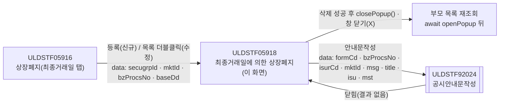
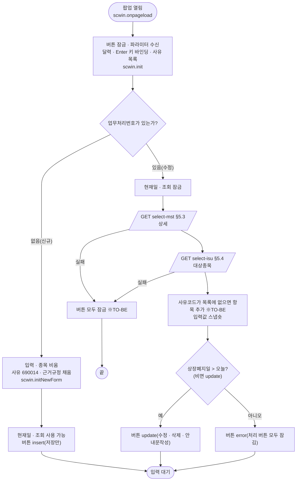
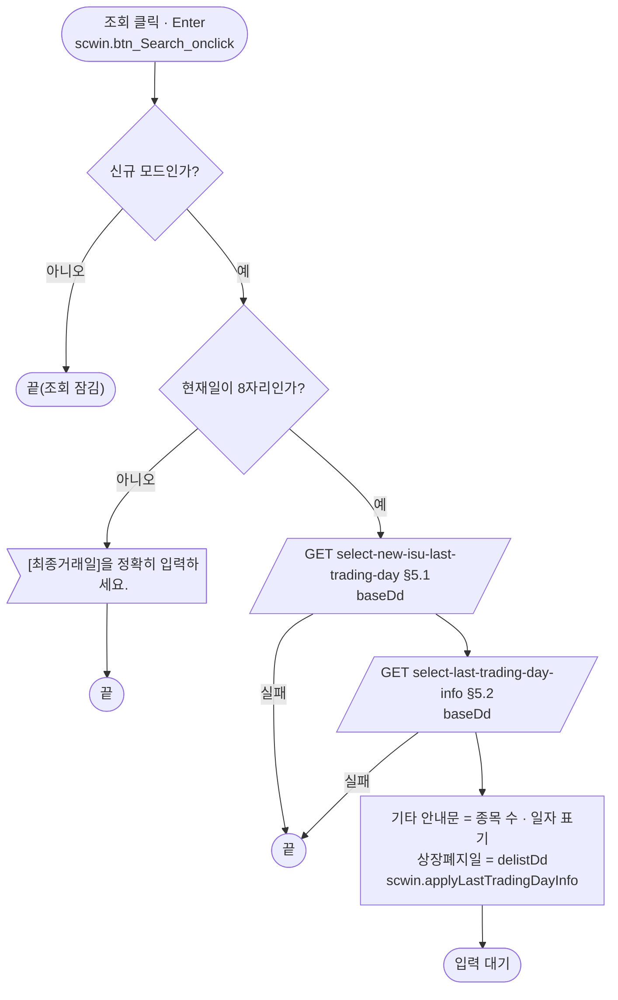
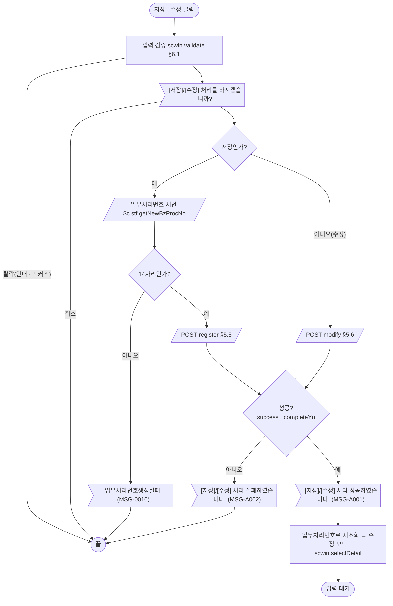
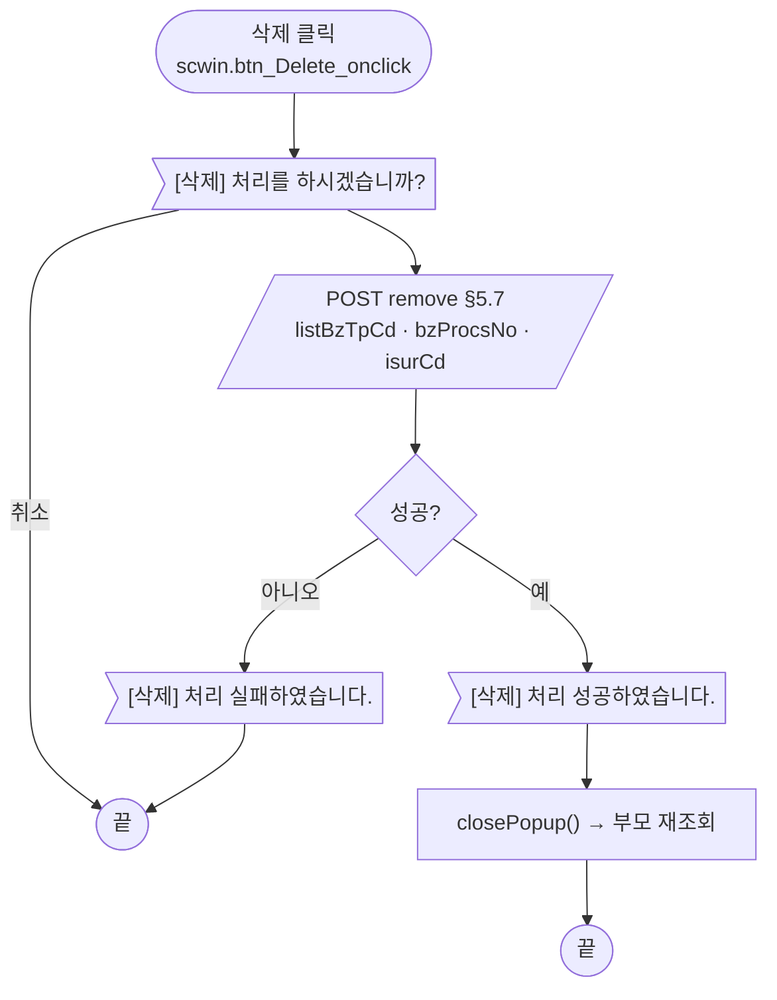
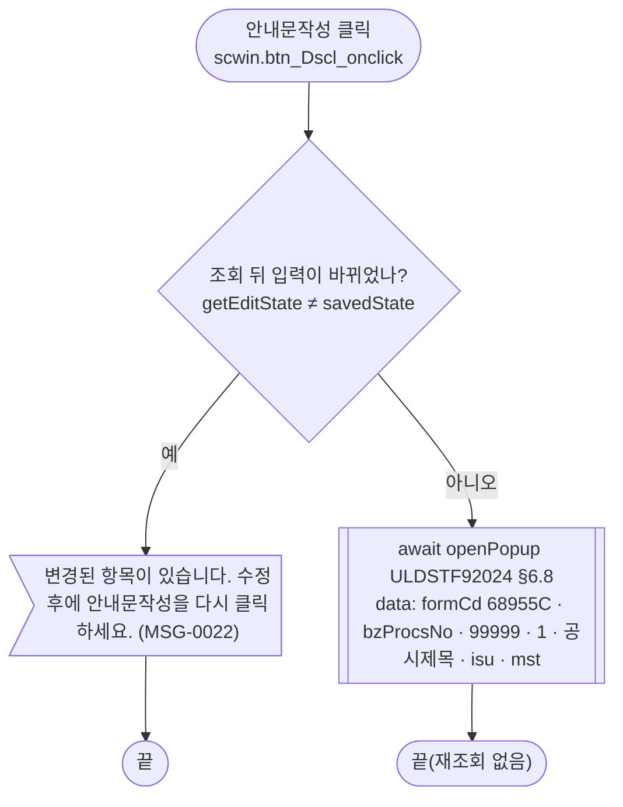
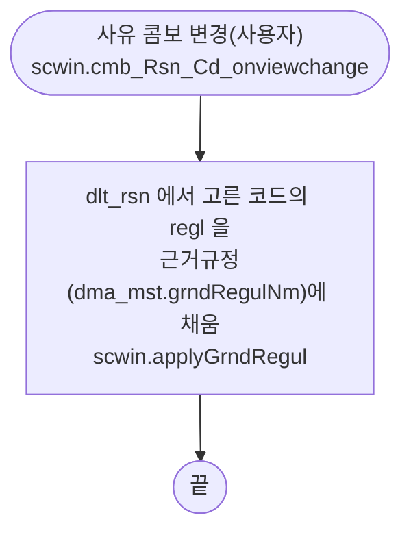
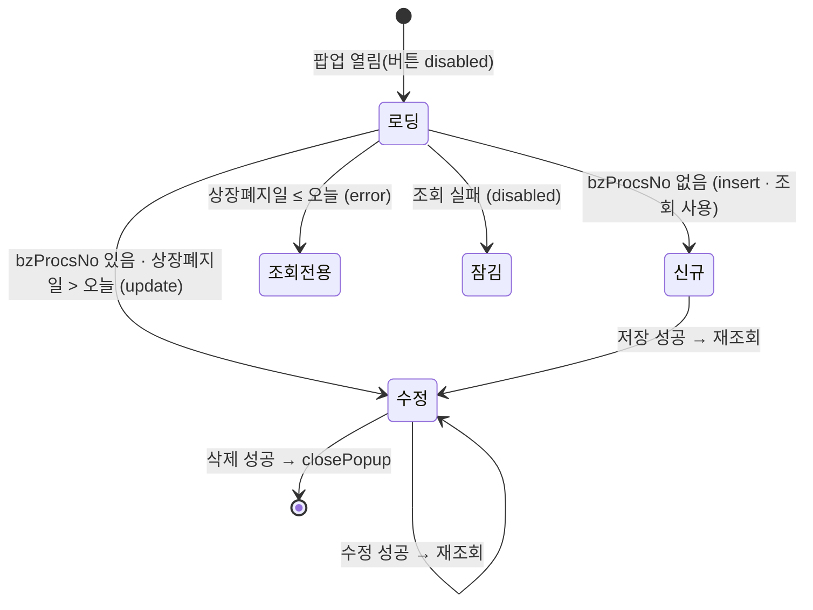

# ULDSTF05918 (팝업)ELW 최종거래일에 의한 상장폐지 — 업무 분석 및 전환 내역

| 항목 | 내용 |
|---|---|
| AS-IS | `/lstproc/ULDSTF05918.gfm` (Gauce/X-Internet, 715×500 — 부모가 720×530 `window` 로 연다) — 반입 `conversion/conversion-front/ui/ULDSTF05918/ULDSTF05918.gfm` |
| 신규 API 명세 | `conversion/conversion-front/ui/ULDSTF05918/ULDSTF05918_API.md` — 블록 8종(이 화면 7종: `[ULDSTF05918]` 2종 + `[ULDSTF05917~05939]` 5종, 다른 화면 1종: `[ULDSTF05917]` `select-new-isu`). §2.2·§5 는 명세 기준(가이드 §0.3·§5) |
| TO-BE | `conversion/conversion-front/ui-tobe/ULDSTF05918.xml` (배포 경로 `/ui/lst/lstproc/ULDSTF05918.xml` — 가정, §10 #9) |
| 퍼블리싱 | 화면 폴더의 `ULDSTF05918.xml` (W-Craft 1차 변환본 + 퍼블리싱 마크업 — 가이드 §0.3 「화면 폴더의 xml 이 퍼블리싱 파일」). 컴포넌트 id 는 AS-IS 와 같고(`edt_Dd`·`edt_DelistDd` `inputCalendar`, `cmb_Rsn_Cd` `xf:select1`, `txb_GrndRegulNm` `xf:input`, `txa_Remk` `xf:textarea`, 버튼 `xf:trigger`), 그리드 컬럼 id 는 대문자·한글(`번호`) 그대로. `conversion/publish/상장/상장처리(대내)/ULDSTF05918.xml` 도 같은 꼴 |
| 화면 캡처 | `ULDSTF05918.png` — 신규 상태(현재일 2026-10-29, 사유 「최종거래일 도래」, 근거규정 「유가증권시장상장규정 제143조」, 하단 저장·수정·삭제·안내문작성·닫기) |
| 업무공통 | `$c.stf`(`getMessageParam`·`setButtonSetWithDate`·`getNewBzProcNo`)·`$c.lc`(`isProcess`·`glb.LIST_BZ_TP_CD_307`) — `cm/pcc/stf`. 게이트는 `--pcc stf` 로 돌린다 |
| 작성 | Inswave / 2026-10-29 |

참고 양식: [websquare_gfm_conversion.md](../../../md/websquare_gfm_conversion.md) — 특히 §1.4 업무 프로세스 흐름, §6.5 getPar/setPar 전환. Gauce 대응은 [gfm_business_analysis_guide.md](../../../md/gfm_business_analysis_guide.md) §5·§6 을 함께 따랐다. 선례: ULDSTF05911(ELW 팝업 등록·수정·삭제)·ULDSTF05232(안내문작성 92024 호출).

---

## 1. 화면 개요

상장 담당자가 **상장폐지 화면(ULDSTF05916)** 의 "최종거래일에 의한 상장폐지" 탭에서 ELW(주식워런트증권) 가운데 **다음 영업일이 최종거래일인 종목들**을 한 건의 상장폐지로 묶어 등록하거나, 등록한 건을 수정·삭제하고 공시안내문을 작성하는 팝업이다.

1. 부모가 증권그룹ID·시장구분·업무처리번호·기준일을 넘겨 팝업을 연다. 업무처리번호가 없으면 신규(기준일 = 오늘), 있으면 수정(기준일 = 그 건의 최종거래일)이다.
2. 신규: 현재일(기준일)로 [조회]하면 기준일 다음 영업일이 최종거래일인 종목이 그리드에 오고, 이어서 상장폐지일(기준일 다음 2번째 영업일)과 안내문구용 일자 표기를 받아 **상장폐지일·기타 안내문을 자동으로 채운다**. 사유는 「최종거래일 도래(690014)」가 기본이고 그 사유의 근거규정이 채워진다.
3. 상장폐지사유를 바꾸면 그 사유의 근거규정이 근거규정 입력란에 채워진다.
4. [저장]하면 검증 → 확인 → 업무처리번호 채번 → 등록 순서로 처리하고, 성공하면 그 번호로 다시 조회해 수정 모드가 된다.
5. 수정이면 상세(MST)와 대상종목을 조회한다. 상장폐지일이 오늘 이후면 [수정]·[삭제]·[안내문작성]이, 지났으면 처리 버튼이 모두 잠긴다. 수정에 성공하면 다시 조회하고, 삭제에 성공하면 팝업을 닫는다.
6. [안내문작성]은 조회 뒤 고친 입력이 없을 때만 공시안내문작성 팝업(ULDSTF92024)을 연다.

### 1.1 호출 화면 (1본)

- `ULDSTF05916` 상장폐지 — 퍼블리싱본 `conversion/publish/상장/상장처리(대내)/ULDSTF05916.xml`(W-Craft 1차 스크립트 포함, 아직 TO-BE 전환 전). 사유별 탭(05917 일반·05918 최종거래일·05919 조기종료·05938 거래부진·05939 전부보유 1개월) 중 두 번째 탭의 팝업.
  - [등록](신규) → `fn_GetPar = fn_GetParNew2` 후 `CreateDialogFrame("DLG_DELLIST", "../lstproc/ULDSTF05918.gfm", getSecuGrpNm(증권그룹ID) + " 최종거래일에 의한 상장폐지", 200, 100, 720, 530, "window")`.
  - 목록 더블클릭(수정) → `fn_GetPar = fn_GetParUpdate2` 후 같은 호출.
  - 팝업이 닫히면 부모가 목록을 다시 조회한다(모달 대기 전제).

### 1.2 호출 규약 (부모 → 이 화면) / 반환 규약

AS-IS 는 부모가 `fn_GetPar` 를 `fn_GetParNew2`/`fn_GetParUpdate2` 로 바꿔 두면, 팝업이 로딩 때 `frame.Provider("../").fn_GetPar(arrPar)` 로 부모 함수를 불러 배열을 채워 받는다.

| arr | TO-BE 키 (제안) | 의미 (부모 `fn_GetParNew2` / `fn_GetParUpdate2`) | 빈 값일 때 / 분기 |
|---|---|---|---|
| `arr[0]` | `secugrpId` | 증권그룹ID (`fr_SecuGrpId`) | 이 화면에서는 쓰지 않음 |
| `arr[1]` | `mktId` | 시장구분 (`fr_MktId`) | AS-IS 는 사유 목록 조회 조건(`MKT=`) — TO-BE 는 사유 목록 API 가 없어 보관만(§10 #1) |
| `arr[2]` | `bzProcsNo` | 업무처리번호 — 신규 `""`, 수정은 선택 행 `bz_procs_no` | **비면 신규**, 있으면 수정 |
| `arr[3]` | `baseDd` | 기준일 — 신규 `cGetToday("yyyymmdd")`, 수정은 선택 행 `ELW_LSTTRD_DD` | 현재일 입력란(`edt_Dd`) 초기값 |

- **TO-BE** (가이드 §6.5): 부모는 함수를 바꿔 끼우지 않고 위 키의 객체를 `data` 로 넘긴다. 이 화면은 `$c.data.getParameter()` 로 받는다. 부모(05916)가 아직 전환 전이라 키 이름은 제안이다(§10 #8).

  ```javascript
  // 부모 ULDSTF05916 (신규: bzProcsNo "" · baseDd 오늘, 수정: 선택 행의 업무처리번호 · 최종거래일)
  const data = { secugrpId, mktId, bzProcsNo, baseDd };
  await $c.win.openPopup("/ui/lst/lstproc/ULDSTF05918.xml",
      { id : "DLG_DELLIST", popupName : $c.lc.getSecuGrpNm(secugrpId) + " 최종거래일에 의한 상장폐지", width : 720, height : 530, type : "pageFramePopup" }, data);
  await scwin.search2();   // AS-IS: CreateDialogFrame(…) 뒤 목록 재조회
  ```

- **반환**: 없음. 원본은 `frame.CloseFrame()` 만 한다 → TO-BE `$c.win.closePopup()`(인자 없음). 부모는 `await` 가 끝나면 다시 조회한다.

### 1.3 이 화면이 여는 하위 팝업

| 팝업 | AS-IS 호출 (getPar/setPar) | 넘기는 `data` (TO-BE) | 받는 결과 (`closePopup`) / 취소 판정 |
|---|---|---|---|
| `ULDSTF92024` 공시안내문작성 (745×820) | `fn_GetPar` 를 임시 함수로 바꾸고 `frame.CreateDialogFrame("ULDSTF92024", "/listingcommon/ULDSTF92024.gfm", "공시안내문작성", …, "window")`. 92024 가 `fn_GetPar(arr, param_dts_isu, param_dts_mst, …)` 로 `arr[0]="68955C"`(서식코드)·`arr[1]=업무처리번호`·`arr[2]="99999"`·`arr[3]="1"`·`arr[4]=""`·`arr[5]="익일 최종거래일에 의한 상장폐지예고"`(공시제목)와 `CopyDataSet(dts_Isu)`·`CopyDataSet(dts_Mst)`(+ 마스터 `DELIST_RSN_NM` = 콤보 표시값)을 받는다. `fn_SetPar` 는 빈 함수 | `{ formCd, bzProcsNo, isurCd, mktId, msg, title, isu, mst }` — §6.8 | 결과 없음(원본도 닫힌 뒤 재조회하지 않음) |

- 92024 전환본(`conversion/sample-front/ui/ULDSTF92024.xml`)은 아직 부모의 `scwin.getPar(arr, dlt_Isu, dlt_Mst, …)` 를 이름으로 불러 값을 받는다(`arr[4]` → `keyMsg`, `arr[5]` → `keyTit`). 그래서 선례(05232·05621)처럼 `data` 로 넘기면서 **호환용 `scwin.getPar`** 를 함께 둔다(가이드 §6.5 예외, §10 #7).

### 1.4 업무 프로세스 흐름

흐름은 AS-IS 동작을 기준으로 그렸다. 점선과 `※TO-BE` 는 전환본에서 바뀌는 곳이다(근거는 §8).

| # | 업무 | 시작 (사용자 동작·진입 조건) | 끝 (결과) | 주요 함수 | 관련 절 |
|---|---|---|---|---|---|
| 1 | 진입·로딩 | 부모가 팝업을 엶 (업무처리번호 유무로 신규/수정) | 입력 대기 (모드별 버튼) | `scwin.onpageload` → `scwin.init` → `scwin.initNewForm` / `scwin.selectDetail` | §3, §5.3, §5.4 |
| 2 | 신규 대상 조회 | [조회] `btn_Search` / 조회 영역 Enter (신규 모드) | 대상종목 · 상장폐지일 · 기타 안내문 채움 | `scwin.btn_Search_onclick` → `searchNewIsu` | §5.1, §5.2, §6.2, §6.3 |
| 3 | 신규 저장 | [저장] (신규 모드) | 저장 성공 안내 후 수정 모드로 재조회 | `scwin.save` → `saveTrs("I")` | §5.5, §6.1, §6.5 |
| 4 | 수정 | [수정] (수정 모드, 상장폐지일 > 오늘) | 수정 성공 안내 후 재조회 | `scwin.update` → `saveTrs("U")` | §5.6, §6.6 |
| 5 | 삭제 | [삭제] (수정 모드, 상장폐지일 > 오늘) | 삭제 성공 안내 후 팝업 닫힘 → 부모 재조회 | `scwin.remove` → `deleteTrs` | §5.7, §6.7 |
| 6 | 안내문작성 | [안내문작성] (수정 모드, 상장폐지일 > 오늘) | 공시안내문작성 팝업 | `scwin.writeDscl` | §6.8 |
| 7 | 사유 변경 | 상장폐지사유 콤보 변경 | 근거규정 채움 | `scwin.cmb_Rsn_Cd_onviewchange` → `applyGrndRegul` | §6.4 |

#### 화면 간 흐름



AS-IS 는 `fn_GetPar` 를 바꿔 끼우고 92024 가 그 함수를 이름으로 불렀다. TO-BE 는 `await $c.win.openPopup(url, options, data)` 로 넘기고, 92024 수신부가 바뀔 때까지 호환용 `scwin.getPar` 를 둔다.

#### 업무 1: 진입·로딩



| # | 단계 | 주체 | 내용 | 분기 · 메시지 | 관련 절 |
|---|---|---|---|---|---|
| 1 | 파라미터 수신 | 화면 | `$c.data.getParameter()` → `secugrpId`·`mktId`·`bzProcsNo`·`baseDd` | `bzProcsNo` 가 비면 신규 | §1.2, §3 |
| 2 | 사유 목록 | 화면 | AS-IS `listCode`(MKT·RSN=05) 동기 조회 → TO-BE 고정 목록 `scwin.RSN_LIST`(명세 없음) | — | §10 #1 |
| 3a | 신규 준비 | 화면 | AS-IS 는 `DELLIST_MST_INOUT` 헤더만 받아 빈 행 추가 → TO-BE 는 `dma_mst.setEmptyValue()` + 사유 기본값 | — | §3 |
| 3b | 수정 조회 | 서버 | `select-mst` → `select-isu` (AS-IS `searchDelList` `DIV_IDX=0/1`, 비동기) | 실패 시 버튼 잠금(※TO-BE) | §5.3, §5.4 |
| 4 | 버튼 상태 | 화면 | 신규 `insert`, 수정은 `setButtonSetWithDate(edt_DelistDd, false, …)` | 상장폐지일 ≤ 오늘이면 `error` | §4 |

#### 업무 2: 신규 대상 조회



| # | 단계 | 주체 | 내용 | 분기 · 메시지 | 관련 절 |
|---|---|---|---|---|---|
| 1 | 기준일 검사 | 화면 | `dma_search.baseDd` 8자리 | `[최종거래일]을 정확히 입력하세요.` | §6.2, §8 #3 |
| 2 | 대상종목 | 서버 | 기준일 다음 영업일이 최종거래일인 ELW (AS-IS `searchDelList` `DIV_IDX=1` `TRS_IDX=NEWSEL` `GUBUN_CD=기준일`) | 0건이어도 다음 단계 진행(원본과 같음) | §5.1 |
| 3 | 안내 일자 | 서버 | 상장폐지일·표기문구 3종 (AS-IS `listGeneral` `queryId=…05918_dd123`) — 원본은 종목 조회 완료 이벤트에서만 부름 | 결과가 비면 상장폐지일 비움 | §5.2 |
| 4 | 채움 | 화면 | `remk` ← `makeEtcInfo()`, `delistDd` ← 응답 `delistDd` | 이미 입력한 기타·상장폐지일을 덮어씀(원본과 같음) | §6.3 |

#### 업무 3: 신규 저장 · 업무 4: 수정



| # | 단계 | 주체 | 내용 | 분기 · 메시지 | 관련 절 |
|---|---|---|---|---|---|
| 1 | 검증 | 화면 | 대상종목 1건 이상 → 상장폐지일 필수·날짜·익일 이후 → 근거규정 필수·200byte → 기타 2000byte | §7.2 메시지 | §6.1 |
| 2 | 확인 | 화면 | `$c.lc.isProcess("I"/"U")` (MSG-A006) | 취소면 끝 | §6.5, §6.6 |
| 3 | 채번(저장만) | 서버 | `$c.stf.getNewBzProcNo()` — 명세 없음, AS-IS 와 같은 업무공통 | 14자리 아니면 MSG-0010 | §5.5, §10 #3 |
| 4 | 전송 | 서버 | `dma_save` + `isuList` | 실패 MSG-A002 | §5.5, §5.6 |
| 5 | 재조회 | 서버 | AS-IS `trs OnSuccess` → `fn_search()` | — | §5.3, §5.4 |

#### 업무 5: 삭제



#### 업무 6: 안내문작성



#### 업무 7: 사유 변경



#### 화면 모드 상태 전이



---

## 2. 화면 구성 및 데이터 정의

### 2.1 화면 구성

| 영역 | AS-IS 요소 | TO-BE 컴포넌트 | 바인딩 / 비고 |
|---|---|---|---|
| 조회조건 | `panel_1` (`TopCondition_01` 패널, `PanelToGroupBox`) | `xf:group.schbox` `panel_1` | Enter 키 `setEnterKeyEvent(panel_1, …)` |
| | `label_3` 「현재일」 | `w2:textbox` `label_3` | — |
| | `edt_Dd` (maskedit 날짜) + `btn_Dd` (달력 이미지) | `w2:inputCalendar` `edt_Dd` | `data:dma_search.baseDd`. `btn_Dd` (옮기지 않음 — 달력 내장). 수정 모드 읽기전용 |
| | `btn_Search` (조회 이미지, `buttonSet.setCopyInfo`) | `xf:trigger.btn_cm.sch` `btn_Search` | `scwin.btn_Search_onclick`. 수정 모드 비활성 |
| 입력 | `panel_3` (`#d9e9fc` 패널) | `xf:group.tblbox` `panel_3` (표 2열) | 검증 범위(`validateDataCollect`) |
| | `label_10`·`label_8`·`label_11`·`label_12` 「*」 별표 라벨 | (옮기지 않음 — 필수 라벨 `class="req"` 로 표시) | — |
| | `label_2` 「1. 상장폐지종목」 + `grd_isu` | `w2:textbox.req` `label_2` + `w2:gridView` `grd_isu` (`gvw row5`, 읽기전용) | `data:dlt_isu` |
| | `label_5` 「2. 상장폐지사유」 + `cmb_Rsn_Cd` (`dts_Rsn` CODE/NAME/REGL) | `w2:textbox.req` `label_5` + `xf:select1` `cmb_Rsn_Cd` | `ref data:dma_mst.delistRsnCd`, itemset `dlt_rsn`(name/code), `ev:onviewchange` |
| | `label_1` 「3. 상장폐지일」 + `edt_DelistDd` + `img_DelistDd` | `w2:textbox.req` `label_1` + `w2:inputCalendar` `edt_DelistDd` | `data:dma_mst.delistDd`. `img_DelistDd` (옮기지 않음 — 달력 내장) |
| | `label_6` 「4. 근거규정」 + `txb_GrndRegulNm` (maxlength 1000) | `w2:textbox.req` `label_6` + `xf:input` `txb_GrndRegulNm` | `data:dma_mst.grndRegulNm`. 길이는 검증(200byte)에서 |
| | `label_7` 「5. 기타」 + `txa_Remk` | `w2:textbox` `label_7` + `xf:textarea` `txa_Remk` | `data:dma_mst.remk` |
| 하단 | `btn_Save`·`btn_Update`·`btn_Delete`·`btn_Dscl` (`buttonSet` 관리) | `xf:group.btnbox` `grpBtnBox` > `rt` : `btn_Dscl` · `btn_Delete`(pt) · `btn_Update`(pt) · `btn_Save`(pt) | 규칙 41 순서. 상태는 `setButtonState("grpBtnBox", …, scwin.BTN_MAP)` |
| | `btn_Close` (닫기) | (옮기지 않음 — 팝업 하단 닫기 금지, 창 닫기(X) 사용) | — |
| (머리) | — | `w2:pageFrame` `pfmContentHeader` | 팝업 필수 |

그리드 `grd_isu` 컬럼 (AS-IS → TO-BE):

| AS-IS column | 머리글 | TO-BE gBody id | 비고 |
|---|---|---|---|
| `BZ_PROCS_NO` (`show=False`) | — | (옮기지 않음) | 숨은 열 — 값은 `dlt_isu.bzProcsNo` 에 남음 |
| `번호` (`{CurRow}`) | 번호 | `rowNo` (`expression rowIndex()+1`) | 머리 `h_rowNo` |
| `ISU_CD` | 종목코드 | `isuCd` | |
| `ISU_NM` | 종목명 | `isuNm` | 왼쪽 정렬 |
| `ELW_LSTTRD_DD` (`mask XXXX-XX-XX`) | 최종거래일 | `elwLsttrdDd` | `dataType="date" displayFormat="yyyy-MM-dd"` (규칙 46) |
| `EXER_END_DD` (`mask XXXX-XX-XX`) | 행사종료일 | `exerEndDd` | 규칙 46 |
| `ISU_PRC` (`decao=3`) | 발행가액 | `isuPrc` | `#,###` |
| `ISU_SHRS` (`decao=3`) | 발행증권수 | `isuShrs` | `#,###` |

### 2.2 데이터 정의

| AS-IS | TO-BE | 키 (명세 원문) | 비고 |
|---|---|---|---|
| (조회 조건 `edt_Dd.text`) | `dma_search` (화면 전용) | `baseDd` | 명세 요청 키 이름 그대로 |
| `dts_Rsn` (`listCode` CODE/NAME/REGL) | `dlt_rsn` (화면 전용) | `code`·`name`·`regl` | 명세 없음 → 고정 목록 `scwin.RSN_LIST`(§10 #1) |
| `dts_Isu` | `dlt_isu` | `bzProcsNo`·`isuCd`·`isuNm`·`elwLsttrdDd`·`exerEndDd`·`isuPrc`(number)·`isuShrs`(number)·`infoIsurCd` | 명세 `select-isu` `dlt_isu` 와 `select-new-isu-last-trading-day` `dlt_newIsuLastTradingDay` 는 같은 컬럼 → 그리드 목록 하나 |
| `dts_CheckDate` (`DELIST_DD`·`LSTTRD_DD_F`·`DELIST_DD_F`·`EXER_END_DD_F`) | `dma_lastTradingDayInfo` | `delistDd`·`lsttrdDdF`·`delistDdF`·`exerEndDdF` | 1행 dataset → dataMap |
| `dts_Mst` (+ `bnd_TrdSsp` 바인더: `DELIST_DD`→`edt_DelistDd`, `GRND_REGUL_NM`→`txb_GrndRegulNm`, `REMK`→`txa_Remk`) | `dma_mst` | 명세 `select-mst` 22키(`comNm` ~ `trdHaltTDd`) | 바인더 → 컴포넌트 `ref`. 사유코드는 AS-IS 가 저장 때 `cmb_Rsn_Cd` 에서 넣던 것을 `ref` 로 직접 |
| (저장 `trs` `dtsParm1=dts_Mst`) | `dma_save` | `listBzTpCd`·`bzProcsNo`·`isurCd`·`delistDd`·`delistRsnCd`·`delistRsnDsc`·`ulyDelistRsnCd`·`ulyDelistBzProcsNo`·`grndRegulNm`·`remk` | `register`·`modify` 공통 |
| (저장 `trs` `dtsParm2=dts_Isu`) | `dlt_saveIsuList` | `isuCd`·`isuPrc`(number) | `requestData.isuList` |
| (`trs OnSuccess/OnFail`) | `dma_result` | `completeYn`·`bzProcsNo` | 명세: `completeYn` 은 boolean |
| `dts_BzProcsNo` | (없음) | — | 채번은 `$c.stf.getNewBzProcNo()` 반환값 |
| `dts_Rsn_Uly` | (옮기지 않음) | — | 이 화면에서 쓰지 않음(05917 기초자산 사유용 잔재) |
| `trs` (`mxlogicaltr`) | (없음) | — | `$c.sbm.executeDynamic` |

- 날짜 열 `elwLsttrdDd`·`exerEndDd` 는 AS-IS 마스크 열이라 규칙 46 형태로 둔다. 서버 값이 8자리 `yyyyMMdd` 인지 확인한다(§10 #10).

---

## 3. 로딩 (`gform onload` → `scwin.onpageload` → `scwin.init`)

`scwin.onpageload` 는 `scwin.init()` 호출만 갖는다. `scwin.init` 단계:

| # | 단계 | 내용 | AS-IS | await 근거 |
|---|---|---|---|---|
| 1 | 버튼 잠금 | `scwin.lockButtons()` — `disabled` | (없음 ※TO-BE) 조회 예외 시 XML 기본값(전부 활성) 방지 | — |
| 2 | 파라미터 | `$c.data.getParameter()` → `secugrpId`·`mktId`·`bzProcsNo`·`baseDd` | `frame.Provider("../").fn_GetPar(arrPar)` | — |
| 3 | 달력·Enter | `$c.date.checkCalendarFormat(edt_Dd, "yyyyMMdd")`, `checkCalendarFormat(edt_DelistDd, "yyyyMMdd")` (단일 달력 2개, 규칙 37), `$c.win.setEnterKeyEvent(panel_1, scwin.btn_Search_onclick)` (규칙 22), 서버 현재일 `scwin.curDate` | `popUpCalendar2` 버튼 | — |
| 4 | 사유 목록·기준일 | `dlt_rsn.setJSON(scwin.RSN_LIST)`, `dma_search.baseDd` ← `baseDd` | `fn_get_rsn_cd()`(동기), `edt_Dd.text = Dd` | — |
| 5 | 모드 | 신규 `scwin.initNewForm()` / 수정 `await scwin.selectDetail()` | `fn_new_onload()` + `dts_Mst OnLoadCompleted` / `fn_search()` | 수정 조회가 끝나야 버튼 상태를 정한다 |

- `buttonSet.set*Info` 버튼 등록은 `ev:onclick` 과 `scwin.BTN_MAP`(save·modify·delete·guide)로 바뀐다. `btn_Search` 는 하단 그룹이 아니라 모드별로 `setDisabled` 한다(AS-IS `setCopyInfo` + `btn_Dd` 의 `fr_bz_procs_no` 가드).
- `PanelToGroupBox(panel_1/panel_3)`, `#include` 8종, `vScrenID`, `window` 크기 관련은 삭제한다.

---

## 4. 컴포넌트 이벤트

| AS-IS 바인딩 | TO-BE 핸들러 | 처리 |
|---|---|---|
| `buttonSet.setCopyInfo(btn_Search, fn_get_isu_cd, btn_Save)` | `ev:onclick="scwin.btn_Search_onclick"` (+ 조회 영역 Enter) | `scwin.searchNewIsu()` |
| `btn_Dd onclick` → `if (fr_bz_procs_no != "") return; popUpCalendar2(edt_Dd)` | (삭제 — 달력 내장, 수정 모드는 `edt_Dd` 읽기전용) | — |
| `img_DelistDd onclick` → `popUpCalendar2(edt_DelistDd)` | (삭제 — 달력 내장) | — |
| `cmb_Rsn_Cd OnSelChange2()` (`isFirstLoad` 가드) | `ev:onviewchange="scwin.cmb_Rsn_Cd_onviewchange"` | `scwin.applyGrndRegul()` — 사용자 조작에만 발생하므로 가드 불필요 |
| `buttonSet.setSaveInfo(btn_Save, fn_save)` | `ev:onclick="scwin.btn_Save_onclick"` | `scwin.save()` |
| `buttonSet.setUpdateInfo(btn_Update, fn_update)` | `ev:onclick="scwin.btn_Update_onclick"` | `scwin.update()` |
| `buttonSet.setDeleteInfo(btn_Delete, fn_delete)` | `ev:onclick="scwin.btn_Delete_onclick"` | `scwin.remove()` |
| `buttonSet.setDsclInfo(btn_Dscl, fn_dscl)` | `ev:onclick="scwin.btn_Dscl_onclick"` | `scwin.writeDscl()` |
| `btn_Close onclick` → `frame.CloseFrame()` | (삭제 — 팝업 하단 닫기 금지) | 창 닫기(X) |
| `trs OnSuccess()` / `OnFail()` | (삭제) | `scwin.saveTrs`·`scwin.deleteTrs` 의 await 뒤 후처리 |
| `dts_Mst OnLoadCompleted(rowcount)` | (삭제) | `scwin.initNewForm` / `scwin.selectDetail` |
| `dts_Isu OnLoadCompleted` (`CloseWin` + `vInitSetting` 이면 `fn_getCheckDD`) | (삭제) | `scwin.searchNewIsu` 순차 호출 |
| `dts_CheckDate OnLoadCompleted` | (삭제) | `scwin.applyLastTradingDayInfo` |

버튼 상태: 신규 `insert`(저장만), 수정 `$c.stf.setButtonSetWithDate(edt_DelistDd, false, "grpBtnBox", scwin.BTN_MAP)` — 상장폐지일 > 오늘(또는 빈 값)이면 `update`(저장 외 전부), 아니면 `error`(처리 버튼 없음). 조회 실패는 `disabled`.

---

## 5. 서버 통신

공통: AS-IS 는 URL 에 `SCREN_ID=ULDSTF05918.gfm`·`SCREN_PROCES_TP_CD`(01 조회 / 02 입력 / 03 수정 / 04 삭제)를 붙이고, 저장 `trs.Action` 은 `fn_encodeNSession` 으로 세션 정보를 붙인다. 신규 API 명세에는 이 파라미터가 없으므로 **TO-BE 는 넘기지 않는다**(§10 #5). 모든 통신은 응답을 쓰기 전에 `if (result?.skipped) return;` 을 둔다.

| # | 용도 | AS-IS | TO-BE |
|---|---|---|---|
| 5.1 | 신규: 대상종목 | `/Delisting.do?method=searchDelList&DIV_IDX=1(DELLIST_DTL)&TRS_IDX=NEWSEL&GUBUN_CD=기준일` → `dts_Isu` | `GET …/select-new-isu-last-trading-day` (`baseDd`) |
| 5.2 | 신규: 안내 일자 | `/listingCommon.do?method=listGeneral&outputMessageId=ULDSTF05918_DELIST_LSTTRD_DD123&queryId=lds.stf.lstproc.dellist.dtl.new.select.05918_dd123&{P}param01=기준일` → `dts_CheckDate` | `GET …/select-last-trading-day-info` (`baseDd`) |
| 5.3 | 수정: 상세 | `/Delisting.do?method=searchDelList&DIV_IDX=0(DELLIST_MST)&BZ_PROCS_NO=` → `dts_Mst` | `GET …/select-mst` (`bzProcsNo`) |
| 5.4 | 수정: 대상종목 | `/Delisting.do?method=searchDelList&DIV_IDX=1&BZ_PROCS_NO=` → `dts_Isu` | `GET …/select-isu` (`bzProcsNo`) |
| 5.5 | 신규 저장 | `fn_getNewBzProcNo` 채번 → `trs` `/Delisting.do?method=saveDelList` `TRS_IDX=1` `KeyValue: dtsParm1=dts_Mst, dtsParm2=dts_Isu` | `$c.stf.getNewBzProcNo()` → `POST …/register` |
| 5.6 | 수정 | 같은 `trs` `TRS_IDX=2` | `POST …/modify` |
| 5.7 | 삭제 | 같은 `trs` `TRS_IDX=3` | `POST …/remove` |
| — | 신규 헤더 | `/gauceSystemierAdaptor.do?method=getGauceDataHeader&messageId=DELLIST_MST_INOUT` → `dts_Mst` | (삭제 — `dma_mst` 정의로 대신) |
| — | 사유 목록 | `/listingCommon.do?method=listCode&MKT=시장구분&RSN=05` → `dts_Rsn` | (명세 없음 — 고정 목록, §10 #1) |

(`…` = `/api/listing/lstproc/elw/delisting/detail`)

#### API 명세 대응 (`ULDSTF05918_API.md`)

| # | 명세 블록 | method · 경로 | 요청 (명세 정의) | 응답 (명세 정의) | AS-IS 대응 | TO-BE 함수 |
|---|---|---|---|---|---|---|
| 1 | [ULDSTF05918] 기타 안내문구용 일자 | `GET …/select-last-trading-day-info` | `baseDd` | `dma_lastTradingDayInfo` (4키) | `fn_getCheckDD` → `dts_CheckDate` | `scwin.selectLastTradingDayInfo` |
| 2 | [ULDSTF05918] 최종거래일 도래 신규 대상종목 | `GET …/select-new-isu-last-trading-day` | `baseDd` | `dlt_newIsuLastTradingDay` (8열) | `fn_get_isu_cd` → `dts_Isu` | `scwin.selectNewIsu` → `dlt_isu` |
| 3 | [ULDSTF05917~05939] 등록된 대상종목 | `GET …/select-isu` | `bzProcsNo` | `dlt_isu` (8열) | `fn_search` 의 `dts_Isu` | `scwin.selectIsu` |
| 4 | [ULDSTF05917~05939] 상세(MST) | `GET …/select-mst` | `bzProcsNo` | `dma_mst` (22키) | `fn_search` 의 `dts_Mst` | `scwin.selectMst` |
| 5 | [ULDSTF05917] 신규 대상종목 | `GET …/select-new-isu` | `isurCd` | `dlt_newIsu` | — (05917 전용) | (부르지 않음 — A06) |
| 6 | [ULDSTF05917~05939] 수정 | `POST …/modify` | `dma_save` 필드를 `requestData` 최상위로 + `dlt_saveIsuList` 를 `requestData.isuList` 로 | `dma_result` (`completeYn`·`bzProcsNo`) | `trs` `TRS_IDX=2` | `scwin.saveTrs("U")` |
| 7 | [ULDSTF05917~05939] 등록 | `POST …/register` | 위와 같음 | (명세에 따로 없음 — 수정과 같은 `dma_result` 로 받음) | `fn_getNewBzProcNo` + `trs` `TRS_IDX=1` | `scwin.saveTrs("I")` |
| 8 | [ULDSTF05917~05939] 삭제 | `POST …/remove` | `{ listBzTpCd, bzProcsNo, isurCd }` | `dma_result` | `trs` `TRS_IDX=3` | `scwin.deleteTrs` |

명세에 없는 AS-IS 통신: 채번(`fn_getNewBzProcNo`) — 업무공통 `$c.stf.getNewBzProcNo` 로 유지, 사유 목록(`listCode`) — 고정 목록, 신규 헤더 — 삭제.

#### 명세 ↔ AS-IS 차이 (→ §10)

| # | 차이 | 처리 | §10 |
|---|---|---|---|
| 1 | 사유 목록(`listCode` MKT·RSN=05) 대응 API 가 없음 | 고정 목록(690014 최종거래일 도래 · 유가증권시장상장규정 제143조 — 캡처 값) + 수정 조회한 코드가 목록에 없으면 상세의 사유설명으로 항목 추가 | #1 |
| 2 | 신규 대상(`dlt_newIsuLastTradingDay`)·등록 종목(`dlt_isu`) 응답 id 가 다르나 컬럼이 같음 | 그리드 목록 `dlt_isu` 하나로 받음(`target "dlt_isu=body"`) | — |
| 3 | 등록 시 업무처리번호를 누가 매기는지 명세에 없음(`dma_save.bzProcsNo` 만 있음) — AS-IS 는 화면 채번 | AS-IS 대로 화면 채번 후 전송, 응답에 `bzProcsNo` 가 오면 그 번호로 재조회 | #2·#3 |
| 4 | `register`·`remove` 응답 정의 없음, `modify` 응답 `completeYn` 은 boolean | 세 API 모두 `dma_result=body` 로 받고 `success` 이고 `completeYn` 이 `false` 가 아니면 성공 | #4 |
| 5 | AS-IS 마스터의 `MKTACT_APPL_OBJ_TP_CD="1"`(종목별)·`SCREN_ID`·`SCREN_PROCES_TP_CD`·세션·`DIV_IDX`·`COUNT` 가 명세에 없음 | 보내지 않음(`listBzTpCd` 는 명세에 있어 `307`) | #5 |
| 6 | `delistRsnDsc` 는 요청 정의에 있으나 AS-IS 화면은 채우지 않음(조회 값 그대로) | 조회 값(신규는 빈 값) 그대로 | #6 |
| 7 | 종목 목록 요청은 `isuCd`·`isuPrc` 만 — AS-IS 는 행마다 `BZ_PROCS_NO` 를 넣어 전송 | 요청 정의대로 | — |

AS-IS `trs.Parameters`: `TRS_IDX`, `BZ_PROCS_NO`, `COUNT=2`, `LIST_BZ_TP_CD=307`(ELW 행사종료일(D-1)에 의한 상장폐지), `DIV_IDX[0]=0`·`DIV_IDX[1]=1`. TO-BE 는 `listBzTpCd` 만 `$c.lc.glb.LIST_BZ_TP_CD_307` 로 보낸다.

### 5.1 신규 대상종목 (`scwin.selectNewIsu`)

| 항목 | 내용 |
|---|---|
| `id` / `method` / `action` | `sbm_selectNewIsu` / `get` / `…/select-new-isu-last-trading-day` |
| `requestData` | `{ baseDd }` |
| `target` / `gridview` | `dlt_isu=body` / `grd_isu` — 명세 `[REQUEST]` target 은 `dlt_newIsuLastTradingDay=body` 이나 같은 컬럼의 그리드 목록으로 받는다 |
| 후처리 | 반환값(성공 여부)만 — 이어서 §5.2 |
| 실패 처리 | `false` 반환 → 안내 일자 조회를 하지 않음(AS-IS `OnLoadError` 와 같음) |
| 중복 실행 | 기본(건너뜀) |

### 5.2 안내 일자 (`scwin.selectLastTradingDayInfo`)

| 항목 | 내용 |
|---|---|
| `id` / `method` / `action` | `sbm_selectLastTradingDayInfo` / `get` / `…/select-last-trading-day-info` |
| `requestData` | `{ baseDd }` |
| `target` | `dma_lastTradingDayInfo=body` (호출 전 `setEmptyValue`) |
| 후처리 | `scwin.applyLastTradingDayInfo()` — 기타 안내문·상장폐지일 (§6.3) |
| 실패 처리 | `false` 반환 → 채우지 않음 |

### 5.3 상세 (`scwin.selectMst`)

| 항목 | 내용 |
|---|---|
| `id` / `method` / `action` | `sbm_selectMst` / `get` / `…/select-mst` |
| `requestData` | `{ bzProcsNo : scwin.bzProcsNo }` |
| `target` | `dma_mst=body` — 상장폐지일·사유·근거규정·기타 입력란이 `ref` 로 바로 보인다 |
| 후처리 / 실패 | `scwin.selectDetail` 이 이어서 §5.4 를 부르고, 실패면 버튼을 모두 잠근다 |

### 5.4 등록된 대상종목 (`scwin.selectIsu`)

| 항목 | 내용 |
|---|---|
| `id` / `method` / `action` | `sbm_selectIsu` / `get` / `…/select-isu` |
| `requestData` | `{ bzProcsNo : scwin.bzProcsNo }` |
| `target` / `gridview` | `dlt_isu=body` / `grd_isu` |
| 후처리 | `scwin.selectDetail` — 사유 항목 보강 → 입력값 스냅숏 → `setButtonSetWithDate` |
| 실패 처리 | 버튼 모두 잠금(`disabled`) — 등록 뒤 재조회 실패에 신규 상태([저장] 활성)가 남지 않게 |

### 5.5 / 5.6 신규 저장·수정 (`scwin.saveTrs(trJob, bzProcsNo)`)

| 항목 | 내용 |
|---|---|
| `id` / `method` / `action` | `sbm_saveTrs` / `post` / 저장 `…/register`, 수정 `…/modify` (가지마다 전체 경로 리터럴 — 규칙 38) |
| 요청 | `dma_save.setJSON({ listBzTpCd : "307", bzProcsNo, isurCd, delistDd, delistRsnCd, delistRsnDsc, ulyDelistRsnCd, ulyDelistBzProcsNo, grndRegulNm, remk })`, `dlt_saveIsuList.setJSON(dlt_isu.getAllJSON())` → `requestData = { ...dma_save.getJSON(), isuList : dlt_saveIsuList.getAllJSON() }` (`ref` 미사용 — 명세) |
| `isurCd` | 저장은 `"99999"`(AS-IS `fn_save` 고정값), 수정은 조회한 `dma_mst.isurCd`(없으면 `"99999"`) |
| `target` | `dma_result=body` |
| 후처리 | 성공 `MSG-A001`(저장/수정) → `scwin.bzProcsNo` ← 응답 `bzProcsNo` 또는 보낸 번호 → `scwin.selectDetail()` (AS-IS `OnSuccess` → `fn_search`) |
| 실패 처리 | `MSG-A002`(저장/수정) — 화면 그대로 |
| 중복 실행 | 기본(건너뜀) |

### 5.7 삭제 (`scwin.deleteTrs`)

| 항목 | 내용 |
|---|---|
| `id` / `method` / `action` | `sbm_deleteTrs` / `post` / `…/remove` |
| 요청 | `{ listBzTpCd : "307", bzProcsNo : scwin.bzProcsNo, isurCd : dma_mst.isurCd \|\| "99999" }` (명세 requestData 그대로) |
| `target` | `dma_result=body` |
| 후처리 | 성공 `MSG-A001`(삭제) → `$c.win.closePopup()` (AS-IS `buttonSet.status == "D"` → `frame.CloseFrame()`) |
| 실패 처리 | `MSG-A002`(삭제) |

---

## 6. 일반 함수

### 6.1 입력 검증 (`scwin.validate`) — 원본 `fn_CheckForm`

| # | 조건 | 메시지 | 방식 |
|---|---|---|---|
| 1 | 대상종목 0건 | `[상장폐지종목]을 선택하세요.` | 업무 |
| 2 | 상장폐지일 필수·날짜 | (공통 문구) | `validateDataCollect` `edt_DelistDd : { required, format : "date", name : "상장폐지일" }` |
| 3 | 상장폐지일 ≤ 오늘 | `[상장폐지일]을 익일 이후로 입력하세요.` + 포커스 | 업무 (AS-IS `checkDdTm("DD", edt_DelistDd, "상장폐지", false)` — pcc 함수는 Gauce `.text` 를 읽어 쓰지 않는다) |
| 4 | 근거규정 필수·200byte | (공통 문구) | `txb_GrndRegulNm : { required, maxLengthB : 200 }` (AS-IS `checkEmptyValue`·`checkMaxLength(…, 200)`) |
| 5 | 기타 2000byte | (공통 문구) | `txa_Remk : { maxLengthB : 2000 }` (AS-IS `checkMaxLength(…, 2000)`) |

### 6.2 신규 대상 조회 (`scwin.searchNewIsu`) — 원본 `fn_get_isu_cd`

수정 모드면 하지 않는다. 기준일 8자리 확인 → `selectNewIsu` → `selectLastTradingDayInfo` → `applyLastTradingDayInfo`. AS-IS 의 `vInitSetting` 플래그(종목 조회 완료 이벤트에서 안내 일자 조회를 한 번만 부르기)는 순차 await 로 대체한다. AS-IS 에 주석으로 남은 `jackal_15.06.18` 블록(즉시 `fn_getCheckDD`·`fn_set_etc_info`)은 옮기지 않는다.

### 6.3 안내문·상장폐지일 채움 (`scwin.applyLastTradingDayInfo` · `scwin.makeEtcInfo`) — 원본 `dts_CheckDate OnLoadCompleted` · `fn_set_etc_info`

```text
상기 {종목 수}종목의 주식워런트증권은 최종거래일({lsttrdDdF})이 도래함에 따라 {delistDdF}에 
상장폐지됨을 알려드립니다. (권리행사기간 만료일:{exerEndDdF})
```

- 기타(`remk`)와 상장폐지일(`delistDd` ← 응답 `delistDd`)을 덮어쓴다. 응답이 비면 상장폐지일은 빈 값, 안내문의 표기 자리는 빈 문자열(원본 `CountRow != 1` 일 때와 같음). AS-IS 의 전역 `vDELIST_DD`·`vLSTTRD_DD_F`·`vDELIST_DD_F`·`vEXER_END_DD_F` 는 `dma_lastTradingDayInfo` 로 대체.

### 6.4 근거규정 채움 (`scwin.applyGrndRegul` · `scwin.ensureRsnItem`)

- `applyGrndRegul`: `dlt_rsn` 에서 `dma_mst.delistRsnCd` 의 `regl` 을 `dma_mst.grndRegulNm` 에 넣는다(없으면 빈 값). 신규 준비와 사용자 사유 변경에서 부른다. 수정 조회 때는 부르지 않는다(AS-IS `isFirstLoad` 동안 `BindColVal` 만 맞추고 규정은 조회 값 유지).
- `ensureRsnItem`(※TO-BE): 수정 조회한 사유코드가 고정 목록에 없으면 `{ code, name : delistRsnDsc || code, regl : grndRegulNm }` 를 더한다 — 콤보가 비어 보이거나 저장 때 사유가 빠지지 않게(§10 #1).

### 6.5 저장 (`scwin.save`) — 원본 `fn_save`

검증 → `$c.lc.isProcess("I")` → `scwin.getNewBzProcsNo()`(14자리 아니면 `MSG-0010`) → `saveTrs("I", 번호)`. AS-IS 가 마스터에 넣던 `BZ_PROCS_NO`·`ISUR_CD="99999"` 는 `dma_save` 에 담는다. `scwin.getNewBzProcsNo` 는 05232 선례대로 `$c.stf.getNewBzProcNo` 의 응답 봉투·문자열 양쪽을 받는다.

### 6.6 수정 (`scwin.update`) — 원본 `fn_update`

검증 → `$c.lc.isProcess("U")` → `saveTrs("U", scwin.bzProcsNo)`. 원본처럼 바뀐 내용이 없어도 보낸다.

### 6.7 삭제 (`scwin.remove`) — 원본 `fn_delete`

`$c.lc.isProcess("D")` → `deleteTrs()`. 입력 검증 없음. `buttonSet.setDeleteStatus()`(응답 이벤트에서 삭제 판별용)는 함수 분리로 필요 없다.

### 6.8 안내문작성 (`scwin.writeDscl` · `scwin.getDsclData` · `scwin.getPar` · `scwin.fillDataList`) — 원본 `fn_dscl`

1. 미저장 변경 확인: AS-IS `dts_Mst.IsUpdated || dts_Rsn.IsUpdated` → TO-BE `scwin.getEditState()`(상장폐지일·사유·근거규정·기타 JSON)가 조회 직후 `scwin.savedState` 와 다르면 `MSG-0022`.
2. `await $c.win.openPopup("/ui/listingcommon/ULDSTF92024.xml", { id : "ULDSTF92024", popupName : "공시안내문작성", width : 745, height : 820, type : "pageFramePopup" }, scwin.getDsclData())`.
3. `getDsclData` = `{ formCd : "68955C", bzProcsNo, isurCd : "99999", mktId : "1", msg : "", title : "익일 최종거래일에 의한 상장폐지예고", isu : dlt_isu 전체, mst : [dma_mst + delistRsnNm(콤보 표시값)] }`.
4. 호환용 `scwin.getPar(arr, dltIsu, dltMst)` — 92024 가 부르면 `arr[0..5]` 와 두 dataList 를 채운다(`fillDataList` 가 빈 컬럼 정의에 키를 더함). AS-IS 처럼 호출 동안만 바꿔 끼우지 않고 상시 정의한다(이 화면은 다른 getPar 팝업을 열지 않음).
5. 닫힌 뒤 재조회하지 않는다(원본과 같음).

---

## 7. 업무 코드 · 메시지 목록

### 7.1 코드

| 코드 | 값 | 의미 / 쓰는 곳 |
|---|---|---|
| 상장폐지사유 기본값 | `690014` | 최종거래일 도래 — 신규 준비 (`scwin.DEFAULT_RSN_CD`) |
| 근거규정(캡처) | `유가증권시장상장규정 제143조` | 690014 의 REGL (`scwin.RSN_LIST`) |
| 사유 목록 조회 | `RSN=05` | AS-IS `listCode` 사유구분(상장폐지) |
| `LIST_BZ_TP_CD` | `307` | ELW 행사종료일(D-1)에 의한 상장폐지 — `$c.lc.glb.LIST_BZ_TP_CD_307` |
| 발행기관코드 | `99999` | 신규 등록·안내문작성 고정값 (`scwin.ELW_ISUR_CD`) |
| `MKTACT_APPL_OBJ_TP_CD` | `1` | 종목별(2 법인별) — AS-IS 저장 때 고정, 명세 없음(§10 #5) |
| 공시 서식코드 | `68955C` | 92024 `arr[0]` |
| 공시 시장구분 | `1` | 92024 `arr[3]` |
| 공시제목 | `익일 최종거래일에 의한 상장폐지예고` | 92024 `arr[5]` |
| 처리구분 | `I`·`U`·`D` | `scwin.trJob` — `isProcess` 문구 |

### 7.2 메시지

| 위치 | 메시지 |
|---|---|
| 신규 조회 | `[최종거래일]을 정확히 입력하세요.` |
| 검증 | `[상장폐지종목]을 선택하세요.` / `[상장폐지일]을 익일 이후로 입력하세요.` / 공통 필수·날짜·byte 문구(상장폐지일·근거규정·기타) |
| 확인 | `MSG-A006` `[저장\|수정\|삭제] 처리를 하시겠습니까?` |
| 채번 실패 | `MSG-0010` `업무처리번호생성실패` |
| 처리 결과 | `MSG-A001` `[^] 처리 성공하였습니다.` / `MSG-A002` `[^] 처리 실패하였습니다.` (AS-IS `fn_alertMsg('S'/'F')`) |
| 안내문작성 | `MSG-0022` `변경된 항목이 있습니다. 수정후에 안내문작성을 다시 클릭하세요.` |

---

## 8. 원본 특이사항 · 결함

| # | 내용 | 결정 |
|---|---|---|
| 1 | 수정 모드에서 [조회]를 막는 것은 `btn_Dd` 가드와 `buttonSet` 의 복사 버튼 상태뿐이고, 화면에서 `edt_Dd` 만 읽기전용 | 유지 — 수정 모드는 `btn_Search` 비활성 + `searchNewIsu` 가드 |
| 2 | 신규 조회를 반복하면 직접 고친 기타·상장폐지일을 덮어씀 | 유지(원본 동작) |
| 3 | 신규 조회 기준일 검사 문구가 라벨(「현재일」)과 다른 「[최종거래일]」 | 유지(원본 문구) |
| 4 | 안내 일자 응답이 1건이 아니면 상장폐지일은 비우지만 안내문은 빈 표기로 덮어씀 | 유지 |
| 5 | 수정 조회 때 사유코드가 콤보 목록에 없으면 AS-IS 는 콤보가 비고 저장 때 `cmb_Rsn_Cd.index + 1` 행 코드로 바뀔 수 있음 | 고침 — `ensureRsnItem` (TO-BE 목록이 고정값이라 더 필요) |
| 6 | `fn_save_trs` 의 사유코드는 콤보 인덱스로 `dts_Rsn` 행을 다시 찾음 | 고침 — `ref` 로 코드 직접 바인딩 |
| 7 | 등록 성공 뒤 재조회가 실패하면 신규 상태가 남음 | 고침 — 조회 실패 시 버튼 잠금 |
| 8 | 안내문작성 미저장 변경 판정에 `dts_Rsn.IsUpdated` 를 쓰나 콤보 선택은 `dts_Rsn` 을 바꾸지 않음(사유만 바꾸면 근거규정 변경으로만 잡힘) | 고침 — 사유코드도 스냅숏에 포함 |
| 9 | `fn_drft`·`fn_makt` 빈 함수, `dts_Rsn_Uly`·`trsIdx` 주석의 "매매거래정지종목" 등 복사 잔재 | 옮기지 않음 |
| 10 | `btn_Close` 하단 닫기 | 옮기지 않음(팝업 닫기 금지) |

---

## 9. 전환 내역 (AS-IS → TO-BE)

| AS-IS | TO-BE |
|---|---|
| `gform onload` | `scwin.onpageload` → `scwin.init`(버튼 잠금 → 파라미터 → 달력·Enter → 사유 목록·기준일 → `scwin.initNewForm` 또는 `scwin.selectDetail`) |
| `frame.Provider("../").fn_GetPar(arrPar)` | `$c.data.getParameter()` (§1.2) |
| 전역 `Secugrp_id`·`Mkt_id`·`fr_bz_procs_no`·`Dd`·`trsIdx` | `scwin.secugrpId`·`scwin.mktId`·`scwin.bzProcsNo`·`scwin.baseDd`·`scwin.trJob` |
| 전역 `isFirstLoad` | 삭제 — `onviewchange` 는 사용자 조작에만 발생 |
| 전역 `vInitSetting`·`vDELIST_DD`·`vLSTTRD_DD_F`·`vDELIST_DD_F`·`vEXER_END_DD_F` | 삭제 — 순차 await + `dma_lastTradingDayInfo` |
| 전역 `fn_GetPar`·`fn_SetPar` | 삭제 — `openPopup` data (+ 호환용 `scwin.getPar`) |
| `fn_get_rsn_cd` | `dlt_rsn.setJSON(scwin.RSN_LIST)` (명세 없음 — §10 #1) |
| `fn_new_onload` + `dts_Mst OnLoadCompleted`(신규) | `scwin.initNewForm` |
| `fn_search` + `dts_Mst OnLoadCompleted`(수정) | `scwin.selectDetail` → `scwin.selectMst` · `scwin.selectIsu` · `scwin.ensureRsnItem` · 버튼 상태 |
| `fn_get_isu_cd` + `dts_Isu OnLoadCompleted` | `scwin.searchNewIsu` → `scwin.selectNewIsu` |
| `fn_getCheckDD` + `dts_CheckDate OnLoadCompleted` | `scwin.selectLastTradingDayInfo` + `scwin.applyLastTradingDayInfo` |
| `fn_set_etc_info` | `scwin.makeEtcInfo` |
| `cmb_Rsn_Cd OnSelChange2` | `scwin.cmb_Rsn_Cd_onviewchange` → `scwin.applyGrndRegul` |
| `fn_CheckForm` | `scwin.validate` (+ `validateDataCollect`) |
| `fn_save` / `fn_update` / `fn_delete` | `scwin.save` / `scwin.update` / `scwin.remove` |
| `fn_save_trs` + `trs.Post()` + `OnSuccess`/`OnFail` | `scwin.saveTrs(trJob, bzProcsNo)` / `scwin.deleteTrs` — `await $c.sbm.executeDynamic` + await 뒤 후처리, 성공 판정 `scwin.isComplete` |
| `fn_getNewBzProcNo(dts_BzProcsNo)` | `scwin.getNewBzProcsNo` (`$c.stf.getNewBzProcNo`) |
| `fn_isProcess('I'/'U'/'D')` | `await $c.lc.isProcess(...)` |
| `fn_alertMsg('S'/'F')` | `$c.win.alert($c.stf.getMessageParam("MSG-A001"/"MSG-A002", 처리명))` |
| `checkDdTm("DD", edt_DelistDd, "상장폐지", false)` · `checkEmptyValue` · `checkMaxLength` | 화면 업무 검증 · `validateDataCollect` |
| `fn_dscl` (getPar 바꿔 끼우기 + `CreateDialogFrame`) | `scwin.writeDscl` + `scwin.getDsclData` + 호환용 `scwin.getPar` + `scwin.fillDataList` |
| `CopyDataSet(dts_Isu/dts_Mst, param_dts_*)` | `data.isu` / `data.mst` (호환 경로는 `fillDataList`) |
| `buttonSet.set*Info` / `setInsertStatus` / `setDeleteStatus` | `ev:onclick` + `$c.util.setButtonState("grpBtnBox", …, scwin.BTN_MAP)` / 삭제 |
| `setButtonSetWithDate(edt_DelistDd, false)` | `$c.stf.setButtonSetWithDate(edt_DelistDd, false, "grpBtnBox", scwin.BTN_MAP)` |
| `edt_Dd.ReadOnly` | `edt_Dd.setReadOnly(…)` + `btn_Search.setDisabled(…)` |
| `bnd_TrdSsp` 바인더 | 컴포넌트 `ref` (`dma_mst.delistDd`·`grndRegulNm`·`remk`) + 사유 `ref` `dma_mst.delistRsnCd` |
| `{CurRow}` 번호 열 | `inputType="expression" expression="rowIndex()+1"` |
| `mask="XXXX-XX-XX"` 열 | `dataType="date" displayFormat="yyyy-MM-dd"` (규칙 46) |
| `ShowWin`/`CloseWin(grd_isu)` | 삭제 (공통 진행 표시) |
| `btn_Close onclick` → `frame.CloseFrame()` | 삭제 — 팝업 창 닫기(X). 삭제 성공 뒤는 `$c.win.closePopup()` |
| `btn_Dd`·`img_DelistDd` → `popUpCalendar2(...)` | 삭제 (inputCalendar 내장) + `checkCalendarFormat` (규칙 37) |
| `alert(...)` | `await $c.win.alert(...)` |
| `#include(...)` 8종, `PanelToGroupBox`, `vScrenID` | 삭제 |
| `fn_drft`, `fn_makt` | 삭제 (빈 함수) |
| (없음 — 화면 보조) | `scwin.isNew`, `scwin.lockButtons`, `scwin.getEditState`, `scwin.ensureRsnItem`, `scwin.isComplete` |

---

## 10. 남은 작업 (TODO)

1. **상장폐지사유 목록 API** — AS-IS `listCode`(`MKT`=시장구분, `RSN=05`)에 대응하는 API 가 명세에 없다. TO-BE 는 캡처에 보이는 한 항목(`690014` 최종거래일 도래 · 유가증권시장상장규정 제143조)만 고정 목록으로 두고, 수정 조회한 코드가 없으면 상세의 사유설명으로 항목을 더한다. 사유 목록(코드·명·근거규정) API 를 받으면 `scwin.init` 의 `dlt_rsn.setJSON` 을 조회로 바꾼다(부모가 넘긴 `mktId` 사용).
2. **등록 채번 주체** — 명세 `register` 는 `dma_save.bzProcsNo` 만 있고 서버 채번 여부가 없다. TO-BE 는 AS-IS 대로 화면 채번 후 보내고, 응답 `bzProcsNo` 가 오면 그 번호로 재조회한다. 서버 채번이면 화면 채번을 지운다.
3. **채번 응답 모양** — `$c.stf.getNewBzProcNo()` 반환이 문자열인지 `{ bzProcsNo }` 인지 확정(05232 §10 과 같은 항목).
4. **성공 판정** — `register`·`remove` 응답 정의가 없고 `modify` 의 `completeYn` 은 boolean. 세 API 모두 `dma_result` 로 받아 `success` 이고 `completeYn` 이 `false` 가 아니면 성공으로 본다 — 서버 응답 확인.
5. **명세에 없는 AS-IS 값** — `MKTACT_APPL_OBJ_TP_CD="1"`(ELW 는 항상 종목별), `SCREN_ID`·`SCREN_PROCES_TP_CD`·세션(`fn_encodeNSession`)을 서버가 대신 정하는지 확인.
6. **`delistRsnDsc`** — 요청 정의에 있으나 AS-IS 화면은 채우지 않는다. 콤보 사유명을 넣어야 하는지 확인.
7. **공시안내문작성(ULDSTF92024) 계약** — 92024 전환본은 아직 부모 `scwin.getPar` 를 이름으로 부른다. 수신부가 `$c.data.getParameter()` 로 바뀌면 `scwin.getPar`·`scwin.fillDataList` 를 지운다. TO-BE 경로(`/ui/listingcommon/ULDSTF92024.xml`)는 가정. 마스터 키가 camelCase(`delistRsnNm` 등)로 넘어가는데 92024 서식이 AS-IS 대문자 컬럼(`DELIST_RSN_NM`)을 기대하는지 확인.
8. **부모(ULDSTF05916) 계약** — 부모 전환 때 `fn_GetParNew2`/`fn_GetParUpdate2` 바꿔 끼우기를 없애고 §1.2 의 `data`(`secugrpId`·`mktId`·`bzProcsNo`·`baseDd`)로 넘긴다. 닫힌 뒤 목록 재조회를 `await openPopup` 바로 뒤에 둔다.
9. **TO-BE 배포 경로·창 크기** — `/ui/lst/lstproc/ULDSTF05918.xml`(가정), 부모가 여는 크기 720×530(contentHeader 가 더해져 높이 확인 필요).
10. **날짜 열 값 형식** — `elwLsttrdDd`·`exerEndDd` 가 8자리 `yyyyMMdd` 인지 확인(규칙 46).
11. **조회전용 상태의 안내문작성** — 상장폐지일이 지난 건은 공통 `error` 상태라 [안내문작성]도 잠긴다. AS-IS `buttonSet` 의 error 상태에서 안내문작성이 열렸는지 확인한다.
