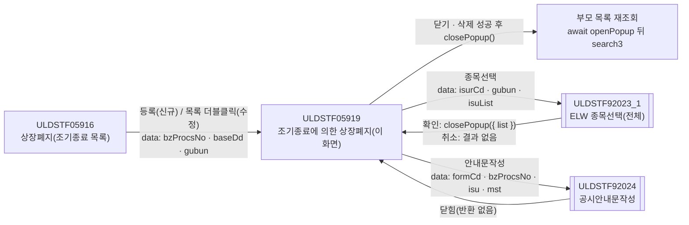
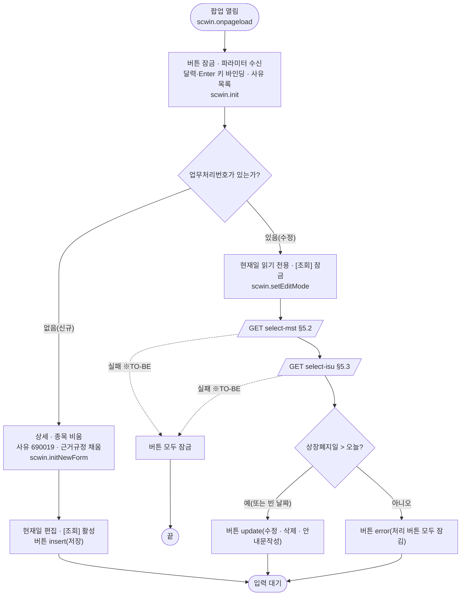
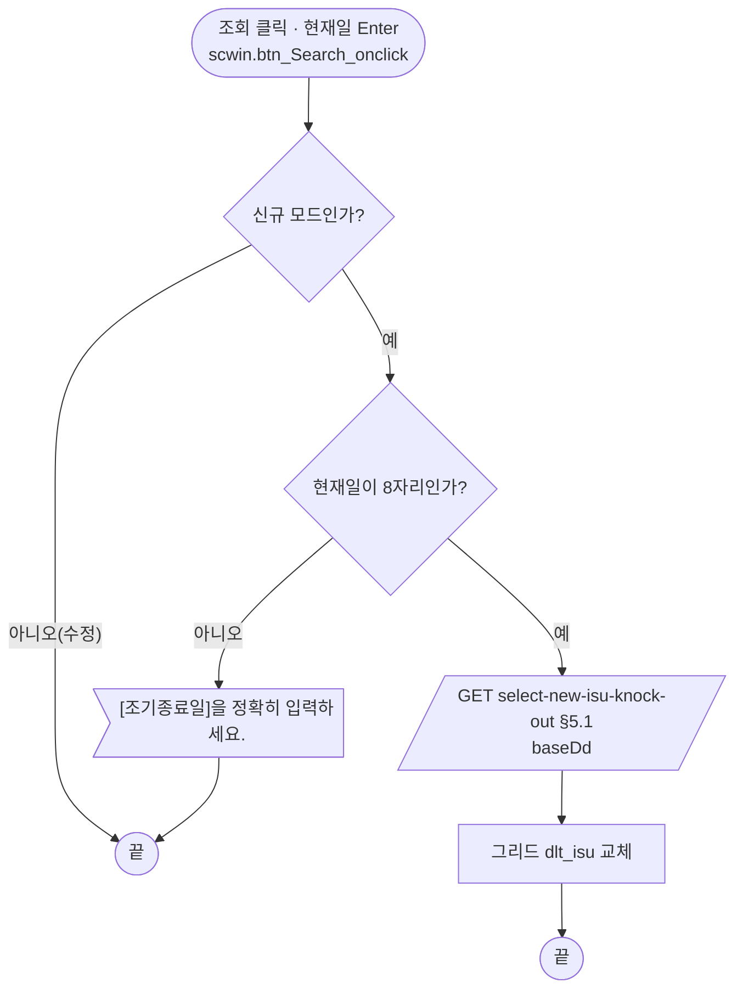
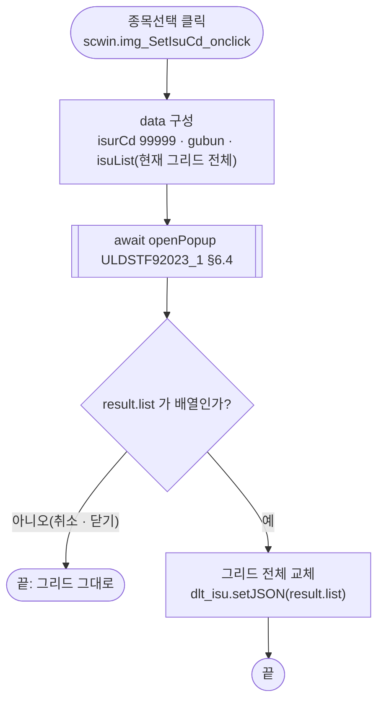
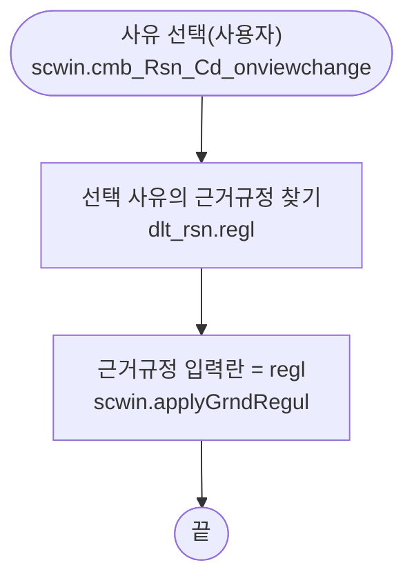
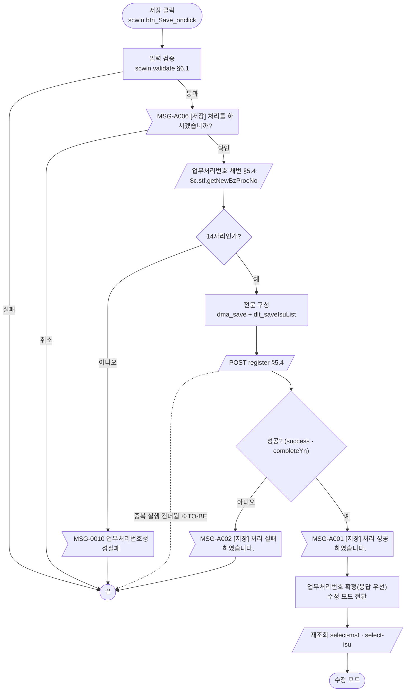
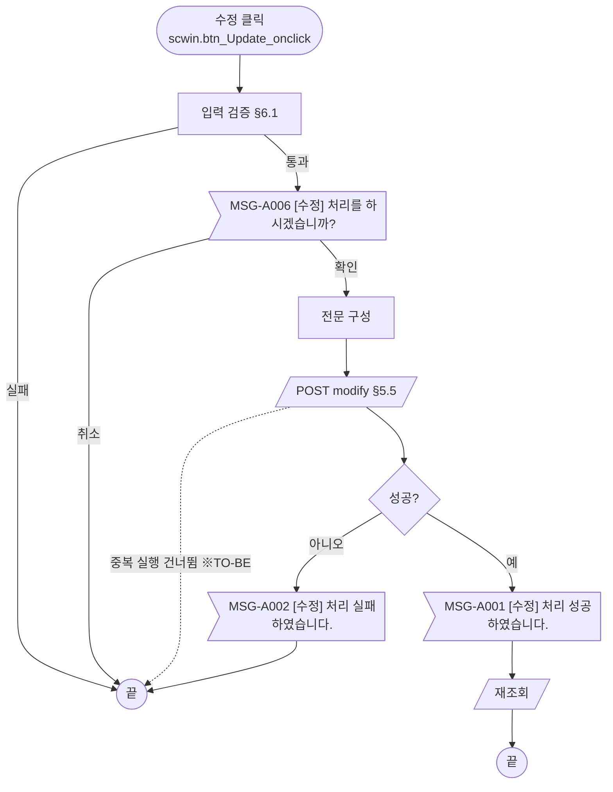
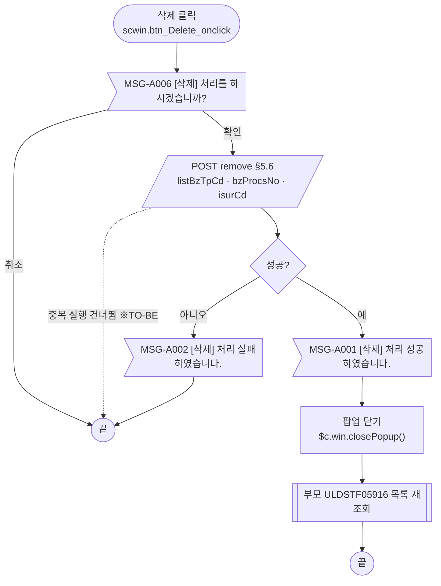
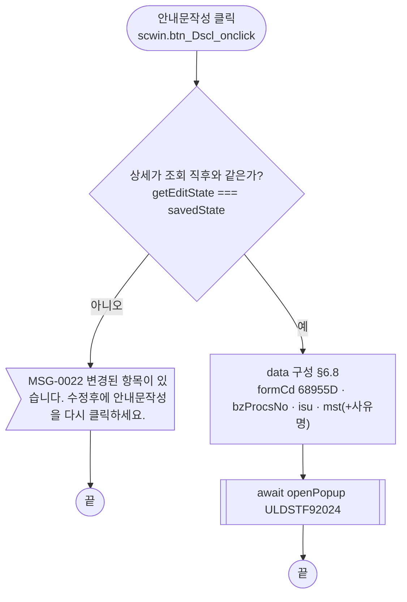
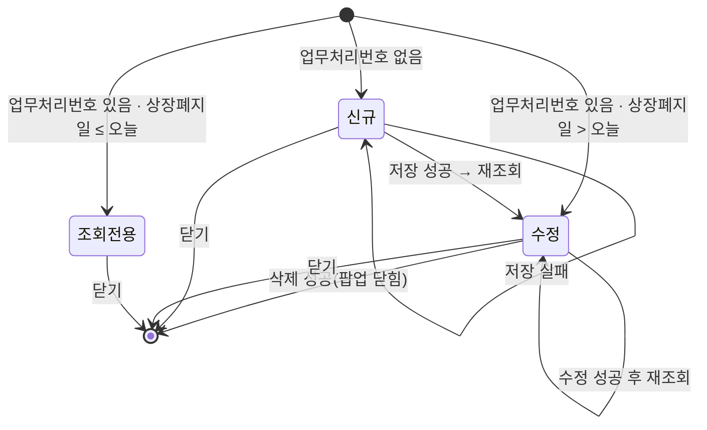

# ULDSTF05919 (팝업)ELW 조기종료에 의한 상장폐지 — 업무 분석 및 전환 내역

| 항목 | 내용 |
|---|---|
| AS-IS | `/lstproc/ULDSTF05919.gfm` (Gauce/X-Internet, 715×500 모달 창 — 부모가 720×530 `window` 로 연다) — 반입 `conversion/conversion-front/ui/ULDSTF05919/ULDSTF05919.gfm` |
| 신규 API 명세 | `conversion/conversion-front/ui/ULDSTF05919/ULDSTF05919_API.md` — 블록 7종(이 화면 6종: `[ULDSTF05919]` 1 + `[ULDSTF05917~05939]` 공통 5, 다른 화면 1종: `[ULDSTF05917]` `select-new-isu`). §2.2·§5 는 명세 기준(가이드 §0.3·§5) |
| TO-BE | `conversion/conversion-front/ui-tobe/ULDSTF05919.xml` (배포 경로 `/ui/lst/lstproc/ULDSTF05919.xml` — 가정, §10) |
| 퍼블리싱 | `conversion/conversion-front/ui/ULDSTF05919/ULDSTF05919.xml` (W-Craft 1차 스크립트 포함) — 컴포넌트 id 는 AS-IS 와 같음(`edt_Dd`·`edt_DelistDd` `inputCalendar`, `cmb_Rsn_Cd` `xf:select1`, `txb_GrndRegulNm` `xf:input`, `txa_Remk` `xf:textarea`, 버튼·`img_SetIsuCd` 는 `xf:trigger`). 그리드 컬럼 id 는 대문자·한글(`번호`) 그대로, 종목선택 버튼은 그리드 오른쪽 `col_fix` 열 |
| 화면 캡처 | `ULDSTF05919.png` — 신규 상태(현재일 2026-10-29, 사유 「권리행사조건의 달성(조기종료 발생)」, 근거규정 「유가증권시장상장규정 제143조」, 하단 [저장]만 활성) |
| 업무공통 | `$c.stf`(`getMessageParam`·`setButtonSetWithDate`·`getNewBzProcNo`)·`$c.lc`(`isProcess`) — `cm/pcc/stf`. 게이트는 `--pcc stf` 로 돌린다 |
| 작성 | Inswave / 2026-10-29 |

참고 양식: [websquare_gfm_conversion.md](../../../md/websquare_gfm_conversion.md) — 특히 §1.4 업무 프로세스 흐름, §6.5 getPar/setPar 전환. Gauce 대응은 [gfm_business_analysis_guide.md](../../../md/gfm_business_analysis_guide.md) §5·§6 을 함께 따랐다. 같은 계열(ELW 상장폐지 팝업 05917~05939) 중 짝 화면은 ULDSTF05918(최종거래일에 의한 상장폐지).

---

## 1. 화면 개요

상장 담당자가 **상장폐지 화면(ULDSTF05916)** 의 「조기종료에 의한 상장폐지」 목록에서 [등록] 또는 행 더블클릭으로 여는 팝업이다. ELW 가 권리행사조건을 달성해 **조기종료(Knock-Out)** 된 종목들을 묶어 상장폐지를 등록하고, 등록한 건을 수정·삭제하며 공시안내문을 작성한다.

1. 부모가 업무처리번호와 기준일(신규: 오늘, 수정: 상장폐지일)을 넘겨 연다. 업무처리번호가 없으면 신규, 있으면 수정이다.
2. 신규: 현재일(조기종료 발생일)을 정해 [조회]하면 그날 조기종료 발생 종목이 그리드에 담긴다. [종목선택]으로 ELW 전체 종목에서 골라 담을 수도 있다. 사유는 「권리행사조건의 달성(조기종료 발생)」이 기본이고 근거규정이 따라 채워진다.
3. 상장폐지일(익일 이후)·근거규정·기타를 입력해 저장한다. 저장 전 확인을 받고 업무처리번호를 새로 받는다. 성공하면 수정 모드로 다시 조회한다.
4. 수정: 상세(MST)와 등록 종목을 조회한다. 상장폐지일이 지났으면 모든 처리 버튼이 잠긴다. 수정에 성공하면 다시 조회하고, 삭제에 성공하면 팝업을 닫는다.
5. [안내문작성]은 고친 내용이 저장돼 있을 때만 공시안내문작성 팝업(ULDSTF92024)을 연다.

### 1.1 호출 화면 (1본)

- `ULDSTF05916` 상장폐지(ELW) — 퍼블리싱본 `conversion/publish/상장/상장처리(대내)/ULDSTF05916.xml`(W-Craft 1차 스크립트, 아직 TO-BE 전환 전). 상장폐지(05917)·최종거래일(05918)·조기종료(05919)… 목록 중 세 번째.
  - [등록] `img_Regist3_onclick` → `fn_GetPar = fn_GetParNew3` → 신규.
  - 목록 더블클릭 `grd3_OnDblClick` → `fn_GetPar = fn_GetParUpdate3` → 수정.
  - 창 제목: `$c.lc.getSecuGrpNm(증권그룹ID) + " 조기종료에 의한 상장폐지"`, 720×530.
  - 팝업이 닫히면 `fn_search3()` 로 목록을 다시 조회한다(모달 대기 전제 — `fn_newpre_create_frame3`).

### 1.2 호출 규약 (부모 → 이 화면) / 반환 규약

AS-IS 는 부모가 `fn_GetPar` 를 `fn_GetParNew3`/`fn_GetParUpdate3` 로 바꿔 두면, 팝업이 로딩 때 `frame.Provider("../").fn_GetPar(arrPar)` 로 배열을 받는다.

| arr | 신규 `fn_GetParNew3` | 수정 `fn_GetParUpdate3` | TO-BE 키 (제안) | 이 화면에서의 쓰임 |
|---|---|---|---|---|
| `arr[0]` | 증권그룹ID | 증권그룹ID | `secugrpId` | 쓰지 않음 |
| `arr[1]` | 시장구분 | 시장구분 | `mktId` | 사유 목록 조회 조건(AS-IS `MKT`) — §10 #1 |
| `arr[2]` | `""` | 선택 행 `bz_procs_no` | `bzProcsNo` | **비면 신규**, 있으면 수정 |
| `arr[3]` | 오늘(`cGetToday`) | 선택 행 `DELIST_DD`(폐지일) | `baseDd` | 현재일 입력란(`edt_Dd`) 초기값 |
| `arr[4]` | `"3"` | (없음) | `gubun` | 종목선택 팝업 구분 — 없으면 `"3"`(전체). 원본은 `arr[3]` 을 읽는 결함(§8 #2) |

- **TO-BE** (가이드 §6.5): 부모는 함수를 바꿔 끼우지 않고 위 키의 객체를 `data` 로 넘긴다. 이 화면은 `$c.data.getParameter()` 로 받는다. 부모(05916)가 전환 전이라 키 이름은 제안이다(§10 #9).

  ```javascript
  // 부모 ULDSTF05916 (신규: bzProcsNo "" · baseDd 오늘, 수정: 선택 행의 업무처리번호 · 폐지일)
  const data = { secugrpId, mktId, bzProcsNo, baseDd, gubun : "3" };
  await $c.win.openPopup("/ui/lst/lstproc/ULDSTF05919.xml",
      { id : "DLG_DELLIST", popupName : $c.lc.getSecuGrpNm(secugrpId) + " 조기종료에 의한 상장폐지", width : 720, height : 530, type : "pageFramePopup" }, data);
  await scwin.search3();   // AS-IS: CreateDialogFrame(…) 뒤 fn_search3()
  ```

- **반환**: 없음. 원본은 삭제 성공 때 `frame.CloseFrame()` 만 한다 → TO-BE `$c.win.closePopup()`(인자 없음). 부모는 `await` 가 끝나면 다시 조회한다.

### 1.3 이 화면이 여는 하위 팝업

| 팝업 | AS-IS 호출 (getPar/setPar) | 넘기는 `data` (TO-BE) | 받는 결과 / 취소 판정 |
|---|---|---|---|
| `ULDSTF92023_1` ELW 종목선택(전체, 510×430) | `fn_GetPar = fn_GetParIsu; fn_SetPar = fn_SetParIsu;` → `fn_PopFindElwCodeAll()`. 팝업이 `fn_GetParIsu(arrPar, param_dts)` 로 `arr[0]=Isur_cd("99999")`, `arr[1]=gubun` 과 **현재 그리드 전체**를 받고, 확인 때 `fn_SetParIsu(param_dts)` 로 **선택 결과 전체를 그리드에 덮어쓴다** | `{ isurCd : "99999", gubun, isuList : dlt_isu.getAllJSON() }` — §6.4 | `{ list : [종목 행 …] }` (가정 — 92023_1 전환본 없음, §10 #7). `!Array.isArray(result.list)` 이면 그대로 둠 |
| `ULDSTF92024` 공시안내문작성 (745×820) | `fn_dscl` 이 `fn_GetPar` 를 임시 함수로 바꿔 `frame.CreateDialogFrame(…, "window")` 로 연 뒤 되돌림 | `{ formCd, bzProcsNo, isurCd, mktId, msg, title, isu, mst }` (+ 호환용 `scwin.getPar`) — §6.8 | 반환 없음(닫힐 때까지 `await`) |

- pcc `$c.lc.popFindElwCodeAll()` 은 `ULDSTF92023_1.gfm` 을 `browserPopup` + 콜백(`scwin.popupCallback`)으로 열고 값을 넘기지 않는다 → `await` 할 수 없어 쓰지 않는다(가이드 §6.5 예외).

### 1.4 업무 프로세스 흐름

흐름은 AS-IS 동작을 기준으로 그렸다. 점선과 `※TO-BE` 는 전환본에서 바뀌는 곳이다(근거는 §8).

| # | 업무 | 시작 (사용자 동작·진입 조건) | 끝 (결과) | 주요 함수 | 관련 절 |
|---|---|---|---|---|---|
| 1 | 진입·로딩 | 부모가 팝업을 엶 (업무처리번호 유무로 신규/수정) | 입력 대기 (모드별 버튼) | `scwin.onpageload` → `scwin.init` → `scwin.initNewForm` / `scwin.selectDetail` | §3, §5.2·5.3 |
| 2 | 대상 종목 조회 | [조회] `btn_Search` 또는 현재일에서 Enter (신규만) | 조기종료 발생 종목으로 그리드 교체 | `scwin.btn_Search_onclick` → `searchNewIsu` | §5.1 |
| 3 | 종목 선택 | [종목선택] `img_SetIsuCd` | 선택 결과로 그리드 전체 교체 | `scwin.img_SetIsuCd_onclick` → `openIsuPopup` | §6.4 |
| 4 | 사유 변경 | 상장폐지사유 콤보 `cmb_Rsn_Cd` 선택 | 근거규정 입력란 갱신 | `scwin.cmb_Rsn_Cd_onviewchange` → `applyGrndRegul` | §6.3 |
| 5 | 신규 저장 | [저장] (신규 모드) | 성공 안내 후 수정 모드로 재조회 | `scwin.save` → `saveTrs("I")` | §5.4, §6.1, §6.5 |
| 6 | 수정 | [수정] (수정 모드, 상장폐지일 > 오늘) | 성공 안내 후 재조회 | `scwin.update` → `saveTrs("U")` | §5.5, §6.6 |
| 7 | 삭제 | [삭제] (수정 모드, 상장폐지일 > 오늘) | 성공 안내 후 팝업 닫힘 → 부모 재조회 | `scwin.remove` → `deleteTrs` | §5.6, §6.7 |
| 8 | 안내문작성 | [안내문작성] (수정 모드) | 공시안내문작성 팝업 | `scwin.btn_Dscl_onclick` → `writeDscl` | §6.8 |

#### 화면 간 흐름



#### 업무 1: 진입·로딩



| # | 단계 | 주체 | 내용 | 분기 · 메시지 | 관련 절 |
|---|---|---|---|---|---|
| 1 | 파라미터 수신 | 화면 | `$c.data.getParameter()` → `secugrpId`·`mktId`·`bzProcsNo`·`baseDd`·`gubun` | `bzProcsNo` 가 비면 신규 | §1.2, §3 |
| 2 | 사유 목록 | 화면 | AS-IS `listCode`(MKT, RSN=05, **동기**) → TO-BE 고정 목록 `scwin.RSN_LIST`(명세 없음) | — | §6.2, §10 #1 |
| 3a | 신규 준비 | 화면 | AS-IS 는 `DELLIST_MST_INOUT` 헤더만 받아 `AddRow` → TO-BE 는 dataMap 비움 + 기본 사유 `690019` + 근거규정 | — | §3 |
| 3b | 수정 조회 | 서버 | `select-mst` → `select-isu` 순서 (AS-IS 는 두 dataset 을 **비동기** 로 동시에 reset) | 실패 시 버튼 잠금(※TO-BE) | §5.2, §5.3 |
| 4 | 버튼 상태 | 화면 | 신규 `insert`, 수정은 `setButtonSetWithDate(edt_DelistDd, false, …)` | 상장폐지일 ≤ 오늘이면 `error` | §4 |

#### 업무 2: 대상 종목 조회 (신규)



- 원본 [조회]는 `buttonSet.setCopyInfo(btn_Search, fn_get_isu_cd, btn_Save)` 로 [저장]과 함께 켜지고 꺼진다 → TO-BE 는 신규 준비에서 켜고 수정 모드에서 잠그며, Enter 키로 들어와도 수정 모드면 조회하지 않는다.

#### 업무 3: 종목 선택



#### 업무 4: 사유 변경



- 원본 `OnSelChange2` 는 로딩 중 `BindColVal` 설정에도 불려 `isFirstLoad` 로 막았다 → TO-BE `onviewchange` 는 사용자 조작에만 발생하므로 가드가 필요 없다.

#### 업무 5: 신규 저장



| # | 단계 | 주체 | 내용 | 분기 · 메시지 | 관련 절 |
|---|---|---|---|---|---|
| 1 | 입력 검증 | 화면 | 종목 1건 이상, 상장폐지일 필수·익일 이후, 근거규정 필수·200 byte, 기타 2000 byte | 각 안내 후 끝 | §6.1 |
| 2 | 저장 확인 | 사용자 | `await $c.lc.isProcess("I")` | 취소면 끝 | §6.5 |
| 3 | 채번 | 서버 | `$c.stf.getNewBzProcNo()` — 14자리 아니면 `MSG-0010`. 원본은 확인 **뒤** 채번(같음) | — | §5.4, §10 #3 |
| 4 | 전문 구성 | 화면 | 머리(`listBzTpCd 313`·`bzProcsNo`·`isurCd 99999`·`delistDd`·`delistRsnCd`·`grndRegulNm`·`remk`) + 종목(`isuCd`·`isuPrc`). AS-IS 는 종목 행마다 `BZ_PROCS_NO` 를 써 넣고 `MKTACT_APPL_OBJ_TP_CD "1"` 을 넣었다 | 그리드는 건드리지 않음(※TO-BE) | §5.4, §8 #4 |
| 5 | 저장 | 서버 | `POST register` | `skipped` 면 안내 없이 끝 | §5.4 |
| 6 | 결과 반영 | 화면 | `MSG-A001` → `scwin.bzProcsNo` 확정(응답 `bzProcsNo` 우선) → 수정 모드 → 재조회 (원본 `OnSuccess` → `fn_search()`) | — | §5.2 |

#### 업무 6: 수정



- 원본 `fn_update` 는 `trsIdx` 를 확인창보다 먼저 정한다(동작 차이 없음). 바뀐 내용이 없어도 전송한다.

#### 업무 7: 삭제



- 삭제는 입력 검증을 하지 않는다. AS-IS 는 MST·종목 전체를 보냈고, TO-BE 는 명세대로 `listBzTpCd`·`bzProcsNo`·`isurCd` 만 보낸다.

#### 업무 8: 안내문작성



#### 화면 모드 상태 전이



| 상태 | 활성 버튼 | 근거 |
|---|---|---|
| 신규 | 저장, 조회 | `insert` + `btn_Search.setDisabled(false)` |
| 수정 | 수정 · 삭제 · 안내문작성 | `update` (저장만 제외) |
| 조회전용 | 없음 | `error` (활성 목록이 `draft` 하나인데 이 화면에 기안 버튼이 없음) |

- 종목선택은 `BTN_MAP` 밖이라 상태와 관계없이 켜져 있다(원본도 `buttonSet` 에 등록하지 않음, §8 #7).
- 신규 저장 검증이 "상장폐지일 익일 이후"를 요구하므로 저장 뒤 재조회하면 언제나 `수정` 상태가 된다.

---

## 2. 화면 구성 및 데이터 정의

### 2.1 화면 구성

| 영역 | AS-IS 요소 | TO-BE 컴포넌트 (바인딩) | 설명 |
|---|---|---|---|
| 조회조건 `panel_1` | `label_3` "현재일" + `edt_Dd` + `btn_Dd`(달력) + `btn_Search` | `schbox#panel_1` > `edt_Dd` (`inputCalendar`, `dma_search.baseDd`) + `btn_Search` (`btn_cm sch`) | 달력 이미지 `btn_Dd` **(옮기지 않음)** — inputCalendar 내장 달력. 수정 모드는 읽기 전용(원본 `edt_Dd.ReadOnly`, `btn_Dd` 클릭 무시) |
| 1. 상장폐지종목 (*) | `label_10`(*)·`label_2` + `grd_isu`(`dts_Isu`) + `img_SetIsuCd`(이미지) | `label_2`(`req`) + `grd_isu` (`dlt_isu`) + `img_SetIsuCd` (`xf:trigger` "종목선택") | 퍼블리싱본 배치(그리드 오른쪽 `col_fix` 150px 열에 버튼) 유지 — 캡처는 버튼이 라벨 아래(§10 #11) |
| 종목 그리드 | 번호·종목코드·종목명·최종거래일·행사종료일·발행가액·발행증권수 (+숨김 `BZ_PROCS_NO`) | 같은 7열. 숨김 `BZ_PROCS_NO` **(옮기지 않음)** | 모두 읽기 전용(원본 `edit="none"`). 날짜 2열은 `dataType="date" displayFormat="yyyy-MM-dd"`(AS-IS `mask="XXXX-XX-XX"`, 규칙 46), 금액·수량은 `decao=3` → `#,###.###` |
| 번호 열 | `{CurRow},{ToString}` | `inputType="expression" expression="rowIndex()+1"` | 퍼블리싱본의 한글 id `번호` 는 영문 id `rowNo` 로 |
| 2. 상장폐지사유 (*) | `label_8`(*)·`label_5` + `cmb_Rsn_Cd` (`dts_Rsn`, `CODE,NAME,REGL`) | `cmb_Rsn_Cd` (`xf:select1`, `dma_mst.delistRsnCd`, itemset `dlt_rsn` label `name`/value `code`) | §6.2·§6.3 |
| 3. 상장폐지일 (*) | `label_11`(*)·`label_1` + `edt_DelistDd` + `img_DelistDd`(달력) | `edt_DelistDd` (`inputCalendar`, `dma_mst.delistDd`) | `img_DelistDd` **(옮기지 않음)** |
| 4. 근거규정 (*) | `label_12`(*)·`label_6` + `txb_GrndRegulNm` (maxlength 1000) | `txb_GrndRegulNm` (`xf:input`, `dma_mst.grndRegulNm`) | 검증은 200 byte(원본 `checkMaxLength`) |
| 5. 기타 | `label_7` + `txa_Remk` | `txa_Remk` (`xf:textarea`, `dma_mst.remk`) | 2000 byte |
| 버튼 | `btn_Save`·`btn_Update`·`btn_Delete`·`btn_Dscl`·`btn_Close` (이미지) | `btn_Dscl`(안내문작성) · `btn_Delete`·`btn_Update`·`btn_Save`(`pt`) — `btnbox#grpBtnBox` 의 `rt`, 규칙 41 순서 | `btn_Close` **(옮기지 않음)** — 팝업 하단 닫기 금지 |
| 화면 머리 | (없음) | `w2:pageFrame#pfmContentHeader` | 팝업도 contentHeader 필수(2026-10-23) |
| (장식) | `panel_1`·`panel_3` + `PanelToGroupBox`, `label_10`·`label_8`·`label_11`·`label_12` "*" | **(옮기지 않음)** | 필수 표시는 `textbox class="req"` |

### 2.2 데이터 정의

| AS-IS | TO-BE | 종류 | 키(컬럼) | 출처 / 용도 |
|---|---|---|---|---|
| (없음 — `edt_Dd.Text` 직접) | `dma_search` (화면 전용) | dataMap | `baseDd` | 현재일 바인딩, `select-new-isu-knock-out` 요청 |
| `dts_Rsn` | `dlt_rsn` (화면 전용 — 명세 없음) | dataList | `code`, `name`, `regl` | 사유 콤보 목록(§10 #1) |
| `dts_Isu` | `dlt_isu` | dataList | 명세 `select-isu` 응답 그대로 — `bzProcsNo`, `isuCd`, `isuNm`, `elwLsttrdDd`, `exerEndDd`, `isuPrc`(number), `isuShrs`(number), `infoIsurCd` | 그리드. `select-new-isu-knock-out` 응답(`dlt_newIsuKnockOut`)도 columnInfo 가 같아 여기로 받는다. 종목선택 결과도 여기 |
| `dts_Mst` (+ `bnd_TrdSsp`) | `dma_mst` | dataMap | 명세 `select-mst` 응답 그대로 22키 — `comNm`, `bzProcsNo`, `isurCd`, `mktactApplObjTpCd`, `delistDd`, `delistAdvnotiStrtDd`·`EndDd`·`PdDsc`, `delistRsnCd`, `delistRsnDsc`, `ulyDelistRsnCd`, `ulyDelistBzProcsNo`, `arrantrd…` 3키, `grndRegulNm`, `remk`, `listAgnccomMbrNo`, `trdHalt…` 4키 | 입력 폼 바인딩(`delistDd`·`delistRsnCd`·`grndRegulNm`·`remk`). 신규는 비우고 `isurCd 99999`·`delistRsnCd 690019` |
| (`trs` 전송 `dts_Mst`) | `dma_save` | dataMap | 명세 `register`·`modify` 요청 그대로 — `listBzTpCd`, `bzProcsNo`, `isurCd`, `delistDd`, `delistRsnCd`, `delistRsnDsc`, `ulyDelistRsnCd`, `ulyDelistBzProcsNo`, `grndRegulNm`, `remk` | 등록·수정 전문 머리 |
| (`trs` 전송 `dts_Isu`) | `dlt_saveIsuList` | dataList | `isuCd`, `isuPrc`(number) | 등록·수정 전문 `isuList` |
| (응답 없음) | `dma_result` | dataMap | `completeYn`, `bzProcsNo` | 등록·수정·삭제 응답(명세 modify 응답 — `completeYn` 은 boolean) |
| `dts_BzProcsNo` | (삭제) | — | — | 채번은 `$c.stf.getNewBzProcNo()` 반환값 |
| `dts_Rsn_Uly` | (삭제) | — | — | 원본도 쓰지 않음(기초자산 사유용 잔재) |
| `trs` | (삭제) | — | — | `executeDynamic` |

- **TO-BE DataCollection 은 `ULDSTF05919_API.md` 의 정의 블록(id·name·dataType)을 그대로 옮긴다**(가이드 §5). 예외: `dlt_newIsuKnockOut` 은 `dlt_isu` 와 같은 columnInfo 라 정의하지 않는다, `remove` 요청은 명세에 XML 정의가 없어 객체 리터럴로 보낸다, 조회조건·사유 목록은 화면 전용.
- AS-IS 컬럼 → TO-BE 키: `ISU_CD→isuCd`, `ISU_NM→isuNm`, `ELW_LSTTRD_DD→elwLsttrdDd`, `EXER_END_DD→exerEndDd`, `ISU_PRC→isuPrc`, `ISU_SHRS→isuShrs`, `BZ_PROCS_NO→bzProcsNo`, `DELIST_DD→delistDd`, `GRND_REGUL_NM→grndRegulNm`, `REMK→remk`, `DELIST_RSN_CD→delistRsnCd`, `ISUR_CD→isurCd`, `MKTACT_APPL_OBJ_TP_CD→mktactApplObjTpCd`, `CODE/NAME/REGL→code/name/regl`.
- 날짜 열 `elwLsttrdDd`·`exerEndDd` 는 AS-IS 마스크 대상(규칙 46) — 서버 값이 8자리 `yyyyMMdd` 인지는 §10 #10.

---

## 3. 로딩 (`gform onload` → `scwin.onpageload` → `scwin.init`)

원본 `gform onload` 순서:

1. **파라미터 수신** — AS-IS `frame.Provider("../").fn_GetPar(arrPar)` → `Secugrp_id`·`Mkt_id`·`fr_bz_procs_no`·`Dd`·`gubun`. TO-BE `const param = $c.data.getParameter() ?? {};` → `scwin.secugrpId`·`scwin.mktId`·`scwin.bzProcsNo`·`dma_search.baseDd`·`scwin.gubun`(§1.2).
2. **사유 목록** — AS-IS `fn_get_rsn_cd()`(동기 `listCode`) → TO-BE `scwin.loadRsnList()`(고정 목록, §10 #1).
3. **버튼 매핑** — AS-IS `buttonSet.setSaveInfo/UpdateInfo/DeleteInfo/DsclInfo` + `setCopyInfo(btn_Search, fn_get_isu_cd, btn_Save)`. TO-BE 는 `ev:onclick` + `scwin.BTN_MAP = { save, modify, "delete", guide : "btn_Dscl" }`, `btn_Search` 는 모드에 따라 직접 켜고 끈다.
4. **현재일** — AS-IS `edt_Dd.text = Dd` → TO-BE `dma_search.set("baseDd", param.baseDd)`.
5. **신규·수정 분기**
   - 업무처리번호 있음 → `edt_Dd.ReadOnly = true` + `fn_search()`(MST·종목 동시 reset) → TO-BE `scwin.setEditMode()` + `await scwin.selectDetail()`(§5.2·5.3). 후처리(원본 `dts_Mst OnLoadCompleted` 수정 분기): 사유 콤보 = `DELIST_RSN_CD`(TO-BE 는 `ref` 바인딩으로 자동), `setButtonSetWithDate(edt_DelistDd, false)`.
   - 없음 → `edt_Dd.ReadOnly = false` + `fn_new_onload()`(헤더만 조회 → `AddRow` → `setInsertStatus` → 사유 `690019` → 근거규정 = REGL) → TO-BE `scwin.initNewForm()`.
6. `PanelToGroupBox(panel_3/panel_1)` — 삭제.

TO-BE 추가(규칙 22·37): `scwin.init` 에서 단일 달력 `edt_Dd`·`edt_DelistDd` 에 `$c.date.checkCalendarFormat(…, "yyyyMMdd")`(기간 쌍 아님), 조회조건 `schbox#panel_1` 에 `$c.win.setEnterKeyEvent(panel_1, scwin.btn_Search_onclick)`.

```javascript
scwin.onpageload = async function () {
    try {
        await scwin.init();
    } catch (ex) {
        await $c.exception.handleError(ex, { context : "ULDSTF05919.onpageload" });
    }
};

scwin.init = async function () {
    // 1) 버튼 잠금  2) 파라미터 수신  3) 달력·Enter 키  4) 사유 목록
    // 5) 업무처리번호 유무로 신규 준비 또는 수정 조회
    if ($c.util.isEmpty(scwin.bzProcsNo)) {
        scwin.initNewForm();
    } else {
        scwin.setEditMode();
        await scwin.selectDetail();
    }
};
```

`onpageload` 는 `scwin.init()` 만 호출하고, 로딩 로직은 `scwin.init` 하나에 둔다(2026-10-26). 신규 준비·수정 모드는 5구역 `scwin.initNewForm`·`scwin.setEditMode`.

---

## 4. 컴포넌트 이벤트

| TO-BE 컴포넌트 | 이벤트 | TO-BE 핸들러 | 동작 (호출 함수) | AS-IS |
|---|---|---|---|---|
| `btn_Search` (조회) | `onclick` (+ `panel_1` Enter) | `scwin.btn_Search_onclick` | `scwin.searchNewIsu()` — §5.1 | `buttonSet.setCopyInfo(btn_Search, fn_get_isu_cd, btn_Save)` |
| `img_SetIsuCd` (종목선택) | `onclick` | `scwin.img_SetIsuCd_onclick` | `scwin.openIsuPopup()` — §6.4 | `fn_GetPar = fn_GetParIsu; fn_SetPar = fn_SetParIsu; fn_PopFindElwCodeAll()` |
| `cmb_Rsn_Cd` (사유) | `onviewchange` | `scwin.cmb_Rsn_Cd_onviewchange` | `scwin.applyGrndRegul()` — §6.3 | `OnSelChange2()` (+ `isFirstLoad` 가드) |
| `btn_Save` (저장) | `onclick` | `scwin.btn_Save_onclick` | `scwin.save()` — §6.5 | `setSaveInfo(btn_Save, fn_save)` |
| `btn_Update` (수정) | `onclick` | `scwin.btn_Update_onclick` | `scwin.update()` — §6.6 | `fn_update` |
| `btn_Delete` (삭제) | `onclick` | `scwin.btn_Delete_onclick` | `scwin.remove()` — §6.7 | `fn_delete` |
| `btn_Dscl` (안내문작성) | `onclick` | `scwin.btn_Dscl_onclick` | `scwin.writeDscl()` — §6.8 | `setDsclInfo(btn_Dscl, fn_dscl)` |
| `btn_Close` (닫기) | — | **(옮기지 않음)** | 팝업 창의 닫기(X) | `frame.CloseFrame()` |
| `btn_Dd` · `img_DelistDd` (달력) | — | **(옮기지 않음)** | inputCalendar 내장 달력 (`btn_Dd` 는 수정 모드 무시 → `edt_Dd` 읽기 전용) | `popUpCalendar2(...)` |
| `trs` | `OnSuccess()`/`OnFail()` | (삭제) | `await executeDynamic` 뒤 후처리 — §5.4~5.6 | `fn_alertMsg('S'/'F')` + 삭제면 `CloseFrame`, 아니면 `fn_search` |
| `dts_Mst` | `OnLoadCompleted(rowcount)` | (삭제) | `scwin.initNewForm` / `scwin.selectDetail` 후처리 | 신규 `AddRow`·`setInsertStatus`·사유 기본값, 수정 `setButtonSetWithDate`·사유 |
| `dts_Isu` | `OnLoadCompleted(rowcount)` | (삭제) | — | `CloseWin(rowcount, grd_isu)` (로딩 표시) |

**버튼 상태 (모드 × 버튼)**

| 상태 | 조회 | 저장 | 수정 | 삭제 | 안내문작성 | TO-BE |
|---|---|---|---|---|---|---|
| 신규 | O | O | | | | `setButtonState("grpBtnBox", "insert", BTN_MAP)` + `btn_Search.setDisabled(false)` |
| 수정 (상장폐지일 > 오늘) | | | O | O | O | `$c.stf.setButtonSetWithDate(edt_DelistDd, false, "grpBtnBox", BTN_MAP)` → `update` |
| 수정 (상장폐지일 ≤ 오늘) | | | | | | 같은 함수 → `error` |

---

## 5. 서버 통신

공통: AS-IS 는 URL 에 `SCREN_ID=ULDSTF05919.gfm`·`SCREN_PROCES_TP_CD`(01 조회 / 02 입력 / 03 수정 / 04 삭제)를 붙이고, 저장 `trs.Action` 은 `fn_encodeNSession` 으로 세션 정보를 붙인다. 신규 API 명세에는 이 파라미터가 없으므로 **TO-BE 는 넘기지 않는다**(§10 #4). 모든 통신은 응답을 쓰기 전에 `if (result?.skipped) return;` 을 둔다(조회 1건은 후처리가 없어 생략).

| # | 용도 | AS-IS | TO-BE |
|---|---|---|---|
| 5.1 | 신규: 조기종료 대상 종목 | `/Delisting.do?method=searchDelList&DIV_IDX=DIV_IDX_DELLIST_LIST_KO_OCCR&TRS_IDX=TRS_IDX_SELECT&GUBUN_CD=현재일` → `dts_Isu` | `GET …/select-new-isu-knock-out` (`baseDd`) |
| 5.2 | 수정: 상세(MST) | `/Delisting.do?method=searchDelList&DIV_IDX=DIV_IDX_DELLIST_MST&BZ_PROCS_NO=` → `dts_Mst` | `GET …/select-mst` (`bzProcsNo`) |
| 5.3 | 수정: 등록 종목 | `…&DIV_IDX=DIV_IDX_DELLIST_DTL&BZ_PROCS_NO=` → `dts_Isu` | `GET …/select-isu` (`bzProcsNo`) |
| 5.4 | 신규 저장 | `fn_getNewBzProcNo` 채번 → `trs` `/Delisting.do?method=saveDelList` `TRS_IDX=INSERT` `KeyValue: dtsParm1=dts_Mst, dtsParm2=dts_Isu` | 채번 `$c.stf.getNewBzProcNo()` → `POST …/register` |
| 5.5 | 수정 | 같은 `trs` `TRS_IDX=UPDATE` | `POST …/modify` |
| 5.6 | 삭제 | 같은 `trs` `TRS_IDX=DELETE` (MST·종목 전체) | `POST …/remove` |
| — | 신규 헤더 | `/gauceSystemierAdaptor.do?method=getGauceDataHeader&messageId=DELLIST_MST_INOUT` → `dts_Mst` | (삭제 — dataMap 정의로 대신) |
| — | 사유 목록 | `/listingCommon.do?method=listCode&…&MKT=Mkt_id&RSN=05` → `dts_Rsn` | (명세 없음 — 고정 목록, §10 #1) |

(`…` = `/api/listing/lstproc/elw/delisting/detail`)

#### API 명세 대응 (`ULDSTF05919_API.md`)

| # | 명세 블록 | method · 경로 | 요청 (명세 정의) | 응답 (명세 정의) | AS-IS 대응 | TO-BE 함수 |
|---|---|---|---|---|---|---|
| 1 | [ULDSTF05919] 조기종료 발생 신규 대상종목 조회 | `GET …/select-new-isu-knock-out` | `baseDd` · [REQUEST] `{ target : "dlt_newIsuKnockOut=body" }` | `dlt_newIsuKnockOut` (8열) | `DIV_IDX_DELLIST_LIST_KO_OCCR` → `dts_Isu` | `scwin.searchNewIsu` → `dlt_isu` |
| 2 | [ULDSTF05917~05939] 등록된 대상종목 조회 | `GET …/select-isu` | `bzProcsNo` · `{ target : "dlt_isu=body" }` | `dlt_isu` (8열) | `DIV_IDX_DELLIST_DTL` → `dts_Isu` | `scwin.selectDetail` |
| 3 | [ULDSTF05917~05939] 상세(MST) 조회 | `GET …/select-mst` | `bzProcsNo` · `{ target : "dma_mst=body" }` | `dma_mst` (22키) | `DIV_IDX_DELLIST_MST` → `dts_Mst` | `scwin.selectDetail` |
| 4 | [ULDSTF05917] 신규 대상종목 조회 | `GET …/select-new-isu` | `isurCd` | `dlt_newIsu` | — | **이 화면 대상 아님**(A06) |
| 5 | [ULDSTF05917~05939] 수정 | `POST …/modify` | `{ ...dma_save.getJSON(), isuList : dlt_saveIsuList.getAllJSON() }` · `{ target : "dma_result=body" }` | `dma_result` (`completeYn` boolean, `bzProcsNo`) | `trs` `TRS_IDX=UPDATE` | `scwin.saveTrs("U", …)` |
| 6 | [ULDSTF05917~05939] 등록 | `POST …/register` | 위와 같음 | (정의 없음 — modify 와 같은 `dma_result` 로 받음) | `fn_getNewBzProcNo` + `trs` `TRS_IDX=INSERT` | `scwin.saveTrs("I", …)` |
| 7 | [ULDSTF05917~05939] 삭제 | `POST …/remove` | `{ listBzTpCd, bzProcsNo, isurCd }` · `{ target : "dma_result=body" }` | (정의 없음) | `trs` `TRS_IDX=DELETE` | `scwin.deleteTrs` |

명세에 없는 AS-IS 통신: 사유 목록(`listCode`) — §10 #1, 채번(`fn_getNewBzProcNo`) — pcc `$c.stf.getNewBzProcNo` 사용(§10 #3), 신규 헤더 — 삭제, 종목선택 팝업 조회 — 팝업 소관.

#### 명세 ↔ AS-IS 차이 (→ §10)

| # | 차이 | 처리 | §10 |
|---|---|---|---|
| 1 | 사유 목록(`listCode` MKT·RSN=05, `CODE`·`NAME`·`REGL`) API 가 명세에 없음 | 기본 사유 1건 고정 목록(근거규정은 캡처 값) | #1 |
| 2 | 조기종료 대상 조회 응답 id 가 `dlt_newIsuKnockOut` 이나 columnInfo 가 `dlt_isu` 와 같음 | `target : "dlt_isu=body"` 로 그리드 목록에 바로 받음 | — |
| 3 | `register` 의 `bzProcsNo` 가 화면 채번인지 서버 채번인지 명세에 없음. pcc `getNewBzProcNo` 는 `/api/listing/lstproc/stock/chglisting/new-bzprocsno` 를 부름 | 원본대로 화면 채번(14자리 검사) + 응답 `bzProcsNo` 가 오면 그것을 우선 | #3 |
| 4 | AS-IS 가 보내던 `MKTACT_APPL_OBJ_TP_CD "1"`(종목별)·`COUNT`·`DIV_IDX[0..1]`·`SCREN_ID`·세션이 명세에 없음 | 보내지 않음 | #4 |
| 5 | `delistRsnDsc`(사유설명) 출처 — AS-IS 는 사유 코드만 저장 | 조회한 `dma_mst.delistRsnDsc` 를 그대로(신규는 빈 값) | #5 |
| 6 | `register`·`remove` 응답 정의가 없음, `completeYn` 은 boolean 이라 적혀 있으나 dataType 은 text | `success` + `completeYn`(빈 값·`true`·`Y` 를 성공) | #6 |
| 7 | AS-IS 삭제는 MST·종목 전체 전송, 명세는 3키 | 명세대로 | — |
| 8 | 요청 종목 목록은 `isuCd`·`isuPrc` 2열 — AS-IS 는 그리드 전체 행(+`BZ_PROCS_NO`) | 명세대로(`setJSON` 이 정의 키만 남김) | — |

### 5.1 조기종료 대상 종목 조회 (`scwin.searchNewIsu`)

| 항목 | 내용 |
|---|---|
| `id` / `method` / `action` | `sbm_searchNewIsu` / `get` / `…/select-new-isu-knock-out` |
| `requestData` | `{ baseDd : dma_search.baseDd }` — 8자리가 아니면 "[조기종료일]을 정확히 입력하세요." 후 `edt_Dd` 포커스(원본 문구 그대로 — 라벨은 「현재일」) |
| `target` / `gridview` | `dlt_isu=body` / `grd_isu` (명세 `dlt_newIsuKnockOut=body` — 같은 columnInfo) |
| 전제 | 신규 모드만(수정이면 바로 끝 — Enter 키 경로 방어) |
| 후처리 · 실패 | 없음(원본도 `CloseWin` 로딩 표시만) |

### 5.2 / 5.3 수정 조회 (`scwin.selectDetail`)

| 항목 | 내용 |
|---|---|
| 순서 | `select-mst`(`sbm_selectMst`, `target : "dma_mst=body"`) → `select-isu`(`sbm_selectIsu`, `target : "dlt_isu=body"`, `gridview : "grd_isu"`), 둘 다 `{ bzProcsNo : scwin.bzProcsNo }` |
| 후처리 | ① 사유 콤보는 `dma_mst.delistRsnCd` 바인딩으로 따라옴(근거규정은 저장 값 유지) ② `scwin.savedState = scwin.getEditState()` ③ `$c.stf.setButtonSetWithDate(edt_DelistDd, false, "grpBtnBox", scwin.BTN_MAP)` |
| 실패 처리 | 어느 하나라도 `success:false` 이면 버튼 모두 잠금(`disabled`) — 등록 뒤 재조회 실패에도 엉뚱한 상태가 남지 않게 |
| 중복 실행 | 기본(건너뜀) |

### 5.4 / 5.5 신규 저장·수정 (`scwin.saveTrs(trJob, bzProcsNo)`)

| 항목 | 내용 |
|---|---|
| `id` | `sbm_saveTrs` |
| `method` / `action` | `post` / `…/register` (I) · `…/modify` (U), `mediatype : "application/json"`, `target : "dma_result=body"` |
| `requestData` | `dma_save` 에 `listBzTpCd "313"`·`bzProcsNo`·`isurCd`(`scwin.getIsurCd()`)·`delistDd`·`delistRsnCd`·`delistRsnDsc`·`ulyDelistRsnCd ""`·`ulyDelistBzProcsNo ""`·`grndRegulNm`·`remk` 를 담고, `dlt_saveIsuList.setJSON(dlt_isu.getAllJSON())` — `{ ...dma_save.getJSON(), isuList : dlt_saveIsuList.getAllJSON() }` (명세가 정한 전달 방식, `ref` 미사용) |
| 채번 | 등록만. `scwin.save` 가 확인 뒤 `scwin.getNewBzProcsNo()`(pcc `$c.stf.getNewBzProcNo` 응답 형태 정규화) → 14자리 아니면 `MSG-0010` |
| 후처리 | `scwin.isDone(result)` → `MSG-A001` → 등록이면 `scwin.bzProcsNo = 응답 bzProcsNo || 채번 값` + `scwin.setEditMode()` → `await scwin.selectDetail()` (원본 `OnSuccess` → `fn_search()`) |
| 실패 처리 | `MSG-A002` "[저장/수정] 처리 실패하였습니다." — 등록 실패면 `scwin.bzProcsNo` 는 빈 채 신규 유지 |
| 중복 실행 | 기본(건너뜀) |

### 5.6 삭제 (`scwin.deleteTrs`)

| 항목 | 내용 |
|---|---|
| `id` / `method` / `action` | `sbm_deleteTrs` / `post` / `…/remove`, `target : "dma_result=body"` |
| `requestData` | `{ listBzTpCd : "313", bzProcsNo : scwin.bzProcsNo, isurCd : scwin.getIsurCd() }` |
| 후처리 | `MSG-A001` "[삭제] 처리 성공하였습니다." → `$c.win.closePopup()` (원본 `buttonSet.status == "D"` → `frame.CloseFrame()`) |
| 실패 처리 | `MSG-A002` "[삭제] 처리 실패하였습니다." |

---

## 6. 일반 함수

### 6.1 입력 검증 (`scwin.validate`) — 원본 `fn_CheckForm`

- **Return:** `Promise<Boolean>`
- **순서 (원본 그대로):**
  1. 종목 0건이면 "[상장폐지종목]을 선택하세요."
  2. 상장폐지일: 필수·날짜(`validateDataCollect` — 원본 `checkDdTm` 의 8자리 검사 "[상장폐지일]을 정확히 입력하세요." 대응), **서버 현재일 이하이면 "[상장폐지일]을 익일 이후로 입력하세요."** 후 포커스.
  3. 근거규정 필수(원본 `checkEmptyValue`) · 200 byte(원본 `checkMaxLength(txb_GrndRegulNm, 200, "근거규정")`).
  4. 기타 2000 byte(원본 `checkMaxLength(txa_Remk, 2000, "기타")`).
- **공통 검증** (`$c.validate.validateDataCollect(panel_3, …)`, 규칙 24): 상장폐지일(필수·날짜), 근거규정(필수·`maxLengthB 200`), 기타(`maxLengthB 2000`).
- **업무 검증**: 1(그리드 행 수), 2 의 "익일 이후"(서버 현재일 비교). pcc `$c.lc.checkDdTm` 은 Gauce 속성 `obj.text` 를 읽으므로 쓰지 않는다(§8 #6).

### 6.2 사유 목록 (`scwin.loadRsnList`)

- 원본 `fn_get_rsn_cd`: `listCode`(`MKT=Mkt_id`, `RSN=05`) 를 동기 조회해 `dts_Rsn`(`CODE`·`NAME`·`REGL`) — 콤보 표시 `NAME`, 값 `CODE`, `REGL` 은 근거규정.
- TO-BE: 명세가 없어 `dlt_rsn.setJSON(scwin.RSN_LIST)` — 기본 사유 `690019` 「권리행사조건의 달성(조기종료 발생)」 한 건, 근거규정 「유가증권시장상장규정 제143조」(캡처 값). API 가 오면 조회로 바꾼다(§10 #1).

### 6.3 근거규정 반영 (`scwin.applyGrndRegul`)

- 선택 사유 코드(`dma_mst.delistRsnCd`)의 `regl` 을 `dma_mst.grndRegulNm` 에 넣는다. 신규 준비와 사용자 사유 변경 때 부른다. 수정 조회 뒤에는 부르지 않는다(원본도 수정 분기는 근거규정을 덮지 않음).

### 6.4 종목 선택 (`scwin.openIsuPopup`) — getPar/setPar → `openPopup` data + `await`

- 원본: 클릭 때 `fn_GetPar = fn_GetParIsu; fn_SetPar = fn_SetParIsu;` 로 바꿔 끼우고(되돌리지 않음) `fn_PopFindElwCodeAll()`.
  - `fn_GetParIsu(arrPar, param_dts)`: `arrPar[0] = Isur_cd("99999")`, `arrPar[1] = gubun`, `CopyDataSet(dts_Isu → param_dts)`.
  - `fn_SetParIsu(param_dts)`: `CopyDataSet(param_dts → dts_Isu)` — 결과로 그리드 전체를 덮어쓴다.
- **TO-BE** (가이드 §6.5):

  ```javascript
  const data = { isurCd : scwin.ISUR_CD, gubun : scwin.gubun, isuList : dlt_isu.getAllJSON() };
  const options = { id : "ULDSTF92023_1", popupName : "종목선택", width : 510, height : 430, type : "pageFramePopup" };
  const result = await $c.win.openPopup("/ui/listingcommon/ULDSTF92023_1.xml", options, data);
  if (!Array.isArray(result?.list)) return;     // 취소·닫기(X)
  dlt_isu.setJSON(result.list);
  ```

- 92023_1 전환본이 저장소에 없어 경로·반환 키(`list`)·행의 컬럼(`elwLsttrdDd`·`exerEndDd`·`isuPrc`·`isuShrs` 포함 여부)은 **가정**이다(§10 #7).

### 6.5 저장 (`scwin.save`) — 원본 `fn_save`

1. `await scwin.validate()` 실패면 끝.
2. `await $c.lc.isProcess("I")` — `MSG-A006` "[저장] 처리를 하시겠습니까?".
3. `scwin.getNewBzProcsNo()` → 14자리 아니면 `MSG-0010`.
4. `await scwin.saveTrs("I", 채번 값)`. (원본은 `BZ_PROCS_NO`·`ISUR_CD "99999"` 를 `dts_Mst` 에 써 넣은 뒤 전송 — TO-BE 는 `dma_save` 에 담는다.)

### 6.6 수정 (`scwin.update`) — 원본 `fn_update`

1. 검증 → 2. `isProcess("U")` → 3. `await scwin.saveTrs("U", scwin.bzProcsNo)`.

### 6.7 삭제 (`scwin.remove`) — 원본 `fn_delete`

1. `isProcess("D")` → 2. `await scwin.deleteTrs()`. 원본의 `buttonSet.setDeleteStatus()` 는 응답 이벤트에서 삭제를 가르기 위한 것이라 필요 없다.

### 6.8 공시안내문작성 (`scwin.writeDscl` · `scwin.getDsclData`) — 원본 `fn_dscl`

- 변경 확인: 원본 `dts_Mst.IsUpdated || dts_Rsn.IsUpdated`(종목 제외) → TO-BE `scwin.getEditState() !== scwin.savedState`(`dma_mst` JSON — 사유 콤보도 `dma_mst.delistRsnCd` 에 바인딩돼 포함). 다르면 `MSG-0022`.
- data (원본 임시 `fn_GetPar` → `openPopup` data):

  | AS-IS | TO-BE 키 | 값 |
  |---|---|---|
  | `arr[0]` | `formCd` | `"68955D"` |
  | `arr[1]` | `bzProcsNo` | `scwin.bzProcsNo` |
  | `arr[2]` | `isurCd` | `"99999"`(`scwin.getIsurCd()`) |
  | `arr[3]` | `mktId` | `"1"` |
  | `arr[4]` | `msg` | `''` (92024 는 `arr.length >= 5` 로 본문 미생성 여부를 정하므로 원본처럼 채운다) |
  | `arr[5]` | `title` | `"조기종료에 의한 상장폐지"` (공시제목 — 짝 화면 05918 과 같은 키) |
  | `CopyDataSet(dts_Isu, param_dts_isu)` | `isu` | `dlt_isu.getAllJSON()` |
  | `CopyDataSet(dts_Mst, param_dts_mst)` + `DELIST_RSN_NM = cmb_Rsn_Cd.text` | `mst` | `[{ ...dma_mst.getJSON(), delistRsnNm : cmb_Rsn_Cd.getText() }]` |

- `await $c.win.openPopup("/ui/listingcommon/ULDSTF92024.xml", { id : "ULDSTF92024", popupName : "공시안내문작성", width : 745, height : 820, type : "pageFramePopup" }, data)` — 원본 크기 (740+5)×(790+30). 원본처럼 닫힌 뒤 재조회하지 않는다.
- **호환용 `scwin.getPar(arr, dltIsu, dltMst)`·`scwin.fillDataList`** — 92024 전환본(sample-front)은 아직 부모의 `scwin.getPar` 를 이름으로 불러 값을 받으므로(가이드 §6.5 예외), 선례 05232·08303·05918 처럼 `getDsclData()` 를 `arr[0..5]` 와 원천 dataList 2개에 채우는 임시 함수를 둔다. 92024 가 `$c.data.getParameter()` 수신으로 바뀌면 지운다.

### 6.9 기타 보조 함수

- `scwin.initNewForm` — §3, `scwin.setEditMode` — 현재일 읽기 전용 + [조회] 잠금, `scwin.getIsurCd` — `dma_mst.isurCd || "99999"`, `scwin.getEditState` — §6.8, `scwin.isDone` — §5 차이 #6, `scwin.getNewBzProcsNo` — §6.5.

---

## 7. 업무 코드 · 메시지 목록

### 7.1 코드

| 용도 | 값 | 출처 |
|---|---|---|
| 상장업무유형 `listBzTpCd` | `"313"` 조기종료에 의한 상장폐지 (원본 주석: `LIST_BZ_TP_CD_307` 대신 추가 예정) | `fn_save_trs` |
| 발행기관코드 | `"99999"` (ELW 종목별 처리) | 전역 `Isur_cd`, `fn_save` |
| 기본 상장폐지사유 | `690019` 권리행사조건의 달성(조기종료 발생) | `dts_Mst OnLoadCompleted` |
| 사유 구분 `RSN` | `05` (상장폐지) | `fn_get_rsn_cd` |
| 시장조치적용대상구분 | `1` 종목별 / `2` 법인별 — ELW 는 항상 `1` | `fn_save_trs` (명세 없음, §10 #4) |
| 종목선택 구분 `gubun` | `3` 전체 | 전역 기본값·부모 `fn_GetParNew3 arr[4]` |
| 공시안내문 서식 | `68955D`, 시장 `1` | `fn_dscl` |
| 업무처리번호 자릿수 | 14 | `fn_save` |
| DIV_IDX | `DELLIST_LIST_KO_OCCR`(조기종료 대상), `DELLIST_MST`, `DELLIST_DTL` | `$c.lc.glb` (TO-BE 미사용 — API 경로로 대체) |
| 화면처리구분 · `TRS_IDX` | `01`~`04`, INSERT/UPDATE/DELETE | TO-BE 미전송 |

### 7.2 메시지

| 코드 / 문구 | 등장 위치 | TO-BE |
|---|---|---|
| "[조기종료일]을 정확히 입력하세요." | 대상 조회 — 현재일 8자리 아님 | 그대로 (`scwin.searchNewIsu`) |
| "[상장폐지종목]을 선택하세요." | 검증 1 | 그대로 |
| "[상장폐지일]을 정확히 입력하세요." / "[상장폐지일]을 익일 이후로 입력하세요." | 검증 2 (`checkDdTm` 문구) | 앞은 `validateDataCollect` 필수·날짜 문구, 뒤는 그대로 |
| `checkEmptyValue` 안내 (근거규정) | 검증 3 | `validateDataCollect` 필수 문구 |
| `checkMaxLength` 안내 (근거규정 200 / 기타 2000) | 검증 3·4 | `validateDataCollect` `maxLengthB` 문구 |
| `MSG-A006` "[^] 처리를 하시겠습니까?" | 저장·수정·삭제 확인 | `$c.lc.isProcess("I"/"U"/"D")` |
| `MSG-0010` "업무처리번호생성실패" | 채번 실패 | `$c.stf.getMessageParam("MSG-0010", "")` |
| `MSG-0022` "변경된 항목이 있습니다. 수정후에 안내문작성을 다시 클릭하세요." | 안내문작성 | `$c.stf.getMessageParam("MSG-0022", "")` |
| `fn_alertMsg('S'/'F')` | `trs OnSuccess`/`OnFail` | `$c.stf.getMessageParam("MSG-A001"/"MSG-A002", 처리명)` |

---

## 8. 원본 특이사항 · 결함

| # | 원본에서 실제로 일어나는 일 (근거) | 전환본 처리 |
|---|---|---|
| 1 | 행 루프가 1-base(`i = 1; i <= CountRow`)로 모든 종목 행에 `BZ_PROCS_NO` 를 써 넣는다 | 고침 — 명세 요청 목록은 `isuCd`·`isuPrc` 만, 그리드는 건드리지 않음 |
| 2 | `gubun = (arrPar.length >= 5 ? arrPar[3] : "")` — 신규는 5번째 값(`"3"`) 대신 **`arr[3]`(오늘 날짜)** 를, 수정(4개)은 빈 값을 넣어 전역 기본값 `"3"` 을 덮는다(주석 의도는 "전체 구분값 셋팅") | 고침 — `param.gubun` 이 없으면 `"3"`(§1.2) |
| 3 | 신규 저장이 실패해도 채번한 `fr_bz_procs_no` 가 남는다 — 다음 저장은 새로 채번하지만 [안내문작성] 등에 실패한 번호가 쓰일 여지 | 고침 — 성공한 뒤에만 `scwin.bzProcsNo` 확정 |
| 4 | `fn_save_trs` 가 `dts_Mst` 에 `MKTACT_APPL_OBJ_TP_CD "1"`·`DELIST_RSN_CD` 를 직접 써 넣는다 | 고침 — 사유는 바인딩, 적용대상구분은 명세에 없어 보내지 않음(§10 #4) |
| 5 | 사유 콤보 `OnSelChange2` 가 로딩 중 `BindColVal` 설정에도 불려 `isFirstLoad` 로 막는다 | 고침 — `onviewchange`(사용자 조작만) |
| 6 | pcc 대응 함수에 Gauce 잔재: `$c.lc.checkDdTm` 은 `obj.text`, `$c.lc.popFindElwCodeAll` 은 값을 넘기지 않는 콜백형 | 쓰지 않음 — 날짜는 화면에서 값 비교, 팝업은 `openPopup` 직접 |
| 7 | [종목선택]은 `buttonSet` 밖이라 조회전용(상장폐지일 경과) 상태에서도 그리드를 바꿀 수 있다(저장 수단은 없음) | 그대로 유지 + §10 #12 |
| 8 | 대상 조회 오류 문구가 "[조기종료일]" 인데 라벨은 "현재일" | 그대로 유지(문구 통일은 §10 #13) |
| 9 | `fn_dscl` 이 `fn_GetPar`/`fn_SetPar` 를 임시 함수로 바꿔 끼운 뒤 되돌린다(모달 대기 전제) | 고침 — `openPopup` data + `await` |
| 10 | 쓰지 않는 것: 전역 `Secugrp_id`(전달만)·`vScrenID`·`dts_Rsn_Uly`·`label_10/8/11/12`("*"), 빈 함수 `fn_drft`·`fn_makt`, 주석 `fn_GetPar` 대체 줄 | 옮기지 않음 (규칙 0·1) |
| 11 | 수정 조회가 MST·종목을 동시에 비동기 reset — `OnLoadCompleted` 순서가 보장되지 않음 | 고침 — `select-mst` → `select-isu` 순차 `await` |
| 12 | 원본은 동기 `trs`·모달이라 연속 클릭이 막혔다. 비동기 전환본은 저장이 두 번 나갈 수 있다 | 고침 — `executeDynamic` 중복 실행 건너뜀 + `skipped` 확인 |
| 13 | 신규 상세는 `DELLIST_MST_INOUT` 헤더만 받는 조회 뒤 `AddRow` — 빈 dataset 구조용 통신 | 옮기지 않음 — dataMap 정의로 대신 |

---

## 9. 전환 내역 (AS-IS → TO-BE)

| AS-IS | TO-BE |
|---|---|
| `gform onload` | `scwin.onpageload` → `scwin.init`(버튼 잠금 → 파라미터 → 달력·Enter 키 → 사유 목록 → `scwin.initNewForm` 또는 `scwin.setEditMode` + `scwin.selectDetail`) |
| `frame.Provider("../").fn_GetPar(arrPar)` | `$c.data.getParameter()` (§1.2) |
| 전역 `Secugrp_id`·`Mkt_id`·`fr_bz_procs_no`·`Dd`·`Isur_cd`·`gubun`·`trsIdx`·`isFirstLoad` | `scwin.secugrpId`·`scwin.mktId`·`scwin.bzProcsNo`·`dma_search.baseDd`·`scwin.ISUR_CD`·`scwin.gubun`·`scwin.trJob`·(삭제 — `onviewchange`) |
| `fn_get_rsn_cd` | `scwin.loadRsnList` (고정 목록 — §10 #1) |
| `fn_new_onload` + `dts_Mst OnLoadCompleted`(신규) | `scwin.initNewForm` |
| `fn_search` + `dts_Mst OnLoadCompleted`(수정) | `scwin.selectDetail` |
| `fn_get_isu_cd` | `scwin.searchNewIsu` |
| `fn_CheckForm` | `scwin.validate` (+ `validateDataCollect`) |
| `fn_save` / `fn_update` / `fn_delete` | `scwin.save` / `scwin.update` / `scwin.remove` |
| `fn_save_trs` + `trs.Post()` + `OnSuccess`/`OnFail` | `scwin.saveTrs(trJob, bzProcsNo)` / `scwin.deleteTrs` — `await $c.sbm.executeDynamic` + `scwin.isDone` |
| `fn_getNewBzProcNo(dts_BzProcsNo)` | `scwin.getNewBzProcsNo` (`$c.stf.getNewBzProcNo` 응답 정규화) |
| `fn_isProcess('I'/'U'/'D')` | `await $c.lc.isProcess(...)` |
| `fn_alertMsg('S'/'F')` | `$c.win.alert($c.stf.getMessageParam("MSG-A001"/"MSG-A002", 처리명))` |
| `checkDdTm` · `checkEmptyValue` · `checkMaxLength` | `validateDataCollect` + 화면 업무 검증 |
| `buttonSet.set*Info` / `setInsertStatus` / `setCopyInfo` | `ev:onclick` + `$c.util.setButtonState("grpBtnBox", …, scwin.BTN_MAP)` + `btn_Search.setDisabled` |
| `setButtonSetWithDate(edt_DelistDd, false)` | `$c.stf.setButtonSetWithDate(edt_DelistDd, false, "grpBtnBox", scwin.BTN_MAP)` |
| `cmb_Rsn_Cd OnSelChange2` + `BindColVal` | `scwin.cmb_Rsn_Cd_onviewchange` → `scwin.applyGrndRegul` + `ref="data:dma_mst.delistRsnCd"` |
| `fn_GetParIsu` / `fn_SetParIsu` + `fn_PopFindElwCodeAll()` (`img_SetIsuCd onclick`) | `scwin.img_SetIsuCd_onclick` → `scwin.openIsuPopup` — `await $c.win.openPopup(…ULDSTF92023_1…, options, { isurCd, gubun, isuList })` → `result.list` |
| `fn_dscl` (임시 `fn_GetPar` + `CreateDialogFrame`) | `scwin.btn_Dscl_onclick` → `scwin.writeDscl` + `scwin.getDsclData` (+ 92024 호환용 `scwin.getPar`·`scwin.fillDataList` — §6.8) |
| `dts_Mst.IsUpdated || dts_Rsn.IsUpdated` | `scwin.getEditState() !== scwin.savedState` |
| `CopyDataSet(...)` | `getAllJSON()` / `setJSON(...)` |
| `{CurRow}` 번호 열, `mask="XXXX-XX-XX"` | `expression="rowIndex()+1"`, `dataType="date" displayFormat="yyyy-MM-dd"`(규칙 46) |
| `bnd_TrdSsp`(`DELIST_DD`·`GRND_REGUL_NM`·`REMK`) | `ref="data:dma_mst.delistDd/grndRegulNm/remk"` |
| `edt_Dd.text`·`edt_Dd.ReadOnly` | `dma_search.baseDd` 바인딩 · `edt_Dd.setReadOnly(…)` (`scwin.setEditMode`/`initNewForm`) |
| `btn_Close onclick` → `frame.CloseFrame()` | 삭제 — 팝업 창의 닫기(X). 삭제 성공 뒤 `$c.win.closePopup()` |
| `btn_Dd` · `img_DelistDd` → `popUpCalendar2` | 삭제 (inputCalendar 내장) + `checkCalendarFormat`(규칙 37) |
| `ShowWin`/`CloseWin`(`dts_Isu OnLoadCompleted`) | 삭제 (공통 로딩 표시) |
| `#include(...)` 8종, `PanelToGroupBox`, `vScrenID` | 삭제 (규칙 11·1) |
| `fn_drft`, `fn_makt` | 삭제 (빈 함수) |
| `alert(...)` | `await $c.win.alert(...)` |
| (없음 — 화면 보조) | `scwin.setEditMode`, `scwin.getIsurCd`, `scwin.isDone`, `scwin.getEditState` |

---

## 10. 남은 작업 (TODO)

1. **사유 목록 API** — AS-IS `listCode`(`MKT`=시장구분, `RSN=05`, 응답 `CODE`·`NAME`·`REGL`)에 대응하는 API 가 명세에 없다. 지금은 기본 사유 `690019` 한 건과 캡처의 근거규정 「유가증권시장상장규정 제143조」를 고정 목록(`scwin.RSN_LIST`)으로 둔다. 수정 건의 `delistRsnCd` 가 목록에 없으면 콤보가 비어 보인다. API 를 받아 `scwin.loadRsnList` 를 조회로 바꾼다(`scwin.mktId` 사용).
2. **응답 형태** — `select-new-isu-knock-out`·`select-isu` 를 같은 `dlt_isu` 로 받는 것이 맞는지(두 응답 columnInfo 동일), `select-mst` 0건일 때 응답 형태 확인.
3. **채번** — 명세 `register` 의 `bzProcsNo` 가 화면 채번인지 서버 채번인지 확인. 지금은 원본대로 pcc `$c.stf.getNewBzProcNo()`(경로 `/api/listing/lstproc/stock/chglisting/new-bzprocsno`)로 받고 14자리를 검사하며, 응답 `dma_result.bzProcsNo` 가 오면 그것을 우선한다.
4. **명세에 없는 AS-IS 전송값** — `MKTACT_APPL_OBJ_TP_CD "1"`(ELW 종목별), `COUNT=2`, `DIV_IDX[0..1]`, `SCREN_ID`·`SCREN_PROCES_TP_CD`, `fn_encodeNSession` 세션을 서버가 대신 처리하는지 확인.
5. **`delistRsnDsc`** — 사유설명에 콤보 사유명을 넣어야 하는지(원본은 코드만 저장). 지금은 조회한 값을 그대로, 신규는 빈 값.
6. **성공 판정** — `register`·`remove` 응답 정의가 없고 `completeYn` 은 "boolean" 이라 적혔으나 dataType 이 text. 지금은 `success` + `completeYn`(빈 값·`true`·`Y` 성공)로 판정한다.
7. **ELW 종목선택(전체) ULDSTF92023_1 계약** — 전환본이 없다. 경로(`/ui/listingcommon/ULDSTF92023_1.xml` 가정)·크기, 받는 `data`(`isurCd`·`gubun`·`isuList`), 돌려주는 결과(`{ list }` 가정)와 행 컬럼(`elwLsttrdDd`·`exerEndDd`·`isuPrc`·`isuShrs`)을 확정한다.
8. **공시안내문작성 ULDSTF92024 계약** — 경로 가정, 92024 는 아직 getPar 계약이라 수신부 변경 필요. 그때까지 호환용 `scwin.getPar`·`scwin.fillDataList` 를 둔다(수신부 전환 시 삭제). `mst[0].delistRsnNm` 키 확인.
9. **부모(ULDSTF05916) 계약** — 부모 전환 때 `fn_GetParNew3`/`fn_GetParUpdate3` 바꿔 끼우기를 없애고 §1.2 의 `data`(`secugrpId`·`mktId`·`bzProcsNo`·`baseDd`·`gubun`)로 넘긴다. 닫힌 뒤 `search3` 를 `await openPopup` 바로 뒤에 둔다.
10. **날짜 열 값 형식** — `elwLsttrdDd`·`exerEndDd` 서버 값이 8자리 `yyyyMMdd` 인지 확인(규칙 46).
11. **종목선택 버튼 위치** — 캡처는 라벨 아래, 퍼블리싱 파일은 그리드 오른쪽 열. 퍼블리싱 파일 배치를 유지했다.
12. **조회전용 상태의 종목선택** — 상장폐지일이 지난 건에서도 그리드를 바꿀 수 있다(저장 불가). 잠글지 정한다(§8 #7).
13. **문구** — 대상 조회 안내 "[조기종료일]" 과 라벨 "현재일" 을 맞출지 정한다.
14. **TO-BE 배포 경로·창 크기** — `/ui/lst/lstproc/ULDSTF05919.xml`(가정), 부모가 여는 크기 720×530.
