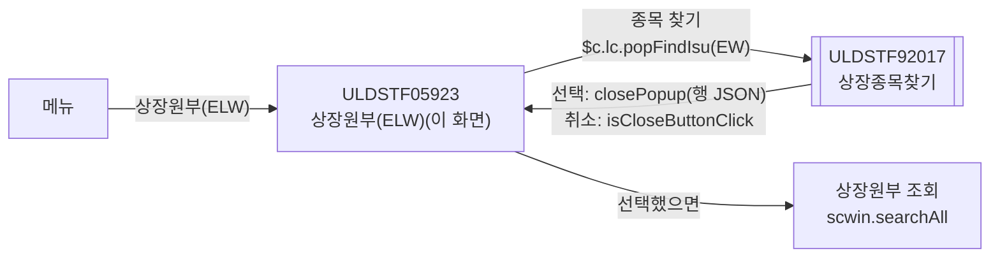
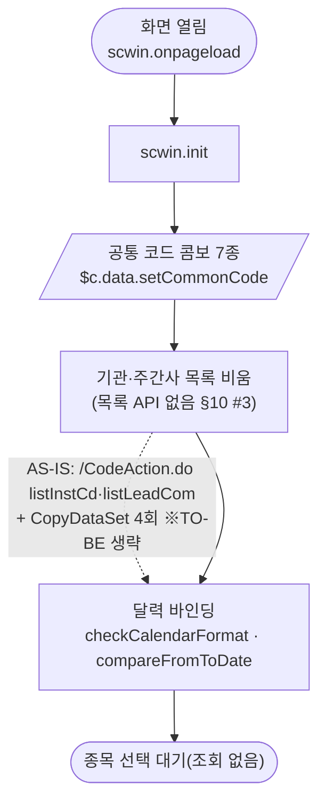
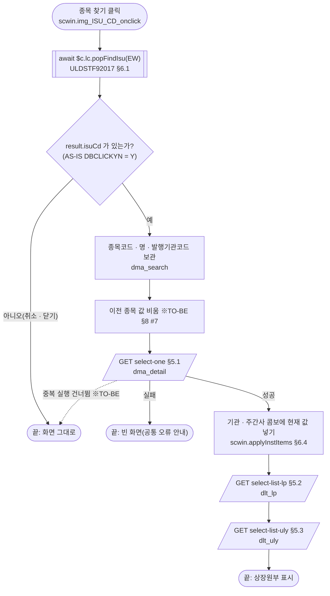
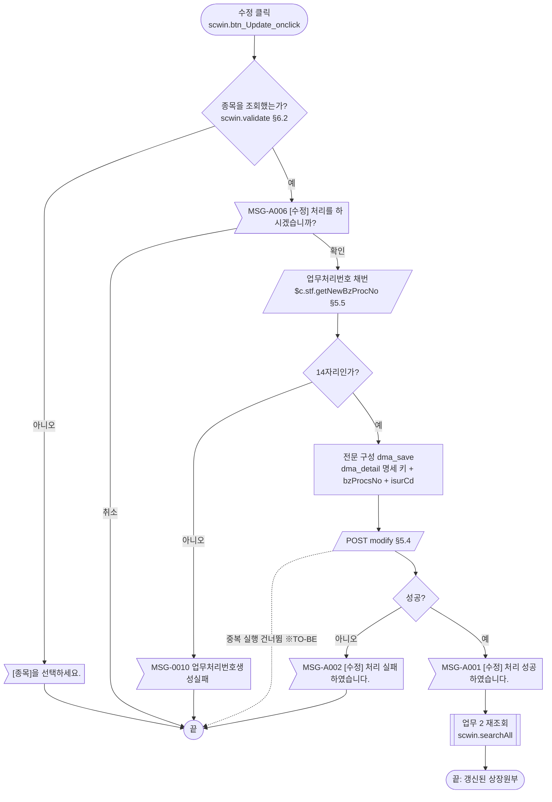
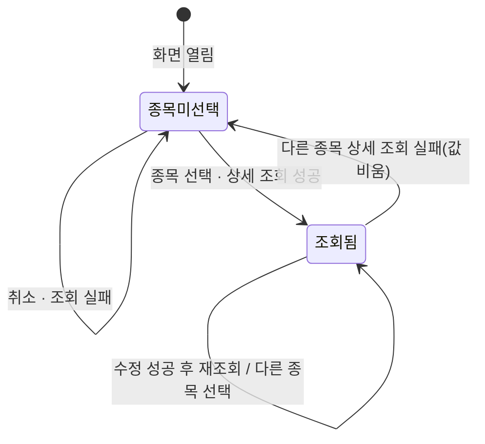

# ULDSTF05923 상장원부(ELW) — 업무 분석 및 전환 내역

| 항목 | 내용 |
|---|---|
| AS-IS | `/lstproc/ULDSTF05923.gfm` (Gauce/X-Internet, 1033×742 메인 화면 — 캡처 창 제목 "상장원부(ELW)_STF05923", 하단 [수정]·[닫기]) — 반입 `conversion/conversion-front/ui/completed/ULDSTF05923/ULDSTF05923.gfm` |
| 신규 API 명세 | `conversion/conversion-front/ui/completed/ULDSTF05923/ULDSTF05923_API.md` — 블록 4종(이 화면 4종, 다른 화면 0종): `/api/listing/lstproc/elw/listed-register/` 아래 `GET select-list-lp`·`GET select-list-uly`·`GET select-one`·`POST modify`. §2.2·§5 는 명세 기준(가이드 §0.3·§5). **2026-10-30 갱신본 반영** — 응답 target id `dlt_ulyIsu`→`dlt_uly`, `dma_isu`→`dma_detail`, `modify` 응답 `dma_saveResult`(4키) 신설, AS-IS 설명 보강·method 대문자 통일 |
| TO-BE | `conversion/conversion-front/ui-tobe/ULDSTF05923.xml` (배포 경로 `/ui/lst/lstproc/ULDSTF05923.xml` — 가정, §10 #1). **2026-10-28 전환** — 1단계: 캡처 기준 퍼블리싱(마크업 전용, 사본 `$CLAUDE_JOB_DIR/tmp/stage1/ULDSTF05923.xml`), 2단계: 이 결과서대로 스크립트 전환. 게이트: `gate_screen --pcc stf`·`scan_mixed_compare`·`publish_gate --pcc stf --before {1단계} --allow P20`·`api_spec_check`(명세 4종 모두 사용)·`init_binding_check`·`wsxml_lint` 0/0 통과 |
| 퍼블리셔 XML | `conversion/publish/상장/상장처리(대내)/ULDSTF05923.xml`(W-Craft 1차 스크립트 내장), 변환 사본 `conversion/publish/publish-tobe/상장/상장처리(대내)/ULDSTF05923.xml` — 본화면(`sub_contents` + `pgtbox`/breadcrumb) 꼴, 컴포넌트 id 는 AS-IS 와 같음(날짜 `w2:inputCalendar`, 콤보 `xf:select1`, 이미지 버튼 → `xf:trigger`, 그리드 컬럼 id 대문자). 표 배치·행 수가 캡처와 달라 **캡처를 따랐다**(§2.1, §10 #11) |
| 화면 캡처 | `ULDSTF05923.png` (빈 화면 — 종목 선택 전, [수정]·[닫기]; 2026-10-30 교체본은 창 테두리를 뺀 같은 레이아웃이라 마크업 변경 없음) → TO-BE 는 가이드 §13.2 퍼블리싱본부터 만들었다. 캡처 하단 [닫기] 는 **(옮기지 않음)** — §2.1·§10 #1 |
| 업무공통 | pcc(`cm/pcc/stf`): `$c.lc`(`popFindIsu`·`isProcess`·`glb.SECUGRP_ID_EW`)·`$c.stf`(`getNewBzProcNo`·`getMessageParam`). gcc: `$c.data.setCommonCode`·`$c.date`(`checkCalendarFormat`·`compareFromToDate`)·`$c.util.isEmpty`·`$c.win.alert`·`$c.sbm.executeDynamic`·`$c.exception.handleError`. 게이트는 `--pcc stf` 로 돌린다 |
| 작성 | Inswave / 2026-10-28 (2026-10-30 명세 갱신 반영) |

참고 양식: [websquare_gfm_conversion.md](../../../md/websquare_gfm_conversion.md) — 특히 §1.4 업무 프로세스 흐름, §5 「API 명세 적용」, §6.5 getPar/setPar 전환. Gauce 대응은 [gfm_business_analysis_guide.md](../../../md/gfm_business_analysis_guide.md) §5·§6 을 함께 따랐다. 같은 모듈 선례 [ULDSTF05710.md](../completed/ULDSTF05710/ULDSTF05710.md)·[ULDSTF05911.md](../completed/ULDSTF05911/ULDSTF05911.md) 의 구성을 따랐다.

---

## 1. 화면 개요

상장 담당자가 **ELW(주식워런트증권) 종목 하나의 상장원부**를 보는 메인 화면이다. 종목을 고르면 발행에 관한 사항(종목명·상장일·발행일·만기일·발행가액·수량·총액·기관), 기초자산(기초주권 목록·기초지수), 유동성공급자(LP) 목록, 권리행사·결제에 관한 사항을 한 화면에 보여 주고, 일부 항목은 고쳐서 수정할 수 있다.

1. [종목 찾기](돋보기)로 상장종목찾기 팝업(ULDSTF92017)을 열어 ELW 종목을 고른다. 진입할 때는 아무것도 조회하지 않는다.
2. 고르면 바로 상장원부 상세 → 유동성공급자 → 기초자산 순으로 조회해 화면을 채운다.
3. 고칠 수 있는 항목(기관 콤보·표준구분·권리형태·외국인투자한도·중도상환여부·권리내용·결제 사항·호가스프레드 등)을 고친다.
4. [수정] 을 누르면 종목 선택 여부를 확인하고, 수정 확인을 받은 뒤 업무처리번호를 새로 받아 수정한다. 성공하면 다시 조회한다.

### 1.1 호출 화면 (0본)

- 이 화면을 여는 화면은 저장소에 없다(`grep -rl ULDSTF05923` — 이 폴더와 퍼블리셔 XML 2본뿐). 메뉴에서 바로 여는 **메인 화면**으로 본다(퍼블리셔 XML 도 `sub_contents` + breadcrumb 본화면 꼴, 원본 크기 1033×742). 진입 파라미터는 없다.

### 1.2 호출 규약 (부모 → 이 화면) / 반환 규약

- 해당 없음 — 메뉴 화면이라 받는 파라미터·돌려주는 값이 없다. 원본 전역 `vSecugrpID = SECUGRP_ID_EW` 에 "(elw)메뉴단에서 파라미터로 받자.." 주석이 있으나 실제로는 상수다 → TO-BE 도 `$c.lc.glb.SECUGRP_ID_EW` 상수로 둔다(§10 #6).

### 1.3 이 화면이 여는 하위 팝업

| 팝업 | AS-IS 호출 (getPar/setPar) | 넘기는 `data` (TO-BE) | 받는 결과 (`closePopup`) / 취소 판정 |
|---|---|---|---|
| `ULDSTF92017` 상장종목찾기 (750×800) | `fn_GetPar = fn_GetParIsuCd; fn_SetPar = fn_SetParIsuCd;` → `fn_PopFindIsu(vSecugrpID)`. 팝업이 `fn_GetParIsuCd(arrPar)` 로 `arr[0]=""`(코드), `arr[1]=txb_SearchNm`(현재 종목명), `arr[2]=증권그룹ID(EW)` 를 받고, 행 더블클릭 때 `fn_SetParIsuCd(arrPar)` 로 `arrPar[0].DBCLICKYN == "Y"` 이면 `ISU_CD`·`ISU_KOR_NM`·`ISUR_CD` 를 이 화면에 넣고 `fn_read_sync` 를 부른다 | pcc `$c.lc.popFindIsu(secugrpId)` 가 `{ secugrpId : "EW" }` 로 연다(기본 `pageFramePopup` → `await` 가능). 현재 종목명(`arr[1]`)은 넘기지 않는다(§10 #4) | 선택 행 JSON(`sample-front/ui/stf/lst/common/ULDSTF92017.xml` 의 `closePopup(dlt_listRes.getRowJSON(row))` — `isuCd`·`isuKorNm`·`isurCd` …). 취소·닫기는 `{ isCloseButtonClick }` 만 오므로 **`result.isuCd` 가 비면 그대로 둔다** |

- pcc `popFindIsu` 는 `$c.win.openPopup` 의 반환값을 그대로 돌려주는 `await` 형이라(가이드 §6.5 예외 아님) 그대로 쓴다.

### 1.4 업무 프로세스 흐름

흐름은 AS-IS 동작을 기준으로 그렸다. 점선과 `※TO-BE` 는 전환본에서 바뀌는 곳이다(근거는 §8).

| # | 업무 | 시작 (사용자 동작·진입 조건) | 끝 (결과) | 주요 함수 | 관련 절 |
|---|---|---|---|---|---|
| 1 | 진입·로딩 | 메뉴에서 화면을 엶 | 콤보 코드 준비, 빈 화면으로 종목 선택 대기 | `scwin.onpageload` → `scwin.init` | §3 |
| 2 | 종목 선택·상장원부 조회 | [종목 찾기] `img_ISU_CD` | 상세·LP·기초자산 표시 | `scwin.img_ISU_CD_onclick` → `scwin.openIsuPopup` → `scwin.searchAll` | §5.1~5.3, §6.1 |
| 3 | 상장원부 수정 | [수정] `btn_Update` | 수정 성공 안내 후 재조회 | `scwin.btn_Update_onclick` → `scwin.update` → `scwin.saveTrs` | §5.4, §5.5, §6.2, §6.3 |

#### 화면 간 흐름



AS-IS 는 `fn_GetPar`/`fn_SetPar` 를 바꿔 끼우고, 92017 이 `fn_SetPar(arrPar)` 로 이 화면의 입력란을 직접 채운 뒤 조회까지 불렀다. TO-BE 는 `await $c.lc.popFindIsu(...)` 의 반환값으로 이 화면이 채우고 조회한다(가이드 §6.5).

#### 업무 1: 진입·로딩



| # | 단계 | 주체 | 내용 | 분기 · 메시지 | 관련 절 |
|---|---|---|---|---|---|
| 1 | (장식) | 화면 | AS-IS `PanelToGroupBox(panel_Top)`·`PanelToGroupBox(panel_Item)` | 삭제 — 퍼블리싱 마크업이 대신함 | §2.1 |
| 2 | 공통 코드 | 서버 | AS-IS `fn_searchCode()`(`elw_recv_common.js`) — `/CodeAction.do?method=listCodeValueNameM&CD_ID_M=…` **동기** 1회로 7그룹을 받아 콤보 7개 `CBData` 구성 | `await $c.data.setCommonCode` (배열 매핑 1회) | §3, §7.1 |
| 3 | 기관 목록 | 서버 | AS-IS `fn_SetInstCdComboCode()` — `dts_INST_CD`(기관)·`dts_LEADCOM_MBR_NO`(주간사) **동기** 조회 → `CopyDataSet(dts_INST_CD, dts_UDWRT_INST_CD / dts_PAY_BK_INST_CD / dts_BZAGNT_INST_CD / dts_DEPO_INST_CD)` | 명세에 목록 API 없음 → TO-BE 는 비운 채, 조회 뒤 현재 값만 넣음(§6.4, §10 #3) | §3 |
| 4 | 달력 바인딩 | 화면 | 단일 달력 7개 `checkCalendarFormat`, 행사 기간 쌍 `compareFromToDate` | — | §3 |

#### 업무 2: 종목 선택·상장원부 조회



| # | 단계 | 주체 | 내용 | 분기 · 메시지 | 관련 절 |
|---|---|---|---|---|---|
| 1 | 종목 선택 | 사용자 | 92017 에서 행 선택 | 취소·닫기면 끝 | §6.1 |
| 2 | 조건 보관 | 화면 | `dma_search.isuCd`·`isuKorNm`·`isurCd`(원본 `txb_SearchCd`·`txb_SearchNm`·`vIsurCd`) | — | §2.2 |
| 3 | 상세 조회 | 서버 | AS-IS `fn_read_sync` 1번째 `dts_Isu` (`readIssueBook`, **동기**) | 실패면 뒤 조회를 하지 않음(※TO-BE) | §5.1 |
| 4 | LP 조회 | 서버 | AS-IS 2번째 `dts_LP` (`readLpMbrNoIssueBook`, **동기**) | — | §5.2 |
| 5 | 기초자산 조회 | 서버 | AS-IS 3번째 `dts_UlyIsu` (`readUlyIssueBook`, **동기**) | — | §5.3 |

- 원본 세 조회는 모두 `syncload="True"` 동기라 순서대로 끝난다 → TO-BE 는 같은 순서로 `await` 한다. 원본은 조회 실패를 `OnLoadError` → `alert_error` 로 알렸다 → TO-BE 는 `executeDynamic` 공통 오류 핸들러가 안내한다.

#### 업무 3: 상장원부 수정



| # | 단계 | 주체 | 내용 | 분기 · 메시지 | 관련 절 |
|---|---|---|---|---|---|
| 1 | 검증 | 화면 | AS-IS `fn_CheckForm` — `txb_ISU_CD`(조회한 종목코드)가 비면 안내 후 포커스 | "[종목]을 선택하세요." | §6.2 |
| 2 | 수정 확인 | 사용자 | AS-IS `fn_isProcess('U')`(동기 confirm) → `await $c.lc.isProcess("U")` | 취소면 끝 | §6.3 |
| 3 | 채번 | 서버 | AS-IS `fn_getNewBzProcNo(dts_BzProcsNo)`(동기) → `$c.stf.getNewBzProcNo()` | 14자리가 아니면 `MSG-0010` 후 끝 | §5.5 |
| 4 | 수정 | 서버 | AS-IS `fn_trs(TR_JOB_UPDATE)` — `trs_Save` `updateIssueBook` (`dts_Isu` 전체 + `TRS_IDX`·`SECUGRP_ID`·`BZ_PROCS_NO`·`ISUR_CD`·`LIST_BZ_TP_CD=309`) → `POST modify` (`ref : "dma_save"`) | `skipped` 면 끝, `success:false` 면 `MSG-A002` | §5.4 |
| 5 | 결과 반영 | 화면 | AS-IS `trs_Save OnSuccess` — `fn_alertMsg('S')` → `fn_read_sync()` | 실패는 `OnFail` — `fn_alertMsg('F')` + `alert_error(trs_Save)` | §5.4 |

- 원본은 바뀐 내용이 없어도 전송한다(`IsUpdated` 확인이 주석 — §8 #6).

#### 화면 모드 상태 전이



| 상태 | [수정] | 근거 |
|---|---|---|
| 종목미선택 | 켜져 있음 — 누르면 "[종목]을 선택하세요." | 원본은 버튼 상태를 관리하지 않는다(`buttonSet` 없음). TO-BE 도 `setButtonState` 를 쓰지 않는다 |
| 조회됨 | 켜져 있음 | 같음 |

---

## 2. 화면 구성 및 데이터 정의

### 2.1 화면 구성

영역은 캡처의 위 → 아래, 왼 → 오른 순서다. 원본의 `*` 표시 라벨(`label_41`·`label_36`·`label_2`·`label_34`·`label_33`·`label_35`·`label_28`·`label_32`·`label_30`·`label_31`)은 **(옮기지 않음)** — 옆 라벨 `w2:textbox class="req"` 로 바꿨다.

| 영역 | AS-IS 요소 | TO-BE 컴포넌트 (바인딩) | 설명 |
|---|---|---|---|
| (화면 머리) | — | `pfmContentHeader` (`/cm/xml/contentHeader.xml`) | 본화면 필수(퍼블리싱 규칙) |
| 종목 선택 | `panel_Top` + `label_5` "종목코드(명)" | `tblbox#panel_Top` > 표 1행, `label_5` | 원본 `PanelToGroupBox` 장식은 마크업이 대신함 |
| └ 종목코드 | `txb_SearchCd` (읽기전용) | `txb_SearchCd` (`xf:input readOnly`, `dma_search.isuCd`) | 퍼블리셔 XML 의 `w2:autoComplete` 는 쓰지 않음 — 원본·캡처가 읽기전용(§10 #11) |
| └ 종목명 | `txb_SearchNm` (읽기전용) | `txb_SearchNm` (`xf:input readOnly`, `dma_search.isuKorNm`) | |
| └ 종목 찾기 | `img_ISU_CD` (이미지) | `img_ISU_CD` (`xf:trigger class="btn_cm icon search"`) | §6.1. 조회 버튼이 따로 없어 `schbox` 가 아니다(Enter 키 바인딩 대상 없음 — §3) |
| 발행에관한사항 제목 | `panel_Item` + `label_3` | `titbox#panel_Item` > `label_3` (h3) | 원본 `panel_Item` 은 아래 네 섹션 전체를 감싸던 패널 |
| 발행에관한사항 | `panel_3` | `tblbox#panel_3` > 8칸 표 7행 | 왼쪽 2칸(종목명 4행은 colspan 3), 오른쪽 2쌍 |
| └ 한글종목명 | `label_25`, `txb_ISU_KOR_NM` | `txb_ISU_KOR_NM` (`readOnly`, `dma_detail.isuKorNm`) | |
| └ 한글종목약명 | `label_10`, `txb_ISU_KOR_ABBRV` | `txb_ISU_KOR_ABBRV` (`readOnly`, `dma_detail.isuKorAbbrv`) | |
| └ 영문종목명 | `label_11`, `txb_ISU_ENG_NM` | `txb_ISU_ENG_NM` (`readOnly`, `dma_detail.isuEngNm`) | |
| └ 영문종목약명 | `label_12`, `txb_ISU_ENG_ABBRV` | `txb_ISU_ENG_ABBRV` (`readOnly`, `dma_detail.isuEngAbbrv`) | |
| └ 종목코드 | `label_27`, `txb_ISU_CD` | `txb_ISU_CD` (`readOnly`, `dma_detail.isuCd`) | 수정 검증 대상(§6.2) |
| └ 종목단축코드 | `label_9`, `txb_ISU_SRT_CD` | `txb_ISU_SRT_CD` (`readOnly`, `dma_detail.isuSrtCd`) | |
| └ *전환비율(승수) | `label_13`(+`label_41` *), `edt_ELW_CONV_RTO` (편집, 소수 8) | `edt_ELW_CONV_RTO` (`dataType="float" maxLength="15.8"`, `dma_detail.elwConvRto`) | **명세 `modify` 요청에 없음** — 고쳐도 전송되지 않는다(§10 #2) |
| └ 발행가액(원) (a) | `label_4`, `edt_ISU_PRC` (읽기전용 숫자) | `edt_ISU_PRC` (`readOnly`, `number #,###`, `dma_detail.isuPrc`) | |
| └ 발행수량(b) | `label_26`, `edt_ISU_SHRS` | `edt_ISU_SHRS` (`readOnly`, `number`, `dma_detail.isuShrs`) | |
| └ 발행총액(원) (a*b) | `label_6`, `edt_ISU_TOTAMT` | `edt_ISU_TOTAMT` (`readOnly`, `number`, `dma_detail.isuTotamt`) | 서버 값을 그대로 표시(화면 계산 없음) |
| └ 상장일 | `label_62`, `edt_LIST_DD` (읽기전용 마스크) | `edt_LIST_DD` (`inputCalendar readOnly`, `dma_detail.listDd`) | |
| └ 발행일 | `label_7`, `edt_ISU_DD` | `edt_ISU_DD` (`inputCalendar readOnly`, `dma_detail.isuDd`) | |
| └ 만기일 | `label_22`, `edt_EXP_DD` | `edt_EXP_DD` (`inputCalendar readOnly`, `dma_detail.expDd`) | |
| └ 청약일 | `label_23`, `edt_SUBS_DD` + `img_SUBS_DD` (달력 이미지) | `edt_SUBS_DD` (`inputCalendar`, `dma_detail.subsDd`) | 달력 이미지 **(옮기지 않음)** — inputCalendar 내장. **명세 `modify` 요청에 없음**(§10 #2) |
| └ 납입일 | `label_8`, `edt_PAY_DD` + `img_PAY_DD` | `edt_PAY_DD` (`inputCalendar`, `dma_detail.payDd`) | 같음 |
| └ 주간사 | `label_21`, `cmb_LEADCOM_MBR_NO` (`dts_LEADCOM_MBR_NO`, **바인딩 없음**) | `cmb_LEADCOM_MBR_NO` (`itemset dlt_leadCom`, `dma_detail.leadcomMbrNo`) | 원본은 바인더에 이 컬럼이 없어 늘 빈 칸(§8 #3) → TO-BE 는 명세 키로 바인딩 |
| └ 납입은행 | `label_14`, `cmb_PAY_BK_INST_CD` (`dts_PAY_BK_INST_CD`) | `cmb_PAY_BK_INST_CD` (`itemset dlt_instCd`, `dma_detail.payBkInstCd`) | 목록 §6.4·§10 #3 |
| └ 사무대행기관 | `label_20`, `cmb_BZAGNT_INST_CD` (`dts_BZAGNT_INST_CD`) | `cmb_BZAGNT_INST_CD` (`itemset dlt_instCd`, `dma_detail.bzagntInstCd`) | |
| └ 인수기관 | `label_15`, `cmb_UDWRT_INST_CD` (`dts_UDWRT_INST_CD`) | `cmb_UDWRT_INST_CD` (`itemset dlt_instCd`, `dma_detail.udwrtInstCd`) | |
| └ 예탁기관 | `label_19`, `cmb_DEPO_INST_CD` (`dts_DEPO_INST_CD`) | `cmb_DEPO_INST_CD` (`itemset dlt_instCd`, `dma_detail.depoInstCd`) | |
| └ 명의개서대행기관 | `label_16`, `cmb_TRANSSTK_AGNT_CD` (`enable2=False`, 공통 코드) | `cmb_TRANSSTK_AGNT_CD` (`disabled`, `dma_detail.transstkAgntCd`) | 공통 코드 `TRANSSTK_AGNT_CD` |
| └ 표준구분 | `label_18`, `cmb_STD_YN` (`Y^표준,N^비표준`) | `cmb_STD_YN` (고정 항목, `dma_detail.stdYn`) | |
| └ 기명/무기명구분 | `label_17`, `cmb_UINSCRIBE_YN` (`Y^무기명,N^기명`, 잠김) | `cmb_UINSCRIBE_YN` (`disabled`, 고정 항목, `dma_detail.uinscribeYn`) | |
| └ 권리형태 | `label_38`, `cmb_ELW_RGHT_TP_KIND_CD` (공통 코드) | `cmb_ELW_RGHT_TP_KIND_CD` (`dma_detail.elwRghtTpKindCd`) | |
| 기초자산의종류 (왼쪽 단) | `label_48` + `panel_4` | `lybox` > `col_5#panel_4` > `titbox`(`label_48`) + 표 + 그리드 | 캡처의 2단 배치 |
| └ 기초자산종류 | `label_29`, `cmb_FNC_ULY_TP_CD` (잠김, 공통 코드) | `cmb_FNC_ULY_TP_CD` (`disabled`, `dma_detail.fncUlyTpCd`) | |
| └ 기초지수 | `label_42`, `cmb_ELW_OBJ_IDX_TP_CD` (잠김, 공통 코드) | `cmb_ELW_OBJ_IDX_TP_CD` (`disabled`, `dma_detail.elwObjIdxTpCd`) | |
| └ 외국인투자한도 | `label_37`, `cmb_FORN_INVST_LMT_OBJ_ISU_YN` (`N^No,Y^Yes`) | `cmb_FORN_INVST_LMT_OBJ_ISU_YN` (`dma_detail.fornInvstLmtObjIsuYn`) | |
| └ 거래시장 | `label_40`, `txb_TRD_MKT_NM` (30자) | `txb_TRD_MKT_NM` (`maxlength="30"`, `dma_detail.trdMktNm`) | |
| └ 지수산출기관 | `label_39`, `txb_IDX_CALC_INST_NM` (30자) | `txb_IDX_CALC_INST_NM` (`maxlength="30"`, `dma_detail.idxCalcInstNm`) | |
| └ 기초주권 목록 | `grd_ULY_ISU_CD` (`dts_UlyIsu`) | `grd_ULY_ISU_CD` (`dataList="data:dlt_uly"`, 읽기전용) | 컬럼 아래 표 |
| 유동성공급에관한사항 (오른쪽 단) | `label_64` + `panel_6` | `col_4#panel_6` > `titbox`(`label_64`) + 그리드 + 표 | 캡처대로 그리드 아래 호가스프레드(퍼블리셔 XML 은 위) |
| └ 유동성공급자 목록 | `grd_LP_MBR_NO` (`dts_LP`) | `grd_LP_MBR_NO` (`dataList="data:dlt_lp"`, 읽기전용) | |
| └ 호가스프레드 | `label_73`, `edt_ORD_SPD_RTO` (소수 8) | `edt_ORD_SPD_RTO` (`float 15.8`, `dma_detail.ordSpdRto`) | |
| 권리행사에관한사항 | `label_58` + `panel_5` | `titbox`(`label_58`) + `tblbox#panel_5` > 6칸 표 4행 | |
| └ 권리유형 | `label_43`, `cmb_ELW_RGHT_TP_CD` (잠김, 공통 코드) | `cmb_ELW_RGHT_TP_CD` (`disabled`, `dma_detail.elwRghtTpCd`) | |
| └ 권리행사방식 | `label_44`, `cmb_ELW_EXER_TP_CD` (잠김, 공통 코드 `EXER_TP_CD`) | `cmb_ELW_EXER_TP_CD` (`disabled`, `dma_detail.elwExerTpCd`) | |
| └ 행사시작일·행사종료일 | `label_47`·`label_45`, `edt_EXER_STRT_DD`·`edt_EXER_END_DD` (읽기전용) | 같은 id (`inputCalendar readOnly`, `dma_detail.exerStrtDd`·`exerEndDd`) | 기간 쌍 → `compareFromToDate`(§3) |
| └ 자동권리행사여부 | `label_49`, `cmb_AUTO_EXER_TP_CD` (잠김, 공통 코드) | `cmb_AUTO_EXER_TP_CD` (`disabled`, `dma_detail.autoExerTpCd`) | |
| └ 중도상환여부 | `label_50`, `cmb_HALFWY_REDMPT_YN` (`Y^Yes,N^No`) | `cmb_HALFWY_REDMPT_YN` (`dma_detail.halfwyRedmptYn`) | |
| └ *만기시 권리내용 | `label_46`(+`label_36` *), `txb_ELW_EXER_CONTN` (100자) | `txb_ELW_EXER_CONTN` (`maxlength="100"`, `dma_detail.elwExerContn`) | 캡처 라벨이 겹쳐 "*간기시"로 보이나 원본 문구 "만기시 권리내용" |
| └ 조기종료시 권리내용 | `label_1`, `txb_ELW_KO_EXER_CONTN` (1000자) | `txb_ELW_KO_EXER_CONTN` (`maxlength="1000"`, `dma_detail.elwKoExerContn`) | |
| 결제에관한사항 | `label_51` + `panel_7` | `titbox`(`label_51`) + `tblbox#panel_7` > 8칸 표 7행 | |
| └ 결제방법 | `label_52`, `cmb_ELW_LST_SETL_METHD_CD` (`A^혼합형,C^현금결제,D^실물결제`, 잠김) | `cmb_ELW_LST_SETL_METHD_CD` (`disabled`, `dma_detail.elwLstSetlMethdCd`) | |
| └ *확정지급액 | `label_53`(+`label_34`), `edt_ELW_FINAL_PAY_VAL` (정수) | `edt_ELW_FINAL_PAY_VAL` (`number #,###`, `dma_detail.elwFinalPayVal`) | |
| └ 지급일 | `label_24`, `edt_ELW_PAY_DD` (읽기전용) | `edt_ELW_PAY_DD` (`inputCalendar readOnly`, `dma_detail.elwPayDd`) | |
| └ 최종거래일 | `label_60`, `edt_ELW_LSTTRD_DD` (읽기전용) | `edt_ELW_LSTTRD_DD` (`inputCalendar readOnly`, `dma_detail.elwLsttrdDd`) | |
| └ *기준가격/지수 | `label_56`(+`label_2`), `edt_ELW_ULY_BAS_PRC` (소수 8) | `edt_ELW_ULY_BAS_PRC` (`float 15.8`, `dma_detail.elwUlyBasPrc`) | |
| └ *가격상승참가율 | `label_57`(+`label_33`), `edt_ELW_PRC_UP_PARTC_RT` (소수 8) | `edt_ELW_PRC_UP_PARTC_RT` (`float 15.8`, `dma_detail.elwPrcUpPartcRt`) | |
| └ *지급대리인 | `label_81`(+`label_35`), `txb_ELW_PAY_AGNT_NM` (40자) | `txb_ELW_PAY_AGNT_NM` (`maxlength="40"`, `dma_detail.elwPayAgntNm`) | |
| └ *행사가격/지수 | `label_54`(+`label_28`), `edt_ELW_EXER_PRC` (소수 8) | `edt_ELW_EXER_PRC` (`float 15.8`, `dma_detail.elwExerPrc`) | |
| └ *최소지급비율 | `label_59`(+`label_32`), `edt_ELW_COMPNS_RT` (소수 8) | `edt_ELW_COMPNS_RT` (`float 15.8`, `dma_detail.elwCompnsRt`) | 명세 이름 "ELW보상률" |
| └ 조기종료발생기준가격/지수 | `label_63`, `edt_ELW_KO_OCCR_BAS_PRC` (소수 8) | `edt_ELW_KO_OCCR_BAS_PRC` (`float 15.8`, `dma_detail.elwKoOccrBasPrc`) | 명세 키는 `text`(AS-IS `TO_CHAR 'fm999999990.099'`) — §10 #9 |
| └ *만기평가가격/지수 | `label_55`(+`label_30`), `txb_ELW_EXP_VALU_PRC_METHD` (100자) | `txb_ELW_EXP_VALU_PRC_METHD` (`maxlength="100"`, `dma_detail.elwExpValuPrcMethd`) | |
| └ 조기종료평가가격/지수 | `label_65`, `txa_ELW_KO_VALU_METHD` (`mxtextarea`) | `txa_ELW_KO_VALU_METHD` (`xf:textarea`, `dma_detail.elwKoValuMethd`) | |
| └ *상장폐지시 지급조건 | `label_61`(+`label_31`), `txb_DELISTTM_PAY_COND_CONTN` (100자) | `txb_DELISTTM_PAY_COND_CONTN` (`maxlength="100"`, `dma_detail.delisttmPayCondContn`) | |
| 하단 버튼 | `btn_Update` (이미지 `btn_modify.gif`) | `btnbox#grpBtnBox` > `rt` > `btn_Update` (`btn_cm pt`, [수정]) | 규칙 41 — 주요 버튼 `pt` 오른쪽 |
| 하단 버튼 | `btn_Close` (이미지, `frame.CloseFrame()`) | **(옮기지 않음)** | 메인 화면은 탭(windowContainer)의 닫기를 쓴다. gcc 에 "현재 메뉴 닫기" 함수가 없고 `$c.win.closePopup` 은 팝업용이다 → §10 #1 확인 |
| (바인더 잔재) | `bnd_Isu` 의 `RISKFRE_INT_RT`·`ELW_DIV_RT`·`APPL_VOLT_RTO`·`CALC_OPT_PRC`·`CALC_ISU_PRC` → `edt_RISKFRE_INT_RT`·`edt_ELW_DIV_RT`·`edt_APPL_VOLT_RTO`·`edt_CALC_OPT_PRC`·`edt_CALC_ISU_PRC` | **(옮기지 않음)** | 화면에 그 컨트롤이 없다(다른 ELW 화면 바인더를 복사한 잔재, §8 #4). 명세에도 키가 없다 |

**그리드 컬럼** (AS-IS 머리글 원문 → TO-BE 컬럼 id = 명세 키, 머리글 id 는 `h_` 접두. 두 그리드 모두 `readOnly="true"`)

| 그리드 | AS-IS 컬럼 (`name`) | TO-BE 컬럼 | 표시 |
|---|---|---|---|
| `grd_ULY_ISU_CD` | `ULY_ISU_NM` "기초주권" (190) | `ulyIsuNm` | 왼쪽 정렬 |
| `grd_ULY_ISU_CD` | `ULY_COMPST_RTO` "구성주식수" (80, `decao=3`) | `ulyCompstRto` (`number`) | `#,##0.000` — 소수 3자리 고정(원본 `decao`). 명세 이름은 "기초자산구성비율" |
| `grd_LP_MBR_NO` | `LP_MBR_NM` "유동성공급자" (110) | `lpMbrNm` | |
| `grd_LP_MBR_NO` | `LP_CONTRT_DD` "계약일" (85, `mask="XXXX-XX-XX"`) | `lpContrtDd` (`date`) | `yyyy-MM-dd` |
| `grd_LP_MBR_NO` | `LP_STRT_DD` "공급시작일" | `lpStrtDd` (`date`) | `yyyy-MM-dd` |
| `grd_LP_MBR_NO` | `LP_END_DD` "공급종료일" | `lpEndDd` (`date`) | `yyyy-MM-dd` |

- 명세 응답의 `lpMbrNo`(LP회원번호), `isuCd`·`ulyIsuCd`(기초자산) 는 그리드에 표시하지 않는다(원본과 같음).

### 2.2 데이터 정의

| AS-IS | TO-BE | 종류 | 키(컬럼) | 출처 / 용도 |
|---|---|---|---|---|
| `dts_Isu` (+ `bnd_Isu`) | `dma_detail` | dataMap | 명세 `select-one` 응답 `dma_detail` keyInfo 58개 그대로 — `isuCd`·`isuSrtCd`·`isuKorNm`·`isuKorAbbrv`·`isuEngNm`·`isuEngAbbrv`·`listDd`·`delistDd`·`isuDd`·`elwLsttrdDd`·`expDd`·`subsDd`·`payDd`, `isuPrc`·`isuShrs`·`isuTotamt`·`elwConvRto`(number), 기관 코드·명 5쌍(`payBkInst*`·`leadcomMbr*`·`udwrtInst*`·`depoInst*`·`bzagntInst*`), `transstkAgntCd`·`transstkAgntNm`, `uinscribeYn`·`stdYn`·`fncUlyTpCd`·`elwObjIdxTpCd`·`fornInvstLmtObjIsuYn`·`idxCalcInstNm`·`elwRghtTpKindCd`·`trdMktNm`·`elwRghtTpCd`·`elwExerTpCd`·`elwExerContn`·`exerStrtDd`·`exerEndDd`·`autoExerTpCd`·`halfwyRedmptYn`·`elwLstSetlMethdCd`, `elwUlyBasPrc`·`elwExerPrc`·`elwPrcUpPartcRt`·`elwCompnsRt`(number), `elwExpValuPrcMethd`·`delisttmPayCondContn`·`elwPayDd`·`elwPayAgntNm`, `ordSpdRto`·`elwFinalPayVal`(number), `elwKoOccrBasPrc`(text)·`elwKoExerContn`·`elwKoValuMethd` | 상세 조회 응답 → 화면 바인딩(§2.1). 수정 전문의 원천 |
| `dts_LP` | `dlt_lp` | dataList | 명세 `select-list-lp` 응답 — `lpMbrNo`, `lpMbrNm`, `lpContrtDd`, `lpStrtDd`, `lpEndDd` | `grd_LP_MBR_NO` |
| `dts_UlyIsu` | `dlt_uly` | dataList | 명세 `select-list-uly` 응답 — `isuCd`, `ulyIsuCd`, `ulyIsuNm`, `ulyCompstRto`(number) | `grd_ULY_ISU_CD` |
| (`trs_Save` 전송 `dts_Isu`) | `dma_save` | dataMap | 명세 `modify` 요청 31키 — `bzProcsNo`·`isurCd`·`isuCd`, 기관 코드 5개·`transstkAgntCd`, `uinscribeYn`·`stdYn`·`fornInvstLmtObjIsuYn`·`elwObjIdxTpCd`·`idxCalcInstNm`·`elwRghtTpKindCd`·`trdMktNm`·`elwExerContn`·`autoExerTpCd`·`halfwyRedmptYn`, `elwUlyBasPrc`·`elwExerPrc`·`elwPrcUpPartcRt`·`elwCompnsRt`(number), `elwExpValuPrcMethd`·`delisttmPayCondContn`·`elwPayAgntNm`, `ordSpdRto`·`elwFinalPayVal`(number), `elwKoOccrBasPrc`·`elwKoExerContn`·`elwKoValuMethd` | 수정 요청(`ref : "dma_save"`). `dma_detail` 의 같은 키 + 채번 번호 + 발행기관코드 |
| (`trs_Save` 결과 — AS-IS 는 `OnSuccess`/`OnFail` 만) | `dma_saveResult` | dataMap | 명세 `modify` 응답 — `bzProcsNo`, `result`, `resultMessage`, `completeYn`(모두 text) | 수정 결과 판정·실패 메시지(§5.4) |
| `txb_SearchCd`·`txb_SearchNm`·전역 `vIsurCd` | `dma_search` (**화면 전용 — 명세 외**) | dataMap | `isuCd`, `isuKorNm`, `isurCd` | 종목 선택 결과. 조회 요청의 `isuCd`, 수정 요청 `isurCd` 의 출처 |
| `dts_INST_CD`·`dts_UDWRT_INST_CD`·`dts_PAY_BK_INST_CD`·`dts_BZAGNT_INST_CD`·`dts_DEPO_INST_CD` | `dlt_instCd` (**화면 전용 — 명세 외**) | dataList | `instCd`, `instNm` | 기관 콤보 4개 공용 목록. AS-IS 는 한 목록을 4벌 복사(`CopyDataSet`) → TO-BE 는 한 목록을 4개 콤보가 `itemset` 으로 공유. 목록 API 없음(§10 #3) |
| `dts_LEADCOM_MBR_NO` | `dlt_leadCom` (**화면 전용 — 명세 외**) | dataList | `leadcomMbrNo`, `leadcomMbrNm` | 주간사 콤보 목록. 목록 API 없음(§10 #3) |
| `dts_Cod` | (삭제) | — | — | 공통 코드 → `$c.data.setCommonCode` 가 콤보에 직접 채운다 |
| `dts_BzProcsNo` | (삭제) | — | — | 채번 → `$c.stf.getNewBzProcNo()` 반환값(§5.5) |
| `trs_Save` (`mxlogicaltr`) | (삭제) | — | — | 수정 통신 → `executeDynamic` |

- **TO-BE DataCollection 은 `ULDSTF05923_API.md` 의 정의 블록(id·name·dataType)을 그대로 옮겼다**(가이드 §5 「API 명세 적용」). 화면 전용은 `dma_search`·`dlt_instCd`·`dlt_leadCom` 셋이다.
- AS-IS 대문자 컬럼 → TO-BE 키: 바인더 컬럼은 `ISU_CD→isuCd` 처럼 그대로 camelCase 대응(`ISU_SRT_CD→isuSrtCd`, `ISU_KOR_NM→isuKorNm`, `ISU_KOR_ABBRV→isuKorAbbrv`, `ISU_ENG_NM→isuEngNm`, `ISU_ENG_ABBRV→isuEngAbbrv`, `DELISTTM_PAY_COND_CONTN→delisttmPayCondContn`, `ELW_EXP_VALU_PRC_METHD→elwExpValuPrcMethd`, `ELW_EXER_CONTN→elwExerContn`, `ELW_PAY_AGNT_NM→elwPayAgntNm`, `IDX_CALC_INST_NM→idxCalcInstNm`, `TRD_MKT_NM→trdMktNm`, `LIST_DD→listDd`, `ISU_DD→isuDd`, `SUBS_DD→subsDd`, `PAY_DD→payDd`, `EXP_DD→expDd`, `ELW_CONV_RTO→elwConvRto`, `ISU_SHRS→isuShrs`, `ISU_PRC→isuPrc`, `ISU_TOTAMT→isuTotamt`, `EXER_STRT_DD→exerStrtDd`, `EXER_END_DD→exerEndDd`, `ELW_LSTTRD_DD→elwLsttrdDd`, `ELW_PAY_DD→elwPayDd`, `ELW_FINAL_PAY_VAL→elwFinalPayVal`, `ELW_PRC_UP_PARTC_RT→elwPrcUpPartcRt`, `ELW_COMPNS_RT→elwCompnsRt`, `ELW_EXER_PRC→elwExerPrc`, `ELW_ULY_BAS_PRC→elwUlyBasPrc`, `ORD_SPD_RTO→ordSpdRto`, `UINSCRIBE_YN→uinscribeYn`, `TRANSSTK_AGNT_CD→transstkAgntCd`, `STD_YN→stdYn`, `FNC_ULY_TP_CD→fncUlyTpCd`, `ELW_OBJ_IDX_TP_CD→elwObjIdxTpCd`, `FORN_INVST_LMT_OBJ_ISU_YN→fornInvstLmtObjIsuYn`, `ELW_RGHT_TP_KIND_CD→elwRghtTpKindCd`, `AUTO_EXER_TP_CD→autoExerTpCd`, `ELW_RGHT_TP_CD→elwRghtTpCd`, `HALFWY_REDMPT_YN→halfwyRedmptYn`, `ELW_EXER_TP_CD→elwExerTpCd`, `ELW_LST_SETL_METHD_CD→elwLstSetlMethdCd`, `UDWRT_INST_CD→udwrtInstCd`, `PAY_BK_INST_CD→payBkInstCd`, `BZAGNT_INST_CD→bzagntInstCd`, `DEPO_INST_CD→depoInstCd`, `ELW_KO_OCCR_BAS_PRC→elwKoOccrBasPrc`, `ELW_KO_EXER_CONTN→elwKoExerContn`, `ELW_KO_VALU_METHD→elwKoValuMethd`). 바인더에 없던 `LEADCOM_MBR_NO→leadcomMbrNo` 는 TO-BE 에서 바인딩(§8 #3).
- 명세에만 있는 키: `delistDd`·기관명 5개·`transstkAgntNm`(표시 안 함 — 기관명은 §6.4 의 콤보 항목명으로 씀). AS-IS 바인더에만 있는 키: `RISKFRE_INT_RT` 등 5개(컨트롤 없음, §2.1).
- 명세 `modify` 요청에 없는 편집 항목: `subsDd`(청약일)·`payDd`(납입일)·`elwConvRto`(*전환비율) → §10 #2.

---

## 3. 로딩 (`gform onload` → `scwin.onpageload` → `scwin.init`)

원본 `gform onload` 순서: `PanelToGroupBox(panel_Top)` · `PanelToGroupBox(panel_Item)` → `fn_searchCode()` → `fn_SetInstCdComboCode()` → `CopyDataSet(dts_INST_CD, dts_UDWRT_INST_CD / dts_PAY_BK_INST_CD / dts_BZAGNT_INST_CD / dts_DEPO_INST_CD)`. 조회는 하지 않는다.

`scwin.init` 의 단계:

1. **공통 코드 콤보 7종** — `await $c.data.setCommonCode([{ code : [7그룹], compID : [7콤보] }])` (배열 매핑 1회 = 원본 `CD_ID_M` 일괄 조회). 원본은 동기라 다음 단계 전에 끝났다 → `await`.

   | 공통 코드 그룹 (원본 `cid`·번호) | 콤보 |
   |---|---|
   | `TRANSSTK_AGNT_CD` (00685 명의개서대행기관) | `cmb_TRANSSTK_AGNT_CD` |
   | `ELW_OBJ_IDX_TP_CD` (01277 ELW대상지수구분) | `cmb_ELW_OBJ_IDX_TP_CD` |
   | `ELW_RGHT_TP_KIND_CD` (01353 ELW권리형태종류) | `cmb_ELW_RGHT_TP_KIND_CD` |
   | `AUTO_EXER_TP_CD` (01402 자동권리행사구분) | `cmb_AUTO_EXER_TP_CD` |
   | `ELW_RGHT_TP_CD` (01292 ELW권리유형) | `cmb_ELW_RGHT_TP_CD` |
   | `EXER_TP_CD` (00055 권리행사유형) | `cmb_ELW_EXER_TP_CD` |
   | `FNC_ULY_TP_CD` (00665 금융기초자산구분) | `cmb_FNC_ULY_TP_CD` |

2. **기관·주간사 목록** — `dlt_instCd.removeAll()`·`dlt_leadCom.removeAll()`. 원본 `fn_SetInstCdComboCode`(`/CodeAction.do?method=listInstCd`·`listLeadCom`) + `CopyDataSet` 4회에 대응하는 API 가 명세에 없다 → `// TODO:` (§10 #3). 조회 뒤 현재 값은 §6.4 가 넣는다.
3. **init 바인딩 (규칙 22·37)**

   | 대상 | 적용 |
   |---|---|
   | 단일 달력 7개 — `edt_LIST_DD`·`edt_SUBS_DD`·`edt_ISU_DD`·`edt_PAY_DD`·`edt_EXP_DD`·`edt_ELW_PAY_DD`·`edt_ELW_LSTTRD_DD` | `$c.date.checkCalendarFormat(cal, "yyyyMMdd")` (읽기전용 달력도 형식 표시를 위해 같이 건다 — 선례 05710) |
   | 기간 쌍 — `edt_EXER_STRT_DD` ~ `edt_EXER_END_DD` | `$c.date.compareFromToDate(edt_EXER_STRT_DD, edt_EXER_END_DD, ["행사시작일", "행사종료일"])` (쌍에는 `checkCalendarFormat` 을 겹쳐 걸지 않음) |
   | 조회 영역 | **해당 없음** — 종목 선택 영역(`panel_Top`)에 조회 버튼이 없고 종목 찾기 팝업에서 고르면 바로 조회한다(`schbox`·`tbl_search` 아님). 원본에도 Enter 키 처리가 없다 |

   마크업 달력에 `ev:onviewchange` 업무 로직은 없다.
4. **버튼 상태** — 해당 없음(원본 `buttonSet` 없음, [수정] 은 늘 켜져 있음).
5. **초기 조회** — 없음(원본과 같음).

```javascript
scwin.onpageload = async function () {
    try {
        await scwin.init();
    } catch (ex) {
        await $c.exception.handleError(ex, { context : "ULDSTF05923.onpageload" });
    }
};
```

---

## 4. 컴포넌트 이벤트

| TO-BE 컴포넌트 | 이벤트 | TO-BE 핸들러 | 동작 (호출 함수) | AS-IS |
|---|---|---|---|---|
| `img_ISU_CD` (종목 찾기) | `onclick` | `scwin.img_ISU_CD_onclick` | `scwin.openIsuPopup()` — §6.1 | `fn_GetPar = fn_GetParIsuCd; fn_SetPar = fn_SetParIsuCd; fn_PopFindIsu(vSecugrpID);` |
| `btn_Update` (수정) | `onclick` | `scwin.btn_Update_onclick` | `scwin.update()` — §6.3 | `fn_update()` |
| `btn_Close` (닫기) | — | **(옮기지 않음)** | 탭 닫기 사용(§2.1, §10 #1) | `frame.CloseFrame()` |
| `img_PAY_DD` | `onclick` | **(옮기지 않음)** | inputCalendar 내장 달력 | `popUpCalendar2(edt_PAY_DD)` |
| `img_SUBS_DD` | `onclick` | **(옮기지 않음)** | inputCalendar 내장 달력 | `popUpCalendar2(edt_SUBS_DD)` |
| `dts_Isu`·`dts_UlyIsu`·`dts_LP` | `OnLoadError()` | **(옮기지 않음)** | `executeDynamic` 공통 오류 핸들러가 안내 | `alert_error(dts_*)` |
| `trs_Save` | `OnSuccess()` | (`scwin.saveTrs` 안 `await` 뒤) | `MSG-A001` → `scwin.searchAll()` — §5.4 | `fn_alertMsg('S'); fn_read_sync();` |
| `trs_Save` | `OnFail()` | (`scwin.saveTrs` 안 `await` 뒤) | `success:false` → `MSG-A002`. 통신 오류는 공통 핸들러 — §5.4 | `fn_alertMsg('F'); alert_error(trs_Save);` |
| `gform` | `onload` | `scwin.onpageload` → `scwin.init` | §3 | `PanelToGroupBox` + `fn_searchCode` + `fn_SetInstCdComboCode` + `CopyDataSet` |

- 핸들러는 진입점이라 try/catch + `$c.exception.handleError` 로 감싸고, 처리는 5구역 함수에 둔다(Thin Event).

---

## 5. 서버 통신

공통: AS-IS 는 조회 URL 에 `SECUGRP_ID`·`SCREN_ID=ULDSTF05923.gfm`·`SCREN_PROCES_TP_CD`(01 조회)를, 수정 `trs_Save.Action` 에 `SCREN_ID`·`SCREN_PROCES_TP_CD`(03 수정)와 `fn_encodeNSession`(세션 정보)을 붙였다. 신규 API 명세에는 이 파라미터가 없으므로 **TO-BE 는 넘기지 않는다**(서버 인증 세션 전제, §10 #6). 모든 통신은 응답을 쓰기 전에 `if (result?.skipped) return;` 을 둔다(중복 실행 기본 정책: 건너뜀).

| # | 용도 | AS-IS | TO-BE |
|---|---|---|---|
| 5.1 | 상장원부 상세 조회 | `/IssueBook.do?method=readIssueBook&inputMessageId=LISTING_ISUBOOK_SEARCH_OUT&SECUGRP_ID=&P_KEY=&SCREN_ID=&SCREN_PROCES_TP_CD=01` → `dts_Isu` (동기) | `GET …/select-one` (`isuCd`) |
| 5.2 | 유동성공급자 조회 | `/IssueBook.do?method=readLpMbrNoIssueBook&…&P_KEY=` → `dts_LP` (동기) | `GET …/select-list-lp` (`isuCd`) |
| 5.3 | 기초자산 조회 | `/IssueBook.do?method=readUlyIssueBook&…&P_KEY=` → `dts_UlyIsu` (동기) | `GET …/select-list-uly` (`isuCd`) |
| 5.4 | 상장원부 수정 | `trs_Save` `/IssueBook.do?method=updateIssueBook&SCREN_ID=&SCREN_PROCES_TP_CD=03` `KeyName=toinb_dataid4` `KeyValue=JSP(I:pInput=dts_Isu)` `Parameters=TRS_IDX,SECUGRP_ID,BZ_PROCS_NO,ISUR_CD,LIST_BZ_TP_CD=309` | `POST …/modify` (`ref : "dma_save"`) |
| 5.5 | 업무처리번호 채번 | `fn_getNewBzProcNo(dts_BzProcsNo)` (`/listingCommon.do?method=createBzProcsNo`, 동기) | 명세 외 — pcc `$c.stf.getNewBzProcNo()` |
| 5.6 | 공통 코드 | `fn_searchCode` `/CodeAction.do?method=listCodeValueNameM` → `dts_Cod` | 명세 외 — gcc `$c.data.setCommonCode` |
| 5.7 | 기관·주간사 목록 | `fn_SetInstCdComboCode` `/CodeAction.do?method=listInstCd` → `dts_INST_CD`, `listLeadCom` → `dts_LEADCOM_MBR_NO` | **명세 없음** — 미전환(§10 #3) |

(`…` = `/api/listing/lstproc/elw/listed-register`)

#### API 명세 대응 (`ULDSTF05923_API.md`)

| # | 명세 블록 | method · 경로 | 요청 (명세 정의) | 응답 (명세 정의) | AS-IS 대응 | TO-BE 함수 |
|---|---|---|---|---|---|---|
| 1 | [ULDSTF05923][ELW][상장원부] LP공급자 조회 | `GET …/select-list-lp` | `isuCd` | `dlt_lp` (dataList 5열) | `readLpMbrNoIssueBook` → `dts_LP` | `scwin.selectLp` |
| 2 | [ULDSTF05923][ELW][상장원부] 기초자산 조회 | `GET …/select-list-uly` | `isuCd` | `dlt_uly` (dataList 4열) | `readUlyIssueBook` → `dts_UlyIsu` | `scwin.selectUly` |
| 3 | [ULDSTF05923][ELW][상장원부] 상세 조회 | `GET …/select-one` | `isuCd` | `dma_detail` (dataMap 58키) | `readIssueBook` → `dts_Isu` | `scwin.selectIsu` |
| 4 | [ULDSTF05923][ELW][상장원부] 수정 | `POST …/modify` | `ref : "dma_save"` (31키) | `dma_saveResult` (dataMap 4키) | `trs_Save` `updateIssueBook` (`dts_Isu` 전체) | `scwin.saveTrs` |

- AS-IS 의 `DIV_IDX` 없이 `method` 로 나뉘던 조회 3회는 명세에서도 3개 API 로 그대로 나뉜다(합쳐지지 않음).

#### 명세 ↔ AS-IS 차이 (→ §10)

| # | 차이 | 처리 | §10 |
|---|---|---|---|
| 1 | 화면에서 고칠 수 있는 `SUBS_DD`(청약일)·`PAY_DD`(납입일)·`ELW_CONV_RTO`(*전환비율)가 `modify` 요청에 없다. AS-IS 는 `dts_Isu` 전체를 보냈다 | 명세대로(보내지 않음). 화면은 편집 가능하게 둠 | #2 |
| 2 | 기관(`listInstCd`)·주간사(`listLeadCom`) 목록 API 가 없다 | 목록 비움 + 조회한 현재 값만 항목으로 | #3 |
| 3 | `modify` 의 `bzProcsNo` 주석은 "`/api/listing/common/bzprocsno/create` 채번값" 인데 pcc `getNewBzProcNo` 는 `/api/listing/lstproc/stock/chglisting/new-bzprocsno` 를 부른다 | pcc 를 그대로 씀(재사용 우선) | #5 |
| 4 | AS-IS 가 보내던 `SECUGRP_ID(EW)`·`TRS_IDX(2)`·`LIST_BZ_TP_CD(309 ELW 기타상장)`·`SCREN_ID`·`SCREN_PROCES_TP_CD`·세션이 명세에 없다 | 보내지 않음 | #6 |
| 5 | `modify` 응답 `dma_saveResult` 의 `completeYn` 이 text 라 값 형식(Y/N·true/false)이 정해지지 않았다(2026-10-30 갱신 전에는 응답 없음) | `success` 이고 `completeYn` 이 실패 표기(`N`·`false`)가 아니면 성공 | #7 |
| 6 | `elwKoOccrBasPrc` 가 응답·요청 모두 `text`(AS-IS `TO_CHAR 'fm999999990.099'` 문자열) — 화면은 소수 8자리 숫자 입력 | 입력은 `float`, 값은 문자열로 주고받음 | #9 |
| 7 | (2026-10-30 갱신으로 해소) method 표기가 블록마다 대소문자가 달랐다 → 갱신본은 모두 대문자 | — | — |

### 5.1 상장원부 상세 조회 (`scwin.selectIsu(isuCd)`)

| 항목 | 내용 |
|---|---|
| `id` | `sbm_selectIsu` |
| `method` / `action` | `get` / `/api/listing/lstproc/elw/listed-register/select-one` *(AS-IS `/IssueBook.do?method=readIssueBook`)* |
| `requestData` | `{ isuCd }` (`dma_search.isuCd`) |
| `target` / `gridview` | `dma_detail=body` / (없음) |
| 선행 / 순서 | `scwin.searchAll` 이 `dma_detail`·`dlt_lp`·`dlt_uly` 를 비운 뒤 가장 먼저 부른다(원본 동기 1번째) |
| 후처리 | `scwin.applyInstItems()` — 기관·주간사 콤보에 현재 값(§6.4). `true` 반환 |
| 실패 처리 | `success:false` 면 `false` 반환 → `searchAll` 이 LP·기초자산 조회를 하지 않는다(화면은 빈 채, 통신 오류 안내는 공통) |
| 중복 실행 | 기본(건너뜀) — `skipped` 면 `false` |

### 5.2 유동성공급자 조회 (`scwin.selectLp(isuCd)`)

| 항목 | 내용 |
|---|---|
| `id` / `method` / `action` | `sbm_selectLp` / `get` / `/api/listing/lstproc/elw/listed-register/select-list-lp` *(AS-IS `readLpMbrNoIssueBook`)* |
| `requestData` | `{ isuCd }` |
| `target` / `gridview` | `dlt_lp=body` / `grd_LP_MBR_NO` |
| 후처리 · 실패 | 없음(그리드 표시). 실패 안내는 공통 |
| 중복 실행 | 기본(건너뜀) |

### 5.3 기초자산 조회 (`scwin.selectUly(isuCd)`)

| 항목 | 내용 |
|---|---|
| `id` / `method` / `action` | `sbm_selectUly` / `get` / `/api/listing/lstproc/elw/listed-register/select-list-uly` *(AS-IS `readUlyIssueBook`)* |
| `requestData` | `{ isuCd }` |
| `target` / `gridview` | `dlt_uly=body` / `grd_ULY_ISU_CD` |
| 후처리 · 실패 | 없음 |
| 중복 실행 | 기본(건너뜀) |

### 5.4 상장원부 수정 (`scwin.saveTrs(bzProcsNo)`)

| 항목 | 내용 |
|---|---|
| `id` | `sbm_saveTrs` |
| `method` / `action` | `post` / `/api/listing/lstproc/elw/listed-register/modify`, `mediatype : "application/json"` *(AS-IS `trs_Save` `updateIssueBook`)* |
| `ref` | `dma_save` (명세 그대로). 전문: `dma_save.setEmptyValue()` → `dma_save.setJSON(dma_detail.getJSON())`(정의된 31키만 남는다) → `bzProcsNo`(§5.5 채번값)·`isurCd`(`dma_search.isurCd` = 원본 `vIsurCd`) |
| `target` | `dma_saveResult=body` (명세 응답 4키). 보내기 전에 `dma_saveResult.setEmptyValue()` |
| 선행 / 순서 | §6.3 검증 → 확인 → 채번 뒤 |
| 후처리 | 성공: `MSG-A001` "[수정] 처리 성공하였습니다." → `await scwin.searchAll()` 재조회(원본 `OnSuccess` 의 `fn_read_sync()`) |
| 실패 처리 | `success:false` 또는 `completeYn` 이 `N`·`false`: `resultMessage` 가 있으면 그 문구, 없으면 `MSG-A002` "[수정] 처리 실패하였습니다." (원본 `fn_alertMsg('F')`; `alert_error` 의 오류 상세는 공통 핸들러) |
| 중복 실행 | 기본(건너뜀) |

### 5.5 업무처리번호 채번 (`scwin.getNewBzProcsNo`)

- `$c.stf.getNewBzProcNo()` 는 `executeDynamic` 의 `responseJSON` 을 그대로 돌려준다 → 봉투면 `body`, `body` 가 객체면 `bzProcsNo` 를 꺼내 문자열로 만든다(선례 05710·05621). 14자리 검사는 호출부(`scwin.update`)가 한다.

---

## 6. 일반 함수

### 6.1 종목 선택 (`scwin.openIsuPopup`) — getPar/setPar → `await` 반환값

- 원본: 클릭 때 `fn_GetPar = fn_GetParIsuCd; fn_SetPar = fn_SetParIsuCd;` 로 바꿔 끼우고(되돌리지 않음) `fn_PopFindIsu(vSecugrpID)` 를 부른다.
  - `fn_GetParIsuCd(arrPar)`: `arrPar[0] = ""`, `arrPar[1] = getObjectValue(txb_SearchNm)`, `arrPar[2] = vSecugrpID` 후 `return arrPar, length;`(§8 #2).
  - `fn_SetParIsuCd(arrPar)`: `arrPar[0].DBCLICKYN == "Y"` 이면 `txb_SearchCd.value = ISU_CD`, `txb_SearchNm.value = ISU_KOR_NM`, `vIsurCd = ISUR_CD`, `fn_read_sync(txb_SearchCd.value)`.
- **TO-BE** (가이드 §6.5):

  ```javascript
  const result = await $c.lc.popFindIsu($c.lc.glb.SECUGRP_ID_EW);   // AS-IS arrPar[2]
  if ($c.util.isEmpty(result?.isuCd)) return;                       // 취소·닫기 — AS-IS DBCLICKYN != "Y"
  dma_search.set("isuCd", result.isuCd);
  dma_search.set("isuKorNm", result.isuKorNm ?? "");
  dma_search.set("isurCd", result.isurCd ?? "");                    // AS-IS vIsurCd
  await scwin.searchAll();                                          // AS-IS fn_read_sync
  ```

- 92017 은 행 더블클릭·확인 때만 `closePopup(행 JSON)` 하므로 `DBCLICKYN` 판정은 `isuCd` 유무로 대신한다. 현재 종목명을 초기 검색어로 넘기던 `arr[1]` 은 pcc·92017 이 받지 않는다(§10 #4).

### 6.2 수정 전 검증 (`scwin.validate`) — 원본 `fn_CheckForm`

- **Return:** `Promise<Boolean>`
- `dma_detail.isuCd`(화면 `txb_ISU_CD`)가 비면 "[종목]을 선택하세요." 안내 → `txb_ISU_CD.focus()` → false.
- 원본의 `if (! dts_Isu.IsUpdated) fn_alertNoUpdate()` 는 **주석**이라 무효(§8 #6) — 옮기지 않는다.
- 필수(`*`) 표시 항목 10개는 원본에서도 검사하지 않는다 → **공통 검증(`validateDataCollect`)으로 옮길 항목 없음**, 그대로 유지하고 §10 #8 에 올린다. 길이 제한은 입력 `maxlength`·`maxLength` 로 막는다.

### 6.3 수정 (`scwin.update`) — 원본 `fn_update`

1. `scwin.trJob = "U"` (원본 `TR_JOB = 'U'`).
2. `await scwin.validate()` 실패면 끝.
3. `await $c.lc.isProcess("U")` — `MSG-A006` "[수정] 처리를 하시겠습니까?" 취소면 끝.
4. `await scwin.getNewBzProcsNo()` — 14자리(`scwin.BZ_PROCS_NO_LEN`)가 아니면 `MSG-0010` 후 끝.
5. `await scwin.saveTrs(bzProcsNo)` (§5.4).

- 채번이 확인 뒤라 취소한 건에는 번호가 소비되지 않는다(원본과 같은 순서). 원본은 채번 번호를 전역 `vBzProcsNo` 에 남겼으나 TO-BE 는 인자로만 넘긴다.

### 6.4 기관·주간사 콤보 현재 값 (`scwin.applyInstItems`) — TO-BE 보조

- 목록 API 가 없어(§10 #3) 콤보 항목이 비면 조회한 코드가 빈 칸으로 보인다. 상세 조회 뒤 `scwin.INST_COMBOS` 5건(`cmb_PAY_BK_INST_CD`·`cmb_UDWRT_INST_CD`·`cmb_BZAGNT_INST_CD`·`cmb_DEPO_INST_CD` → `dlt_instCd`, `cmb_LEADCOM_MBR_NO` → `dlt_leadCom`)마다:
  1. 코드(`dma_detail.payBkInstCd` 등)가 비면 건너뜀.
  2. 목록에 그 코드가 없으면(`getMatchedIndex(codeCol, code, true)`) 행을 넣고 명(`payBkInstNm` 등, 없으면 코드)을 채운다.
  3. 콤보를 그 코드로 다시 선택(`setValue`).
- 목록 API 가 정해지면 init 에서 목록을 채우고 이 함수는 지운다.

### 6.5 조회 묶음 (`scwin.searchAll`) — 원본 `fn_read_sync`

- `dma_detail.setEmptyValue()`·`dlt_lp.removeAll()`·`dlt_uly.removeAll()` 로 이전 종목 값을 비운 뒤(§8 #7) `selectIsu` → (성공했을 때만) `selectLp` → `selectUly` 를 차례로 `await`.
- 원본은 인자 없이 `txb_SearchCd.value` 를 읽었다(`fn_SetParIsuCd` 가 넘기는 인자는 무시됨, §8 #1) → TO-BE 는 `dma_search.isuCd`.

---

## 7. 업무 코드 · 메시지 목록

### 7.1 코드

| 용도 | 값 | 출처 |
|---|---|---|
| 증권그룹ID | `SECUGRP_ID_EW` = `'EW'` (주식워런트증권) | `$c.lc.glb.SECUGRP_ID_EW` — 종목 찾기 조건 |
| 상장업무유형 | `LIST_BZ_TP_CD_309` = `"309"` (ELW 기타상장) | 원본 수정 `Parameters` — 명세에 없음(§10 #6) |
| 처리구분 `TR_JOB` / `TRS_IDX` | `U` 수정 / `TR_JOB_UPDATE`(2) | 원본 — TO-BE 는 API 경로로 대체(`scwin.trJob` 만 `isProcess` 인자로) |
| 화면처리구분 | `SCREN_PROCS_TP_CD_01` 조회, `_02` 입력, `_03` 수정, `_04` 삭제 | 원본 `fn_trs` 분기(이 화면은 `U` 만 씀) — TO-BE 미전송 |
| 기명/무기명 | `Y` 무기명, `N` 기명 | `cmb_UINSCRIBE_YN` `cbdata` |
| 표준구분 | `Y` 표준, `N` 비표준 | `cmb_STD_YN` |
| 외국인투자한도 | `N` No, `Y` Yes | `cmb_FORN_INVST_LMT_OBJ_ISU_YN` |
| 중도상환여부 | `Y` Yes, `N` No | `cmb_HALFWY_REDMPT_YN` |
| 결제방법 | `A` 혼합형, `C` 현금결제, `D` 실물결제 | `cmb_ELW_LST_SETL_METHD_CD` |
| 공통 코드 그룹 7종 | `TRANSSTK_AGNT_CD`(00685)·`ELW_OBJ_IDX_TP_CD`(01277)·`ELW_RGHT_TP_KIND_CD`(01353)·`AUTO_EXER_TP_CD`(01402)·`ELW_RGHT_TP_CD`(01292)·`EXER_TP_CD`(00055)·`FNC_ULY_TP_CD`(00665) | `fn_searchCode` 주석 — §3 표 |
| 업무처리번호 자릿수 | 14 | `fn_update` (`scwin.BZ_PROCS_NO_LEN`) |
| 소수 자릿수 | 전환비율·호가스프레드·기준가격·가격상승참가율·행사가격·최소지급비율·조기종료발생기준가격 8자리(`maxdecimalplace="8"`), 구성주식수 3자리(`decao=3`) | 원본 컨트롤 속성 |

### 7.2 메시지

| 코드 / 문구 | 등장 위치 | TO-BE |
|---|---|---|
| "[종목]을 선택하세요." | `fn_CheckForm` | 그대로 `await $c.win.alert` |
| `MSG-A006` "[^] 처리를 하시겠습니까?" | `fn_isProcess('U')` | `await $c.lc.isProcess("U")` |
| `MSG-0010` "업무처리번호생성실패" | 채번 14자리 아님 | `$c.stf.getMessageParam("MSG-0010", "")` |
| `fn_alertMsg('S')` | `trs_Save OnSuccess` | `$c.stf.getMessageParam("MSG-A001", "수정")` |
| `fn_alertMsg('F')` + `alert_error(trs_Save)` | `trs_Save OnFail` | `$c.stf.getMessageParam("MSG-A002", "수정")` (오류 상세는 공통 핸들러) |
| `alert_error(dts_*)` | 조회 `OnLoadError` | 공통 오류 핸들러 |
| `alert(arrCid[i].cnm)` | `fn_searchCode` — 콤보를 못 찾을 때(디버그) | 옮기지 않음(§8 #8) |

---

## 8. 원본 특이사항 · 결함

| # | 원본에서 실제로 일어나는 일 (근거) | 전환본 처리 |
|---|---|---|
| 1 | `fn_SetParIsuCd` 가 `fn_read_sync(txb_SearchCd.value)` 로 인자를 넘기지만 `fn_read_sync()` 는 인자를 받지 않고 `txb_SearchCd.value` 를 다시 읽는다 | 정리 — `searchAll()` 은 `dma_search.isuCd` 를 읽는다 |
| 2 | `fn_GetParIsuCd` 가 `return arrPar, length;` — 쉼표 연산자라 전역 `length`(`window.length`)를 돌려준다. 호출부는 반환값을 쓰지 않음 | 옮기지 않음(getPar 계약 삭제) |
| 3 | 바인더 `bnd_Isu` 에 `LEADCOM_MBR_NO` 가 없어 **주간사 콤보가 늘 빈 칸**이다. 그래도 전송 dataset 에는 조회한 `LEADCOM_MBR_NO` 가 그대로 실려 값은 바뀌지 않았다 | 고침 — 명세 `select-one`·`modify` 모두 `leadcomMbrNo` 가 있어 바인딩한다(조회 값이 보이고, 고치면 전송된다) |
| 4 | 바인더에 화면에 없는 컨트롤 5개(`edt_RISKFRE_INT_RT`·`edt_ELW_DIV_RT`·`edt_APPL_VOLT_RTO`·`edt_CALC_OPT_PRC`·`edt_CALC_ISU_PRC`)가 남아 있다 — 다른 ELW 화면 바인더 복사 잔재 | 옮기지 않음 |
| 5 | `var fn_GetPar, fn_SetPar;` 가 두 번 선언됐다 | 옮기지 않음(getPar 계약 삭제) |
| 6 | `fn_CheckForm` 의 바뀐 내용 확인(`IsUpdated` → `fn_alertNoUpdate`)이 **주석**이라 바뀐 것이 없어도 수정 전송한다 | 그대로 유지(업무 결과가 같음) |
| 7 | 다른 종목을 골라 조회가 실패하면 dataset 에 이전 종목 값이 남을 수 있고, 위 입력란에는 새 종목명이 보여 **다른 종목으로 수정**할 위험이 있다 | 고침 — 조회 전에 `dma_detail`·목록을 비우고, 상세 조회가 실패하면 뒤 조회를 하지 않는다 |
| 8 | `fn_searchCode` 는 콤보를 못 찾으면 `alert(콤보 id)` 를 띄운다(디버그 잔재) | 옮기지 않음 — `setCommonCode` |
| 9 | 필수 표시(`*`) 10개 항목을 검사하지 않는다(검증은 종목 선택 하나) | 그대로 유지 + §10 #8 |
| 10 | 원본 동기 처리(조회·채번·`trs`)라 연속 클릭이 막혔다. 비동기 전환본은 조회·수정이 겹칠 수 있다 | 고침 — `executeDynamic` 중복 실행 건너뜀 + `skipped` 확인 |
| 11 | `fn_isProcess` 는 동기 `confirm` | 고침 — `await $c.lc.isProcess("U")` |
| 12 | 전역 `vSecugrpID` 가 "메뉴단에서 파라미터로 받자" 주석과 달리 상수 `SECUGRP_ID_EW` | 그대로 유지(상수) |
| 13 | `fn_update` 가 검증 전에 `TR_JOB = 'U'` 를 정한다(이 화면은 U 만 있어 영향 없음) | 그대로(`scwin.trJob`) |
| 14 | 청약일·납입일·전환비율은 편집할 수 있는데 명세 `modify` 요청에 없다 — 고쳐도 반영되지 않는다(TO-BE 에서 생기는 차이) | 명세대로 + §10 #2 |

---

## 9. 전환 내역 (AS-IS → TO-BE)

| AS-IS | TO-BE |
|---|---|
| `gform onload` | `scwin.onpageload` → `scwin.init`(공통 코드 → 기관 목록 비움 → 달력 바인딩) |
| `PanelToGroupBox(panel_Top)`·`PanelToGroupBox(panel_Item)` | 삭제 — 퍼블리싱 마크업(`tblbox`·`titbox`) |
| `fn_searchCode()` (`elw_recv_common.js`, `dts_Cod` + `CBData`) | `await $c.data.setCommonCode([{ code : [7], compID : [7] }])` |
| `fn_SetInstCdComboCode()` + `CopyDataSet(dts_INST_CD, …)` ×4 | `dlt_instCd`·`dlt_leadCom` 공유 `itemset` + `scwin.applyInstItems`(현재 값) — 목록 API TODO(§10 #3) |
| 전역 `vScrenID` | 삭제(규칙 1) |
| 전역 `vSecugrpID` | `$c.lc.glb.SECUGRP_ID_EW` |
| 전역 `vIsurCd` | `dma_search.isurCd` |
| 전역 `TR_JOB` | `scwin.trJob` |
| 전역 `vBzProcsNo` | `scwin.update` 의 지역 값 → `scwin.saveTrs(bzProcsNo)` 인자 |
| `var fn_GetPar, fn_SetPar;` + `fn_GetParIsuCd`/`fn_SetParIsuCd` + `fn_PopFindIsu(vSecugrpID)` | `scwin.openIsuPopup` — `await $c.lc.popFindIsu($c.lc.glb.SECUGRP_ID_EW)` → `result.isuCd` 로 판정 → `dma_search` → `scwin.searchAll` (가이드 §6.5) |
| `fn_read_sync()` (동기 `DataID`+`Reset` 3회) | `scwin.searchAll` → `scwin.selectIsu`·`scwin.selectLp`·`scwin.selectUly` (`await` 순서) |
| `fn_CheckForm()` | `scwin.validate()` |
| `fn_update()` | `scwin.update()` |
| `fn_isProcess(TR_JOB)` | `await $c.lc.isProcess(scwin.trJob)` |
| `fn_getNewBzProcNo(dts_BzProcsNo)` | `scwin.getNewBzProcsNo()` → `$c.stf.getNewBzProcNo()` |
| `fn_trs(trsIdx)` + `trs_Save.Post()` + `fn_encodeNSession` | `scwin.saveTrs(bzProcsNo)` — `await $c.sbm.executeDynamic` (`ref : "dma_save"`) + await 뒤 후처리(규칙 16) |
| `trs_Save OnSuccess` (`fn_alertMsg('S')` + `fn_read_sync`) | `MSG-A001` 안내 + `await scwin.searchAll()` |
| `trs_Save OnFail` (`fn_alertMsg('F')` + `alert_error`) | `success:false` → `MSG-A002` / 통신 오류는 공통 핸들러 |
| `dts_Isu`·`dts_UlyIsu`·`dts_LP` `OnLoadError` (`alert_error`) | 삭제 — 공통 오류 핸들러 |
| `getMessageParam("MSG-0010", "")` | `$c.stf.getMessageParam("MSG-0010", "")` |
| `alert(...)` | `await $c.win.alert(...)` |
| `getObjectValue(txb_ISU_CD) == ""` | `$c.util.isEmpty(dma_detail.get("isuCd"))` |
| `txb_SearchCd.value = …` / `txb_SearchNm.value = …` | `dma_search.set("isuCd"/"isuKorNm", …)` (`ref` 바인딩) |
| `mxbinder bnd_Isu` | 컴포넌트 `ref="data:dma_detail.*"` (주간사 추가, 잔재 5개 제외) |
| `mxmaskedit` 날짜(`format="YYYY-MM-DD"`) | `w2:inputCalendar` (읽기전용은 `readOnly`) |
| `mxmaskedit` 숫자(`numeric`, `maxdecimalplace="8"`) | `xf:input dataType="float" maxLength="15.8" displayFormat="#,###.########[floor]"` / 정수 `dataType="number" displayFormat="#,###"` |
| `mxcombo` `cbdata` / `combodataid` / `CBData` | `xf:select1` 고정 `choices` / `itemset` / `setCommonCode` |
| `mxgrid` `<format><column>` | `w2:gridView` (`h_` 머리글, camelCase 컬럼, 날짜 `yyyy-MM-dd`, 구성주식수 `#,##0.000`) |
| `img_PAY_DD`·`img_SUBS_DD` + `popUpCalendar2` | 삭제 — inputCalendar 내장 달력 |
| `btn_Close` + `frame.CloseFrame()` | 삭제 — 탭 닫기(§10 #1) |
| `btn_Update` (이미지) | `btn_Update` (`xf:trigger btn_cm pt`) + `ev:onclick="scwin.btn_Update_onclick"` |
| `#include(...)` 7종(`libRoundPanel.js`·`stf.js`·`utils.js`·`PopupCalendar.js`·`list_common.js`·`session.js`·`elw_recv_common.js`) | 삭제(규칙 11) — 쓰는 함수만 `$c.lc`·`$c.stf`·gcc 로 |
| (명세 갱신 2026-10-30) | DataCollection id `dma_isu`→`dma_detail`, `dlt_ulyIsu`→`dlt_uly`(바인딩·스크립트 전부), `dma_saveResult` 신설 + `saveTrs` 의 `target`·`completeYn` 판정 |
| (없음 — TO-BE 보조) | `scwin.applyInstItems`(목록 API 없을 때 현재 값 표시), `scwin.INST_COMBOS`·`scwin.BZ_PROCS_NO_LEN` 상수 |

---

## 10. 남은 작업 (TODO)

1. **화면 형태·닫기·배포 경로** — 호출 화면이 저장소에 없어 메뉴(메인) 화면으로 보고 `sub_contents` + contentHeader 로 만들었다. 원본·캡처의 [닫기](`btn_Close` → `frame.CloseFrame()`)는 옮기지 않았다(탭 닫기 사용, gcc 에 현재 메뉴 닫기 함수 없음). 다른 화면에서 팝업으로 여는 일이 있으면 `pop_contents` 로 바꾸고 하단 닫기 없이 둔다. 배포 경로 `/ui/lst/lstproc/ULDSTF05923.xml`(가정). (§1.1, §2.1)
2. **수정 요청에 없는 편집 항목** — 청약일(`subsDd`)·납입일(`payDd`)·*전환비율(`elwConvRto`)은 AS-IS 에서 편집·전송되던 값인데 명세 `modify` 요청 정의에 없다. 명세에 추가할지, 화면에서 읽기전용으로 바꿀지 정한다. 추가되면 `dma_save` 정의만 늘리면 된다(`setJSON` 이 옮김). (§5 차이 #1, §8 #14)
3. **기관·주간사 목록 API** — 원본 `/CodeAction.do?method=listInstCd`(납입은행·인수·사무대행·예탁 4콤보 공용)·`listLeadCom`(주간사)에 대응하는 신규 API 가 명세에 없다. 지금은 조회한 현재 값 하나만 항목으로 넣어(`scwin.applyInstItems`) 다른 기관으로 바꿀 수 없다. API 가 정해지면 `scwin.init` 2단계에서 `dlt_instCd`·`dlt_leadCom` 을 채우고 `applyInstItems` 를 지운다. (§3, §6.4)
4. **상장종목찾기(ULDSTF92017) 계약** — pcc `$c.lc.popFindIsu(secugrpId)` 는 `secugrpId` 만 넘긴다. 원본이 넘기던 현재 종목명(`arr[1]`, 초기 검색어)은 빠진다 — 필요하면 pcc 함수·92017 에 `isuKorNm` 을 추가한다(공용 소관, 보고만). 반환 키 `isuCd`·`isuKorNm`·`isurCd` 는 `sample-front/ui/stf/lst/common/ULDSTF92017.xml`(dlt_listRes 행 JSON) 기준이다. (§1.3, §6.1)
5. **채번 API·응답 모양** — 명세 `dma_save.bzProcsNo` 주석은 `/api/listing/common/bzprocsno/create` 인데 pcc `getNewBzProcNo` 는 `/api/listing/lstproc/stock/chglisting/new-bzprocsno` 를 부른다. 어느 쪽이 맞는지, 응답이 문자열인지 `{ bzProcsNo }` 인지 확인한다(지금은 둘 다 받음). 공용 pcc 수정이 필요하면 보고 대상. (§5.5)
6. **화면 이력·세션·업무유형 파라미터** — AS-IS 의 `SECUGRP_ID(EW)`·`SCREN_ID`·`SCREN_PROCES_TP_CD(01/03)`·`fn_encodeNSession`·`TRS_IDX(2)`·`LIST_BZ_TP_CD(309)` 를 서버가 대신 정하는지 확인한다. (§5)
7. **modify 성공 판정** — 갱신 명세의 응답 `dma_saveResult.completeYn` 은 text 라 값 형식이 정해지지 않았다. 지금은 `success` 이고 `completeYn` 이 `N`·`false` 가 아니면 성공으로 본다(비어 와도 성공). `result` 의 코드 체계와 함께 확인해 판정을 좁힌다. (§5.4)
8. **필수 표시 항목 검증** — `*` 표시 10개(전환비율·만기시 권리내용·확정지급액·기준가격/지수·가격상승참가율·지급대리인·행사가격/지수·최소지급비율·만기평가가격/지수·상장폐지시 지급조건)를 원본은 검사하지 않는다. 검사를 넣을지 정한다 — 넣으면 `scwin.validate` 에 `$c.validate.validateDataCollect` 로 추가한다. (§6.2, §8 #9)
9. **조기종료발생기준가격 형식** — 명세는 `elwKoOccrBasPrc` 를 `text`(AS-IS `TO_CHAR 'fm999999990.099'` — 소수 최대 3자리)로 주고받는다. 화면 입력은 원본처럼 소수 8자리 `float` 이다. 서버가 숫자 문자열을 받는지, 자릿수를 3자리로 맞출지 확인한다. (§5 차이 #6)
10. **공통 코드 그룹명** — `setCommonCode` 에 원본 `CD_ENG_NM`(영문 그룹명 `TRANSSTK_AGNT_CD` 등)을 넘겼다. TO-BE 공통 코드 API 가 영문명으로 찾는지, 번호(00685 등)로 찾는지 확인해 맞춘다. (§3)
11. **퍼블리셔 XML 과 캡처의 차이** — 퍼블리셔 XML 은 발행 사항 표의 행 배치(오른쪽 칸 순서·colspan 없음으로 칸 수 불일치), 호가스프레드 위치(그리드 위), 종목코드 `autoComplete`, 하단 [닫기] 가 캡처·원본과 달라 **캡처를 따랐다**. 퍼블리셔 확인이 필요하면 회신 받는다. (§2.1)
12. **실화면 확인** — `itemset` 목록에 행을 넣은 뒤 `setValue` 로 다시 선택되는지, 읽기전용 `inputCalendar` 의 표시, `float` 입력의 8자리 표시, `dma_save.setJSON(dma_detail.getJSON())` 이 정의된 31키만 남기는지(선례 05911 과 같은 전제 — 조회 전용 키가 섞이면 정의 키만 골라 옮기도록 바꾼다)를 실화면에서 확인한다. (§5.4, §6.4)
