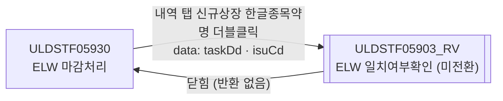
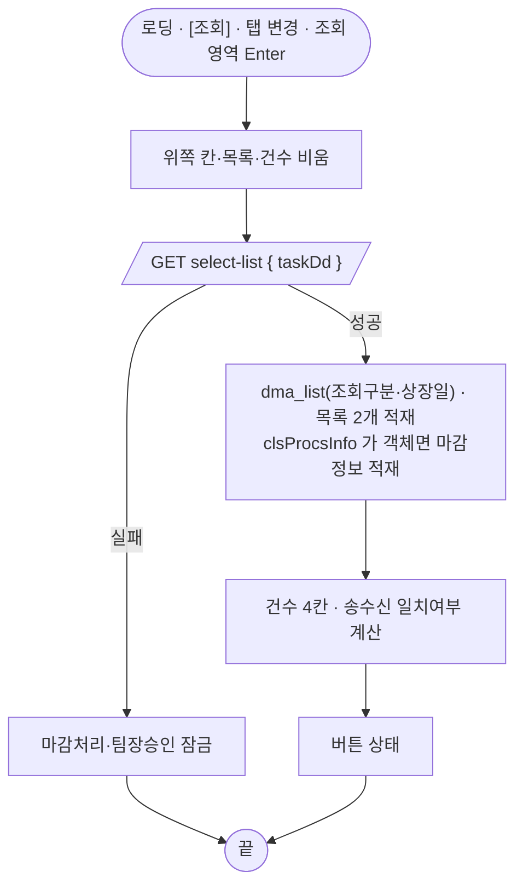
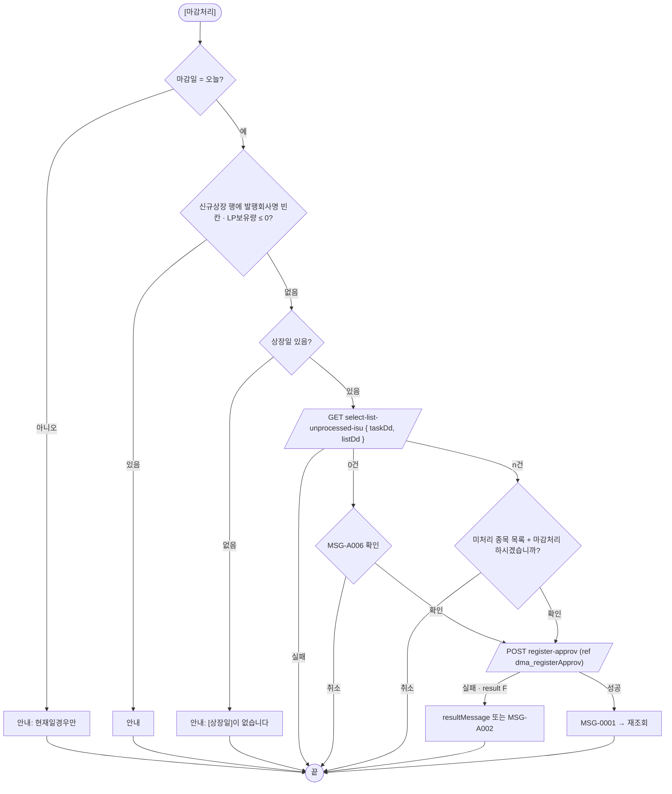
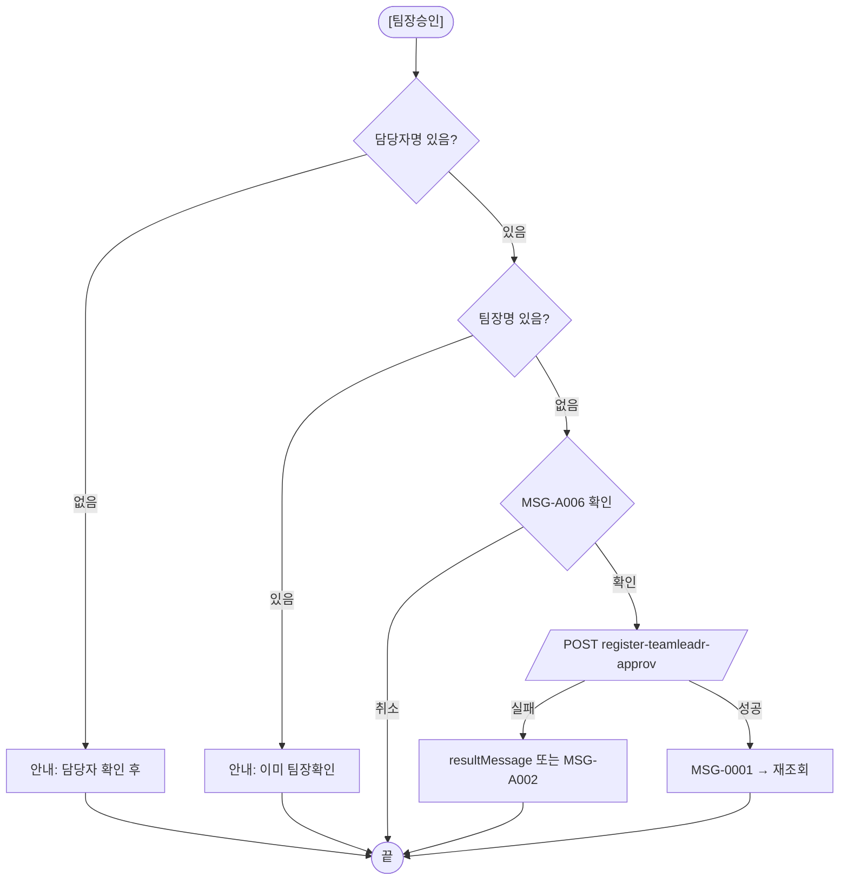
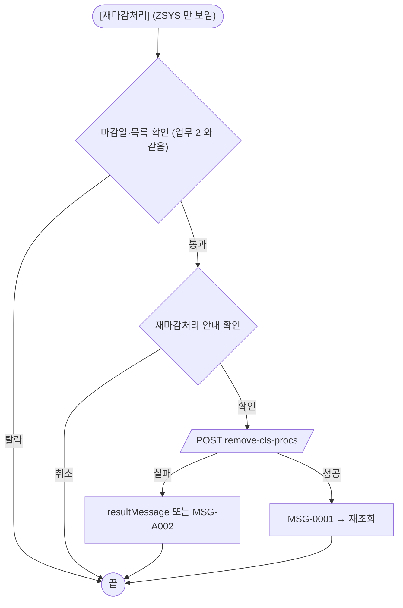
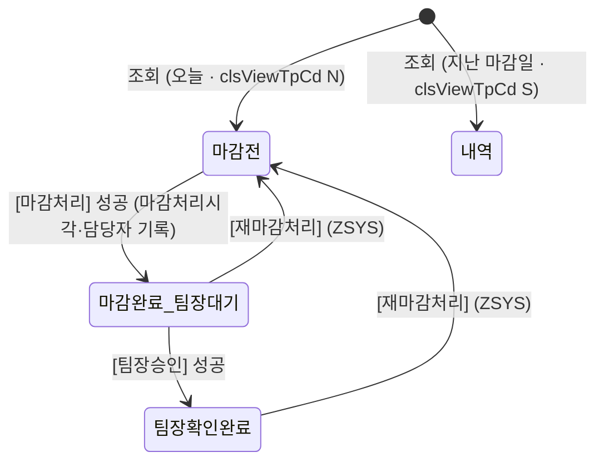

# ULDSTF05930 ELW 마감처리 — 업무 분석 및 전환 내역

| 항목 | 내용 |
|---|---|
| AS-IS | `/lstproc/ULDSTF05930.gfm` (Gauce/X-Internet 메인 화면, 탭 2개 「ELW마감처리」·「ELW마감처리내역」) — 반입 `conversion/conversion-front/ui/completed/ULDSTF05930/ULDSTF05930.gfm` |
| 신규 API 명세 | `conversion/conversion-front/ui/completed/ULDSTF05930/ULDSTF05930_API.md` — 블록 5종(머리 `[ULDSTF05930]`, 전부 이 화면): ① 재마감처리 `remove-cls-procs` ② 팀장승인 `register-teamleadr-approv` ③ 담당자승인 `register-approv` ④ 조회 `select-list` ⑤ 미처리종목 조회 `select-list-unprocessed-isu`. §2.2·§5 는 명세 기준(가이드 §0.3·§5) |
| TO-BE | `conversion/conversion-front/ui-tobe/ULDSTF05930.xml` (배포 경로 `/ui/lst/lstproc/ULDSTF05930.xml` — 가정, §10 #8). **2026-10-30 전환** — 1단계: 캡처 + publish 원본 기준 퍼블리싱(마크업 전용, 사본 `$CLAUDE_JOB_DIR/tmp/ULDSTF05930_stage1.xml`), 2단계: 이 결과서대로 스크립트 |
| 퍼블리싱 | 화면 폴더에 xml 이 없어 가이드 §0.3 대로 `conversion/publish/상장/상장처리(대내)/ULDSTF05930.xml`(KRX 퍼블리셔 XML)을 기준으로 했다 — 위쪽 12칸(6쌍) 표, 탭 2개, 탭마다 신규·추가상장 그리드 2개와 안내문·버튼 영역. 캡처와 다른 점은 §2.1 끝 |
| 화면 캡처 | `ULDSTF05930.png`(「ELW마감처리」 탭, 0건) — 마감일·상장일, 마감처리시각·마감자, 파일전송·수신시각, 신규상장/추가상장 그리드, 하단 안내문, [재마감처리][마감처리][닫기][엑셀저장] |
| 업무공통 | `$c.stf`(`getMessageParam`·`fillGridHeaderTotalCnt`) — `cm/pcc/stf`. 게이트는 `--pcc stf` |
| 선례 | 같은 마감 계열 `ULDSTF70016`(신종증권 — 탭 alwaysDraw·마감 전 마감이력 null 대비 적재)·`ULDSTF08200`(ETN)·`ULDSTF09330`·`ULDSTF09350`(서브미션 옵션 객체 재사용 금지·처리 결과 판정) |
| 작성 | Inswave / 2026-10-30 |

참고 양식: [websquare_gfm_conversion.md](../../../md/websquare_gfm_conversion.md) — §1.4 업무 프로세스 흐름, §5 API 명세 적용. Gauce 대응은 [gfm_business_analysis_guide.md](../../../md/gfm_business_analysis_guide.md) §5·§6 을 함께 따랐다.

---

## 1. 화면 개요

상장 담당자·팀장이 **ELW(주식워런트증권) 신규·추가상장 종목의 당일 마감**(매매시스템으로 보낼 상장 데이터 확정)을 처리하고, 지난 마감일의 **마감처리내역(송신데이터·송수신 일치여부)** 을 확인하는 메인 화면이다.

1. 마감일(기본 오늘)로 조회하면 상장일(마감일의 다음 영업일)·마감정보와 신규상장·추가상장 목록이 한 번에 온다(명세 ④). 마감일이 오늘이고 마감 전이면 **마감처리 목록**(`clsViewTpCd` N), 그 밖이면 **마감처리내역 목록**(S)을 서버가 정해 내려준다.
2. [마감처리]는 명세 ③ **담당자승인** — 원본의 마감처리(`fn_trsend`)와 담당자 확인(`fn_rcvApprove`)을 서버가 한 트랜잭션으로 묶었다. 마감 전 미처리 종목이 있으면 목록을 보여 주고 진행 여부를 묻는다(명세 ⑤).
3. 팀장은 담당자 확인 뒤 [팀장승인](명세 ②)을 한다(「ELW마감처리내역」 탭).
4. 시스템관리자(부서 ZSYS)만 [재마감처리](명세 ① — 당일 마감기록·승인기록 삭제)를 볼 수 있다.

### 1.1 호출 화면 (0본)

메뉴로 여는 메인 화면이다(원본 [닫기] 가 `frame.CloseFrame()`). 이 화면을 여는 다른 화면은 저장소에 없다.

### 1.2 호출 규약 (부모 → 이 화면) / 반환 규약

해당 없음 (메인 화면 — 받는 파라미터·반환 없음).

### 1.3 이 화면이 여는 하위 팝업

| 팝업 | AS-IS 호출 | 넘기는 `data` (TO-BE) | 받는 결과 |
|---|---|---|---|
| `ULDSTF05903_RV` ELW 일치여부확인 (665×800) | `fn_sndRcvCorrYn` — `dts_CorrYn` 에 일치여부 상세(listGeneral `…sndrcvcorryn.condition.rv`)를 읽은 뒤 `frame.CreateDialogFrame("DLG_ELWCORRYN", "/lstproc/ULDSTF05903_RV.gfm", …)` | `{ taskDd, isuCd }` — 제안(팝업이 스스로 조회) | 없음(닫힐 때까지 `await`) |

`ULDSTF05903_RV` 는 원본·전환본 모두 저장소에 없고, 일치여부 상세 조회 API 도 명세에 없다 — 경로 `/ui/lst/lstproc/ULDSTF05903_RV.xml`·data 키는 제안이다(§10 #6).

### 1.4 업무 프로세스 흐름

#### 화면 간 흐름

#### 업무 1: 조회

| 단계 | 처리 | TO-BE |
|---|---|---|
| 1 | 앞 결과 비움 | `scwin.clearHeader`, 목록 `removeAll`, `scwin.fillCounts` |
| 2 | 조회 | `scwin.searchList` → 명세 ④ |
| 3 | 마감정보 | `scwin.applyClsProcsInfo` (null 대비) |
| 4 | 일치여부 | `scwin.calcCorrYn` ×2 |
| 5 | 버튼 | `scwin.applyButtonState` |

#### 업무 2: 마감처리 (= 담당자승인)

#### 업무 3: 팀장승인

#### 업무 4: 재마감처리 (시스템관리자)

#### 업무 5: 송수신 일치여부 확인 · 엑셀저장

- 내역 탭 신규상장 그리드의 한글종목약명을 더블클릭하면 `ULDSTF05903_RV` 를 연다(§1.3).
- [엑셀저장]은 선택한 탭의 신규·추가상장 그리드를 각각 파일로 내려받는다(§6.7).

#### 화면 모드 상태 전이

| 상태 | [마감처리] | [팀장승인] | [재마감처리] |
|---|---|---|---|
| 마감 전 (N, 마감처리시각 없음) | 활성 | 잠금 | ZSYS 만 보임·활성 |
| 마감 완료·팀장 대기 | 잠금 | 팀장(직책 ≠ 03)만 활성 | ZSYS 만 |
| 팀장 확인 완료 | 잠금 | 잠금 | ZSYS 만 |
| 내역(S) | 잠금 | 담당자 확인·팀장 미확인이면 팀장만 활성 | ZSYS 만 |

---

## 2. 화면 구성 및 데이터 정의

### 2.1 화면 구성

| AS-IS 요소 | TO-BE 컴포넌트 | 설명 |
|---|---|---|
| `panel_Top` (조회 영역, `PanelToGroupBox`) | `xf:group.schbox#panel_Top` — publish 원본 12칸(6쌍) 표 | Enter 키 조회(규칙 22) |
| `label_2` 마감일 · `edt_TASK_DD` · `img_TASK_DD`(달력 버튼, `popUpCalendar2`) | `w2:inputCalendar#edt_TASK_DD` ← `dma_search.taskDd` | 달력 버튼은 inputCalendar 내장으로 대체(`img_TASK_DD` 옮기지 않음), `checkCalendarFormat`(규칙 37) |
| `label_1` 상장일 · `edt_LIST_DD`(`bnd_LIST_DD` ← `dts_Get_ListDD`) | `xf:input#edt_LIST_DD` 읽기전용 ← `dma_list.listDd` | 마감일의 다음 영업일 |
| `label_3` 마감처리시각 · `txb_BZ_CLS_TM` | ← `dma_listClsProcsInfo.bzClsTm` | |
| `label_8` 마감자 · `txb_CHRG_EMP_NM` | ← `dma_listClsProcsInfo.chrgEmpNm` | |
| `label_5` 파일전송시각 · `txb_TRNSM_END_TM` | ← `dma_listClsProcsInfo.trnsmEndTm` | 명세상 배치 미개발(§10 #2) |
| `label_6` 파일수신시각 · `txb_RCV_TM` | ← `dma_listClsProcsInfo.rcvTm` | 명세상 배치 미개발 |
| `lb_NEW_SNDRCV_DATA_CORR_YN` · `txb_NEW_SNDRCV_DATA_CORR_YN` 신규상장송수신일치여부 | ← `dma_search.newSndrcvDataCorrYn`(화면 계산) | 내역 탭에서만 보임 |
| `lb_ADD_SNDRCV_DATA_CORR_YN` · `txb_ADD_SNDRCV_DATA_CORR_YN` 추가상장송수신일치여부 | ← `dma_search.addSndrcvDataCorrYn` | 내역 탭에서만 |
| `lb_APPROV_EMP_NM` · `txb_APPROV_EMP_NM` 담당자명 | ← `dma_listClsProcsInfo.approvEmpNm` | 내역 탭에서만 |
| `lb_APPROV_TM` · `txb_APPROV_TM` 담당자 확인시각 | ← `…approvTm` | 내역 탭에서만 |
| `lb_TEAMLEADR_EMP_NM` · `txb_TEAMLEADR_EMP_NM` 팀장명 | ← `…approvTeamleadrEmpNm` | 내역 탭에서만 |
| `lb_TEAMLEADR_TM` · `txb_TEAMLEADR_TM` 팀장 확인시각 | ← `…teamleadrApprovTm` | 내역 탭에서만 |
| `btn_Search` · `img_tmp_11`(구분선 이미지) | `btn_Search` (`btn_cm sch`) | `img_tmp_11` 은 장식이라 옮기지 않음 |
| `MaxTab_01` · `panel_1`(ELW마감처리) · `panel_2`(ELW마감처리내역) | `w2:tabControl#MaxTab_01` (탭 `panel_1`·`panel_2`, 본문 `alwaysDraw="true"`) | 규칙 45 예외(탭 안 버튼을 init 에서 제어 — 선례 08200·70016) |
| `label_12` 신규상장 · `edt_New_Proc_TotalCnt` · `grd_New_Proc`(`dts_New_Proc`) | titbox h3 + 건수 `edt_New_Proc_TotalCnt` + `grd_New_Proc` ← `dlt_listNewListingList` | |
| `label_13` 추가상장 · `edt_Add_Proc_TotalCnt` · `grd_Add_Proc`(`dts_Add_Proc`) | titbox + `edt_Add_Proc_TotalCnt` + `grd_Add_Proc` ← `dlt_listAddListingList` | |
| `label_50` 안내문(3시 이전 마감) | `w2:textbox.txt_info#label_50` | |
| `btn_ReTrSend` · `btn_TrSend` · `btn_ProcExcel` · `btn_ProcClose` | `btnbox#grpBtnProc > rt` : [재마감처리][마감처리][엑셀저장] | [닫기](`btn_ProcClose`)는 메인 화면이라 옮기지 않음(선례) |
| `label_10` 신규상장 · `edt_New_Search_TotalCnt` · `grd_New_Search`(`dts_New_Search`) | titbox + `edt_New_Search_TotalCnt` + `grd_New_Search` ← `dlt_listNewListingList` | 일치여부·LP보유량 열 추가, 더블클릭 |
| `label_11` 추가상장 · `edt_Add_Search_TotalCnt` · `grd_Add_Search`(`dts_Add_Search`) | titbox + `edt_Add_Search_TotalCnt` + `grd_Add_Search` ← `dlt_listAddListingList` | 일치여부 열 추가 |
| `label_14` 안내문(일치여부 15:30 이후) | `w2:textbox.txt_info#label_14` | |
| `btn_rcvApprove` · `btn_rcvTeamleadr` · `btn_SearchExcel` · `btn_SearchClose` | `btnbox#grpBtnSearch > rt` : [팀장승인][엑셀저장] | [담당자 확인]은 명세 ③ 에 합쳐져 [마감처리]로 처리(§9·§10 #1), [닫기] 옮기지 않음 |
| 데이터셋 `dts_Item`(`bnd_Item`) · `dts_Get_ListDD` · `dts_IsuDelChk` · `dts_CorrYn` · `dts_UnRcvIsuChk` · 트랜잭션 `trs_Save` | §2.2 DataCollection · §5 서브미션 | |

**캡처·publish 원본과 다른 점**: 위쪽 표는 publish 원본의 12칸 배치를 그대로 두고, 「ELW마감처리」 탭에서는 내역 전용 6쌍의 라벨·칸을 숨긴다(원본 `showObj` 와 같고, 캡처가 이 상태다). 하단 [닫기]는 옮기지 않았다.

### 2.2 데이터 정의

| AS-IS | TO-BE | 종류 | 키 (명세 원문) | 비고 |
|---|---|---|---|---|
| (화면) | `dma_search` | dataMap | `taskDd`, `newSndrcvDataCorrYn`, `addSndrcvDataCorrYn` | 화면 전용 — 마감일, 송수신 일치여부(계산) |
| `dts_Get_ListDD` (상장일) | `dma_list` | dataMap | `clsViewTpCd`(N 마감처리 / S 내역), `listDd` | 명세 ④ `body` |
| `dts_Item` (마감 송신로그) | `dma_listClsProcsInfo` | dataMap | `taskDd`, `bzClsTm`, `trnsmStrtTm`, `trnsmEndTm`, `rcvTm`, `approvTm`, `chrgEmpNo`, `chrgEmpNm`, `approvEmpNo`, `approvEmpNm`, `elwListSndInfoTpCd`, `approvTeamleadrEmpNm`, `teamleadrApprovTm` | 명세 ④ `body.clsProcsInfo` — target 에서 빼고 객체일 때만 적재(§5) |
| `dts_New_Proc` · `dts_New_Search` | `dlt_listNewListingList` | dataList | 명세 ④ 신규상장 69키(`bzProcsNo`, `isuKorAbbrv`, `listDd`, `isuShrs`, `elwIsuMktpartcNm`, … `lpHdQty`, `taskDd`, `sndrcvTpCd`, `sndrcvDataCorrYn`) | 두 탭 그리드가 함께 쓴다. 내역 조회에서만 `lpHdQty`·`taskDd`·`sndrcvTpCd`·`sndrcvDataCorrYn` |
| `dts_Add_Proc` · `dts_Add_Search` | `dlt_listAddListingList` | dataList | `bzProcsNo`, `isuCd`, `isuKorAbbrv`, `isuKorNm`, `listDd`, `addIsuShrs`, `taskDd`, `sndrcvTpCd`, `sndrcvDataCorrYn` | 명세 ④ `body.addListingList` |
| `dts_UnRcvIsuChk` | `dlt_listUnprocessedIsu` | dataList | `isuKorAbbrv`, `listProcsStatNm` | 명세 ⑤ |
| `dts_Item`(처리 요청) | `dma_registerApprov` · `dma_registerTeamleadrApprov` · `dma_removeClsProcs` | dataMap | `taskDd`, `listDd` | 명세 ③·②·① 요청(`ref`) |
| (응답 없음) | `dma_registerApprovResult` · `dma_registerTeamleadrApprovResult` · `dma_removeClsProcsResult` | dataMap | `result`(S/F), `resultMessage`, `newListingCount`, `addListingCount` | 명세 ③·②·① 응답 |
| `dts_IsuDelChk`(코드 삭제종목) · `dts_CorrYn`(일치여부 상세) | (없음) | — | — | 대응 API 없음 — 삭제종목은 서버가 막고(명세 ③), 일치여부 상세는 팝업 몫(§10 #6) |

- AS-IS 대문자 컬럼 → camelCase: `BZ_CLS_TM→bzClsTm`, `CHRG_EMP_NM→chrgEmpNm`, `TRNSM_END_TM→trnsmEndTm`, `RCV_TM→rcvTm`, `APPROV_EMP_NM→approvEmpNm`, `APPROV_TM→approvTm`, `ELW_ISU_MKTPARTC_NM→elwIsuMktpartcNm`, `ISU_SHRS→isuShrs`, `SNDRCV_DATA_CORR_YN→sndrcvDataCorrYn`, `ISU_KOR_ABBRV→isuKorAbbrv`, `LIST_PROCS_STAT_NM→listProcsStatNm`.
- 그리드 날짜 열(AS-IS `mask="XXXX-XX-XX"`: `LIST_DD`·`EXER_STRT_DD`·`EXER_END_DD`·`ELW_LSTTRD_DD`·`ELW_PAY_DD`·`LP_END_DD`)은 `dataType="date" displayFormat="yyyy-MM-dd"`(규칙 46).

### 2.3 그리드 컬럼 대응 (AS-IS `id` / 머리글 `name` → TO-BE)

`grd_New_Proc`(마감처리 신규상장) — AS-IS 고정열(`fcolumn`) `NO` 번호·`BZ_PROCS_NO`·`ISU_KOR_ABBRV` → `rowNumVisible`(번호) + `fixedColumn="2"`.

| AS-IS id | 머리글 | TO-BE id | 형식 |
|---|---|---|---|
| `NO` | 번호 | (rowNum) | `{CurRow}` |
| `BZ_PROCS_NO` | 신청일련번호 | `bzProcsNo` | |
| `ISU_KOR_ABBRV` | 한글종목약명 | `isuKorAbbrv` | |
| `LIST_DD` | 상장일 | `listDd` | 날짜(규칙 46) |
| `ISU_CD` | 종목코드 | `isuCd` | |
| `ISU_SHRS` | 발행수량 | `isuShrs` | `#,##0` |
| `ISU_PRC` | 발행가 | `isuPrc` | `#,##0.###`(decao 3) |
| `ELW_ULY_BAS_PRC` | 기준가격/지수 | `elwUlyBasPrc` | `#,##0.###` |
| `ELW_EXER_PRC` | 행사가격/지수 | `elwExerPrc` | `#,##0.###` |
| `ELW_KO_OCCR_BAS_PRC` | 조기종료발생기준가격/지수 | `elwKoOccrBasPrc` | `#,##0.###` |
| `ELW_ISU_MKTPARTC_NM` | 발행회사명 | `elwIsuMktpartcNm` | |
| `ISU_KOR_NM` | 한글종목명 | `isuKorNm` | |
| `ISU_ENG_NM` | 영문종목명 | `isuEngNm` | |
| `ISU_ENG_ABBRV` | 영문종목약명 | `isuEngAbbrv` | |
| `ULY_NM` | 기초자산 | `ulyNm` | |
| `IDX_IND_NM1` | 지수 | `idxIndNm1` | |
| `ELW_IDX_NM1` | 신지수 | `elwIdxNm1` | |
| `ELW_IDX_BELNG_MKT_TP_NM1` | 지수시장구분 | `elwIdxBelngMktTpNm1` | |
| `ULY_RTO` | 구성비 | `ulyRto` | 문자열(복수는 콤마 구분 — 숫자 형식 미적용) |
| `LP_MBR_NM` | 유동성 공급자 | `lpMbrNm` | |
| `ISU_SRT_CD` | 종목단축코드 | `isuSrtCd` | |
| `ELW_EO_TP_NM` | 이색옵션구분 | `elwEoTpNm` | |
| `EXER_STRT_DD` | 행사개시일 | `exerStrtDd` | 날짜 |
| `EXER_END_DD` | 행사종료일 | `exerEndDd` | 날짜 |
| `ELW_LSTTRD_DD` | 최종거래일 | `elwLsttrdDd` | 날짜 |
| `ELW_LST_SETL_METHD_NM` | 결제방법 | `elwLstSetlMethdNm` | |
| `ELW_CONV_RTO` | 전환비율(%) | `elwConvRto` | |
| `ORD_SPD_RTO` | 호가스프레드 | `ordSpdRto` | `#,##0.######`(decao 6) |
| `ELW_PRC_UP_PARTC_RT` | 가격상승참가율 | `elwPrcUpPartcRt` | |
| `ELW_COMPNS_RT` | 최소지급비율 | `elwCompnsRt` | |
| `ELW_PAY_DD` | 지급일 | `elwPayDd` | 날짜 |
| `ELW_PAY_AGNT_NM` | 지급대리인 | `elwPayAgntNm` | |
| `ELW_RGHT_TP_NM` | 권리유형 | `elwRghtTpNm` | |
| `ELW_EXER_TP_NM` | 권리행사방식 | `elwExerTpNm` | |
| `ELW_EXER_CONTN` | 만기시 권리내용 | `elwExerContn` | |
| `ELW_KO_EXER_CONTN` | 조기종료시 권리내용 | `elwKoExerContn` | |
| `ELW_EXP_VALU_PRC_METHD` | 만기평가가격/지수 | `elwExpValuPrcMethd` | |
| `ELW_KO_VALU_METHD` | 조기종료평가가격/지수 | `elwKoValuMethd` | |
| `LP_END_DD` | LP 공급종료일 | `lpEndDd` | 날짜 |
| `ISU_SHRS`(두 번째) | LP보유량 | (마감처리 그리드는 옮기지 않음) / 내역 그리드 `lpHdQty` | AS-IS 는 발행수량과 같은 `ISU_SHRS` 를 한 번 더 보였다 — 한 그리드에 같은 열 id 를 둘 수 없어, 마감처리 그리드는 발행수량 하나만, 내역 그리드는 명세 `lpHdQty`(LP보유수량, 내역 조회 시에만)로 보인다(§8 #3) |
| `ELW_FINAL_PAY_VAL` | 확정지급액 | `elwFinalPayVal` | |

`grd_New_Search`(내역 신규상장) — 위와 같고 맨 앞에 `SNDRCV_DATA_CORR_YN` 일치여부(`sndrcvDataCorrYn`, 글자색 blue — `scwin.fmtCorrYn`), `LP_END_DD` 다음에 LP보유량(`lpHdQty`) 이 있다. `ISU_KOR_ABBRV` 칸은 더블클릭 대상(배경 `bg_orange` — `scwin.fmtDblClickCell`, 원본 bgcolor #FFFF99). 고정열 3.

`grd_Add_Proc` / `grd_Add_Search`(추가상장) — `NO` 번호·`BZ_PROCS_NO` 신청일련번호·`ISU_KOR_ABBRV` 한글종목약명·`LIST_DD` 상장일(날짜)·`ISU_CD` 종목코드·`ADD_ISU_SHRS` 추가발행수량(`addIsuShrs`, `#,##0`)·`ISU_KOR_NM` 한글종목명. 내역 그리드는 맨 앞에 `SNDRCV_DATA_CORR_YN` 일치여부.

---

## 3. 로딩 (`gform onload` → `scwin.onpageload` → `scwin.init`)

AS-IS `gform` `onload`: ZSYS 면 `btn_ReTrSend` 를 보이되 잠금, 아니면 숨김 → 마감일 = `cGetToday`(클라이언트 오늘) → `MaxTab_01.ActiveIndex = 1` → `PanelToGroupBox(panel_Top)` → `fn_list_sync` → `fn_btnDisable`.

`scwin.onpageload` 는 `scwin.init()` 만 부른다. `scwin.init` 순서:

1. 세션 직책·부서(`jobtitl`·`depCd`), 서버 오늘(`$c.date.getServerDateTime`) — 원본은 클라이언트 날짜.
2. init 바인딩 — `$c.date.checkCalendarFormat(edt_TASK_DD, "yyyyMMdd")`(규칙 37), `$c.win.setEnterKeyEvent(panel_Top, scwin.btn_Search_onclick)`(규칙 22).
3. 버튼 초기 — `scwin.applyReTrSendButton`(ZSYS 만 보임), `scwin.lockButtons`(조회 전 잠금).
4. 마감일 = 오늘, `scwin.applyTabMode(TAB_PROC)`(내역 전용 칸 숨김).
5. `await scwin.searchList()` — 버튼 상태까지 정한다(원본 `fn_btnDisable`).

탭 본문은 `alwaysDraw="true"` — 탭 안 컴포넌트를 init 에서 제어한다(규칙 45 예외, 선례 08200·70016). 달력은 단일 마감일 하나뿐이다(기간 쌍 없음).

---

## 4. 컴포넌트 이벤트

| AS-IS 이벤트 | TO-BE 핸들러 | 처리 |
|---|---|---|
| `btn_Search` `onclick` (`fn_list_sync` + `fn_btnDisable`) | `scwin.btn_Search_onclick` (+ Enter 키) | `scwin.searchList` |
| `MaxTab_01` `OnSelChanged(nIndex)` (`fn_list_sync` + `showObj` ×12, 탭2면 `fn_btnDisable`) | `scwin.MaxTab_01_onchange` | `scwin.applyTabMode` → `scwin.searchList` |
| `btn_TrSend` `onclick` (`fn_trsend`) | `scwin.btn_TrSend_onclick` | `scwin.trSend` |
| `btn_ReTrSend` `onclick` (`fn_re_trsend`) | `scwin.btn_ReTrSend_onclick` | `scwin.reTrSend` |
| `btn_rcvApprove` `onclick` (`fn_rcvApprove`) | (없음) | 명세 ③ 이 마감처리와 담당자 확인을 합쳐 [마감처리]로 처리 — 버튼을 옮기지 않음(§9) |
| `btn_rcvTeamleadr` `onclick` (`fn_rcvTeamleadr`) | `scwin.btn_rcvTeamleadr_onclick` | `scwin.rcvTeamleadr` |
| `btn_ProcExcel` · `btn_SearchExcel` `onclick` (`doLogSave` + `fn_ExcelDown`) | `scwin.btn_ProcExcel_onclick` · `scwin.btn_SearchExcel_onclick` | `scwin.excelDown` (`doLogSave` 삭제) |
| `btn_ProcClose` · `btn_SearchClose` `onclick` (`frame.CloseFrame`) | (없음) | 메인 화면 [닫기] — 옮기지 않음 |
| `img_TASK_DD` `onclick` (`popUpCalendar2`) | (없음) | inputCalendar 내장 달력 |
| `grd_New_Search` `OnDblClick(row, colid)` (`ISU_KOR_ABBRV` 면 `fn_sndRcvCorrYn`) | `scwin.grd_New_Search_oncelldblclick` | `isuKorAbbrv` 칸이면 `scwin.openCorrYn` |
| `dts_*` `OnLoadCompleted(rowcount)` (건수·`CloseWin`·일치여부) | `scwin.searchList` 안 | `scwin.fillCounts`·`scwin.calcCorrYn` |
| `dts_*` `OnLoadError()` (`MSG-0002`·`alert_error`) | (없음) | 공통 `$c.sbm` 오류 안내 |
| `trs_Save` `OnSuccess()` (`MSG-0001` → 재조회 → `fn_btnDisable`) · `OnFail()` (`MSG-A002` + `alert_error`) | `scwin.postClose` | 성공 MSG-0001 → `searchList` / 실패 `resultMessage` 또는 MSG-A002 |
| `gform` `onload` | `scwin.onpageload` → `scwin.init` | §3 |

---

## 5. 서버 통신

모든 통신은 `$c.sbm.executeDynamic`, action 은 전체 경로 리터럴(규칙 38), 옵션 객체는 호출마다 새로 만든다(공통 함수가 옵션을 고친다 — 선례 09350).

#### API 명세 대응 (`ULDSTF05930_API.md`)

| AS-IS | TO-BE API | 요청 | 응답 |
|---|---|---|---|
| `fn_list_sync` — `dts_Get_ListDD`(`getElwListingListDd`)·`dts_Item`(`listElwListingTrSendLog`)·`dts_New_Proc`/`dts_Add_Proc`(listGeneral `…trsend.condition.rv`) 또는 `dts_New_Search`/`dts_Add_Search`(`…trsend.search.condition.rv`) | ④ `GET /api/listing/lstproc/elw/cls-procs/select-list` | `{ taskDd }` | `dma_list=body`, `body.clsProcsInfo`(수동 적재), `dlt_listNewListingList=body.newListingList`, `dlt_listAddListingList=body.addListingList` |
| `fn_UnRcvIsuCheck` — `dts_UnRcvIsuChk`(listGeneral `…trsend.precondition`) | ⑤ `GET /api/listing/lstproc/elw/cls-procs/select-list-unprocessed-isu` | `{ taskDd, listDd }` | `dlt_listUnprocessedIsu=body` |
| `fn_trsend`(`clsElwListingRV`) + `fn_rcvApprove`(`rcvApprovElwListing` APPROV_TYPE 1) | ③ `POST /api/listing/lstproc/elw/cls-procs/register-approv` | `ref dma_registerApprov` `{ taskDd, listDd }` | `dma_registerApprovResult=body` |
| `fn_rcvTeamleadr`(`rcvApprovElwListing` APPROV_TYPE 2) | ② `POST /api/listing/lstproc/elw/cls-procs/register-teamleadr-approv` | `ref dma_registerTeamleadrApprov` | `dma_registerTeamleadrApprovResult=body` |
| `fn_re_trsend`(`reClsElwListing`) | ① `POST /api/listing/lstproc/elw/cls-procs/remove-cls-procs` | `ref dma_removeClsProcs` | `dma_removeClsProcsResult=body` |
| `fn_isuDelCheck` — `dts_IsuDelChk`(listGeneral `…delete.check.condition.rv`) | (없음) | — | 명세 ③ 설명대로 서버가 삭제종목을 막는다 |
| `fn_sndRcvCorrYn` — `dts_CorrYn`(listGeneral `…sndrcvcorryn.condition.rv`) | (없음) | — | 일치여부 상세는 팝업 몫(§10 #6) |

#### 명세 ↔ AS-IS 차이 (→ §10)

1. **조회 통합** — AS-IS 는 상장일·마감로그·목록을 따로 읽고 탭에 따라 마감처리 목록/내역 목록 쿼리를 골랐다. 명세 ④ 는 한 번에 주고, **어느 목록을 줄지는 서버가 마감일로 정한다**(오늘·마감 전 N / 그 밖 S). 탭은 요청에 영향이 없어 두 탭 그리드가 같은 목록을 보인다(§10 #1).
2. **마감처리 + 담당자 확인 통합** — 명세 ③ 이 한 트랜잭션. 원본 [담당자 확인](`fn_rcvApprove`)의 파일수신시각 확인(「파일수신전 상태」)과 「이미 담당자확인」 확인은 옮기지 않았다(수신시각은 명세상 배치 미개발 — §10 #2).
3. **`clsProcsInfo` target 제외** — 마감 전이면 null 일 수 있어(명세에 명시 없음, 선례 70016 finalLog) target 에서 빼고 객체일 때만 적재한다(§10 #3).
4. **보내지 않는 원본 값** — `dts_Item` 의 `CHRG_EMP_NO`·`APPROV_EMP_NO`·`APPROV_TEAMLEADR_EMP_NO`(세션 사번)·`CLS_TYPE`·`APPROV_TYPE`, URL 인자 `SCREN_ID`·`SCREN_PROCES_TP_CD`(§10 #4).
5. **삭제종목 검사** — 원본 `fn_isuDelCheck` 의 종목 목록 안내는 대응 API 가 없다. 서버가 막을 때 그 사유가 `resultMessage` 로 오는지 확인(§10 #5).

### 5.1 조회 (`scwin.searchList`)

앞 결과를 비운 뒤 명세 ④ 를 부른다. 실패하면 [마감처리]·[팀장승인]을 잠근다. 성공하면 `clsProcsInfo` 적재 → 건수 4칸 → 일치여부 2칸 → 버튼 상태. 진행 중 조회가 있으면 건너뛴다(`skipped`).

### 5.2 재마감처리 (`scwin.reTrSend` → `scwin.postClose`)

명세 ①. 요청 `dma_removeClsProcs` 에 `taskDd`·`listDd`(명세상 재마감에는 쓰지 않음)를 넣어 보낸다.

### 5.3 팀장승인 (`scwin.rcvTeamleadr` → `scwin.postClose`)

명세 ②. 요청 `dma_registerTeamleadrApprov`.

### 5.4 담당자승인 = 마감처리 (`scwin.trSend` → `scwin.postClose`)

명세 ③. 요청 `dma_registerApprov`(상장일 필수). **판정**: `success` 이고 `result !== "F"` 면 성공 — 실패면 `resultMessage`(없으면 `MSG-A002`).

### 5.5 미처리종목 조회 (`scwin.searchUnprocessedIsu`)

명세 ⑤. 마감처리 확인 전에 부르고, 실패·건너뜀이면 `null` 을 돌려 마감처리를 멈춘다. 결과가 있어도 승인은 가능 — 목록을 보여 주고 묻는다.

---

## 6. 일반 함수

| AS-IS 함수 | TO-BE | 설명 |
|---|---|---|
| `fn_list_sync` | `scwin.searchList` | §5.1 |
| `fn_setButton` | `scwin.applyButtonState` · `scwin.applyReTrSendButton` | §6.8 |
| `fn_btnDisable` | `scwin.applyButtonState` | §6.8 |
| `fn_setSndRcvCorrYn` | `scwin.calcCorrYn` | §6.2 |
| `fn_sndRcvCorrYn` | `scwin.openCorrYn` | §6.6 |
| `fn_isuDelCheck` | (삭제 — 서버) | §5 차이 5 |
| `fn_checkProcDt` | `scwin.checkProcDt` | §6.2 |
| `fn_UnRcvIsuCheck` | `scwin.searchUnprocessedIsu` + `scwin.trSend` 확인 문구 | §5.5 |
| `fn_trsend` | `scwin.trSend` | §6.3 |
| `fn_re_trsend` | `scwin.reTrSend` | §6.4 |
| `fn_rcvApprove` | (`scwin.trSend` 에 합침) | 명세 ③ |
| `fn_rcvTeamleadr` | `scwin.rcvTeamleadr` | §6.5 |
| `fn_ExcelDown` | `scwin.excelDown` | §6.7 |

### 6.1 탭 상태 (`scwin.applyTabMode`)

「ELW마감처리내역」 탭에서만 `scwin.SEARCH_ONLY_IDS` 12개(일치여부·담당자·팀장 라벨·칸)를 보인다. 원본은 탭 2 에서 `fn_btnDisable` 도 불렀다 — TO-BE 는 탭 변경 시 재조회(`searchList`)가 버튼 상태까지 정한다.

### 6.2 마감 처리 전 확인 (`scwin.checkProcDt`) · 송수신 일치여부 (`scwin.calcCorrYn`)

- `checkProcDt`: 마감일 ≠ 서버 오늘이면 「[마감일]이 현재일경우만 '…'를 할수 있습니다.」. 신규상장 목록에 발행회사명(`elwIsuMktpartcNm`)이 빈 종목이면 「발행회사명에 대한 시장참가자번호가 없는 종목이 있습니다. …」, LP보유량(`isuShrs`) ≤ 0 이면 「LP보유량이 '0'인 종목이 있습니다. …」. 마감처리·재마감처리가 부른다(명세 ①·③ 의 목록검증과 같음).
- `calcCorrYn`: 파일수신시각(`rcvTm`)이 있을 때만, 모든 행 `sndrcvDataCorrYn === "O"` 면 O, 아니면 X. 수신 전이거나 0건이면 「-」.

### 6.3 마감처리 (`scwin.trSend`)

§1.4 업무 2. 상장일 빈 값이면 「[상장일]이 없습니다.」 후 `edt_LIST_DD` 포커스. 미처리 종목이 있으면 「미처리 종목이 있습니다 / - 종목명 : … [사유] … / 마감처리 하시겠습니까?」, 없으면 `MSG-A006`.

### 6.4 재마감처리 (`scwin.reTrSend`)

§1.4 업무 4. 확인 문구는 원본 그대로(「… 재마감처리후 다시 마감처리를 하셔아 됩니다. …」).

### 6.5 팀장승인 (`scwin.rcvTeamleadr`)

§1.4 업무 3. 원본처럼 마감일 확인은 하지 않는다.

### 6.6 일치여부 확인 팝업 (`scwin.openCorrYn`)

`ULDSTF05903_RV` 를 `{ taskDd, isuCd }` 로 열고 닫힐 때까지 기다린다(가이드 §6.5). 원본은 이 화면이 상세를 읽고 팝업이 부모 데이터셋(`dts_CorrYn`)을 참조했다.

### 6.7 엑셀저장 (`scwin.excelDown`)

선택한 탭의 신규·추가상장 그리드를 각각 내려받는다(원본도 `GridToExcel` 두 번). 파일명 `{menuId}_신규상장 마감처리목록_{yyyyMMddHHmmss}.xlsx` · `{menuId}_추가상장 송신목록_…`(규칙 42). 행이 있는 그리드만 내려받고, 둘 다 비면 공통 함수의 0건 안내를 한 번만 띄운다.

### 6.8 버튼 상태 (`scwin.applyButtonState` · `scwin.applyReTrSendButton` · `scwin.lockButtons`)

- [마감처리]: 조회구분 N 이고 마감처리시각이 없을 때만 활성(원본 `fn_setButton` 은 `BZ_CLS_TM` 만 봤다 — N/S 조건을 더해 지난 마감일에 마감하지 못하게 함, 서버도 당일만 허용).
- [팀장승인]: 직책이 담당자(03)가 아니고, 담당자명 있음·팀장명 없음일 때만(원본 `fn_btnDisable`).
- [재마감처리]: 부서 ZSYS 만 보이고 활성.
- 조회 전·조회 실패: [마감처리]·[팀장승인] 잠금.

---

## 7. 업무 코드 · 메시지 목록

| 구분 | 값 | 의미 / 문구 |
|---|---|---|
| 조회구분 `clsViewTpCd` | N / S | 마감처리 목록 / 마감처리내역 목록 |
| 직책 `jobtitl` | 03 | 담당자(그 외 팀장) |
| 부서 `depCd` | ZSYS | 시스템관리자(재마감처리) |
| 송수신 일치 `sndrcvDataCorrYn` | O | 일치 |
| 처리결과 `result` | S / F | 성공 / 실패 |
| `MSG-A006` | 처리명 | 「… 하시겠습니까?」 계열 확인 |
| `MSG-0001` | 처리명 | 완료 안내 |
| `MSG-A002` | 처리명 | 실패 안내 |
| `MSG-0002` | — | 원본 조회 오류 안내(TO-BE 는 공통 오류 안내) |
| 안내 | — | 「[마감일]이 현재일경우만 '…'를 할수 있습니다.」, 「발행회사명에 대한 시장참가자번호가 없는 종목이 있습니다. 시스템관리자에게 문의바랍니다.」, 「LP보유량이 '0'인 종목이 있습니다. 확인하여주십시오.」, 「[상장일]이 없습니다.」, 「[담당자]가 확인하지 않았습니다. …」, 「이미 [팀장확인] 처리되었습니다.」 |

---

## 8. 원본 특이사항 · 결함

| # | 내용 | 결정 |
|---|---|---|
| 1 | 마감일 기준을 클라이언트 날짜(`cGetToday`)로 판정 | **고침** — 서버 날짜 |
| 2 | 동기 조회(`Reset`) 직후 `fn_setButton` 을 불러 버튼 상태가 조회 결과에 기대어 있었다 | **고침** — 조회 응답 뒤 버튼 상태 |
| 3 | 그리드에 같은 열 id `ISU_SHRS` 를 두 번(발행수량·LP보유량) | **고침** — 마감처리 그리드는 하나, 내역은 명세 `lpHdQty` |
| 4 | `fn_UnRcvIsuCheck` 가 미처리 0건이면 `undefined` 를 돌려 호출부가 `res == null` 로 분기 | **고침** — 건수로 분기 |
| 5 | 조회 실패에도 앞 목록·마감로그가 남아 그 상태로 마감 가능 | **고침** — 조회 전 비우고 실패 시 버튼 잠금 |
| 6 | 처리 중 연속 클릭으로 중복 전송 가능 | **고침** — 공통 중복 실행 방지(`skipped`) |
| 7 | `fn_rcvApprove` 의 파일수신시각 확인 — 수신 배치가 명세상 미개발이라 늘 막힘 | **옮기지 않음** — 명세 ③ 에 합쳐짐 |
| 8 | [마감처리]가 마감처리시각만 보고 활성 — 지난 마감일 조회에서도 활성 | **고침** — 조회구분 N 조건 추가 |
| 9 | 원본 `alert_error`·`doLogSave` 호출 | **옮기지 않음** — 공통 오류 안내, 화면 로그 제거(선례) |

---

## 9. 전환 내역 (AS-IS → TO-BE)

| AS-IS | TO-BE |
|---|---|
| 전역 `vScrenID`·`procJob`·`vViewCorrYnTyp`·`pMngId`·`pJobTitl` | `scwin.screenId`·`scwin.procJob`·(삭제 — 미사용)·(삭제 — 미사용)·`scwin.jobTitl` |
| (원본 `js_dep_cd`·`cGetToday`·탭 번호·코드 리터럴) | 상태 `scwin.depCd`·`scwin.todayDd`, 상수 `scwin.TAB_PROC`·`scwin.TAB_SEARCH`·`scwin.VIEW_PROC`(N)·`scwin.JOBTITL_CHRG`(03)·`scwin.DEP_CD_SYS`(ZSYS)·`scwin.CORR_OK`(O)·`scwin.SEARCH_ONLY_IDS` |
| `#include` 9종 | 삭제 (`$c.*`·`$c.stf`) |
| `gform onload` | `scwin.onpageload` → `scwin.init` |
| `fn_list_sync` | `scwin.searchList` |
| `fn_setButton` · `fn_btnDisable` | `scwin.applyButtonState` · `scwin.applyReTrSendButton` · `scwin.lockButtons` |
| `fn_setSndRcvCorrYn` | `scwin.calcCorrYn` |
| `fn_sndRcvCorrYn` | `scwin.openCorrYn` (`scwin.grd_New_Search_oncelldblclick`) |
| `fn_isuDelCheck` | 삭제(서버 검증 — 명세 ③) |
| `fn_checkProcDt` | `scwin.checkProcDt` |
| `fn_UnRcvIsuCheck` | `scwin.searchUnprocessedIsu` |
| `fn_trsend` + `fn_rcvApprove` | `scwin.trSend` (명세 ③) — `btn_rcvApprove` 는 옮기지 않음 |
| `fn_re_trsend` | `scwin.reTrSend` (명세 ①) |
| `fn_rcvTeamleadr` | `scwin.rcvTeamleadr` (명세 ②) |
| `fn_ExcelDown` | `scwin.excelDown` |
| `trs_Save` OnSuccess·OnFail | `scwin.postClose` |
| `MaxTab_01` OnSelChanged | `scwin.MaxTab_01_onchange` + `scwin.applyTabMode` |
| (신규) | `scwin.clearHeader`·`scwin.applyClsProcsInfo`·`scwin.fillCounts`·`scwin.fmtCorrYn`·`scwin.fmtDblClickCell` |

- publicInfo: 정의한 29함수 전부(내부 helper 없음). 전역 상수·상태는 등재하지 않는다.
- 게이트: `gate_screen --pcc stf` OK · `scan_mixed_compare` A 1(`length`·`rowCount` 숫자 비교 — 의도)·B 0 · `publish_gate --pcc stf --before {1단계} --allow P20` OK(P22·P24 는 스크립트 전환분) · `api_spec_check` OK(명세 5종 전부 호출) · `init_binding_check` OK · `wsxml_lint` 0/0 · `convert.py` 고정점.

---

## 10. 남은 작업 (TODO)

1. **탭과 조회구분** — 명세 ④ 는 탭과 무관하게 마감일로 N/S 목록을 정한다. 오늘 마감 전에 「ELW마감처리내역」 탭을 열면 내역이 아니라 마감처리 목록이 보인다(원본은 빈 내역). 탭별로 구분해야 하면 요청 인자(조회구분) 추가가 필요하다. 원본 [담당자 확인] 버튼은 명세 ③ 에 합쳐져 옮기지 않았다 — 업무 확인.
2. **파일전송·수신시각** — 명세상 EXTURE 배치가 기록하며 현재 개발범위 제외. 그동안 송수신 일치여부는 늘 「-」 다.
3. **`clsProcsInfo` 형태** — 마감 전에 null 인지 빈 객체인지 확인. 빈 객체면 명세 target 으로 되돌려도 된다.
4. **명세에 없는 원본 전송값** — 사번(마감자·담당자·팀장)·`CLS_TYPE`·`APPROV_TYPE`·`SCREN_ID` 를 서버가 세션으로 채우는지 확인.
5. **삭제종목 안내** — 원본은 코드 삭제종목의 종목코드·종목명을 나열했다. 서버가 막을 때 `resultMessage` 에 같은 정보가 오는지 확인.
6. **ULDSTF05903_RV(ELW 일치여부확인)** — 원본·전환본·상세 조회 API 모두 없다. 경로 `/ui/lst/lstproc/ULDSTF05903_RV.xml`·data `{ taskDd, isuCd }` 는 제안.
7. **처리 응답 판정** — `result` 를 비워 보내는 경우가 있는지(지금은 `success` 이고 `F` 가 아니면 성공).
8. **배포 경로** — `/ui/lst/lstproc/ULDSTF05930.xml` 가정. 날짜 열 서버 값이 8자리인지(규칙 46).
9. **엑셀 버튼 위치** — 캡처대로 하단 btnbox(publish 원본과 같음).
