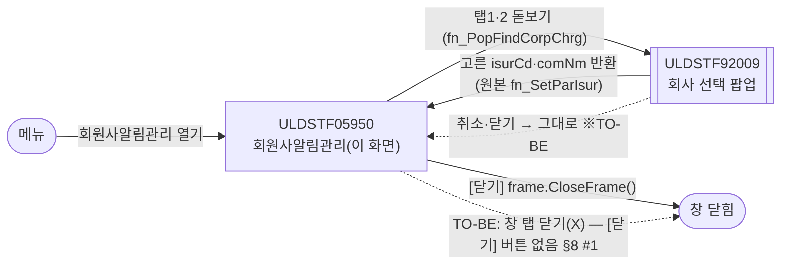
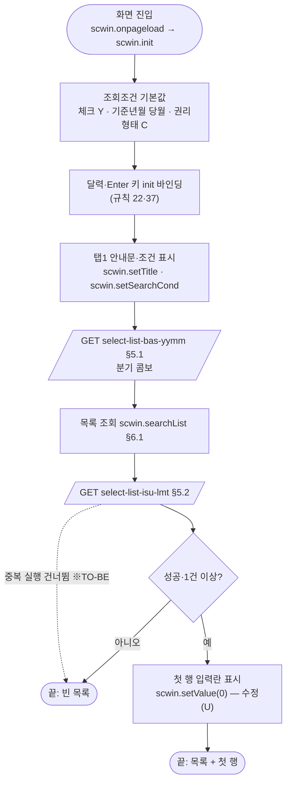
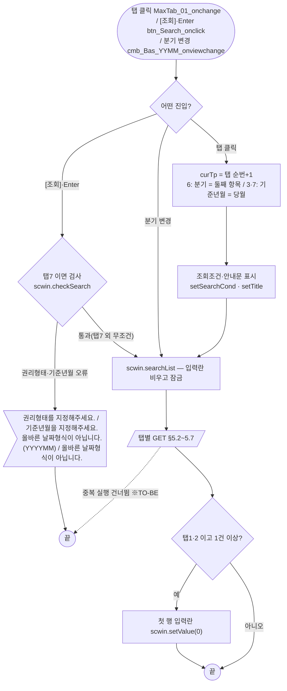
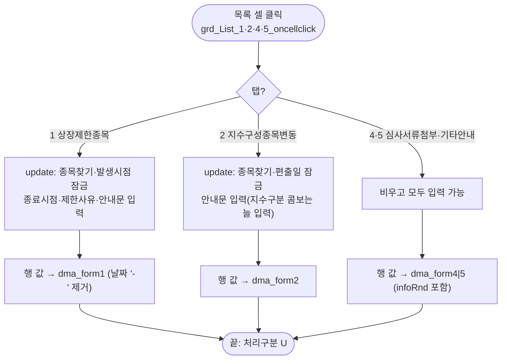
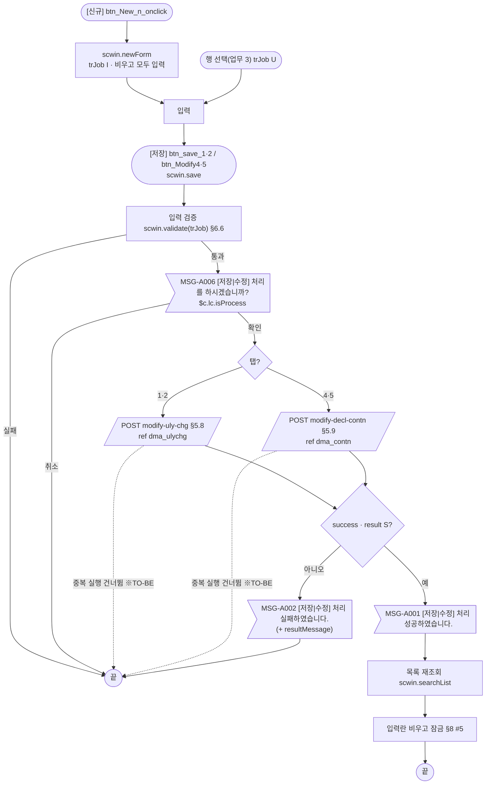
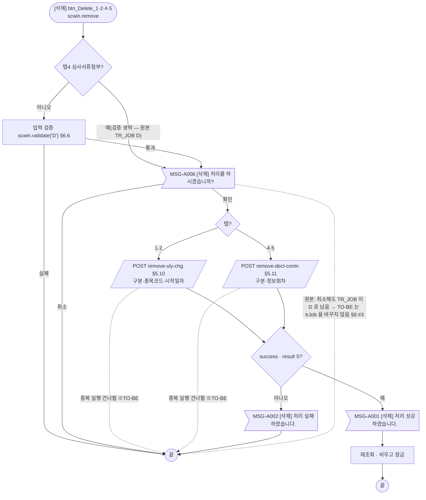
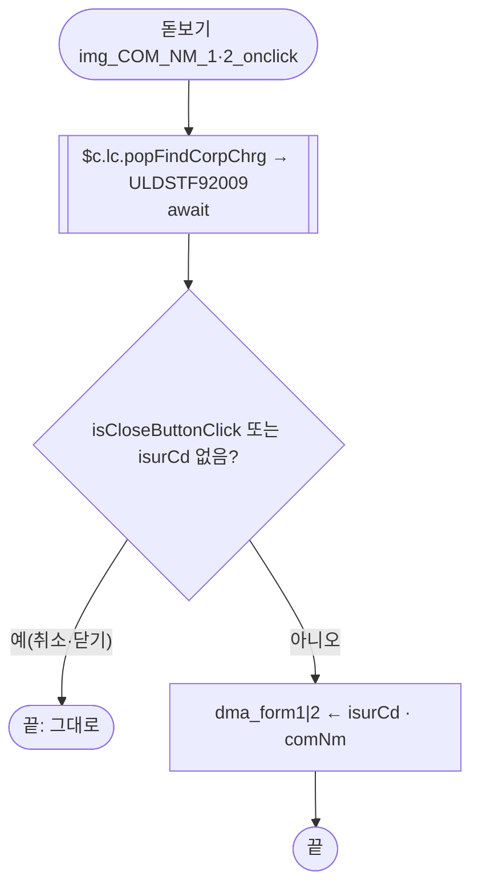
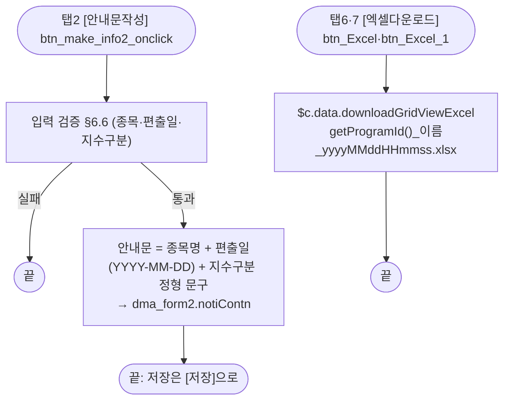
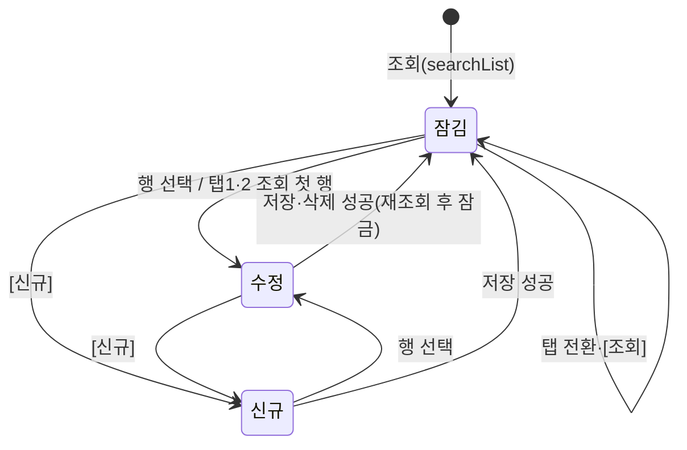

# ULDSTF05950 회원사알림관리 — 업무 분석 및 전환 내역

| 항목 | 내용 |
|---|---|
| AS-IS | `/lstproc/ULDSTF05950.gfm` (Gauce/X-Internet, **메뉴 화면** 950×747 — 캡처 제목 표시줄 「회원사알림관리_STF05950」, 최소화·최대화 버튼이 있는 MDI 창) — 반입 `conversion/conversion-front/ui/completed/ULDSTF05950/ULDSTF05950.gfm` |
| 신규 API 명세 | `ULDSTF05950_API.md` — 블록 11종, **모두 이 화면ID**(`[ULDSTF05950]`) — 조회 7종(`select-list-bas-yymm`·`select-list-decl-contn`·`select-list-exer-prc`·`select-list-isu-lmt`·`select-list-stridx-top5`·`select-list-uly-chg`·`select-list-uly-nm`), 저장 2종(`modify-decl-contn`·`modify-uly-chg`), 삭제 2종(`remove-decl-contn`·`remove-uly-chg`). §2.2·§5 는 명세 기준(가이드 §0.3·§5). **블록 1(기준분기 콤보) 머리에 `## 1.` 이 없어** 게이트(`api_spec_check.py`)가 블록 1 을 읽지 못한다 → 원본 명세로 돌리면 A01 1건(§10 #11). 같은 폴더의 `ULDSTF05950_API_bak.md` 는 이전본으로, 마크다운 서식(머리글·굵게·코드 블록)만 다르고 **경로·method·요청·응답 내용은 같다**(diff 확인) — `_API.md` 를 기준으로 했다 |
| TO-BE | `conversion/conversion-front/ui-tobe/ULDSTF05950.xml` (배포 경로 `/ui/lst/lstproc/ULDSTF05950.xml` — 가정, §10 #14). **2026-10-28 전환** — 1단계: 캡처 기준 퍼블리싱(마크업 전용, 잡 임시 폴더 `stage1/ULDSTF05950.xml` 보관), 2단계: 이 결과서대로 스크립트 전환. 게이트 결과는 §10 끝 「게이트」 |
| 퍼블리셔 XML | `conversion/publish/상장/상장처리(대내)/ULDSTF05950.xml`(원본), `conversion/publish/publish-tobe/상장/상장처리(대내)/ULDSTF05950.xml`(정비 사본, W-Craft 1차 스크립트 내장) — 본화면(`sub_contents` + 페이지 타이틀), 탭 본문은 같은 화면 안 `w2:content`, 컴포넌트 id 는 AS-IS 와 같다(이미지 버튼 → `xf:trigger`, `mxmaskedit` → `w2:inputCalendar`, 달력 이미지 `btn_SDate_*`·`btn_EDate_1` 없음). TO-BE 는 이 id 를 그대로 쓴다 |
| 화면 캡처 | **`ULDSTF05710.png` — 파일 이름은 05710 이지만 내용은 이 화면(05950)이다.** 근거: ① 제목 표시줄 「회원사알림관리_STF05950」, ② 탭 7개(상장제한종목·지수구성종목변동·발행가능 코스닥150 기초자산·심사서류첨부·기타안내·발행가능 KOSPI 200 기초자산·발행가능행사가격)가 `MaxTab_01` 의 `tabpage title` 과 같다, ③ 상단 안내문이 `fn_SetTitle` 탭1 문구와 같고 「현재 유효한 항목만 보기」(`chk_DelYn`)·[조회] 가 있다, ④ 목록 머리(번호·종목코드·종목명·제한사유·제한사유 발생시점·제한사유 종료시점)가 `grd_List_1`, 입력란(종목명·제한사유·제한사유 발생시점·제한사유 종료시점·안내문)과 「※ 화면개발일(2018.10.12) …」 문구가 `panel_6`, 하단 [신규][저장][삭제][닫기] 가 `btn_New_1`·`btn_save_1`·`btn_Delete_1`·`btn_Close_1` 과 같다. ULDSTF05710(완료 화면 — `completed/ULDSTF05710/`)은 「(팝업)신주인수권증권 신주상장관리」 14행 입력 팝업이라 맞지 않는다. 상태: **상장제한종목 탭, 조회 0건(빈 목록), 입력란 잠김**. → TO-BE 는 가이드 §13.2 퍼블리싱본부터 만들었다. 같은 폴더의 `ULDSTF05710.xml` 은 ULDSTF05710 의 W-Craft 1차본이라 이 화면과 무관하다(참고하지 않음, 옮기거나 지우지 않음) |
| 업무공통 | pcc(`cm/pcc/stf`): `$c.lc`(`isProcess`·`popFindCorpChrg`)·`$c.stf`(`getMessageParam`). gcc: `$c.date`(`getServerDateTime`·`checkCalendarFormat`·`compareFromToDate`)·`$c.validate.validateDataCollect`·`$c.util.isEmpty`·`$c.win`(`alert`·`setEnterKeyEvent`·`getProgramId`)·`$c.data.downloadGridViewExcel`·`$c.sbm.executeDynamic`·`$c.exception.handleError`. 게이트는 `--pcc stf` 로 돌린다 |
| 작성 | Inswave / 2026-10-28 |

참고 양식: [websquare_gfm_conversion.md](../../../md/websquare_gfm_conversion.md) — §1.4 업무 프로세스 흐름, §5 「API 명세 적용」, §6.5 getPar/setPar 전환, §13 완료 기준. Gauce 대응은 [gfm_business_analysis_guide.md](../../../md/gfm_business_analysis_guide.md) §5·§6 을 함께 따랐다. 같은 모듈 선례 [ULDSTF05710.md](../completed/ULDSTF05710/ULDSTF05710.md)·탭 본화면 선례 [ULDBNS30400.md](../completed/ULDBNS30400/ULDBNS30400.md) 의 구성을 따랐다. 이전 샘플 전환본 `conversion/sample-front/ui/ULDSTF05950.xml`(97e3cfbb·38e77ad2)은 참고만 했다 — 명세에 없는 `register-*` 경로를 부르고 `action` 을 객체 조회로 조립해(규칙 38 위반) 그대로 쓰지 않았다.

---

## 1. 화면 개요

상장 담당자가 **ELW 발행사(회원사)가 상장공시제출시스템에서 보게 될 안내(알림)** 를 관리하는 메뉴 화면이다. 탭 7개로 나뉘고, 탭 번호(원본 전역 `ELW_MBR_INFO_TP_CD` = 1~7)가 화면의 모든 분기 기준이다.

1. **상장제한종목**(탭1) — 기초자산이 상장제한 사유에 해당하는 종목과 제한사유·발생/종료시점·안내문을 등록·수정·삭제한다. 발행사가 그 종목을 기초자산으로 상장신청 탭을 고르면 안내 메시지가 나간다. 「현재 유효한 항목만 보기」 로 거른다.
2. **지수구성종목변동**(탭2) — 지수(KOSPI100·스타지수)에서 편출될 종목과 편출일·안내문을 등록·수정·삭제한다. [안내문작성] 이 정형 문구를 만들어 준다.
3. **심사서류첨부**(탭4, 구분 3)·**기타안내**(탭5, 구분 4) — 표시기간 동안 발행사 공시제출 탭에서 팝업으로 보여 줄 제목·내용을 등록·수정·삭제한다.
4. **발행가능 코스닥150 기초자산**(탭3, 기준년월)·**발행가능 KOSPI 200 기초자산**(탭6, 분기)·**발행가능행사가격**(탭7, 기준년월·권리형태) — 조회 전용, 탭6·7 은 엑셀 저장.
5. 편집 탭(1·2·4·5)은 목록 행을 누르면 입력란에 옮겨 수정하고, [신규] 로 빈 입력란을 열어 등록하며, 저장·삭제 뒤 목록을 다시 읽는다.

### 1.1 호출 화면 (0본)

- 저장소 안에서 `ULDSTF05950`·`STF05950` 을 부르는 화면은 없다(grep — 이 폴더·퍼블리셔 XML·sample-front 사본·`pipeline_report.json` 만 나옴). **메뉴에서 여는 화면**으로 본다(캡처 MDI 창, 퍼블리셔 XML 이 `sub_contents` 본화면). 닫기는 원본 `frame.CloseFrame()`(MDI 창 닫기)뿐이다.

### 1.2 호출 규약 (부모 → 이 화면) / 반환 규약

- **받는 파라미터: 없음.** 원본은 `frame.Provider` 나 `fn_GetPar` 로 부모 값을 받지 않는다(`var fn_GetPar, fn_SetPar, fr_SecuGrpId;` 는 하위 팝업용 전역이고 `fr_SecuGrpId` 는 값을 넣는 곳이 없다 — §8 #10). `pMenuID = InfoMenuID()` 는 쓰는 곳이 없다.
- **반환: 없음**(메뉴 화면). TO-BE 는 windowContainer 탭으로 열리므로 닫기는 창 탭의 닫기(X)를 쓴다.

### 1.3 이 화면이 여는 하위 팝업

| 팝업 | AS-IS 호출 (getPar/setPar) | 넘기는 `data` | 받는 결과 (`closePopup`) / 취소 판정 |
|---|---|---|---|
| `ULDSTF92009` 종목담당자법인(회사) 찾기 — 업무공통 `$c.lc.popFindCorpChrg` (`pageFramePopup` 900×500, `await` 반환) | `img_COM_NM_1`·`img_COM_NM_2` onclick: `fn_GetPar = fn_GetParIsur; fn_SetPar = fn_SetParIsur; fn_PopFindCorpChrg(fr_SecuGrpId);` — 팝업이 `fn_GetParIsur(arrPar)` 로 `arrPar[0]` 발행기관코드(`txb_ISUR_CD_n`), `[1]` 발행기관명(`txb_COM_NM_n`), `[2]` `fr_SecuGrpId`(undefined), `[3]` `"9"`(회사코드팝업 전체데이터)를 받고, `fn_SetParIsur(arrPar)` 로 `arrPar[0].DBCLICKYN == "Y"` 면 `ISUR_CD`·`COM_NM` 을 현재 탭 입력란에 넣는다 | `$c.lc.popFindCorpChrg("", "", "")` → `{ secugrpId : "", mktTpCd : "", comAbbrv : "" }`. 원본 `[0]`·`[1]`·`[3]` 은 업무공통 함수가 받지 않는다(§10 #7) | `{ isurCd, comNm, comAbbrv, spotIsuTrdMktTpCd, … }` (sample-front 92009 전환본 `closePopup` 키). `result.isCloseButtonClick === true` 이거나 `isurCd` 가 비면 아무것도 안 함 → 아니면 `dma_form1|2.isurCd`·`comNm` |

### 1.4 업무 프로세스 흐름

| # | 업무 | 시작 (사용자 동작·진입 조건) | 끝 (결과) | 주요 함수 | 관련 절 |
|---|---|---|---|---|---|
| 1 | 진입·로딩 | 메뉴로 화면 열기 | 상장제한종목 목록 표시, 첫 행 입력란(수정 상태) | `scwin.init` → `scwin.selectBasYymm`·`scwin.searchList` | §3, §5.1, §5.2 |
| 2 | 탭 전환·조회 | 탭 클릭 / [조회] / 조회 영역 Enter / 분기 콤보 변경 | 탭 목록 표시(편집 탭 1·2 는 첫 행 표시) | `scwin.MaxTab_01_onchange`·`scwin.btn_Search_onclick`·`scwin.searchList` | §4, §5.2~5.7, §6.1~6.3 |
| 3 | 행 선택 | 편집 탭 목록 셀 클릭 | 입력란에 행 값, 수정(U) 상태 | `scwin.setValue` | §6.5 |
| 4 | 신규 등록·수정 저장 | [신규] → 입력 → [저장] / 행 선택 → 수정 → [저장] | 저장 안내 후 목록 재조회, 입력란 잠김 | `scwin.newForm`·`scwin.save` | §5.8, §5.9, §6.6, §6.8 |
| 5 | 삭제 | 행 선택 → [삭제] | 삭제 안내 후 목록 재조회, 입력란 잠김 | `scwin.remove` | §5.10, §5.11, §6.9 |
| 6 | 종목 찾기 | 탭1·2 돋보기 | 종목코드·종목명 채움 | `scwin.openCorpPopup` | §1.3, §6.11 |
| 7 | 안내문작성 | 탭2 [안내문작성] | 안내문 칸에 정형 문구 | `scwin.makeInfo` | §6.10 |
| 8 | 엑셀다운로드 | 탭6·7 [엑셀다운로드] | `{menuId}_{이름}_{일시}.xlsx` | `scwin.excelDown` | §6.12 |

#### 화면 간 흐름



#### 업무 1: 진입·로딩



| # | 단계 | 주체 | 내용 | 분기 · 메시지 | 관련 절 |
|---|---|---|---|---|---|
| 1 | 조회조건 기본값 | 화면 | `chkYn` Y, `basYymm` 서버 당월(원본 `fn_setYYYYMM`·`cGetToday`), `rghtTpCd` C | — | §3 |
| 2 | init 바인딩 | 화면 | 단일 달력 3개 `checkCalendarFormat`, 기간 쌍 2개 `compareFromToDate`, `tbl_search` Enter → `btn_Search_onclick` | — | §3 |
| 3 | 탭1 표시 | 화면 | 안내문 탭1 문구, 체크박스 보임, 기준년월·분기·권리형태 숨김 | — | §6.2 |
| 4 | 분기 콤보 | 서버 | `GET select-list-bas-yymm` → `dlt_listbasyymmdd` | 실패해도 계속(콤보만 빔) | §5.1 |
| 5 | 목록 조회 | 서버 | 입력란 비우고 잠금 → `GET select-list-isu-lmt { chkYn }` | `skipped`·실패면 빈 목록 | §5.2 |
| 6 | 첫 행 표시 | 화면 | 1건 이상이면 0행을 입력란에(원본 `OnLoadCompleted` → `fn_SetValue(RowPosition)`) | — | §6.5 |

#### 업무 2: 탭 전환·조회



| # | 단계 | 주체 | 내용 | 분기 · 메시지 | 관련 절 |
|---|---|---|---|---|---|
| 1 | 탭 번호 | 화면 | `scwin.curTp = getSelectedTabIndex() + 1` (원본 `nIndex` 1부터) | — | §4 |
| 2 | 조건 값 | 화면 | 탭6: `basQtr` = 콤보 둘째 항목(원본 `cmb_Bas_YYMM.Index = 1`), 탭3·7: `basYymm` = 서버 당월 | 콤보가 1건 이하면 빈 값(§8 #6) | §6.2 |
| 3 | 표시 | 화면 | `setSearchCond`(기준년월/분기 라벨·콤보·입력·권리형태), `setTitle`(안내문·체크박스) | — | §6.2 |
| 4 | 조회 검사 | 화면 | [조회] 일 때 탭7 만: 권리형태 필수, 기준년월 필수·6자리·첫 자리 1 이상·월 1~12 | 실패 안내 후 포커스, 끝 | §6.3 |
| 5 | 목록 조회 | 서버 | §5.2~5.7 (탭4·5 는 같은 API, 구분 3/4) | `skipped` 면 끝 | §5 |
| 6 | 첫 행 | 화면 | 탭1·2 만 첫 행 표시(탭4·5 는 클릭해야 표시 — 원본 그대로) | — | §6.5 |

#### 업무 3: 행 선택



| # | 단계 | 주체 | 내용 | 분기 · 메시지 | 관련 절 |
|---|---|---|---|---|---|
| 1 | 처리구분 | 화면 | `scwin.trJob = "U"` | 원본 `row > 0`(1부터) → TO-BE `row >= 0` | §6.5 |
| 2 | 잠금 | 화면 | `setFormMode("update")` | 탭3 클릭은 옮기지 않음(원본도 효과 없음 §8 #11) | §6.4 |
| 3 | 값 | 화면 | `dlt_*.getRowJSON(row)`(화면 행 번호) → `dma_formN.setJSON` | — | §6.5 |

#### 업무 4: 신규 등록·수정 저장



| # | 단계 | 주체 | 내용 | 분기 · 메시지 | 관련 절 |
|---|---|---|---|---|---|
| 1 | 검증 | 화면 | 탭별 필수·형식(공통) + 선후·특수문자(업무) | 실패 안내·포커스 후 끝 | §6.6 |
| 2 | 확인 | 사용자 | `await $c.lc.isProcess(trJob)` — MSG-A006 | 취소면 끝 | §7.2 |
| 3 | 저장 | 서버 | 탭1·2 `modify-uly-chg`, 탭4·5 `modify-decl-contn` — **신규·수정 같은 API**(명세에 register 없음) | `skipped` 면 끝, 실패 MSG-A002 | §5.8, §5.9 |
| 4 | 후처리 | 화면 | MSG-A001 → `searchList` → 비우고 잠금 | — | §6.8 |

#### 업무 5: 삭제



| # | 단계 | 주체 | 내용 | 분기 · 메시지 | 관련 절 |
|---|---|---|---|---|---|
| 1 | 검증 | 화면 | 탭1·2·5 는 저장과 같은 검증(원본 `fn_CheckForm` 그대로), 탭4 는 생략 | 실패면 끝 | §6.6 |
| 2 | 확인 | 사용자 | MSG-A006 「[삭제] 처리를 하시겠습니까?」 | 취소면 끝 | §7.2 |
| 3 | 삭제 | 서버 | §5.10 / §5.11 | 실패 MSG-A002 | §5 |
| 4 | 후처리 | 화면 | 저장과 같다 | — | §6.8 |

#### 업무 6: 종목 찾기



| # | 단계 | 주체 | 내용 | 분기 · 메시지 | 관련 절 |
|---|---|---|---|---|---|
| 1 | 팝업 | 화면 | `await $c.lc.popFindCorpChrg("", "", "")` | 돋보기는 신규 상태에서만 활성 | §6.11 |
| 2 | 반영 | 화면 | 현재 탭 입력 dataMap 에 `isurCd`·`comNm` | 취소면 끝 | §6.11 |

#### 업무 7·8: 안내문작성 · 엑셀다운로드



| # | 단계 | 주체 | 내용 | 분기 · 메시지 | 관련 절 |
|---|---|---|---|---|---|
| 1 | 안내문 | 화면 | §6.10 문구(원본 `fn_MakeInfo`) | 검증 실패면 끝 | §6.10 |
| 2 | 엑셀 | 화면 | 탭6 「KOSPI 200 기초자산목록」, 탭7 「발행가능행사가격」. 원본 `doLogSave` 는 옮기지 않음 | 0건이어도 원본처럼 내려받음 | §6.12 |

#### 화면 모드 상태 전이 (편집 탭 1·2·4·5 입력란)



| 상태 | `trJob` | 탭1 | 탭2 | 탭4·5 |
|---|---|---|---|---|
| 잠김 | `""` | 전부 읽기전용, 돋보기 비활성 | 편출일·안내문 읽기전용, 돋보기 비활성 (지수구분 콤보는 늘 입력 — §8 #7) | 전부 읽기전용 (일련번호는 늘 입력 — §8 #7) |
| 신규 | `I` | 전부 입력, 돋보기 활성 | 전부 입력, 돋보기 활성 | 전부 입력 |
| 수정 | `U` | 종목·발생시점 잠금, 나머지 입력 | 종목·편출일 잠금, 안내문 입력 | 전부 입력 |

버튼(신규·저장·삭제·안내문작성)은 원본처럼 상태와 관계없이 늘 활성이다(검증·확인으로 막음).

---

## 2. 화면 구성 및 데이터 정의

### 2.1 화면 구성

| 영역 | AS-IS 요소 | TO-BE 컴포넌트 (바인딩) | 설명 |
|---|---|---|---|
| 화면 골격 | `gform` 950×747, `PanelToGroupBox(panel_Top_1)` | `xf:group.sub_contents` + `w2:pageFrame pfmContentHeader`(`/cm/xml/contentHeader.xml`) | 메뉴 화면 — contentHeader 가 제목·경로를 그린다. `PanelToGroupBox` 는 장식이라 옮기지 않음 |
| 조회 영역 | `panel_Top_1`(class `TopCondition_01`) | `panel_Top_1`(`schbox`) > `tbl_search`(1칸 표) + `btn_schbox` | Enter 키 → `btn_Search_onclick`(규칙 22) |
| 조회 — 안내문 | `txa_Title`(`mxtextarea` 읽기전용, 2줄) | `txa_Title`(`w2:textbox.txt_info`, `white-space:pre-line`) | 탭별 문구(§6.2). 입력이 아니라 표시용이라 textbox 로 바꿈. 탭6·7 숨김 |
| 조회 — 권리형태 | `label_26` 「권리형태」, `rdo_RGHT_TP_CD`(`C^콜,F^풋`, codevalue C) | `label_26`(textbox), `rdo_RGHT_TP_CD`(radiogroup, `data:dma_search.rghtTpCd`) | 탭7 만 보임 |
| 조회 — 기준년월/분기 라벨 | `txb_basYm`(읽기전용 textbox, 값 「기준년월」/「분기」) | `txb_basYm`(`w2:textbox`) | 탭3·6·7 보임, 탭6 은 「분기」 |
| 조회 — 분기 콤보 | `cmb_Bas_YYMM`(`dts_Bas_YYMM`, `VALUE`/`TEXT`, index 1) | `cmb_Bas_YYMM`(`data:dma_search.basQtr`, itemset `dlt_listbasyymmdd` text/value, `ev:onviewchange`) | 탭6 만 보임 |
| 조회 — 기준년월 | `txb_YYYYMM`(maxlength 6, `onkeydown` 숫자만) | `txb_YYYYMM`(`data:dma_search.basYymm`, `allowChar="0-9"`) | 탭3·7 보임. 숫자 제한은 `allowChar` 로(§9) |
| 조회 — 유효 항목 | `chk_DelYn`(checked) + `label_14` 「현재 유효한 항목만 보기」 | `chk_DelYn`(checkboxgroup, 항목 `Y` 「현재 유효한 항목만 보기」, `data:dma_search.chkYn`) | 탭1 만 보임. `label_14` 는 체크박스 항목 라벨로 합침 **(옮기지 않음)** |
| 조회 — 구분선 | `image_2`(`img_line2.gif`) | **(옮기지 않음)** | 장식 |
| 조회 버튼 | `btn_Search`(`btn_select.gif`) | `btn_Search`(`btn_cm sch`) | §4 |
| 탭 | `MaxTab_01`(activeindex 1, tabpage 7개 → `panel_1`·`panel_2`·`panel_3`·`panel_4`·`panel_5`·`panel_11`·`panel_12`) | `MaxTab_01`(`tbcbox` > `w2:tabControl.tbc`, `selectedIndex="0"`, `ev:onchange`), `w2:tabs` id `panel_1`…`panel_12`, 본문 `w2:content` `panel_N_01` | 탭 이름 「발행가능  KOSPI 200 기초자산」(공백 2칸)은 캡처대로 1칸. 본문은 같은 화면 안이라 contentHeader 없음 |
| 탭1 목록 | `grd_List_1`(`dts_List_1`) | `grd_List_1`(`data:dlt_isulimit`, `gvw row15`, sortable, `ev:oncellclick`) | 컬럼 §2.2 |
| 탭1 입력 | `panel_6`: `label_1` 종목명 + `txb_ISUR_CD_1`·`txb_COM_NM_1`·`img_COM_NM_1`, `label_2` 제한사유 + `txb_NotiTitle_1`, `label_3` 제한사유 발생시점 + `edt_SDate_1`·`btn_SDate_1`, `label_15` 제한사유 종료시점 + `edt_EDate_1`·`btn_EDate_1`, `label_4` 안내문 + `txa_NotiContn_1`, `label_16` ※ 안내 | `panel_6`(`tblbox`, 4칸 표): `txb_ISUR_CD_1`(`dma_form1.isurCd`)·`txb_COM_NM_1`(`dma_form1.comNm`)·`img_COM_NM_1`(`btn_cm icon search`), `txb_NotiTitle_1`(`notiTitle`), `edt_SDate_1`(`strtDd`)·`edt_EDate_1`(`endDd`) inputCalendar, `txa_NotiContn_1`(`notiContn`), `label_16`(`txt_info`, 표 아래) | 달력 이미지 `btn_SDate_1`·`btn_EDate_1` 은 inputCalendar 자체 버튼으로 **(옮기지 않음)**. 필수 라벨 `req`(원본 검증 항목) |
| 탭1 버튼 | `btn_New_1`·`btn_save_1`·`btn_Delete_1`·`btn_Close_1` | `btnbox` > `rt`: `btn_Delete_1`·`btn_save_1`·`btn_New_1`(모두 `btn_cm pt`, [삭제]-[저장]-[신규] 규칙 41) | `btn_Close_1` **(옮기지 않음)** §8 #1 |
| 탭2 목록 | `grd_List_2`(`dts_List_2`) | `grd_List_2`(`data:dlt_uly`, `row15`, `ev:oncellclick`) | |
| 탭2 입력 | `panel_7`: `label_5` 종목명 + `txb_ISUR_CD_2`·`txb_COM_NM_2`·`img_COM_NM_2`, `label_6` 지수구분 + `cmb_NotiTitle_2`(`^선택,KOSPI100^KOSPI100,스타지수^스타지수`), `label_7` 지수편출일 + `edt_SDate_2`·`btn_SDate_2`, `label_8` 안내문 + `txa_NotiContn_2` | `panel_7`(2칸 표): `dma_form2` 의 `isurCd`·`comNm`·`notiTitle`(콤보)·`strtDd`·`notiContn` | `btn_SDate_2` **(옮기지 않음)** |
| 탭2 버튼 | `btn_New_2`·`btn_make_info2`(안내문작성)·`btn_save_2`·`btn_Delete_2`·`btn_Close_2` | `btn_make_info2`(`btn_cm`) \| `btn_Delete_2`·`btn_save_2`·`btn_New_2`(`btn_cm pt`) | `btn_Close_2` **(옮기지 않음)** |
| 탭3 목록 | `grd_List_3`(`dts_List_3`), `btn_Close_3` | `grd_List_3`(`data:dlt_staridx`, `row25`) | 하단 버튼 없음(닫기만 있었음) |
| 탭4 목록 | `grd_List_4`(`dts_List_4`, 머리 2단 「메시지 표시기간」) | `grd_List_4`(`data:dlt_declcontn`, `row15`, `ev:oncellclick`), 일련번호 열 `hidden` | 원본 폭 0 열 → hidden |
| 탭4 입력 | `panel_9`: `label_11` 제목 + `txb_NotiTitle_4`, `label_12` 내용 + `txa_NotiContn_4`, `label_19` 메시지 표시기간 + `edt_SDate_4_1`·`btn_SDate_4_1`·`label_20` ~ ·`edt_SDate_4_2`·`btn_SDate_4_2`, `label_22` 일련번호 + `txb_INFO_RND_4`, `label_13` 특수문자 안내(빨강 굵게) | `panel_9`(4칸 표): `dma_form4` 의 `notiTitle`·`notiContn`·`strtDd`·`endDd`(기간 `flex flex_no` + `w2:span` ~)·`infoRnd`, `label_13`(`txt_info red`, 표 아래) | `btn_SDate_4_1`·`btn_SDate_4_2` **(옮기지 않음)** |
| 탭4 버튼 | `btn_New_4`·`btn_Modify4`(`btn_save.gif`)·`btn_Delete_4`·`btn_Close_4` | `btn_Delete_4`·`btn_Modify4`(라벨 「저장」)·`btn_New_4` (`btn_cm pt`) | `btn_Close_4` **(옮기지 않음)** |
| 탭5 목록 | `grd_List_5`(`dts_List_5`) | `grd_List_5`(`data:dlt_declcontn` — 탭4 와 공용, `row15`, `ev:oncellclick`) | |
| 탭5 입력 | `panel_8`: `label_9` 제목 + `txb_NotiTitle_5`, `label_10` 내용 + `txa_NotiContn_5`, `label_23` 메시지 표시기간 + `edt_SDate_5_1`·`btn_SDate_5_1`·`label_24` ~ ·`edt_SDate_5_2`·`btn_SDate_5_2`, `label_21` 일련번호 + `txb_INFO_RND_5` | `panel_8`(4칸 표): `dma_form5` | `edt_SDate_5_1` 은 원본에 `format` 이 빠져 있었다(§8 #12). 달력 이미지 **(옮기지 않음)** |
| 탭5 버튼 | `btn_New_5`·`btn_Modify5`·`btn_Delete_5`·`btn_Close_5` | `btn_Delete_5`·`btn_Modify5`(저장)·`btn_New_5` | `btn_Close_5` **(옮기지 않음)** |
| 탭6 | `grd_List_6`(`dts_List_6`), `btn_Excel`(`btn_excelsave.gif`), `btn_Close_6` | `grd_List_6`(`data:dlt_ulynm`, `row25`), `btn_Excel`(`btn_cm download` 「엑셀다운로드」) | `btn_Close_6` **(옮기지 않음)** |
| 탭7 | `grd_List_7`(`dts_List_7`, 머리 2단 「패리티별 행사가격」, `PRITY_110` 배경 `#FFFF99`), `btn_Excel_1`, `btn_Close_7` | `grd_List_7`(`data:dlt_experprc`, `row25`, 정렬 없음 — 원본 `sort="False"`), `prity110` 열 `class="bg_orange"`(규칙 40 — 노랑 class 가 없어 가장 가까운 연한 주황), `btn_Excel_1` | `btn_Close_7` **(옮기지 않음)** |
| (숨김) | `dts_Item`·`trs_Save`(`toinb_dataid4`, `JSP(I:pInput=dts_Item)`) | **(옮기지 않음)** → 탭별 요청 dataMap(`dma_ulychg`·`dma_contn`·`dma_ulydelete`·`dma_contny`) + `executeDynamic` | §5 |

* 퍼블리싱 1단계는 캡처(탭1 상태)와 퍼블리셔 XML 을 함께 봤다. 캡처와 다른 점 — ① 하단 버튼 순서가 캡처 [신규][저장][삭제][닫기] → [삭제][저장][신규](규칙 41, [닫기] 없음), ② 목록 머리 「제한사유<br>발생시점」 2줄 → 1줄 「제한사유 발생시점」, ③ 필수 라벨 표시(`req`) 추가. 탭2~7 은 캡처가 없어 퍼블리셔 XML·gfm 배치를 따랐다(§10 #13).

### 2.2 데이터 정의

| TO-BE | 종류 | 키(컬럼) | 출처 / 용도 |
|---|---|---|---|
| `dma_search` | dataMap | `chkYn`, `basYymm`, `basQtr`, `rghtTpCd` | 조회조건(화면 전용). 명세 블록별 `requestData` 는 §5 함수에서 만든다 |
| `dlt_listbasyymmdd` | dataList | `value`, `text` | 명세 1 `select-list-bas-yymm` 응답 (원본 `dts_Bas_YYMM` `VALUE`/`TEXT`) |
| `dlt_isulimit` | dataList | `isurCd`, `comAbbrv`, `notiTitle`, `notiContn`, `strtDd`, `endDd` | 명세 4 `select-list-isu-lmt` 응답 (원본 `dts_List_1`) — 날짜 YYYYMMDD |
| `dlt_uly` | dataList | `isurCd`, `comAbbrv`, `notiTitle`, `notiContn`, `strtDd` | 명세 6 `select-list-uly-chg` 응답 (원본 `dts_List_2`) — 날짜 YYYY-MM-DD |
| `dlt_staridx` | dataList | `rnk`, `basYymm`, `isurCd`, `comAbbrv`, `mktcap`, `notiTitle` | 명세 5 `select-list-stridx-top5` 응답 (원본 `dts_List_3`) |
| `dlt_declcontn` | dataList | `notiTitle`, `notiContn`, `strtDd`, `endDd`, `infoRnd` | 명세 2 `select-list-decl-contn` 응답 (원본 `dts_List_4`·`dts_List_5` — 탭4·5 공용) |
| `dlt_ulynm` | dataList | `rank`, `basYymm`, `isuCd`, `isuKorAbbrv`, `dyavgTrdval`, `mktcap`, `notiTitle` | 명세 7 `select-list-uly-nm` 응답 정의 (원본 `dts_List_6`). 명세 target 은 `dlt_uly=body` 라 어긋남(§5 차이 #5) |
| `dlt_experprc` | dataList | `gubun`, `rnk`, `isuCd`, `isuKorAbbrv`, `basDd`, `basPrc`, `prity90`…`prity110`(11개) | 명세 3 `select-list-exer-prc` 응답 (원본 `dts_List_7`) |
| `dma_form1` | dataMap | `isurCd`, `comNm`, `notiTitle`, `strtDd`, `endDd`, `notiContn` | 탭1 입력란(화면 전용) — 저장·삭제 때 요청 dataMap 으로 옮김 |
| `dma_form2` | dataMap | `isurCd`, `comNm`, `notiTitle`, `strtDd`, `notiContn` | 탭2 입력란 |
| `dma_form4`·`dma_form5` | dataMap | `notiTitle`, `notiContn`, `strtDd`, `endDd`, `infoRnd` | 탭4·5 입력란 |
| `dma_ulychg` | dataMap | `elwMbrInfoTpCd`, `isurCd`, `strtDd`, `endDd`, `notiTitle`, `notiContn` | 명세 9 `modify-uly-chg` 요청(ref) — 원문 그대로 |
| `dma_contn` | dataMap | `elwMbrInfoTpCd`, `infoRnd`, `strtDd`, `endDd`, `notiTitle`, `notiContn` | 명세 8 `modify-decl-contn` 요청(ref). **명세 keyInfo 의 id 가 설명 문구**(`"elwMbrInfoTpCd *"`, `"Constraints: Min 1 chars"`, `"정보회차 - 수정 시 필수(PK)…"`, …)라 응답 `dlt_declcontn` 키 이름으로 복원했다(§10 #2) |
| `dma_contny` | dataMap | `elwMbrInfoTpCd`, `infoRnd` | 명세 10 `remove-decl-contn` 요청 — 원문 그대로. 명세 ref `"elwMbrInfoTpCd"` 는 dataMap id 가 아니라 `ref : "dma_contny"` 로 보냄 |
| `dma_ulydelete` | dataMap | `elwMbrInfoTpCd`, `isurCd`, `strtDd` | 명세 11 `remove-uly-chg` 요청. keyInfo 가 깨져 있어(`"발행기관코드"` id 에 name `"strtDd *"`) 복원(§10 #2) |
| `dma_result` | dataMap | `result`, `resultMessage` | 명세 8~11 응답 — `result` S 성공, F 실패 |

**AS-IS 컬럼 → 명세 키** (원본 대문자 컬럼, 그리드 `name` 은 원문 그대로)

| AS-IS 컬럼 (그리드 `name`) | TO-BE 키 | 쓰는 탭 |
|---|---|---|
| `NO` 「번호」 (`{CurRow},{ToString}`) | gBody 표현식 열 `rowNo1`~`rowNo7`(`rowIndex()+1`) — 데이터 키 아님 | 1~6 |
| `RNK` 「번호」 (`{CurRow}` 값 덮어씀) | 표현식 열 `rowNo7` (명세 `rnk` 는 받기만 하고 표시 안 함 — 원본도 행 번호 표시) | 7 |
| `ISUR_CD` 「종목코드」 | `isurCd` | 1·2·3 |
| `COM_ABBRV` 「종목명」 | `comAbbrv` (입력란은 `comNm`) | 1·2·3 |
| `NOTI_TITLE` 「제한사유」·「지수구분」·「제목」·「상장제한사유(제한기간)」 | `notiTitle` | 1~6 |
| `NOTI_CONTN` 「내용」(안내문) | `notiContn` | 1·2·4·5 |
| `STRT_DD` 「제한사유;발생시점」·「지수편출일」·「시작일자」 | `strtDd` | 1·2·4·5 |
| `END_DD` 「제한사유;종료시점」·「종료일자」 | `endDd` | 1·4·5 |
| `INFO_RND` 「일련번호」 | `infoRnd` | 4·5 |
| `MKTCAP` 「시가총액」 | `mktcap` | 3·6 |
| `ISU_CD` 「종목코드」·「기초자산;종목코드」 | `isuCd` | 6·7 |
| `ISU_KOR_ABBRV` 「종목명」·「기초자산명」 | `isuKorAbbrv` | 6·7 |
| `DYAVG_TRDVAL` 「일평균거래대금」 | `dyavgTrdval` | 6 |
| `GUBUN` 「구분」 | `gubun` | 7 |
| `BAS_DD` 「기준일」 | `basDd` | 7 |
| `BAS_PRC` 「기준가격」 | `basPrc` | 7 |
| `PRITY_90`·`PRITY_92`·`PRITY_94`·`PRITY_96`·`PRITY_98`·`PRITY_100`·`PRITY_102`·`PRITY_104`·`PRITY_106`·`PRITY_108`·`PRITY_110` 「90%」·「92%」·「94%」·「96%」·「98%」·「100%」·「102%」·「104%」·「106%」·「108%」·「110%」 (그룹 「패리티별 행사가격」) | `prity90`…`prity110` | 7 |
| 그룹 「메시지 표시기간」 > 「시작일자」·「종료일자」 | 머리 2단 `h_msgPrd4|5` > `h_strtDd4|5`·`h_endDd4|5` | 4·5 |
| `dts_Item` 전송 헤더 `TR_JOB`·`ELW_MBR_INFO_TP_CD`·`ISUR_CD`·`STRT_DD`·`END_DD`·`NOTI_TITLE`·`NOTI_CONTN`·`EMP_NO`·`INFO_RND`·(탭3 `BAS_YYMM`·`ISUR_CD1`~`ISUR_CD5`) | `elwMbrInfoTpCd`·`isurCd`·`strtDd`·`endDd`·`notiTitle`·`notiContn`·`infoRnd`. **`TR_JOB`·`EMP_NO` 는 명세에 없음**(§10 #1·#3). 탭3 헤더는 저장 진입점이 없어 쓰이지 않음(§8 #11) | — |

* 명세에만 있는 키: `dlt_staridx.rnk`·`basYymm`, `dlt_ulynm.rank`·`basYymm` — 화면은 표시하지 않는다(원본 그리드에도 없음).
* 숫자 컬럼(`mktcap`·`dyavgTrdval`·`basPrc`·`prity*`)은 명세가 `text` 라 표시 형식을 주지 않았다(원본도 마스크 없음 — §10 #12).

---

## 3. 로딩 (`gform onload` → `scwin.onpageload` → `scwin.init`)

원본 `gform onload`: `fn_setYYYYMM()` → `ELW_MBR_INFO_TP_CD = 1` → `fn_SetTitle()` → `PanelToGroupBox(panel_Top_1)` → `fn_SetDataHeader()` → `showObj(txb_basYm/cmb_Bas_YYMM/label_26/rdo_RGHT_TP_CD/txb_YYYYMM, false)` → `fn_Bas_YYMM_sync()` → `fn_list_sync()`.

`scwin.onpageload` 는 `scwin.init()` 만 부르고(try/catch + `handleError`), `scwin.init` 의 단계는 다음과 같다.

1. **조회조건 기본값** — `dma_search.chkYn = "Y"`(원본 `chk_DelYn checked`), `basYymm = $c.date.getServerDateTime("yyyyMM")`(원본 `fn_setYYYYMM`: `cGetToday("yyyymmdd").substr(0,6)`), `rghtTpCd = "C"`(원본 `codevalue="C"`).
2. **init 바인딩**(규칙 22·37) — 아래 표. 달력에 마크업 `ev:onviewchange` 는 없다(충돌 없음).

   | 대상 | 적용 |
   |---|---|
   | 단일 달력 `edt_SDate_1`(제한사유 발생시점)·`edt_EDate_1`(제한사유 종료시점)·`edt_SDate_2`(지수편출일) | `$c.date.checkCalendarFormat(cal, "yyyyMMdd")` — 탭1 의 두 달력은 서로 다른 칸이라 기간 관용구가 아니다(선후는 저장 검증 §6.6 이 본다) |
   | 기간 쌍 `edt_SDate_4_1 ~ edt_SDate_4_2`, `edt_SDate_5_1 ~ edt_SDate_5_2` (메시지 표시기간) | `$c.date.compareFromToDate(start, end, ["메시지 표시기간 시작일자", "메시지 표시기간 종료일자"])` |
   | 조회 영역 `panel_Top_1`(schbox) > `tbl_search` | `$c.win.setEnterKeyEvent(tbl_search, scwin.btn_Search_onclick)` |

3. **탭1 표시** — `scwin.curTp = 1`, `scwin.setTitle()`(§6.2), `scwin.setSearchCond()`(조건 숨김). 원본 `fn_SetDataHeader`(전송 dataset 헤더 재정의)는 TO-BE 요청 dataMap 이 고정이라 없앤다.
4. **분기 콤보** — `await scwin.selectBasYymm()`(§5.1). 원본은 비동기(`syncload="False"`)였고 목록 조회와 순서 의존이 없다 — TO-BE 는 순서대로 await 한다.
5. **초기 조회** — `await scwin.searchList()`(§6.1) → 탭1 목록, 1건 이상이면 첫 행 표시.

---

## 4. 컴포넌트 이벤트

| TO-BE 컴포넌트 | 이벤트 | TO-BE 핸들러 | 동작 (호출 함수) | AS-IS |
|---|---|---|---|---|
| `MaxTab_01` | `onchange` | `scwin.MaxTab_01_onchange` | `curTp` 갱신, 탭6 분기 둘째 항목·탭3·7 기준년월 당월 → `setSearchCond`·`setTitle` → `searchList` | `MaxTab_01` `OnSelChanged(nIndex)` (`fn_SetTitle` 2회·`fn_SetDataHeader`·`fn_list_sync`) |
| `btn_Search` (조회) | `onclick` | `scwin.btn_Search_onclick` | `checkSearch`(탭7) 통과 시 `searchList` | `btn_Search` `onclick` |
| `tbl_search` (조회 영역) | Enter 키 | — | `$c.win.setEnterKeyEvent` 로 `btn_Search_onclick` (§3) | 없음 — 원본 `txb_YYYYMM` `onkeydown` 은 13(Enter)을 허용만 하고 조회하지 않았다 |
| `cmb_Bas_YYMM` (분기) | `onviewchange` | `scwin.cmb_Bas_YYMM_onviewchange` | `searchList` (사용자 변경만 — 탭 변경에서 코드로 값을 넣을 때 중복 조회하지 않게) | `cmb_Bas_YYMM` `OnSelChange()` |
| `txb_YYYYMM` (기준년월) | — | — | `allowChar="0-9"` + `maxlength 6` | `txb_YYYYMM` `onkeydown`: 숫자·BS·←→·Del·Tab·Enter 외 "숫자를 입력하세요." 후 막음 |
| `grd_List_1`·`grd_List_2`·`grd_List_4`·`grd_List_5` | `oncellclick` | `scwin.grd_List_1_oncellclick` 외 3 | `setValue(row)` | `grd_List_n` `OnClick(row, colid)` → `fn_SetValue(row)` |
| `grd_List_3` | — | **(옮기지 않음)** | — | `grd_List_3` `OnClick(row, colid)` → `fn_SetValue` — 탭3 분기는 `fn_Enable_Item` 이 아무것도 안 해 `TR_JOB = "U"` 만 남는다(§8 #11) |
| `img_COM_NM_1`·`img_COM_NM_2` (돋보기) | `onclick` | `scwin.img_COM_NM_1_onclick`·`_2_onclick` | `openCorpPopup` | `fn_GetPar = fn_GetParIsur; fn_SetPar = fn_SetParIsur; fn_PopFindCorpChrg(fr_SecuGrpId);` |
| `btn_New_1`·`btn_New_2`·`btn_New_4`·`btn_New_5` (신규) | `onclick` | `scwin.btn_New_n_onclick` | `newForm` | `TR_JOB = "I"; fn_Enable_Item();` |
| `btn_save_1`·`btn_save_2`·`btn_Modify4`·`btn_Modify5` (저장) | `onclick` | `scwin.btn_save_1_onclick` 외 3 | `save` | `fn_save()` |
| `btn_Delete_1`·`btn_Delete_2`·`btn_Delete_4`·`btn_Delete_5` (삭제) | `onclick` | `scwin.btn_Delete_n_onclick` | `remove` | `fn_delete()` |
| `btn_make_info2` (안내문작성) | `onclick` | `scwin.btn_make_info2_onclick` | `makeInfo` | `fn_MakeInfo()` |
| `btn_Excel`·`btn_Excel_1` (엑셀) | `onclick` | `scwin.btn_Excel_onclick`·`scwin.btn_Excel_1_onclick` | `excelDown(grd_List_6|7, 이름)` | `doLogSave(vScrenID, SCREN_PROCS_TP_CD_07); grd_List_6|7.GridToExcel(이름, "", "8");` |
| `btn_Close_1`~`btn_Close_7` (닫기) | — | **(옮기지 않음)** | 창 탭의 닫기(X) | `frame.CloseFrame()` (§8 #1) |
| `btn_SDate_1`·`btn_EDate_1`·`btn_SDate_2`·`btn_SDate_4_1`·`btn_SDate_4_2`·`btn_SDate_5_1`·`btn_SDate_5_2` (달력 이미지) | — | **(옮기지 않음)** | inputCalendar 자체 달력 버튼 | `popUpCalendar2(edt_…)` |
| `dts_List_1`~`dts_List_7` | — | — | `executeDynamic` 후처리(await 뒤) — 탭1·2 첫 행 표시는 `searchList` | `OnLoadCompleted(rowcount)`: `CloseWin(rowcount, grd)`(진행 창 닫기) + 탭1·2 `fn_SetValue(RowPosition)` |
| `dts_List_1`~`dts_List_7`·`dts_Bas_YYMM` | — | — | 공통 오류 핸들러 | `OnLoadError()` → `alert_error(dts)` |
| `trs_Save` | — | — | `checkResult`·`afterTrs` (§6.8) | `OnSuccess()`: `fn_alertMsg('S'); fn_list_sync(); fn_Disable_Item();` / `OnFail()`: 오류코드·메시지 alert + `fn_alertMsg('F')` + `alert_error(trs_Save)` |
| (진행 창) | — | — | `executeDynamic` 의 `gridview` 스피너 | `ShowWin(grd)`·`CloseWin(rowcount, grd)` |

버튼 활성은 원본처럼 상태와 관계없이 늘 켜져 있다(`setButtonState` 를 쓰지 않음 — 원본에 buttonSet 없음). 입력란 잠금 규칙은 §1.4 상태 표·§6.4.

---

## 5. 서버 통신

| # | 용도 | AS-IS | TO-BE (API 명세) |
|---|---|---|---|
| 5.1 | 분기 콤보 | `fn_Bas_YYMM_sync` — `dts_Bas_YYMM.DataID = "/CodeAction.do?method=listUlyYYMM&For=Q"` | `GET /api/listing/lstproc/elw/mbr-noti/select-list-bas-yymm` (명세 1) |
| 5.2 | 탭1 상장제한종목 | `fn_list_sync` 탭1 — `/listingCommon.do?…method=listGeneralForDynamicName&outputMessageId=ELW_ULY_CHG_INFO_INOUT&service=…ListingCommonApp&queryId=lds.stf.lstproc.select.elw.list.isu.lmt.condition&{P}ELW_MBR_INFO_TP_CD=1&{P}CHK_YN=` | `GET …/select-list-isu-lmt` (명세 4) `{ chkYn }` |
| 5.3 | 탭2 지수구성종목변동 | 탭2 — `/ElwListedReceive.do?method=listElwUlyChgInfo&inputMessageId=ELW_ULY_CHG_INFO_INOUT&ELW_MBR_INFO_TP_CD=2` | `GET …/select-list-uly-chg` (명세 6) `{}` |
| 5.4 | 탭3 코스닥150 | 탭3 — `method=listElwStarIndexByTop5Com&inputMessageId=ELW_STARIDX_BYMM_TOP5_COM_INOUT&BAS_YYMM=` | `GET …/select-list-stridx-top5` (명세 5) `{ basYymm }` |
| 5.5 | 탭4·5 심사서류첨부·기타안내 | 탭4·5 — `method=listElwExchDeclInfo&inputMessageId=ELW_EXCH_DECL_INFO_INOUT&ELW_MBR_INFO_TP_CD=3|4` | `GET …/select-list-decl-contn` (명세 2) `{ elwMbrInfoTpCd : "3"|"4" }` |
| 5.6 | 탭6 KOSPI 200 | 탭6 — `method=listElwUlyNmInfo&inputMessageId=ELW_ULY_NM_INOUT&ELW_MBR_INFO_TP_CD=6&BAS_YYMM=`(분기 콤보) | `GET …/select-list-uly-nm` (명세 7) `{ basYymm }` |
| 5.7 | 탭7 행사가격 | 탭7 — `method=listElwIsuPosblExerPrcInfo&inputMessageId=ELW_ISU_POSBL_EXER_PRC_INOUT&ELW_MBR_INFO_TP_CD=7&BAS_YYMM=&RGHT_TP_CD=` | `GET …/select-list-exer-prc` (명세 3) `{ basYymm, rghtTpCd }` |
| 5.8 | 탭1·2 저장(I·U) | `fn_trs` — `trs_Save.Action="/ElwListedReceive.do?method=saveElwUlyChgInfo&SCREN_ID=…&SCREN_PROCES_TP_CD=…"`, `JSP(I:pInput=dts_Item)` | `POST …/modify-uly-chg` (명세 9) ref `dma_ulychg` |
| 5.9 | 탭4·5 저장(I·U) | `fn_trs` — `method=saveElwExchDeclInfo` | `POST …/modify-decl-contn` (명세 8) ref `dma_contn` |
| 5.10 | 탭1·2 삭제 | `fn_trs`(TR_JOB D) — `saveElwUlyChgInfo` | `POST …/remove-uly-chg` (명세 11) ref `dma_ulydelete` |
| 5.11 | 탭4·5 삭제 | `fn_trs`(TR_JOB D) — `saveElwExchDeclInfo` | `POST …/remove-decl-contn` (명세 10) ref `dma_contny` |

#### API 명세 대응 (`ULDSTF05950_API.md`, 블록 11종 — 모두 이 화면ID)

* 원본은 목록 조회를 `fn_list_sync` 하나에서 탭별 URL 7가지로, 저장·삭제를 `fn_trs` 하나에서 `TR_JOB`(I/U/D)·화면처리구분코드(`SCREN_PROCS_TP_CD_02/03/04`)로 갈랐다. 명세는 조회 7종을 탭별 API 로, 저장·삭제를 대상(uly-chg = 탭1·2, decl-contn = 탭4·5) × 동작(modify/remove)으로 나눴다.
* 명세 블록 머리의 AS-IS 줄(`fn_Bas_YYMM_sync`·`fn_list_sync`·`fn_save`)은 함수 이름만 있어 위 표의 AS-IS URL 은 `.gfm` 기준으로 채웠다.
* 모든 `action` 은 명세 경로 전체 리터럴이다(규칙 38). `getContextPath()` 는 붙이지 않는다(규칙 39).

#### 명세 ↔ AS-IS 차이 (→ §10)

| # | 차이 | TO-BE 처리 |
|---|---|---|
| 1 | **등록 API 가 없다** — 블록 9 「등록」 이 `modify-uly-chg`, 블록 8 「수정」 이 `modify-decl-contn`(설명에 "등록 시 서버 채번"). 원본은 같은 Action 에 `TR_JOB` I/U 를 실어 보냈는데 명세 요청에는 처리구분 키가 없다 | 신규·수정 모두 modify-* 를 부른다. 신규 decl-contn 은 `infoRnd` 를 비워 보낸다. 서버가 신규/수정을 어떻게 가르는지 확인(§10 #1) |
| 2 | 블록 8·11 요청 keyInfo 가 깨져 있다(id 칸에 설명 문구·`*`·"Constraints: Min 1 chars"), 블록 10·11 의 `ref` 가 `"elwMbrInfoTpCd"`(dataMap id 아님) | 응답 키 이름으로 복원한 `dma_contn`·`dma_ulydelete`, ref 는 요청 dataMap id(§10 #2) |
| 3 | 원본 `EMP_NO`(`js_id` 사번)·`SCREN_ID`·`SCREN_PROCES_TP_CD` 가 명세에 없다 | 보내지 않는다 — 서버 세션·로그 처리로 본다(§10 #3) |
| 4 | 블록 6 `select-list-uly-chg` 요청이 비어 있다 — 원본은 `ELW_MBR_INFO_TP_CD=2` 를 보냈다. 블록 4 도 원본 `{P}ELW_MBR_INFO_TP_CD=1` 이 빠지고 `chkYn` 만 있다 | 명세대로 보낸다(서버가 구분을 고정한다고 본다, §10 #4) |
| 5 | 블록 7 target `dlt_uly=body` 인데 응답 정의는 `dlt_ulynm`(블록 6 의 `dlt_uly` 와 컬럼이 다름) | 응답 정의를 따라 `dlt_ulynm=body`(§10 #5) |
| 6 | 블록 3·5·7 은 `basYymm` 을 받는데, 탭6 은 원본이 분기 콤보 값(`cmb_Bas_YYMM`)을 `BAS_YYMM` 으로 보냈다 | `basYymm : dma_search.basQtr` (§10 #6) |
| 7 | 명세 1 은 머리에 `## 1.` 이 없어 게이트가 블록으로 읽지 못한다 | 코드는 명세 1 경로를 그대로 쓴다. 게이트는 머리글만 보정한 사본으로 통과 확인(§10 #11) |

### 5.1 분기 콤보 (`scwin.selectBasYymm`)

| 항목 | 내용 |
|---|---|
| `id` | `sbm_selectBasYymm` |
| `method` / `action` | `get` / `/api/listing/lstproc/elw/mbr-noti/select-list-bas-yymm` *(AS-IS `/CodeAction.do?method=listUlyYYMM&For=Q`)* |
| `ref` / `requestData` | `{}` (명세 requestData 빈 객체) |
| `target` / `gridview` | `dlt_listbasyymmdd=body` / — |
| 선행 / 순서 | `scwin.init` 4단계(목록 조회 앞). 원본 비동기 |
| 후처리 | 없음 — 탭6 진입 때 둘째 항목을 고른다(§6.2) |
| 실패 처리 | 공통 오류 핸들러(원본 `dts_Bas_YYMM OnLoadError` → `alert_error`) |
| 중복 실행 | 기본(건너뜀) |

### 5.2 상장제한종목 목록 (`scwin.selectIsuLmt`)

| 항목 | 내용 |
|---|---|
| `id` | `sbm_selectIsuLmt` |
| `method` / `action` | `get` / `/api/listing/lstproc/elw/mbr-noti/select-list-isu-lmt` *(AS-IS `/listingCommon.do` queryId `lds.stf.lstproc.select.elw.list.isu.lmt.condition`)* |
| `ref` / `requestData` | `{ chkYn : "Y" | "N" }` — 체크박스 미체크 값 `""` 을 원본 `getObjectValue(checkbox)` 처럼 `"N"` 으로 |
| `target` / `gridview` | `dlt_isulimit=body` / `grd_List_1` |
| 선행 / 순서 | `searchList` 가 입력란을 비우고 잠근 뒤 |
| 후처리 | 성공·1건 이상이면 `setValue(0)` (원본 `dts_List_1 OnLoadCompleted`) |
| 실패 처리 | 공통 오류 핸들러, `success` 아니면 false |
| 중복 실행 | 기본(건너뜀) — `skipped` 면 false |

### 5.3 지수구성종목변동 목록 (`scwin.selectUlyChg`)

`get` `/api/listing/lstproc/elw/mbr-noti/select-list-uly-chg` *(AS-IS `listElwUlyChgInfo`)* — 요청 `{}`(§5 차이 #4), 응답 `dlt_uly=body`, gridview `grd_List_2`. 후처리: 1건 이상이면 `setValue(0)`(원본 `dts_List_2 OnLoadCompleted`). 중복 실행 기본.

### 5.4 발행가능 코스닥150 기초자산 (`scwin.selectStridxTop5`)

`get` `/api/listing/lstproc/elw/mbr-noti/select-list-stridx-top5` *(AS-IS `listElwStarIndexByTop5Com`)* — 요청 `{ basYymm : dma_search.basYymm }`, 응답 `dlt_staridx=body`, gridview `grd_List_3`. 후처리 없음. 기준년월 검사는 원본도 하지 않는다.

### 5.5 심사서류첨부·기타안내 목록 (`scwin.selectDeclContn(tp)`)

`get` `/api/listing/lstproc/elw/mbr-noti/select-list-decl-contn` *(AS-IS `listElwExchDeclInfo`)* — 요청 `{ elwMbrInfoTpCd : scwin.DECL_TP_CD[tp] }`(탭4 → `"3"`, 탭5 → `"4"`), 응답 `dlt_declcontn=body`(두 탭 공용), gridview 탭4 `grd_List_4` / 탭5 `grd_List_5`. 후처리 없음(원본도 첫 행을 표시하지 않음).

### 5.6 발행가능 KOSPI 200 기초자산 (`scwin.selectUlyNm`)

`get` `/api/listing/lstproc/elw/mbr-noti/select-list-uly-nm` *(AS-IS `listElwUlyNmInfo`)* — 요청 `{ basYymm : dma_search.basQtr }`(분기 콤보 값, §5 차이 #6), 응답 `dlt_ulynm=body`(§5 차이 #5), gridview `grd_List_6`.

### 5.7 발행가능행사가격 (`scwin.selectExerPrc`)

`get` `/api/listing/lstproc/elw/mbr-noti/select-list-exer-prc` *(AS-IS `listElwIsuPosblExerPrcInfo`)* — 요청 `{ basYymm, rghtTpCd }`, 응답 `dlt_experprc=body`, gridview `grd_List_7`. 선행: [조회] 에서는 `checkSearch`(§6.3), 탭 변경에서는 검사 없이(원본 그대로).

### 5.8 상장제한종목·지수구성종목변동 저장 (`scwin.saveUlyChg(tp)`)

| 항목 | 내용 |
|---|---|
| `id` | `sbm_saveUlyChg` |
| `method` / `action` | `post` / `/api/listing/lstproc/elw/mbr-noti/modify-uly-chg` *(AS-IS `saveElwUlyChgInfo`, `JSP(I:pInput=dts_Item)`)* |
| `ref` / `requestData` | `ref : "dma_ulychg"` — 직전에 `dma_form1|2` 에서 옮김: `elwMbrInfoTpCd` `"1"`/`"2"`, `isurCd`, `strtDd`, `endDd`(탭1 만, 탭2 는 `""` — 명세 주석), `notiTitle`, `notiContn`. `mediatype : "application/json"` |
| `target` / `gridview` | `dma_result=body` / — |
| 선행 / 순서 | §6.6 검증 → `await $c.lc.isProcess(trJob)` 확인 |
| 후처리 | `checkResult` 통과 → §6.8 `afterTrs` |
| 실패 처리 | `success` 아님 또는 `result !== "S"` → MSG-A002 「[저장|수정] 처리 실패하였습니다.」 + `resultMessage` |
| 중복 실행 | 기본(건너뜀) — `skipped` 면 false, 안내 없음 |

### 5.9 심사서류첨부·기타안내 저장 (`scwin.saveDeclContn(tp)`)

`post` `/api/listing/lstproc/elw/mbr-noti/modify-decl-contn` *(AS-IS `saveElwExchDeclInfo`)* — `ref : "dma_contn"`(`elwMbrInfoTpCd` `"3"`/`"4"`, `infoRnd`(신규면 빈 값 — 서버 채번), `strtDd`, `endDd`, `notiTitle`, `notiContn`), `target : "dma_result=body"`. 선행·후처리·실패·중복은 §5.8 과 같다.

### 5.10 상장제한종목·지수구성종목변동 삭제 (`scwin.removeUlyChg(tp)`)

`post` `/api/listing/lstproc/elw/mbr-noti/remove-uly-chg` *(AS-IS `saveElwUlyChgInfo` + `TR_JOB` D)* — `ref : "dma_ulydelete"`(`elwMbrInfoTpCd`, `isurCd`, `strtDd` — 복원 키 §10 #2), `target : "dma_result=body"`. 선행: §6.6 검증(`"D"`) → `isProcess("D")`. 후처리 §6.8, 실패 MSG-A002 「[삭제] …」.

### 5.11 심사서류첨부·기타안내 삭제 (`scwin.removeDeclContn(tp)`)

`post` `/api/listing/lstproc/elw/mbr-noti/remove-decl-contn` *(AS-IS `saveElwExchDeclInfo` + `TR_JOB` D)* — `ref : "dma_contny"`(`elwMbrInfoTpCd`, `infoRnd`), `target : "dma_result=body"`. 탭4 는 검증 없이 확인 → 삭제(원본 그대로 — 행을 고르지 않으면 빈 `infoRnd` 가 간다, §8 #13).

* 세션 정보(사번 `EMP_NO`·`js_id`)는 요청에 붙이지 않는다 — 서버 세션으로 처리한다고 본다(§10 #3).

---

## 6. 일반 함수

### 6.1 목록 조회 (`scwin.searchList`) — 원본 `fn_list_sync`

* **파라미터:** 없음(`scwin.curTp`) / **Return:** 없음
* **로직:** `trJob = ""` → `clearForm()` → `setFormMode("disabled")`(원본 `fn_Disable_Item`) → 탭별 §5.2~5.7. 탭1·2 는 조회가 성공하고 1건 이상이면 `setValue(0)`.
* 원본 `ShowWin(grd)`/`CloseWin` 진행 창은 `gridview` 스피너로 대신한다.

### 6.2 안내문·조회조건 표시 (`scwin.setTitle` / `scwin.setSearchCond`) — 원본 `fn_SetTitle` + `OnSelChanged`·onload 의 `showObj`

* `setTitle`: 탭6·7 → `txa_Title.hide()`, 그 밖 → `show("")` + `scwin.TITLE[tp]`(탭3 은 빈 문구). `chk_DelYn` 은 탭1 만 보임(원본 `chk_DelYn`·`label_14`).
* `setSearchCond`: `txb_basYm` 라벨 탭6 「분기」, 그 밖 「기준년월」. 보임 — `txb_basYm` 탭3·6·7, `cmb_Bas_YYMM` 탭6, `txb_YYYYMM` 탭3·7, `label_26`·`rdo_RGHT_TP_CD` 탭7.
* 탭 변경 때 값: 탭6 `basQtr` = 콤보 둘째 항목(`dlt_listbasyymmdd.getCellData(1, "value")`, 원본 `cmb_Bas_YYMM.Index = 1` + `ValueOfIndex("VALUE", 1)`), 탭3·7 `basYymm` = 서버 당월(원본 `fn_setYYYYMM`).

### 6.3 조회 조건 검사 (`scwin.checkSearch`) — 원본 `btn_Search onclick`

* **Return:** `Promise<Boolean>`. 탭7 이 아니면 true.
* **업무 검증**(공통으로 옮기지 않음 — 원본 문구·순서 유지):

  | 조건 | 메시지 | 포커스 |
  |---|---|---|
  | 권리형태 빈 값 | 「권리형태를 지정해주세요.」 | `rdo_RGHT_TP_CD` |
  | 기준년월 빈 값 | 「기준년월을 지정해주세요.」 | `txb_YYYYMM` |
  | 기준년월 6자리 미만 | 「올바른 날짜형식이 아닙니다.(YYYYMM)」 | `txb_YYYYMM` |
  | 첫 자리 < 1 또는 월 > 12 또는 월 < 1 | 「올바른 날짜형식이 아닙니다.」 | `txb_YYYYMM` |

  원본은 문자열 `substr` 을 숫자와 `<`·`>` 로 비교(암묵 변환) — TO-BE 는 `Number()` 로 명시.

### 6.4 입력란 비우기·잠금 (`scwin.clearForm` / `scwin.setFormMode(mode)` / `scwin.newForm` / `scwin.getForm`) — 원본 `fn_Enable_Item`·`fn_Disable_Item`

* `getForm`: 탭 → `dma_form1|2|4|5`(그 밖 null). `clearForm`: 현재 탭 dataMap `setEmptyValue()`(원본 `setObjectValue(…, "")` 나열).
* `setFormMode`: §1.4 상태 표. `disabled` 전부 잠금 / `new` 전부 입력 / `update` 탭1·2 는 종목 찾기(`setDisabled`)·시작일자(`setReadOnly`) 잠금, 탭4·5 는 `new` 와 같다. 원본의 배경색 토글(`style.background = "#b9d4f7"`/`"#ffffff"`)은 읽기전용 기본 스타일로 대신한다(규칙 40 — 인라인 색 금지).
* `newForm`: `trJob = "I"` → `clearForm` → `setFormMode("new")` (원본 `btn_New_n`: `TR_JOB = "I"; fn_Enable_Item();`).

### 6.5 행 → 입력란 (`scwin.setValue(row)` / `scwin.toDd`) — 원본 `fn_SetValue(row)`

* **파라미터:** `row` 화면 행 번호(0부터 — 원본 1부터, `row > 0`). `getRowJSON(row)` 도 화면 번호라 정렬 뒤에도 같은 행을 읽는다.
* 탭1: `update` → `dma_form1` ← `isurCd`·`comAbbrv`(→`comNm`)·`notiTitle`·`notiContn`·`strtDd`·`endDd`.
* 탭2: `update` → `dma_form2` ← `isurCd`·`comAbbrv`·`notiTitle`(지수구분 콤보)·`notiContn`·`strtDd`(`-` 제거).
* 탭4·5: 비우고(원본 `fn_Enable_Item`) `update`(=모두 입력) → `notiTitle`·`notiContn`·`strtDd`·`endDd`(`-` 제거)·`infoRnd`.
* `toDd(value)`: `String(value ?? "").replace(/-/g, "")` — 원본 `replaceAll(…, "-", "")`.

### 6.6 입력 검증 (`scwin.validate(trJob)` / `scwin.validateFields` / `scwin.validatePeriod`) — 원본 `fn_CheckForm`

* **Return:** `Promise<Boolean>`. 공통 검증(`$c.validate.validateDataCollect`, `validateType : "alert"`, `checkType : "single"`)은 컨테이너 DOM 순서로 보므로, 원본 순서를 지키려고 `validateFields(container, fields)` 를 묶음마다 부른다. 공통 안내는 표준 문구(「[이름] …」)라 원본 「[종목명]를 입력하세요.」 와 문구가 다르다.

  | 탭 | 순서 (공통: 컴포넌트 · 규칙 · 이름) | 업무 검증 |
  |---|---|---|
  | 1 (`panel_6`) | `txb_ISUR_CD_1` 필수 「종목명」 → `edt_SDate_1` 필수·date 「제한사유 발생시점」, `edt_EDate_1` 필수·date 「제한사유 종료시점」 → `txb_NotiTitle_1` 필수 「제한사유」 | `strtDd > endDd` → 「[제한사유 종료시점]을  이전으로 입력하세요.」(원본 문구 그대로 — §8 #14), 포커스 `edt_SDate_1` |
  | 2 (`panel_7`) | `txb_ISUR_CD_2` 「종목명」 → `edt_SDate_2` date 「지수편출일」 → `cmb_NotiTitle_2` 「지수구분」 | — |
  | 4 (`panel_9`) | `trJob === "D"` 면 검사 없이 true. `txb_NotiTitle_4` 「제목」, `txa_NotiContn_4` 「내용」 → 특수문자 → 기간 | `chkXss(notiContn)` → 「허용되지 않는 문자가 들어가 있습니다.」 포커스 `txa_NotiContn_4`. 기간: `validatePeriod` |
  | 5 (`panel_8`) | `txb_NotiTitle_5` 「제목」, `txa_NotiContn_5` 「내용」 → 기간 (삭제 예외·특수문자 검사 없음 — 원본 그대로 §8 #8) | 기간: `validatePeriod` |

* `validatePeriod(container, form, calStart, calEnd)`: 두 달력 필수·date 「메시지 표시기간」(원본 「[메시지 표시기간]을 입력하세요.」) → `strtDd > endDd` 면 「[메시지 표시기간]의 시작일자는 종료일자보다 작아야 합니다.」 포커스 시작 달력.
* 원본 탭3 분기(`txb_ISUR_CD_1_1` — 없는 컴포넌트)는 저장 진입점이 없어 옮기지 않는다(§8 #11).

### 6.7 특수문자 검사 (`scwin.chkXss(str)`) — 원본 `fn_chkXss`(include `stf.js`)

* **Return:** `Boolean`. `/[\\&=!]/` — 원본 `invalidChars = "\\&!="`(`\`·`&`·`!`·`=`)와 같다. 업무공통 `cm/pcc/stf` 에 없어 화면에 둔다(gcc `$c.str` 의 XSS 함수는 치환용이라 판정이 다름).
* 화면 안내 `label_13` 은 「\, &, <, >」 라 원본 함수와 막는 문자가 다르다 — 원본 함수를 따른다(§8 #9, §10 #10).

### 6.8 저장 (`scwin.save`) · 후처리 (`scwin.afterTrs`) · 응답 판정 (`scwin.checkResult`) — 원본 `fn_save` + `trs_Save OnSuccess/OnFail`

* `save`: `validate(trJob)` → `await $c.lc.isProcess(trJob)`(원본 `fn_isProcess` — MSG-A006, `LastJob` 저장/수정) → 탭1·2 `saveUlyChg`, 탭4·5 `saveDeclContn` → 성공이면 `afterTrs(저장|수정)`. 원본 `dts_Item.NameValue(1, "TR_JOB"/"ELW_MBR_INFO_TP_CD"/"EMP_NO")` 는 §5.8·5.9 요청 dataMap 채우기로 대신한다.
* `afterTrs(jobNm)`: `await $c.win.alert(MSG-A001)`(원본 `fn_alertMsg('S')`) → `await searchList()` → `trJob = ""` · `clearForm` · `setFormMode("disabled")`(원본 OnSuccess 의 마지막 `fn_Disable_Item()`, §8 #5).
* `checkResult(result, jobNm)`: `responseJSON.success` 이고 `dma_result.result === "S"` 면 true, 아니면 MSG-A002 + `resultMessage` 안내 후 false(원본 OnFail 의 「Error Code : … Error Message : …」 alert 와 `alert_error` 는 공통 오류 핸들러가 맡는다).

### 6.9 삭제 (`scwin.remove`) — 원본 `fn_delete`

* `validate("D")` → `isProcess("D")` → 탭1·2 `removeUlyChg`, 탭4·5 `removeDeclContn` → `afterTrs("삭제")`.
* 원본은 전역 `TR_JOB = "D"` 를 먼저 바꿔 두어, 검증 실패·확인 취소 뒤에도 D 가 남았다(§8 #3) — TO-BE 는 `"D"` 를 인수로만 넘기고 `scwin.trJob` 을 바꾸지 않는다.

### 6.10 안내문작성 (`scwin.makeInfo`) — 원본 `fn_MakeInfo`

* `validate(trJob)` 통과 + 탭2 일 때 `dma_form2.notiContn` ←

  ```text
  {comNm} 종목이 {strtDd YYYY-MM-DD} 에 {notiTitle} 에서 편출될 예정이므로 \n
  해당 종목을 기초자산으로 하는 주식워런트증권은 상장이 불가합니다.\n
  자세한 사항은 상품상장팀 담당자에게 문의하여 주시기 바랍니다.
  ```

  날짜는 원본 `FormatDateEx`(`yyyy-mm-dd`) — gcc `formatDate` 에 `-` 형식이 없어 같은 줄에서 자른다. 저장은 하지 않는다.

### 6.11 종목 찾기 (`scwin.openCorpPopup`) — 원본 `fn_GetParIsur` + `fn_SetParIsur` + `fn_PopFindCorpChrg` (getPar/setPar → `openPopup` data + `await`)

* `const result = await $c.lc.popFindCorpChrg("", "", "");` (업무공통 — 내부에서 `$c.win.openPopup("/ui/lst/common/ULDSTF92009.xml", { type : "pageFramePopup", … }, data)` 를 await 해 결과를 돌려준다)
* 취소 판정: `result?.isCloseButtonClick === true || $c.util.isEmpty(result?.isurCd)` 면 return(원본은 `DBCLICKYN == "Y"` 일 때만 반영).
* 반영: `scwin.getForm()`(탭1 `dma_form1`, 탭2 `dma_form2`)에 `isurCd`, `comNm`(원본 `ISUR_CD`·`COM_NM`).
* 함수 바꿔 끼우기(`fn_GetPar = fn_GetParIsur`)는 없앤다. 원본 `arrPar[0]`·`[1]`(현재 값)·`[3]`(`"9"` 전체데이터)은 업무공통이 받지 않아 넘기지 못한다(§10 #7).

### 6.12 엑셀다운로드 (`scwin.excelDown(grd, name)`) — 원본 `GridToExcel(이름, "", "8")`

* `$c.data.downloadGridViewExcel(grd, { fileName : $c.win.getProgramId() + "_" + name + "_" + $c.date.getServerDateTime("yyyyMMddHHmmss") + ".xlsx" })` (규칙 42 — 탭 본문이라 생략하지 않음).
* 원본 `doLogSave(vScrenID, SCREN_PROCS_TP_CD_07)`(화면 사용 로그)는 옮기지 않는다(jsp-front V28 과 같은 결정 — 서버 로그로 대신).

---

## 7. 업무 코드 · 메시지 목록

### 7.1 코드

| 용도 | 값 | 쓰는 곳 |
|---|---|---|
| 탭 번호(원본 `ELW_MBR_INFO_TP_CD`) | 1 상장제한종목, 2 지수구성종목변동, 3 발행가능 코스닥150(원본 주석 「스타지수」), 4 심사서류첨부, 5 기타안내, 6 발행가능 KOSPI 200, 7 발행가능행사가격 | `scwin.curTp` — 모든 분기 |
| ELW회원사알림정보구분코드 `elwMbrInfoTpCd` | 1 상장제한종목, 2 지수구성종목변동 (`scwin.LIST_TP_CD`), 3 심사서류첨부, 4 기타안내 (`scwin.DECL_TP_CD` — 원본 `fn_trs` 의 `"3"`·`"4"`, 목록 URL 의 `ELW_MBR_INFO_TP_CD=3|4`) | §5.5, §5.8~5.11 |
| 처리구분 `TR_JOB` | I 신규(저장), U 수정(행 선택), D 삭제 → 원본 `SCREN_PROCS_TP_CD_02/03/04` | `scwin.trJob`(I·U), 확인 문구·탭4 검증 |
| 현재 유효한 항목만 보기 `chkYn` | Y / N | §5.2 |
| 권리형태 `rghtTpCd` | C 콜, F 풋 | §5.7 |
| 지수구분(탭2 콤보) | `""` 선택, `KOSPI100`, `스타지수` | `cmb_NotiTitle_2` |
| 결과 `result` | S 성공, F 실패 | `checkResult` |
| 콤보 기본 위치 | 분기 콤보 둘째 항목(index 1) | §6.2 |

### 7.2 메시지

| 코드 / 문구 | 위치 |
|---|---|
| `MSG-A006` 「[^] 처리를 하시겠습니까?」 (`$c.lc.isProcess` — ^ = 저장·수정·삭제) | §6.8, §6.9 |
| `MSG-A001` 「[^] 처리 성공하였습니다.」 (원본 `fn_alertMsg('S')`) | `afterTrs` |
| `MSG-A002` 「[^] 처리 실패하였습니다.」 (원본 `fn_alertMsg('F')`) + `resultMessage` | `checkResult` |
| 「권리형태를 지정해주세요.」 / 「기준년월을 지정해주세요.」 / 「올바른 날짜형식이 아닙니다.(YYYYMM)」 / 「올바른 날짜형식이 아닙니다.」 | `checkSearch` |
| 「[종목명]를 입력하세요.」 「[제한사유 발생시점]을 입력하세요.」 「[제한사유 종료시점]을 입력하세요.」 「[제한사유]를 입력하세요.」 「[지수편출일]을 입력하세요.」 「[지수구분]을 선택하세요.」 「[제목]을 입력하세요.」 「[내용]을 입력하세요.」 「[메시지 표시기간]을 입력하세요.」 — 원본 필수 안내 | TO-BE 는 공통 검증 표준 문구(이름은 같게) — §6.6 |
| 「[제한사유 종료시점]을  이전으로 입력하세요.」 (원본 그대로) | `validate` 탭1 |
| 「[메시지 표시기간]의 시작일자는 종료일자보다 작아야 합니다.」 | `validatePeriod` |
| 「허용되지 않는 문자가 들어가 있습니다.」 | `validate` 탭4 |
| 「숫자를 입력하세요.」 (원본 `txb_YYYYMM onkeydown`) | TO-BE 없음 — `allowChar` 가 입력 자체를 막는다 |
| 「Error Code : … Error Message : …」 (원본 `trs_Save OnFail`) | 공통 오류 핸들러 |
| 탭별 안내문(§6.2 `scwin.TITLE`) · 「※ 화면개발일(2018.10.12) 이전의 제한사유 종료시점은 …」 · 「* 특수문자(\, & ,<,> 등)가 포함된 문구는 입력이 제한되어 있습니다.」 | 마크업·`setTitle` |

---

## 8. 원본 특이사항 · 결함

| # | 원본에서 실제로 일어나는 일 (근거) | 전환본 처리 |
|---|---|---|
| 1 | 탭마다 [닫기](`btn_Close_1`~`btn_Close_7`) → `frame.CloseFrame()` 로 MDI 창을 닫는다 | **옮기지 않음** — TO-BE 는 windowContainer 탭이라 탭 닫기(X)를 쓰고, 본화면을 닫는 gcc API 도 없다(`closePopup` 은 팝업 전용) |
| 2 | 탭 전환 때 `fn_SetTitle()` 을 두 번 부르고, `fn_SetDataHeader()` 로 전송 dataset 헤더를 매번 다시 만든다 | 고침 — 한 번만, 헤더 재정의는 고정 dataMap 으로 대체 |
| 3 | `fn_delete` 가 전역 `TR_JOB = "D"` 를 먼저 바꾼다 → 검증 실패·확인 취소 뒤에도 D 가 남아, 이어서 [저장] 하면 `TR_JOB = "D"` 로 전송돼 **삭제가 실행된다**(탭4 는 검증도 건너뜀) | **고침** — 삭제는 `"D"` 를 인수로만 쓰고 `scwin.trJob` 을 바꾸지 않는다. [저장] 은 늘 modify-* 를 부른다 |
| 4 | `TR_JOB` 은 탭을 바꿔도 이전 값이 남는다(탭1 첫 행 U → 탭4 에서 클릭 없이 [저장] 하면 확인 문구가 「[수정]」) | 고침 — `searchList` 에서 `""` 로 비운다(입력란이 잠기고 비어 있어 저장은 검증에서 막힌다) |
| 5 | `trs_Save OnSuccess` 는 `fn_list_sync()`(탭1·2 는 첫 행 표시) 뒤에 `fn_Disable_Item()` 을 다시 부른다. 목록 dataset 이 동기 로드(Gauce 기본)면 첫 행 표시까지 지워져 **입력란이 비고 잠긴 채** 끝난다 | 유지 — 재조회 뒤 비우고 잠근다(목록 dataset 의 `syncload` 미지정 — 비동기였다면 첫 행이 남는다, §10 #8) |
| 6 | 탭6 진입 때 `cmb_Bas_YYMM.Index = 1` — 둘째 항목을 고른다(첫 항목이 최신 분기라면 직전 분기). 항목이 1건 이하면 빈 값 | 유지 — `getCellData(1, "value")`, 1건 이하면 `""`(§10 #9) |
| 7 | 지수구분 콤보(`cmb_NotiTitle_2`)·일련번호(`txb_INFO_RND_4`·`_5`)는 잠그는 코드가 없어 늘 입력 가능 — 일련번호를 고치면 다른 회차를 수정하게 된다 | 유지(원본 동작) — §10 #10 에 잠금 여부 확인 |
| 8 | 기타안내(탭5) 검증에는 삭제 예외·특수문자 검사가 없다(탭4 와 다름) → 탭5 삭제도 제목·내용·기간이 다 있어야 한다 | 유지 |
| 9 | 특수문자 검사 `fn_chkXss` 는 `\ & ! =` 를 막는데 화면 안내(`label_13`)는 「\, &, <, >」 다. 기타안내는 검사 자체가 없다 | 유지(원본 함수 기준) — §10 #10 |
| 10 | `fr_SecuGrpId` 는 선언만 있고 값이 없어 팝업에 `undefined` 를 넘긴다. `pMenuID = InfoMenuID()`·`flagVal`·`vScrenID` 는 쓰지 않거나 로그용 | 옮기지 않음 — 증권그룹 빈 값, `vScrenID` 삭제(규칙 1) |
| 11 | `grd_List_3` 클릭 → `fn_SetValue` 탭3 분기는 `fn_Enable_Item()`(탭3 분기 없음)만 불러 `TR_JOB = "U"` 만 남는다. `fn_CheckForm` 탭3 분기는 없는 컴포넌트 `txb_ISUR_CD_1_1` 을 읽지만 탭3 에 저장 버튼이 없어 도달하지 않는다. `fn_SetDataHeader` 탭3 헤더(`BAS_YYMM`·`ISUR_CD1`~`5`)도 쓰이지 않는다(코스닥150 자동 저장 기능의 흔적 — 안내문도 주석) | 옮기지 않음 |
| 12 | `edt_SDate_5_1` 은 `format="YYYY-MM-DD"` 가 빠져 있다(나머지 달력은 있음) | 고침 — 다른 달력과 같은 inputCalendar(`yyyy-MM-dd`) |
| 13 | 탭4 삭제는 검증을 건너뛰므로 행을 고르지 않고 [삭제] → 확인하면 빈 `INFO_RND` 로 전송된다 | 유지 — 서버가 거절할 것으로 본다(§10 #10) |
| 14 | 탭1 선후 검사 문구 「[제한사유 종료시점]을  이전으로 입력하세요.」(공백 2칸, 뜻이 반대로 읽힘)이고 포커스는 발생시점 | 유지 — 문구 그대로(§10 #10) |
| 15 | 연속 클릭 — `trs_Save.Post()` 진행 중 가드가 없다 | 고침 — `executeDynamic` 중복 실행 건너뜀 + `skipped` 확인 |
| 16 | 숫자 비교가 느슨하다 — `ELW_MBR_INFO_TP_CD == 1`(숫자)과 `nIndex`, 기준년월 `substr(0,1) < 1`(문자열↔숫자) | 고침 — `curTp` 는 `Number` 로 만들고 `===`, 기준년월은 `Number()` 로 바꿔 비교 |
| 17 | 목록 행 번호는 원본 `row` 1부터(`row > 0` 검사) | 고침 — 화면 행 번호 0부터(`row >= 0`) |

---

## 9. 전환 내역 (AS-IS → TO-BE)

| AS-IS | TO-BE |
|---|---|
| `gform onload` | `scwin.onpageload` → `scwin.init` (§3) |
| `#include("../js/libRoundPanel.js")`·`PopupCalendar.js`·`stf.js`·`session.js`·`list_common.js`·`utils.js`·`common.js` | 삭제(규칙 11) — 쓰는 함수만 `$c.*`·화면 함수로 대응(아래) |
| `var vScrenID = "ULDSTF05950.gfm"` | 삭제(규칙 1) |
| `var pMenuID = InfoMenuID()`, `var flagVal` | 삭제 — 쓰는 곳 없음 |
| `var fn_GetPar, fn_SetPar, fr_SecuGrpId` | 삭제 — 팝업은 `await` 반환(§6.11) |
| `var ELW_MBR_INFO_TP_CD`, `var TR_JOB` | `scwin.curTp`(1~7), `scwin.trJob`(I·U) |
| `fn_SetTitle` | `scwin.setTitle` + `scwin.TITLE` 상수 |
| `fn_setYYYYMM` (`cGetToday`) | `dma_search.set("basYymm", $c.date.getServerDateTime("yyyyMM"))` (init·탭 변경) |
| `fn_SetDataHeader` (`dts_Item.SetDataHeader`) | 삭제 — 고정 요청 dataMap `dma_ulychg`·`dma_contn`·`dma_ulydelete`·`dma_contny` |
| `fn_GetParIsur` / `fn_SetParIsur` + `fn_PopFindCorpChrg(fr_SecuGrpId)` | `scwin.openCorpPopup` — `await $c.lc.popFindCorpChrg(...)` 반환값(§6.5 가이드) |
| `fn_SetValue(row)` | `scwin.setValue(row)` + `scwin.toDd` |
| `fn_Enable_Item` | `scwin.newForm`(신규) / `scwin.setFormMode("new"|"update")` + `scwin.clearForm` |
| `fn_Disable_Item` | `scwin.clearForm` + `scwin.setFormMode("disabled")` |
| `fn_list_sync` (`dts_List_n.DataID = url; Reset()`) | `scwin.searchList` → `scwin.selectIsuLmt`·`selectUlyChg`·`selectStridxTop5`·`selectDeclContn`·`selectUlyNm`·`selectExerPrc` (`await $c.sbm.executeDynamic`) |
| `fn_Bas_YYMM_sync` | `scwin.selectBasYymm` |
| `fn_MakeInfo` (`FormatDateEx`) | `scwin.makeInfo` |
| `fn_CheckForm` | `scwin.validate` + `scwin.validateFields`(공통 `validateDataCollect`) + `scwin.validatePeriod` |
| `fn_chkXss` (stf.js) | `scwin.chkXss` |
| `fn_trs` (`trs_Save.Action`·`KeyName`·`KeyValue`·`Post()`) | `scwin.saveUlyChg`·`saveDeclContn`·`removeUlyChg`·`removeDeclContn` (규칙 16) |
| `fn_save` | `scwin.save` |
| `fn_delete` | `scwin.remove` (§8 #3) |
| `fn_isProcess(TR_JOB)` | `await $c.lc.isProcess(trJob)` |
| `fn_alertMsg('S'|'F')` (`LastJob`) | `$c.win.alert($c.stf.getMessageParam("MSG-A001"|"MSG-A002", 처리명))` — `scwin.afterTrs`·`checkResult` |
| `trs_Save OnSuccess` / `OnFail` | `scwin.afterTrs` / `scwin.checkResult` + 공통 오류 핸들러 |
| `dts_* OnLoadCompleted` (`CloseWin`, `fn_SetValue(RowPosition)`) | await 뒤 후처리(`searchList`), 스피너는 `gridview` 옵션 |
| `dts_* OnLoadError`·`alert_error` | 공통 오류 핸들러(규칙 15) |
| `ShowWin(grd)`·`CloseWin(rowcount, grd)` | 삭제 — `gridview` 스피너 |
| `showObj(obj, flag)` | `comp.show("")` / `comp.hide()` |
| `setObjectValue` / `getObjectValue` | dataMap 바인딩 `set`/`get` (`txb_basYm`·`txa_Title` 은 `setValue`) |
| `obj.ReadOnly = …` / `.readOnly` / `.disabled` | `setReadOnly(b)` / `setDisabled(b)` |
| `obj.style.background = "#b9d4f7"|"#ffffff"` | 삭제 — 읽기전용 기본 스타일(규칙 40) |
| `dts_List_n.NameString(eval(row), "COL")` (1부터, `eval`) | `dlt_*.getRowJSON(row)` (0부터, 규칙 29·31) |
| `replaceAll(x, "-", "")` | `scwin.toDd` |
| `popUpCalendar2(edt_…)` (`btn_SDate_*`·`btn_EDate_1`) | 삭제 — inputCalendar 자체 달력 |
| `MaxTab_01 OnSelChanged(nIndex)` | `scwin.MaxTab_01_onchange` (`getSelectedTabIndex() + 1`) |
| `cmb_Bas_YYMM OnSelChange()` | `scwin.cmb_Bas_YYMM_onviewchange` |
| `cmb_Bas_YYMM.Index = 1; setObjectValue(cmb, cmb.ValueOfIndex("VALUE", 1))` | `dma_search.set("basQtr", dlt_listbasyymmdd.getCellData(1, "value"))` |
| `txb_YYYYMM onkeydown` (keyCode 숫자 필터) | `allowChar="0-9"` (jsp-front V47 과 같은 방식) |
| `grd_List_n OnClick(row, colid)` | `scwin.grd_List_n_oncellclick` (탭3 은 옮기지 않음) |
| `btn_*` `onclick` (이미지 버튼) | `xf:trigger` + `scwin.{id}_onclick` (§4) |
| `alert(…)` | `await $c.win.alert(…)` |
| `GridToExcel(이름, "", "8")` + `doLogSave` | `scwin.excelDown` — `$c.data.downloadGridViewExcel` + menuId 파일명(규칙 20·42), `doLogSave` 삭제 |
| `frame.CloseFrame()` | 삭제 — 본화면 탭 닫기(§8 #1) |
| `PanelToGroupBox(panel_Top_1)` | 삭제 — 장식 |
| `js_id` (사번, `EMP_NO`) | 보내지 않음 — 서버 세션(§10 #3) |
| 그리드 `bgcolor="#FFFF99"` (`PRITY_110`) | gBody 열 `class="bg_orange"` (규칙 40) |

---

## 10. 남은 작업 (TODO)

1. **신규·수정 구분** — 명세에 register API·처리구분 키가 없다. `modify-uly-chg` 는 (구분, 종목코드, 시작일자)로, `modify-decl-contn` 은 `infoRnd` 유무로 서버가 등록/수정을 가르는지 확인. 별도 register API 가 생기면 `saveUlyChg`·`saveDeclContn` 의 action 을 `trJob` 으로 나눈다(§5 차이 #1, §5.8·5.9).
2. **명세 요청 정의 정리** — 블록 8(`dma_contn`)·11(`dma_ulydelete`)의 keyInfo id 가 설명 문구로 깨져 있고, 블록 10·11 의 `ref` 가 `"elwMbrInfoTpCd"` 다. 화면은 응답 키 이름으로 복원한 키(`elwMbrInfoTpCd`·`infoRnd`·`strtDd`·`endDd`·`notiTitle`·`notiContn` / `elwMbrInfoTpCd`·`isurCd`·`strtDd`)와 요청 dataMap id 를 ref 로 쓴다 — 명세 담당 확인 후 다르면 head dataMap·`setJSON` 키를 고친다(§2.2, §5).
3. **사번·화면 로그** — 원본 `EMP_NO`(`js_id`)·`SCREN_ID`·`SCREN_PROCES_TP_CD` 를 서버가 세션·로그로 채우는지 확인(§5 차이 #3).
4. **구분코드 생략** — `select-list-uly-chg` 요청 `{}`(원본 `ELW_MBR_INFO_TP_CD=2`), `select-list-isu-lmt` 의 구분 1 생략이 서버 고정인지 확인(§5 차이 #4).
5. **블록 7 target** — `dlt_uly=body`(명세 REQUEST) ↔ 응답 정의 `dlt_ulynm`. 화면은 `dlt_ulynm` — 명세 수정 요청(§5 차이 #5).
6. **탭6 기준값** — `select-list-uly-nm` 의 `basYymm` 에 분기 콤보 값(`dlt_listbasyymmdd.value`)을 넣는다. 콤보 값 형식(YYYYMM? 분기 코드?)이 명세 `basYymm` 과 맞는지 확인(§5 차이 #6).
7. **종목 찾기 팝업 인자** — 원본 `fn_GetParIsur` 의 현재 코드·명(`arrPar[0]`·`[1]`)과 `"9"`(회사코드팝업 전체데이터, `arrPar[3]`)를 업무공통 `$c.lc.popFindCorpChrg(secugrpId, mktTpCd, comAbbrv)` 가 받지 않는다. ULDSTF92009 전환본이 「전체」 조회를 어떻게 받는지 확인하고, 필요하면 pcc 함수 확장(공용 변경 — 보고만)(§6.11).
8. **저장 후 입력란 상태** — 원본 목록 dataset 이 동기 로드였는지(동기면 비고 잠김 — 현재 구현, 비동기면 탭1·2 첫 행 표시) 운영 화면으로 확인(§8 #5).
9. **분기 콤보 둘째 항목** — `cmb_Bas_YYMM.Index = 1` 이 의도(직전 분기)인지, 응답 첫 항목이 빈 값/안내 행인지 확인(§8 #6).
10. **원본 유지한 입력 규칙 확인** — 지수구분 콤보·일련번호 잠금 없음(§8 #7), 특수문자 기준(`\ & ! =` ↔ 안내 「\, &, <, >」)과 기타안내 미검사(§8 #8·#9), 탭4 무선택 삭제(§8 #13), 탭1 선후 문구(§8 #14) — 업무 확인 후 고칠지 정한다.
11. **명세 블록 1 머리글** — `ULDSTF05950_API.md` 첫 블록에 `## 1.` 이 없어 `api_spec_check.py` 가 `select-list-bas-yymm` 을 명세에 없는 API(A01)로 본다. 명세 파일 첫 줄을 `## 1. [ULDSTF05950]…` 로 고치면 게이트가 그대로 통과한다(머리글만 보정한 잡 임시 사본으로 OK 확인). 입력 자료라 이 작업에서는 고치지 않았다.
12. **숫자 표시 형식** — 시가총액·일평균거래대금·기준가격·행사가격이 명세 `text` 라 콤마 없이 표시한다(원본도 마스크 없음). 서버 값 형식을 보고 gridView `dataType="number" displayFormat="#,###"` 적용 여부를 정한다(§2.2).
13. **탭2~7 레이아웃 캡처** — 캡처는 탭1 만 있다. 탭2~7 은 퍼블리셔 XML·gfm 배치로 만들었으므로 실화면 검토 필요(§2.1). 메뉴 화면 판단(호출 화면 0본, 팝업 아님)도 메뉴 정보로 확인.
14. **배포 경로** — `/ui/lst/lstproc/ULDSTF05950.xml` 가정(원본 `/lstproc/`).
15. **실화면 확인** — 탭 전환 시 `onchange` 이벤트 인자·첫 진입 때 발생 여부, `w2:textbox`(`txa_Title`) 의 줄바꿈(`white-space:pre-line`), 두 그리드(`grd_List_4`·`grd_List_5`)가 `dlt_declcontn` 을 함께 쓰는 동작, `hidden` 열 처리.

### 게이트 (2026-10-28, 저장소 루트에서)

| 명령 | 결과 |
|---|---|
| `publish_gate.py --pcc stf ui-tobe/ULDSTF05950.xml` (1단계 퍼블리싱본, 신규라 보존 검사 없음) | `lint=OK, gate=OK, markup=OK` — PUBLISH GATE: OK |
| `gate_screen.py --pcc stf ui-tobe/ULDSTF05950.xml` | GATE: OK (tokens `{}`) |
| `scan_mixed_compare.py ui-tobe/ULDSTF05950.xml` | A 47 · B 0 — A 는 `tp === 4` 류 숫자 리터럴 엄격 비교로, `scwin.curTp` 는 `Number(...) + 1` 로만 만들어져 숫자가 보장된다(의도). B(await 없는 async 공통) 0 |
| `publish_gate.py --pcc stf --before {잡}/stage1/ULDSTF05950.xml --allow P20 ui-tobe/ULDSTF05950.xml` | OK — WARN P22(스크립트)·P23(`itemset`)·P24(ref 27·핸들러 25)는 §2.1·§4 대로 의도한 추가. P10~P13 없음 |
| `api_spec_check.py ui-tobe/ULDSTF05950.xml` | **FAIL A01 1건** — `select-list-bas-yymm`(명세 블록 1 머리글 누락, §10 #11). 머리글만 보정한 사본 `--spec` 으로는 OK(11종 모두 사용, A07·A08 없음) |
| `init_binding_check.py ui-tobe/ULDSTF05950.xml` | INIT BINDING: OK |
| `python -m wsxml_lint ui-tobe/ULDSTF05950.xml` | 1 files, 0 errors, 0 warnings |
