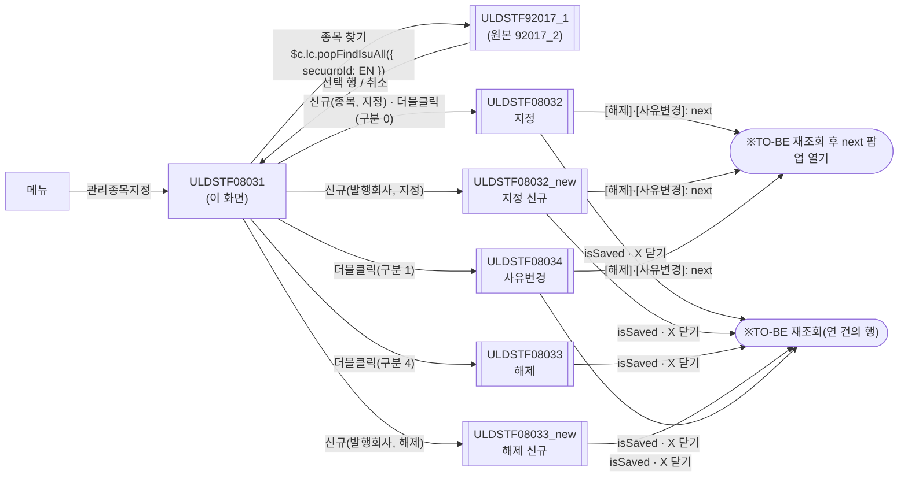
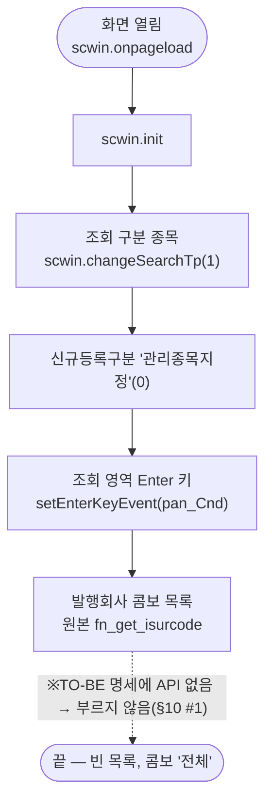
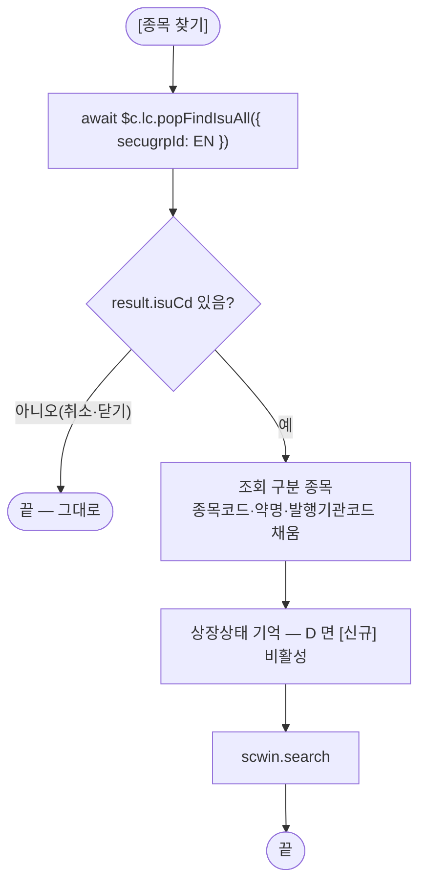
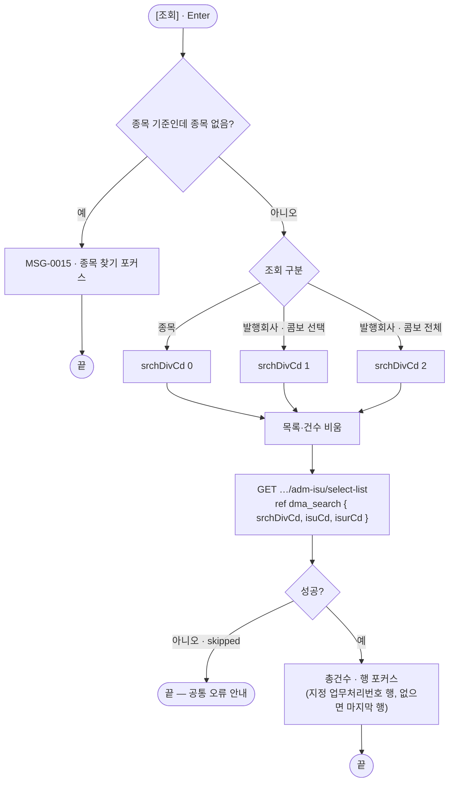
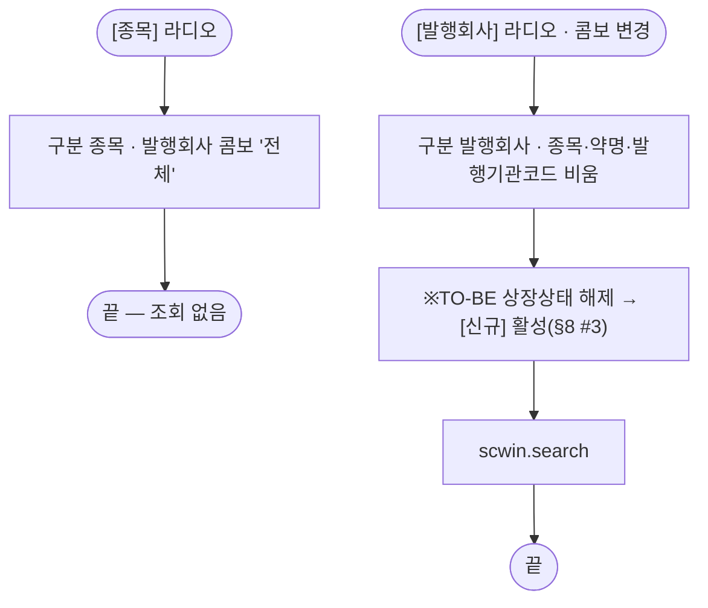
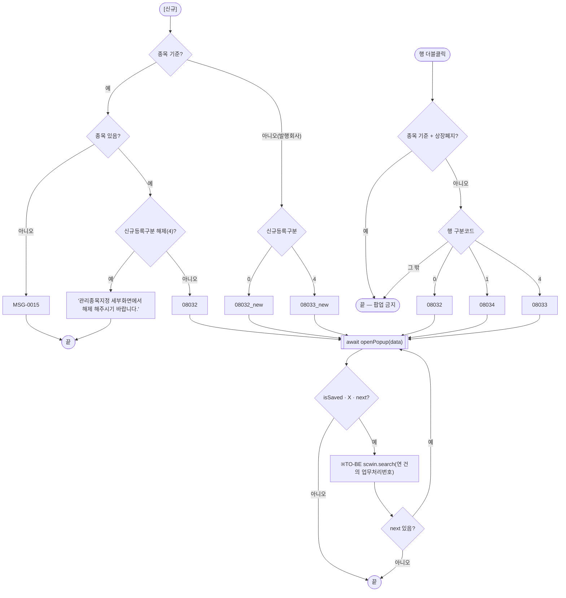
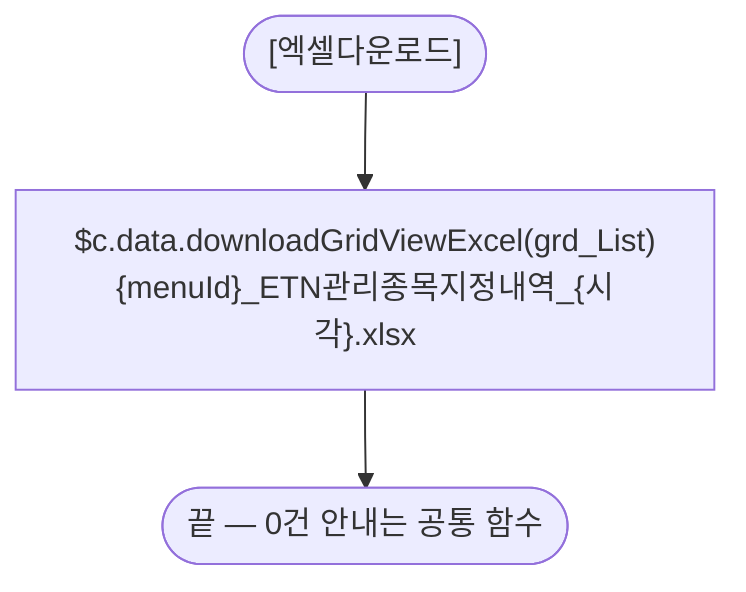
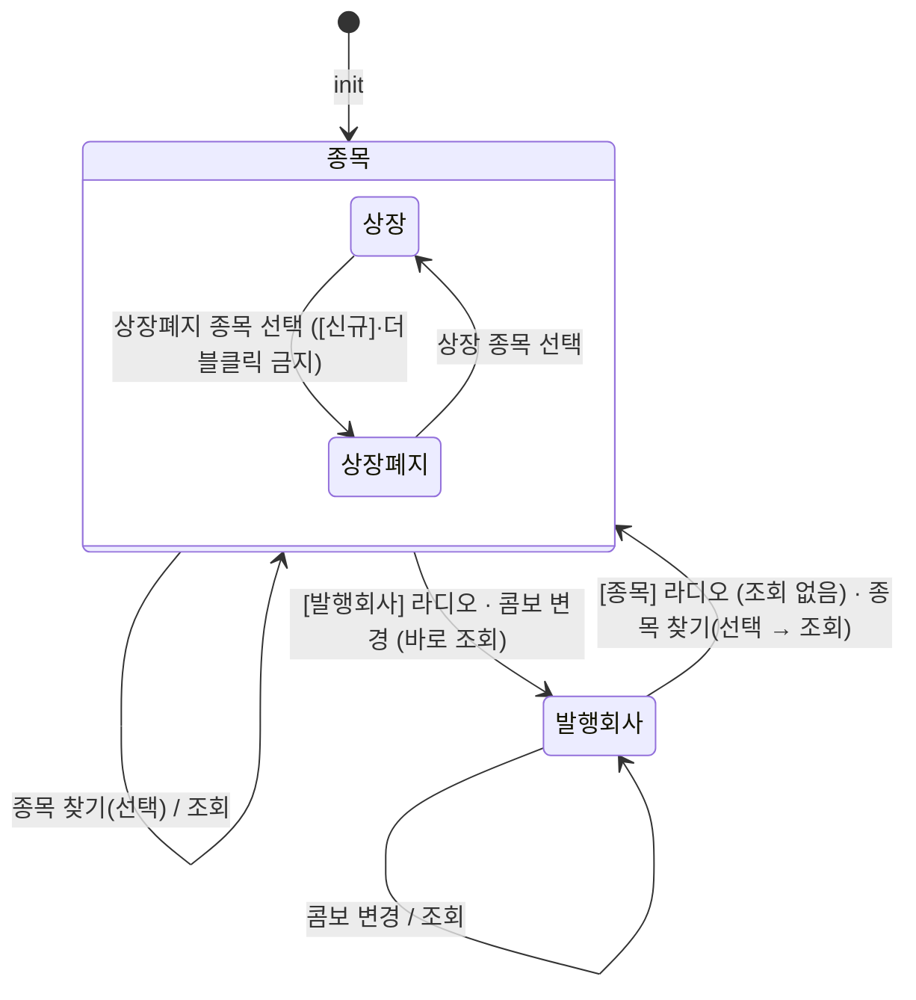

# ULDSTF08031 관리종목지정 — 업무 분석 및 전환 내역

| 항목 | 내용 |
|---|---|
| AS-IS | `ULDSTF08031.gfm` (Gauce/X-Internet, 1270×750 메인 화면, 원본 폴더 `/etn/` — ETN 관리종목지정 목록) — 반입 `conversion/conversion-front/ui/ULDSTF08031/ULDSTF08031.gfm` |
| 신규 API 명세 | 7화면 공용 `ULDSTF08031/ULDSTF08031,ULDSTF08032,ULDSTF08032_new,ULDSTF08033,ULDSTF08033_new,ULDSTF08034,ULDSTF08037_API.md` 의 **§5 블록 1종** — 목록 `GET /api/listing/lstproc/etn/adm-isu/select-list`(AS-IS `fn_search` — `DIV_ETN_IDX_ADMISU_LIST_ISU/CORP/ALL`, requestData `srchDivCd`·`isuCd`·`isurCd`, target `dlt_list`). 같은 내용의 개별 `ULDSTF08031_API.md` 도 있어 `api_spec_check` 는 개별 파일을 먼저 잡는다. **발행회사 콤보 목록(`/etn/EtnCodeAct.do?method=listIsurCd&For=R`)은 명세에 없다**(§10 #1). §2.2·§5 는 명세 기준(가이드 §0.3·§5) |
| TO-BE | `conversion/conversion-front/ui-tobe/ULDSTF08031.xml` (배포 경로 미정 — 원본 `/etn/`, §10 #6). **2026-10-30 전환** — 1단계: 화면 폴더 퍼블리싱 xml + 캡처 기준 마크업(사본 `$CLAUDE_JOB_DIR/tmp/ULDSTF08031_stage1.xml`), 2단계: 이 결과서대로 스크립트. 게이트: `gate_screen --pcc stf`·`scan_mixed_compare`(A 1·B 0)·`publish_gate --pcc stf --before {1단계} --allow P20`·`api_spec_check`·`init_binding_check`·`wsxml_lint` 0/0, `convert.py` 고정점 |
| 퍼블리셔 XML | 화면 폴더의 `ULDSTF08031.xml`(W-Craft 1차 스크립트 내장, `conversion/publish/상장/상장처리(대내)/ULDSTF08031.xml` 과 같은 계열) — 본화면(`sub_contents`) + `pgtbox`, 조회 1행(라디오 2개를 th 에), 총건수·엑셀 + 그리드 + 하단 신규등록구분 콤보·[신규]·[닫기]. `txb_ISU_CD` 는 `w2:autoComplete`, 그리드 열 id 는 AS-IS 대문자이고 `DSC_YN` 이 두 번 나온다(WS120). 캡처·퍼블리싱 규칙대로 정리했다(§2.1) |
| 화면 캡처 | `ULDSTF08031.png` (조회 전 빈 목록 — 조회 구분 "종목", 발행회사 콤보 "전체", 하단 신규등록구분 "관리종목지정"·[신규]·[닫기]·[엑셀저장]) → TO-BE 는 가이드 §13.2 퍼블리싱본부터 만들었다 |
| 공통 계약 | 7화면 공통 계약서(작업 산출물 `etn0803x_contracts.md`) — 팝업 data 키(§3.1)·[해제]/[사유변경] 부모 경유(`next`, §3.2)·재조회 규약 |
| 업무공통 | pcc(`cm/pcc/stf`): `$c.lc.popFindIsuAll`(ULDSTF92017_1), `$c.stf.getMessageParam`(MSG-0015). gcc: `$c.sbm.executeDynamic`·`$c.win`(`setEnterKeyEvent`·`openPopup`·`alert`·`getProgramId`)·`$c.data.downloadGridViewExcel`·`$c.date.getServerDateTime`·`$c.session.getUserInfo`·`$c.util.isEmpty`·`$c.exception.handleError`. 게이트는 `--pcc stf` |
| 작성 | Inswave / 2026-10-30 |

참고 양식: [websquare_gfm_conversion.md](../../../../md/websquare_gfm_conversion.md) — §1.4 업무 흐름, §5 「API 명세 적용」, §6.5 getPar/setPar 전환. Gauce 대응은 [gfm_business_analysis_guide.md](../../../../md/gfm_business_analysis_guide.md). 같은 업무 계열 선례는 ETN 관리종목지정 우려예고 [ULDSTF08035.md](../ULDSTF08035/ULDSTF08035.md)(조회 골격·종목 찾기·발행회사 콤보 결함 처리 그대로).

---

## 1. 화면 개요

시장감시·상장 담당자가 **ETN 관리종목지정** 내역(지정·사유변경·해제 건)을 조회하고, 지정·해제·사유변경 팝업으로 신규 건을 만들거나 기존 건을 고치는 메인 화면이다.

1. 조회 구분은 **[종목]** 또는 **[발행회사]** 둘 중 하나다(라디오 2개를 화면이 서로 배타로 맞춘다).
2. [종목]이면 [종목 찾기]로 ETN 종목을 고른다 — 고르면 바로 조회하고, 그 뒤에는 [조회]로 다시 조회한다. 종목을 안 고르고 [조회]·[신규]를 누르면 MSG-0015.
3. [발행회사] 라디오를 고르거나 발행회사 콤보를 바꾸면 바로 조회한다(콤보 "전체"는 전체 조회).
4. [신규]는 **신규등록구분**(관리종목지정 0 · 관리종목지정 해제 4)에 따라 팝업을 연다 — 발행회사 기준이면 `_new` 판(08032_new·08033_new), 종목 기준이면 08032. 종목 기준에서 해제를 고르면 「관리종목지정 세부화면에서 해제 해주시기 바랍니다.」로 막는다.
5. 목록 행 더블클릭은 그 행의 **관리종목지정업무구분**(0 지정·1 사유변경·4 해제)에 맞는 팝업(08032·08034·08033)을 수정으로 연다.
6. 팝업이 [해제]·[사유변경]으로 형제 팝업을 열면, TO-BE 는 이 화면이 다시 조회한 뒤 그 팝업을 이어서 연다(공통 계약서 §3.2).
7. 고른 종목이 상장폐지(`LIST_STAT_CD = D`)면 [신규]를 막고, 종목 기준 목록 더블클릭도 막는다.
8. [엑셀다운로드]로 목록을 내려받는다.

### 1.1 호출 화면 (0본)

- 이 화면을 여는 화면은 저장소에 없다(`grep -rl ULDSTF08031` — 이 폴더·퍼블리셔 XML·공용 명세뿐). 메뉴에서 바로 여는 **메인 화면**이다. 원본 [닫기](`img_Close` → `frame.CloseFrame()`)는 메뉴 창 닫기라 옮기지 않았다(§8 #5).

### 1.2 호출 규약 (부모 → 이 화면) / 반환 규약

- 해당 없음 — 메뉴 화면. 원본 전역 `fr_SecuGrpId = SECUGRP_ID_EN`("EN"), `fr_MktId = fn_getMktId()`(로그인 사용자 시장)는 화면 상수 `scwin.SECUGRP_ID_EN`·세션 값 `$c.session.getUserInfo("market")` 으로 바꿨다(§9).

### 1.3 이 화면이 여는 하위 팝업

| 팝업 | AS-IS 호출 (getPar/setPar) | 넘기는 `data` (TO-BE) | 받는 결과 (`closePopup`) / 취소 판정 |
|---|---|---|---|
| AS-IS `ULDSTF92017_2` ETN 종목약명 찾기 → TO-BE `ULDSTF92017_1` | `fn_GetPar = fn_GetParIsur`(arr[0] "", arr[1] 종목명, arr[2] 증권그룹) · `fn_SetPar = fn_SetParIsur` 후 `fn_PopFindEtnIsuAll(fr_SecuGrpId)` | pcc `$c.lc.popFindIsuAll({ secugrpId : "EN" })` (92017_1 은 `secugrpId` 만 받는다, §10 #4) | 선택 행 JSON(`isuCd`·`isuKorAbbrv`·`isurCd`·`listStatCd`). **`result.isuCd` 가 비면 취소** |
| `ULDSTF08032` 관리종목지정 (720×450) — 종목 기준 신규(구분 0) · 수정(행 구분 0) | 신규 `fn_GetPar = fn_GetParNew` / 수정 `fn_GetParUpdate`, `fn_SetPar = undefined` 후 `fn_newpre_create_frame("0")` → `CreateDialogFrame("DLG_0", "../etn/ULDSTF08032.gfm", "ETN 관리종목지정", 200, 50, 720, 450, "window")` | `await $c.win.openPopup("/ui/lst/etn/ULDSTF08032.xml", { id, popupName : "ETN 관리종목지정", width : 720, height : 450, type : "pageFramePopup" }, data)` — data 는 §6.4 표 | `{ isSaved }` · X 닫기 `{ isCloseButtonClick }` · [해제]/[사유변경]은 `{ isSaved, next : { id, data } }` — **`isSaved`·X·`next` 면 재조회**, `next` 면 이어서 그 팝업을 연다 |
| `ULDSTF08032_new` 관리종목지정 (750×450) — 발행회사 기준 신규(구분 0) | `fn_new_create_frame("0")` → `CreateDialogFrame("DLG_0", "../etn/ULDSTF08032_new.gfm", …, 750, 450, "window")` | 같은 꼴, id `ULDSTF08032_new` | 위와 같음 |
| `ULDSTF08033` 관리종목지정 해제 (725×600) — 수정(행 구분 4) | `fn_newpre_create_frame("4")` → `CreateDialogFrame("DLG_2", "../etn/ULDSTF08033.gfm", "ETN 관리종목지정 해제", …, 725, 600, "window")` | 같은 꼴, id `ULDSTF08033` | `{ isSaved }` · X |
| `ULDSTF08033_new` 관리종목지정 해제 (755×595) — 발행회사 기준 신규(구분 4) | `fn_new_create_frame("4")` → `CreateDialogFrame("DLG_2", "../etn/ULDSTF08033_new.gfm", …, 755, 595, "window")` | 같은 꼴, id `ULDSTF08033_new` | `{ isSaved }` · X |
| `ULDSTF08034` 관리종목지정 사유변경 (720×680) — 수정(행 구분 1) | `fn_newpre_create_frame("1")` → `CreateDialogFrame("DLG_1", "../etn/ULDSTF08034.gfm", "ETN 관리종목지정 사유변경", 200, 5, 720, 680, "window")` | 같은 꼴, id `ULDSTF08034` | `{ isSaved }` · X · [해제] `next` |

### 1.4 업무 프로세스 흐름

흐름은 AS-IS 동작을 기준으로 그렸다. 점선과 `※TO-BE` 는 전환본에서 바뀌는 곳이다(근거는 §8).

| # | 업무 | 시작 (사용자 동작·진입 조건) | 끝 (결과) | 주요 함수 | 관련 절 |
|---|---|---|---|---|---|
| 1 | 진입·로딩 | 메뉴에서 화면을 엶 | 조회 구분 "종목", 신규등록구분 "지정", 빈 목록 | `scwin.onpageload` → `scwin.init` → `scwin.changeSearchTp` | §3 |
| 2 | 종목 찾기 | [종목 찾기] `btn_iSU_CD` | 종목 채움 + 종목 기준 목록 | `scwin.btn_iSU_CD_onclick` → `scwin.openIsuPopup` → `scwin.search` | §6.3 |
| 3 | 조회 | [조회] `img_Search` · 조회 영역 Enter | 목록·총건수 | `scwin.btn_Search_onclick` → `scwin.validateSearch` → `scwin.search` → `scwin.selectList` → `scwin.focusRow` | §5, §6.1 |
| 4 | 조회 구분 전환 | [종목]·[발행회사] 라디오, 발행회사 콤보 | 구분 전환(발행회사는 바로 조회) | `scwin.rdo_ISUR_CD_1_onviewchange` · `scwin.rdo_ISUR_CD_2_onviewchange` · `scwin.cmb_ISUR_CD_onviewchange` → `scwin.changeSearchTp` | §6.2 |
| 5 | 신규 | [신규] `img_Regist` + 신규등록구분 `cmb_RegistTyp` | 지정·해제 팝업 → 닫히면 재조회 | `scwin.img_Regist_onclick` → `scwin.writeNew` → `scwin.getPopupData` → `scwin.openRegPopup` | §6.4 |
| 6 | 수정 | 목록 행 더블클릭 | 구분에 맞는 팝업 → 닫히면 재조회 | `scwin.grd_List_oncelldblclick` → `scwin.openDetail` → `scwin.openRegPopup` | §6.4 |
| 7 | 형제 팝업 이어 열기 | 팝업의 [해제]·[사유변경] | 재조회 후 다음 팝업 | `scwin.openRegPopup`(반환 `next`) | §6.4 |
| 8 | 엑셀 | [엑셀다운로드] `img_Excel` | 목록 엑셀 파일 | `scwin.img_Excel_onclick` → `scwin.excelDown` | §6.6 |

#### 화면 간 흐름

AS-IS 는 팝업이 부모의 `fn_GetPar(arrPar)` 를 이름으로 불러 값을 받았고, [해제]·[사유변경]은 팝업이 부모 `fn_GetPar` 를 바꿔 끼운 뒤 형제 팝업을 열고 자기 창을 닫았다. TO-BE 는 `openPopup` data + `await` 반환값이고, 형제 팝업은 반환 `next` 로 이 화면이 연다(가이드 §6.5, 공통 계약서 §3.2).

#### 업무 1: 진입·로딩

| 단계 | 처리 | 근거 |
|---|---|---|
| 1 | 라디오 [종목] | 원본 `rdo_ISUR_CD_1.CodeValue = "1"` |
| 2 | 신규등록구분 첫 항목(0) | 원본 `cmb_RegistTyp` `index="0"` |
| 3 | 조회 영역 Enter 키 → `scwin.btn_Search_onclick` | 규칙 22 |
| 4 | 발행회사 콤보 목록 — **부르지 않음**(명세에 없음, `api_spec_check` A01) | 원본 `fn_get_isurcode()` — §10 #1 |
| 5 | 자동 조회 없음 | 원본과 같음. 원본 `PanelToGroupBox(pan_Cnd)` 는 장식이라 삭제 |

#### 업무 2: 종목 찾기

| 단계 | 처리 | AS-IS |
|---|---|---|
| 1 | 92017_1 을 열고 기다린다 | `fn_PopFindEtnIsuAll` → 92017_2 |
| 2 | 취소면 끝(※TO-BE — 원본은 `fn_SetParIsur` 가 불리면 취소에도 `fn_search`, §8 #2) | `fn_SetParIsur` 의 `DBCLICKYN == "Y"` 분기 |
| 3 | 종목 기준, `isuCd`·약명(`isuKorAbbrv`)·`scwin.isurCd` | `fn_changeRadioBtn(1)`, `txb_ISU_CD`·`txb_ISU_NM`(ISU_KOR_ABBRV)·`vIsurCd` |
| 4 | `scwin.setListStat(listStatCd)` | `vLIST_STAT_CD` + `img_Regist.disabled`·이미지 교체 |
| 5 | 조회 | `fn_search()` |

#### 업무 3: 조회

#### 업무 4: 조회 구분 전환

#### 업무 5·6·7: 신규 · 수정 · 형제 팝업 이어 열기

#### 업무 8: 엑셀

#### 화면 모드 상태 전이

---

## 2. 화면 구성 및 데이터 정의

### 2.1 화면 구성 (AS-IS 요소 → TO-BE 컴포넌트)

TO-BE 는 본화면 `sub_contents` + contentHeader(`pfmContentHeader`) 아래 조회 영역(`schbox#pan_Cnd`, 1행 4열 표) · 목록 머리(`titbox` 총건수·엑셀) · 그리드(`gvwbox`) · 하단 버튼(`btnbox` 신규등록구분·[신규]) 순서다. 퍼블리셔의 `pgtbox`(제목·breadcrumb)는 contentHeader 로 바꿨다.

| 영역 | AS-IS 요소 (id · 종류) | TO-BE 컴포넌트 | 바인딩 | 비고 |
|---|---|---|---|---|
| 조회 | `pan_Cnd` (panel, `PanelToGroupBox`) | `schbox#pan_Cnd` | — | Enter 키 영역 |
| | `rdo_ISUR_CD_1` (mxradio `1^종목,2^`) | `xf:select1#rdo_ISUR_CD_1` radiogroup(항목 "종목"=1) — th | `ev:onviewchange` | 두 라디오는 `scwin.changeSearchTp` 가 배타로 맞춘다 |
| | `txb_ISU_CD` (textbox readonly) | `xf:input#txb_ISU_CD` readOnly | `dma_search.isuCd` | 퍼블리셔 `w2:autoComplete` 대신 읽기 전용 입력(원본도 readonly) |
| | `txb_ISU_NM` (textbox readonly) | `xf:input#txb_ISU_NM` readOnly | (없음) | |
| | `btn_iSU_CD` (image 돋보기) | `xf:trigger.btn_cm.icon.search#btn_iSU_CD` | `ev:onclick` | |
| | `rdo_ISUR_CD_2` (mxradio `1^발행회사,2^`) | `xf:select1#rdo_ISUR_CD_2` radiogroup(항목 "발행회사"=1) — th | `ev:onviewchange` | |
| | `cmb_ISUR_CD` (mxcombo, `dts_EtnInst`) | `xf:select1#cmb_ISUR_CD` `chooseOption` "전체" | `dma_search.isurCd`, itemset `dlt_isurList` | 목록 API 없음(§10 #1) |
| | `img_Search` (image 조회) · `image_1` (구분선 이미지) | `xf:trigger.btn_cm.sch#img_Search` · (옮기지 않음 — 장식) | `ev:onclick` | |
| 목록 머리 | `txb_TotCnt` (textbox "총건수 : n") | `titbox` > `count` > `w2:span#txb_TotCnt` | — | 「총 n 건」 꼴 |
| | `img_Excel` (image 엑셀저장, 하단) | `xf:trigger.btn_cm.download#img_Excel` (목록 머리 오른쪽) | `ev:onclick` | 캡처는 하단 — 퍼블리셔·선례(08035)대로 목록 머리(§10 #7) |
| 그리드 | `grd_List` (mxgrid, `dts`) | `w2:gridView#grd_List` readOnly, 행 번호 열(`rowNumVisible`) | `dlt_list` | 열은 아래 |
| | `NO` (번호 `{CurRow}`) | 행 번호 열 | — | |
| | `DSC_YN` (숨김 「공시;여부」) · `DSC_YN` (「지정;공시;여부」) | `dscYn` 하나(「지정 공시여부」) | | 원본 같은 id 두 열 — 숨김 열은 옮기지 않음(§8 #6) |
| | `ISU_NM` 종목명 · `COM_NM` 발행회사 | `isuNm` · `comNm` | | |
| | `MKTACT_ENFORCE_DD` 관리종목;지정일 · `MKTACT_RSN_CHG_DD` 관리종목;사유변경일 · `MKTACT_RELEAS_DD` 관리종목지정;해제(예정)일 (mask `XXXX-XX-XX`) | `mktactEnforceDd` · `mktactRsnChgDd` · `mktactReleasDd` — `dataType="date" displayFormat="yyyy-MM-dd"` | | 규칙 46 |
| | `RSN_CHG_DSC_YN` 변경;공시;여부 · `RELEAS_DSC_YN` 해제;공시;여부 | `rsnChgDscYn` · `releasDscYn` | | |
| | `ADMISU_RSN_NM` 지정사유 · `GRND_REGUL_NM` 근거 · `LST_EMP_NM` 최종처리자 | `admisuRsnNm` · `grndRegulNm` · `lstEmpNm` | | |
| 하단 | `lbl_1` (label 「신규등록구분」) | `w2:textbox#lbl_1` | — | btnbox `rt` 안 [신규] 왼쪽 |
| | `cmb_RegistTyp` (mxcombo `0^관리종목지정,4^관리종목지정 해제`) | `xf:select1#cmb_RegistTyp` 고정 항목 2개 | (없음 — `getValue`) | 조회조건이 아니라 바인딩 없음 |
| | `img_Regist` (image 신규) | `xf:trigger.btn_cm.pt#img_Regist` | `ev:onclick` | 규칙 41(pt 오른쪽 끝) |
| | `img_Close` (image 닫기) | (옮기지 않음) | | 본화면 — §8 #5 |

### 2.2 데이터 정의 (DataCollection)

| AS-IS | TO-BE | 종류 | 키 | 비고 |
|---|---|---|---|---|
| (URL 인자 `DIV_IDX`·`ISU_CD`·`ISUR_CD`·`GUBUN_CD`) | `dma_search` | dataMap | `srchDivCd`(0 종목별·1 발행회사별·2 전체), `isuCd`, `isurCd` | 공용 명세 §5 requestData 그대로 |
| `dts` | `dlt_list` | dataList | 명세 §5 응답 20열 — `dftYn`·`bzProcsNo`·`admisuDesignBzProcsNo`·`isuCd`·`isurCd`·`isuNm`·`comNm`·`admisuDesignBzTpCd`·`mktactEnforceDd`·`dscYn`·`mktactRsnChgDd`·`rsnChgDscYn`·`mktactReleasDd`·`releasDscYn`·`admisuDesignBzTpNm`·`admisuRsnNm`·`admisuRsnContn`·`grndRegulNm`·`remk`·`lstEmpNm` | 그리드는 11열만 보인다 |
| `dts_EtnInst` (cb `VALUE`,`TEXT`) | `dlt_isurList` | dataList | `value`, `text` | 채우지 않음(§10 #1) |

- AS-IS 컬럼 → TO-BE 키: `bz_procs_no→bzProcsNo`(원본 소문자 키), `ADMISU_DESIGN_BZ_TP_CD→admisuDesignBzTpCd`, `ADMISU_DESIGN_BZ_PROCS_NO→admisuDesignBzProcsNo`, `ISUR_CD→isurCd`, `ISU_CD→isuCd`, `COM_NM→comNm` 외 그리드 열은 §2.1.

---

## 3. 로딩 (`scwin.onpageload` → `scwin.init`)

- `scwin.onpageload` 는 `scwin.init()` 만 부르고(try/catch + `handleError`), 로딩은 `scwin.init` 하나에 있다(`init_*` 분리 없음).
- `scwin.init` 순서: ① `scwin.changeSearchTp(SEARCH_TP_ISU)` ② `cmb_RegistTyp.setValue("0")` ③ `$c.win.setEnterKeyEvent(pan_Cnd, scwin.btn_Search_onclick)`(규칙 22) ④ 발행회사 콤보 목록은 부르지 않음(§10 #1).
- 달력 없음 → 규칙 37 바인딩 대상 없음. 조회 영역 `pan_Cnd`(schbox)에 Enter 키 — `init_binding_check` OK.
- 원본 `gform onload` 의 `PanelToGroupBox(pan_Cnd)`(장식)는 삭제.

## 4. 컴포넌트 이벤트

| AS-IS 이벤트 | TO-BE 핸들러 | 동작 |
|---|---|---|
| `img_Search` onclick | `scwin.btn_Search_onclick` | 종목 검사 → 조회 |
| `rdo_ISUR_CD_1` OnClick() | `scwin.rdo_ISUR_CD_1_onviewchange` | 구분 종목 |
| `rdo_ISUR_CD_2` OnClick() | `scwin.rdo_ISUR_CD_2_onviewchange` | 구분 발행회사 + 조회 |
| `cmb_ISUR_CD` OnSelChange() | `scwin.cmb_ISUR_CD_onviewchange` | 구분 발행회사 + 조회 |
| `btn_iSU_CD` onclick | `scwin.btn_iSU_CD_onclick` | 종목 찾기 |
| `grd_List` OnDblClick(row, colid) | `scwin.grd_List_oncelldblclick` | 구분에 맞는 팝업 |
| `img_Excel` onclick | `scwin.img_Excel_onclick` | 엑셀 |
| `img_Regist` onclick | `scwin.img_Regist_onclick` | 신규 |
| `img_Close` onclick | (삭제) | 본화면 닫기 — §8 #5 |
| `dts` OnLoadCompleted(rowcount) | `scwin.search` 의 조회 뒤 처리 | 건수·행 포커스 |
| `dts` OnLoadError() | (삭제 — 공통 오류 핸들러) | `alert_error(dts)` |
| `gform` onload | `scwin.onpageload` → `scwin.init` | §3 |

## 5. 서버 통신

### 5.1 관리종목지정 목록 조회 (`scwin.selectList`)

| 항목 | AS-IS | TO-BE (공용 명세 §5) |
|---|---|---|
| 경로 | `/etn/EtnMktAct.do?method=searchEtnAdministrativeIssue` + `DIV_IDX`(`DIV_ETN_IDX_ADMISU_LIST_ISU` 종목 / `…_LIST_CORP` 발행회사 / `…_LIST_ALL` 전체) + `TRS_IDX=TRS_IDX_SELECT` + `ISU_CD` / `ISUR_CD`·`GUBUN_CD=ETN` + `SCREN_ID`·`SCREN_PROCES_TP_CD` | `GET /api/listing/lstproc/etn/adm-isu/select-list` |
| 요청 | URL 인자 | `ref : "dma_search"` → `{ srchDivCd, isuCd, isurCd }` — 종목 `0`, 발행회사 콤보 선택 `1`, 콤보 전체 `2` |
| 응답 | `dts` | `target : "dlt_list=body"`, `gridview : "grd_List"` |
| 후처리 | `OnLoadCompleted` — 「총건수 : n」, `dts.RowPosition = rowcount` | `txb_TotCnt` 에 건수, `scwin.focusRow(keepBzProcsNo)` — 업무처리번호가 같은 행, 없으면 마지막 행 |
| 실패 | `alert_error(dts)` | 공통 오류 핸들러, `success !== true` 면 끝 |
| 중복 실행 | — | `result.skipped` 면 끝 |

- 명세와 AS-IS 차이: `GUBUN_CD=ETN`·`TRS_IDX`·`SCREN_ID`·`SCREN_PROCES_TP_CD` 는 명세에 없어 보내지 않는다(§10 #2). 조회 전에 목록·건수를 비운다(실패 시 앞 조건의 행으로 팝업을 여는 일 방지).

## 6. 일반 함수

### 6.1 조회 · 검사 (`scwin.search` · `scwin.focusRow` · `scwin.validateSearch`)

- `scwin.search(keepBzProcsNo)` — 조회구분을 `dma_search.srchDivCd` 에 넣고(원본 `fn_search` 의 DIV_IDX 분기) 조회한 뒤 건수·포커스.
- `scwin.focusRow(keepBzProcsNo)` — 팝업이 닫힌 뒤 재조회하면 연 건의 업무처리번호 행으로, 신규·일반 조회는 마지막 행(원본 `dts.RowPosition = rowcount`).
- `scwin.validateSearch()` — 종목 기준인데 `isuCd` 가 비면 MSG-0015(`$c.stf.getMessageParam("MSG-0015", "")`) + `btn_iSU_CD.focus()`. 원본 `img_Search`·`img_Regist` onclick 의 공통 검사.

### 6.2 조회 구분 (`scwin.changeSearchTp`)

- 원본 `fn_changeRadioBtn(idx)` — 1 이면 콤보 index 0 + 라디오 맞춤, 2 면 종목·약명 비움 + 라디오 맞춤.
- TO-BE 는 발행회사로 갈 때 `scwin.isurCd` 와 상장상태도 풀고 [신규]를 다시 켠다(§8 #3).

### 6.3 종목 찾기 (`scwin.openIsuPopup` · `scwin.setListStat`)

- 원본 `fn_GetParIsur`(arr[0] "", arr[1] 종목명, arr[2] 증권그룹) / `fn_SetParIsur`(arr[0] 행: `DBCLICKYN`·`ISU_CD`·`ISU_KOR_ABBRV`·`ISUR_CD`·`LIST_STAT_CD`).
- TO-BE: `await $c.lc.popFindIsuAll({ secugrpId : "EN" })` → `isuCd` 가 비면 취소. 채운 뒤 `scwin.setListStat(listStatCd)` 로 상장폐지면 `img_Regist.setDisabled(true)`, 그리고 조회.

### 6.4 팝업 data · 열기 (`scwin.getPopupData` · `scwin.openRegPopup` · `scwin.writeNew` · `scwin.openDetail`) — getPar → `openPopup` data + `await`

data 표 (원본 `fn_GetParNew` / `fn_GetParUpdate` 의 arrPar[0..8], 공통 계약서 §3.1):

| arr | 키 | 신규(종목 / 발행회사 선택 / 발행회사 전체) | 수정(더블클릭 — 종목 / 발행회사 선택 / 전체) |
|---|---|---|---|
| 0 | `isurCd` | 종목의 발행기관(`scwin.isurCd`) / 콤보 값 / "" | 행 `isurCd` (원본 `vIsurCd = ISUR_CD`) |
| 1 | `isurNm` | 종목약명 / 콤보 텍스트 / "" | 종목약명 / 행 `comNm` / 행 `comNm` |
| 2 | `secugrpId` | "EN" | "EN" |
| 3 | `mktId` | `$c.session.getUserInfo("market")` | 같음 |
| 4 | `bzProcsNo` | "" | 행 `bzProcsNo` |
| 5 | `admisuDesignBzTpCd` | 신규등록구분 `cmb_RegistTyp` 값 | 행 `admisuDesignBzTpCd` |
| 6 | `isuCd` | 종목코드 / "" / "" | 종목코드 / 행 `isuCd` / 행 `isuCd` |
| 7 | `selTp` | "1" / "2" / "3" | 같은 규칙 |
| 8 | `admisuDesignBzProcsNo` | "" | 행 `admisuDesignBzProcsNo` |

- `scwin.writeNew()` — 종목 기준이면 종목 검사 + 해제(4) 금지 안내, 그 뒤 발행회사 기준 `POPUP_NEW_BY_TP`(0→08032_new, 4→08033_new) / 종목 기준 `POPUP_BY_TP`(0→08032). data 를 만든 뒤 신규등록구분을 0 으로 되돌린다(원본 `cmb_RegistTyp.index = 0`).
- `scwin.openDetail(row)` — 종목 기준 + 상장폐지면 끝. 행 구분코드 `POPUP_BY_TP`(0→08032, 1→08034, 4→08033), 그 밖이면 끝(원본 switch 와 같음).
- `scwin.openRegPopup(popupId, data)` — `scwin.POPUPS` 의 제목·크기로 `await $c.win.openPopup(scwin.POPUP_PATH + id + ".xml", { id, popupName : "ETN " + 제목, width, height, type : "pageFramePopup" }, data)`. 반환이 `isSaved === true` · `isCloseButtonClick === true` · `next` 중 하나면 `scwin.search(data.bzProcsNo)`. `next : { id, data }` 가 있으면 그 팝업을 이어서 연다(반복 — 08034 [해제] → 08033 처럼 이어질 수 있음). `POPUPS` 에 없는 id 는 열지 않는다.
- 원본 팝업이 부르던 부모 함수(`fn_parentRefresh`·`fn_search`)는 반환 규약으로 대신한다(공통 계약서 §3.2).

### 6.5 부모 ↔ 팝업 파라미터 전달 (getPar/setPar → `$c.win.openPopup` + `await`)

| AS-IS | TO-BE |
|---|---|
| `fn_GetPar = fn_GetParNew` / `fn_GetParUpdate` 후 `CreateDialogFrame` — 팝업이 `frame.Provider("../").fn_GetPar(arrPar)` 로 값을 읽음 | `scwin.getPopupData(row)` 로 data 를 만들어 `openPopup` 에 넘김 — 팝업은 `$c.data.getParameter()` |
| `fn_SetPar = undefined` (등록 팝업은 돌려주지 않음) | 반환 `{ isSaved }` / `{ isCloseButtonClick }` / `{ isSaved, next }` |
| 종목 찾기 `fn_GetParIsur`/`fn_SetParIsur` | `$c.lc.popFindIsuAll` 반환값 |

취소 판정은 필요한 필드로 한다 — 종목 찾기 `isuCd`, 등록 팝업은 `isSaved`·`isCloseButtonClick`·`next`.

### 6.6 엑셀 (`scwin.excelDown`)

- 원본 `GridToExcel(fn_getSecuGrpNm(fr_SecuGrpId) + "괸리종목지정내역", "", "8")` + `doLogSave(vScrenID, SCREN_PROCS_TP_CD_07)` + 0건이면 `NO_EXCEL_DATA`.
- TO-BE `$c.data.downloadGridViewExcel(grd_List, { fileName : {menuId}_ETN관리종목지정내역_{yyyyMMddHHmmss}.xlsx, sheetName : "sheet1" })` — 규칙 42, 오타 「괸리」 정정, `doLogSave` 삭제, 0건 안내는 공통 함수.

## 7. 업무 코드 · 메시지 목록

| 구분 | 값 | 의미 |
|---|---|---|
| 조회 구분(화면) | 1 / 2 | 종목 / 발행회사 |
| 명세 `srchDivCd` | 0 / 1 / 2 | 종목별 / 발행회사별 / 전체 |
| 선택 구분 `selTp` | 1 / 2 / 3 | 종목 / 발행회사 / 전체 (팝업이 [해제]·[사유변경]으로 넘길 때 0) |
| 관리종목지정업무구분 `admisuDesignBzTpCd` | 0 / 1 / 4 | 지정 / 사유변경 / 해제 |
| 신규등록구분 `cmb_RegistTyp` | 0 / 4 | 관리종목지정 / 관리종목지정 해제 |
| 상장상태 `listStatCd` | D | 상장폐지(삭제) — [신규]·종목 기준 더블클릭 금지 |
| 증권그룹 | EN | ETN |
| MSG-0015 | 「[종목코드(명)]을 선택해주세요.」 | 종목 기준인데 종목 없음 |
| (문구) | 「관리종목지정 세부화면에서 해제 해주시기 바랍니다.」 | 종목 기준 신규에서 해제 선택 |

## 8. 원본 특이사항 · 결함

| # | 내용 | 결정 |
|---|---|---|
| 1 | 발행회사 콤보 목록(`fn_get_isurcode`)이 명세에 없음 | 옮기지 않음 — 콤보 "전체"만(§10 #1) |
| 2 | 종목 찾기 취소에도 `fn_SetParIsur` 가 불리면 `fn_search` | 고침 — `isuCd` 가 비면 아무것도 안 함 |
| 3 | 상장폐지 종목을 고른 뒤 [발행회사]로 바꿔도 [신규]가 계속 비활성(`vLIST_STAT_CD` 유지) | 고침 — 발행회사로 가면 상장상태 해제 |
| 4 | 팝업이 닫혀도 원본 부모는 다시 조회하지 않음(팝업이 부모 `fn_parentRefresh` 를 이름으로 부름) | 고침 — 반환 규약으로 재조회(연 건의 행 복원) |
| 5 | 본화면 [닫기](`frame.CloseFrame`) | 옮기지 않음 — 메뉴 창 닫기 |
| 6 | 그리드에 같은 id `DSC_YN` 열 두 개(숨김 「공시여부」·보이는 「지정 공시여부」) — 퍼블리셔도 WS120 | 고침 — `dscYn` 하나 |
| 7 | `fn_GetParUpdate` 의 arr[1] 이 종목 기준이면 종목명, 아니면 회사명 | 유지 — 공통 계약서 §3.1 |
| 8 | 종목 기준 신규에서 해제(4) 선택 시 안내 후 중단 | 유지 |
| 9 | 엑셀 파일명 오타 「괸리」 | 고침 — 규칙 42 파일명 |
| 10 | 행 구분코드가 0·1·4 밖이면 `fn_newpre_create_frame` 이 아무것도 안 함 | 유지 |

## 9. 전환 내역 (AS-IS → TO-BE)

| AS-IS | TO-BE | 비고 |
|---|---|---|
| 전역 `vScrenID` | 삭제 | `doLogSave` 와 함께 |
| 전역 `fr_SecuGrpId`·`fr_MktId` | `scwin.SECUGRP_ID_EN` · `$c.session.getUserInfo("market")` | |
| 전역 `fn_GetPar`·`fn_SetPar` | 삭제 | §6.5 |
| 전역 `vIsurCd`·`vLIST_STAT_CD` | `scwin.isurCd`·`scwin.listStatCd` | |
| `fn_search` | `scwin.search` + `scwin.selectList` + `scwin.focusRow` | §5.1·§6.1 |
| `fn_GetParIsur`·`fn_SetParIsur` | `scwin.openIsuPopup` + `scwin.setListStat` | §6.3 |
| `fn_GetParUpdate`·`fn_GetParNew` | `scwin.getPopupData` | §6.4 |
| `fn_new_create_frame`·`fn_newpre_create_frame` | `scwin.writeNew`·`scwin.openDetail` → `scwin.openRegPopup`(`scwin.POPUPS`·`POPUP_BY_TP`·`POPUP_NEW_BY_TP`) | §6.4 |
| `fn_get_isurcode` | 삭제(명세에 없음) | §10 #1 |
| `fn_changeRadioBtn` | `scwin.changeSearchTp` | §6.2 |
| 이벤트 핸들러 | §4 표 | |
| (신규) | `scwin.onpageload`·`scwin.init`·`scwin.validateSearch`·`scwin.excelDown` | |

- publicInfo: 정의한 22함수 전부. 상수·상태는 등재하지 않는다.
- 게이트: `gate_screen --pcc stf`·`scan_mixed_compare`(A 1건 — `rowCount === 0` 숫자 비교, 의도)·`publish_gate --before 1단계 --allow P20`·`api_spec_check`(개별 명세)·`init_binding_check`·`wsxml_lint` 0/0, `convert.py` 고정점.

## 10. 남은 작업 (TODO)

1. **발행회사 콤보 목록 API** — 원본 `/etn/EtnCodeAct.do?method=listIsurCd&For=R` 대응이 명세에 없다(08035·08061 과 같은 결함). 받으면 `scwin.init` 에서 `dlt_isurList` 를 채운다. 그 전에는 발행회사별 조회(`srchDivCd 1`)를 할 수 없다.
2. **명세에 없는 원본 인자** — `GUBUN_CD=ETN`·`SCREN_ID`·`SCREN_PROCES_TP_CD` 를 보내지 않아도 되는지(전체 조회가 ETN 으로 걸러지는지).
3. **팝업 계약** — 08032·08032_new·08033·08033_new·08034 가 공통 계약서 §3.1 data 키와 반환(`isSaved`·`next`)을 따르는지 마감 대조. `next.data` 는 팝업이 만든 값을 그대로 넘긴다.
4. **종목 찾기** — 원본 ETN 종목약명 찾기 ULDSTF92017_2 미전환 → 92017_1(`secugrpId` 거름). ETN·상장폐지 종목이 나오는지 확인.
5. **팝업 크기** — 원본 크기에 contentHeader 가 더해진다. 실화면에서 조정 확인.
6. **배포 경로** — 팝업 `/ui/lst/etn/`(원본 `../etn/`)는 가정.
7. **엑셀 버튼 위치** — 캡처(하단 「엑셀저장」)와 달리 목록 머리 「엑셀다운로드」(퍼블리셔·08035 선례).
8. **날짜 열 값** — `mktactEnforceDd`·`mktactRsnChgDd`·`mktactReleasDd` 서버 값이 8자리 `yyyyMMdd` 인지(규칙 46).
