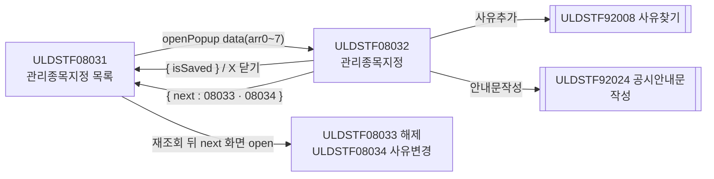
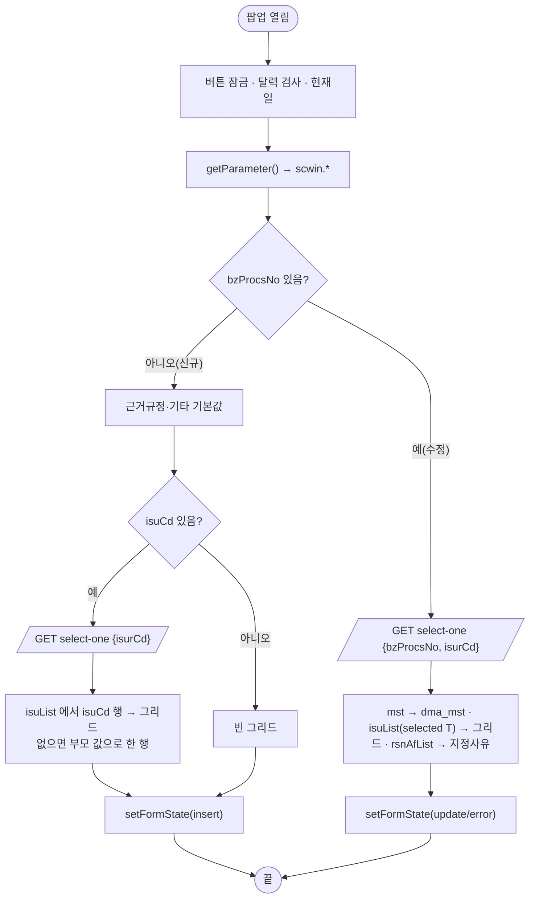
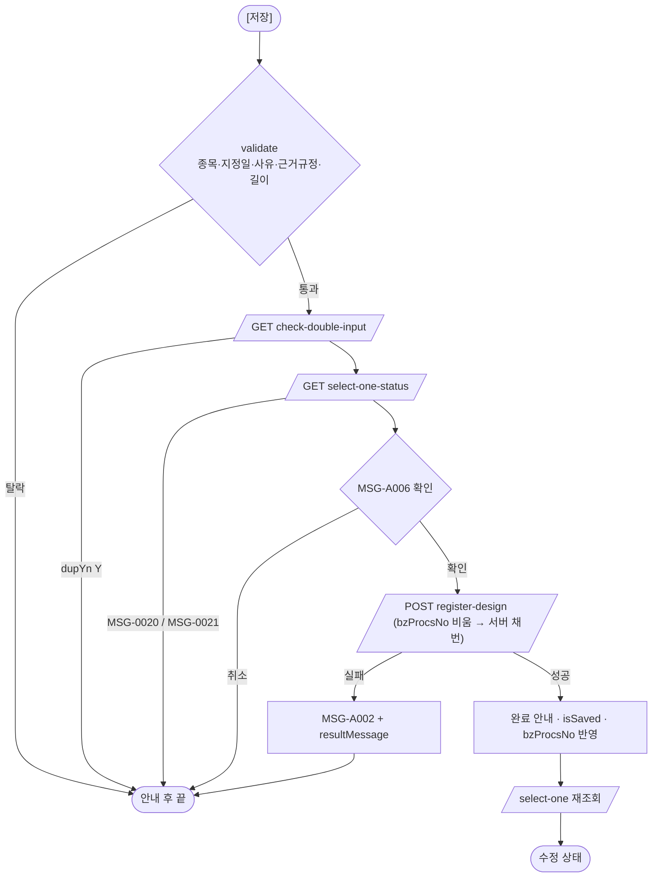
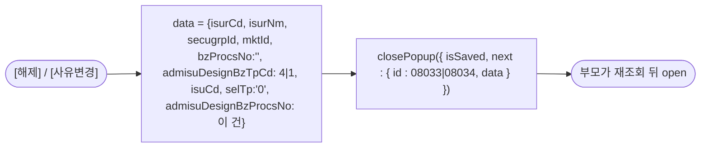
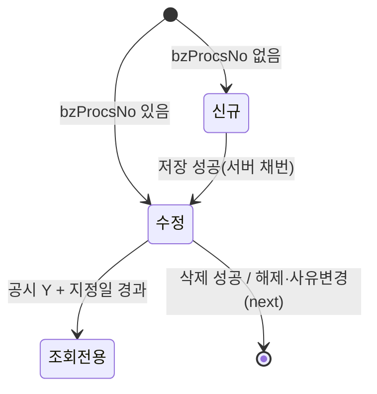

# ULDSTF08032 (팝업)관리종목지정 — 업무 분석 및 전환 내역

| 항목 | 내용 |
|---|---|
| AS-IS | `/etn/ULDSTF08032.gfm` (Gauce/X-Internet, 705×410 — 부모 ULDSTF08031 이 720×450 `window` 로 연다) — 반입 `conversion/conversion-front/ui/ULDSTF08032/ULDSTF08032.gfm` |
| 신규 API 명세 | **7화면 공용** `conversion/conversion-front/ui/ULDSTF08031/ULDSTF08031,ULDSTF08032,ULDSTF08032_new,ULDSTF08033,ULDSTF08033_new,ULDSTF08034,ULDSTF08037_API.md` 의 이 화면 블록 6종 — §1 `check-double-input` · §6 `select-one-status` · §7 `select-one` · §8 `modify-design` · §11 `register-design` · §14 `remove`(블록 머리 `[ULDSTF08032/08032_new/…]` 묶음). `api_spec_check` 가 공용 파일명·묶음 머리 숫자 꼬리를 인식해 `--spec` 없이 대조한다. §2.2·§5 는 명세 기준(가이드 §0.3·§5) |
| TO-BE | `conversion/conversion-front/ui-tobe/ULDSTF08032.xml` (배포 경로 `/ui/lst/etn/ULDSTF08032.xml` — 공통 계약서 §3, 원본 `../etn/ULDSTF08032.gfm`) |
| 퍼블리싱 | **없음** — 캡처 + gfm 기준 마크업(§13.2 1단계). `conversion/publish/` 에도 이 화면 xml 이 없다 |
| 화면 캡처 | `ULDSTF08032.png` — 종목 한 행(KRG580000260 KB S&P 레버리지 은 선물 ETN(H)), 지정일 빈칸, 지정사유 빈 그리드, 근거규정 「유가증권시장상장규정 제149조의6제1항」, 기타 기본 문구, 하단 해제·사유변경 / 저장·수정·삭제·안내문작성·닫기 |
| 업무공통 | `$c.stf`(`getMessageParam`·`checkMaxLength`)·`$c.lc`(`isProcess`·`popFindClssLstRsnCd`) — `cm/pcc/stf`. 게이트는 `--pcc stf` |
| 공통 계약 | ETN 관리종목지정 7화면 공통 계약서(작업 산출물) — 부모 data 키 §3.1, 형제 팝업 부모 경유 §3.2, 사유찾기 §3.4, 92024 §4 |
| 작성 | Inswave / 2026-10-30 |

참고 양식: [websquare_gfm_conversion.md](../../../md/websquare_gfm_conversion.md) — §1.4 업무 프로세스 흐름, §6.5 getPar/setPar 전환. Gauce 대응은 [gfm_business_analysis_guide.md](../../../md/gfm_business_analysis_guide.md) 병행. 선례: ULDSTF09341~09345(투자유의 팝업 등록·수정·삭제·92024), ULDSTF08035(ETN 관리종목 우려예고 — 08036 계약 제안), ULDSTF05806(사유찾기 `popFindClssLstRsnCd`).

---

## 1. 화면 개요

ETN(상장지수증권) 종목을 **관리종목으로 지정**하는 팝업이다. 관리종목지정 목록(ULDSTF08031)에서 종목 기준으로 신규 [지정]을 고르거나 지정 건을 더블클릭하면 열린다.

1. 부모가 발행기관·증권그룹·시장·업무처리번호·업무구분(0 지정)·종목코드·선택구분을 넘긴다. 업무처리번호가 없으면 신규, 있으면 수정이다.
2. 신규: 넘어온 종목을 그리드에 두고, 근거규정·기타에 표준 문구를 넣는다. 지정일·지정사유를 입력해 [저장]한다(검증 → 종목 최신 상태 확인 → 확인 → 등록, 업무처리번호는 서버 채번).
3. 수정: 업무처리번호로 마스터·종목·지정사유를 조회한다. 공시된 건(공시여부 Y)이고 지정일이 지났으면 조회 전용, 그 밖에는 [수정]·[삭제]·[안내문작성]이 열린다.
4. [해제]·[사유변경]: 공시된 지정 건에서 해제(ULDSTF08033)·사유변경(ULDSTF08034) 화면으로 넘어간다 — TO-BE 는 부모가 연다.
5. [안내문작성]: 공시안내문작성(ULDSTF92024, 서식 68344)을 연다.

### 1.1 호출 화면 (1본)

- `ULDSTF08031` 관리종목지정(ETN) 목록 — 종목 기준 신규(신규등록구분 0) 또는 행 더블클릭(구분 0). 발행회사 기준 신규는 `ULDSTF08032_new` 가 열린다(공통 계약서 §2).

### 1.2 호출 규약 (부모 → 이 화면) / 반환 규약

AS-IS: 부모의 `fn_GetPar(arrPar)` 를 `frame.Provider("../").fn_GetPar` 로 불러 arr 0~7 을 받았다(gform `onload`).
TO-BE: 부모가 `$c.win.openPopup("/ui/lst/etn/ULDSTF08032.xml", { …, width : 720, height : 450, type : "pageFramePopup" }, data)` + `await`, 이 화면은 `$c.data.getParameter()`.

| arr | data 키 | 의미 | TO-BE 변수 |
|---|---|---|---|
| 0 | `isurCd` | 발행기관코드 | `scwin.isurCd` |
| 1 | `isurNm` | 발행기관명(종목 기준이면 종목명) | `scwin.isurNm` |
| 2 | `secugrpId` | 증권그룹ID(EN) | `scwin.secugrpId` |
| 3 | `mktId` | 시장구분코드 | `scwin.mktId` |
| 4 | `bzProcsNo` | 업무처리번호(수정만) | `scwin.bzProcsNo` |
| 5 | `admisuDesignBzTpCd` | 업무구분 0 지정 | `scwin.tpCd` |
| 6 | `isuCd` | 종목코드 | `scwin.isuCd` |
| 7 | `selTp` | 선택구분 1 종목·2 발행회사·3 전체(형제 팝업에서 오면 0) | `scwin.selTp` |
| 8 | `admisuDesignBzProcsNo` | 지정업무처리번호 — 이 화면은 받지 않음(지정은 자기 번호) | — |

**반환**: 저장·수정 성공은 `scwin.isSaved = true`, 삭제 성공은 `closePopup({ isSaved : true })`, [해제]·[사유변경]은 `closePopup({ isSaved, next : { id, data } })`(§6.7). X 닫기는 `{ isCloseButtonClick }`. 부모는 `isSaved || isCloseButtonClick` 이면 재조회, `next` 가 있으면 재조회 뒤 그 화면을 연다.

### 1.3 이 화면이 여는 하위 팝업

| 팝업 | AS-IS | TO-BE | 반환 / 취소 |
|---|---|---|---|
| 사유찾기 `ULDSTF92008` | `fn_PopFindClssLstRsnCd(RSNCD_ADM_DESIGN)` + `fn_GetParRsnCd`(arr0 "1"·arr1 "07"·arr5 "N") / `fn_SetParRsnCd` | `await $c.lc.popFindClssLstRsnCd(scwin.RSNCD_ADM_DESIGN, { mkt : "1", rsn : "07", spac : "N" })` | 행 `{ code, name, … }` / `isCloseButtonClick` 또는 `code` 빈 값이면 취소 |
| ETN 종목 다건 찾기 | `fn_PopFindEtnCode()` + `fn_GetParIsu`(arr0 발행기관·arr1 gubun, 종목 데이터셋 복사) / `fn_SetParIsu`(다건 복사) | **미연결** — 대응 팝업 미전환(파일명 불명). 안내만(§10 #1) | — |
| 공시안내문작성 `ULDSTF92024` | `fn_dscl` 이 `fn_GetPar` 를 바꿔 끼우고 `CreateDialogFrame(…, 745, 825, "window")` | `openPopup("/ui/listingcommon/ULDSTF92024.xml", 745×820, data)` + 호환용 `scwin.getPar` | 반환 없음 |
| 해제 `ULDSTF08033` / 사유변경 `ULDSTF08034` | `fn_release`·`fn_rsnChange` 가 `fn_GetParRelease`·`fn_GetParRsnChange` 로 바꿔 끼우고 형제 팝업을 연 뒤 `frame.CloseFrame()` | 부모 경유 `next`(§6.7) | — |

### 1.4 업무 프로세스 흐름

#### 화면 간 흐름

#### 업무 1: 진입·로딩

| 단계 | 처리 | TO-BE |
|---|---|---|
| 1 | 버튼 잠금, `edt_MktactEnforceDd` 날짜 검사(규칙 37), 서버 현재일 | `scwin.init` |
| 2 | 파라미터 수신 | `$c.data.getParameter()` |
| 3 | 신규 기본값 / 종목 조회 | `scwin.initNewForm` → `scwin.selectOne("")` |
| 4 | 수정 상세 | `scwin.applyDetail` → `scwin.selectOne(bzProcsNo)` |

#### 업무 2: 신규 저장

#### 업무 3: 수정 · 업무 4: 삭제

- 수정: `validate`(중복입력은 자기 건 제외) → MSG-A006 → `POST modify-design` → 성공 시 재조회. 종목내역·지정사유는 서버가 전체 삭제 후 재등록(명세).
- 삭제: MSG-A006 → `POST remove {bzProcsNo}` → 성공 시 `closePopup({ isSaved : true })`, 실패 시 MSG-A002. 공시 승인 건은 서버가 거부(명세).

#### 업무 5: 해제·사유변경 (부모 경유)

#### 업무 6: 사유추가·사유삭제 / 업무 7: 안내문작성

- 사유추가: 92008 → 취소면 끝 → 같은 사유코드가 있으면 「이미 선택하신 사유가 있습니다.」 → 행 추가.
- 사유삭제: 지정사유 그리드 고른 행 삭제.
- 안내문작성: `getDsclData()` 로 data 를 만들어 92024 를 열고 닫힐 때까지 기다린다(재조회 없음).

#### 화면 모드 상태 전이

| 상태 | 버튼(BTN_MAP) | 종목선택 | 해제·사유변경 |
|---|---|---|---|
| 신규 `insert` | 저장 | selTp 1 이면 잠금 | 잠금 |
| 수정 `update` | 수정·삭제·안내문작성 | 잠금 | 공시여부 N 이면 잠금 |
| 조회전용 `error` | 모두 잠금 | 잠금 | 공시여부 N 이면 잠금(Y 라 열림) |

---

## 2. 화면 구성 및 데이터 정의

### 2.1 화면 구성

| AS-IS 요소 | 종류 | TO-BE | 비고 |
|---|---|---|---|
| `panel_3` | panel(그룹박스) | `panel_1` `tblbox` + `w2tb tbl`(2열) | `PanelToGroupBox` 대체 |
| `label_10`·`label_8`·`label_11`·`label_12` | 필수 표시 `*` | 라벨 `class="req"` | 옮기지 않음(class 로 대체) |
| `label_2` 「1. 관리종목지정 종목」 | label | `label_2` `w2:textbox.req` | |
| `img_SetIsuCd` | image 버튼 | `img_SetIsuCd` `xf:trigger` 「종목선택」 | §6.3 |
| `grid_1` (`dts_Isu`) | mxgrid | `grd_isu` (`dlt_isu`) | 열 `ISU_CD`→`isuCd` 「종목코드」, `ISUR_NM`→`isurNm` 「발행회사」, `ISU_NM`→`isuNm` 「종목명」, `LIST_DD`→`listDd` 「상장일」(mask → 규칙 46 `yyyy-MM-dd`), `BZ_PROCS_NO`(숨김) — 옮기지 않음 |
| `label_1` 「2. 관리종목지정일」 | label | `label_1` | |
| `edt_MktactEnforceDd` + `img_MktactEnforceDd` | maskedit + 달력 image | `edt_MktactEnforceDd` `w2:inputCalendar` | `popUpCalendar2` 대체 |
| `label_5` 「3. 지정사유」 | label | `label_5` | |
| `MxGrid_1` (`dts_Rsn`) | mxgrid | `grd_rsn` (`dlt_rsn`) | 열 `ADMISU_DESIGN_RSN_CD`→`admisuDesignRsnCd` 「사유코드」, `ADMISU_DESIGN_RSN_NM`→`admisuDesignRsnNm` 「사유내용」, `BZ_PROCS_NO`(숨김, 「업무처리번호」) — dataList 에만 |
| `btn_rsn_add`·`btn_rsn_del` | image 버튼 | 같은 id `xf:trigger` | 그리드 오른쪽 세로 묶음 |
| `label_6` 「4. 근거규정」 / `txb_AdmisuDesignGrndRegulNm` | label / textbox(1000) | 같은 id `xf:input` | |
| `label_7` 「5. 기타」 / `txa_Remk` | label / textarea | 같은 id `xf:textarea` | |
| `btn_release`·`btn_rsn_change` | image 버튼 | `xf:trigger` 「해제」·「사유변경」 | 규칙 41: `rt` 일반 버튼 |
| `btn_Dscl` | image 버튼 | `xf:trigger` 「안내문작성」 | |
| `btn_Delete`·`btn_Update`·`btn_Save` | image 버튼 | `btn_cm pt` | 규칙 41 순서 삭제-수정-저장 |
| `btn_Close` | image 버튼 | **옮기지 않음** | 팝업 하단 [닫기] 금지(창 X) |
| `bnd_Mst` | binder | `ref="data:dma_mst.*"` | `MKTACT_ENFORCE_DD`·`GRND_REGUL_NM`·`REMK` |
| — | — | `pfmContentHeader` | 팝업 contentHeader 필수 |

### 2.2 데이터 정의

| AS-IS | TO-BE | 종류 | 키 (명세) | 비고 |
|---|---|---|---|---|
| `dts_Mst` | `dma_mst` | dataMap | `bzProcsNo`·`dscYn`·`isurCd`·`isuCd`·`admisuDesignBzTpCd`·`mktactEnforceDd`·`grndRegulNm`·`admisuRsnContn`·`admisuDesignBzProcsNo`·`isurNm`·`comNm`·`remk` | 명세 §7 `dma_packageMst` |
| `dts_Isu` | `dlt_isu` | dataList | `bzProcsNo`·`isuCd`·`isuNm`·`listDd`·`isurCd`·`comNm`·`isurNm`·`selected` | 명세 §7 `dlt_packageIsuList`(쓰는 키만) |
| `dts_Rsn` | `dlt_rsn` | dataList | `bzProcsNo`·`admisuDesignRsnCd`·`admisuDesignRsnNm` | 명세 §7 `dlt_packageRsnAfList` / 저장 `rsnList` |
| `dts_BZ_CHECK` | `dma_chkDbl` | dataMap | `disclsProcsDdtm`·`disclsProcsStatCd`·`dupYn` | 명세 §1 |
| `dts_Status` | `dma_status` | dataMap | `bzProcsNo`·`mktactEnforceDd`·`admisuDesignBzTpCd` | 명세 §6 (`____dma____` 자리표 → 이름 부여) |
| `dts_BzProcsNo` | — | — | — | 화면 채번 없앰(서버 채번) |
| `dts_ByCorpDepCd` | — | — | — | 원본도 주석(`setButtonDepCd`) — 옮기지 않음 |
| — | `dma_saveResult` | dataMap | `bzProcsNo`·`bzProcsNoList`·`result`·`resultMessage` | 명세 `dlt_resultSave`(dataList) — 본문이 단건이라 dataMap(§10 #4) |
| `trs` | `$c.sbm.executeDynamic` | — | — | `mxlogicaltr` 대체 |

AS-IS 대문자 키 → camelCase: `MKTACT_ENFORCE_DD→mktactEnforceDd`, `GRND_REGUL_NM→grndRegulNm`, `REMK→remk`, `ISUR_CD→isurCd`, `ISU_CD→isuCd`, `ADMISU_DESIGN_BZ_TP_CD→admisuDesignBzTpCd`, `ADMISU_DESIGN_BZ_PROCS_NO→admisuDesignBzProcsNo`, `DSC_YN→dscYn`, `COM_NM→comNm`. `ADMISUTM_ISU_NM`(신규 시 발행기관명)·`CHG_BFAF_TP_CD`·`ADMISU_DESNRELS_TP_CD`·`ADMISU_ADD_DESIGN_RSN_YN` 은 명세 요청에 없어 보내지 않는다(서버가 채움 — §5 차이).

---

## 3. 로딩 (`gform onload` → `scwin.onpageload` → `scwin.init`)

1. 버튼 잠금: `$c.util.setButtonState("grpBtnBox", "disabled", BTN_MAP)` + `btn_release`·`btn_rsn_change` 잠금 — 조회 실패 시 버튼이 기본(활성)으로 남지 않게.
2. 달력: `$c.date.checkCalendarFormat(edt_MktactEnforceDd, "yyyyMMdd")`(규칙 37, 단일 달력). 조회 영역(`schbox`)이 없어 Enter 키 바인딩 없음.
3. 파라미터: §1.2 표.
4. 원본 `buttonSet.setSaveInfo/setUpdateInfo/setDeleteInfo/setDsclInfo` → `scwin.BTN_MAP` + 공통 상태(`setButtonState`). 원본 `fn_SetIsuCdBtnShow(gubun)`·`fn_SetRelAndChgRsnBtnShow()` → `scwin.setFormState()`.
5. 신규면 `scwin.initNewForm()`(원본 `fn_new_onload` + `isFirstNew = true`), 수정이면 `scwin.applyDetail(bzProcsNo)`(원본 `fn_search`). `isFirstNew` 는 원본에서 쓰이지 않아 옮기지 않는다.

## 4. 컴포넌트 이벤트

| AS-IS 이벤트 | TO-BE 핸들러 |
|---|---|
| gform `onload` | `scwin.onpageload` → `scwin.init` |
| `img_SetIsuCd` `onclick` | `scwin.img_SetIsuCd_onclick` (안내 — §10 #1) |
| `btn_Close` `onclick` (`frame.CloseFrame()`) | 옮기지 않음(창 X) |
| `img_MktactEnforceDd` `onclick` (`popUpCalendar2`) | `inputCalendar` 내장 |
| `btn_rsn_add` `onclick` | `scwin.btn_rsn_add_onclick` → `scwin.openRsnPopup` |
| `btn_rsn_del` `onclick` | `scwin.btn_rsn_del_onclick` |
| `btn_release` `onclick` → `fn_release` | `scwin.btn_release_onclick` → `scwin.requestNext("ULDSTF08033","4")` |
| `btn_rsn_change` `onclick` → `fn_rsnChange` | `scwin.btn_rsn_change_onclick` → `scwin.requestNext("ULDSTF08034","1")` |
| `buttonSet` 저장·수정·삭제·안내문작성 | `scwin.btn_Save_onclick`·`btn_Update_onclick`·`btn_Delete_onclick`·`btn_Dscl_onclick` |
| `trs` `OnSuccess()` / `OnFail()` | `scwin.saveTrs`·`scwin.removeTrs` 의 `await` 결과 분기 |
| `dts_Mst` `OnLoadCompleted(rowcount)` | `scwin.initNewForm`(신규 기본값) / `scwin.applyDetail` + `setFormState`(수정) |
| `dts_Isu` `OnLoadCompleted(rowcount)` (SELECTED F, `Isu_cd`) | `scwin.initNewForm` 의 `selected : "F"` |
| `dts_BZ_CHECK`·`dts_Isu`·`dts_Rsn`·`dts_Mst` `OnLoadError()` (`alert_error`) | 공통 오류 핸들러(`$c.sbm`) — 옮기지 않음 |

## 5. 서버 통신

#### API 명세 대응 (공용 명세의 이 화면 블록)

| AS-IS | TO-BE (명세) | 함수 |
|---|---|---|
| `fn_search` — `/etn/EtnMktAct.do?method=searchEtnAdministrativeIssue` DIV_IDX MST·ISU_ITM·RSN_AF 3회 / `fn_new_onload` — 헤더(`getGauceDataHeader`)·`searchEtnCode` | `GET /api/listing/lstproc/etn/adm-isu/select-one` (§7 `select-one`) | `scwin.selectOne` |
| `fn_check_bz_doubleinput_etn` (list_common_etn.js) | `GET …/adm-isu/check-double-input` (§1) | `scwin.checkDoubleInput` |
| `fn_getMstStatus_etn` | `GET …/adm-isu/select-one-status` (§6) | `scwin.checkStatus` |
| `fn_save_trs` (TRS_IDX_INSERT) + `fn_getNewBzProcNo` | `POST …/adm-isu/register-design` (§11) | `scwin.saveTrs("I")` |
| `fn_save_trs` (TRS_IDX_UPDATE) | `POST …/adm-isu/modify-design` (§8) | `scwin.saveTrs("U")` |
| `fn_save_trs` (TRS_IDX_DELETE) + `fn_check_delete_discls` | `POST …/adm-isu/remove` (§14) | `scwin.removeTrs` |

#### 명세 ↔ AS-IS 차이 (→ §10)

1. **채번**: 원본은 화면에서 `fn_getNewBzProcNo` 로 채번하고 14자리를 검사했다. 명세는 `mstDto.bzProcsNo` 를 비우면 서버 채번 — 화면 채번·`MSG-0010` 검사를 없앴다.
2. **상세 조회 통합**: DIV_IDX 3회 → `select-one` 1회(`mst`·`isuList`·`rsnAfList`). `isuList` 는 발행기관 종목 전체 + `selected` 라, 수정은 `selected T` 행만, 신규는 `isuCd` 행만 둔다(§10 #2·#3).
3. **상태 확인**: 명세는 등록 API 가 같은 확인을 서버에서 하므로 저장 전 호출이 필요 없다고 적었다 — 원본처럼 저장 전에 불러 사유를 먼저 안내한다(MSG-0020·0021).
4. **삭제 사전 확인**: 원본 `fn_check_delete_discls`(공시 승인 건 삭제 금지) → 서버가 `remove` 에서 거부(명세). 화면 확인을 없앴다.
5. **지정사유 행 고정값**: 원본은 행마다 `CHG_BFAF_TP_CD 2`·`ADMISU_DESNRELS_TP_CD 1`·`ADMISU_ADD_DESIGN_RSN_YN N`·`BZ_PROCS_NO` 를 넣었다 — 명세는 `rsnList{ admisuDesignRsnCd, admisuDesignRsnNm }` 만 받고 서버가 채운다.
6. **보내지 않는 원본 인자**: `SCREN_ID`·`SCREN_PROCES_TP_CD`·`TRS_IDX`·`COUNT`·`LIST_BZ_TP_CD(713)`·`DIV_IDX[]` — 명세에 없음(업무구분 713 은 서버 고정, 명세 §1).
7. **응답 형태**: 명세 응답 `dlt_resultSave` 는 dataList 로 적혔으나 키(첫 번호·번호 목록·결과·메시지)가 단건 — `dma_saveResult` dataMap 으로 받는다.

### 5.1 상세 조회 (`scwin.selectOne(bzProcsNo)`)

- `GET /api/listing/lstproc/etn/adm-isu/select-one`, requestData `{ bzProcsNo, orgBzProcsNo : "", isurCd : scwin.isurCd }`, target 없음(본문을 받아 호출부가 담는다 — 명세 [RESPONSE & 처리]).
- 반환 본문 `{ mst, mstBf, isuList, rsnBfList, rsnAfList }` 또는 실패 시 `null`. 이 화면은 `mst`·`isuList`·`rsnAfList` 만 쓴다.

### 5.2 업무 중복입력 (`scwin.checkDoubleInput(isuCd)`)

- `GET …/check-double-input`, `{ isuCd, mktactEnforceDd, bzProcsNo }` → `dma_chkDbl`. `dupYn Y` 면 「[업무명]건으로 일시에 이미 입력되어있습니다.」 후 true. 통신 실패도 true(저장하지 않음).

### 5.3 종목 최신 상태 (`scwin.checkStatus(isuCd)`)

- `GET …/select-one-status`, `{ isuCd }` → `dma_status`. 최신 시행일 ≥ 입력 지정일 → `MSG-0020`. 최신 업무구분이 있고 해제(4)가 아니면 → `MSG-0021`. 원본 `fn_getMstStatus_etn`(list_common_etn.js — 저장소에 없음)을 pcc 주식판 `getMstStatus` 의 종목별 지정(tpCd 0) 판정으로 옮겼다(§10 #5).

### 5.4 등록·수정 (`scwin.saveTrs(trJob)`)

- action: `trJob === "I"` 면 `register-design`, 아니면 `modify-design`(전체 경로 리터럴 삼항 — 규칙 38). `mediatype : "application/json"`, target `dma_saveResult=body`.
- requestData `{ mstDto : { bzProcsNo(I 비움/U 이 건), isuCd(그리드 첫 행), mktactEnforceDd, grndRegulNm, admisuRsnContn, admisuDesignBzProcsNo, remk }, rsnList, isuCdList : [] }`.
- 성공(`success` 이고 `result !== "F"`) → `com_complete_0096` 안내, `isSaved = true`, 등록이면 응답 `bzProcsNo` 반영 → `applyDetail` 재조회. 실패 → `MSG-A002` + `resultMessage`.

### 5.5 삭제 (`scwin.removeTrs`)

- `POST …/remove`, `{ bzProcsNo }`, target `dma_saveResult=body`. 성공 → 안내 후 `closePopup({ isSaved : true })`. 실패 → `MSG-A002`.

## 6. 일반 함수

### 6.1 화면 상태 (`scwin.setFormState`) — 원본 `fn_SetIsuCdBtnShow`·`fn_SetRelAndChgRsnBtnShow`·`setButtonSetWithDate`·`setButtonSetWithDate2`

- 종목선택(`img_SetIsuCd`): 원본 `initTyp == "1" || fr_bz_procs_no != ""` 이면 잠금(`.src` 이미지 교체 → `setDisabled`).
- 버튼: 신규 `insert`. 수정은 원본 조합(`setButtonSetWithDate(edt, false)` → `setButtonSetWithDate2(DSC_YN)`)을 그대로 — 공시 Y 이면서 지정일 당일 포함 경과면 `error`, 그 밖에는 `update`(미공시는 날짜와 무관하게 수정 가능).
- [해제]·[사유변경]: `buttonSet.status == "I" || DSC_YN == "N"` 이면 잠금.

### 6.2 입력 검증 (`scwin.validate`) — 원본 `fn_CheckForm`

| 순서 | 검사 | 메시지 |
|---|---|---|
| 1 | 종목 행 0 | 「[관리지정종목]을 선택하세요.」 |
| 2 | 지정일 8자리 (`checkDdTm("DD", …, "지정", false)`) | 「[지정일]을 정확히 입력하세요.」 |
| 3 | 지정일 ≤ 현재일 | 「[지정일]을 익일 이후로 입력하세요.」 |
| 4 | 지정사유 행 0 | 「[지정사유]를 선택하세요.」 |
| 5 | 근거규정 빈 값 (`checkEmptyValue`) | `MSG-A005` 「[근거규정] 을(를) 입력하셔야 합니다.」 |
| 6 | 근거규정 200byte·기타 2000byte (`checkMaxLength`) | `$c.stf.checkMaxLength` |
| 7 | 업무 중복입력 | §5.2 |

### 6.3 종목선택 (`scwin.img_SetIsuCd_onclick`) — 원본 `fn_PopFindEtnCode` + `fn_GetParIsu`·`fn_SetParIsu`

대응 팝업 미전환 → 안내만. 종목 기준(selTp 1)으로 열리면 버튼이 잠겨 쓰이지 않는다(§10 #1).

### 6.4 저장·수정·삭제 (`scwin.save`·`scwin.update`·`scwin.remove`) — 원본 `fn_save`·`fn_update`·`fn_delete`

- 저장: `validate` → `checkStatus` → `$c.lc.isProcess("I")` → `saveTrs("I")`. 원본 순서(`fn_CheckForm` → `fn_getMstStatus_etn` → `fn_isProcess` → 채번)와 같다.
- 수정: `validate` → `isProcess("U")` → `saveTrs("U")`.
- 삭제: `isProcess("D")` → `removeTrs()`. 원본 `buttonSet.setDeleteStatus()` 는 응답 분기용 상태라 불필요.

### 6.5 사유추가 (`scwin.openRsnPopup`) — 원본 `fn_GetParRsnCd`·`fn_SetParRsnCd`

92008 data `{ mkt : "1", rsn : "07", spac : "N" }` → 반환 `code`·`name`. 중복 확인은 0부터(원본 `fn_isNewValueForDataSet` — pcc `isNewValueForDataSet` 는 1부터 세는 결함, §8 #4).

### 6.6 안내문작성 (`scwin.writeDscl`·`scwin.getDsclData`·`scwin.getPar`·`scwin.fillDataList`) — 원본 `fn_dscl`

| AS-IS | TO-BE data 키 | 값 |
|---|---|---|
| `arr[0]` | `formCd` | `"68344"` |
| `arr[1]` | `bzProcsNo` | `scwin.bzProcsNo` |
| `arr[2]` | `isurCd` | `scwin.isurCd` |
| `arr[3]` | `mktId` | `"1"` |
| `arr[4]` | `msg` | `""`(원본 미설정) |
| `arr[5]` | `title` | 고른(없으면 첫) 종목 `isuNm` |
| `CopyDataSet(dts_Isu, param_dts_isu)` | `isu` | `dlt_isu.getAllJSON()` |
| `CopyDataSet(dts_Mst, param_dts_mst)` + `COM_NM` | `mst` | `[{ ...dma_mst, comNm : 종목 comNm }]` |
| `CopyDataSet(dts_Rsn, param_dts2)` | `rsn` | `dlt_rsn.getAllJSON()` |

92024 전환본은 아직 부모의 `scwin.getPar(arr, dltIsu, dltMst, dlt2)` 를 이름으로 부르므로 호환용 `getPar`·`fillDataList` 를 둔다(가이드 §6.5 예외, 선례 05232·09341). 원본 길이 6(arr[5] 설정) 그대로 — 92024 는 `arr.length >= 5` 면 본문을 생성하지 않는 서식으로 본다.

### 6.7 해제·사유변경 (`scwin.requestNext(id, tpCd)`) — 원본 `fn_release`·`fn_rsnChange`·`fn_GetParRelease`·`fn_GetParRsnChange`

원본 arr 0~8 을 계약서 §3.1 키로 → `closePopup({ isSaved, next : { id, data } })`. `selTp "0"`(형제 팝업 표시), `admisuDesignBzProcsNo` = 이 건 번호, `isuCd` = 그리드 첫 행.

### 6.8 기타 원본 함수

- `fn_setRemk` → `scwin.DEFAULT_REMK`(`initNewForm`).
- `fn_parentRefresh`(부모 `fn_search` 직접 호출) → 삭제, 반환 규약.
- `fn_drft`·`fn_makt` — 빈 함수, 옮기지 않음.

## 7. 업무 코드 · 메시지 목록

| 구분 | 값 | 의미 |
|---|---|---|
| 업무구분 `admisuDesignBzTpCd` | 0 / 1 / 4 | 지정 / 사유변경 / 해제 |
| 선택구분 `selTp` | 0 / 1 / 2 / 3 | 형제 팝업 / 종목 / 발행회사 / 전체 |
| 공시여부 `dscYn` | Y / N | 공시 / 미공시 |
| 공시안내문 서식 | 68344 | 관리종목지정 |
| 사유찾기 | `RSNCD_ADM_DESIGN` "2", mkt "1", rsn "07", spac "N" | 관리종목지정사유 |
| 업무유형 | 713 | ETN 관리종목지정(서버 고정) |

| 메시지 | 내용 |
|---|---|
| `MSG-A006` | [^] 처리를 하시겠습니까? |
| `MSG-A002` | [^] 처리 실패하였습니다. |
| `MSG-A005` | [^] 을(를) 입력하셔야 합니다. |
| `MSG-0020` | 입력한 일자보다, 예정된 관리종목지정업무가 있습니다. |
| `MSG-0021` | 신규 관리종목지정 업무를 저장 할 수 없습니다. |
| `com_complete_0096` | $[0] 되었습니다. |
| (화면) | [관리지정종목]을 선택하세요. / [지정일]을 정확히 입력하세요. / [지정일]을 익일 이후로 입력하세요. / [지정사유]를 선택하세요. / 이미 선택하신 사유가 있습니다. / [업무명]건으로 일시에 이미 입력되어있습니다. |

## 8. 원본 특이사항 · 결함

| # | 내용 | 결정 |
|---|---|---|
| 1 | `fn_release`·`fn_rsnChange` 가 형제 팝업을 연 뒤 자기 창을 닫음(자식 수명 끊김) | **고침** — 부모 경유 `next` |
| 2 | `buttonSet.setCopyInfo`(해제·사유변경) 주석 — 버튼은 직접 `onclick` | 유지(직접 핸들러) |
| 3 | `fn_parentRefresh` 가 부모 함수를 이름으로 호출 | **고침** — 반환 규약 |
| 4 | 사유 중복 확인 `fn_isNewValueForDataSet` 의 pcc 대응이 1부터 셈(dataList 첫 행 누락) | **고침** — 화면에서 0부터 |
| 5 | `fn_new_onload` 의 `getGauceDataHeader` 헤더 조회(빈 데이터셋 컬럼 정의용) | 옮기지 않음 — dataList 정의 |
| 6 | 신규 시 `ADMISUTM_ISU_NM` 에 발행기관명 기록 | 옮기지 않음 — 명세 요청에 없음 |
| 7 | 미공시 건은 지정일이 지나도 수정 가능(`setButtonSetWithDate2` 가 update 로 덮음) | 유지(원본 조합) — §10 #6 |
| 8 | `alert_error`(데이터셋 오류) | 옮기지 않음 — 공통 오류 핸들러 |

## 9. 전환 내역 (AS-IS → TO-BE)

| AS-IS 함수 | TO-BE |
|---|---|
| gform `onload` | `scwin.onpageload` → `scwin.init` |
| `fn_search` | `scwin.applyDetail` + `scwin.selectOne` |
| `fn_new_onload` | `scwin.initNewForm` + `scwin.selectOne("")` |
| `fn_GetParRsnCd` / `fn_SetParRsnCd` | `scwin.openRsnPopup` |
| `fn_GetParIsu` / `fn_SetParIsu` | 삭제(대응 팝업 미전환) — `scwin.img_SetIsuCd_onclick` 안내 |
| `fn_CheckForm` | `scwin.validate` + `scwin.checkDoubleInput` |
| `fn_save_trs` | `scwin.saveTrs` / `scwin.removeTrs` |
| `fn_save` / `fn_update` / `fn_delete` | `scwin.save` / `scwin.update` / `scwin.remove` (+ `scwin.checkStatus`) |
| `fn_release` / `fn_GetParRelease` | `scwin.btn_release_onclick` → `scwin.requestNext` |
| `fn_rsnChange` / `fn_GetParRsnChange` | `scwin.btn_rsn_change_onclick` → `scwin.requestNext` |
| `fn_dscl` | `scwin.writeDscl` + `scwin.getDsclData` + 호환용 `scwin.getPar`·`scwin.fillDataList` |
| `fn_setRemk` | `scwin.DEFAULT_REMK` |
| `fn_SetIsuCdBtnShow` / `fn_SetRelAndChgRsnBtnShow` | `scwin.setFormState` |
| `fn_parentRefresh` | 삭제(반환 규약) |
| `fn_drft` / `fn_makt` | 삭제(빈 함수) |
| 전역 `vScrenID`·`Isu_cd`·`Isur_cd`·`Isur_nm`·`Secugrp_id`·`Mkt_id`·`fr_bz_procs_no`·`haltTpCd`·`gubun`·`tpCd`·`isFirstNew`·`trsIdx`·`fn_GetPar`·`fn_SetPar` | `scwin.*` 변수(§1.2) / `scwin.trJob` — `vScrenID`·`haltTpCd`·`isFirstNew` 는 미사용이라 삭제 |

- publicInfo: 정의한 29함수 전부. 상수·상태는 등재하지 않는다.
- 게이트: `gate_screen --pcc stf` OK · `scan_mixed_compare` A 5(숫자 비교 — 의도)·B 0 · `publish_gate --before 1단계 사본 --allow P20` OK(P22·P24 는 스크립트 전환분) · `api_spec_check` OK(공용 명세 자동 탐지, 다른 화면 블록은 A06 INFO) · `init_binding_check` OK · `wsxml_lint` 0/0 · `convert.py` 고정점.

## 10. 남은 작업 (TODO)

1. **ETN 종목 다건 찾기 팝업** — 원본 `fn_PopFindEtnCode` 대상 화면이 저장소에 없고 pcc 대응도 없다. 08037(해제 대상 종목선택)과 같은 꼴이면 재사용 가능 여부 확인. 그 전까지 종목선택은 안내만(종목 기준 진입은 영향 없음).
2. **신규 종목 조회** — 원본 `searchEtnCode GUBUN=1` 대신 `select-one { isurCd }` 의 `isuList` 를 종목코드로 거른다. 목록에 없으면 부모 값으로 한 행을 만든다(상장일 비어 보임). `isurCd` 가 비어 오는 경우 확인.
3. **수정 종목 행** — `isuList` 의 `selected T` 가 「이 업무처리번호에 등록된 종목」인지 서버 확인. 없으면 마스터 `isuCd` 행.
4. **응답 형태** — 등록·수정·삭제 응답 본문이 단건 객체인지(명세는 `dlt_resultSave` dataList), `result` 값(S/F) 판정 확인.
5. **상태 확인 규칙** — 원본 `fn_getMstStatus_etn`(list_common_etn.js) 원문이 없어 주식판 종목별 판정으로 옮겼다. ETN 원문의 메시지·조건과 대조 필요. 서버도 같은 확인을 하므로 중복이면 화면 호출을 뺄 수 있다.
6. **미공시 건 수정 가능 기간** — 원본 조합상 미공시 건은 지정일이 지나도 수정·삭제 가능. 의도인지 업무 확인.
7. **92024 계약** — 경로 `/ui/listingcommon/` 가정, 원천 dataList 컬럼명(camelCase vs 대문자) 확인, 호환용 `getPar` 는 92024 수신부 전환 시 삭제.
8. **크기** — 원본 720×450 에 contentHeader 가 더해짐. 부모(08031) 크기 조정 확인.
9. **배포 경로** — `/ui/lst/etn/ULDSTF08032.xml`(원본 `../etn/` 기준 가정).
