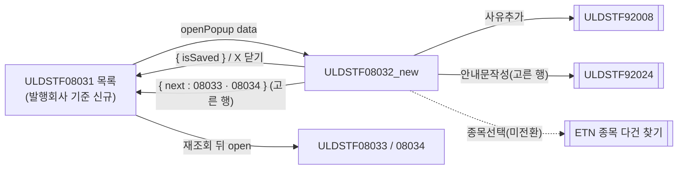
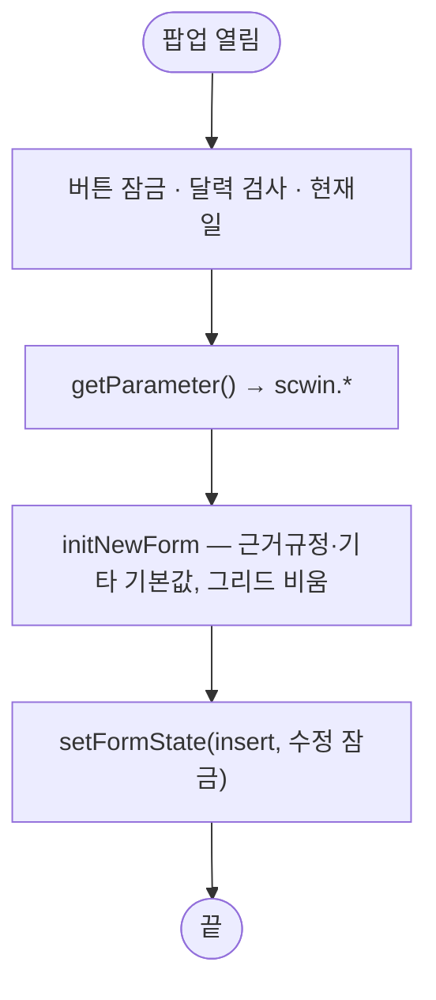
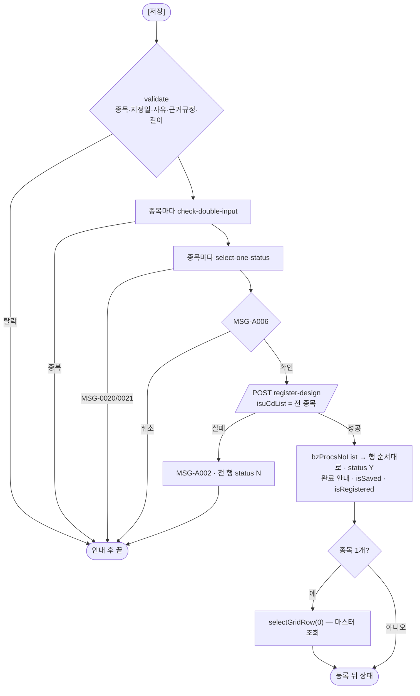
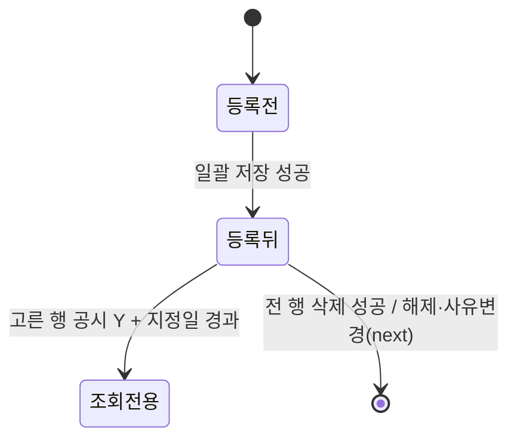

# ULDSTF08032_new (팝업)관리종목지정(발행회사) — 업무 분석 및 전환 내역

| 항목 | 내용 |
|---|---|
| AS-IS | `/etn/ULDSTF08032_new.gfm` (Gauce/X-Internet, 730×410 — 부모 ULDSTF08031 이 750×450 `window` 로 연다) — 반입 `conversion/conversion-front/ui/ULDSTF08032_new/ULDSTF08032_new.gfm` |
| 신규 API 명세 | **7화면 공용** `conversion/conversion-front/ui/ULDSTF08031/ULDSTF08031,ULDSTF08032,ULDSTF08032_new,ULDSTF08033,ULDSTF08033_new,ULDSTF08034,ULDSTF08037_API.md` 의 이 화면 블록 5종 — §1 `check-double-input` · §6 `select-one-status` · §7 `select-one` · §11 `register-design` · §14 `remove`(블록 머리 `[ULDSTF08032/08032_new/…]` 묶음의 숫자 꼬리 `08032_new`). **수정(`modify-design`) 블록이 없다** — 신규 전용. `api_spec_check` 가 공용 파일명·숫자 꼬리를 인식해 `--spec` 없이 대조한다 |
| TO-BE | `conversion/conversion-front/ui-tobe/ULDSTF08032_new.xml` (배포 경로 `/ui/lst/etn/ULDSTF08032_new.xml` — 공통 계약서 §3) |
| 퍼블리싱 | **없음** — 캡처 + gfm 기준 마크업(§13.2 1단계) |
| 화면 캡처 | `ULDSTF08032_new.png` — ULDSTF08032 와 같은 캡처(종목 한 행, 하단 해제·사유변경 / 저장·수정·삭제·안내문작성·닫기). gfm 상 종목 그리드에 「업무처리번호」 열이 하나 더 있다 |
| 업무공통 | `$c.stf`(`getMessageParam`·`checkMaxLength`)·`$c.lc`(`isProcess`·`popFindClssLstRsnCd`) — `cm/pcc/stf`. 게이트는 `--pcc stf` |
| 공통 계약 | ETN 관리종목지정 7화면 공통 계약서 — §2(`_new` 판 = 발행회사 기준 신규 전용), §3.1·§3.2·§3.4·§4 |
| 작성 | Inswave / 2026-10-30 |

참고 양식: [websquare_gfm_conversion.md](../../../md/websquare_gfm_conversion.md) — §1.4, §6.5. Gauce 대응은 [gfm_business_analysis_guide.md](../../../md/gfm_business_analysis_guide.md) 병행. 짝 화면: ULDSTF08032(종목 기준 지정·수정). 선례: ULDSTF09341~09345(종목 여러 개 순차 처리·status 표시).

---

## 1. 화면 개요

ETN **발행회사의 종목 여러 개를 한꺼번에 관리종목으로 지정**하는 신규 전용 팝업이다. 관리종목지정 목록(ULDSTF08031)에서 「발행회사」 기준으로 신규 [지정]을 고르면 열린다.

1. 부모가 발행회사(콤보)·증권그룹·시장·업무구분(0)·선택구분(2)을 넘긴다. 원본은 업무처리번호와 관계없이 늘 신규 작성으로 시작한다.
2. 종목선택으로 발행회사의 종목들을 그리드에 담고, 지정일·지정사유·근거규정·기타는 모든 종목에 같게 입력해 [저장]한다.
3. 원본은 종목마다 화면에서 채번하고 한 건씩 보냈다. TO-BE 는 종목코드 목록(`isuCdList`)을 한 번에 보내고, 서버가 종목마다 채번해 한 트랜잭션으로 저장한다.
4. 저장 뒤 행을 고르면 그 종목의 마스터를 조회한다. [삭제]는 전 행을 한 건씩, [해제]·[사유변경]·[안내문작성]은 고른 행으로 한다.
5. [수정]은 이 화면의 수정 API 가 명세에 없어 늘 잠근다 — 수정은 목록에서 행을 더블클릭해 ULDSTF08032 로 연다.

### 1.1 호출 화면 (1본)

- `ULDSTF08031` 관리종목지정(ETN) 목록 — 「발행회사」 기준 신규(신규등록구분 0) — `fn_new_create_frame`(공통 계약서 §2).

### 1.2 호출 규약 (부모 → 이 화면) / 반환 규약

AS-IS: `frame.Provider("../").fn_GetPar(arrPar)` → arr 0~7(gform `onload`). TO-BE: `openPopup("/ui/lst/etn/ULDSTF08032_new.xml", { …, width : 750, height : 450 }, data)` + `await`, `$c.data.getParameter()`.

| arr | data 키 | 의미 | TO-BE 변수 |
|---|---|---|---|
| 0 | `isurCd` | 발행기관코드(콤보 발행회사) | `scwin.isurCd` |
| 1 | `isurNm` | 발행기관명(콤보 텍스트) | `scwin.isurNm` |
| 2 | `secugrpId` | 증권그룹ID(EN) | `scwin.secugrpId` |
| 3 | `mktId` | 시장구분코드 | `scwin.mktId` |
| 4 | `bzProcsNo` | 업무처리번호 — 원본도 읽기만 하고 신규로 시작 | 받지 않음 |
| 5 | `admisuDesignBzTpCd` | 업무구분 0 지정 | `scwin.tpCd` |
| 6 | `isuCd` | 원본 주석 「발행사/기초자산 구분값」 — 발행회사 기준이라 빈 값 | 받지 않음 |
| 7 | `selTp` | 선택구분 2 발행회사 | `scwin.selTp` |

**반환**: 저장 성공 `scwin.isSaved = true`, 전 행 삭제 성공 `closePopup({ isSaved : true })`, [해제]·[사유변경] `closePopup({ isSaved, next : { id, data } })`. X 닫기는 `{ isCloseButtonClick }`. 부모는 `isSaved || isCloseButtonClick` 이면 재조회, `next` 면 재조회 뒤 그 화면을 연다.

### 1.3 이 화면이 여는 하위 팝업

| 팝업 | AS-IS | TO-BE |
|---|---|---|
| 사유찾기 `ULDSTF92008` | `fn_PopFindClssLstRsnCd(RSNCD_ADM_DESIGN)` + `fn_GetParRsnCd` / `fn_SetParRsnCd` | `await $c.lc.popFindClssLstRsnCd(scwin.RSNCD_ADM_DESIGN, { mkt : "1", rsn : "07", spac : "N" })` |
| ETN 종목 다건 찾기 | `fn_PopFindEtnCode()` + `fn_GetParIsu`(arr0 발행기관·arr1 gubun, `dts_Isu_Temp` 복사) / `fn_SetParIsu`(다건 → `dts_Isu_Temp`, STATUS N) | **미연결** — 대응 팝업 미전환(§10 #1) |
| 공시안내문작성 `ULDSTF92024` | `fn_dscl`(고른 행 `fn_copy_dts` 뒤 `fn_GetPar` 바꿔 끼움) | `openPopup` 745×820 + 호환용 `scwin.getPar` |
| 해제 `ULDSTF08033` / 사유변경 `ULDSTF08034` | `fn_release`·`fn_rsnChange`(고른 행 `fn_copy_dts`, 형제 팝업 열고 `frame.CloseFrame()`) | 부모 경유 `next` |

### 1.4 업무 프로세스 흐름

#### 화면 간 흐름

#### 업무 1: 진입·로딩

#### 업무 2: 일괄 저장

#### 업무 3: 행 선택 · 업무 4: 삭제

- 행 선택(`grd_isu` 셀 클릭): `scwin.selRow` 기록 → 업무처리번호가 있으면 `select-one { bzProcsNo, isurCd }` 의 `mst` 만 `dma_mst` 에 → `setFormState`.
- 삭제: MSG-A006 → 행마다 `POST remove { bzProcsNo }` 순차 → 전부 성공이면 안내 후 `closePopup({ isSaved : true })`, 일부 실패면 MSG-A002 + 성공 행 제거(실패 행만 남김).

#### 업무 5: 해제·사유변경 / 업무 6: 안내문작성 / 업무 7: 사유추가·삭제

- [해제]·[사유변경]·[안내문작성]: 대상 행 = 종목 1개면 그 행, 여럿이면 고른 행. 고르지 않았으면 「종목을 선택해 주세요!」, 등록 안 된 행이면 「저장되지 않은 종목입니다. 저장한 뒤 처리하세요.」.
- 해제·사유변경: 고른 행의 발행기관·발행회사명·종목·업무처리번호로 `next` data(계약서 §3.2).
- 사유추가·삭제: ULDSTF08032 와 같다.

#### 화면 모드 상태 전이

| 상태 | 버튼(BTN_MAP) | 종목선택 | 해제·사유변경 |
|---|---|---|---|
| 등록 전 `insert` | 저장 | 열림 | 잠금 |
| 등록 뒤 `update` | 삭제·안내문작성 (수정은 override 로 늘 잠금) | 잠금 | 고른 행 공시여부 N 이면 잠금 |
| 조회 전용 `error` | 모두 잠금 | 잠금 | 〃 |

---

## 2. 화면 구성 및 데이터 정의

### 2.1 화면 구성

| AS-IS 요소 | TO-BE | 비고 |
|---|---|---|
| `panel_3` | `panel_1` `tblbox` + `w2tb tbl`(2열) | `PanelToGroupBox` 대체 |
| `label_10`·`label_8`·`label_11`·`label_12`(`*`) | 라벨 `class="req"` | 옮기지 않음 |
| `label_2` / `img_SetIsuCd` | `label_2` / `img_SetIsuCd` `xf:trigger` 「종목선택」 | §6.3 |
| `grid_1` (`dts_Isu_Temp`) | `grd_isu` (`dlt_isuTemp`) + `ev:oncellclick` | 열 `ISU_CD` 「종목코드」·`ISUR_NM` 「발행회사」·`ISU_NM` 「종목명」·`LIST_DD` 「상장일」(규칙 46)·`BZ_PROCS_NO` 「업무처리번호」 → camelCase |
| `label_1` / `edt_MktactEnforceDd` + `img_MktactEnforceDd` | `label_1` / `edt_MktactEnforceDd` `inputCalendar` | |
| `label_5` / `MxGrid_1` (`dts_Rsn`) | `label_5` / `grd_rsn` (`dlt_rsn`) | 열 `ADMISU_DESIGN_RSN_CD` 「사유코드」·`ADMISU_DESIGN_RSN_NM` 「사유내용」 |
| `btn_rsn_add`·`btn_rsn_del` | 같은 id | |
| `label_6` / `txb_AdmisuDesignGrndRegulNm` | 같은 id `xf:input` | |
| `label_7` / `txa_Remk` | 같은 id `xf:textarea` | |
| `btn_release`·`btn_rsn_change`·`btn_Dscl` | `btn_cm` | 규칙 41 일반 버튼 |
| `btn_Delete`·`btn_Update`·`btn_Save` | `btn_cm pt` | `btn_Update` 는 핸들러 없음·늘 잠금 |
| `btn_Close` | 옮기지 않음 | 팝업 하단 [닫기] 금지 |
| `bnd_Mst` | `ref="data:dma_mst.*"` | |
| `dts_Isu` (`fn_copy_dts` 대상 1행) | — | 고른 행 JSON 으로 대체 |

### 2.2 데이터 정의

| AS-IS | TO-BE | 키 | 비고 |
|---|---|---|---|
| `dts_Mst` | `dma_mst` | 명세 §7 `dma_packageMst` 12키 | 입력 마스터 겸 고른 행 마스터 |
| `dts_Isu_Temp` | `dlt_isuTemp` | `bzProcsNo`·`isuCd`·`isuNm`·`listDd`·`isurCd`·`comNm`·`isurNm`·`status` | 원본 `STATUS`(Y/N)·`SELECTED` 중 `status` 만 |
| `dts_Isu` | — | — | `fn_copy_dts` 임시 1행 — 고른 행 JSON |
| `dts_Rsn` | `dlt_rsn` | `bzProcsNo`·`admisuDesignRsnCd`·`admisuDesignRsnNm` | |
| `dts_BZ_CHECK` | `dma_chkDbl` | 명세 §1 | |
| `dts_Status` | `dma_status` | 명세 §6 | |
| `dts_BzProcsNo` | — | — | 서버 채번 |
| `dts_ByCorpDepCd` | — | — | 원본 주석 |
| — | `dma_saveResult` | `bzProcsNo`·`bzProcsNoList`·`result`·`resultMessage` | 명세 `dlt_resultSave` — 단건이라 dataMap |
| `trs` | `$c.sbm.executeDynamic` | | |

---

## 3. 로딩 (`gform onload` → `scwin.onpageload` → `scwin.init`)

1. 버튼 잠금(BTN_MAP + 해제·사유변경), `checkCalendarFormat(edt_MktactEnforceDd)`(규칙 37), 현재일.
2. 파라미터(§1.2). 원본 `buttonSet.set*Info` → BTN_MAP, `fn_SetIsuCdBtnShow(gubun)`·`fn_SetRelAndChgRsnBtnShow()` → `setFormState`.
3. `scwin.initNewForm()`(원본 `fn_new_onload` + `isFirstNew = true` — `isFirstNew` 는 쓰이지 않아 삭제).

## 4. 컴포넌트 이벤트

| AS-IS | TO-BE |
|---|---|
| gform `onload` | `scwin.onpageload` → `scwin.init` |
| `grid_1` `OnClick(row, colid)` → `fn_SelectGridRow` | `scwin.grd_isu_oncellclick` → `scwin.selectGridRow` |
| `img_SetIsuCd` `onclick` | `scwin.img_SetIsuCd_onclick`(안내) |
| `btn_Close` `onclick` | 옮기지 않음 |
| `img_MktactEnforceDd` `onclick` | `inputCalendar` 내장 |
| `btn_rsn_add`·`btn_rsn_del` `onclick` | `scwin.btn_rsn_add_onclick`·`scwin.btn_rsn_del_onclick` |
| `btn_release`·`btn_rsn_change` `onclick` | `scwin.btn_release_onclick`·`scwin.btn_rsn_change_onclick` |
| `buttonSet` 저장·수정·삭제·안내문작성 | `scwin.btn_Save_onclick`·(수정 없음)·`btn_Delete_onclick`·`btn_Dscl_onclick` |
| `trs` `OnSuccess()` / `OnFail()` (응답 카운터 `trsCnt`·`trsTotalCnt`·`trsErrCnt`) | `saveTrs` 한 번 + `remove` 순차 `await` |
| `dts_Mst` `OnLoadCompleted(rowcount)` | `scwin.initNewForm` / `scwin.selectMst` |
| `dts_Isu` `OnLoadCompleted(rowcount)`(`AddRow`) | 삭제 |
| `dts_Isu_Temp` `OnLoadCompleted(rowcount)`(SELECTED F, `fn_check_chk_MktactApplObjTpCd`) | 삭제 — §6.8 |
| `dts_*` `OnLoadError()` | 공통 오류 핸들러 |

## 5. 서버 통신

#### API 명세 대응

| AS-IS | TO-BE | 함수 |
|---|---|---|
| `fn_search`(마스터만, DIV_IDX MST) | `GET /api/listing/lstproc/etn/adm-isu/select-one` | `scwin.selectMst` |
| `fn_check_bz_doubleinput_etn`(종목 루프) | `GET …/check-double-input` | `scwin.checkDoubleInput` |
| `fn_getMstStatus_etn`(종목 루프) | `GET …/select-one-status` | `scwin.checkStatus` |
| `fn_save` 종목 루프 + `fn_getNewBzProcNo` + `fn_save_trs`(INSERT) | `POST …/register-design` (`isuCdList`) | `scwin.saveTrs` |
| `fn_delete` 종목 루프 + `fn_save_trs`(DELETE) | `POST …/remove` | `scwin.removeTrs` |
| `fn_update` 종목 루프 + `fn_save_trs`(UPDATE) | **명세에 없음** | — (수정 잠금) |

#### 명세 ↔ AS-IS 차이 (→ §10)

1. **일괄 등록**: 원본 종목마다 채번·전송(응답 카운터) → `isuCdList` 한 번, 서버가 종목마다 채번, 한 트랜잭션(명세 §11). 일부 성공이 없다.
2. **수정 없음**: 원본 `fn_update` 는 행마다 업데이트 전송 — 명세 블록에 `08032_new` 의 `modify-design` 이 없다(§8 블록 머리 `[ULDSTF08032]` 단독). [수정] 잠금.
3. **삭제 사전 확인**: 원본 _new 는 `fn_check_delete_discls` 가 없었고, 명세는 서버가 공시 승인 건 삭제를 거부(_new 에도 적용).
4. **상태 확인**: 저장 전 종목마다 `select-one-status` — 명세는 서버도 확인한다고 적음(원본 동작 유지).
5. **번호 목록**: 응답 `bzProcsNoList` 형태(배열/쉼표 문자열) 미확정 — 둘 다 받는다(§10 #4).
6. **보내지 않는 원본 인자**: `SCREN_ID`·`SCREN_PROCES_TP_CD`·`TRS_IDX`·`COUNT`·`LIST_BZ_TP_CD`·`DIV_IDX[]`, 지정사유 행 고정값.

### 5.1 고른 행 마스터 (`scwin.selectMst(bzProcsNo, isurCd)`)

`GET …/select-one`, `{ bzProcsNo, orgBzProcsNo : "", isurCd }` → 본문 `mst` 만 `dma_mst.setJSON`. 종목·사유 그리드는 그대로(원본 `fn_search` 와 같다).

### 5.2 / 5.3 중복입력 · 최신 상태 (`scwin.checkDoubleInput` · `scwin.checkStatus`)

ULDSTF08032 §5.2·§5.3 과 같다. `checkDoubleInput` 의 `bzProcsNo` 는 늘 빈 값(신규 전용). 두 함수 모두 종목마다 부른다.

### 5.4 일괄 등록 (`scwin.saveTrs`)

`POST …/register-design`(`application/json`, target `dma_saveResult=body`), `{ mstDto : { bzProcsNo : "", isuCd : 첫 종목, mktactEnforceDd, grndRegulNm, admisuRsnContn, admisuDesignBzProcsNo : "", remk }, rsnList, isuCdList : 전 종목 }`. 성공 → `scwin.applyBzProcsNoList(body)` → 안내 → `isSaved`·`isRegistered` → 종목 1개면 `selectGridRow(0)`. 실패 → MSG-A002 + `resultMessage`, 전 행 `status N`.

### 5.5 삭제 (`scwin.removeTrs(bzProcsNo)`)

`POST …/remove`, `{ bzProcsNo }` → 성공 여부(boolean). `scwin.remove` 가 행마다 순차 호출.

## 6. 일반 함수

### 6.1 화면 상태 (`scwin.setFormState`) · 행 선택 (`scwin.selectGridRow`) — 원본 `fn_SetIsuCdBtnShow`·`fn_SetRelAndChgRsnBtnShow`·`fn_SelectGridRow`

- 종목선택: 등록 뒤 잠금(원본 저장 성공 시 `fn_SetIsuCdBtnShow(1)`).
- 버튼: 등록 전 `insert`, 등록 뒤 원본 조합(공시 Y + 지정일 경과 → `error`, 아니면 `update`) + `override { modify : false }`.
- 해제·사유변경: 등록 전이거나 `dscYn N` 이면 잠금.
- 행 선택: `scwin.selRow` 기록, 등록된 행이면 `selectMst`.

### 6.2 입력 검증 (`scwin.validate`) — 원본 `fn_CheckForm`

ULDSTF08032 §6.2 와 같고, 업무 중복입력은 종목마다(원본 종목 루프).

### 6.3 종목선택 (`scwin.img_SetIsuCd_onclick`) — 원본 `fn_PopFindEtnCode` + `fn_GetParIsu`·`fn_SetParIsu`

대응 팝업 미전환 → 안내만. **이 팝업이 없으면 이 화면은 종목을 담을 수 없다** — 발행회사 기준 일괄 지정은 팝업 전환 전까지 쓸 수 없다(§10 #1).

### 6.4 저장·삭제 (`scwin.save`·`scwin.remove`) — 원본 `fn_save`·`fn_delete`

- 저장: `validate` → 종목마다 `checkStatus` → `isProcess("I")` → `saveTrs()`.
- 삭제: `isProcess("D")` → 행마다 `removeTrs` → 결과 `status` → 일부 실패면 성공 행 제거, 전부 성공이면 닫기. 원본 `buttonSet.setDeleteStatus()`·응답 카운터 불필요.
- 원본 `fn_update` → 옮기지 않음(명세 없음).

### 6.5 사유추가 (`scwin.openRsnPopup`) — 원본 `fn_GetParRsnCd`·`fn_SetParRsnCd`

ULDSTF08032 §6.5 와 같다.

### 6.6 안내문작성 (`scwin.writeDscl`·`scwin.getDsclData(row)`·`scwin.getPar`·`scwin.fillDataList`) — 원본 `fn_dscl`

대상 행 = `scwin.getSelectedRow()`. data: `formCd "68344"`, `bzProcsNo`·`isurCd` = 고른 행, `mktId "1"`, `msg ""`, `title` = 고른 행 `isuNm`(원본 `dts_Isu_Temp.NameValue(selectedGrdNum, "ISU_NM")`), `isu` = [고른 행](원본 `fn_copy_dts` → `CopyDataSet(dts_Isu)`), `mst` = `dma_mst` + 고른 행 `comNm`, `rsn` = 지정사유. 호환용 `getPar` 는 `scwin.selRow` 로 되읽는다.

### 6.7 해제·사유변경 (`scwin.requestNext(id, tpCd)`) — 원본 `fn_release`·`fn_rsnChange`·`fn_GetParRelease`·`fn_GetParRsnChange`·`fn_copy_dts`

고른 행 → `{ isurCd : 행 isurCd, isurNm : 행 comNm, secugrpId, mktId, bzProcsNo : "", admisuDesignBzTpCd : 4|1, isuCd : 행 isuCd, selTp : "0", admisuDesignBzProcsNo : 행 bzProcsNo }` → `closePopup({ isSaved, next })`. 원본 `fn_copy_dts` 가 `Isu_cd`·`Isur_cd`·`Isur_nm(COM_NM)` 을 바꾸던 것을 행 JSON 으로 대체.

### 6.8 기타 원본 함수

- `fn_copy_dts(index)` → 행 JSON(`getRowJSON`)으로 대체 — `LSTTRD_DD`·`EXP_DD` 복사는 명세에 없는 키라 옮기지 않음.
- `fn_check_chk_MktactApplObjTpCd`(SELECTED T 첫 행 종목명 → `ADMISUTM_ISU_NM`) → 삭제(명세 요청에 없는 키, SELECTED 는 원본에서 늘 F).
- `fn_setRemk` → `scwin.DEFAULT_REMK`. `fn_search` → `scwin.selectMst`. `fn_new_onload` → `scwin.initNewForm`.
- `fn_parentRefresh` → 삭제(반환 규약). `fn_drft`·`fn_makt` → 삭제(빈 함수).

## 7. 업무 코드 · 메시지 목록

ULDSTF08032 §7 과 같다. 추가: 처리결과 `status` Y/N(그리드 행), 「종목을 선택해 주세요!」, 「저장되지 않은 종목입니다. 저장한 뒤 처리하세요.」(TO-BE 신설).

## 8. 원본 특이사항 · 결함

| # | 내용 | 결정 |
|---|---|---|
| 1 | `vScrenID = "ULDSTF08032.gfm"`(기존 판 이름) | 삭제(미사용) |
| 2 | 응답 카운터(`trsCnt`)로 결과를 맞추는데 Post 를 연달아 던져 응답 순서가 어긋나면 엉뚱한 행에 번호·상태가 들어감 | **고침** — 등록 1회(서버 채번), 삭제 순차 `await` |
| 3 | `fn_update` 가 행마다 전송 — 명세에 수정 API 없음 | [수정] 잠금 |
| 4 | 저장 실패 시 `OnFail` 이 `dts_Isu_Temp.NameString(trsCnt, …)` — 카운터가 앞서 증가해 다른 행 표시 | **고침**(1회 등록이라 해당 없음) |
| 5 | `fn_release`·`fn_rsnChange` 가 형제 팝업을 연 뒤 자기 창을 닫음 | **고침** — `next` |
| 6 | 사유 중복 확인(pcc `isNewValueForDataSet`)이 1부터 셈 | **고침** — 0부터 |
| 7 | `fn_check_chk_MktactApplObjTpCd` 함수명 앞 공백 두 칸(`function  fn_…`) — 정규식 누락 주의 | 기록만 |

## 9. 전환 내역 (AS-IS → TO-BE)

| AS-IS 함수 | TO-BE |
|---|---|
| gform `onload` | `scwin.onpageload` → `scwin.init` |
| `fn_new_onload` | `scwin.initNewForm` |
| `fn_search` | `scwin.selectMst` |
| `fn_SelectGridRow` | `scwin.selectGridRow` (+ `scwin.grd_isu_oncellclick`) |
| `fn_GetParRsnCd` / `fn_SetParRsnCd` | `scwin.openRsnPopup` |
| `fn_GetParIsu` / `fn_SetParIsu` | 삭제(대응 팝업 미전환) — `scwin.img_SetIsuCd_onclick` 안내 |
| `fn_CheckForm` | `scwin.validate` + `scwin.checkDoubleInput` |
| `fn_save` | `scwin.save` + `scwin.checkStatus` + `scwin.saveTrs` + `scwin.applyBzProcsNoList` |
| `fn_update` | 삭제(명세 없음) — [수정] 잠금 |
| `fn_delete` | `scwin.remove` + `scwin.removeTrs` |
| `fn_save_trs` | `scwin.saveTrs` / `scwin.removeTrs` |
| `fn_copy_dts` | `getRowJSON` (`scwin.requestNext`·`scwin.getDsclData`) |
| `fn_release` / `fn_GetParRelease` / `fn_rsnChange` / `fn_GetParRsnChange` | `scwin.btn_release_onclick`·`scwin.btn_rsn_change_onclick` → `scwin.requestNext` (+ `scwin.getSelectedRow`) |
| `fn_dscl` | `scwin.writeDscl` + `scwin.getDsclData` + 호환용 `scwin.getPar`·`scwin.fillDataList` |
| `fn_setRemk` | `scwin.DEFAULT_REMK` |
| `fn_SetIsuCdBtnShow` / `fn_SetRelAndChgRsnBtnShow` | `scwin.setFormState` |
| `fn_check_chk_MktactApplObjTpCd` | 삭제 |
| `fn_parentRefresh` / `fn_drft` / `fn_makt` | 삭제 |
| 전역 `trsCnt`·`trsTotalCnt`·`trsErrCnt`·`selectedGrdNum`·`trsIdx`·`isFirstNew` | 삭제 / `scwin.selRow`·`scwin.trJob`·`scwin.isRegistered` |

- publicInfo: 정의한 30함수 전부.
- 게이트: `gate_screen` OK · `scan_mixed_compare` A 6·B 0 · `publish_gate --before 1단계 --allow P20` OK · `api_spec_check` OK(공용 명세 자동 탐지, 이 화면 블록 5종 모두 호출) · `init_binding_check` OK · `wsxml_lint` 0/0 · `convert.py` 고정점(규칙 28 `setBroadcast` 를 `applyBzProcsNoList` 루프에 반영).

## 10. 남은 작업 (TODO)

1. **ETN 종목 다건 찾기 팝업** — 이 화면의 핵심 입력. 원본 `fn_PopFindEtnCode` 대상이 저장소에 없다. 전환되면 반환 행을 `dlt_isuTemp` 에 담고 `status "N"`. 그 전까지 발행회사 기준 일괄 지정은 쓸 수 없다(부모 08031 의 발행회사 기준 신규를 막을지 확인).
2. **수정 경로** — 명세에 `_new` 수정이 없다. 저장 직후 수정이 필요하면 닫고 목록에서 ULDSTF08032 로 여는 흐름이 맞는지 업무 확인.
3. **일괄 등록 결과** — 한 트랜잭션이라 일부 성공이 없다는 명세 전제 확인. 원본은 종목별 성공·실패를 그리드 `STATUS` 로 보였다.
4. **번호 목록 형태** — `bzProcsNoList` 가 배열인지 쉼표 문자열인지, 순서가 `isuCdList` 와 같은지 확인. 응답 본문 단건 여부(명세 `dlt_resultSave` dataList)도.
5. **상태 확인 규칙** — ULDSTF08032 §10 #5 와 같다.
6. **92024 계약** — 경로 가정, 원천 dataList 컬럼명, 호환용 `getPar` 삭제 시점.
7. **크기·배포 경로** — 750×450 + contentHeader, `/ui/lst/etn/ULDSTF08032_new.xml` 가정.
