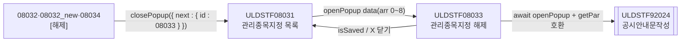
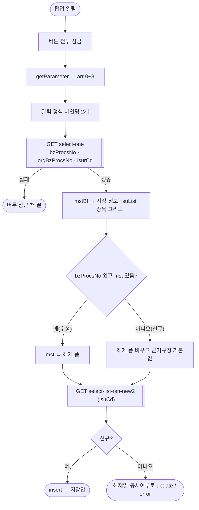
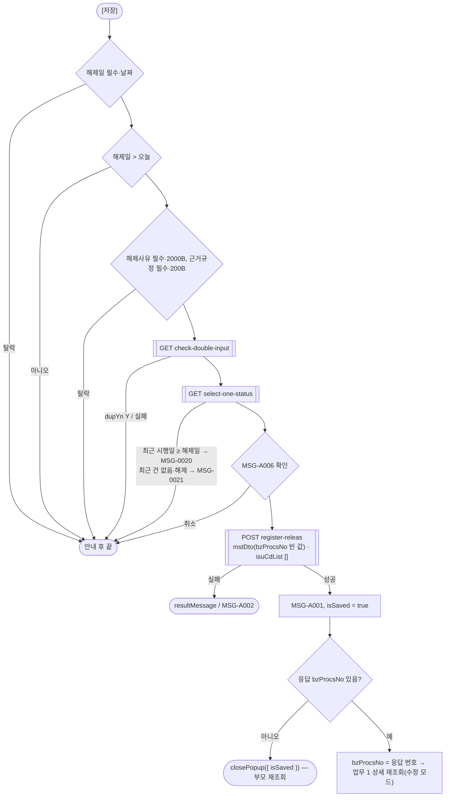
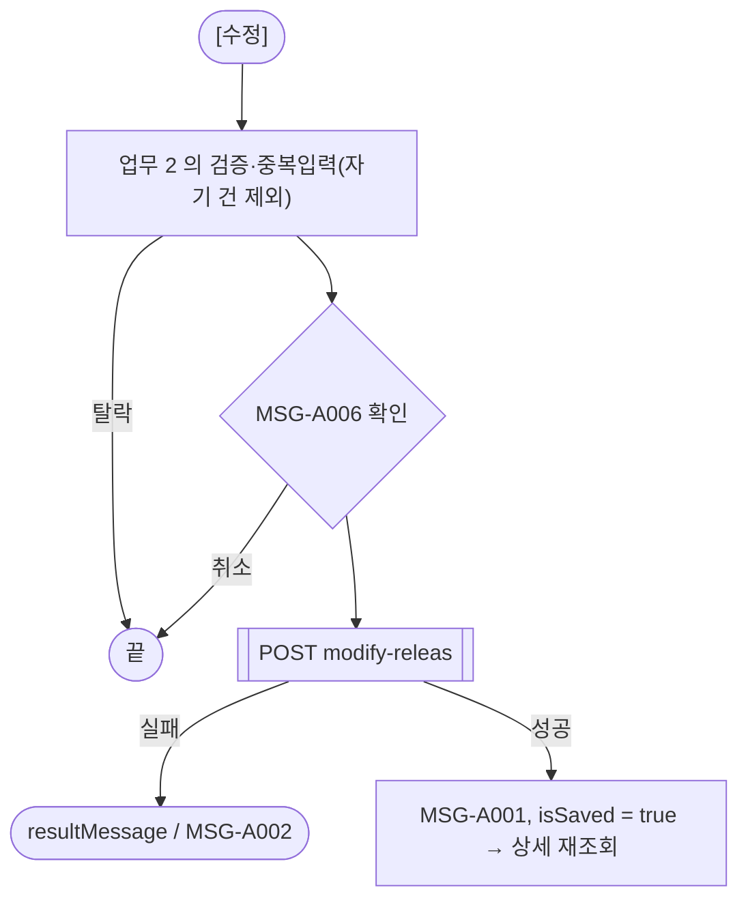
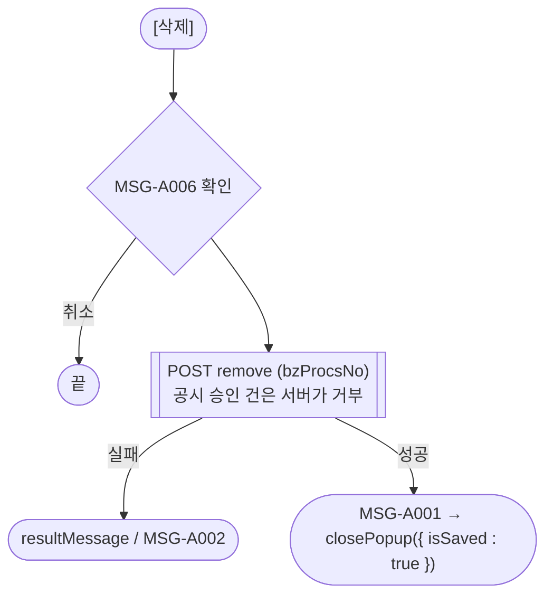
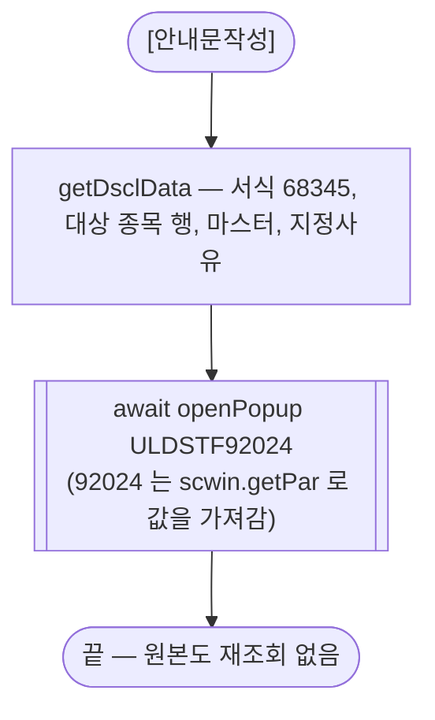
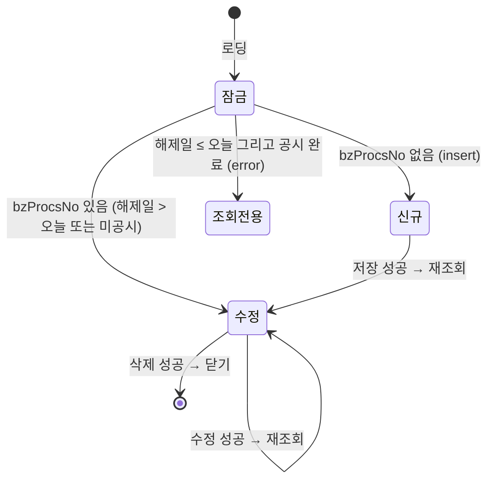

# ULDSTF08033 (팝업)ETN 관리종목지정 해제 — 업무 분석 및 전환 내역

| 항목 | 내용 |
|---|---|
| AS-IS | `/etn/ULDSTF08033.gfm` (Gauce/X-Internet, 710×560 모달 창 — 부모가 `window` 로 연다) — 반입 `conversion/conversion-front/ui/completed/ULDSTF08033/ULDSTF08033.gfm` |
| 신규 API 명세 | **공용** `conversion/conversion-front/ui/completed/ULDSTF08031/ULDSTF08031,ULDSTF08032,ULDSTF08032_new,ULDSTF08033,ULDSTF08033_new,ULDSTF08034,ULDSTF08037_API.md` 의 이 화면 블록 7종 — §1 `check-double-input`, §3 `select-list-rsn-new2`, §6 `select-one-status`, §7 `select-one`, §9 `modify-releas`, §12 `register-releas`, §14 `remove`(다른 화면 블록 7종은 A06). `api_spec_check` 가 공용 파일명·묶음 머리 숫자 꼬리(`08033_new`)를 인식해 `--spec` 없이 대조한다(2026-10-30 보강) |
| TO-BE | `conversion/conversion-front/ui-tobe/ULDSTF08033.xml` (배포 경로 `/ui/lst/etn/ULDSTF08033.xml` — 원본 `../etn/ULDSTF08033.gfm`, 공통 계약서 §3) |
| 퍼블리싱 | 없음 — 캡처 + gfm 기준 마크업(가이드 §13.2 1단계). 퍼블리셔 XML 은 08031 만 있다 |
| 화면 캡처 | `ULDSTF08033.png`(신규 진입 — 빈 종목·지정사유 그리드, 해제 근거규정 기본값, 하단 저장·수정·삭제·안내문작성·닫기) |
| 공통 계약서 | ETN 관리종목지정 7화면 공통 계약(08031 ↔ 팝업 data·반환, 형제 팝업 부모 경유, 08037, 92024) — 묶음 작업 기준 |
| 업무공통 | `$c.lc`(`isProcess`)·`$c.stf`(`getMessageParam`·`setButtonSetWithDate`·`setButtonSetWithDate2`) — `cm/pcc/stf`. 게이트는 `--pcc stf` |
| 작성 | Inswave / 2026-10-30 |

참고 양식: [websquare_gfm_conversion.md](../../../md/websquare_gfm_conversion.md) — §1.4 업무 프로세스 흐름, §6.5 getPar/setPar 전환. Gauce 대응은 [gfm_business_analysis_guide.md](../../../md/gfm_business_analysis_guide.md). 선례: `ui/completed/ULDSTF08303`(ETN 다건 팝업)·`ULDSTF05621`(익일 검사)·`ULDSTF09341`(정비형 팝업).

---

## 1. 화면 개요

상장 담당자가 **ETN 관리종목지정 목록(ULDSTF08031)** 에서 관리종목으로 지정된 종목을 **해제**(관리종목지정업무구분코드 4)하는 건을 등록하거나, 등록한 해제 건을 수정·삭제하고 공시안내문을 작성하는 팝업이다.

1. 부모가 발행기관·종목·업무처리번호·원 지정업무처리번호 등을 넘겨 연다. 업무처리번호가 없으면 신규, 있으면 수정이다.
2. 위쪽(원본 `panel_3`)은 **원 지정 건** 정보 — 관리종목지정 종목 그리드·지정일·지정사유 그리드·근거규정·기타(모두 읽기 전용).
3. 아래쪽(원본 `panel_2`)은 **해제 입력** — 해제일(달력)·해제사유·근거규정(기본 「유가증권시장상장규정 제149조의6제2항」).
4. [저장]: 검증(해제일 익일 이후, 해제사유·근거규정 byte, 업무 중복입력) → 처리상태 확인 → 확인 → 등록(서버 채번) → 응답 번호로 다시 조회해 수정 모드.
5. 수정 모드: [수정]·[삭제]·[안내문작성]. 해제일이 오늘 이전이면 잠기되, 공시 전(`dscYn ≠ Y`)이면 수정 가능(원본 버튼 규칙 그대로).

### 1.1 호출 화면 (4본 — 공통 계약서 §1)

- `ULDSTF08031` 관리종목지정 목록 — 종목 기준 [신규](신규등록구분 4)·목록 더블클릭(구분 4) → 직접 연다(725×600).
- `ULDSTF08032`·`ULDSTF08032_new`(지정)·`ULDSTF08034`(사유변경) 의 [해제] — 원본은 그 팝업이 `fn_GetPar` 를 바꿔 끼우고 이 화면을 연 뒤 자기 창을 닫았다. TO-BE 는 그 팝업이 `closePopup({ isSaved, next : { id : "ULDSTF08033", data } })` 를 돌려주고 **08031 이 연다**(공통 계약서 §3.2). 이때 `selTp` 는 `"0"`.

### 1.2 호출 규약 (부모 → 이 화면) / 반환 규약

AS-IS 는 로딩 때 `frame.Provider("../").fn_GetPar(arrPar)` 로 부모 함수를 불러 배열 0~8 을 받는다. TO-BE 는 `openPopup` 의 `data` 를 `$c.data.getParameter()` 로 받는다(공통 계약서 §3.1).

| arr | TO-BE 키 | 의미 | 사용 |
|---|---|---|---|
| 0 | `isurCd` | 발행기관코드 (`Isur_cd`) | 상세 조회 `isurCd`, 신규 폼 기본값, 안내문 arr[2] |
| 1 | `isurNm` | 발행기관명 (`Isur_nm`) | 받기만 함(원본도 미사용) |
| 2 | `secugrpId` | 증권그룹ID (`Secugrp_id`) | 받기만 함 |
| 3 | `mktId` | 시장구분코드 (`Mkt_id`) | 받기만 함(안내문 arr[3] 은 원본처럼 `'1'` 고정) |
| 4 | `bzProcsNo` | 업무처리번호 (`fr_bz_procs_no`) | 비면 신규, 있으면 상세 조회·수정·삭제 키 |
| 5 | `admisuDesignBzTpCd` | 관리종목지정업무구분코드 (`tpCd`) | 받기만 함 — 처리상태 판정은 해제(4) 고정(§5.4) |
| 6 | `isuCd` | 종목코드 (`Isu_cd`) | 지정사유·중복입력·처리상태 조회 키. 비면 종목내역 첫 등록 종목 |
| 7 | `selTp` | 선택 구분 0 형제 팝업 / 1 종목 / 2 발행회사 / 3 전체 (`gubun`) | 원본 `isFirstNew` 표시뿐 — 동작 영향 없음 |
| 8 | `admisuDesignBzProcsNo` | 원 지정업무처리번호 (`fr_org_bz_procs_no`) | 상세 조회 `orgBzProcsNo`, 등록·수정 `mstDto.admisuDesignBzProcsNo` |

**반환**: 저장·수정 성공 → `scwin.isSaved = true`(창은 열어 둔다). 삭제 성공 → `closePopup({ isSaved : true })`. 그 밖은 창 X·ESC → `{ isCloseButtonClick : true }`. 부모(08031)는 `isSaved === true || isCloseButtonClick === true` 이면 목록을 다시 조회하고 행을 복원한다(원본 `fn_parentRefresh` — 부모 `fn_parentRefresh`/`fn_search` 이름 호출 대체).

### 1.3 이 화면이 여는 하위 팝업

| 팝업 | AS-IS 호출 | TO-BE (`data`) | 반환 / 취소 |
|---|---|---|---|
| `ULDSTF92024` 공시안내문작성 (745×825) | `fn_dscl` 이 `fn_GetPar` 를 임시 함수로 바꿔 `frame.CreateDialogFrame(…, "window")` 로 연 뒤 되돌림 | `{ formCd:"68345", bzProcsNo, isurCd, mktId:"1", isuNm, isu, mst, rsn }` + **호환용 `scwin.getPar(arr, dltIsu, dltMst, dlt2)`**(92024 전환본이 아직 부모 `getPar` 를 이름으로 부름 — 선례 05232·08303) | 반환 없음(닫힐 때까지 `await`) |

### 1.4 업무 프로세스 흐름

#### 화면 간 흐름

#### 업무 1: 진입·로딩

| 단계 | 처리 | 근거 |
|---|---|---|
| 1 | 로딩 동안 버튼 잠금 — 조회 실패 시 신규로 오인해 재등록하지 않게 | §3 |
| 2 | `select-one` 한 번으로 해제 건(mst)·원 지정 건(mstBf)·종목내역(isuList)을 받는다 — 원본은 `dts_Mst`·`dts_Mst_Bf`·`dts_Isu` 를 따로 조회 | §5.1 |
| 3 | 종목코드가 비었으면 종목내역의 등록 종목(selected T) → 첫 행 | §6.3 |
| 4 | 지정사유 조회 후 버튼 상태 | §5.2·§6.2 |

#### 업무 2: 신규 저장

#### 업무 3: 수정

#### 업무 4: 삭제

#### 업무 5: 안내문작성

#### 화면 모드 상태 전이

---

## 2. 화면 구성 및 데이터 정의

### 2.1 화면 구성

| AS-IS 요소 | 종류 | TO-BE id / 컴포넌트 | 비고 |
|---|---|---|---|
| `panel_3` | panel(원 지정 건) | `panel_3` tblbox 표 | `PanelToGroupBox` 대체 |
| `label_10`·`label_2` | `*` + 「1. 관리종목지정 종목」 | `label_2` (`req`) | 필수 표시는 `class="req"` 로 합침 |
| `grid_1` (`dts_Isu`) | 그리드 | `grd_isu` (`dlt_packageIsuList`) | 컬럼 `BZ_PROCS_NO`(숨김, 옮기지 않음)·`ISU_CD` 종목코드·`ISUR_NM` 발행회사·`ISU_NM` 종목명·`LIST_DD` 상장일(`mask XXXX-XX-XX` → 규칙 46 `yyyy-MM-dd`) |
| `label_8`·`label_1` | 「2. 관리종목지정일」 | `label_1` (`req`) | |
| `edt_MktactEnforceDd` | maskedit 읽기 전용 | `edt_MktactEnforceDd` inputCalendar `readOnly` | `bnd_Mst_Bf` → `dma_packageMstBf.mktactEnforceDd` |
| `label_11`·`label_5` | 「3. 지정사유」 | `label_5` (`req`) | |
| `MxGrid_1` (`dts_Rsn`) | 그리드 | `grd_rsn` (`dlt_listRsnNew2`) | `BZ_PROCS_NO` 업무처리번호(숨김, 명세 응답에 없음 — 옮기지 않음)·`ADMISU_DESIGN_RSN_CD` 사유코드·`ADMISU_DESIGN_RSN_NM` 사유내용 |
| `label_12`·`label_6` | 「4. 근거규정」 | `label_6` (`req`) | |
| `txb_AdmisuDesignGrndRegulNm` | 읽기 전용 | `xf:input readOnly` | `dma_packageMstBf.grndRegulNm` |
| `label_7` | 「5. 기타」 | `label_7` | |
| `txa_Remk` | textarea 읽기 전용 | `xf:textarea readOnly` | `dma_packageMstBf.remk` |
| `panel_2` | panel(해제 입력) | `panel_2` tblbox 표 | 검증 범위 |
| `label_17`·`label_9` | 「1. 관리종목지정 해제일」 | `label_9` (`req`) | |
| `edt_MktactEnforceEndDd` + `img_MktactEnforceDd` | maskedit + 달력 아이콘(`popUpCalendar2`) | `edt_MktactEnforceEndDd` inputCalendar | 아이콘은 inputCalendar 자체 버튼으로 대체(옮기지 않음). `bnd_Mst` → `dma_packageMst.mktactEnforceDd` |
| `lbl_2`·`label_16` | 「2. 해제 사유」 | `label_16` (`req`) | |
| `txa_RelRsnContn` | textarea | `xf:textarea` | `dma_packageMst.admisuRsnContn` |
| `lbl_1` | 「3. 근거규정」 | `lbl_1` | 캡처에 `*` 없음 — 그대로(검증은 필수, §8 #6) |
| `txb_RelAdmisuDesignGrndRegulNm` | textbox(maxlength 1000) | `xf:input maxlength="1000"` | `dma_packageMst.grndRegulNm` |
| `btn_Save`·`btn_Update`·`btn_Delete`·`btn_Dscl` | 이미지 버튼 | `btn_Save`·`btn_Update`·`btn_Delete`·`btn_Dscl` (`grpBtnBox`) | 규칙 41 — 안내문작성(rt) 다음 삭제·수정·저장 `pt` |
| `btn_Close` | 닫기 | (옮기지 않음) | 팝업 하단 닫기 금지 — 창 X 로 닫는다 |

### 2.2 데이터 정의

| AS-IS | TO-BE | 종류 | 키 (명세 원문) | 비고 |
|---|---|---|---|---|
| `dts_Mst` (+`bnd_Mst`) | `dma_packageMst` | dataMap | `bzProcsNo`·`dscYn`·`isurCd`·`isuCd`·`admisuDesignBzTpCd`·`mktactEnforceDd`·`grndRegulNm`·`admisuRsnContn`·`admisuDesignBzProcsNo`·`isurNm`·`comNm`·`remk` | 명세 §7 `select-one` body.mst — 해제 폼 바인딩 |
| `dts_Mst_Bf` (+`bnd_Mst_Bf`) | `dma_packageMstBf` | dataMap | 위와 같음 | body.mstBf — 원 지정 건 표시 |
| `dts_Isu` | `dlt_packageIsuList` | dataList | `bzProcsNo`·`isuCd`·`isuNm`·`listDd`·`isurCd`·`comNm`·`isurNm`·`secugrpId`·`isuNmFm`·`selected`·`stkKndNm` | body.isuList |
| `dts_Rsn` | `dlt_listRsnNew2` | dataList | `admisuDesignRsnCd`·`admisuDesignRsnNm` | 명세 §3 target |
| `dts_BZ_CHECK` | `dma_checkDoubleInput` | dataMap | `disclsProcsDdtm`·`disclsProcsStatCd`·`dupYn` | 명세 §1 target |
| `dts_Status` | `dma_oneStatus` | dataMap | `bzProcsNo`·`mktactEnforceDd`·`admisuDesignBzTpCd` | 명세 §6 응답 id(명세 target 자리표 `____dma____` 대신 응답 id) |
| (요청 전문) | `dma_registerReleasMstDto`·`dma_modifyReleasMstDto` | dataMap | `bzProcsNo`·`isuCd`·`mktactEnforceDd`·`grndRegulNm`·`admisuRsnContn`·`admisuDesignBzProcsNo`·`remk` | 명세 §12·§9 mstDto |
| (응답) | `dma_resultSave` | dataMap | `bzProcsNo`·`bzProcsNoList`·`result`·`resultMessage` | **명세는 `dlt_resultSave`(dataList)** 로 적었으나 응답 body 가 한 건 객체라 dataMap 으로 받는다(08303 선례) — §10 #3 |
| `dts_BzProcsNo` | (없앰) | — | — | 채번은 등록 API 가 서버에서(명세 §12 「비우면 서버 채번」) |

- AS-IS 컬럼 → TO-BE 키: `ISU_CD→isuCd`, `ISU_NM→isuNm`, `ISUR_NM→isurNm`, `LIST_DD→listDd`, `BZ_PROCS_NO→bzProcsNo`, `ADMISU_DESIGN_RSN_CD→admisuDesignRsnCd`, `ADMISU_DESIGN_RSN_NM→admisuDesignRsnNm`, `MKTACT_ENFORCE_DD→mktactEnforceDd`, `ADMISU_RSN_CONTN→admisuRsnContn`, `GRND_REGUL_NM→grndRegulNm`, `REMK→remk`, `ADMISU_DESIGN_BZ_PROCS_NO→admisuDesignBzProcsNo`, `ADMISU_DESIGN_BZ_TP_CD→admisuDesignBzTpCd`, `DSC_YN→dscYn`.
- 날짜 열 `listDd` 는 규칙 46(`dataType="date" displayFormat="yyyy-MM-dd"`). 숫자 입력 칸 없음(규칙 48 해당 없음).

---

## 3. 로딩 (`gform onload` → `scwin.onpageload` → `scwin.init`)

AS-IS `gform onload`: `fn_GetPar(arrPar)` 수신 → `buttonSet.setSaveInfo/setUpdateInfo/setDeleteInfo/setDsclInfo` → `gubun == "0"` 이면 `isFirstNew` → 업무처리번호가 있으면 `fn_search()`, 없으면 `fn_new_onload()` → `PanelToGroupBox(panel_3/panel_2)`.

TO-BE `scwin.onpageload` 는 `scwin.init()` 호출만(try/catch + `$c.exception.handleError`). `scwin.init` 단계:

1. `setButtonState("grpBtnBox", "disabled", BTN_MAP)` — 로딩 동안 잠금.
2. `$c.data.getParameter()` → arr 0~8 키(§1.2).
3. `scwin.todayDd = $c.date.getServerDateTime("yyyyMMdd")` — 해제일 익일 검사용.
4. 달력 바인딩(규칙 37): `checkCalendarFormat(edt_MktactEnforceDd)`·`checkCalendarFormat(edt_MktactEnforceEndDd)`. 조회 영역(`schbox`) 없음 → `setEnterKeyEvent` 해당 없음.
5. `await scwin.selectDetail()` — 신규·수정 모두 이 함수(§5.1). `buttonSet.setXxxInfo` 는 각 버튼 `ev:onclick` 으로, `PanelToGroupBox` 는 tblbox 마크업으로 대체.

`isFirstNew`(gubun 0) 는 원본에서도 값만 바꾸고 읽지 않아 옮기지 않는다(§8 #4).

---

## 4. 컴포넌트 이벤트

| AS-IS 이벤트 | TO-BE 핸들러 | 동작 |
|---|---|---|
| `btn_Save` (buttonSet `fn_save`) | `scwin.btn_Save_onclick` → `scwin.save` | §6.5 |
| `btn_Update` (buttonSet `fn_update`) | `scwin.btn_Update_onclick` → `scwin.update` | §6.6 |
| `btn_Delete` (buttonSet `fn_delete`) | `scwin.btn_Delete_onclick` → `scwin.remove` | §6.7 |
| `btn_Dscl` (buttonSet `fn_dscl`) | `scwin.btn_Dscl_onclick` → `scwin.writeDscl` | §6.8 |
| `btn_Close` onclick `frame.CloseFrame()` | (옮기지 않음) | 창 X |
| `img_MktactEnforceDd` onclick `popUpCalendar2` | (inputCalendar 자체) | |
| `trs` OnSuccess / OnFail | 각 처리 함수의 `await` 결과 분기 | §6.5~6.7 |
| `dts_Isu`·`dts_Rsn`·`dts_Mst` OnLoadError (`alert_error`) | 공통 `$c.sbm` 오류 안내 | 삭제 |
| `dts_Isu` OnLoadCompleted (`Isu_cd` = 현재 행, 신규면 `fn_search_rsn`) | `scwin.selectDetail` 안 | §5.1 |
| `dts_Mst` OnLoadCompleted (신규 `AddRow`+근거규정 기본값+`setInsertStatus` / 수정 `setButtonSetWithDate`·`setButtonSetWithDate2`) | `scwin.initNewForm` + `scwin.setButtonByDetail` | §6.1·§6.2 |

---

## 5. 서버 통신

#### API 명세 대응 (공용 명세의 이 화면 블록)

| AS-IS | TO-BE (명세) | 함수 |
|---|---|---|
| `fn_search` 의 `searchEtnAdministrativeIssue` DIV_IDX `ADMISU_MST`(bzProcsNo)·`ADMISU_MST`(org)·`ADMISU_ISU_ITM`, `fn_new_onload` 의 `getGauceDataHeader`+org 조회 | `GET /api/listing/lstproc/etn/adm-isu/select-one` (§7) | `scwin.selectDetail` |
| `fn_search_rsn` DIV_IDX `ADMISU_RSN_BF`·TRS_IDX `NEWSEL2` | `GET …/select-list-rsn-new2` (§3) | `scwin.selectRsn` |
| `fn_check_bz_doubleinput_etn(dts_BZ_CHECK, Isu_cd, 해제일, fr_bz_procs_no, LIST_BZ_TP_CD_713)` | `GET …/check-double-input` (§1) | `scwin.checkDoubleInput` |
| `fn_getMstStatus_etn(dts_Status, tpCd, 해제일, Isu_cd)` | `GET …/select-one-status` (§6) | `scwin.checkMstStatus` |
| `fn_getNewBzProcNo` + `fn_save_trs`(TRS_IDX_INSERT) `saveEtnAdministrativeIssue` | `POST …/register-releas` (§12) | `scwin.registerTrs` |
| `fn_save_trs`(TRS_IDX_UPDATE) | `POST …/modify-releas` (§9) | `scwin.modifyTrs` |
| `fn_check_delete_discls` + `fn_save_trs`(TRS_IDX_DELETE) | `POST …/remove` (§14) | `scwin.removeTrs` |

#### 명세 ↔ AS-IS 차이 (→ §10)

1. 원본 저장 전문은 `dts_Mst`·`dts_Rsn`(해제 사유 목록) 을 함께 보냈다(`DIV_IDX[1]=ADMISU_RSN_REL`). 명세 `register-releas`·`modify-releas` 는 `mstDto` 만 받고 「원 지정건의 지정사유에 해제업무처리번호를 갱신한다」 — 사유 목록은 보내지 않는다.
2. 원본 전송값 `SCREN_ID`·`SCREN_PROCES_TP_CD`·`LIST_BZ_TP_CD`(713)·`COUNT`·`LD_MKT_TP_CD`·`DIV_IDX`·`ISUR_CD` 는 명세에 없어 보내지 않는다(업무구분 713 은 서버 고정).
3. 원본은 화면에서 채번(`fn_getNewBzProcNo`, 14자리 검사 `MSG-0010`)했다. 명세는 `bzProcsNo` 를 비우면 서버 채번 → 채번 호출·14자리 검사를 없앴다.
4. 명세 §6 은 「등록 API 가 같은 확인을 서버에서 하므로 저장 전 호출은 필요 없음」이라 적었으나, 원본처럼 저장 전에 MSG-0020/0021 로 안내하려고 호출한다(서버 확인과 중복).
5. 삭제 전 공시 승인 확인(`fn_check_delete_discls`)은 명세 `remove` 가 서버에서 거부하므로 화면 호출을 없앴다.
6. 등록·수정·삭제 응답은 `dlt_resultSave`(dataList) 로 적혀 있으나 body 는 한 건 객체(`bzProcsNo`·`result`) — dataMap 으로 받는다.
7. 지정사유 조회는 원본이 `ISUR_CD`·`ISU_CD` 를 보냈고, 명세는 `isuCd` 만.

### 5.1 상세 조회 (`scwin.selectDetail`)

- 요청: `{ bzProcsNo, orgBzProcsNo : scwin.orgBzProcsNo, isurCd }` — target 없이 받아 명세 [RESPONSE & 처리] 대로 `body.mstBf`→`dma_packageMstBf`, `body.isuList`→`dlt_packageIsuList`, (수정이면) `body.mst`→`dma_packageMst`. `mst`·`mstBf` 는 번호가 없으면 null.
- 종목코드가 비면 `getIsuRow()` 행의 `isuCd`(§6.3).
- 신규(번호 없음 또는 mst null) → `initNewForm`. 이어 `selectRsn` → `setButtonByDetail`.
- 실패: 버튼 잠금 유지(신규로 오인 방지). 중복 실행 `skipped` 면 그냥 끝.

### 5.2 지정사유 조회 (`scwin.selectRsn`)

`GET select-list-rsn-new2 { isuCd }` → target `dlt_listRsnNew2=body`. 종목코드가 없으면 비우고 끝.

### 5.3 업무 중복입력 체크 (`scwin.checkDoubleInput`)

`{ isuCd, mktactEnforceDd : 해제일, bzProcsNo }`(자기 건 제외) → `dupYn === "Y"` 이면 「[업무명]건으로 처리일시에  이미 입력되어있습니다.」(pcc `checkBzDoubleInput` 문구) 후 false. 통신 실패는 MSG-A002(중복확인).

### 5.4 처리상태 확인 (`scwin.checkMstStatus`)

`{ isuCd }` → `dma_oneStatus`. ① 최근 건 `mktactEnforceDd ≥ 해제일` → MSG-0020. ② 해제(4)는 최근 건이 있고 해제가 아니어야 한다 — 비었거나 4 면 MSG-0021(pcc `getMstStatus` 의 종목별 해제 분기와 같은 규칙. ETN 판 `fn_getMstStatus_etn` 원본은 저장소에 없어 pcc 규칙으로 재현 — §10 #4). 판정 구분은 받은 `tpCd` 대신 해제(4) 고정.

### 5.5 등록 (`scwin.registerTrs`)

`mstDto = getMstDto()` + `bzProcsNo : ""`, `isuCdList : []`(단건). `mediatype application/json`, target `dma_resultSave=body`. 성공 = `success === true && result !== "F"`(§6.9).

### 5.6 수정 (`scwin.modifyTrs`)

`mstDto = getMstDto()`(업무처리번호 필수), `isuCdList : []`.

### 5.7 삭제 (`scwin.removeTrs`)

`{ bzProcsNo }`. 공시 승인 건은 서버 거부 → `resultMessage` 안내.

---

## 6. 일반 함수

### 6.1 신규 준비 (`scwin.initNewForm`)

`dma_packageMst` 를 비우고 `isurCd`·`isuCd`·`admisuDesignBzTpCd`(4)·`admisuDesignBzProcsNo`(원 지정)·`grndRegulNm`(기본 근거규정)을 넣는다. 원본 `dts_Mst.AddRow` + `NameString(ISUR_CD)` + `txb_RelAdmisuDesignGrndRegulNm.value` 대응.

### 6.2 버튼 상태 (`scwin.setButtonByDetail`)

신규 → `insert`(저장만). 수정 → `$c.stf.setButtonSetWithDate(edt_MktactEnforceEndDd, false, "grpBtnBox", BTN_MAP)`(해제일 ≤ 오늘이면 `error`, 아니면 `update`) → `$c.stf.setButtonSetWithDate2(dscYn, …)`(미공시면 `update`). 원본 두 함수 호출 순서·의미 그대로(4인자 — 선례 09312 의 2인자 결함 회피).

### 6.3 대상 종목 행 (`scwin.getIsuRow`)

화면 종목코드와 같은 행 → 등록 종목(`selected === "T"`) → 첫 행. 원본 `dts_Isu.RowPosition`(로드 직후 첫 행) 대응 — 명세 `isuList` 가 발행기관 종목 전체 + 등록여부일 수 있어 등록 종목을 우선한다.

### 6.4 입력 검증 (`scwin.validate`) — 원본 `fn_CheckForm`

1. `validateDataCollect(panel_2)` — 해제일 필수·날짜.
2. 해제일 > 오늘 — 「[해제일]을 익일 이후로 입력하세요.」(원본 `checkDdTm("DD", …, "해제", false)` 문구; pcc `checkDdTm` 은 Gauce `.text` 를 읽어 쓰지 않는다 — 05621 선례).
3. `validateDataCollect(panel_2)` — 해제사유 필수·`maxLengthB 2000`, 근거규정 필수·`maxLengthB 200`(원본 `checkEmptyValue`·`checkMaxLength`, 한글 2 byte).
4. `checkDoubleInput()`.

### 6.5 저장 (`scwin.save`) — 원본 `fn_save` + `trs OnSuccess`

검증 → 처리상태 → `$c.lc.isProcess("I")`(MSG-A006) → 등록 → MSG-A001, `isSaved = true` → 응답 `bzProcsNo` 로 `selectDetail`(수정 모드). 번호가 없으면 `closePopup({ isSaved : true })`(수정 키 없음). 원본 `fn_parentRefresh` 는 반환 규약으로 대체.

### 6.6 수정 (`scwin.update`) — 원본 `fn_update`

검증 → `isProcess("U")` → 수정 → MSG-A001, `isSaved = true` → `selectDetail`.

### 6.7 삭제 (`scwin.remove`) — 원본 `fn_delete`

`isProcess("D")` → 삭제 → MSG-A001 → `closePopup({ isSaved : true })`. 원본 `buttonSet.setDeleteStatus()` 는 응답 분기용이라 `await` 로 대체.

### 6.8 공시안내문작성 (`scwin.writeDscl` · `scwin.getDsclData` · `scwin.getPar` · `scwin.fillDataList`) — 원본 `fn_dscl`

| AS-IS `fn_GetPar` | TO-BE data 키 | 값 |
|---|---|---|
| `arr[0]` | `formCd` | `"68345"` |
| `arr[1]` | `bzProcsNo` | `scwin.bzProcsNo` |
| `arr[2]` | `isurCd` | `scwin.isurCd` |
| `arr[3]` | `mktId` | `"1"` |
| `arr[4]` | (비움) | 원본도 미설정 — `arr[5]` 를 넣어 길이 6 |
| `arr[5]` | `isuNm` | 대상 종목 행 `isuNm` |
| `CopyDataSet(dts_Isu, param_dts_isu)` | `isu` | `dlt_packageIsuList.getAllJSON()` |
| `CopyDataSet(dts_Mst, param_dts_mst)` + `COM_NM` | `mst` | `[{ ...dma_packageMst, comNm : 대상 행 comNm }]` |
| `CopyDataSet(dts_Rsn, param_dts2)` | `rsn` | `dlt_listRsnNew2.getAllJSON()` |

`await openPopup("/ui/listingcommon/ULDSTF92024.xml", { 745×825 pageFramePopup }, getDsclData())` — 원본 크기 (730+15)×(785+40). 92024 전환본(`sample-front/ui/ULDSTF92024.xml`)은 부모 `scwin.getPar(arr, dlt_Isu, dlt_Mst, dlt_2, …)` 를 부르므로 호환용 `getPar` 가 arr·`fillDataList` 로 세 데이터셋을 채운다.

### 6.9 응답 판정 (`scwin.isSaveSuccess`) · 요청 마스터 (`scwin.getMstDto`)

- 성공 = `responseJSON.success === true` 그리고 `dma_resultSave.result !== "F"`(명세 S/F — 비어 오면 성공으로 봄, §10 #3).
- `getMstDto` = `{ bzProcsNo, isuCd, mktactEnforceDd, grndRegulNm, admisuRsnContn, admisuDesignBzProcsNo : 원 지정, remk }`.

---

## 7. 업무 코드 · 메시지 목록

### 7.1 코드

| 코드 | 값 | 쓰는 곳 |
|---|---|---|
| 관리종목지정업무구분코드 | 0 지정, 1 사유변경, 4 해제 | `TP_CD_RELEAS = "4"` — 처리상태 판정·신규 폼 |
| 선택 구분 `selTp` | 0 형제 팝업, 1 종목, 2 발행회사, 3 전체 | 받기만 함 |
| 공시안내문 서식 | 68345 관리종목지정 해제 | `DSCL_FORM_CD` |
| 처리결과 `result` | S 성공, F 실패 | `isSaveSuccess` |
| 상장업무구분 | 713 ETN 관리종목지정 | 서버 고정(화면 미전송) |

### 7.2 메시지

| 메시지 | 문구 / 출처 | 시점 |
|---|---|---|
| MSG-A006 | `$c.lc.isProcess(I/U/D)` 「[저장/수정/삭제] 처리를 하시겠습니까?」 | 처리 확인 |
| MSG-A001 / MSG-A002 | `$c.stf.getMessageParam` 성공/실패 (원본 `fn_alertMsg('S'/'F')`) | 처리 결과 |
| MSG-0020 | 시행일 선후 | 처리상태 |
| MSG-0021 | 처리할 수 없는 상태 | 처리상태 |
| (화면) | 「[해제일]을 익일 이후로 입력하세요.」 | 검증 |
| (화면) | 「[업무명]건으로 처리일시에  이미 입력되어있습니다.」 | 중복입력 |
| MSG-0010 | 채번 14자리 오류 — **없앰**(서버 채번) | — |

---

## 8. 원본 특이사항 · 결함

| # | 내용 | 결정 |
|---|---|---|
| 1 | `fn_save_trs` 에서 `trs.Action` 을 두 번 대입(앞 것 `saveAdministrativeIssue` 는 즉시 덮어씀) | 고침 — 명세 경로 한 개 |
| 2 | `fn_parentRefresh` 가 부모 함수 이름(`fn_parentRefresh`/`fn_search`)을 직접 부름 — 부모가 바뀌면 오류 | 고침 — 반환 규약(isSaved/X) |
| 3 | 수정 모드 `fn_search` 는 `dts_Isu` 로드를 기다리지 않고 `fn_search_rsn` 을 불러, 받은 `Isu_cd` 가 비면 사유가 비었다 | 고침 — 상세 응답 뒤 순차 조회 |
| 4 | `isFirstNew`·`gubun == "0"` 은 값만 바꾸고 쓰지 않음, `fn_drft`·`fn_makt` 빈 함수, `fn_check_chk_MktactApplObjTpCd` 는 부르는 곳 없음(`SELECTED`·`ADMISUTM_ISU_NM`) | 옮기지 않음 |
| 5 | 그리드 숨김 열 `BZ_PROCS_NO`(종목·사유) | 옮기지 않음(표시 안 함) |
| 6 | 해제 근거규정 라벨(`lbl_1`)에 `*` 가 없는데 저장 시 필수 검사 | 유지 — 캡처 라벨 그대로, 검증 필수 |
| 7 | 삭제 응답 뒤 `frame.CloseFrame()`, 저장·수정 뒤 `fn_search()` | 유지 — `closePopup({isSaved})` / `selectDetail` |
| 8 | 처리상태 판정을 부모가 넘긴 `tpCd` 로 함 — 형제 팝업 경유 시에도 4 | 해제(4) 고정으로 단순화(값 같음) |

---

## 9. 전환 내역 (AS-IS → TO-BE)

| AS-IS | TO-BE |
|---|---|
| `gform onload` | `scwin.onpageload` → `scwin.init` |
| `fn_search` | `scwin.selectDetail` (수정) |
| `fn_new_onload` | `scwin.selectDetail` (신규 — 원 지정 건만) + `scwin.initNewForm` |
| `fn_search_rsn` | `scwin.selectRsn` |
| `fn_CheckForm` | `scwin.validate` (+ `scwin.checkDoubleInput`) |
| `fn_check_bz_doubleinput_etn` (list_common_etn.js) | `scwin.checkDoubleInput` |
| `fn_getMstStatus_etn` (list_common_etn.js) | `scwin.checkMstStatus` |
| `fn_save` | `scwin.save` + `scwin.registerTrs` |
| `fn_update` | `scwin.update` + `scwin.modifyTrs` |
| `fn_delete` (+`fn_check_delete_discls`) | `scwin.remove` + `scwin.removeTrs` (공시 승인 확인은 서버) |
| `fn_save_trs` | `registerTrs`·`modifyTrs`·`removeTrs` 로 나눔, 요청 마스터는 `scwin.getMstDto` |
| `fn_getNewBzProcNo` | 삭제 — 서버 채번 |
| `fn_dscl` (임시 `fn_GetPar`/`fn_SetPar` + `CreateDialogFrame`) | `scwin.btn_Dscl_onclick` → `scwin.writeDscl` + `scwin.getDsclData` (+ 92024 호환용 `scwin.getPar`·`scwin.fillDataList`) |
| `fn_parentRefresh` | 삭제 — `scwin.isSaved` / `closePopup({ isSaved : true })` / X 닫기 |
| `fn_drft`·`fn_makt`·`fn_check_chk_MktactApplObjTpCd` | 삭제(빈 함수·미사용) |
| `fn_GetPar`·`fn_SetPar` 전역(부모 수신) | `$c.data.getParameter()` |
| buttonSet `setSaveInfo`…`setDsclInfo` / `setInsertStatus` / `setButtonSetWithDate(2)` | `ev:onclick` + `scwin.setButtonByDetail`(`$c.util.setButtonState`·`$c.stf.setButtonSetWithDate(2)`) |
| `trs` OnSuccess / OnFail, `dts_*` OnLoadError (`alert_error`) | `await` 결과 분기, 공통 오류 안내 |
| (신규) | `scwin.getIsuRow`, `scwin.isSaveSuccess` |

- publicInfo: 정의한 26함수 전부(내부 helper 없음). 전역 상수·상태는 등재하지 않는다.
- 게이트: `gate_screen --pcc stf`·`scan_mixed_compare`(A 1건 `rows.length === 0` 숫자 비교 — 의도)·`publish_gate --before 1단계 사본 --allow P20`(P22·P24 는 스크립트 전환분)·`api_spec_check`(공용 명세 자동 탐지, 이 화면 7종 호출)·`init_binding_check`·`wsxml_lint` 0/0, `convert.py` 고정점.

---

## 10. 남은 작업 (TODO)

1. **부모 08031 계약 대조** — 08031(묶음 A)이 arr 0~8 키(특히 `admisuDesignBzProcsNo`)로 열고, 형제 팝업의 `next` 를 받아 이 화면을 여는지, 닫힌 뒤 `isSaved || isCloseButtonClick` 으로 재조회하는지 대조. 크기 725×600 은 contentHeader 추가 후 조정 확인.
2. **원 지정업무처리번호 누락 시** — 수정 진입에 부모가 `admisuDesignBzProcsNo` 를 비워 넘기면 원 지정 건이 비어 보인다. 해제 건 `mst.admisuDesignBzProcsNo` 로 다시 조회할지 확인(원본도 부모 값만 씀).
3. **등록·수정·삭제 응답** — 명세는 `dlt_resultSave`(dataList)·`result S/F`. body 가 객체인지 배열인지, `result` 를 비워 보내는 경우가 있는지, 등록 응답에 `bzProcsNo` 가 오는지 확인(오지 않으면 저장 뒤 팝업을 닫는다).
4. **처리상태 규칙** — ETN 판 `fn_getMstStatus_etn` 원본이 저장소에 없어 pcc `getMstStatus`(종목별) 규칙으로 재현. 명세 응답에 `mktactApplObjTpCd` 가 없어 회사별 분기는 뺐다 — 서버 등록 API 의 확인과 같은지.
5. **`isuList` 의 의미** — 「발행기관 종목 + 등록여부 SELECTED」면 그리드에 발행기관 종목이 모두 보일 수 있다. 등록 종목(selected T)만 보일지 확인(지금은 받은 그대로, 대상 행만 등록 종목 우선).
6. **ULDSTF92024 계약** — 경로 `/ui/listingcommon/` 가정, 92024 가 `getParameter` 로 바뀌면 `scwin.getPar`·`scwin.fillDataList` 삭제. 원천 자료 컬럼명(camelCase/대문자) 확인.
7. **해제 사유 목록 미전송** — 원본은 `dts_Rsn` 을 저장 전문에 함께 보냈다. 명세대로 서버가 원 지정 건 사유를 갱신하는지 확인.
8. **배포 경로** `/ui/lst/etn/ULDSTF08033.xml` 가정(원본 `../etn/`).
