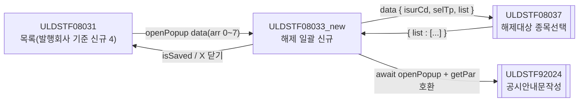
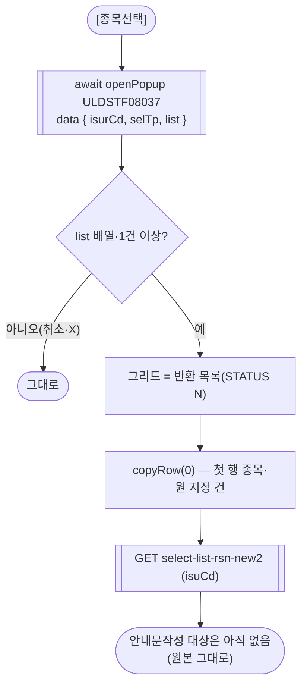
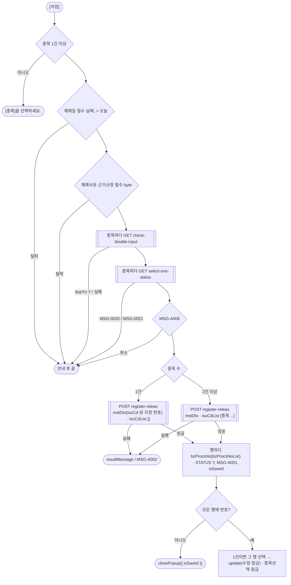
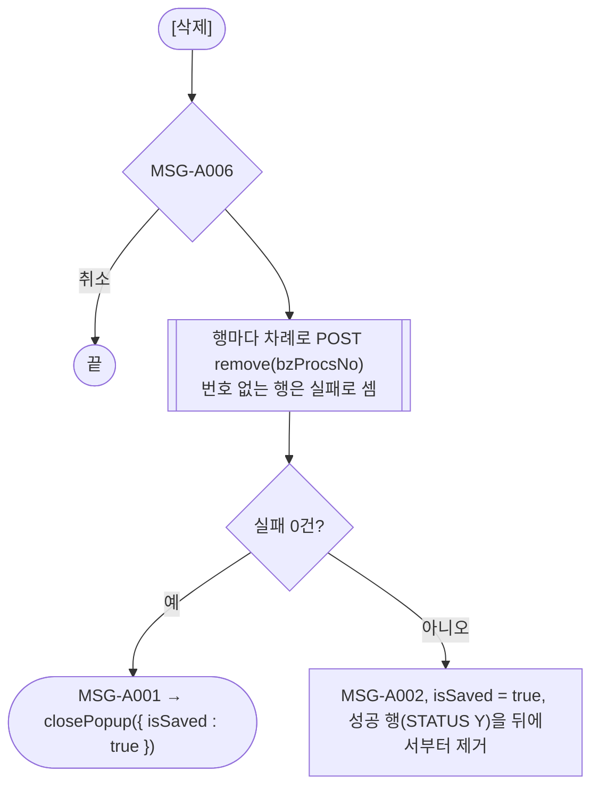
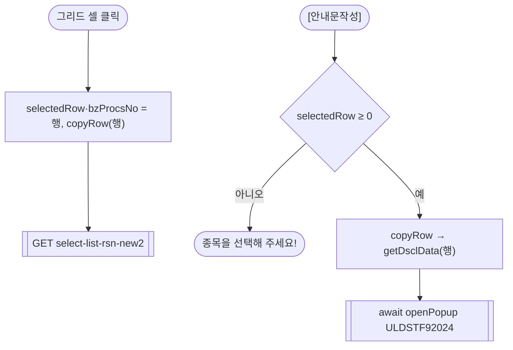
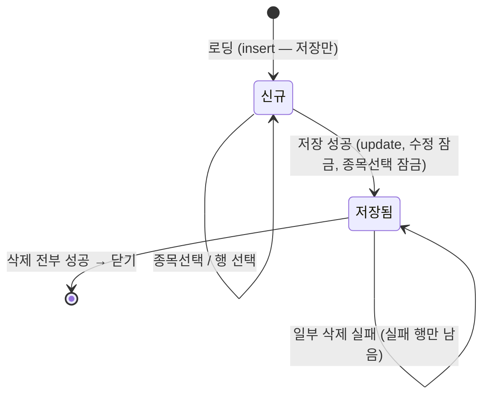

# ULDSTF08033_new (팝업)ETN 관리종목지정 해제(발행회사 기준 신규) — 업무 분석 및 전환 내역

| 항목 | 내용 |
|---|---|
| AS-IS | `/etn/ULDSTF08033_new.gfm` (Gauce/X-Internet, 740×560 모달 창 — 부모가 `window` 로 연다. 원본 `vScrenID` 는 `ULDSTF08033.gfm` 오기) — 반입 `conversion/conversion-front/ui/completed/ULDSTF08033_new/ULDSTF08033_new.gfm` |
| 신규 API 명세 | **공용** `conversion/conversion-front/ui/completed/ULDSTF08031/ULDSTF08031,ULDSTF08032,ULDSTF08032_new,ULDSTF08033,ULDSTF08033_new,ULDSTF08034,ULDSTF08037_API.md` 의 이 화면 블록 5종 — §1 `check-double-input`, §3 `select-list-rsn-new2`, §6 `select-one-status`, §12 `register-releas`, §14 `remove`. **§7 `select-one`·§9 `modify-releas` 블록 머리에 이 화면이 없다** — 신규 전용(수정은 08033). `api_spec_check` 가 묶음 머리 숫자 꼬리(`08033_new`)를 인식한다(2026-10-30 보강) |
| TO-BE | `conversion/conversion-front/ui-tobe/ULDSTF08033_new.xml` (배포 경로 `/ui/lst/etn/ULDSTF08033_new.xml` — 공통 계약서 §3) |
| 퍼블리싱 | 없음 — 캡처 + gfm 기준 마크업(가이드 §13.2 1단계) |
| 화면 캡처 | `ULDSTF08033_new.png`(신규 진입 — [종목선택] 버튼, 빈 종목(업무처리번호 열 포함)·지정사유 그리드, 하단 저장·수정·삭제·안내문작성·닫기) |
| 공통 계약서 | ETN 관리종목지정 7화면 공통 계약 — 08031 → 이 화면(발행회사 기준 신규 4), 이 화면 → 08037(§3.3) |
| 업무공통 | `$c.lc`(`isProcess`)·`$c.stf`(`getMessageParam`) — `cm/pcc/stf`. 게이트는 `--pcc stf` |
| 작성 | Inswave / 2026-10-30 |

참고 양식: [websquare_gfm_conversion.md](../../../md/websquare_gfm_conversion.md) — §1.4, §6.5. Gauce 대응은 [gfm_business_analysis_guide.md](../../../md/gfm_business_analysis_guide.md). 짝 화면: [ULDSTF08033](../ULDSTF08033/ULDSTF08033.md)(단건 해제·수정). 선례: `ui/completed/ULDSTF08303`(다건 종목 등록·행별 삭제·`toNoList`).

---

## 1. 화면 개요

상장 담당자가 **ETN 관리종목지정 목록(ULDSTF08031)** 에서 **발행회사 기준**으로 [신규] 해제(구분 4)를 누르면 열리는 팝업이다. 그 발행회사의 해제 대상 종목을 여러 건 골라 **한 번의 해제일·해제사유·근거규정으로 종목별 해제 건을 일괄 등록**한다.

1. [종목선택](ULDSTF08037)으로 공시 완료된 지정 건 중 아직 해제되지 않은 종목을 골라 그리드에 담는다. 첫 행의 원 지정 건(지정일·근거규정·기타)과 지정사유가 보인다.
2. 행을 클릭하면 그 종목의 원 지정 건·지정사유를 보여 주고 안내문작성 대상으로 둔다.
3. [저장]: 검증(종목 1건 이상, 해제일 익일 이후, 해제사유·근거규정 byte, 종목별 업무 중복입력) → 종목별 처리상태 → 확인 → 등록(종목마다 서버 채번) → 행마다 업무처리번호.
4. 저장 뒤 [삭제]·[안내문작성]만 쓸 수 있다. [수정]은 명세에 없어 늘 잠긴다(수정은 목록에서 08033 으로).
5. [삭제]: 행마다 차례로 삭제, 모두 성공하면 닫는다.

### 1.1 호출 화면 (1본)

- `ULDSTF08031` 관리종목지정 목록 — 「발행회사」 라디오 기준 [신규] + 신규등록구분 4(해제) → 이 화면(755×595, 원본 `fn_new_create_frame`). 수정(더블클릭)은 08033 을 연다.

### 1.2 호출 규약 (부모 → 이 화면) / 반환 규약

| arr | TO-BE 키 | 의미 | 사용 |
|---|---|---|---|
| 0 | `isurCd` | 발행기관코드 (`Isur_cd`) | 08037 data `isurCd`. 행을 고르면 그 행 값 |
| 1 | `isurNm` | 발행기관명 (`Isur_nm`) | 행을 고르면 그 행 `comNm` |
| 2 | `secugrpId` | 증권그룹ID | 받기만 함 |
| 3 | `mktId` | 시장구분코드 | 받기만 함 |
| 4 | `bzProcsNo` | 업무처리번호 | 신규 전용이라 빈 값 — 있으면 [종목선택] 잠금(원본 `fn_SetIsuCdBtnShow`) |
| 5 | `admisuDesignBzTpCd` | 관리종목지정업무구분코드 | 받기만 함(원본 `haltTpCd` 로 받고 쓰지 않음) |
| 6 | `isuCd` | 종목코드 | 받기만 함 — 대상 종목은 08037 로 고른다 |
| 7 | `selTp` | 선택 구분 1 종목 / 2 발행회사 / 3 전체 (`gubun`) | 08037 data `selTp`, 1 이면 [종목선택] 잠금 |

(원본은 arr[8] 을 받지 않는다 — 원 지정업무처리번호는 08037 행에서 얻는다.)

**반환**: 저장 성공 → `scwin.isSaved = true`. 삭제 전부 성공 → `closePopup({ isSaved : true })`. 그 밖은 X → `{ isCloseButtonClick }`. 부모는 `isSaved || isCloseButtonClick` 이면 재조회(원본 `fn_parentRefresh` 대체).

### 1.3 이 화면이 여는 하위 팝업

| 팝업 | AS-IS 호출 | TO-BE (`data`) | 반환 / 취소 판정 |
|---|---|---|---|
| `ULDSTF08037` 해제대상 종목선택 (510×430) | `img_SetIsuCd` onclick: `fn_GetPar = fn_GetParIsu; fn_SetPar = fn_SetParIsu;` + `CreateDialogFrame("DLG_ETN_CODE", "../etn/ULDSTF08037.gfm", …)` | `{ isurCd, selTp, list : 지금 그리드 행 }`(`fn_GetParIsu` arr0·arr1 + `CopyDataSet(dts_Isu_Mst_Temp, param_dts)`) | `{ list : [...] }`(명세 §2 응답 15열 행). `!Array.isArray(res?.list) \|\| res.list.length === 0` 이면 취소 |
| `ULDSTF92024` 공시안내문작성 (745×825) | `fn_dscl` 임시 `fn_GetPar` + `CreateDialogFrame` | `{ formCd:"68345", bzProcsNo, isurCd, mktId:"1", isuNm, isu, mst, rsn }` + 호환용 `scwin.getPar` | 반환 없음(`await`) |

### 1.4 업무 프로세스 흐름

#### 화면 간 흐름

#### 업무 1: 진입·로딩

| 단계 | 처리 | 근거 |
|---|---|---|
| 1 | 버튼 잠금 → `getParameter` → 오늘 → 달력 바인딩 2개 | §3 |
| 2 | `initNewForm` — 그리드·원 지정 건·지정사유 비움, 근거규정 기본값 | §6.1 |
| 3 | `setIsuBtnState` — `selTp === "1"` 또는 업무처리번호 있음 → [종목선택] 잠금 | §6.2 |
| 4 | `insert`(저장만) | §6.6 |

통신 없음(원본 `fn_new_onload` 의 `getGauceDataHeader` 는 헤더만 받는 호출 — dataList 정의로 대체).

#### 업무 2: 종목 선택

#### 업무 3: 일괄 저장

#### 업무 4: 삭제

#### 업무 5: 행 선택 · 안내문작성

#### 화면 모드 상태 전이

---

## 2. 화면 구성 및 데이터 정의

### 2.1 화면 구성

| AS-IS 요소 | 종류 | TO-BE id / 컴포넌트 | 비고 |
|---|---|---|---|
| `panel_3` | panel | `panel_3` tblbox | `PanelToGroupBox` 대체 |
| `label_10`·`label_2` | 「1. 관리종목지정 종목」 | `label_2` (`req`) | |
| `img_SetIsuCd` | 이미지 버튼 「종목선택」 | `img_SetIsuCd` `xf:trigger btn_cm`(라벨 칸 안, 캡처 위치) | 잠금은 `setDisabled`(원본 `.src` 교체·`.disabled`) |
| `grid_1` (`dts_Isu_Mst_Temp`) | 그리드 | `grd_isu` (`dlt_isuTemp`) | `BZ_PROCS_NO`(숨김 첫 열, 옮기지 않음)·`ISU_CD` 종목코드·`ISUR_NM` 발행회사·`ISU_NM` 종목명·`LIST_DD` 상장일(규칙 46)·`BZ_PROCS_NO` 업무처리번호 |
| `label_8`·`label_1` | 「2. 관리종목지정일」 | `label_1` (`req`) | |
| `edt_MktactEnforceDd` | maskedit 읽기 전용 | inputCalendar `readOnly` | `bnd_Mst_Bf` → `dma_mstBf.mktactEnforceDd` |
| `label_11`·`label_5` | 「3. 지정사유」 | `label_5` (`req`) | |
| `MxGrid_1` (`dts_Rsn`) | 그리드 | `grd_rsn` (`dlt_listRsnNew2`) | `BZ_PROCS_NO` 업무처리번호(숨김, 옮기지 않음)·`ADMISU_DESIGN_RSN_CD` 사유코드·`ADMISU_DESIGN_RSN_NM` 사유내용 |
| `label_12`·`label_6` | 「4. 근거규정」 | `label_6` (`req`) | |
| `txb_AdmisuDesignGrndRegulNm` | 읽기 전용 | `xf:input readOnly` | `dma_mstBf.grndRegulNm` |
| `label_7` / `txa_Remk` | 「5. 기타」 / textarea 읽기 전용 | `label_7` / `xf:textarea readOnly` | `dma_mstBf.remk` |
| `panel_2` | panel(해제 입력) | `panel_2` tblbox | 검증 범위 |
| `label_17`·`label_9` / `edt_MktactEnforceEndDd` + `img_MktactEnforceDd` | 「1. 관리종목지정 해제일」 / maskedit + 달력 아이콘 | `label_9` (`req`) / inputCalendar | 아이콘은 옮기지 않음. `dma_registerReleasMstDto.mktactEnforceDd` |
| `lbl_2`·`label_16` / `txa_RelRsnContn` | 「2. 해제 사유」 / textarea | `label_16` (`req`) / `xf:textarea` | `dma_registerReleasMstDto.admisuRsnContn` |
| `lbl_1` / `txb_RelAdmisuDesignGrndRegulNm` | 「3. 근거규정」 / textbox | `lbl_1` / `xf:input maxlength="1000"` | 캡처에 `*` 없음 — 검증은 필수(§8 #7). `dma_registerReleasMstDto.grndRegulNm` |
| `btn_Save`·`btn_Update`·`btn_Delete`·`btn_Dscl` | 이미지 버튼 | `grpBtnBox` 같은 id | 규칙 41. `btn_Update` 는 캡처대로 두되 `disabled` + 핸들러 없음(§10 #1) |
| `btn_Close` | 닫기 | (옮기지 않음) | 팝업 하단 닫기 금지 |

### 2.2 데이터 정의

| AS-IS | TO-BE | 종류 | 키 | 비고 |
|---|---|---|---|---|
| `dts_Isu_Mst_Temp` | `dlt_isuTemp` | dataList (화면 전용) | `isuCd`·`isuNm`·`isurCd`·`isurNm`·`comNm`·`listDd`·`bzProcsNo`·`mktactEnforceDd`·`grndRegulNm`·`remk`·`admisuDesignBzProcsNo`·`status` | 08037 반환 행(명세 §2 15열 중 11열) + 처리결과. 해제·사유변경 쪽 7키(`mktactReleasDd` 등)는 08037 행에 없고 쓰지 않는다 |
| `dts_Isu` (`fn_copy_dts` 로 1행) | (없앰) | — | — | 대상 행은 `dlt_isuTemp` 의 `selectedRow` 로 대체, 안내문 `isu` 는 그 행 1건 |
| `dts_Mst_Bf` (+`bnd_Mst_Bf`) | `dma_mstBf` | dataMap (화면 전용) | `mktactEnforceDd`·`grndRegulNm`·`remk` | `fn_copy_dts` 가 채우던 원 지정 건 3항목 |
| `dts_Mst` (+`bnd_Mst`) | `dma_registerReleasMstDto` | dataMap | `bzProcsNo`·`isuCd`·`mktactEnforceDd`·`grndRegulNm`·`admisuRsnContn`·`admisuDesignBzProcsNo`·`remk` | 명세 §12 mstDto 원문 — 해제 입력 폼을 직접 바인딩 |
| `dts_Rsn` | `dlt_listRsnNew2` | dataList | `admisuDesignRsnCd`·`admisuDesignRsnNm` | 명세 §3 |
| `dts_BZ_CHECK` | `dma_checkDoubleInput` | dataMap | `disclsProcsDdtm`·`disclsProcsStatCd`·`dupYn` | 명세 §1 |
| `dts_Status` | `dma_oneStatus` | dataMap | `bzProcsNo`·`mktactEnforceDd`·`admisuDesignBzTpCd` | 명세 §6 |
| (응답) | `dma_resultSave` | dataMap | `bzProcsNo`·`bzProcsNoList`·`result`·`resultMessage` | 명세 `dlt_resultSave`(dataList) — body 한 건 객체라 dataMap(§10 #3) |
| `dts_BzProcsNo` | (없앰) | — | — | 서버 채번 |

- AS-IS 컬럼 → TO-BE 키: `ISU_CD→isuCd`, `ISU_NM→isuNm`, `ISUR_CD→isurCd`, `ISUR_NM→isurNm`, `COM_NM→comNm`, `LIST_DD→listDd`, `BZ_PROCS_NO→bzProcsNo`, `MKTACT_ENFORCE_DD→mktactEnforceDd`, `GRND_REGUL_NM→grndRegulNm`, `REMK→remk`, `ADMISU_DESIGN_BZ_PROCS_NO→admisuDesignBzProcsNo`, `STATUS→status`, `ADMISU_DESIGN_RSN_CD/NM→admisuDesignRsnCd/Nm`, `ADMISU_RSN_CONTN→admisuRsnContn`.
- 날짜 열 `listDd` 규칙 46. 숫자 입력 없음(규칙 48 해당 없음).

---

## 3. 로딩 (`gform onload` → `scwin.onpageload` → `scwin.init`)

AS-IS: `fn_GetPar(arrPar)`(arr 0~7) → `buttonSet.set*Info` → `fn_SetIsuCdBtnShow(gubun)` → 업무처리번호가 없으면 `fn_new_onload()`·`isFirstNew = true` → `PanelToGroupBox`.

TO-BE `scwin.init`: ① 버튼 잠금 ② `getParameter` ③ `todayDd` ④ `checkCalendarFormat(edt_MktactEnforceDd)`·`checkCalendarFormat(edt_MktactEnforceEndDd)`(규칙 37, 조회 영역 없음 → Enter 바인딩 해당 없음) ⑤ `initNewForm` ⑥ `setIsuBtnState` ⑦ `insert`.

원본 `fn_new_onload` 의 `gubun == "1"` 분기(`/etn/EtnCodeAct.do?method=searchEtnCode` 로 종목 한 건 조회)는 명세에 대응 API 가 없고, 08031 은 발행회사 기준에서만 이 화면을 연다(공통 계약서 §2) — 옮기지 않고 §10 #2.

---

## 4. 컴포넌트 이벤트

| AS-IS 이벤트 | TO-BE 핸들러 | 동작 |
|---|---|---|
| `img_SetIsuCd` onclick | `scwin.img_SetIsuCd_onclick` → `scwin.openIsuPopup` | §6.5 |
| `grid_1` OnClick(row, colid) → `fn_SelectGridRow` | `scwin.grd_isu_oncellclick` → `scwin.selectGridRow` | §6.4 |
| `btn_Save` (`fn_save`) | `scwin.btn_Save_onclick` → `scwin.save` | §6.6 |
| `btn_Update` (`fn_update`) | (없음 — 늘 잠김) | §8 #2, §10 #1 |
| `btn_Delete` (`fn_delete`) | `scwin.btn_Delete_onclick` → `scwin.remove` | §6.7 |
| `btn_Dscl` (`fn_dscl`) | `scwin.btn_Dscl_onclick` → `scwin.writeDscl` | §6.8 |
| `btn_Close` / `img_MktactEnforceDd` | (옮기지 않음) | |
| `trs` OnSuccess / OnFail (trsCnt·trsTotalCnt·trsErrCnt 집계) | 일괄 등록 한 번 + 행별 삭제 `await` 집계 | §6.6·§6.7 |
| `dts_Isu`·`dts_Isu_Mst_Temp`·`dts_Rsn`·`dts_Mst`·`dts_Mst_Bf` OnLoadError (`alert_error`) | 공통 오류 안내 | 삭제 |
| `dts_Isu` OnLoadCompleted(`AddRow`)·`dts_Mst`/`dts_Mst_Bf` OnLoadCompleted(신규 `AddRow`, 근거규정 기본값, `setInsertStatus`) | `scwin.initNewForm` + `insert` | §6.1 |
| `dts_Isu_Mst_Temp` OnLoadCompleted (빈 핸들러) | 삭제 | |

---

## 5. 서버 통신

#### API 명세 대응 (공용 명세의 이 화면 블록)

| AS-IS | TO-BE (명세) | 함수 |
|---|---|---|
| `fn_search` DIV_IDX `ADMISU_RSN_BF`·TRS_IDX `NEWSEL2` | `GET /api/listing/lstproc/etn/adm-isu/select-list-rsn-new2` (§3) | `scwin.selectRsn` |
| `fn_CheckForm` 의 종목별 `fn_check_bz_doubleinput_etn` | `GET …/check-double-input` (§1) | `scwin.checkDoubleInput` |
| `fn_save` 의 종목별 `fn_getMstStatus_etn` | `GET …/select-one-status` (§6) | `scwin.checkMstStatus` |
| `fn_save` 의 종목별 `fn_getNewBzProcNo` + `fn_save_trs`(INSERT) | `POST …/register-releas` (§12) — 한 번에 | `scwin.registerTrs` |
| `fn_delete` 의 종목별 `fn_save_trs`(DELETE) | `POST …/remove` (§14) — 행마다 | `scwin.removeTrs` |
| `fn_update` 의 종목별 `fn_save_trs`(UPDATE) | (명세에 이 화면 없음) | 옮기지 않음 |
| `fn_new_onload` 의 `searchEtnCode`(gubun 1) | (명세 없음) | 옮기지 않음 |

#### 명세 ↔ AS-IS 차이 (→ §10)

1. **수정·상세 조회 없음** — `modify-releas`·`select-one` 블록 머리에 08033_new 가 없다. 원본 `fn_update`(종목별 수정)는 옮기지 않고 [수정]을 잠근다.
2. **일괄 등록** — 원본은 종목마다 채번·`trs.Post` 를 연달아 던지고 OnSuccess/OnFail 에서 `trsCnt` 로 집계했다(응답 순서가 바뀌면 다른 행에 번호가 들어갈 수 있음). 명세 `register-releas` 는 `isuCdList` 로 한 트랜잭션·종목마다 서버 채번·원 지정 번호 서버 조회 → 한 번 호출하고 `bzProcsNoList` 를 요청 순서대로 적는다. 1건이면 단건(`isuCdList []` + `mstDto.isuCd`·원 지정 번호).
3. 원본 전송 `dts_Rsn`·`SCREN_ID`·`SCREN_PROCES_TP_CD`·`LIST_BZ_TP_CD`(713)·`COUNT`·`LD_MKT_TP_CD`·`DIV_IDX`·`ISUR_CD` 는 보내지 않는다.
4. 채번(`fn_getNewBzProcNo`, MSG-0010) 없앰 — 서버 채번.
5. 처리상태(§6)는 명세가 「저장 전 호출 필요 없음」이라 했지만 원본처럼 종목마다 저장 전 안내.
6. 삭제 전 공시 승인 확인은 원본에서도 주석(`//if (! fn_check_delete_discls…`) — 명세 `remove` 가 서버에서 거부.
7. 응답 `dlt_resultSave` 는 dataMap 으로 받는다.

### 5.1 지정사유 조회 (`scwin.selectRsn`)

`{ isuCd : 고른 행 종목 }` → `dlt_listRsnNew2=body`. 종목이 없으면 비운다.

### 5.2 업무 중복입력 체크 (`scwin.checkDoubleInput`)

종목마다 `{ isuCd : 행, mktactEnforceDd : 해제일, bzProcsNo : scwin.bzProcsNo }` — 하나라도 `dupYn Y` 면 pcc 문구로 안내 후 false.

### 5.3 처리상태 확인 (`scwin.checkMstStatus`)

종목마다 `{ isuCd }` — 최근 시행일 ≥ 해제일 → MSG-0020, 최근 건 없음·해제(4) → MSG-0021(08033 §5.4 와 같은 규칙).

### 5.4 일괄 등록 (`scwin.registerTrs`)

- `dma_registerReleasMstDto`(폼) 에 `bzProcsNo ""`·`isuCd`(첫 행)·`admisuDesignBzProcsNo`(1건이면 그 행, 다건이면 빈 값 — 서버가 종목별로 찾음).
- `requestData = { mstDto, isuCdList : 1건이면 [] / 다건이면 행 종목코드 배열 }`, `mediatype application/json`, target `dma_resultSave=body`.
- 성공이면 `toNoList(body.bzProcsNoList)`(배열 또는 쉼표 문자열) → 행마다 `bzProcsNo`·`status Y`. 1건인데 목록이 비면 `bzProcsNo` 를 쓴다.

### 5.5 행 삭제 (`scwin.removeTrs(row)`)

행 `bzProcsNo` 가 없으면 호출하지 않고 실패. `{ bzProcsNo }` → 성공 여부를 행 `status`(Y/N) 로.

---

## 6. 일반 함수

### 6.1 신규 준비 (`scwin.initNewForm`)

그리드·지정사유·원 지정 건 비우고 `selectedRow = -1`, 폼(`dma_registerReleasMstDto`)을 비우고 근거규정 기본값.

### 6.2 종목선택 잠금 (`scwin.setIsuBtnState`) — 원본 `fn_SetIsuCdBtnShow`

`selTp === "1"` 또는 업무처리번호 있음 → `img_SetIsuCd.setDisabled(true)`. 저장 성공 뒤에는 `save` 가 잠근다(원본 `fn_SetIsuCdBtnShow(1)`).

### 6.3 행 값 옮기기 (`scwin.copyRow`) — 원본 `fn_copy_dts`

행의 `isuCd`·`isurCd`·`comNm`(→`isurNm`)·`admisuDesignBzProcsNo` 를 화면 상태값으로, `mktactEnforceDd`·`grndRegulNm`·`remk` 를 `dma_mstBf` 로. 원본이 `dts_Isu` 1행·`dts_Mst` 에 함께 쓰던 값은 등록 시 `registerTrs`·안내문 시 `getDsclData` 가 행에서 직접 만든다.

### 6.4 행 선택 (`scwin.selectGridRow`) — 원본 `fn_SelectGridRow`

`selectedRow`·`bzProcsNo` = 행 → `copyRow` → `selectRsn`.

### 6.5 종목 선택 (`scwin.openIsuPopup`) — getPar/setPar → `openPopup` data + `await`

| AS-IS | TO-BE |
|---|---|
| `fn_GetParIsu(arrPar, param_dts)` arr[0] `Isur_cd`, arr[1] `gubun`, `CopyDataSet(dts_Isu_Mst_Temp, param_dts)` | `data = { isurCd, selTp, list : dlt_isuTemp.getAllJSON() }` — 08037 이 `list` 로 오른쪽 목록을 미리 채움 |
| `fn_SetParIsu(param_dts)` — `CopyDataSet(param_dts, dts_Isu_Mst_Temp)`, 전 행 `STATUS = "N"`, `fr_bz_procs_no` = 1행, `fn_copy_dts(1)`, `fn_search()` | 반환 `{ list }` → 그리드 교체(`status "N"`) → `bzProcsNo` = 첫 행 → `copyRow(0)` → `selectRsn` |
| 취소(원본 `fn_SetPar` 미호출) | `!Array.isArray(res?.list) \|\| res.list.length === 0` → 아무것도 안 함 |

`await $c.win.openPopup("/ui/lst/etn/ULDSTF08037.xml", { id:"ULDSTF08037", popupName:"관리종목지정종목선택", width:510, height:430, type:"pageFramePopup" }, data)`.

### 6.6 저장 (`scwin.save`) — 원본 `fn_save` + `trs OnSuccess`

`validate`(종목 1건 이상 → 해제일 필수·날짜·익일 이후 → 해제사유·근거규정 필수·2000/200 byte → 종목별 중복입력) → `checkMstStatus` → `isProcess("I")` → `registerTrs`. 실패: `resultMessage` 또는 MSG-A002. 성공: MSG-A001, `isSaved = true` → 번호 없는 행이 있으면 `closePopup({ isSaved : true })`, 아니면 1건이면 `selectGridRow(0)` → `setButtonState("update", { override : { modify : false } })` → `img_SetIsuCd` 잠금.

### 6.7 삭제 (`scwin.remove`) — 원본 `fn_delete` + OnSuccess/OnFail D 분기

`isProcess("D")` → 행마다 `removeTrs` → 실패 0 이면 MSG-A001 + `closePopup({ isSaved : true })`. 실패가 있으면 MSG-A002(또는 `resultMessage`), `isSaved = true`, `status Y` 행을 뒤에서부터 제거(원본 OnFail 의 `STATUS == "Y"` 행 `DeleteRow`).

### 6.8 공시안내문작성 (`scwin.writeDscl` · `scwin.getDsclData` · `scwin.getPar` · `scwin.fillDataList`) — 원본 `fn_dscl`

`selectedRow < 0` → 「종목을 선택해 주세요!」(원본 `selectedGrdNum == 0`). 아니면 `copyRow(selectedRow)` 후:

| AS-IS `fn_GetPar` | TO-BE | 값 |
|---|---|---|
| `arr[0]` | `formCd` | `"68345"` |
| `arr[1]` | `bzProcsNo` | 대상 행 `bzProcsNo` |
| `arr[2]` | `isurCd` | 대상 행 `isurCd` |
| `arr[3]` | `mktId` | `"1"` |
| `arr[5]` | `isuNm` | `dts_Isu_Mst_Temp.NameValue(selectedGrdNum, "ISU_NM")` → 행 `isuNm` |
| `CopyDataSet(dts_Isu, …)` | `isu` | 대상 행 1건 |
| `CopyDataSet(dts_Mst, …)` + `COM_NM` | `mst` | 폼 + 행 `bzProcsNo`·`isurCd`·`isuCd`·`admisuDesignBzTpCd "4"`·원 지정 번호·`comNm` |
| `CopyDataSet(dts_Rsn, param_dts2)` | `rsn` | `dlt_listRsnNew2` |

호환용 `scwin.getPar(arr, dltIsu, dltMst, dlt2)` 는 대상 행이 없으면 아무것도 채우지 않는다.

### 6.9 응답 판정 · 번호 목록 (`scwin.isSaveSuccess` · `scwin.toNoList`)

성공 = `success === true && result !== "F"`. `toNoList` 는 배열이면 그대로, 문자열이면 쉼표로 나눈다(08303 선례).

---

## 7. 업무 코드 · 메시지 목록

### 7.1 코드

| 코드 | 값 | 쓰는 곳 |
|---|---|---|
| 관리종목지정업무구분코드 | 4 해제 | `TP_CD_RELEAS` — 처리상태·안내문 mst |
| 선택 구분 `selTp` | 1 종목(→[종목선택] 잠금), 2 발행회사, 3 전체 | `SEL_TP_ISU`, 08037 data |
| 공시안내문 서식 | 68345 | `DSCL_FORM_CD` |
| 처리결과 `result` / 행 `status` | S·F / Y·N | 응답 판정 / 행 처리결과 |

### 7.2 메시지

| 메시지 | 문구 | 시점 |
|---|---|---|
| (화면) | 「[종목]을 선택하세요.」 | 종목 0건 저장 |
| (화면) | 「[해제일]을 익일 이후로 입력하세요.」 | 검증 |
| (화면) | 「[업무명]건으로 처리일시에  이미 입력되어있습니다.」 | 중복입력 |
| MSG-0020 / MSG-0021 | 처리상태 | 저장 전 |
| MSG-A006 / MSG-A001 / MSG-A002 | 처리 확인 / 성공 / 실패 (원본 `fn_alertMsg('S'/'F')`) | 저장·삭제 |
| (화면) | 「종목을 선택해 주세요!」(원본 뒤 공백 제거) | 안내문작성 대상 없음 |
| MSG-0010 | 채번 오류 — 없앰 | — |

---

## 8. 원본 특이사항 · 결함

| # | 내용 | 결정 |
|---|---|---|
| 1 | `vScrenID = "ULDSTF08033.gfm"` 오기, `var fn_GetPar , fn_SetPar ;;` | 고침 — `scwin.screenId = "ULDSTF08033_new"` |
| 2 | `fn_update` 는 종목별 수정을 보내지만 명세에 이 화면의 수정이 없다 | 옮기지 않음 — [수정] 잠금 |
| 3 | 저장·수정·삭제 `trs.Post` 를 응답을 기다리지 않고 연달아 던지고 `trsCnt` 로 OnSuccess/OnFail 를 짝지음 — 응답 순서가 바뀌면 다른 행에 번호·상태가 들어감 | 고침 — 등록은 한 번, 삭제는 행마다 `await` |
| 4 | `fn_save` 는 채번이 14자리가 아니면 안내만 하고 다음 종목을 계속 | 해당 없음 — 서버 채번 |
| 5 | `fn_save_trs` 의 `trs.Action` 이중 대입 | 고침 |
| 6 | `onload` 에서 arr[5] 를 선언 없는 전역 `haltTpCd` 로 받음(쓰지 않음) | 고침 — `scwin.tpCd` |
| 7 | 해제 근거규정 라벨에 `*` 없음, 검증은 필수 | 유지(캡처 라벨) |
| 8 | `fn_parentRefresh` 가 부모 함수 이름 직접 호출 | 고침 — 반환 규약 |
| 9 | `fn_SetParIsu` 뒤 안내문작성 대상(`selectedGrdNum`)이 정해지지 않아, 1건이어도 클릭하지 않으면 「종목을 선택해 주세요!」 | 유지(저장 성공 뒤 1건이면 자동 선택 — 원본과 같음) |
| 10 | `fn_check_chk_MktactApplObjTpCd`(부르는 곳 없음)·`fn_drft`·`fn_makt` 빈 함수·`isFirstNew` | 옮기지 않음 |
| 11 | 그리드 숨김 열 `BZ_PROCS_NO` | 옮기지 않음 |

---

## 9. 전환 내역 (AS-IS → TO-BE)

| AS-IS | TO-BE |
|---|---|
| `gform onload` | `scwin.onpageload` → `scwin.init` |
| `fn_new_onload` | `scwin.initNewForm` (gubun 1 분기는 옮기지 않음 — §10 #2) |
| `fn_search` | `scwin.selectRsn` |
| `fn_GetParIsu`·`fn_SetParIsu` + `img_SetIsuCd` onclick | `scwin.img_SetIsuCd_onclick` → `scwin.openIsuPopup` |
| `fn_copy_dts` | `scwin.copyRow` |
| `fn_SelectGridRow` + `grid_1` OnClick | `scwin.grd_isu_oncellclick` → `scwin.selectGridRow` |
| `fn_SetIsuCdBtnShow` | `scwin.setIsuBtnState` |
| `fn_CheckForm` (+종목별 `fn_check_bz_doubleinput_etn`) | `scwin.validate` + `scwin.checkDoubleInput` |
| `fn_save` (+종목별 `fn_getMstStatus_etn`·`fn_getNewBzProcNo`) | `scwin.save` + `scwin.checkMstStatus` + `scwin.registerTrs` |
| `fn_update` | 옮기지 않음(명세 없음) |
| `fn_delete` | `scwin.remove` + `scwin.removeTrs` |
| `fn_save_trs` | `registerTrs`·`removeTrs` |
| `fn_dscl` | `scwin.btn_Dscl_onclick` → `scwin.writeDscl` + `scwin.getDsclData` (+ 92024 호환용 `scwin.getPar`·`scwin.fillDataList`) |
| `fn_parentRefresh` | 삭제 — `scwin.isSaved` / `closePopup({ isSaved : true })` / X |
| `fn_drft`·`fn_makt`·`fn_check_chk_MktactApplObjTpCd` | 삭제 |
| `trs` OnSuccess/OnFail 집계 | `scwin.save`·`scwin.remove` 의 `await` 집계 + `scwin.isSaveSuccess`·`scwin.toNoList` |
| buttonSet `set*Info`·`setInsertStatus`·`setUpdateStatus`·`setDeleteStatus` | `ev:onclick` + `$c.util.setButtonState`(insert / update + `modify` 잠금) |

- publicInfo: 정의한 26함수 전부. 전역 상수·상태는 등재하지 않는다.
- 게이트: `gate_screen --pcc stf`·`scan_mixed_compare`(A 6건 — `getRowCount() === 0`·`length === 1`·`errCnt === 0` 등 숫자 비교, 의도)·`publish_gate --before 1단계 사본 --allow P20`·`api_spec_check`(공용 명세, 이 화면 5종 호출)·`init_binding_check`·`wsxml_lint` 0/0, `convert.py` 고정점.

---

## 10. 남은 작업 (TODO)

1. **수정 경로** — 명세에 이 화면의 `modify-releas`·`select-one` 이 없어 [수정]을 잠갔다(캡처에는 있음). 저장한 건은 목록(08031)에서 더블클릭해 08033 으로 수정하는 것이 맞는지 확인.
2. **종목 기준(gubun 1) 진입** — 원본 `fn_new_onload` 의 종목 한 건 조회(`searchEtnCode`) 대응 API 가 없다. 08031 이 이 화면을 종목 기준으로 여는 경우가 없는지(공통 계약서 §2) 확인.
3. **등록 응답** — `bzProcsNoList` 가 배열인지 쉼표 문자열인지, 1건 등록에도 오는지, `result` 를 비워 보내는 경우가 있는지. 번호가 없으면 저장 뒤 팝업을 닫는다.
4. **다건 등록의 원 지정 번호** — 다건은 `mstDto.admisuDesignBzProcsNo` 를 비워 서버가 종목별로 찾게 했다(명세 문구). 08037 행에 이미 `admisuDesignBzProcsNo` 가 있으니 서버 조회와 같은 값인지 확인.
5. **일괄 등록의 트랜잭션** — 원본은 종목별 독립 저장(일부 성공 가능), 명세는 한 트랜잭션(전부 실패). 일부 성공을 기대하는 업무가 없는지.
6. **ULDSTF92024 계약** — 경로 가정, `getParameter` 수신으로 바뀌면 `scwin.getPar`·`scwin.fillDataList` 삭제.
7. **08037 계약 대조** — 08037(묶음 A)은 `data { isurCd, selTp, list }` 를 받고 `{ list }`(명세 15열) 를 돌려준다(코디네이터 확인). 08033_new 는 그 안의 11열만 쓴다.
8. **부모 08031 계약** — 08031 이 발행회사 기준 신규 4 에서 arr 0~7 로 열고 `isSaved || isCloseButtonClick` 으로 재조회하는지. 크기 755×595 는 contentHeader 추가 후 조정 확인.
9. **배포 경로** `/ui/lst/etn/ULDSTF08033_new.xml` 가정.
