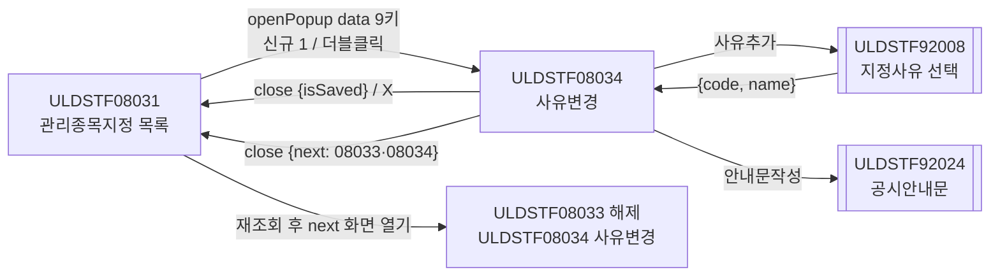
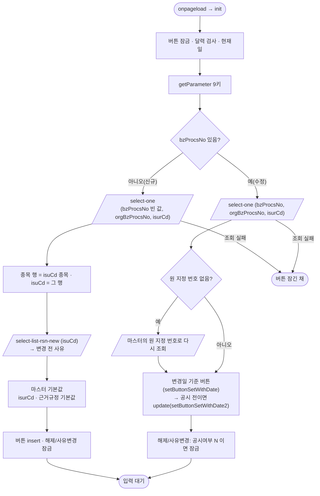
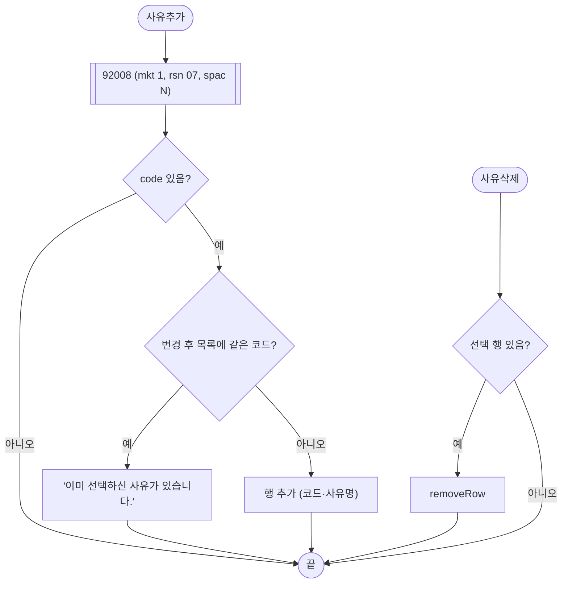
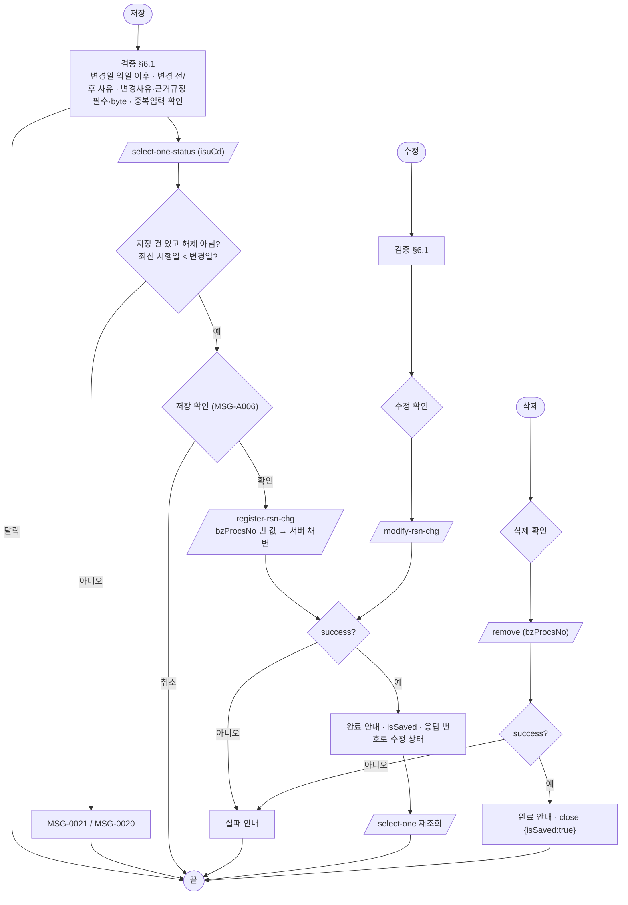
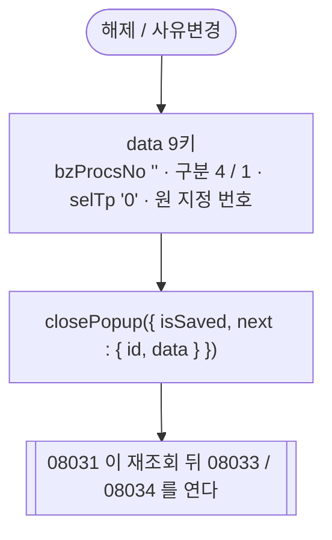
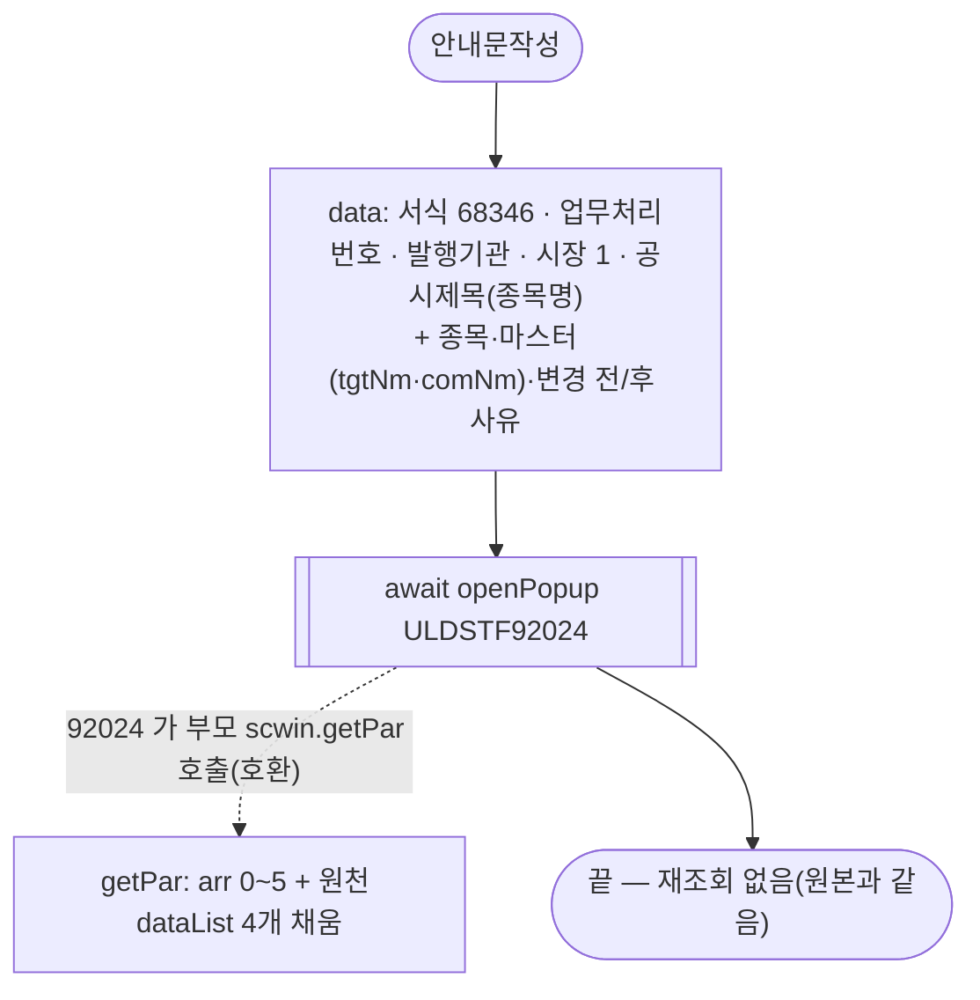
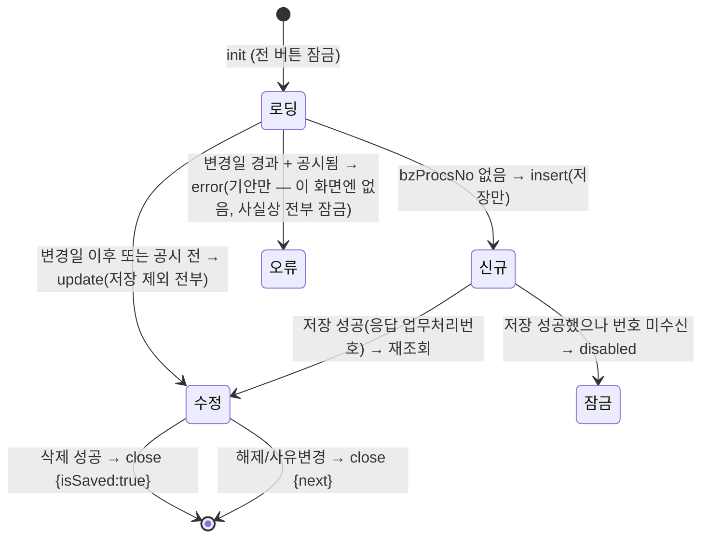

# ULDSTF08034 (팝업)ETN 관리종목지정 사유변경 — 업무 분석 및 전환 내역

| 항목 | 내용 |
|---|---|
| AS-IS 원본 | `ULDSTF08034.gfm` (Gauce, `/etn/ULDSTF08034.gfm`) — 반입 `conversion/conversion-front/ui/ULDSTF08034/ULDSTF08034.gfm`(ETN 관리종목지정 7화면 묶음 `ULDSTF08031_관리종목지정(ETN)` 을 화면별 폴더로 나눔, 2026-10-30) |
| 신규 API 명세 | **7화면 공용** `conversion/conversion-front/ui/completed/ULDSTF08031/ULDSTF08031,ULDSTF08032,ULDSTF08032_new,ULDSTF08033,ULDSTF08033_new,ULDSTF08034,ULDSTF08037_API.md` 의 이 화면 블록 7종 — ① check-double-input · ④ select-list-rsn-new · ⑥ select-one-status · ⑦ select-one · ⑩ modify-rsn-chg · ⑬ register-rsn-chg · ⑭ remove (모두 `/api/listing/lstproc/etn/adm-isu/` 아래). 블록 머리가 `[ULDSTF08032/08032_new/08033/08033_new/08034]` 묶음 표기 — `api_spec_check` 가 공용 파일명·숫자 꼬리 표기를 인식(2026-10-30 보강)해 `--spec` 없이 대조 |
| TO-BE | `conversion/conversion-front/ui-tobe/ULDSTF08034.xml` (배포 경로 `/ui/lst/etn/ULDSTF08034.xml` — 원본 `../etn/ULDSTF08034.gfm`, 공통 계약서 §3). 1단계 캡처+gfm 기준 마크업(사본 `$CLAUDE_JOB_DIR/tmp/ULDSTF08034_stage1.xml`) → 2단계 스크립트. 게이트: `gate_screen --pcc stf`·`scan_mixed_compare`(A 3건 — `getRowCount() === 0` 2·`length !== 8` 숫자 비교, 의도)·`publish_gate --before {1단계} --allow P20`(P22·P24 는 스크립트 전환분)·`api_spec_check`(공용 명세 자동 탐지, 7종 모두 호출)·`init_binding_check`·`wsxml_lint` 0/0, `convert.py` 고정점 |
| 퍼블리싱 파일 | 없음 — 캡처 기준(화면 폴더·`conversion/publish/` 에 이 ID 의 xml 이 없다). 마크업 꼴은 같은 날 전환한 팝업 선례 ULDSTF09341·09042(그리드 옆 세로 버튼 `lybox` + `col_fix flex flex_column`)를 따랐다 |
| 화면 캡처 | `ULDSTF08034.png` — 수정 상태(원 지정 건 KRG551100156 NH투자증권 QV 제약 TOP5 ETN, 지정일 2016-06-09, 변경일 2016-06-10) |
| 업무공통 | pcc(`cm/pcc/stf`): `$c.lc.popFindClssLstRsnCd`(ULDSTF92008)·`$c.lc.isProcess`·`$c.stf.getMessageParam`·`$c.stf.setButtonSetWithDate`·`$c.stf.setButtonSetWithDate2`. gcc: `$c.data.getParameter`·`$c.data.getMessage`·`$c.date.checkCalendarFormat`·`$c.date.getServerDateTime`·`$c.validate.validateDataCollect`·`$c.util.setButtonState`·`$c.util.isEmpty`·`$c.win.alert`·`$c.win.openPopup`·`$c.win.closePopup`·`$c.sbm.executeDynamic`·`$c.exception.handleError`. 게이트는 `--pcc stf` |
| 공통 계약서 | ETN 관리종목지정 7화면 공통 계약서(§3.1 data 키, §3.2 형제 팝업 전환 `next`, §4 92024) — 작업 임시 `$CLAUDE_JOB_DIR/tmp/etn0803x_contracts.md` |
| 작성 | Inswave / 2026-10-30 |

참고 양식: [websquare_gfm_conversion.md](../../../md/websquare_gfm_conversion.md) — §1.4 업무 프로세스 흐름, §6.5 getPar/setPar 전환. Gauce 대응은 [gfm_business_analysis_guide.md](../../../md/gfm_business_analysis_guide.md) §5·§6.

---

## 1. 화면 개요

ETN 관리종목 담당자가 **이미 관리종목으로 지정된 ETN 의 지정사유를 바꾸는(사유변경) 입력 팝업**이다. 위 표는 원 지정 건(조회 전용), 아래 표가 이번 사유변경 입력이다.

1. 업무처리번호가 없으면 **신규** — 원 지정 건과 그 종목을 보여 주고, 변경 전 사유를 해제 건 이후 최신 지정 건에서 불러온다. 근거규정 기본값 「유가증권시장상장규정 제149조의6제1항」. [사유추가]로 변경 후 사유를 고르고 변경일·변경사유를 넣어 [저장]한다.
2. 업무처리번호가 있으면 **수정** — 사유변경 건(변경 전/후 사유 포함)을 조회한다. 변경일이 지났으면 버튼 error 상태, 단 공시 전이면 수정 가능.
3. [해제]·[사유변경]은 공시된 건에서만 켜지며, 이 창을 닫고 부모가 관리종목지정 해제(ULDSTF08033) 또는 새 사유변경(ULDSTF08034)을 연다.
4. [안내문작성]은 공시안내문작성 팝업(ULDSTF92024, 서식 `68346`)을 연다.

### 1.1 호출 화면 (3본)

| 부모 | 여는 경우 | 크기 | 근거 |
|---|---|---|---|
| ULDSTF08031 관리종목지정 목록 | 종목 기준 신규(신규등록구분 1), 목록 더블클릭(행 구분코드 1) | 720×680 | `ULDSTF08031.gfm:206-238`·`:303-338`(계약서 §3.1) |
| ULDSTF08032·08032_new 지정 | [사유변경] — 원본은 형제 팝업을 열고 자기 창을 닫음 → TO-BE 는 부모 08031 이 연다 | 720×680 | `ULDSTF08032.gfm:374-379`(계약서 §3.2) |
| ULDSTF08034 사유변경(자기 자신) | [사유변경] — 같은 방식 | 720×680 | `ULDSTF08034.gfm:481-487` |

### 1.2 호출 규약 (부모 → 이 화면) / 반환 규약

**받는 값** — `$c.data.getParameter()` 평면 객체(원본 `fn_GetPar` arr 0~8, 계약서 §3.1)

| arr | 키 | 원본 변수 | 이 화면에서 |
|---|---|---|---|
| 0 | `isurCd` | `Isur_cd` | `scwin.isurCd` — 종목 목록 조회, 공시안내문 arr[2], 신규 마스터 |
| 1 | `isurNm` | `Isur_nm` | `scwin.isurNm` — 공시 마스터 `tgtNm`(원본 `TGT_NM`), 형제 팝업에 그대로 |
| 2 | `secugrpId` | `Secugrp_id` | `scwin.secugrpId` — 형제 팝업에 그대로(원본은 창 제목 `fn_getSecuGrpNm` 에만 사용) |
| 3 | `mktId` | `Mkt_id` | `scwin.mktId` — 형제 팝업에 그대로 |
| 4 | `bzProcsNo` | `fr_bz_procs_no` | `scwin.bzProcsNo` — **비어 있으면 신규** |
| 5 | `admisuDesignBzTpCd` | `tpCd` | `scwin.tpCd`(이 화면은 `1` 사유변경 — 원본도 판정에 쓰지 않음) |
| 6 | `isuCd` | `Isu_cd` | `scwin.isuCd` — 종목 행 선택, 상태·중복 확인, 저장 |
| 7 | `selTp` | `gubun` | `scwin.selTp`(0 형제 팝업·1 종목·2 발행회사·3 전체 — 원본도 판정에 쓰지 않음) |
| 8 | `admisuDesignBzProcsNo` | `fr_org_bz_procs_no` | `scwin.orgBzProcsNo` — 원 지정 건 조회·저장 |

**반환** — `closePopup` 인자(계약서 §3·§3.2)

| 경우 | 반환 | 부모(08031) 처리 |
|---|---|---|
| 삭제 성공 | `{ isSaved : true }` | 목록 재조회 |
| [해제]·[사유변경] | `{ isSaved, next : { id : "ULDSTF08033"·"ULDSTF08034", data : {…위 9키, bzProcsNo "", admisuDesignBzTpCd "4"·"1", selTp "0", admisuDesignBzProcsNo 원 지정 번호} } }` | 재조회 뒤 `next.id` 를 `next.data` 로 연다 |
| X 닫기 | `{ isCloseButtonClick : true }`(엔진) | 목록 재조회(저장·수정은 `scwin.isSaved` 로만 남는다 — 스스로 닫는 경로가 없음) |

취소 판정: 부모는 반환 `isSaved === true || isCloseButtonClick === true` 이면 재조회(kindstk·pf 규약 재사용).

### 1.3 이 화면이 여는 하위 팝업

| 팝업 | AS-IS 호출 (getPar/setPar) | 넘기는 `data` (TO-BE) | 받는 결과 / 취소 판정 |
|---|---|---|---|
| ULDSTF92008 관리종목지정사유 선택 | `btn_rsn_add` → `fn_GetParRsnCd`(arr `"1"`,`"07"`,…,[5] `"N"`)·`fn_SetParRsnCd` + `fn_PopFindClssLstRsnCd(RSNCD_ADM_DESIGN)` | `$c.lc.popFindClssLstRsnCd("2", { mkt : "1", rsn : "07", spac : "N" })` | `{ code, name }` — `isCloseButtonClick` 이거나 `code` 빈 값이면 취소 |
| ULDSTF92024 공시안내문작성 (745×820) | `fn_dscl` 이 `fn_GetPar` 를 임시로 바꿔 `CreateDialogFrame` | `{ formCd "68346", bzProcsNo, isurCd, mktId "1", msg "", title 종목명, isu, mst, rsnBf, rsnAf }` + 호환용 `scwin.getPar` | 반환 없음(닫힐 때까지 `await`) |

### 1.4 업무 프로세스 흐름

#### 화면 간 흐름

#### 업무 1: 진입 (신규 / 수정)

| 단계 | 처리 | 함수 | 근거 |
|---|---|---|---|
| 1 | 버튼 잠금, 달력 검사 2개, 서버 현재일 | `scwin.init` | §3 |
| 2 | 파라미터 9키 수신 | `scwin.init` | §1.2 |
| 3 | 신규: 원 지정 건·종목 조회 → 변경 전 사유 → 기본값 | `scwin.newOnload`·`scwin.selectOne`·`scwin.selectRsnNew` | §5.2·§5.3 |
| 4 | 수정: 묶음 조회 → 버튼 | `scwin.search`·`scwin.selectOne` | §5.2·§6.4 |

#### 업무 2: 사유추가·사유삭제

#### 업무 3: 저장 · 수정 · 삭제

| 단계 | 처리 | 함수 | 근거 |
|---|---|---|---|
| 1 | 검증(원본 순서) | `scwin.validate`·`scwin.checkDoubleInput` | §6.1·§5.4 |
| 2 | 신규만 — 최신 처리상태 확인 | `scwin.checkMstStatus` | §5.5 |
| 3 | 확인 → 전송 | `$c.lc.isProcess`·`scwin.saveTrs`·`scwin.removeTrs` | §5.6·§5.7 |
| 4 | 결과 안내·뒤처리 | `scwin.afterSave`·`scwin.getBzProcsNoOf` | §5.8 |

#### 업무 4: 해제 · 사유변경 (형제 화면 전환)

#### 업무 5: 공시안내문작성

#### 화면 모드 상태 전이

---

## 2. 화면 구성 및 데이터 정의

### 2.1 화면 구성 (AS-IS 요소 → TO-BE 컴포넌트)

| AS-IS 요소 (id) | 라벨·용도 | TO-BE 컴포넌트 | 비고 |
|---|---|---|---|
| `panel_3` | 변경 전(원 지정 건) 영역 | `xf:group.tblbox` `panel_3` + `w2tb` 표 | `PanelToGroupBox` 대신 표 |
| `label_10`·`label_11`·`label_8`·`label_12` | `*` 필수 표시 | 라벨 `class="req"` | 별 라벨은 옮기지 않음 |
| `label_2` | 1. 관리종목지정 종목 | `w2:textbox` `label_2` (req) | |
| `grid_1` (`dts_Isu`) | 종목 그리드 — `BZ_PROCS_NO`(숨김) · `ISU_CD` 종목코드 · `ISUR_NM` 발행회사 · `ISU_NM` 종목명 · `LIST_DD` 상장일(mask `XXXX-XX-XX`) | `w2:gridView` `grd_Isu` (`dlt_isu`) — `isuCd`·`isurNm`·`isuNm`·`listDd` | 상장일 `dataType="date" displayFormat="yyyy-MM-dd"`(규칙 46), 숨김 업무처리번호 열은 옮기지 않음 |
| `label_1` | 2. 관리종목지정일 | `label_1` (req) | |
| `edt_MktactEnforceDd` | 지정일(읽기 전용, `bnd_Mst_Bf`) | `w2:inputCalendar` `edt_MktactEnforceDd` readOnly ← `dma_mstBf.mktactEnforceDd` | |
| `label_5` | 3. 지정사유 | `label_5` (req) | |
| `MxGrid_1` (`dts_Rsn`) | 변경 전 사유 — `BZ_PROCS_NO`(숨김, 「업무처리번호」) · `ADMISU_DESIGN_RSN_CD` 사유코드 · `ADMISU_DESIGN_RSN_NM` 사유내용 | `grd_RsnBf` (`dlt_rsnBf`) — `admisuDesignRsnCd`·`admisuDesignRsnNm` | |
| `label_6` | 4. 근거규정 | `label_6` (req) | |
| `txb_AdmisuDesignGrndRegulNm` | 원 지정 근거규정(읽기 전용) | `xf:input` readOnly ← `dma_mstBf.grndRegulNm` | |
| `label_7` | 5. 기타 | `label_7` | |
| `txa_Remk` | 원 지정 비고(읽기 전용) | `xf:textarea` readOnly ← `dma_mstBf.remk` | |
| `panel_2` | 변경 입력 영역 | `xf:group.tblbox` `panel_2` | 검증 범위(`validateDataCollect`) |
| `label_9`·`label_17` | 1. 관리종목지정사유 변경일 / `*` | `label_9` (req) | |
| `edt_MktactEnforceChgDd` + `img_MktactEnforceDd`(달력 아이콘, `popUpCalendar2`) | 변경일 (`bnd_Mst`) | `w2:inputCalendar` `edt_MktactEnforceChgDd` ← `dma_mst.mktactEnforceDd` | 아이콘은 달력 컴포넌트에 포함 — 옮기지 않음 |
| `lbl_4`·`lbl_3` | 2. 지정사유 변경 / `*` | `lbl_4` (req) | |
| `grid_2` (`dts_Rsn_Af`) | 변경 후 사유 — 열은 `MxGrid_1` 과 같음 | `grd_RsnAf` (`dlt_rsnAf`) | |
| `btn_rsn_add`·`btn_rsn_del` | 사유추가·사유삭제 이미지 | `xf:trigger.btn_cm` 세로 배치 | |
| `label_16`·`lbl_2` | 3. 변경사유 / `*` | `label_16` (req) | |
| `txa_ChgRsnContn` | 변경사유 (`bnd_Mst`) | `xf:textarea` ← `dma_mst.admisuRsnContn` | |
| `lbl_1` | 4. 근거규정 | `lbl_1` | 캡처에 `*` 없음(검증은 필수 — 원본과 같음) |
| `txb_ChgAdmisuDesignGrndRegulNm` | 근거규정 (`bnd_Mst`, 기본값) | `xf:input` maxlength 1000 ← `dma_mst.grndRegulNm` | |
| `btn_release`·`btn_rsn_change` | 해제·사유변경(왼쪽) | `btnbox > lt` | |
| `btn_Dscl`·`btn_Delete`·`btn_Update`·`btn_Save` | 안내문작성·삭제·수정·저장 | `btnbox > rt` — 안내문작성 \| 삭제-수정-저장 `btn_cm pt`(규칙 41) | |
| `btn_Close` | 닫기 | (옮기지 않음) | 팝업 하단 닫기 금지 — 창 X |

### 2.2 데이터 정의 (DataCollection)

| AS-IS | TO-BE | 유형 | 키 (camelCase, 명세 기준) | 용도 |
|---|---|---|---|---|
| `dts_Mst` + `bnd_Mst` | `dma_mst` | dataMap | `bzProcsNo`·`dscYn`·`isurCd`·`isuCd`·`admisuDesignBzTpCd`·`mktactEnforceDd`·`grndRegulNm`·`admisuRsnContn`·`admisuDesignBzProcsNo`·`isurNm`·`comNm`·`remk` (명세 ⑦ `dma_packageMst`) | 사유변경 건 — 아래 표 바인딩, 저장 `mstDto` 원천 |
| `dts_Mst_Bf` + `bnd_Mst_Bf` | `dma_mstBf` | dataMap | 위와 같음 (명세 `dma_packageMstBf`) | 원 지정 건 — 위 표 바인딩 |
| `dts_Isu` | `dlt_isu` | dataList | `bzProcsNo`·`isuCd`·`isuNm`·`listDd`·`isurCd`·`comNm`·`isurNm`·`secugrpId`·`isuNmFm`·`selected`·`stkKndNm` (명세 `dlt_packageIsuList`) | 종목 그리드 — 이 화면 종목만(§5.2) |
| `dts_Rsn` | `dlt_rsnBf` | dataList | `bzProcsNo`·`chgBfafTpCd`·`admisuDesnrelsTpCd`·`admisuDesignRsnCd`·`admisuDesignRsnNm` (명세 `dlt_packageRsnBfList`; ④ `dlt_listRsnNew` 는 이 중 사유 2키) | 변경 전 사유 |
| `dts_Rsn_Af` | `dlt_rsnAf` | dataList | 위와 같음 (명세 `dlt_packageRsnAfList`) | 변경 후 사유 |
| `dts_BZ_CHECK` | `dma_checkDoubleInput` | dataMap | `disclsProcsDdtm`·`disclsProcsStatCd`·`dupYn` (명세 ①) | 업무 중복입력 확인 |
| `dts_Status` | `dma_oneStatus` | dataMap | `bzProcsNo`·`mktactEnforceDd`·`admisuDesignBzTpCd` (명세 ⑥) | 최신 처리상태 |
| `dts_BzProcsNo` | (옮기지 않음) | — | — | 화면 채번 없음 — 명세 등록이 서버 채번 |
| `trs` | (옮기지 않음) | — | — | `executeDynamic` |

- AS-IS 컬럼 → TO-BE 키: `BZ_PROCS_NO→bzProcsNo`, `ISU_CD→isuCd`, `ISUR_NM→isurNm`, `ISU_NM→isuNm`, `LIST_DD→listDd`, `ADMISU_DESIGN_RSN_CD→admisuDesignRsnCd`, `ADMISU_DESIGN_RSN_NM→admisuDesignRsnNm`, `MKTACT_ENFORCE_DD→mktactEnforceDd`, `ADMISU_RSN_CONTN→admisuRsnContn`, `GRND_REGUL_NM→grndRegulNm`, `REMK→remk`, `DSC_YN→dscYn`, `ADMISU_DESIGN_BZ_PROCS_NO→admisuDesignBzProcsNo`, `ADMISU_DESIGN_BZ_TP_CD→admisuDesignBzTpCd`, `ISUR_CD→isurCd`, `COM_NM→comNm`, `TGT_NM→tgtNm`(공시 마스터에만), `CHG_BFAF_TP_CD`·`ADMISU_DESNRELS_TP_CD`·`ADMISU_ADD_DESIGN_RSN_YN`(원본이 저장 전 행마다 채움 → 서버가 채움, 명세 ⑩·⑬).
- 등록·수정 응답 target `dlt_resultSave=body`(명세)는 응답 정의가 없어 DataCollection 을 두지 않고 `responseJSON.body` 를 직접 읽는다(§5.8, §10 #2).

---

## 3. 로딩 (`scwin.onpageload` → `scwin.init`)

원본 `gform onload`: `frame.Provider("../").fn_GetPar(arrPar)` 로 9개 값을 받고 → buttonSet 등록(`setSaveInfo`·`setUpdateInfo`·`setDeleteInfo`·`setDsclInfo`, 해제·사유변경은 주석) → `fn_SetRelAndChgRsnBtnShow` → 업무처리번호가 있으면 `fn_search`, 없으면 `fn_new_onload` → `PanelToGroupBox(panel_3/panel_2)`.

TO-BE `scwin.init` (onpageload 는 `scwin.init()` 호출만):

1. **버튼 잠금** — `$c.util.setButtonState("grpBtnBox", "disabled", BTN_MAP)` + `scwin.setRelAndChgRsnBtnShow()`(조회 실패 시 XML 기본 활성으로 남지 않게).
2. **달력 검사(규칙 37)** — 단일 달력 2개 `$c.date.checkCalendarFormat(edt_MktactEnforceDd, "yyyyMMdd")`(읽기 전용이지만 선례 05807·05923 과 같이 건다)·`(edt_MktactEnforceChgDd, "yyyyMMdd")`. 기간 쌍·조회 영역 없음 → `compareFromToDate`·`setEnterKeyEvent` 없음.
3. **서버 현재일** `scwin.curDate`.
4. **파라미터** `$c.data.getParameter()` → §1.2 9키.
5. 업무처리번호 유무로 `await scwin.newOnload()` / `await scwin.search()` — 조회가 끝나야 버튼 상태를 정할 수 있어 await.

---

## 4. 컴포넌트 이벤트

| AS-IS 바인딩 | TO-BE 핸들러 | 내용 |
|---|---|---|
| `btn_rsn_add` onclick | `scwin.btn_rsn_add_onclick` → `scwin.openRsnPopup` | §6.3 |
| `btn_rsn_del` onclick (`dts_Rsn_Af.DeleteRow(RowPosition)`) | `scwin.btn_rsn_del_onclick` | 선택 행 `removeRow` |
| `buttonSet.setSaveInfo(btn_Save, fn_save)` | `scwin.btn_Save_onclick` → `scwin.save` | §6.2 |
| `buttonSet.setUpdateInfo(btn_Update, fn_update)` | `scwin.btn_Update_onclick` → `scwin.update` | |
| `buttonSet.setDeleteInfo(btn_Delete, fn_delete)` | `scwin.btn_Delete_onclick` → `scwin.remove` | |
| `buttonSet.setDsclInfo(btn_Dscl, fn_dscl)` | `scwin.btn_Dscl_onclick` → `scwin.writeDscl` | §6.5 |
| `btn_release` onclick → `fn_release` | `scwin.btn_release_onclick` → `scwin.requestNext("ULDSTF08033", "4")` | §6.6 |
| `btn_rsn_change` onclick → `fn_rsnChange` | `scwin.btn_rsn_change_onclick` → `scwin.requestNext("ULDSTF08034", "1")` | §6.6 |
| `img_MktactEnforceDd` onclick (`popUpCalendar2`) | (없음) | inputCalendar 내장 |
| `btn_Close` onclick (`frame.CloseFrame`) | (없음) | 창 X |
| `trs` `OnSuccess()` / `OnFail()` | `scwin.afterSave` | §5.8 |
| `dts_Isu` `OnLoadCompleted(rowcount)` (`Isu_cd` 갱신 + 신규면 `fn_search_rsn`) | `scwin.newOnload` 순서 | §3·§5.3 |
| `dts_Mst` `OnLoadCompleted(rowcount)` (신규 AddRow·기본값·insert / 수정 버튼) | `scwin.newOnload`·`scwin.search` | §6.4 |
| `dts_*` `OnLoadError()` (`alert_error`) | (없음) | 공통 오류 핸들러 |

---

## 5. 서버 통신

**AS-IS ↔ 명세 대응표** (공용 명세의 이 화면 블록)

| # | AS-IS | TO-BE (명세) | 요청 | 응답 → |
|---|---|---|---|---|
| ⑦ | `fn_search`·`fn_new_onload` — `/etn/EtnMktAct.do?method=searchEtnAdministrativeIssue` × DIV_IDX `ADMISU_MST`(원 지정·사유변경)·`ADMISU_ISU_ITM`·`ADMISU_RSN_BF`·`ADMISU_RSN_AF` (5회) + `getGauceDataHeader` 헤더 조회 2회 | `GET …/adm-isu/select-one` | `{ bzProcsNo, orgBzProcsNo, isurCd }` | body `mst`·`mstBf`·`isuList`·`rsnBfList`·`rsnAfList` → `dma_mst`·`dma_mstBf`·`dlt_isu`·`dlt_rsnBf`·`dlt_rsnAf` |
| ④ | `fn_search_rsn` — DIV_IDX `ADMISU_RSN_BF`, TRS_IDX `NEWSEL` | `GET …/adm-isu/select-list-rsn-new` | `{ isuCd }` | `dlt_rsnBf=body` |
| ① | `fn_check_bz_doubleinput_etn(dts_BZ_CHECK, Isu_cd, 변경일, fr_bz_procs_no, LIST_BZ_TP_CD_713)` | `GET …/adm-isu/check-double-input` | `{ isuCd, mktactEnforceDd, bzProcsNo }` | `dma_checkDoubleInput=body` |
| ⑥ | `fn_getMstStatus_etn(dts_Status, tpCd, edt_MktactEnforceChgDd, Isu_cd)` | `GET …/adm-isu/select-one-status` | `{ isuCd }` | `dma_oneStatus=body` |
| ⑬ | `fn_save` → `fn_save_trs` (`saveEtnAdministrativeIssue`, TRS_IDX INSERT, dts_Mst·dts_Rsn·dts_Rsn_Af) | `POST …/adm-isu/register-rsn-chg` | `{ mstDto, bfRsnList, afRsnList, isuCdList : [] }` | `responseJSON.body`(정의 없음) |
| ⑩ | `fn_update` → `fn_save_trs` (TRS_IDX UPDATE) | `POST …/adm-isu/modify-rsn-chg` | 같음(`mstDto.bzProcsNo` 필수) | 같음 |
| ⑭ | `fn_delete` → `fn_check_delete_discls` + `fn_save_trs` (TRS_IDX DELETE) | `POST …/adm-isu/remove` | `{ bzProcsNo }` | — |

**명세와 AS-IS 의 차이** (→ §10)
1. **채번** — 원본은 `fn_getNewBzProcNo(dts_BzProcsNo)` 로 화면 채번 후 14자리 검사(`MSG-0010`). 명세 ⑬ `mstDto.bzProcsNo` 는 "비우면 서버 채번" → 비워 보내고 응답에서 번호를 받는다. 응답 모양 미정의(§10 #2).
2. **사유 행 부가값** — 원본이 행마다 넣던 `CHG_BFAF_TP_CD`(1/2)·`BZ_PROCS_NO`·`ADMISU_DESNRELS_TP_CD "1"`·`ADMISU_ADD_DESIGN_RSN_YN "N"` 은 명세상 서버가 채운다 — 사유 2키만 보낸다.
3. **원본 URL 인자** — `SCREN_ID`·`SCREN_PROCES_TP_CD`·`DIV_IDX[0..2]`·`COUNT`·`LIST_BZ_TP_CD 713`·`TRS_IDX` 는 명세에 없어 보내지 않는다(업무구분 713 은 서버 고정 — 명세 ①).
4. **삭제 전 공시 확인** — 원본 `fn_check_delete_discls`(승인 공시 건 삭제 금지)는 명세 ⑭ 가 서버에서 한다 → 화면 호출 없음.
5. **상태 확인** — 명세 ⑥ 은 "등록 API 가 같은 확인을 서버에서 하므로 저장 전 호출은 필요 없음". 원본 순서·안내를 지키려고 신규 저장 전에 부른다(§5.5, §10 #3).
6. **종목 목록** — 명세 ⑦ `isuList` 는 발행기관 종목 전체 + `selected`. 원본 `dts_Isu` 는 업무처리번호로 걸러 한 건 → 이 화면 종목만 남긴다(§5.2).

### 5.1 공통 — 통신 오류·중복 실행

모든 호출은 `$c.sbm.executeDynamic` + `isProcessMsg : false`. 통신 오류는 공통 오류 핸들러가 안내하고 예외를 던지며 핸들러의 `$c.exception.handleError` 가 받는다. 진행 중 중복 호출이면 결과 `skipped` — 조회·저장 함수가 그대로 끝낸다.

### 5.2 상세 묶음 조회 (`scwin.selectOne`)

- 신규 `selectOne("", orgBzProcsNo)` / 수정 `selectOne(bzProcsNo, orgBzProcsNo)`, `isurCd` 는 늘 보낸다.
- body 의 각 항목은 없으면 null(명세) → `setEmptyValue` 후 있는 것만 `setJSON`.
- 종목 `scwin.pickIsuRows`: `isuCd` 를 알면 그 종목, 모르면 `selected === "T"` 행, 그것도 없으면 전부.
- 수정에서 부모가 원 지정 번호를 넘기지 않았으면 `dma_mst.admisuDesignBzProcsNo` 로 한 번 더 조회(`scwin.search`).

### 5.3 변경 전 사유 초기값 (`scwin.selectRsnNew`)

신규 전용. 원본은 `dts_Isu` OnLoadCompleted 에서 `Isu_cd` 를 그 행으로 바꾼 뒤 `fn_search_rsn` → TO-BE 는 `newOnload` 안에서 종목 조회 뒤 순서대로 await.

### 5.4 업무 중복입력 확인 (`scwin.checkDoubleInput`)

`dupYn === "Y"` 또는 처리일시가 있으면 "[업무명]건으로 일시에 이미 입력되어있습니다." 안내(pcc `checkBzDoubleInput` 과 같은 문구) 후 false. ETN 은 pcc 함수가 주식 변경상장 경로(`/stock/chglisting/check-double-input`)를 부르므로 쓰지 않고 명세 ① 을 직접 부른다.

### 5.5 최신 처리상태 확인 (`scwin.checkMstStatus`)

원본 `fn_getMstStatus_etn`(list_common_etn.js — **저장소에 없음**)을 상장 관리종목 판정(pcc `getMstStatus`)과 메시지로 재구성:
- 지정 건 없음(`bzProcsNo` 빈 값) 또는 최신 건이 해제(`4`) → `MSG-0021` "신규 관리종목지정 업무를 저장 할 수 없습니다…"
- 최신 건 시행일 ≥ 변경일 → `MSG-0020` "입력한 일자보다, 예정된 관리종목지정업무가 있습니다…"
- 신규 저장(`save`)에서만 — 원본도 `fn_save` 에서만 불렀다.

### 5.6 등록·수정 (`scwin.saveTrs`)

- action: `(trJob === "I") ? ".../register-rsn-chg" : ".../modify-rsn-chg"`(리터럴 삼항식 — 규칙 38).
- `mstDto`: `bzProcsNo`(수정만, 등록 빈 값), `isuCd`, `mktactEnforceDd`·`grndRegulNm`·`admisuRsnContn`(아래 표 입력), `admisuDesignBzProcsNo`(원 지정 번호 — `dma_mstBf` → `dma_mst` → 파라미터 순, 원본 `dts_Mst_Bf.ADMISU_DESIGN_BZ_PROCS_NO`), `remk`(등록은 원 지정 건 비고 — 원본 `fn_save`, 수정은 사유변경 건 비고).
- `bfRsnList`·`afRsnList`: 사유 2키, `isuCdList : []`(단건 — 비우면 마스터 종목코드, 명세).

### 5.7 삭제 (`scwin.removeTrs`)

`{ bzProcsNo }` 만 — 발행기관·종목·업무구분은 서버 조회(명세 ⑭).

### 5.8 결과 처리 (`scwin.afterSave`)

- 실패: `com_complete_0151`(실패 안내) + 해제·사유변경 버튼 재판정(원본 OnFail 의 `fn_alertMsg('F')`·`fn_SetRelAndChgRsnBtnShow`).
- 성공: `com_complete_0096` "$[0] 되었습니다." — 삭제면 `closePopup({ isSaved : true })`(원본 `CloseFrame`). 저장·수정이면 `scwin.isSaved = true`, 등록은 `scwin.getBzProcsNoOf(body)` 로 번호를 받아 수정 상태로 → `scwin.search()` 재조회(원본 `buttonSet.setUpdateStatus` + `fn_search`).
- 등록 응답에서 번호를 못 받으면 재등록을 막으려 버튼 전부 잠금(§10 #2).
- 원본 `fn_parentRefresh`(부모 `fn_parentRefresh`/`fn_search` 이름 호출)는 반환 규약으로 대체 — 삭제.

---

## 6. 일반 함수

### 6.1 검증 (`scwin.validate`)

원본 `fn_CheckForm` 순서 그대로:
1. 변경일 — `checkDdTm("DD", edt_MktactEnforceChgDd, "변경", false)`: 8자리 아니면 "[변경일]을 정확히 입력하세요.", 현재일 이하이면 "[변경일]을 익일 이후로 입력하세요." (pcc `checkDdTm` 은 Gauce `obj.text` 를 읽어 inputCalendar 에 맞지 않아 화면에서 같은 판정을 한다.)
2. 변경 전 사유 0건 → "[변경전 지정사유]가 없어 처리할 수 없습니다."
3. 변경 후 사유 0건 → "[변경후 지정사유]를 선택하세요." + 사유추가 포커스.
4. 공통 검증 `$c.validate.validateDataCollect(panel_2, …)` — 변경사유 `required`·`maxLengthB 2000`, 근거규정 `required`·`maxLengthB 200`(원본 `checkEmptyValue`·`checkMaxLength`).
5. 업무 중복입력 확인 §5.4.

### 6.2 저장·수정·삭제 (`scwin.save`·`scwin.update`·`scwin.remove`)

- 저장: 검증 → 상태 확인(§5.5) → `$c.lc.isProcess("I")`(MSG-A006) → 등록.
- 수정: 검증 → `isProcess("U")` → 수정.
- 삭제: `isProcess("D")` → 삭제(원본 `buttonSet.setDeleteStatus` 는 응답 분기용 — `trJob` 으로 대신).

### 6.3 사유추가 (`scwin.openRsnPopup`)

`$c.lc.popFindClssLstRsnCd("2", { mkt : "1", rsn : "07", spac : "N" })` — 원본 arr[0] "1"·arr[1] "07"·arr[5] "N"(기업인수목적회사 아님) → 92008 수신 키. 같은 코드가 변경 후 목록에 있으면 "이미 선택하신 사유가 있습니다." 안내 후 무시(원본 `fn_isNewValueForDataSet`). 화면에서 0번 행부터 본다 — pcc `isNewValueForDataSet` 은 1번 행부터 세어 첫 행을 보지 못한다(§8 #5).

### 6.4 상태 (`scwin.search`·`scwin.newOnload`·`scwin.setRelAndChgRsnBtnShow`)

- 신규: `insert`(저장만).
- 수정: `$c.stf.setButtonSetWithDate(edt_MktactEnforceChgDd, false, …)` — 변경일이 현재일 이하면 `error`, 이후면 `update` → `$c.stf.setButtonSetWithDate2(dscYn, …)` — 공시 전(≠ Y)이면 `update`(원본 순서 — 뒤 판정이 앞 판정을 덮는다).
- 해제·사유변경: 신규(업무처리번호 없음)이거나 공시여부 `N` 이면 잠금(원본 `buttonSet.status == "I" || DSC_YN == "N"`) — buttonSet 밖에서 따로(원본도 `setCopyInfo`·`setRelInfo` 주석).

### 6.5 공시안내문작성 (`scwin.writeDscl`·`scwin.getDsclData`·`scwin.getPar`·`scwin.fillDataList`)

- 원본 `fn_dscl`: arr[0] `"68346"`, [1] `fr_bz_procs_no`, [2] `Isur_cd`, [3] `'1'`, [4] 비움, [5] `dts_Isu.ISU_NM`(현재 행) → 길이 6. `CopyDataSet` 4개(마스터·종목·`dts_Rsn`→`param_dts2`·`dts_Rsn_Af`→`param_dts3`) + 마스터 `TGT_NM = Isur_nm`, `COM_NM = 종목 행 COM_NM`. 창 730+15 × 785+40.
- TO-BE: `await $c.win.openPopup("/ui/listingcommon/ULDSTF92024.xml", { … 745×820 … }, scwin.getDsclData())` — 92024 전환본이 아직 부모 `scwin.getPar(arr, dlt_Isu, dlt_Mst, dlt_2, dlt_3, …)` 를 이름으로 부르므로 **호환용 `scwin.getPar`·`scwin.fillDataList`** 를 둔다(선례 05232·05918·09341, 가이드 §6.5 예외). `arr[4] = ""` 로 원본 길이 6 을 재현(92024 는 길이 ≥ 5 면 본문 미생성 서식으로 본다 — 원본과 같음).
- 원본처럼 닫힌 뒤 재조회하지 않는다. `fn_drft`·`fn_makt` 는 빈 함수 — 옮기지 않음.

### 6.6 해제·사유변경 (`scwin.requestNext`) — 부모 ↔ 팝업 파라미터 전달 (getPar/setPar → `$c.win.openPopup` + `await`) — 필수

| 원본 | TO-BE |
|---|---|
| `fn_release`: `fn_GetPar = fn_GetParRelease` → `CreateDialogFrame("DLG_TRDSUSP_TRM", "../etn/ULDSTF08033.gfm", …, 720, 600)` → `frame.CloseFrame()` | `closePopup({ isSaved, next : { id : "ULDSTF08033", data } })` — 부모 08031 이 재조회 뒤 연다 |
| `fn_rsnChange`: `fn_GetPar = fn_GetParRsnChange` → `"../etn/ULDSTF08034.gfm"` 720×680 → `CloseFrame` | `next : { id : "ULDSTF08034", data }` |
| `fn_GetParRelease`·`fn_GetParRsnChange` arr 0~8 | `data` 9키: `isurCd`·`isurNm`·`secugrpId`·`mktId`·`bzProcsNo ""`·`admisuDesignBzTpCd "4"/"1"`·`isuCd`·`selTp "0"`·`admisuDesignBzProcsNo`(원 지정 번호) |
| 부모 `fn_GetPar`(gform onload 의 `frame.Provider("../").fn_GetPar`) | `$c.data.getParameter()` 평면 9키(§1.2) |
| `fn_GetParRsnCd`·`fn_SetParRsnCd`(92008) | `await $c.lc.popFindClssLstRsnCd(…, data)` 반환값(§6.3) |

팝업 안에서 형제 팝업을 열고 자기 창을 닫으면 자식 창 수명이 끊기므로 부모가 연다(공통 계약서 §3.2). 원본의 `fn_GetPar`/`fn_SetPar` 바꿔 끼우기는 남기지 않는다(92024 호환 `getPar` 만 예외).

---

## 7. 업무 코드 · 메시지 목록

| 구분 | 값 | 의미 / 문구 |
|---|---|---|
| 관리종목지정업무구분코드 | `0`·`1`·`4` | 지정 · 사유변경 · 해제 (`scwin.BZ_TP_RSN_CHG "1"`·`BZ_TP_RELEAS "4"`) |
| 사유 찾기 구분 | `2` | 관리종목지정사유 (pcc `RSNCD_ADM_DESIGN`) |
| 92008 조건 | `mkt "1"`·`rsn "07"`·`spac "N"` | 유가·관리종목·기업인수목적회사 아님 |
| 선택 구분 `selTp` | `0`·`1`·`2`·`3` | 형제 팝업·종목·발행회사·전체 |
| 공시 서식 | `68346` | 관리종목 사유변경 공시안내문 |
| 근거규정 기본값 | 「유가증권시장상장규정 제149조의6제1항」 | 신규 |
| MSG-0020 | "입력한 일자보다, 예정된 관리종목지정업무가 있습니다. 관리종목지정현황을 확인하세요." | 상태 확인 |
| MSG-0021 | "신규 관리종목지정 업무를 저장 할 수 없습니다. 관리종목지정현황을 확인하세요." | 상태 확인(지정 없음·해제됨) |
| MSG-0010 | "업무처리번호생성실패" | (원본 화면 채번 — TO-BE 없음) |
| MSG-A006 | "[^] 처리를 하시겠습니까?" | `$c.lc.isProcess` |
| com_complete_0096 / 0151 | "$[0] 되었습니다." / 실패 안내 | 처리 결과(원본 `fn_alertMsg('S'/'F')`) |
| 화면 문구 | "[변경일]을 정확히 입력하세요." · "[변경일]을 익일 이후로 입력하세요." · "[변경전 지정사유]가 없어 처리할 수 없습니다." · "[변경후 지정사유]를 선택하세요." · "이미 선택하신 사유가 있습니다." · "[업무명]건으로 일시에 이미 입력되어있습니다." | |

---

## 8. 원본 특이사항 · 결함

| # | 내용 | 결정 |
|---|---|---|
| 1 | `fn_save_trs` 가 `vScrenProcTpCd`(SCREN_PROCS_TP_CD_02/03/04)를 만들어 URL 에만 붙임 | 옮기지 않음(명세에 없음) |
| 2 | 해제·사유변경이 형제 팝업을 열고 자기 창을 닫음(`CreateDialogFrame` + `CloseFrame`) | **고침** — `closePopup` 의 `next` 로 부모가 연다(계약서 §3.2) |
| 3 | `fn_parentRefresh` 가 부모 함수(`fn_parentRefresh`→없으면 `fn_search`)를 이름으로 호출 | 삭제 — 반환 `isSaved`/X 닫기로 부모 재조회 |
| 4 | 신규 `dts_Mst` 를 `getGauceDataHeader` 헤더 조회로 빈 행 만들기(`useupdate=false` 주석) | 옮기지 않음 — dataMap 정의가 대신 |
| 5 | `fn_isNewValueForDataSet`(사유 중복) — pcc 대응 `isNewValueForDataSet` 은 1번 행부터 셈(0번 행 누락) | **고침** — 화면에서 0번 행부터 확인 |
| 6 | 근거규정(변경) 라벨에 `*` 가 없는데 검증은 필수 | 유지(캡처·원본 그대로) — §10 #6 |
| 7 | `fn_getMstStatus_etn`(list_common_etn.js) 원본이 저장소에 없음 | 재구성(§5.5) — §10 #3 |
| 8 | `isFirstNew`·`trsIdx` 상태 변수, `buttonSet.setDeleteStatus` 응답 분기 | `scwin.trJob` 하나로 |
| 9 | 원본 `vScrenID = "ULDSTF08034.gfm"` | 옮기지 않음(쓰는 곳 없음) |
| 10 | 원본은 등록 실패해도 채번한 `fr_bz_procs_no` 가 남아 이후 [수정]/[해제] 판정에 쓰일 수 있음 | **고침** — 등록 성공 응답의 번호로만 수정 상태 |
| 11 | `fn_dscl` 의 `arr[4]` 미설정 + `arr[5]` 설정(길이 6) | 유지 — `arr[4] = ""` 로 같은 길이 |

---

## 9. 전환 내역 (AS-IS → TO-BE)

| AS-IS | TO-BE | 비고 |
|---|---|---|
| `gform onload` | `scwin.onpageload` → `scwin.init` | §3 |
| `fn_search` | `scwin.search` + `scwin.selectOne` | 묶음 조회 1회(원 지정 번호 없으면 2회) |
| `fn_new_onload` | `scwin.newOnload` + `scwin.selectOne` | |
| `fn_search_rsn` | `scwin.selectRsnNew` | |
| (`dts_Isu` 행 고르기) | `scwin.pickIsuRows` | 명세 isuList 대응 |
| `fn_GetParRsnCd`·`fn_SetParRsnCd` + `btn_rsn_add` onclick | `scwin.btn_rsn_add_onclick` → `scwin.openRsnPopup` | 반환값 방식 |
| `btn_rsn_del` onclick | `scwin.btn_rsn_del_onclick` | |
| `fn_CheckForm` | `scwin.validate` | |
| `fn_check_bz_doubleinput_etn` | `scwin.checkDoubleInput` | 명세 ① |
| `fn_getMstStatus_etn` | `scwin.checkMstStatus` | 명세 ⑥, 재구성 |
| `fn_save` | `scwin.btn_Save_onclick` → `scwin.save` | 서버 채번 |
| `fn_update` | `scwin.btn_Update_onclick` → `scwin.update` | |
| `fn_delete` | `scwin.btn_Delete_onclick` → `scwin.remove` | 공시 확인은 서버 |
| `fn_save_trs` | `scwin.saveTrs`(등록·수정)·`scwin.removeTrs`(삭제) | |
| `trs` OnSuccess·OnFail | `scwin.afterSave` + `scwin.getBzProcsNoOf` | |
| `fn_dscl` | `scwin.btn_Dscl_onclick` → `scwin.writeDscl` + `scwin.getDsclData` (+ 호환용 `scwin.getPar`·`scwin.fillDataList`) | §6.5 |
| `fn_release` + `fn_GetParRelease` | `scwin.btn_release_onclick` → `scwin.requestNext` | §6.6 |
| `fn_rsnChange` + `fn_GetParRsnChange` | `scwin.btn_rsn_change_onclick` → `scwin.requestNext` | §6.6 |
| `fn_SetRelAndChgRsnBtnShow` | `scwin.setRelAndChgRsnBtnShow` | |
| `fn_parentRefresh` | 삭제 | 반환 규약 |
| `fn_drft`·`fn_makt` | 삭제 | 빈 함수 |
| `fn_GetPar`·`fn_SetPar` 전역 | 삭제 | `getParameter`·반환값 |
| `btn_Close`·`img_MktactEnforceDd` onclick | 삭제 | 창 X·달력 내장 |
| `dts_*` OnLoadError | 삭제 | 공통 오류 핸들러 |

- publicInfo: 정의한 32함수 전부. 전역 상수·상태는 등재하지 않는다.
- 게이트: `gate_screen --pcc stf` OK · `scan_mixed_compare` A 3(숫자 비교, 의도)·B 0 · `publish_gate --before 1단계 --allow P20` OK(P22·P24 는 스크립트 전환분) · `api_spec_check` OK(공용 명세 자동 탐지, 이 화면 7종 호출, 다른 화면 블록 7종 A06 INFO) · `init_binding_check` OK · `wsxml_lint` 0/0 · `convert.py` 고정점.

---

## 10. 남은 작업 (TODO)

1. **부모 08031 계약** — 08031 이 §1.2 9키로 열고, 반환 `next` 를 받으면 재조회 뒤 `next.id` 를 `/ui/lst/etn/{id}.xml`(08033 725×600 · 08034 720×680)로 여는지 대조(계약서 §3.2, 묶음 A).
2. **등록 응답 모양** — 명세 ⑬ target `dlt_resultSave=body` 이나 응답 정의가 없다. 서버 채번 번호를 `body` 문자열·`{ bzProcsNo }`·`[{ bzProcsNo }]` 중 무엇으로 주는지 확인. 못 받으면 지금은 버튼 전부 잠금. 성공 판정도 `success` 만(`completeYn` 정의 없음).
3. **최신 처리상태 판정** — `fn_getMstStatus_etn` 원본(list_common_etn.js)이 없어 재구성. 사유변경 기준(지정 건 존재·해제 아님·시행일 비교)이 원본과 같은지, 명세처럼 서버 확인만으로 충분하면 호출을 뺄지(뺀다면 `api_spec_check --allow-unused`).
4. **종목 목록 거르기** — `select-one` 의 `isuList` 가 발행기관 종목 전체로 오면 이 화면 종목만 남긴다. 서버가 원 지정 건 종목만 주는지(`selected` 의미) 확인.
5. **92024 계약** — 경로 `/ui/listingcommon/` 가정, 원천 dataList 컬럼명이 camelCase 로 가도 되는지(원본 대문자 `TGT_NM`·`COM_NM` 등), 92024 수신부가 data 로 바뀌면 `scwin.getPar`·`fillDataList` 삭제.
6. **근거규정(변경) 필수 표시** — 캡처·원본 라벨에 `*` 가 없으나 검증은 필수. 라벨을 req 로 할지.
7. **사유추가 92008 조건** — `mkt "1"`(유가) 고정이 ETN 사유 목록에도 맞는지(원본 그대로).
8. **팝업 크기** — 원본 720×680 에 contentHeader 가 더해졌다. 실화면에서 하단 버튼이 가리는지 확인.
9. **변경일 기본값** — 원본은 신규 변경일을 비운다(주석 처리). 그대로 둠.
10. **배포 경로** — `/ui/lst/etn/ULDSTF08034.xml`(원본 `../etn/` 리터럴, 계약서 §3).
