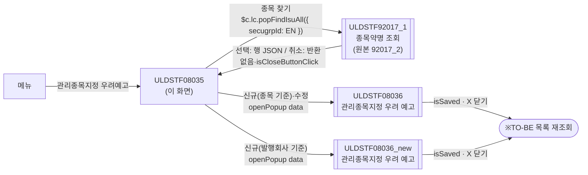
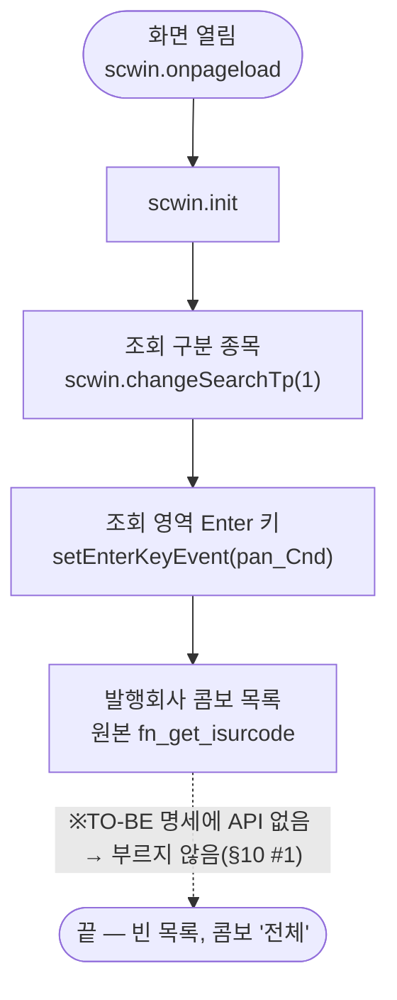
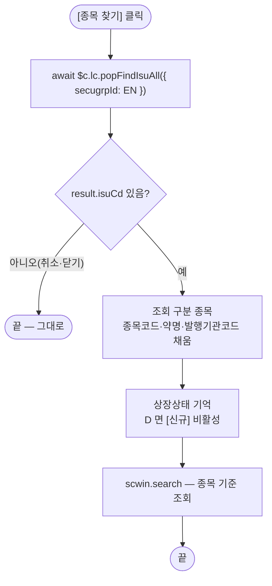
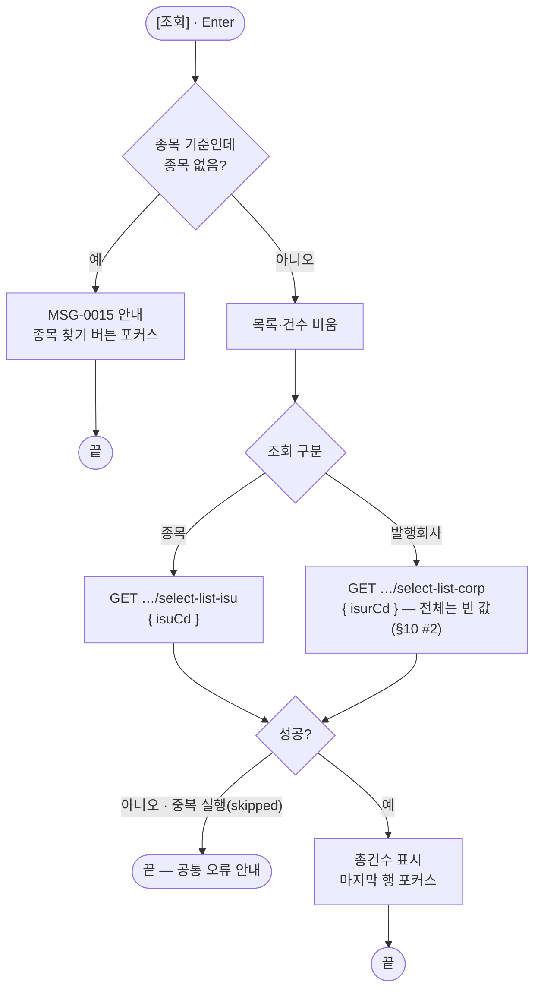
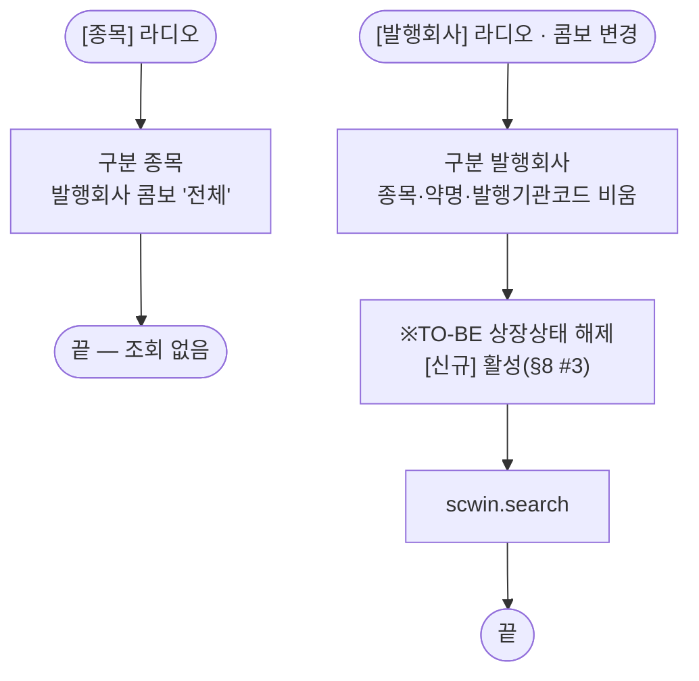
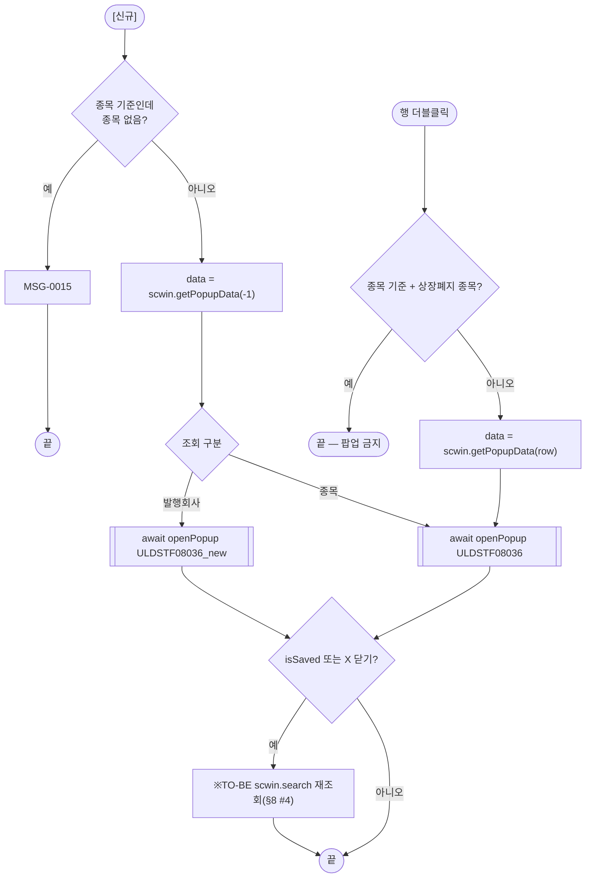
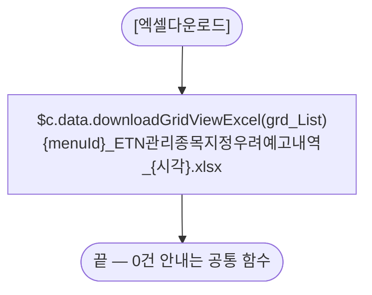
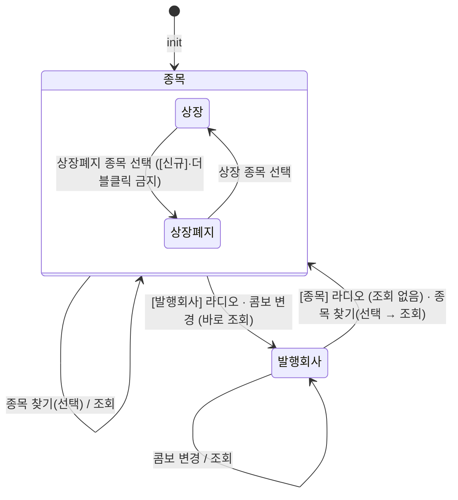

# ULDSTF08035 관리종목지정 우려예고 — 업무 분석 및 전환 내역

| 항목 | 내용 |
|---|---|
| AS-IS | `ULDSTF08035.gfm` (Gauce/X-Internet, 1200×750 메인 화면, 원본 폴더 `/etn/` — ETN 관리종목지정 우려예고 목록) — 반입 `conversion/conversion-front/ui/ULDSTF08035/ULDSTF08035.gfm` |
| 신규 API 명세 | `ULDSTF08035_API.md` — 블록 2종: ① 발행사 기준 목록 `GET /api/listing/lstproc/etn/adm-isu-noti/select-list-corp`(AS-IS `DIV_ETN_IDX_ADMISUNOTI_LIST_CORP`, requestData `isurCd`, target `dlt_listCorp`), ② 종목 기준 목록 `GET /api/listing/lstproc/etn/adm-isu-noti/select-list-isu`(AS-IS `DIV_ETN_IDX_ADMISUNOTI_LIST_ISU`, requestData `isuCd`, target `dlt_listIsu`). 두 응답 열은 13열로 같다. **AS-IS 의 발행회사 "전체"(`DIV_ETN_IDX_ADMISUNOTI_LIST_ALL`)와 발행회사 콤보 목록(`/etn/EtnCodeAct.do?method=listIsurCd&For=R`)은 명세에 없다**(§10 #1·#2). §2.2·§5 는 명세 기준(가이드 §0.3·§5) |
| TO-BE | `conversion/conversion-front/ui-tobe/ULDSTF08035.xml` (배포 경로 미정 — 원본 `/etn/`, §10 #6). **2026-10-30 전환** — 1단계: 캡처 기준 퍼블리싱(마크업 전용, 사본 `$CLAUDE_JOB_DIR/tmp/ULDSTF08035_stage1.xml`), 2단계: 이 결과서대로 스크립트 전환. 게이트: `gate_screen --pcc stf`·`scan_mixed_compare`(A 0·B 0)·`publish_gate --pcc stf --before {1단계} --allow P20`·`api_spec_check`·`init_binding_check`·`wsxml_lint` 0/0 통과, `convert.py` 고정점 |
| 퍼블리셔 XML | 화면 폴더의 `ULDSTF08035.xml`(W-Craft 1차 스크립트 내장, `conversion/publish/상장/상장처리(대내)/ULDSTF08035.xml` 과 같은 계열) — 본화면(`sub_contents`) + `pgtbox`(제목·breadcrumb), 조회 1행 표(라디오 2개를 th 에), 총건수·엑셀 + 그리드 + 하단 [신규]·[닫기]. `txb_ISU_CD` 는 `w2:autoComplete`, 그리드 열 id 는 AS-IS 대문자. **캡처·퍼블리싱 규칙을 따라** 정리했다(§2.1, §10 #7) |
| 화면 캡처 | `ULDSTF08035.png` (조회 전 빈 목록 — 조회 구분 "종목" 선택, 발행회사 콤보 "전체", 하단 [신규]·[닫기]·[엑셀저장]) → TO-BE 는 가이드 §13.2 퍼블리싱본부터 만들었다 |
| 업무공통 | pcc(`cm/pcc/stf`): `$c.lc.popFindIsuAll`(ULDSTF92017_1), `$c.stf.getMessageParam`(MSG-0015). gcc: `$c.sbm.executeDynamic`(requestData 2번째 인자)·`$c.win`(`setEnterKeyEvent`·`openPopup`·`alert`·`getProgramId`)·`$c.data.downloadGridViewExcel`·`$c.date.getServerDateTime`·`$c.session.getUserInfo`·`$c.util.isEmpty`·`$c.exception.handleError`. 게이트는 `--pcc stf` |
| 작성 | Inswave / 2026-10-30 |

참고 양식: [websquare_gfm_conversion.md](../../../md/websquare_gfm_conversion.md) — 특히 §1.4 업무 프로세스 흐름, §5 「API 명세 적용」, §6.5 getPar/setPar 전환. Gauce 대응은 [gfm_business_analysis_guide.md](../../../md/gfm_business_analysis_guide.md) §5·§6 을 함께 따랐다. 조회 화면 골격은 선례 [ULDSTF15900.md](../completed/ULDSTF15900/ULDSTF15900.md), ETN 증권그룹 상수는 `ui-tobe/ULDSTF08305.xml`, 명세에 없는 콤보 목록 처리는 [ULDSTF25205.md](../completed/ULDSTF25205/ULDSTF25205.md)·[ULDSTF05918.md](../completed/ULDSTF05918/ULDSTF05918.md), 미전환 등록 팝업의 재조회 규약은 kindstk 묶음(`isSaved || isCloseButtonClick`)을 따랐다.

---

## 1. 화면 개요

시장감시·상장 담당자가 **ETN 관리종목지정 우려예고** 내역을 조회하고, 등록 팝업으로 신규 예고를 작성하거나 기존 건을 고치는 메인 화면이다.

1. 조회 구분은 **[종목]** 또는 **[발행회사]** 둘 중 하나다(라디오 2개를 화면이 서로 배타로 맞춘다).
2. [종목]이면 [종목 찾기]로 ETN 종목을 고른다 — 고르면 바로 조회하고, 그 뒤에는 [조회]로 다시 조회한다. 종목을 안 고르고 [조회]·[신규]를 누르면 MSG-0015 를 띄운다.
3. [발행회사] 라디오를 고르거나 발행회사 콤보를 바꾸면 바로 조회한다(콤보 "전체"는 발행회사 전체).
4. [신규]는 등록 팝업을 연다 — 종목 기준이면 `ULDSTF08036`, 발행회사 기준이면 `ULDSTF08036_new`. 목록 행 더블클릭은 그 건을 `ULDSTF08036` 으로 연다.
5. 고른 종목이 상장폐지(삭제, `LIST_STAT_CD = D`)면 [신규]를 막고, 종목 기준 목록 더블클릭도 막는다.
6. [엑셀다운로드]로 목록을 내려받는다.

### 1.1 호출 화면 (0본)

- 이 화면을 여는 화면은 저장소에 없다(`grep -rl ULDSTF08035` — 이 폴더와 퍼블리셔 XML 2본뿐). 메뉴에서 바로 여는 **메인 화면**으로 본다. 원본 [닫기](`frame.CloseFrame()`)는 메뉴 창 닫기라 옮기지 않았다(§8 #5).

### 1.2 호출 규약 (부모 → 이 화면) / 반환 규약

- 해당 없음 — 메뉴 화면이라 받는 파라미터·돌려주는 값이 없다. 원본 전역 `fr_SecuGrpId = SECUGRP_ID_EN`("EN"), `fr_MktId = fn_getMktId()`(로그인 사용자 시장 `js_market`)는 화면 상수·세션 값으로 바꿨다(§9).

### 1.3 이 화면이 여는 하위 팝업

| 팝업 | AS-IS 호출 (getPar/setPar) | 넘기는 `data` (TO-BE) | 받는 결과 (`closePopup`) / 취소 판정 |
|---|---|---|---|
| AS-IS `ULDSTF92017_2` ETN 종목약명 찾기 → TO-BE `ULDSTF92017_1` 상장·비상장 종목약명 조회 (600×700) | `fn_GetPar = fn_GetParIsur`(arr[0] "", arr[1] 종목명, arr[2] 증권그룹) · `fn_SetPar = fn_SetParIsur` 를 바꿔 끼우고 `fn_PopFindEtnIsuAll(fr_SecuGrpId)` → `frame.CreateDialogFrame("ISU_CD", "../etn/ULDSTF92017_2.gfm", "종목선택", …, 410, 580, "window")` | pcc `$c.lc.popFindIsuAll({ secugrpId : "EN" })`(92017_1 은 `secugrpId` 만 받는다 — 원본 arr[1] 검색어는 넘기지 않음, §10 #4) | 선택 행 JSON(`isuCd`·`isuKorAbbrv`·`isurCd`·`listStatCd` …). 취소·닫기는 반환 없음 또는 `{ isCloseButtonClick }` → **`result.isuCd` 가 비면 그대로 둔다** |
| `ULDSTF08036` 관리종목지정 우려 예고 (720×450) — 종목 기준 신규 · 수정 | 신규 `fn_GetPar = fn_GetParNew` / 수정 `fn_GetPar = fn_GetParUpdate`, `fn_SetPar = undefined` 후 `fn_newpre_create_frame()` → `CreateDialogFrame("DLG_0", "../etn/ULDSTF08036.gfm", "ETN 관리종목지정 우려 예고", 200, 50, 720, 450, "window")` | `await $c.win.openPopup("/ui/lst/etn/ULDSTF08036.xml", { id : "ULDSTF08036", popupName : "ETN 관리종목지정 우려 예고", width : 720, height : 450, type : "pageFramePopup" }, data)` — `data` 는 §6.4 표(arr[0..7] 의 camelCase, 제안) | 제안: 저장했으면 `{ isSaved : true }`. **`isSaved === true` 또는 `isCloseButtonClick === true` 면 목록 재조회**(§6.4, §10 #5) |
| `ULDSTF08036_new` 관리종목지정 우려 예고 (750×450) — 발행회사 기준 신규 | `fn_GetPar = fn_GetParNew` 후 `fn_new_create_frame()` → `CreateDialogFrame("DLG_0", "../etn/ULDSTF08036_new.gfm", …, 750, 450, "window")` | `await $c.win.openPopup("/ui/lst/etn/ULDSTF08036_new.xml", { id : "ULDSTF08036_new", …, width : 750, height : 450, type : "pageFramePopup" }, data)` | 위와 같음 |

### 1.4 업무 프로세스 흐름

흐름은 AS-IS 동작을 기준으로 그렸다. 점선과 `※TO-BE` 는 전환본에서 바뀌는 곳이다(근거는 §8).

| # | 업무 | 시작 (사용자 동작·진입 조건) | 끝 (결과) | 주요 함수 | 관련 절 |
|---|---|---|---|---|---|
| 1 | 진입·로딩 | 메뉴에서 화면을 엶 | 조회 구분 "종목", 빈 목록(자동 조회 없음) | `scwin.onpageload` → `scwin.init` → `scwin.changeSearchTp` | §3 |
| 2 | 종목 찾기 | [종목 찾기] `btn_iSU_CD` | 종목 채움 + 종목 기준 목록 | `scwin.btn_iSU_CD_onclick` → `scwin.openIsuPopup` → `scwin.search` | §6.3 |
| 3 | 조회 | [조회] `img_Search` · 조회 영역 Enter | 목록·총건수 | `scwin.btn_Search_onclick` → `scwin.validateSearch` → `scwin.search` → `scwin.selectListIsu` / `scwin.selectListCorp` | §5, §6.1 |
| 4 | 조회 구분 전환 | [종목]·[발행회사] 라디오, 발행회사 콤보 | 구분 전환(발행회사는 바로 조회) | `scwin.rdo_ISUR_CD_1_onviewchange` · `scwin.rdo_ISUR_CD_2_onviewchange` · `scwin.cmb_ISUR_CD_onviewchange` → `scwin.changeSearchTp` | §6.2 |
| 5 | 신규 | [신규] `img_Regist` | 등록 팝업(08036 / 08036_new) → 닫히면 재조회 | `scwin.img_Regist_onclick` → `scwin.writeNew` → `scwin.openRegPopup` | §6.4 |
| 6 | 수정 | 목록 행 더블클릭 | 등록 팝업(08036) → 닫히면 재조회 | `scwin.grd_List_oncelldblclick` → `scwin.openDetail` → `scwin.openRegPopup` | §6.4 |
| 7 | 엑셀 | [엑셀다운로드] `img_Excel` | 목록 엑셀 파일 | `scwin.img_Excel_onclick` → `scwin.excelDown` | §6.6 |

#### 화면 간 흐름



AS-IS 는 팝업이 부모의 `fn_GetPar(arrPar)` 를 이름으로 불러 값을 받고, 종목 찾기는 부모의 `fn_SetPar(arrPar)` 로 결과를 돌려줬다. TO-BE 는 `openPopup` 의 data + `await` 반환값 방식이다(가이드 §6.5). 08036·08036_new 는 저장소에 없어 data·반환은 제안이다(§10 #5).

#### 업무 1: 진입·로딩



| 단계 | 처리 | 근거 |
|---|---|---|
| 1 | 라디오 [종목] 선택 | 원본 `rdo_ISUR_CD_1.CodeValue = "1"` |
| 2 | 조회 영역 Enter 키 → `scwin.btn_Search_onclick` | 규칙 22 |
| 3 | 발행회사 콤보 목록 조회 — **하지 않음**(명세에 대응 API 없음, `api_spec_check` A01) | 원본 `fn_get_isurcode()` — §10 #1 |
| 4 | 자동 조회 없음 | 원본과 같음 |

#### 업무 2: 종목 찾기



| 단계 | 처리 | AS-IS |
|---|---|---|
| 1 | 92017_1 을 열고 기다린다 | `fn_PopFindEtnIsuAll` → 92017_2 |
| 2 | 취소·닫기면 끝(※TO-BE — 원본은 취소에도 `fn_SetParIsur` 가 불리면 `fn_search` 를 돌렸다, §8 #2) | `fn_SetParIsur` 의 `DBCLICKYN == "Y"` 분기 |
| 3 | 종목 기준으로 전환, `isuCd`·약명(`isuKorAbbrv`)·`scwin.isurCd` 채움 | `fn_changeRadioBtn(1)`, `txb_ISU_CD`·`txb_ISU_NM`(ISU_KOR_ABBRV)·`vIsurCd` |
| 4 | `scwin.setListStat(listStatCd)` — `D` 면 [신규] `setDisabled(true)` | `vLIST_STAT_CD` + `img_Regist.disabled`·이미지 교체 |
| 5 | 조회 | `fn_search()` |

#### 업무 3: 조회



#### 업무 4: 조회 구분 전환



#### 업무 5·6: 신규 · 수정



#### 업무 7: 엑셀



#### 화면 모드 상태 전이



---

## 2. 화면 구성 및 데이터 정의

### 2.1 화면 구성 (AS-IS 요소 → TO-BE 컴포넌트)

TO-BE 는 본화면 `sub_contents` + contentHeader(`pfmContentHeader`) 아래 조회 영역(`schbox#pan_Cnd`, 1행 4열 표) · 목록 머리(`titbox` 총건수·엑셀) · 그리드(`gvwbox`) · 하단 버튼(`btnbox`) 순서다(캡처와 같음). 퍼블리셔의 `pgtbox`(제목·breadcrumb)는 contentHeader 로 바꿨다.

| 영역 | AS-IS 요소 (id · 종류) | TO-BE 컴포넌트 | 바인딩 | 비고 |
|---|---|---|---|---|
| 조회 | `pan_Cnd` (panel, `PanelToGroupBox`) | `schbox#pan_Cnd` | — | 장식 함수 삭제, Enter 키 영역 |
| | `rdo_ISUR_CD_1` (mxradio `1^종목,2^`) | `xf:select1#rdo_ISUR_CD_1` radiogroup(항목 "종목"=1) — th 안 | `ev:onviewchange` | 두 라디오를 `scwin.changeSearchTp` 가 배타로 맞춘다 |
| | `txb_ISU_CD` (textbox readonly) | `xf:input#txb_ISU_CD` readOnly | `dma_search.isuCd` | 퍼블리셔의 `w2:autoComplete` 대신 읽기 전용 입력(원본도 readonly — §10 #7) |
| | `txb_ISU_NM` (textbox readonly) | `xf:input#txb_ISU_NM` readOnly | (바인딩 없음 — 조회조건 아님) | |
| | `btn_iSU_CD` (image 돋보기) | `xf:trigger#btn_iSU_CD` `btn_cm icon search` "종목 찾기" | `ev:onclick` | |
| | `rdo_ISUR_CD_2` (mxradio `1^발행회사,2^`) | `xf:select1#rdo_ISUR_CD_2` radiogroup(항목 "발행회사"=1) — th 안 | `ev:onviewchange` | |
| | `cmb_ISUR_CD` (mxcombo, `dts_EtnInst` VALUE·TEXT) | `xf:select1#cmb_ISUR_CD` (chooseOption "전체") | `dma_search.isurCd`, itemset `dlt_isurList`, `ev:onviewchange` | 목록 API 가 명세에 없어 "전체"만(§10 #1) |
| | `img_Search` (image 조회) | `xf:trigger#img_Search` `btn_cm sch` | `ev:onclick` → `scwin.btn_Search_onclick` | |
| | `image_1` (구분선 이미지) | (옮기지 않음) | — | schbox 레이아웃이 대신함 |
| 목록 머리 | `txb_TotCnt` (textbox "총건수 : n") | `w2:span#txb_TotCnt` (`count` 안 "총 n 건") | — | |
| | `img_Excel` (image 엑셀저장) | `xf:trigger#img_Excel` `btn_cm download` "엑셀다운로드" | `ev:onclick` | 캡처는 아래쪽, 퍼블리싱 표준은 목록 머리 오른쪽(선례 15900·25205) |
| 그리드 | `grd_List` (mxgrid, `dts`) | `w2:gridView#grd_List` (`dlt_list`, readOnly, rowNum "번호") | `ev:oncelldblclick` | |
| | 열 `NO` "번호" (`{CurRow}`) | `rowNumVisible`(번호) | — | |
| | 열 `DSC_YN` "공시;여부" | `dscYn` (머리 "공시`<br/>`여부") | — | |
| | 열 `ISU_NM` "종목명" | `isuNm` | — | |
| | 열 `COM_NM` "발행회사" | `comNm` | — | |
| | 열 `ADMISUNOTI_DD` "관리종목;지정예고일" (mask `XXXX-XX-XX`) | `admisunotiDd` `dataType="date" displayFormat="yyyy-MM-dd"` | — | 규칙 46 |
| | 열 `ADMISU_DESIGN_SCHDL_DD` "관리종목지정;예정일" (mask `XXXX-XX-XX`) | `admisuDesignSchdlDd` `dataType="date" displayFormat="yyyy-MM-dd"` | — | 규칙 46 |
| | 열 `ADMISU_RSN_NM` "지정예고 사유" | `admisuRsnNm` | — | |
| | 열 `ADMISU_DESIGN_GRND_REGUL_NM` "근거" (`show="False"`) | **(옮기지 않음)** | — | 원본도 숨김, 명세 응답에 없음(§8 #6) |
| | 열 `LST_EMP_NM` "최종처리자" | `lstEmpNm` | — | |
| 하단 | `img_Regist` (image 신규) | `xf:trigger#img_Regist` `btn_cm pt` "신규" | `ev:onclick` | 규칙 41(오른쪽 끝) |
| | `img_Close` (image 닫기, `frame.CloseFrame()`) | **(옮기지 않음)** | — | 본화면 — 메뉴 창 닫기는 프레임 몫(§8 #5) |

### 2.2 데이터 정의 (DataCollection)

| TO-BE | AS-IS | 용도 | 키 (camelCase) |
|---|---|---|---|
| `dma_search` | URL 인자 `ISU_CD`·`ISUR_CD` | 조회조건 — 명세 ② requestData `isuCd` / 명세 ① requestData `isurCd`. 호출마다 해당 키 하나만 `executeDynamic` 2번째 인자로 보낸다(§5) | `isuCd`·`isurCd` |
| `dlt_list` | `dts` | 목록 — 명세 ①(`dlt_listCorp`)·②(`dlt_listIsu`) 응답의 **열이 13열로 같아** 그리드 목록 하나로 받는다(`target : "dlt_list=body"`, 선례 05918 `dlt_isu`). 명세 원문 13열 + 원본이 팝업에 넘기던 `admisuDesignBzTpCd`(명세에 없음, §10 #3) | `dftYn`·`dscYn`·`bzProcsNo`·`isurCd`·`admisunotiDd`·`admisuDesignSchdlDd`·`isuCd`·`isuNm`·`comNm`·`admisuRsnNm`·`admisuDesignSchdlContn`·`remk`·`lstEmpNm` + `admisuDesignBzTpCd` |
| `dlt_isurList` | `dts_EtnInst` (`cbdatacolumns="VALUE,TEXT"`) | 발행회사 콤보 — **대응 API 가 명세에 없어 비어 있다**(§10 #1) | `value`·`text` |

AS-IS 그리드 열 ↔ 명세 키: `DSC_YN`→`dscYn`, `ISU_NM`→`isuNm`, `COM_NM`→`comNm`, `ADMISUNOTI_DD`→`admisunotiDd`, `ADMISU_DESIGN_SCHDL_DD`→`admisuDesignSchdlDd`, `ADMISU_RSN_NM`→`admisuRsnNm`, `LST_EMP_NM`→`lstEmpNm`. `fn_GetParUpdate`·더블클릭이 읽던 `bz_procs_no`·`ISUR_CD`·`COM_NM` → `bzProcsNo`·`isurCd`·`comNm`(명세에 있음), `ADMISU_DESIGN_BZ_TP_CD` → `admisuDesignBzTpCd`(명세에 없음). 명세의 `dftYn`·`isuCd`·`admisuDesignSchdlContn`·`remk` 는 화면에 표시하지 않는다(원본 그리드에도 없음).

---

## 3. 로딩 (`scwin.onpageload` → `scwin.init`) — 2구역

- `scwin.onpageload` 는 `await scwin.init()` 만 부른다(try/catch + `$c.exception.handleError`).
- `scwin.init` 순서
  1. `scwin.changeSearchTp(scwin.SEARCH_TP_ISU)` — [종목] 라디오 선택, 발행회사 콤보 "전체"(원본 `rdo_ISUR_CD_1.CodeValue = "1"`).
  2. `$c.win.setEnterKeyEvent(pan_Cnd, scwin.btn_Search_onclick)`(규칙 22). 조회 영역 입력란은 모두 읽기 전용이지만 영역 Enter 키를 둔다.
  3. 발행회사 콤보 목록 — **부르지 않는다**(원본 `fn_get_isurcode()`, 명세에 API 없음 — §10 #1).
- 달력이 없어 규칙 37 바인딩 대상이 없다. 자동 조회 없음(원본과 같음).
- 삭제: `PanelToGroupBox(pan_Cnd)`.

## 4. 컴포넌트 이벤트 — 3구역

| TO-BE 핸들러 | 컴포넌트 · 이벤트 | 동작 | AS-IS |
|---|---|---|---|
| `scwin.onpageload` | `body ev:onpageload` | `scwin.init` | `gform onload` |
| `scwin.btn_Search_onclick` | `img_Search` `ev:onclick` (+ `pan_Cnd` Enter) | `scwin.validateSearch` → `scwin.search` | `img_Search onclick` |
| `scwin.rdo_ISUR_CD_1_onviewchange` | `rdo_ISUR_CD_1` `ev:onviewchange` | `scwin.changeSearchTp("1")` — 조회 없음 | `rdo_ISUR_CD_1 OnClick()` → `fn_changeRadioBtn(1)` |
| `scwin.rdo_ISUR_CD_2_onviewchange` | `rdo_ISUR_CD_2` `ev:onviewchange` | `scwin.changeSearchTp("2")` → `scwin.search` | `rdo_ISUR_CD_2 OnClick()` → `fn_changeRadioBtn(2)` · `fn_search()` |
| `scwin.cmb_ISUR_CD_onviewchange` | `cmb_ISUR_CD` `ev:onviewchange` | `scwin.changeSearchTp("2")` → `scwin.search` | `cmb_ISUR_CD OnSelChange()` → `fn_changeRadioBtn(2)` · `fn_search()` |
| `scwin.btn_iSU_CD_onclick` | `btn_iSU_CD` `ev:onclick` | `scwin.openIsuPopup` | `btn_iSU_CD onclick` → `fn_GetPar = fn_GetParIsur`·`fn_SetPar = fn_SetParIsur`·`fn_PopFindEtnIsuAll(fr_SecuGrpId)` |
| `scwin.grd_List_oncelldblclick` | `grd_List` `ev:oncelldblclick` | `scwin.openDetail(rowIndex)` | `grd_List OnDblClick(row, colid)` |
| `scwin.img_Regist_onclick` | `img_Regist` `ev:onclick` | `scwin.writeNew` | `img_Regist onclick` |
| `scwin.img_Excel_onclick` | `img_Excel` `ev:onclick` | `scwin.excelDown` | `img_Excel onclick` |
| (옮기지 않음) | `img_Close onclick` → `frame.CloseFrame()` | 본화면 — §8 #5 | |
| (옮기지 않음) | `dts OnLoadError()` · `OnLoadCompleted(rowcount)` | `executeDynamic` 공통 오류 안내 + `scwin.search` 후처리 | `alert_error(dts)` · 총건수·`RowPosition`·`CloseWin` |

## 5. 서버 통신 — 4구역

**API 명세 적용** — 명세 블록 2종을 모두 쓴다. requestData 는 명세대로 키 하나씩만 보낸다(`executeDynamic(sbmOptions, requestData)` — 선례 ULDBNF45000).

| AS-IS | TO-BE (명세) |
|---|---|
| `fn_search` — `dts.DataID = encodeURI("/etn/EtnMktAct.do?method=searchEtnAdministrativeIssueNoti&SCREN_ID=…&SCREN_PROCES_TP_CD=01&DIV_IDX=DIV_ETN_IDX_ADMISUNOTI_LIST_ISU&TRS_IDX=TRS_IDX_SELECT&ISU_CD=…")` (종목 기준) | `scwin.selectListIsu` — `GET /api/listing/lstproc/etn/adm-isu-noti/select-list-isu`, requestData `{ isuCd }`, `target : "dlt_list=body"`(명세 `dlt_listIsu`) |
| `fn_search` — `…&DIV_IDX=DIV_ETN_IDX_ADMISUNOTI_LIST_CORP&TRS_IDX=…&ISUR_CD=…&GUBUN_CD=ETN` (발행회사 선택) | `scwin.selectListCorp` — `GET /api/listing/lstproc/etn/adm-isu-noti/select-list-corp`, requestData `{ isurCd }`, `target : "dlt_list=body"`(명세 `dlt_listCorp`) |
| `fn_search` — `…&DIV_IDX=DIV_ETN_IDX_ADMISUNOTI_LIST_ALL&TRS_IDX=…&GUBUN_CD=ETN` (발행회사 "전체") | **명세 없음** — `scwin.selectListCorp` 에 `isurCd : ""` 로 보낸다(가정, §10 #2) |
| `fn_get_isurcode` — `dts_EtnInst.DataID = "/etn/EtnCodeAct.do?method=listIsurCd&For=R"` | **명세 없음** — 부르지 않음(§10 #1) |

### 5.1 종목 기준 목록 조회 (`scwin.selectListIsu`)

| 항목 | 내용 |
|---|---|
| 호출 | `scwin.search`(조회 구분 종목) |
| 경로 | `GET /api/listing/lstproc/etn/adm-isu-noti/select-list-isu` (규칙 38 전체 경로 리터럴) |
| [REQUEST] | `{ target : "dlt_list=body", gridview : "grd_List" }` + requestData `{ isuCd }` (명세 ②) |
| [RESPONSE] | `dlt_list` 13열(§2.2) |
| 후처리 | `scwin.search` — 총건수, 마지막 행 포커스(원본 `dts.RowPosition = rowcount`) |
| 실패 | `executeDynamic` 공통 오류 안내(원본 `alert_error(dts)`) — 목록은 조회 전에 비워 둔다 |
| 중복 실행 | `result.skipped` 면 그대로 끝 |
| 명세에 없는 원본 인자 | `SCREN_ID`·`SCREN_PROCES_TP_CD(01)`·`DIV_IDX`·`TRS_IDX` — 보내지 않음(§10 #8) |

### 5.2 발행회사 기준 목록 조회 (`scwin.selectListCorp`)

| 항목 | 내용 |
|---|---|
| 호출 | `scwin.search`(조회 구분 발행회사) |
| 경로 | `GET /api/listing/lstproc/etn/adm-isu-noti/select-list-corp` |
| [REQUEST] | `{ target : "dlt_list=body", gridview : "grd_List" }` + requestData `{ isurCd }` (명세 ①). 콤보 "전체"면 `isurCd : ""` — **원본 LIST_ALL 대응 명세가 없어 빈 값을 전체로 받는다고 가정**(§10 #2) |
| [RESPONSE] | `dlt_list` 13열 |
| 후처리 · 실패 · 중복 실행 | §5.1 과 같음 |
| 명세에 없는 원본 인자 | `GUBUN_CD=ETN`·`SCREN_ID`·`SCREN_PROCES_TP_CD`·`DIV_IDX`·`TRS_IDX` — 보내지 않음(§10 #8) |

## 6. 일반 함수 — 5구역

### 6.1 조회 (`scwin.search` · `scwin.validateSearch`)

- `scwin.btn_Search_onclick`: `if (!(await scwin.validateSearch())) return;` → `await scwin.search()`.
- `scwin.validateSearch`(원본 `img_Search`·`img_Regist` onclick 의 공통 검사): 조회 구분이 종목이고 `dma_search.isuCd` 가 비면 `await $c.win.alert($c.stf.getMessageParam("MSG-0015", ""))`("[종목코드(명)]을 선택해주세요.") + `btn_iSU_CD.focus()` → `false`.
- `scwin.search`(원본 `fn_search` + `dts OnLoadCompleted`):
  1. `dlt_list.removeAll()`·`txb_TotCnt.setValue("0")` — 조회가 실패해도 앞 조건의 행이 남지 않게(※TO-BE).
  2. 조회 구분 종목 → `scwin.selectListIsu()`, 발행회사 → `scwin.selectListCorp()`.
  3. 성공이면 `txb_TotCnt` 에 건수, 건수가 있으면 `grd_List.setFocusedCell(rowCount - 1, "isuNm")`(원본 `dts.RowPosition = rowcount`).
- 라디오·콤보로 바로 조회하는 경로(§6.2)는 원본처럼 검사 없이 조회한다(발행회사 기준이라 검사 대상이 없다).

### 6.2 조회 구분 (`scwin.changeSearchTp`)

| 구분 | 처리 | AS-IS `fn_changeRadioBtn(idx)` |
|---|---|---|
| 종목(`"1"`) | `scwin.searchTp = "1"`, `dma_search.isurCd = ""`(콤보 "전체"), `rdo_ISUR_CD_1 = "1"`·`rdo_ISUR_CD_2 = ""` | `cmb_ISUR_CD.index = 0`, `rdo_ISUR_CD_1.CodeValue = "1"`, `rdo_ISUR_CD_2.CodeValue = "2"` |
| 발행회사(`"2"`) | `scwin.searchTp = "2"`, `dma_search.isuCd = ""`·`txb_ISU_NM = ""`·`scwin.isurCd = ""`, **`scwin.setListStat("Y")`(※TO-BE §8 #3)**, `rdo_ISUR_CD_1 = ""`·`rdo_ISUR_CD_2 = "1"` | `txb_ISU_CD`·`txb_ISU_NM` 비움, `rdo_ISUR_CD_1.CodeValue = "2"`, `rdo_ISUR_CD_2.CodeValue = "1"` |

- 라디오는 항목 하나("1")짜리 두 개라, 선택 해제는 값 `""` 로 한다(원본 값 "2" 는 항목이 없는 값). `setValue` 는 `onviewchange` 를 일으키지 않으므로 재귀가 없다.
- 조회 구분의 기준값은 `scwin.searchTp` 다(라디오 값을 다시 읽지 않는다).

### 6.3 종목 찾기 (`scwin.openIsuPopup` · `scwin.setListStat`)

```javascript
const result = await $c.lc.popFindIsuAll({ secugrpId : scwin.SECUGRP_ID_EN });   // ULDSTF92017_1
if ($c.util.isEmpty(result?.isuCd)) return;          // 취소·닫기(X)
scwin.changeSearchTp(scwin.SEARCH_TP_ISU);
dma_search.set("isuCd", result.isuCd);
txb_ISU_NM.setValue(result.isuKorAbbrv ?? "");       // 원본 ISU_KOR_ABBRV
scwin.isurCd = result.isurCd ?? "";                  // 원본 vIsurCd
scwin.setListStat(result.listStatCd);                // 원본 vLIST_STAT_CD
await scwin.search();
```

- `scwin.setListStat(listStatCd)`: 값을 `scwin.listStatCd` 에 두고 `img_Regist.setDisabled(listStatCd === "D")`(원본 `img_Regist.disabled` + 버튼 이미지 `btn_new_d.gif`/`btn_new.gif` 교체 — 이미지는 class 버튼이라 옮기지 않음).
- 원본 ETN 전용 찾기 `ULDSTF92017_2` 는 미전환이라, 같은 계열의 전환본 `ULDSTF92017_1`(상장·비상장 종목약명, `secugrpId` 로 거름)로 연다(§10 #4).

### 6.4 신규 · 수정 (`scwin.writeNew` · `scwin.openDetail` · `scwin.getPopupData` · `scwin.openRegPopup`)

- `scwin.writeNew`(원본 `img_Regist onclick`): `scwin.validateSearch` 통과 후 `scwin.openRegPopup(조회 구분이 발행회사인가, scwin.getPopupData(-1))` — 발행회사면 `ULDSTF08036_new`(750×450), 종목이면 `ULDSTF08036`(720×450).
- `scwin.openDetail(rowIndex)`(원본 `grd_List OnDblClick`): 종목 기준이고 `scwin.listStatCd === "D"` 면 아무것도 하지 않는다. 아니면 `scwin.openRegPopup(false, scwin.getPopupData(rowIndex))` — 늘 `ULDSTF08036`.
- `scwin.getPopupData(rowIndex)` — 원본 `fn_GetParNew`(rowIndex `-1`) / `fn_GetParUpdate`(행) 의 arrPar 를 키로 바꾼 data(제안):

  | AS-IS | TO-BE 키 | 종목 기준 | 발행회사 "전체" | 발행회사 선택 |
  |---|---|---|---|---|
  | `arr[0]` 발행기관코드 | `isurCd` | 신규 `scwin.isurCd`(종목 찾기 결과) / 수정 행 `isurCd` | 신규 `""` / 수정 행 `isurCd` | 신규 콤보 값 / 수정 행 `isurCd` |
  | `arr[1]` 발행기관명(종목명) | `isurNm` | `txb_ISU_NM`(종목약명) | 신규 `""` / 수정 행 `comNm` | 신규 `cmb_ISUR_CD.getText()` / 수정 행 `comNm` |
  | `arr[2]` 증권그룹 | `secugrpId` | `"EN"` | 〃 | 〃 |
  | `arr[3]` 시장구분 | `mktId` | `$c.session.getUserInfo("market")`(원본 `fn_getMktId()` = `js_market`) | 〃 | 〃 |
  | `arr[4]` 업무처리번호 | `bzProcsNo` | 신규 `""` / 수정 행 `bzProcsNo` | 〃 | 〃 |
  | `arr[5]` 관리종목지정및해제구분코드 | `admisuDesignBzTpCd` | 신규 `""` / 수정 행 `admisuDesignBzTpCd`(명세에 없음 — §10 #3) | 〃 | 〃 |
  | `arr[6]` 종목코드 | `isuCd` | `dma_search.isuCd` | `""` | `""` |
  | `arr[7]` 선택 구분 | `selTp` | `"1"` | `"3"` | `"2"` |

  원본은 수정 때 더블클릭 직전 `vIsurCd = dts.NameString(dts.RowPosition, "ISUR_CD")` 로 전역을 덮어썼다. TO-BE 는 행 값을 data 에 직접 넣고 전역(`scwin.isurCd`)은 종목 찾기 결과로만 둔다 — 종목 기준이면 행과 고른 종목의 발행기관이 같아 결과가 같다.
- `scwin.openRegPopup(isCorpNew, data)`: `await $c.win.openPopup(경로, { id, popupName : "ETN 관리종목지정 우려 예고", width, height : 450, type : "pageFramePopup" }, data)`. 반환이 `isSaved === true` 이거나 `isCloseButtonClick === true` 면 `scwin.search()`(※TO-BE — 원본은 `fn_SetPar = undefined` 로 재조회가 없었다, §8 #4). 08036 이 하단 [닫기] 없이 X 로만 닫히는 규칙(팝업 닫기 버튼 금지)이라 X 닫기도 재조회한다(kindstk 묶음 규약).

### 6.5 부모 ↔ 팝업 파라미터 전달 (getPar/setPar → `$c.win.openPopup` + `await`)

- 이 화면이 부모로서 쓰던 방식 — `fn_GetPar`/`fn_SetPar` 전역 변수를 바꿔 끼우고 팝업이 이름으로 부르게 하던 것(종목 찾기 `fn_GetParIsur`/`fn_SetParIsur`, 등록 `fn_GetParNew`/`fn_GetParUpdate`) — 을 모두 `openPopup` 의 data + `await` 반환으로 바꿨다(§6.3·§6.4). 남기는 `fn_GetPar`/`fn_SetPar`/호환용 `getPar` 는 없다 — 08036·08036_new 가 저장소에 없어 새 계약(§1.3·§6.4 data 표)으로 전환할 때 함께 맞춘다(§10 #5).
- 취소 판정: 종목 찾기는 `result.isuCd` 가 비었는지, 등록 팝업은 반환을 쓰지 않고 재조회 여부만 본다.

### 6.6 엑셀 (`scwin.excelDown`)

- `$c.data.downloadGridViewExcel(grd_List, { fileName : {menuId}_ETN관리종목지정우려예고내역_{yyyyMMddHHmmss}.xlsx, sheetName : "sheet1" })`(규칙 42). 원본 파일명 오타 "괸리종목지정 우려 예고 내역"은 바로잡았다. 0건 안내는 공통 함수가 한다(원본 `alert(NO_EXCEL_DATA)`). 원본 `doLogSave(vScrenID, SCREN_PROCS_TP_CD_07)` 은 삭제(선례 ULDBNS30400·05911·15900). `GridToExcel` 의 3번째 인자 `"8"` 은 옮기지 않음.

## 7. 업무 코드 · 메시지 목록

| 구분 | 값 | 쓰는 곳 |
|---|---|---|
| 증권그룹ID | `EN` ETN (`scwin.SECUGRP_ID_EN`, 원본 `SECUGRP_ID_EN`) · 증권그룹명 `ETN` | 종목 찾기·등록 팝업 data·팝업 제목·엑셀 파일명 |
| 조회 구분 | `1` 종목 · `2` 발행회사 (`scwin.searchTp`) | §6.2 |
| 팝업 선택 구분 | `1` 종목 · `2` 발행회사 · `3` 전체 (원본 arr[7]) | §6.4 |
| 상장상태코드 | `D` 상장폐지(삭제 종목) — [신규]·더블클릭 금지 | §6.3·§6.4 |
| 조회 구분(서버) | `DIV_ETN_IDX_ADMISUNOTI_LIST_ISU`·`_LIST_CORP`·`_LIST_ALL`, `TRS_IDX_SELECT`, `GUBUN_CD=ETN` | 원본만 — TO-BE 는 경로로 구분(§5) |
| 화면처리구분 | `SCREN_PROCS_TP_CD_01`(조회)·`_07`(엑셀 로그) | 원본만 — TO-BE 미전송·삭제 |
| 메시지 | MSG-0015 "[종목코드(명)]을 선택해주세요." | §6.1 |
| 메시지 | `NO_EXCEL_DATA`(엑셀 0건) | 공통 함수 안내로 대체(§6.6) |

## 8. 원본 특이사항 · 결함

| # | 내용 | 결정 |
|---|---|---|
| 1 | 라디오 두 개가 각각 독립 그룹이라 `fn_changeRadioBtn` 이 `CodeValue` 를 "1"/"2" 로 맞춰 배타를 흉내 낸다(값 "2" 는 항목이 없는 값). `idx == "1"` 은 숫자 1 과 느슨한 비교 | 유지(동작) — `scwin.searchTp` 를 기준값으로 두고 라디오 값은 `"1"`/`""` 로 맞춘다. 비교는 문자열 상수 |
| 2 | 종목 찾기 `fn_SetParIsur` 는 `DBCLICKYN != "Y"`(취소 등)여도 `fn_search()` 를 부르고 `arrPar[0].LIST_STAT_CD` 로 상장상태를 덮는다 | 고침 — 취소·닫기면 아무것도 하지 않는다 |
| 3 | 상장폐지 종목을 고른 뒤 [발행회사]로 바꿔도 [신규]가 계속 비활성으로 남는다(종목은 비워지는데 `vLIST_STAT_CD`·버튼 상태는 그대로) | 고침 — 발행회사로 바꾸면 상장상태를 `Y` 로 풀고 [신규]를 다시 켠다(`scwin.changeSearchTp`) |
| 4 | 등록 팝업을 열 때 `fn_SetPar = undefined` — 이 화면은 저장 뒤 목록을 다시 조회하지 않는다(팝업이 부모 `fn_search` 를 직접 불렀는지는 08036 원본이 없어 모름) | 고침(제안) — 팝업이 `{ isSaved : true }` 를 돌려주거나 X 로 닫히면 재조회(§10 #5) |
| 5 | [닫기] `frame.CloseFrame()` — 메뉴 화면을 닫는 프레임 기능(W-Craft 1차는 `closePopup` 으로 잘못 옮김) | 옮기지 않음 — 본화면 닫기는 탭·창 프레임이 한다(선례 05100) |
| 6 | 숨김 열 "근거"(`ADMISU_DESIGN_GRND_REGUL_NM`, `show="False"`)는 화면에 보이지 않고 명세 응답에도 없다 | 옮기지 않음 |
| 7 | 엑셀 파일명 오타 "괸리종목지정" | 고침 — 규칙 42 파일명으로 |
| 8 | `fn_GetParNew` 는 `return arrPar.length` 가 없다(`fn_GetParUpdate` 는 있음) | 옮기지 않음 — data 객체 반환으로 대체 |
| 9 | `fn_GetParUpdate` 가 `dts.NameString(…, "bz_procs_no")` 를 소문자로 읽는다(Gauce 는 열 이름 대소문자 무시) | 고침 — 명세 키 `bzProcsNo` |
| 10 | `OnLoadCompleted` 가 `dts.RowPosition = rowcount` 로 마지막 행에 포커스한다 | 유지 — `grd_List.setFocusedCell(rowCount - 1, "isuNm")` |

## 9. 전환 내역 (AS-IS → TO-BE)

| AS-IS | TO-BE |
|---|---|
| 전역 `vScrenID = "ULDSTF08035.gfm"` | 삭제 — 쓰던 곳(`SCREN_ID` URL 인자·`doLogSave`)이 모두 없어짐(§5·§6.6) |
| 전역 `fr_SecuGrpId = SECUGRP_ID_EN` | `scwin.SECUGRP_ID_EN = "EN"`(pcc `glb` 에 없어 화면 상수 — 선례 08305) + `scwin.SECUGRP_NM_EN = "ETN"`(원본 `fn_getSecuGrpNm`) |
| 전역 `fr_MktId = fn_getMktId()` | `$c.session.getUserInfo("market")` — `scwin.getPopupData` 에서 읽음 |
| 전역 `fn_GetPar`, `fn_SetPar` | 삭제 — §6.5 |
| 전역 `vIsurCd` / `vLIST_STAT_CD` | `scwin.isurCd` / `scwin.listStatCd` |
| (rdo 값으로 판단) | `scwin.searchTp` + 상수 `SEARCH_TP_ISU`·`SEARCH_TP_ISUR`·`SEL_TP_ISU`·`SEL_TP_ISUR`·`SEL_TP_ALL`·`LIST_STAT_DELISTED`·`POPUP_URL_REG`·`POPUP_URL_REG_NEW` |
| `fn_search()` | `scwin.search`(§6.1) + `scwin.selectListIsu`(§5.1) / `scwin.selectListCorp`(§5.2) |
| `fn_GetParIsur(arrPar)` / `fn_SetParIsur(arrPar)` | `scwin.openIsuPopup` + `scwin.setListStat`(§6.3) |
| `fn_GetParUpdate(arrPar)` / `fn_GetParNew(arrPar)` | `scwin.getPopupData(rowIndex)`(§6.4) |
| `fn_new_create_frame()` / `fn_newpre_create_frame()` | `scwin.openRegPopup(isCorpNew, data)`(§6.4) |
| `fn_get_isurcode()` | 삭제 — 명세에 API 없음(§10 #1) |
| `fn_changeRadioBtn(idx)` | `scwin.changeSearchTp(searchTp)`(§6.2) |
| `img_Search onclick` | `scwin.btn_Search_onclick` → `scwin.validateSearch` · `scwin.search` |
| `dts OnLoadError()` / `OnLoadCompleted(rowcount)` | 삭제 — 공통 오류 안내 / `scwin.search` 후처리 |
| `img_Excel onclick` | `scwin.img_Excel_onclick` → `scwin.excelDown`(doLogSave 삭제) |
| `img_Close onclick` | 삭제 — §8 #5 |
| `btn_iSU_CD onclick` | `scwin.btn_iSU_CD_onclick` → `scwin.openIsuPopup` |
| `img_Regist onclick` | `scwin.img_Regist_onclick` → `scwin.writeNew` |
| `grd_List OnDblClick(row, colid)` | `scwin.grd_List_oncelldblclick` → `scwin.openDetail` |
| `gform onload` | `scwin.onpageload` → `scwin.init` |
| `rdo_ISUR_CD_1 OnClick()` / `rdo_ISUR_CD_2 OnClick()` | `scwin.rdo_ISUR_CD_1_onviewchange` / `scwin.rdo_ISUR_CD_2_onviewchange` |
| `cmb_ISUR_CD OnSelChange()` | `scwin.cmb_ISUR_CD_onviewchange` |
| `dts` / `dts_EtnInst` | `dlt_list`(+ `dma_search`) / `dlt_isurList`(빈 목록) |

W-Craft 1차 스크립트(퍼블리셔 XML)의 `$c.libRoundPanel.PanelToGroupBox`·`$c.lce.fn_getMktId`·`$c.lce.fn_PopFindEtnIsuAll`·`$c.lce.fn_getSecuGrpNm`·`$c.stf.doLogSave`·`SECUGRP_ID_EN`·`NO_EXCEL_DATA`·`url +=`(선언 없는 변수)·`action : "/etn/EtnMktAct.do"` 등(미정의·AS-IS URL)은 쓰지 않고 이 결과서대로 다시 썼다. 1차 스크립트 함수 대응:

| W-Craft 1차 (퍼블리셔 XML) | TO-BE |
|---|---|
| `scwin.onpageload` · `scwin.onpageunload`(빈 함수) | `scwin.onpageload` → `scwin.init` · 삭제 |
| `scwin.img_Search_onclick` | `scwin.btn_Search_onclick`(조회 영역 Enter 키도 같은 핸들러) |
| `scwin.dts_OnLoadError` · `scwin.dts_OnLoadCompleted` · `scwin.img_Close_onclick` · `scwin.popupCallback` · `scwin.getIsurcode` | 삭제(위 표 사유) |
| `scwin.img_Excel_onclick` · `scwin.btn_iSU_CD_onclick` · `scwin.img_Regist_onclick` | 같은 이름으로 다시 씀 |
| `scwin.grd_List_OnDblClick` · `scwin.rdo_ISUR_CD_1_onclick` · `scwin.rdo_ISUR_CD_2_onclick` · `scwin.cmb_ISUR_CD_onselchange` | `scwin.grd_List_oncelldblclick` · `scwin.rdo_ISUR_CD_1_onviewchange` · `scwin.rdo_ISUR_CD_2_onviewchange` · `scwin.cmb_ISUR_CD_onviewchange`(이벤트명 소문자, 규칙 3) |
| `scwin.search` | `scwin.search` + `scwin.selectListIsu`·`scwin.selectListCorp` |
| `scwin.getParIsur` · `scwin.setParIsur` | `scwin.openIsuPopup` · `scwin.setListStat` |
| `scwin.getParUpdate` · `scwin.getParNew` | `scwin.getPopupData` |
| `scwin.newCreateFrame` · `scwin.newpreCreateFrame` | `scwin.openRegPopup` |
| `scwin.changeRadioBtn` | `scwin.changeSearchTp` |
| 그리드 머리 id `NO_H`·`DSC_YN_H`·`ISU_NM_H`·`COM_NM_H`·`ADMISUNOTI_DD_H`·`ADMISU_DESIGN_SCHDL_DD_H`·`ADMISU_RSN_NM_H`·`ADMISU_DESIGN_GRND_REGUL_NM_H`·`LST_EMP_NM_H` | `h_` + 명세 camelCase(`h_dscYn` …). `NO`·근거 열은 rowNum·삭제. `caption1`·`header1`·`gBody1` 은 그대로 |

## 10. 남은 작업 (TODO)

1. **발행회사 콤보 목록 API** — 원본 `fn_get_isurcode`(`/etn/EtnCodeAct.do?method=listIsurCd&For=R`, ETN 발행사)에 대응하는 API 가 명세에 없다. `api_spec_check` 가 명세에 없는 경로를 막아(A01) 부르지 않는다 → 콤보는 "전체" 하나뿐이고, 특정 발행회사로 조회할 수 없다. 목록 API(응답 `value`·`text` 또는 이에 맞춘 itemset)를 받아 `scwin.init` 에서 `dlt_isurList` 로 조회하면 바인딩·조회 로직(§5.2)은 그대로 동작한다.
2. **발행회사 "전체" 조회** — 원본은 별도 조회(`DIV_ETN_IDX_ADMISUNOTI_LIST_ALL`, `GUBUN_CD=ETN`)였는데 명세에 없다. `select-list-corp` 에 `isurCd : ""` 를 보내 전체로 받는다고 가정했다 — 서버가 빈 값을 전체로 처리하는지 확인 필요.
3. **관리종목지정및해제구분코드** — 원본 `fn_GetParUpdate` arr[5](`ADMISU_DESIGN_BZ_TP_CD`, 주석 "거래정지지정및해제구분코드 값 넘겨야함")를 수정 팝업에 넘기는데 명세 응답에 없다. `dlt_list` 에 `admisuDesignBzTpCd` 키를 두고(이름에 「명세에 없음」 표시) 행 값을 넘긴다 — 서버 응답에 추가되지 않으면 늘 빈 값이다.
4. **종목 찾기 팝업** — 원본 ETN 전용 `ULDSTF92017_2`(종목약명 찾기, 410×580)는 미전환이라 전환된 `ULDSTF92017_1`(`$c.lc.popFindIsuAll({ secugrpId : "EN" })`, 600×700)로 연다. 92017_1 이 ETN(EN) 종목과 상장폐지 종목을 보여 주는지, 원본처럼 입력한 종목명(arr[1])을 검색어로 받을 필요가 있는지 확인 필요.
5. **등록 팝업 ULDSTF08036·08036_new 계약** — 저장소에 원본·전환본이 모두 없다. 경로(`/ui/lst/etn/ULDSTF08036.xml`·`ULDSTF08036_new.xml` — 원본 `../etn/` 기준 가정), data 키(§6.4 표), 반환 `{ isSaved : true }` 는 제안이다. 팝업 전환 때 `$c.data.getParameter()` 수신·`closePopup({ isSaved })` 로 맞춰야 한다. 원본 팝업이 부모의 `fn_GetPar` 를 이름으로 부르므로, 팝업을 이 계약으로 바꾸지 않으면 값이 넘어가지 않는다.
6. **배포 경로** — 원본 `/etn/ULDSTF08035.gfm`. 메뉴 등록 시 확인.
7. **퍼블리셔 XML 과의 차이** — `pgtbox`(제목·breadcrumb)를 contentHeader 로, `txb_ISU_CD` 를 `w2:autoComplete` 대신 읽기 전용 입력으로(원본도 readonly), 그리드 열 id 를 명세 camelCase·머리 `h_` 로, 날짜 열을 규칙 46 으로, 숨김 "근거" 열 삭제, 하단 [닫기] 삭제. [엑셀다운로드]는 캡처(아래쪽)와 달리 퍼블리싱 표준대로 목록 머리 오른쪽.
8. **명세에 없는 원본 인자** — `SCREN_ID`·`SCREN_PROCES_TP_CD(01)`·`DIV_IDX`·`TRS_IDX`·`GUBUN_CD=ETN` 을 보내지 않는다. 엑셀 `doLogSave`(07)도 삭제. 서버가 화면 로그·ETN 구분을 따로 요구하면 반영.
9. **실화면 확인** — 항목 하나짜리 라디오 두 개의 배타 동작(`setValue("")` 로 해제), 상장폐지 종목일 때 [신규] 비활성 표시.

## 11. 화면 함수 목록 (TO-BE)

| 구역 | 함수 | 설명 |
|---|---|---|
| 1 | `scwin.SECUGRP_ID_EN` · `scwin.SECUGRP_NM_EN` · `scwin.SEARCH_TP_ISU` · `scwin.SEARCH_TP_ISUR` · `scwin.SEL_TP_ISU` · `scwin.SEL_TP_ISUR` · `scwin.SEL_TP_ALL` · `scwin.LIST_STAT_DELISTED` · `scwin.POPUP_URL_REG` · `scwin.POPUP_URL_REG_NEW` / `scwin.searchTp` · `scwin.isurCd` · `scwin.listStatCd` | 상수 / 화면 상태 |
| 2 | `scwin.onpageload` / `scwin.init` | 로딩 |
| 3 | `scwin.btn_Search_onclick` · `scwin.rdo_ISUR_CD_1_onviewchange` · `scwin.rdo_ISUR_CD_2_onviewchange` · `scwin.cmb_ISUR_CD_onviewchange` · `scwin.btn_iSU_CD_onclick` · `scwin.grd_List_oncelldblclick` · `scwin.img_Excel_onclick` · `scwin.img_Regist_onclick` | 이벤트 |
| 4 | `scwin.selectListIsu` · `scwin.selectListCorp` | 종목 / 발행회사 기준 목록 조회 |
| 5 | `scwin.search` · `scwin.validateSearch` · `scwin.changeSearchTp` · `scwin.setListStat` · `scwin.openIsuPopup` · `scwin.getPopupData` · `scwin.openRegPopup` · `scwin.writeNew` · `scwin.openDetail` · `scwin.excelDown` | 조회·검증·구분 전환·팝업·엑셀 |
