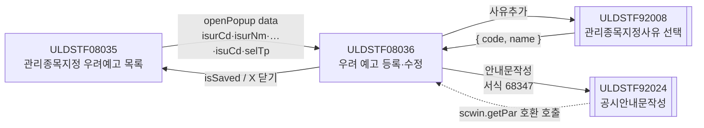
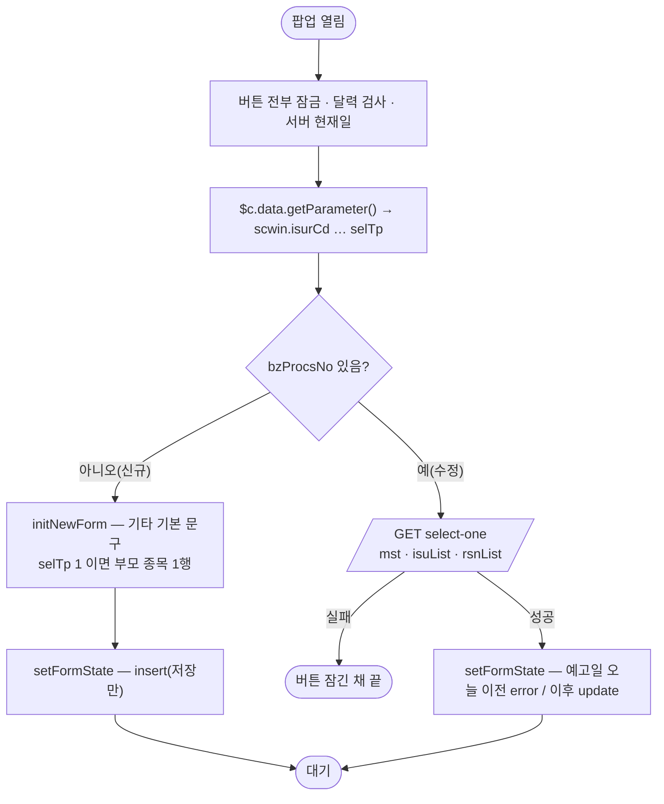
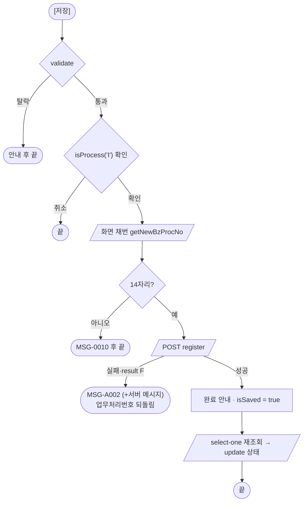
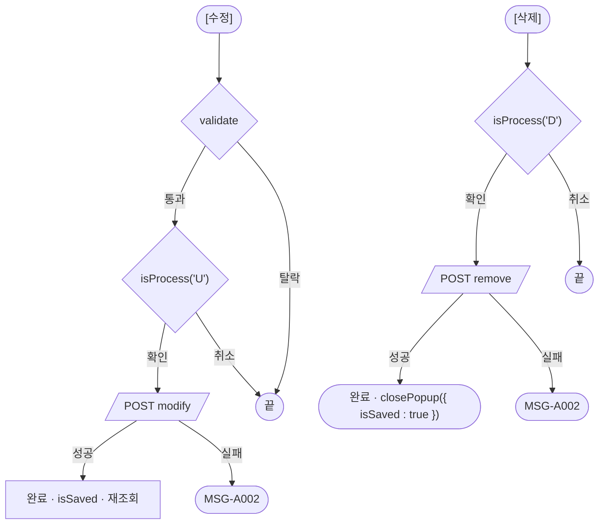
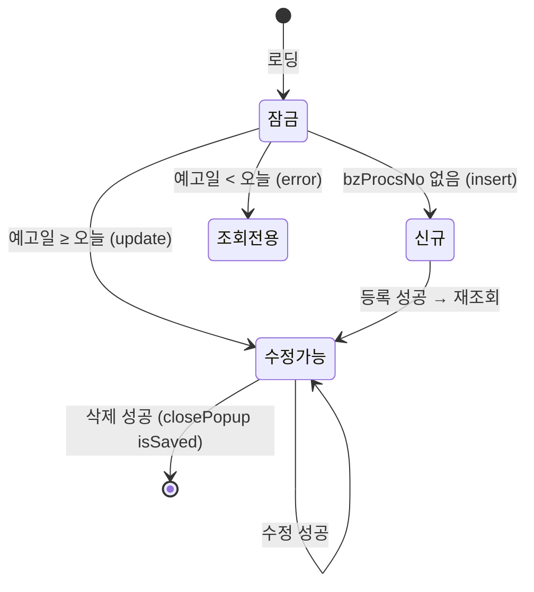

# ULDSTF08036 (팝업)관리종목지정 우려 예고 — 업무 분석 및 전환 내역

| 항목 | 내용 |
|---|---|
| AS-IS | `/etn/ULDSTF08036.gfm` (Gauce/X-Internet, 710×410 — 부모 ULDSTF08035 가 720×450 `window` 로 연다) — 반입 `conversion/conversion-front/ui/ULDSTF08036/ULDSTF08036.gfm` |
| 신규 API 명세 | `ULDSTF08036_API.md` — 이 화면 블록 4종: §1 `POST …/adm-isu-noti/remove` · §2 `POST …/register` · §3 `POST …/modify` · §4 `GET …/select-one`(수정 진입 상세). §5~§7 은 부모 ULDSTF08035 의 목록 조회 3종(`select-list-corp`·`select-list-isu`·`select-list-all`)이다(§1.1 참고만). §2.2·§5 는 명세 기준(가이드 §0.3·§5) |
| TO-BE | `conversion/conversion-front/ui-tobe/ULDSTF08036.xml` (배포 경로 `/ui/lst/etn/ULDSTF08036.xml` — 부모 08035 의 `scwin.POPUP_URL_REG`, 원본 `../etn/ULDSTF08036.gfm`) |
| 퍼블리싱 | **없음** — 캡처 + gfm 기준 마크업(§13.2 1단계). `conversion/publish/` 에도 이 화면 xml 이 없다 |
| 화면 캡처 | `ULDSTF08036.png` — 종목 한 행(KRG530001269 삼성증권 ETN 0512, 상장일 20260514), 예고일·예정일 빈칸, 주석 빈칸, 예고사유 1행(1102 보고서 미제출(반기보고서)), 기타 기본 문구 「관리종목으로 지정된 경우에도 ETN 매매는 정상적으로 가능합니다.」, 하단 저장·수정·삭제·안내문작성·닫기 |
| 업무공통 | `$c.stf`(`getMessageParam`·`checkMaxLength`·`setButtonSetWithDate`·`getNewBzProcNo`)·`$c.lc`(`isProcess`·`popFindClssLstRsnCd`) — `cm/pcc/stf`. 게이트는 `--pcc stf` |
| 작성 | Inswave / 2026-10-30 |

참고 양식: [websquare_gfm_conversion.md](../../../md/websquare_gfm_conversion.md) — §1.4 업무 프로세스 흐름, §6.5 getPar/setPar 전환. Gauce 대응은 [gfm_business_analysis_guide.md](../../../md/gfm_business_analysis_guide.md) 병행. 선례: ULDSTF08032(같은 계열 ETN 관리종목지정 팝업 — 마크업·버튼·사유찾기·92024 패턴), ULDSTF08034(`$c.stf.setButtonSetWithDate`), ULDSTF05918(화면 채번 `getNewBzProcNo`), ULDSTF08035(부모 — 이 화면의 data 키 제안).

---

## 1. 화면 개요

ETN(상장지수증권) 종목에 **관리종목지정 우려 예고**를 등록·수정·삭제하는 팝업이다. 관리종목지정 우려예고 목록(ULDSTF08035)에서 종목 기준 [신규]를 누르거나 목록 행을 더블클릭하면 열린다.

1. 부모가 발행기관·증권그룹·시장·업무처리번호·업무구분·종목코드·선택구분을 넘긴다. 업무처리번호가 없으면 신규, 있으면 수정이다.
2. 신규: 넘어온 종목을 그리드에 두고, 기타에 표준 문구를 넣는다. 예고일·예정일(또는 주석)·예고사유를 입력해 [저장]한다(검증 → 확인 → **화면 채번** → 등록).
3. 수정: 업무처리번호로 마스터·종목·예고사유를 조회한다. 예고일이 오늘 이전이면 조회 전용, 오늘 포함 이후면 [수정]·[삭제]·[안내문작성]이 열린다.
4. [안내문작성]: 공시안내문작성(ULDSTF92024, 서식 68347)을 연다.

### 1.1 호출 화면 (1본)

- `ULDSTF08035` 관리종목지정 우려예고(ETN) 목록 — 종목 기준 [신규], 또는 목록 행 더블클릭(수정). 발행회사 기준 신규는 `ULDSTF08036_new`(이번 입력에 없음 — 범위 밖)가 열린다(08035 `scwin.openRegPopup`).
- 명세 §5~§7 은 08035 의 목록 API 다. 08035 TO-BE 는 §5·§6 경로를 이미 쓰고 있다(§10 #6 — §7 `select-list-all` 은 08035 에 반영 필요).

### 1.2 호출 규약 (부모 → 이 화면) / 반환 규약

- **AS-IS**: 이 화면이 부모의 `fn_GetPar(arrPar)` 를 이름으로 불러 arr[0..7] 을 받았다(`gform onload`).
- **TO-BE** (가이드 §6.5): 부모가 `await $c.win.openPopup("/ui/lst/etn/ULDSTF08036.xml", { id : "ULDSTF08036", popupName : "ETN 관리종목지정 우려 예고", width : 720, height : 450, type : "pageFramePopup" }, data)` 로 연다. 이 화면은 `$c.data.getParameter()` 로 받는다. **키는 08035 `scwin.getPopupData` 그대로**(바꾼 것 없음).

| AS-IS arr | 원본 변수 | TO-BE data 키 (08035) | 이 화면에서 쓰는 곳 |
|---|---|---|---|
| arr[0] | `Isur_cd` 발행기관코드 | `isurCd` | 마스터 발행기관코드 기본값, 상세 조회·저장·삭제 요청, 92024 arr[2] |
| arr[1] | `Isur_nm` 발행기관명(종목 기준이면 종목약명) | `isurNm` | 신규 종목 행의 종목명 |
| arr[2] | `Secugrp_id` 증권그룹ID | `secugrpId` | 받기만 함(원본도 미사용) |
| arr[3] | `Mkt_id` 시장구분 | `mktId` | 받기만 함(원본도 미사용) |
| arr[4] | `fr_bz_procs_no` 업무처리번호 | `bzProcsNo` | 비면 신규, 있으면 수정 |
| arr[5] | `tpCd` 구분코드 | `admisuDesignBzTpCd` | 받기만 함(원본도 미사용) |
| arr[6] | `gubun` 종목코드(원본 `ISUR_CD=` 인자로 종목 검색) | `isuCd` | 신규 종목 행 |
| arr[7] | `select_gubun` 선택구분 1 종목·2 발행회사·3 전체 | `selTp` | 종목선택 버튼 잠금(1), 신규 종목 행(1) |

- **반환**: 저장·수정 성공은 `scwin.isSaved = true` 로만 표시한다(스스로 닫는 경로 없음 — 하단 [닫기] 금지). 삭제 성공은 `closePopup({ isSaved : true })`. 그 밖에는 X 로 닫혀 `{ isCloseButtonClick : true }` 가 간다. **부모는 `isSaved === true || isCloseButtonClick === true` 면 목록을 다시 조회한다** — 08035 `openRegPopup` 이 이미 그렇게 한다.

### 1.3 이 화면이 여는 하위 팝업

| 팝업 | AS-IS | TO-BE | 반환 |
|---|---|---|---|
| 관리종목지정사유 선택 (ULDSTF92008) | `fn_GetPar = fn_GetParRsnCd`(arr[0] "1"·arr[1] "07"·arr[5] "N") + `fn_PopFindClssLstRsnCd(RSNCD_ADM_DESIGN)` | `await $c.lc.popFindClssLstRsnCd("2", { mkt : "1", rsn : "07", spac : "N" })` (08032·08034 와 같음) | `{ code, name }` — `code` 가 비거나 X 닫기면 취소 |
| ETN 종목 다건 선택 | `fn_GetParIsu`·`fn_SetParIsu` + `fn_PopFindEtnCode()` (CopyDataSet 로 주고받음) | **미연결** — 대응 팝업 미전환. 버튼은 두고 안내만(§6.3, §10 #2) | — |
| 공시안내문작성 (ULDSTF92024) | `fn_dscl` — `fn_GetPar` 임시 함수로 arr[0..5] + 데이터셋 3개 | `await $c.win.openPopup("/ui/listingcommon/ULDSTF92024.xml", …, data)` + 호환용 `scwin.getPar` | 없음(닫힐 때까지 `await`) |

### 1.4 업무 프로세스 흐름

#### 화면 간 흐름

#### 업무 1: 진입·로딩

| 단계 | 함수 | 내용 | 근거 |
|---|---|---|---|
| 1 | `scwin.init` | 버튼 잠금 → `checkCalendarFormat` 2개 → 서버 현재일 → 파라미터 | §3 |
| 2 | `scwin.initNewForm` / `scwin.applyDetail` | 신규 기본값 / 상세 조회 | §5.1·§6.1 |

#### 업무 2: 신규 저장

#### 업무 3: 수정 · 업무 4: 삭제

#### 업무 5: 사유추가·사유삭제 / 업무 6: 안내문작성

| 업무 | 흐름 | 근거 |
|---|---|---|
| 사유추가 | 92008 열기 → 취소면 끝 → 같은 사유코드가 있으면 「이미 선택하신 사유가 있습니다.」 → 아니면 행 추가 | §6.5 |
| 사유삭제 | 포커스 행이 없으면 끝 → 그 행 삭제 | §4 |
| 안내문작성 | `getDsclData` 로 data 구성 → 92024 `await` (92024 가 `scwin.getPar` 로도 받음) | §6.6 |

#### 화면 모드 상태 전이

---

## 2. 화면 구성 및 데이터 정의

### 2.1 화면 구성

| AS-IS 요소 | TO-BE | 비고 |
|---|---|---|
| `panel_3` (TopCondition 패널) | `xf:group.tblbox#panel_3` > `w2tb tbl` (th 150px) | 팝업 `pop_contents` + `pfmContentHeader`(팝업 필수) |
| `label_10`·`label_8`·`label_9`·`label_5` 「*」 | th `w2:textbox.req` | 필수 표시를 라벨 class 로 |
| `label_2` 「1.관리종목지정예고 종목」 | `w2:textbox#label_2.req` | |
| `img_SetIsuCd` (종목선택 이미지) | `xf:trigger#img_SetIsuCd.btn_cm` 「종목선택」 | th 안, 신규·종목기준 아닐 때만 활성(§6.1) |
| 종목 그리드 `MxGrid_2` (BZ_PROCS_NO 숨김·ISU_CD·ISUR_NM·ISU_NM·LIST_DD) | `w2:gridView#grd_isu` (dlt_isu) — `isuCd`·`isurNm`·`isuNm`·`listDd` | 숨김 `BZ_PROCS_NO` 열은 옮기지 않음(dataList 에만). 상장일 규칙 46 `yyyy-MM-dd`, 머리 `h_` |
| `label_1` 「2. 관리종목지정예고일」 + `edt_AdmIsuNotiDd` + `img_SetAdmIsuNotiDd`(달력) | `w2:inputCalendar#edt_AdmIsuNotiDd` ref `dma_mst.admisunotiDd` | 달력 이미지는 inputCalendar 에 포함 |
| `label_14` 「3. 관리종목지정예정일」 + `edt_AdmIsuNotiEndDd` + `image_1`(달력) | `w2:inputCalendar#edt_AdmIsuNotiEndDd` ref `dma_mst.admisuDesignSchdlDd` | 같은 칸 `flex flex_no` |
| `label_16` 「주석」 + `txb_AdmIsuNotiEndContn` (maxlength 2000) | `w2:span#label_16` + `xf:input#txb_AdmIsuNotiEndContn` ref `dma_mst.admisuDesignSchdlContn` | 검증은 400byte(§6.2) |
| `label_11` 「4. 예고사유」 + `MxGrid_1` (BZ_PROCS_NO 숨김·ADMISU_DESIGN_RSN_CD·ADMISU_DESIGN_RSN_NM) | `w2:gridView#grd_rsn` (dlt_rsn) — `admisuDesignRsnCd`·`admisuDesignRsnNm` (머리 「사유코드」·「사유내용」) | `lybox` 오른쪽에 버튼 열 |
| `btn_rsn_add` · `btn_rsn_del` (이미지) | `xf:trigger#btn_rsn_add` 「사유추가」 · `#btn_rsn_del` 「사유삭제」 | |
| `label_7` 「5. 기타」 + `txa_Remk` | `xf:textarea#txa_Remk` ref `dma_mst.remk` | |
| `btn_Save`·`btn_Update`·`btn_Delete`·`btn_Dscl` (이미지) | `grpBtnBox` `rt`: `btn_Dscl` 「안내문작성」 \| `btn_Delete`·`btn_Update`·`btn_Save` `btn_cm pt` | 규칙 41 — 삭제·수정·저장 오른쪽 고정 순서 |
| `btn_Close` (이미지 닫기, `frame.CloseFrame()`) | **(옮기지 않음)** | 팝업 하단 [닫기] 금지 — X 로 닫는다 |
| 숫자 입력칸 | 없음 | 규칙 48 해당 없음 |

### 2.2 데이터 정의

| AS-IS | TO-BE | 종류 | 키 (명세) | 비고 |
|---|---|---|---|---|
| `dts_Mst` (`bnd_Mst` 바인딩) | `dma_mst` | dataMap | 명세 §4 `dma_detailMst` 11키 — `bzProcsNo`·`dscYn`·`isurCd`·`isuCd`·`admisunotiDd`·`admisuDesignSchdlDd`·`admisuDesignSchdlContn`·`admisuRsnNm`·`isurNm`·`comNm`·`remk` | 바인더 `ADMISUNOTI_DD→admisunotiDd`·`ADMISU_DESIGN_SCHDL_DD→admisuDesignSchdlDd`·`REMK→remk`·`ADMISU_DESIGN_SCHDL_CONTN→admisuDesignSchdlContn` |
| `dts_Isu` | `dlt_isu` | dataList | 명세 §4 `dlt_detailIsuList` 중 9열(`bzProcsNo`·`isuCd`·`isuNm`·`isuNmFm`·`listDd`·`isurCd`·`comNm`·`isurNm`·`secugrpId`) | 그리드 `ISU_CD·ISUR_NM·ISU_NM·LIST_DD → isuCd·isurNm·isuNm·listDd`. 명세의 `stkKndNm`·`lsttrdDd`·`expDd` 는 화면에서 쓰지 않아 뺐다(target 적재 시 무시) |
| `dts_Rsn` | `dlt_rsn` | dataList | 명세 §4 `dlt_detailRsnList` 중 `bzProcsNo`·`admisuDesignRsnCd`·`admisuDesignRsnNm` | 저장 `rsnList` 는 사유코드·사유명 2키(명세 §2·§3) |
| `dts_BzProcsNo` (채번 결과) | (없음) | — | — | `scwin.getNewBzProcsNo` 반환값으로 대체 |
| (trs 응답) | `dma_saveResult` | dataMap | 명세 `dma_registerResult`·`dma_modifyResult`·`dma_removeResult` 공통 4키 `bzProcsNo`·`result`·`resultMessage`·`completeYn` | 세 응답의 키가 같아 하나로 받는다 |

- AS-IS 대문자 키는 모두 camelCase 로 바꿨다. 명세 요청 dataMap `dma_register`·`dma_modify`·`dma_remove`·`dlt_registerRsnList`·`dlt_modifyRsnList` 는 따로 두지 않고 `dma_mst`·`dlt_rsn` 에서 요청 객체를 만든다(§5.2 — 08032 선례).

---

## 3. 로딩 (`gform onload` → `scwin.onpageload` → `scwin.init`)

`scwin.onpageload` 는 `scwin.init()` 호출만 한다(try/catch + `$c.exception.handleError`). `scwin.init` 단계:

1. `$c.util.setButtonState("grpBtnBox", "disabled", scwin.BTN_MAP)` — 로딩 중 버튼 잠금(원본 `buttonSet.setSaveInfo/…` 초기화 대응, 조회 실패 시 전부 활성으로 남는 것 방지).
2. 달력 바인딩(규칙 37) — 단일 달력 둘: `$c.date.checkCalendarFormat(edt_AdmIsuNotiDd, "yyyyMMdd")`·`$c.date.checkCalendarFormat(edt_AdmIsuNotiEndDd, "yyyyMMdd")`. 예고일·예정일은 조회 기간이 아니라 선후 관계만 있는 두 날짜라 `compareFromToDate` 를 쓰지 않는다(선후는 저장 검증 §6.2). 조회 영역(schbox)이 없어 `setEnterKeyEvent` 대상 없음.
3. `scwin.curDate = $c.date.getServerDateTime("yyyyMMdd")`.
4. `$c.data.getParameter()` → `scwin.isurCd`·`isurNm`·`secugrpId`·`mktId`·`bzProcsNo`·`tpCd`·`isuCd`·`selTp` (원본 `Isur_cd`·`Isur_nm`·`Secugrp_id`·`Mkt_id`·`fr_bz_procs_no`·`tpCd`·`gubun`·`select_gubun`).
5. 업무처리번호가 비면 `scwin.initNewForm()`(원본 `fn_new_onload` — 빈 데이터셋 헤더 조회는 필요 없음), 있으면 `await scwin.applyDetail(bzProcsNo)`(원본 `fn_search`).
- 원본 `PanelToGroupBox(panel_3)`·`fn_SetIsuCdBtnShow(select_gubun)` 는 마크업·`setFormState` 로 대체.

## 4. 컴포넌트 이벤트

| AS-IS | TO-BE 핸들러 | 내용 |
|---|---|---|
| `img_SetIsuCd onclick` (`fn_GetPar = fn_GetParIsu; fn_SetPar = fn_SetParIsu; fn_PopFindEtnCode()`) | `scwin.img_SetIsuCd_onclick` | 대응 팝업 없음 — 안내만(§6.3) |
| `img_SetAdmIsuNotiDd onclick` (`popUpCalendar2`) · `image_1 onclick` | (없음) | inputCalendar 내장 달력 |
| `btn_rsn_add onclick` (`fn_GetParRsnCd`·`fn_SetParRsnCd` + `fn_PopFindClssLstRsnCd`) | `scwin.btn_rsn_add_onclick` → `scwin.openRsnPopup` | §6.5 |
| `btn_rsn_del onclick` (`dts_Rsn.DeleteRow(RowPosition)`) | `scwin.btn_rsn_del_onclick` | 포커스 행 `removeRow` |
| `buttonSet.setSaveInfo(btn_Save, fn_save)` | `scwin.btn_Save_onclick` → `scwin.save` | |
| `buttonSet.setUpdateInfo(btn_Update, fn_update)` | `scwin.btn_Update_onclick` → `scwin.update` | |
| `buttonSet.setDeleteInfo(btn_Delete, fn_delete)` | `scwin.btn_Delete_onclick` → `scwin.remove` | |
| `buttonSet.setDsclInfo(btn_Dscl, fn_dscl)` | `scwin.btn_Dscl_onclick` → `scwin.writeDscl` | |
| `btn_Close onclick` (`frame.CloseFrame()`) | (옮기지 않음) | 하단 닫기 금지 |
| `edt_AdmIsuNotiDd OnKillFocus` (`//fn_setRemk()` 주석) | (옮기지 않음) | 원본도 동작 없음 |
| `dts_Mst OnLoadCompleted` (신규면 행 추가·`ISUR_CD`·`fn_setRemk`, 버튼 상태) | `scwin.initNewForm`·`scwin.setFormState` | |
| `dts_Isu OnLoadCompleted` (`Isu_cd` = 현재 행 종목) | `scwin.saveTrs` 요청 `isuCd`(마스터 종목코드, 없으면 첫 행) | |
| `dts_Isu`·`dts_Rsn`·`dts_Mst OnLoadError` (`alert_error`) | (공통) | `$c.sbm` 오류 처리 |
| `trs OnSuccess` (`fn_alertMsg('S')`·`fn_parentRefresh()`·삭제면 닫기·아니면 `fn_search`) | `scwin.saveTrs`·`scwin.removeTrs` 후처리 | 부모 직접 재조회 → 반환 규약 |
| `trs OnFail` (`fn_alertMsg('F')`) | `MSG-A002` 안내 | |

## 5. 서버 통신

#### API 명세 대응 (이 화면 블록 4종)

| AS-IS | TO-BE (명세) | 함수 | 요청 | 응답 |
|---|---|---|---|---|
| `fn_search` — `searchEtnAdministrativeIssueNoti` `DIV_IDX=MST`·`ISU_ITM`(`ISUR_CD`)·`RSN` 3회 | §4 `GET /api/listing/lstproc/etn/adm-isu-noti/select-one` | `scwin.selectOne` | `{ bzProcsNo, isurCd }` | target `dma_mst=body.mst, dlt_isu=body.isuList, dlt_rsn=body.rsnList` |
| `fn_save_trs` (TRS_IDX INSERT) — `saveEtnAdministrativeIssueNoti` | §2 `POST /api/listing/lstproc/etn/adm-isu-noti/register` | `scwin.saveTrs("I")` | `{ bzProcsNo(화면 채번), isurCd, isuCd, admisunotiDd, admisuDesignSchdlDd, admisuDesignSchdlContn, remk, rsnList[] }` | `dma_saveResult=body` |
| `fn_save_trs` (UPDATE) | §3 `POST /api/listing/lstproc/etn/adm-isu-noti/modify` | `scwin.saveTrs("U")` | 위와 같음 | `dma_saveResult=body` |
| `fn_save_trs` (DELETE) | §1 `POST /api/listing/lstproc/etn/adm-isu-noti/remove` | `scwin.removeTrs` | `{ bzProcsNo, isurCd }` | `dma_saveResult=body` |
| `fn_getNewBzProcNo(dts_BzProcsNo)` | (명세 밖 — pcc `$c.stf.getNewBzProcNo`) | `scwin.getNewBzProcsNo` | — | 업무처리번호 |

#### 명세 ↔ AS-IS 차이 (→ §10)

1. **채번** — 명세 등록 `bzProcsNo` 는 「프론트 채번값」. 같은 계열 08032(서버 채번)와 달리 원본처럼 화면이 채번한다. 채번 API 는 명세에 없어 pcc `getNewBzProcNo` 를 쓴다(§10 #3).
2. **사유 행 부가값** — 원본은 행마다 `CHG_BFAF_TP_CD "2"`·`ADMISU_DESNRELS_TP_CD "3"`(우려예고)·`ADMISU_ADD_DESIGN_RSN_YN "N"`·`BZ_PROCS_NO` 를 채웠다. 명세 `rsnList` 는 사유코드·사유명 2키뿐 — 서버가 채운다고 본다(§10 #4).
3. **명세에 없는 원본 인자** — `SCREN_ID`·`SCREN_PROCES_TP_CD`·`TRS_IDX`·`COUNT=2`·`LIST_BZ_TP_CD=714`·`DIV_IDX[0..1]` 는 보내지 않는다(경로가 처리구분을 대신함).
4. **신규 종목 조회** — 원본은 종목 기준 신규에서 `/etn/EtnCodeAct.do?method=searchEtnCode&GUBUN=1&ISUR_CD={종목코드}` 로 종목 한 행(발행회사·상장일 포함)을 받았다. 명세에 대응 API 가 없다 — 부모가 넘긴 값으로 한 행을 만든다(발행회사·상장일 빈칸, §10 #1).
5. **응답 dataMap 3개 → 1개** — 등록·수정·삭제 응답 키 구성이 같아 `dma_saveResult` 하나로 받는다. 성공 판정 `success && result !== "F"`(§10 #4).

### 5.1 상세 조회 (`scwin.selectOne(bzProcsNo)`) — 수정 진입·저장 뒤 재조회

- 화면 DataCollection 3개를 비우고 target 3개로 적재한다(공통 `$c.sbm` 의 쉼표 target). `isurCd` 는 부모 값(원본 `ISUR_CD` 인자).
- `scwin.applyDetail` 이 성공이면 `scwin.bzProcsNo` 를 응답 마스터 값으로 맞추고, 마스터 발행기관코드가 비면 부모 값을 채운 뒤 `setFormState`.
- 원본처럼 종목 목록은 받은 그대로 보인다.

### 5.2 등록·수정 (`scwin.saveTrs(trJob)`)

- 요청은 `dma_mst`·`dlt_rsn` 에서 만든다. `isuCd` 는 마스터 종목코드, 없으면(신규) 그리드 첫 행(원본 `Isu_cd`).
- 실패(`success` 아님 또는 `result === "F"`) → `MSG-A002`(+서버 `resultMessage`). 성공 → `com_complete_0096` 「저장/수정 되었습니다.」 → `scwin.isSaved = true` → `applyDetail` 재조회(원본 `trs OnSuccess → fn_search`).
- 원본 `fn_parentRefresh()`(부모 `fn_search` 직접 호출)는 없앴다 — 부모가 닫힘 반환으로 재조회.

### 5.3 삭제 (`scwin.removeTrs`)

- `{ bzProcsNo, isurCd }` 전송. 성공 → 안내 → `closePopup({ isSaved : true })`(원본 `buttonSet.status == "D"` 면 `frame.CloseFrame()`).

### 5.4 채번 (`scwin.getNewBzProcsNo`)

- `$c.stf.getNewBzProcNo()` 응답이 문자열이든 `{ bzProcsNo }` 든 받는다(05918 선례). `scwin.save` 가 14자리가 아니면 `MSG-0010` 후 중단, 등록이 실패하면 업무처리번호를 비워 신규 상태로 되돌린다.

## 6. 일반 함수

### 6.1 화면 상태 (`scwin.setFormState`) — 원본 `fn_SetIsuCdBtnShow`·`buttonSet.setInsertStatus`·`setButtonSetWithDate`

- 종목선택: `img_SetIsuCd.setDisabled(!isNew || selTp === "1")` (원본 `initTyp == "1" || fr_bz_procs_no != ""` 면 비활성).
- 신규: `setButtonState("grpBtnBox", "insert", BTN_MAP)` — [저장]만.
- 수정: `$c.stf.setButtonSetWithDate(edt_AdmIsuNotiDd, true, "grpBtnBox", BTN_MAP)` — 예고일이 비면 update, 오늘 이전이면 error(조회 전용), 오늘 포함 이후면 update(원본 `setButtonSetWithDate(edt_AdmIsuNotiDd, true)`).

### 6.2 입력 검증 (`scwin.validate`) — 원본 `fn_CheckForm`

순서·문구는 원본을 따른다.

| # | 검사 | 문구 |
|---|---|---|
| 1 | 종목 그리드 0행 | 「[관리종목지정예고 종목]을 선택하세요.」 |
| 2 | 예고일 8자리 / 현재일 이후(오늘 포함) — 원본 `checkDdTm("DD", 예고, true)` | 「[관리종목지정예고일]을 정확히 입력하세요.」 / 「…현재일 이후로 입력하세요.」 |
| 3 | 예정일 **입력했으면** 8자리 / 익일 이후 — 원본 `checkDdTm("DD", 예정, false)` | 「[관리종목지정예정일]을 정확히 입력하세요.」 / 「…익일 이후로 입력하세요.」 |
| 4 | 예정일·주석 둘 다 비었음 | 「[관리종목지정예정] 또는 [주석]을 입력하세요.」 |
| 5 | 주석 400byte | `$c.stf.checkMaxLength(txb_AdmIsuNotiEndContn, 400, "주석")` |
| 6 | 예정일이 있고 예고일 ≥ 예정일 | 「[관리종목지정예정일]은  [관리종목지정예고일]이후로 입력하세요.」 |
| 7 | 예고사유 0행 | 「[지정사유]를 선택하세요.」 |
| 8 | 기타 4000byte | `$c.stf.checkMaxLength(txa_Remk, 4000, "기타")` |

- 날짜 검사는 `scwin.checkDd(comp, msg, includeCurDate)` — pcc `checkDdTm` 은 Gauce `obj.text` 를 읽어 쓸 수 없어 같은 기준·문구로 화면에서 본다(05621·08033 선례).
- #3 은 원본 결함 수정(§8 #1).

### 6.3 종목선택 (`scwin.img_SetIsuCd_onclick`) — 원본 `fn_PopFindEtnCode` + `fn_GetParIsu`·`fn_SetParIsu`

- 원본: arr[0] 발행기관코드·arr[1] 선택구분 + `CopyDataSet(dts_Isu → param)` 로 열고, 돌아온 데이터셋으로 그리드를 바꾼 뒤 발행기관코드가 비었으면 첫 행 값으로 채웠다.
- TO-BE: ETN 종목 다건 선택 팝업이 미전환(08032 와 같음) → 안내만. 부모 08035 는 종목 기준일 때만 이 화면을 신규로 열고 그때 버튼이 잠기므로 실사용 영향은 없다(§10 #2).

### 6.4 저장·수정·삭제 (`scwin.save`·`scwin.update`·`scwin.remove`) — 원본 `fn_save`·`fn_update`·`fn_delete`

- `save`: `validate` → `$c.lc.isProcess("I")`(원본 `fn_isProcess('I')`, MSG-A006 확인) → 채번(14자리, `MSG-0010`) → `saveTrs("I")`. 원본은 확인 전에 채번하지 않고 확인 뒤 채번했다 — 같은 순서.
- `update`: `validate` → `isProcess("U")` → `saveTrs("U")`. 원본은 `trsIdx` 를 확인보다 먼저 정했지만 결과는 같다.
- `remove`: `isProcess("D")` → `removeTrs`. 원본 `buttonSet.setDeleteStatus()` 는 응답 분기용 — 함수 분리로 대체.

### 6.5 사유추가 (`scwin.openRsnPopup`) — 원본 `fn_GetParRsnCd`·`fn_SetParRsnCd`

- `$c.lc.popFindClssLstRsnCd("2"(RSNCD_ADM_DESIGN), { mkt : "1", rsn : "07", spac : "N" })` — 원본 arr[0] "1"·arr[1] "07"·arr[5] "N".
- 반환 `code` 가 비거나 X 닫기면 취소. 같은 사유코드가 있으면 「이미 선택하신 사유가 있습니다.」 — 0행부터 직접 비교(pcc `isNewValueForDataSet` 은 1부터 세어 첫 행을 못 봄, §8 #3).
- 원본 `//fn_setRemk()`(주석) 은 옮기지 않음.

### 6.6 안내문작성 (`scwin.writeDscl`·`scwin.getDsclData`·`scwin.getRsnNm`·`scwin.getPar`·`scwin.fillDataList`) — 원본 `fn_dscl`·`fn_getRsnNm`

| AS-IS | TO-BE 키 | 값 |
|---|---|---|
| `arr[0]` | `formCd` | `"68347"` |
| `arr[1]` | `bzProcsNo` | `scwin.bzProcsNo` |
| `arr[2]` | `isurCd` | 마스터 발행기관코드(없으면 부모 값) |
| `arr[3]` | `mktId` | `"1"` |
| `arr[4]` | `msg` | `""` (원본 미설정 — arr 길이 6 재현, 92024 는 본문 미생성 서식으로 봄) |
| `arr[5]` | `title` | 포커스(없으면 첫) 종목의 종목명 |
| `CopyDataSet(dts_Isu)` | `isu` | `dlt_isu.getAllJSON()` |
| `CopyDataSet(dts_Mst)` + `ADMISU_RSN_NM = fn_getRsnNm()` + `COM_NM` | `mst` | `[{ ...dma_mst, admisuRsnNm : scwin.getRsnNm(), comNm : 종목 발행회사명 }]` |
| `CopyDataSet(dts_Rsn)` | `rsn` | `dlt_rsn.getAllJSON()` |

- `scwin.getRsnNm()` — 「M월 D일 현재 {사유1 및 사유2} 사유로 인하여, 6월말|12월말」. 예고일이 8자리가 아니면 「O월 O일」, 예고월 > "06" 이면 「12월말」, 같은 사유명은 한 번만(원본 `indexOf` 기준).
- `await $c.win.openPopup("/ui/listingcommon/ULDSTF92024.xml", { id : "ULDSTF92024", popupName : "공시안내문작성", width : 745, height : 825, type : "pageFramePopup" }, data)` — 원본 크기 (730+15)×(785+40). 닫힌 뒤 재조회 없음(원본 같음).
- **호환용 `scwin.getPar(arr, dltIsu, dltMst, dlt2)`·`scwin.fillDataList`** — 92024 전환본이 부모의 `scwin.getPar` 를 이름으로 부르므로(가이드 §6.5 예외, 08032·05232 선례) 같은 값을 arr 와 원천 dataList 3개에 채운다. 92024 가 `getParameter()` 수신으로 바뀌면 지운다(§10 #5).

### 6.7 기타 원본 함수

| AS-IS | 처리 |
|---|---|
| `fn_setRemk` (신규 기타 문구) | `scwin.DEFAULT_REMK` — `initNewForm` 에서 넣는다(2014.12.26 문구만, 주석 처리된 옛 문구는 옮기지 않음) |
| `fn_drft()`·`fn_makt()` (빈 함수) | 삭제 |
| `fn_parentRefresh` | 삭제 — 반환 규약 |
| `fn_GetPar`·`fn_SetPar`(전역 변수 바꿔 끼우기) | 삭제 — §6.5 openPopup data/반환 |
| `vScrenID`·`trsIdx`·`haltTpCd`·`gubun`·`Isu_cd` 등 전역 | `scwin.*` 상태 변수로 정리(쓰지 않는 `haltTpCd` 삭제) |

## 7. 업무 코드 · 메시지 목록

| 코드·메시지 | 의미 | 쓰는 곳 |
|---|---|---|
| 서식 `68347` | 관리종목지정 우려 예고 공시안내문 | §6.6 |
| `RSNCD_ADM_DESIGN` `"2"` | 관리종목지정사유(92008) | §6.5 |
| 사유 찾기 data `mkt "1"`·`rsn "07"`·`spac "N"` | 원본 `fn_GetParRsnCd` | §6.5 |
| `ADMISU_DESNRELS_TP_CD "3"` | 관리종목우려예고 (원본 사유 행 — 서버가 채움) | §5 차이 2 |
| `selTp` 1·2·3 | 종목·발행회사·전체 | §6.1 |
| `MSG-A006` | 처리 확인 (`$c.lc.isProcess`) | §6.4 |
| `MSG-0010` | 업무처리번호 채번 실패 | §6.4 |
| `MSG-A002` | 「[^] 처리 실패하였습니다.」 | §5.2·§5.3 |
| `com_complete_0096` | 「$[0] 되었습니다.」 | §5.2·§5.3 |
| 화면 문구 | §6.2 표, 「이미 선택하신 사유가 있습니다.」, 「ETN 종목 선택 팝업이 아직 준비되지 않았습니다.…」 | §6 |

## 8. 원본 특이사항 · 결함

| # | 내용 | 결정 |
|---|---|---|
| 1 | `fn_CheckForm` 이 예정일을 `checkDdTm(…, false)` 로 늘 필수 검사 → 뒤의 「[관리종목지정예정] 또는 [주석]」 분기에 예정일 빈 값으로는 도달 못함(주석만으로 저장 불가) | **고침** — 명세 「예정일자 또는 주석 중 하나 필수」대로 예정일은 입력했을 때만 형식·익일 검사 |
| 2 | `fn_parentRefresh` — 부모 `fn_search` 를 이름으로 직접 호출 | 고침 — 반환 `{ isSaved }`·X 닫기로 부모가 재조회 |
| 3 | 사유 중복 확인 `fn_isNewValueForDataSet` — pcc TO-BE 판은 1부터 세어 첫 행을 못 봄 | 고침 — 화면에서 0행부터 비교 |
| 4 | `dts_Isu OnLoadCompleted` 에서만 `Isu_cd` 를 잡아, 종목선택 팝업으로 그리드를 바꿔도 저장 종목코드가 갱신되지 않음 | 고침 — 저장 시 마스터 종목코드, 없으면 그리드 첫 행 |
| 5 | 원본 주석 `tpCd` 「거래정지지정및해제구분코드」(복붙 잔재), 미사용 | 받기만 함 |
| 6 | 하단 [닫기] `frame.CloseFrame()` | 옮기지 않음(팝업 규칙) |

## 9. 전환 내역 (AS-IS → TO-BE)

| AS-IS | TO-BE |
|---|---|
| `gform onload` | `scwin.onpageload` → `scwin.init` |
| `fn_search` | `scwin.applyDetail` + `scwin.selectOne` |
| `fn_new_onload` + `dts_Mst OnLoadCompleted`(신규) | `scwin.initNewForm` |
| `fn_SetIsuCdBtnShow` + `buttonSet` 상태 + `setButtonSetWithDate` | `scwin.setFormState` |
| `fn_CheckForm` (`checkDdTm`·`checkMaxLength`) | `scwin.validate` + `scwin.checkDd` |
| `fn_save` (`fn_isProcess`·`fn_getNewBzProcNo`) | `scwin.save` + `scwin.getNewBzProcsNo` |
| `fn_update` | `scwin.update` |
| `fn_delete` | `scwin.remove` |
| `fn_save_trs` + `trs OnSuccess/OnFail` | `scwin.saveTrs` / `scwin.removeTrs` |
| `fn_GetParRsnCd`·`fn_SetParRsnCd` + `btn_rsn_add` | `scwin.btn_rsn_add_onclick` → `scwin.openRsnPopup` |
| `btn_rsn_del` | `scwin.btn_rsn_del_onclick` |
| `fn_GetParIsu`·`fn_SetParIsu` + `img_SetIsuCd` | `scwin.img_SetIsuCd_onclick` (안내만 — §10 #2) |
| `fn_dscl` | `scwin.btn_Dscl_onclick` → `scwin.writeDscl` + `scwin.getDsclData` (+ 호환용 `scwin.getPar`·`scwin.fillDataList`) |
| `fn_getRsnNm` | `scwin.getRsnNm` |
| `fn_setRemk` | `scwin.DEFAULT_REMK` (initNewForm) |
| `fn_parentRefresh`·`fn_drft`·`fn_makt` | 삭제 — §6.7 |
| `btn_Close` · `img_SetAdmIsuNotiDd`·`image_1`(달력 이미지) · `edt_AdmIsuNotiDd OnKillFocus` · `dts_* OnLoadError` | 삭제(팝업 규칙·inputCalendar 내장·주석 잔재·공통 오류 처리) |

- publicInfo: 정의한 27함수 전부. 상수·상태 변수는 등재하지 않는다.
- 게이트: `gate_screen --pcc stf` OK · `scan_mixed_compare` A 5(`length !== 8`·`getRowCount() === 0`·`length !== 14` 숫자 비교 — 의도)·B 0 · `publish_gate --before 1단계 사본 --allow P20` OK(P22·P24 는 스크립트 전환분) · `api_spec_check` OK(08035 블록 3종은 A06 INFO) · `init_binding_check` OK · `wsxml_lint` 0/0 · `convert.py` 고정점(`.setDisabled` 보고는 정식 API — 오탐).

## 10. 남은 작업 (TODO)

1. **신규 종목 한 행** — 원본 `searchEtnCode`(GUBUN=1) 에 대응하는 API 가 명세에 없어, 부모가 넘긴 종목코드·종목약명(`isurNm`)·발행기관코드로 한 행을 만든다 → 그리드의 발행회사·상장일이 비고, 공시안내문 마스터의 발행회사명(`comNm`)도 빈다. 종목 단건 조회 API(또는 부모가 `comNm`·`listDd` 를 넘기는 계약)가 필요하다.
2. **ETN 종목 다건 선택 팝업** — `fn_PopFindEtnCode` 대응 팝업 미전환(08032 §10 과 같은 건). 08035 가 종목 기준일 때만 이 화면을 신규로 열어 실사용 영향은 없지만, 팝업이 전환되면 `img_SetIsuCd_onclick` 에 연결한다.
3. **채번** — 명세는 「프론트 채번값」이지만 채번 API 는 명세에 없어 pcc `$c.stf.getNewBzProcNo`(주식 변경상장 경로)를 쓴다. ETN 관리종목 우려예고도 같은 채번인지, 응답이 문자열인지 `{ bzProcsNo }` 인지 확인.
4. **저장 응답·사유 부가값** — 성공 판정은 `success && result !== "F"`(완료여부 `completeYn` 형식 미정). 사유 행의 변경후구분(2)·지정해제구분(3)·추가지정여부(N)를 서버가 채우는지 확인.
5. **ULDSTF92024 계약** — 경로 `/ui/listingcommon/ULDSTF92024.xml`(conversion-front 선례)은 가정. 92024 가 `getParameter()` 수신으로 바뀌면 호환용 `scwin.getPar`·`fillDataList` 삭제. 마스터 `admisuRsnNm`·`comNm` 키가 92024 서식 68347 이 읽는 이름인지 확인(원본 `ADMISU_RSN_NM`·`COM_NM`).
6. **부모 08035 반영 사항** — 이 명세 §7 에 「전체」 목록 `GET /api/listing/lstproc/etn/adm-isu-noti/select-list-all` 이 있다. 08035 는 이 API 가 없다고 보고 발행회사 「전체」를 `select-list-corp`(`isurCd ""`)로 조회한다(08035 §10 #2) — 08035 의 「전체」 분기를 `select-list-all` 로 바꾸고 08035 명세에도 이 블록을 반영해야 한다. data 키·경로·크기·반환 규약은 08035 제안 그대로라 바꿀 것 없음.
7. **ULDSTF08036_new** — 발행회사 기준 신규판은 이번 입력에 없다(08035 가 `/ui/lst/etn/ULDSTF08036_new.xml` 로 연다). 반입되면 같은 계약으로 전환.
8. **수정 진입 종목 목록** — `select-one` 의 `isuList` 가 이 건의 종목만 오는지 발행기관 종목 전체인지 명세에 없다(08032 판은 `selected` 표시가 있었음). 지금은 받은 그대로 보인다.
9. **배포 경로** — `/ui/lst/etn/ULDSTF08036.xml`(08035 `POPUP_URL_REG`, 원본 `../etn/` 기준 가정).
10. **실화면 확인** — 예정일·주석 한 칸 배치(`flex flex_no`) 폭, 조회 전용(error) 상태에서 [안내문작성] 활성 여부(공통 BTN_STATE_MAP).

## 11. 화면 함수 목록 (TO-BE)

| 구역 | 함수 | 설명 |
|---|---|---|
| 1 | `scwin.DSCL_FORM_CD`·`DSCL_MKT_ID`·`RSNCD_ADM_DESIGN`·`DEFAULT_REMK`·`BTN_MAP` / `isurCd`·`isurNm`·`secugrpId`·`mktId`·`bzProcsNo`·`tpCd`·`isuCd`·`selTp`·`curDate`·`trJob`·`isSaved` | 상수 / 화면 상태 |
| 2 | `scwin.onpageload` · `scwin.init` | 로딩 |
| 3 | `scwin.img_SetIsuCd_onclick` · `btn_rsn_add_onclick` · `btn_rsn_del_onclick` · `btn_Save_onclick` · `btn_Update_onclick` · `btn_Delete_onclick` · `btn_Dscl_onclick` | 이벤트 |
| 4 | `scwin.selectOne` · `saveTrs` · `removeTrs` | 통신 |
| 5 | `scwin.getNewBzProcsNo` · `initNewForm` · `applyDetail` · `setFormState` · `checkDd` · `validate` · `save` · `update` · `remove` · `openRsnPopup` · `getRsnNm` · `getDsclData` · `writeDscl` · `getPar` · `fillDataList` | 채번·상태·검증·처리·팝업·안내문 |
