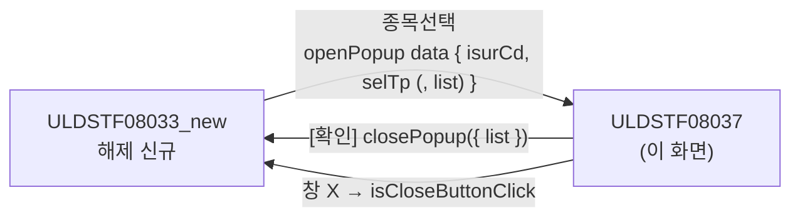
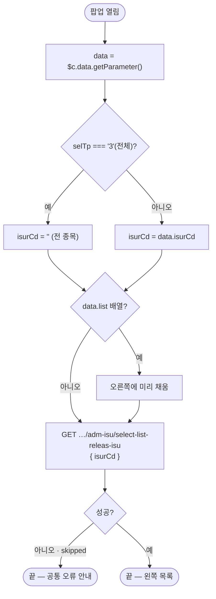
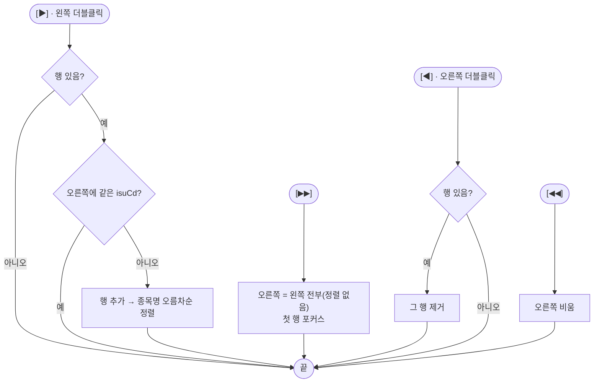
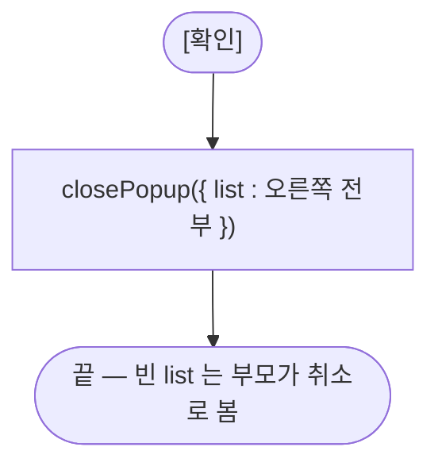

# ULDSTF08037 (팝업)관리종목지정 해제대상 종목선택 — 업무 분석 및 전환 내역

| 항목 | 내용 |
|---|---|
| AS-IS | `ULDSTF08037.gfm` (Gauce/X-Internet, 500×410 팝업, 원본 폴더 `/etn/` — ETN 관리종목지정 해제 대상 종목을 여러 개 고르는 팝업) — 반입 `conversion/conversion-front/ui/ULDSTF08037/ULDSTF08037.gfm` |
| 신규 API 명세 | 7화면 공용 `ULDSTF08031/ULDSTF08031,ULDSTF08032,ULDSTF08032_new,ULDSTF08033,ULDSTF08033_new,ULDSTF08034,ULDSTF08037_API.md` 의 **§2 블록 1종** — `GET /api/listing/lstproc/etn/adm-isu/select-list-releas-isu`(AS-IS `fn_set_code` — `DIV_ETN_IDX_ADMISU_ISU_RELEAS`, requestData `isurCd`, target `dlt_listReleasIsu`). 개별 명세 파일은 없고 `api_spec_check` 가 공용 파일명에서 이 화면을 찾는다(2026-10-30 보강). §2.2·§5 는 명세 기준 |
| TO-BE | `conversion/conversion-front/ui-tobe/ULDSTF08037.xml` (배포 경로 `/ui/lst/etn/ULDSTF08037.xml` 가정 — 공통 계약서 §3.3). **2026-10-30 전환** — 1단계: 캡처 + gfm 기준 마크업(퍼블리싱 파일 없음, 사본 `$CLAUDE_JOB_DIR/tmp/ULDSTF08037_stage1.xml`), 2단계: 스크립트. 게이트: `gate_screen --pcc stf`·`scan_mixed_compare`(A 0·B 0)·`publish_gate --pcc stf --before {1단계} --allow P20`·`api_spec_check`(공용 명세 자동 인식)·`init_binding_check`·`wsxml_lint` 0/0, `convert.py` 고정점 |
| 퍼블리셔 XML | 없음 — 화면 폴더·`conversion/publish` 모두 없다. 좌우 목록 이동 팝업 관용구(`lybox horizontal` + `ly_btn`)는 sample-front `ULDSTF09048`·`ULDSTF08045` 를 따랐다 |
| 화면 캡처 | `ULDSTF08037.png` (빈 상태 — 왼쪽·오른쪽 「종목명」 목록, 가운데 ▶·▶▶·◀·◀◀, 하단 [확인]·[닫기]) → 가이드 §13.2 퍼블리싱본부터 만들었다 |
| 공통 계약 | 7화면 공통 계약서(작업 산출물 `etn0803x_contracts.md`) §3.3 — data `{ isurCd, selTp }`, 반환 `{ list : [...] }`, 빈 목록·X 는 취소 |
| 업무공통 | gcc: `$c.sbm.executeDynamic`·`$c.data.getParameter`·`$c.win.closePopup`·`$c.exception.handleError`. pcc 사용 없음. 게이트는 `--pcc stf` |
| 작성 | Inswave / 2026-10-30 |

참고 양식: [websquare_gfm_conversion.md](../../../../md/websquare_gfm_conversion.md) — §1.4, §6.5. Gauce 대응은 [gfm_business_analysis_guide.md](../../../../md/gfm_business_analysis_guide.md).

---

## 1. 화면 개요

ETN 관리종목지정 **해제 신규**(ULDSTF08033_new)에서 해제할 종목을 고를 때 여는 팝업이다.

1. 부모가 넘긴 발행기관의 **해제 대상 종목**(공시가 끝난 지정건 중 아직 해제되지 않은 종목)을 왼쪽 목록에 조회한다. 부모 선택 구분이 전체(3)면 발행기관을 비워 전 종목을 조회한다.
2. [▶]·왼쪽 더블클릭은 고른 종목을 오른쪽에 더한다 — 같은 종목은 한 번만, 종목명 순으로 정렬.
3. [▶▶]는 오른쪽을 왼쪽 전부로 바꾼다. [◀]·오른쪽 더블클릭은 고른 행을, [◀◀]는 오른쪽 전부를 뺀다.
4. [확인]은 오른쪽 목록을 부모에 돌려주고 닫는다. 닫기는 창 X 다(팝업 하단 [닫기] 금지).

### 1.1 호출 화면 (1본)

| 화면 | 여는 곳 | 비고 |
|---|---|---|
| `ULDSTF08033_new` 관리종목지정 해제(발행회사 기준 신규) | 종목선택 버튼 — 원본 `fn_GetPar = fn_GetParIsu`·`fn_SetPar = fn_SetParIsu` 후 `CreateDialogFrame("…ULDSTF08037.gfm", 510×430)` (08033_new.gfm:576-579) | 같은 묶음의 C 묶음이 전환 |

### 1.2 호출 규약 (부모 → 이 화면) / 반환 규약

| 방향 | AS-IS | TO-BE |
|---|---|---|
| 부모 → 이 화면 | `frame.Provider("../").fn_GetPar(arrPar, dts_selectleadcom)` — `arrPar[0]` 발행기관코드(`keyIsurCd`), `arrPar[1]` 선택 구분(`keyGubun`), 그리고 부모가 이미 고른 목록을 `CopyDataSet(dts_Isu_Mst_Temp, param_dts)` 로 `dts_selectleadcom` 에 채움 | `$c.data.getParameter()` → `{ isurCd, selTp }`(공통 계약서 §3.3). **선택 키 `list`**(부모가 고른 행 배열)가 오면 오른쪽에 미리 채운다 — 계약서에 없는 키라 부모가 넘기지 않으면 빈 목록(§10 #3) |
| 이 화면 → 부모 | `fn_SetPar(dts_selectleadcom)` + `frame.CloseFrame()` — 부모 `fn_SetParIsu` 가 `CopyDataSet(param_dts, dts_Isu_Mst_Temp)` | `await $c.win.closePopup({ list : dlt_selList.getAllJSON() })` — 행은 명세 §2 응답 15열 키 |
| 취소 | [닫기] → `CloseFrame`(돌려주지 않음) | 창 X → `{ isCloseButtonClick }`. 부모는 `!Array.isArray(res?.list) || res.list.length === 0` 이면 취소 |

### 1.3 이 화면이 여는 하위 팝업

해당 없음.

### 1.4 업무 프로세스 흐름

| # | 업무 | 시작 | 끝 | 주요 함수 | 관련 절 |
|---|---|---|---|---|---|
| 1 | 진입·조회 | 부모가 팝업을 엶 | 왼쪽 해제대상 목록(오른쪽은 부모가 넘긴 목록) | `scwin.onpageload` → `scwin.init` → `scwin.selectList` | §3, §5.1 |
| 2 | 하나 더하기 | [▶] `img_rightarr` · 왼쪽 더블클릭 | 오른쪽에 추가(중복 무시, 종목명 순) | `scwin.img_rightarr_onclick` · `scwin.grd_leadcom_oncelldblclick` → `scwin.add` | §6.1 |
| 3 | 전부 더하기 | [▶▶] `img_rightarr_all` | 오른쪽 = 왼쪽 전부 | `scwin.img_rightarr_all_onclick` → `scwin.addAll` | §6.1 |
| 4 | 빼기 | [◀] `img_leftarr` · 오른쪽 더블클릭 / [◀◀] `img_leftarr_all` | 오른쪽에서 제거 | `scwin.img_leftarr_onclick` · `scwin.grd_selectleadcom_oncelldblclick` → `scwin.del` / `scwin.img_leftarr_all_onclick` → `scwin.delAll` | §6.1 |
| 5 | 확인 | [확인] `btn_confirm` | `{ list }` 반환·닫힘 | `scwin.btn_confirm_onclick` → `scwin.confirm` | §6.2 |

#### 화면 간 흐름

#### 업무 1: 진입·조회

#### 업무 2~4: 더하기 · 빼기

#### 업무 5: 확인

---

## 2. 화면 구성 및 데이터 정의

### 2.1 화면 구성 (AS-IS 요소 → TO-BE 컴포넌트)

TO-BE 는 팝업 `pop_contents` + contentHeader(`pfmContentHeader`) 아래 `lybox horizontal`(왼쪽 그리드 · 가운데 `ly_btn` 이동 버튼 4개 · 오른쪽 그리드) · 하단 `btnbox`([확인]) 순서다(캡처와 같음).

| 영역 | AS-IS 요소 (id · 종류) | TO-BE 컴포넌트 | 바인딩 | 비고 |
|---|---|---|---|---|
| 왼쪽 | `grd_leadcom` (mxgrid, `dts_code`) — 열 `ISU_CD`(숨김 「코드」)·`ISU_NM`(「종목명」) | `w2:gridView#grd_leadcom` readOnly, 열 `isuNm`(「종목명」) | `dlt_listReleasIsu` | 숨김 코드 열은 옮기지 않음(데이터에는 있음) |
| 가운데 | `img_rightarr` · `img_rightarr_all` · `img_leftarr` · `img_leftarr_all` (image 화살표) | `xf:trigger.btn_cm.right.icon` · `.right_all.icon` · `.left.icon` · `.left_all.icon` (같은 id) | `ev:onclick` | 라벨 「선택 추가」·「전체 추가」·「선택 제외」·「전체 제외」(아이콘 버튼 대체 텍스트) |
| 오른쪽 | `grd_selectleadcom` (mxgrid, `dts_selectleadcom`) — 열 `ISU_CD`(숨김)·`ISU_NM`·`PAGE_IDX`(숨김) | `w2:gridView#grd_selectleadcom` readOnly, 열 `isuNm` | `dlt_selList` | 숨김 `ISU_CD`·`PAGE_IDX` 는 옮기지 않음(`PAGE_IDX` 는 쓰는 곳 없음) |
| 하단 | `panel_3` (panel) | `btnbox#panel_3` > `rt` | — | |
| | `btn_confirm` (image 확인) | `xf:trigger.btn_cm.pt#btn_confirm` | `ev:onclick` | |
| | `btn_close` (image 닫기) | (옮기지 않음) | | 팝업 하단 [닫기] 금지 — 창 X |

### 2.2 데이터 정의 (DataCollection)

| AS-IS | TO-BE | 종류 | 키 | 비고 |
|---|---|---|---|---|
| `dts_code` | `dlt_listReleasIsu` | dataList | 명세 §2 응답 15열 — `bzProcsNo`·`isuCd`·`disclsYn`·`listDd`·`isuNm`·`isuNmFm`·`isurCd`·`comNm`·`isurNm`·`secugrpId`·`admisuDesignBzTpCd`·`mktactEnforceDd`·`grndRegulNm`·`admisuDesignBzProcsNo`·`remk` | 명세 target id 그대로 |
| `dts_selectleadcom` | `dlt_selList` | dataList | 위와 같은 15열 | 반환 `list` 의 행 |

- 원본 `fn_add_dts_select` 가 옮기던 19열 중 `MKTACT_RELEAS_DD`·`MKTACT_RSN_CHG_DD`·`ADMISU_RELEAS_GRND_REGUL_NM`·`ADMISU_RSN_CHG_GRND_REGUL_NM`·`ADMISU_RELEAS_RSN_CONTN`·`ADMISU_RSN_CONTN`·`ADMISU_RSN_CHG_CONTN` 7열은 **명세 응답에 없다** → 반환 행에도 없다(§10 #1). 명세에만 있는 `disclsYn`·`isuNmFm`·`secugrpId` 는 함께 돌려준다.

---

## 3. 로딩 (`scwin.onpageload` → `scwin.init`)

- `scwin.onpageload` 는 `scwin.init()` 만 부른다(try/catch + `handleError`).
- `scwin.init` 순서: ① `$c.data.getParameter()` — `selTp === "3"` 이면 `scwin.isurCd = ""`, 아니면 `data.isurCd`(원본 `if(keyGubun == "3") keyIsurCd = ""`) ② `data.list` 배열이 있으면 `dlt_selList.setJSON(list)`(원본 `CopyDataSet` 대응, 선택 키) ③ `await scwin.selectList()`.
- 원본 `gform.scroll="no"` 는 삭제. 원본은 `fn_GetPar` 가 없으면 조회하지 않았지만 TO-BE 는 늘 부모가 열므로 늘 조회한다.
- 달력·조회 영역 없음 → 규칙 22·37 대상 없음(`init_binding_check` OK).

## 4. 컴포넌트 이벤트

| AS-IS 이벤트 | TO-BE 핸들러 | 동작 |
|---|---|---|
| `grd_leadcom` OnDblClick(row, colid) | `scwin.grd_leadcom_oncelldblclick` | `scwin.add(rowIndex)` |
| `grd_selectleadcom` OnDblClick(row, colid) | `scwin.grd_selectleadcom_oncelldblclick` | `scwin.del(rowIndex)` |
| `img_rightarr` onclick | `scwin.img_rightarr_onclick` | `scwin.add(grd_leadcom.getFocusedRowIndex())` |
| `img_rightarr_all` onclick | `scwin.img_rightarr_all_onclick` | `scwin.addAll()` |
| `img_leftarr` onclick | `scwin.img_leftarr_onclick` | `scwin.del(grd_selectleadcom.getFocusedRowIndex())` |
| `img_leftarr_all` onclick | `scwin.img_leftarr_all_onclick` | `scwin.delAll()` |
| `btn_confirm` onclick | `scwin.btn_confirm_onclick` | `scwin.confirm()` |
| `btn_close` onclick | (삭제 — 창 X) | |
| `dts_code` OnLoadError() · OnFail() | (삭제 — 공통 오류 핸들러) | `alert_error(dts_code)` |
| `dts_selectleadcom` OnLoadError() · OnFail() | (삭제) | 서버 통신 없는 데이터셋이라 해당 없음 |
| `gform` onload | `scwin.onpageload` → `scwin.init` | §3 |

## 5. 서버 통신

### 5.1 해제대상 종목 조회 (`scwin.selectList`)

| 항목 | AS-IS | TO-BE (공용 명세 §2) |
|---|---|---|
| 경로 | `/etn/EtnMktAct.do?method=searchEtnAdministrativeIssue&DIV_IDX=DIV_ETN_IDX_ADMISU_ISU_RELEAS&ISUR_CD=…` | `GET /api/listing/lstproc/etn/adm-isu/select-list-releas-isu` |
| 요청 | URL 인자 `ISUR_CD` | requestData `{ isurCd : scwin.isurCd }` |
| 응답 | `dts_code` | `target : "dlt_listReleasIsu=body"`, `gridview : "grd_leadcom"` |
| 실패 | `alert_error(dts_code)` | 공통 오류 핸들러 |
| 중복 실행 | — | `result.skipped` 면 끝 |

## 6. 일반 함수

### 6.1 더하기 · 빼기 (`scwin.add` · `scwin.addAll` · `scwin.del` · `scwin.delAll`)

- `scwin.add(rowIndex)` — 원본 `fn_add` + `fn_add_dts_select`: 범위 밖이면 끝, 오른쪽에 같은 `isuCd` 가 있으면 끝, 아니면 왼쪽 행 JSON(`getRowJSON`)을 더하고 종목명 오름차순(원본 `SortExpr="+ISU_NM"`)으로 다시 채운다. 원본의 열별 복사(19열)는 행 JSON 통째 복사로 바꿨다.
- `scwin.addAll()` — 원본 `fn_add_all`: 오른쪽을 왼쪽 전부로 바꾸고(`DeleteAll` 후 전부 추가) 첫 행 포커스. 정렬하지 않는다(원본 주석 처리).
- `scwin.del(rowIndex)` — 원본 `fn_del`: 그 행 `removeRow`.
- `scwin.delAll()` — 원본 `fn_del_all`: `removeAll`.

### 6.2 확인 (`scwin.confirm`)

- 원본 `fn_confirm` — `fn_SetPar(dts_selectleadcom)` + `frame.CloseFrame()`. TO-BE `await $c.win.closePopup({ list : dlt_selList.getAllJSON() })`.

### 6.3 기타

- 원본 `fn_set_code` → `scwin.init` 의 발행기관 결정 + `scwin.selectList`.

### 6.5 부모 ↔ 팝업 파라미터 전달 (getPar/setPar → `$c.win.openPopup` + `await`)

| AS-IS | TO-BE |
|---|---|
| `prt.fn_GetPar(arrPar, dts_selectleadcom)` — arr[0] 발행기관, arr[1] 구분, 부모 목록 복사 | `$c.data.getParameter()` → `isurCd`·`selTp`(+ 선택 `list`) |
| `prt.fn_SetPar(dts_selectleadcom)` | `closePopup({ list })` — 부모가 `await openPopup` 의 반환값으로 받는다 |

## 7. 업무 코드 · 메시지 목록

| 구분 | 값 | 의미 |
|---|---|---|
| 선택 구분 `selTp` | 3 | 전체 — 발행기관을 비워 전 종목 조회 |
| 메시지 | — | 화면 자체 메시지 없음(조회 실패는 공통 오류 안내) |

## 8. 원본 특이사항 · 결함

| # | 내용 | 결정 |
|---|---|---|
| 1 | `fn_add` 루프 변수 `i` 가 선언 없는 전역 | 고침 — `let` |
| 2 | 응답 19열을 열마다 `NameValue` 로 옮김 | 고침 — 행 JSON 통째 |
| 3 | [▶▶]가 오른쪽을 먼저 지우고 전부 추가(앞서 고른 것도 사라짐) | 유지 — 원본 동작 |
| 4 | [▶▶] 뒤에는 정렬하지 않음(정렬 주석 처리) | 유지 |
| 5 | 팝업 하단 [닫기] | 옮기지 않음 — 창 X |
| 6 | 숨김 열 `PAGE_IDX` — 쓰는 곳 없음 | 옮기지 않음 |
| 7 | `vScrenID` 전역 — 쓰는 곳 없음 | 삭제 |

## 9. 전환 내역 (AS-IS → TO-BE)

| AS-IS | TO-BE |
|---|---|
| 전역 `fn_GetPar`·`fn_SetPar` | 삭제(§6.5) |
| 전역 `keyIsurCd`·`keyGubun` | `scwin.isurCd`(선택 구분은 `scwin.init` 안에서만 씀) |
| 전역 `vScrenID` | 삭제 |
| `fn_add_dts_select` · `fn_add` | `scwin.add` |
| `fn_add_all` | `scwin.addAll` |
| `fn_del` · `fn_del_all` | `scwin.del` · `scwin.delAll` |
| `fn_confirm` | `scwin.confirm` |
| `fn_set_code` | `scwin.init` + `scwin.selectList` |
| 이벤트 | §4 표 |

- publicInfo: 정의한 15함수 전부.
- 게이트: `gate_screen --pcc stf`·`scan_mixed_compare`(A 0·B 0)·`publish_gate --before 1단계 --allow P20`·`api_spec_check`(공용 명세 자동 인식, 다른 화면 블록은 A06 INFO)·`init_binding_check`·`wsxml_lint` 0/0, `convert.py` 고정점.

## 10. 남은 작업 (TODO)

1. **명세 응답 열 부족** — 원본이 부모에 돌려주던 `MKTACT_RELEAS_DD`·`MKTACT_RSN_CHG_DD`·`ADMISU_RELEAS_GRND_REGUL_NM`·`ADMISU_RSN_CHG_GRND_REGUL_NM`·`ADMISU_RELEAS_RSN_CONTN`·`ADMISU_RSN_CONTN`·`ADMISU_RSN_CHG_CONTN` 이 명세 §2 응답에 없다. 공통 계약서 §3.3 의 반환 키 목록에 있는 이 7키는 `list` 행에 없으므로, 08033_new 가 해제 상세를 이 값으로 채운다면 명세 보완이 필요하다.
2. **`bzProcsNo`** — 명세 주석대로 AS-IS 는 늘 빈 값. 08033_new 가 `list[0].bzProcsNo` 를 업무처리번호로 쓰면 늘 빈 값이다(원본과 같음).
3. **선택 키 `list`** — 원본은 부모가 이미 고른 목록을 오른쪽에 채웠다. 계약서 data 는 `{ isurCd, selTp }` 뿐이라 08033_new 가 `list` 를 넘기지 않으면 매번 빈 오른쪽으로 연다. 원본 동작이 필요하면 08033_new 가 `list : 현재 종목 목록` 을 넘기면 된다(이 화면은 이미 받는다).
4. **팝업 크기** — 원본 510×430 에 contentHeader 가 더해진다. 부모(08033_new)가 정하는 크기 확인.
5. **배포 경로** — `/ui/lst/etn/ULDSTF08037.xml` 가정.
