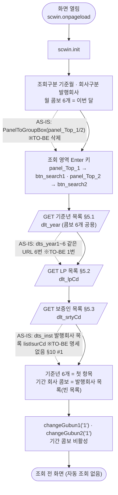
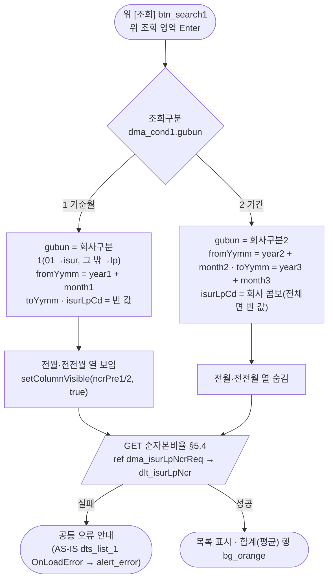
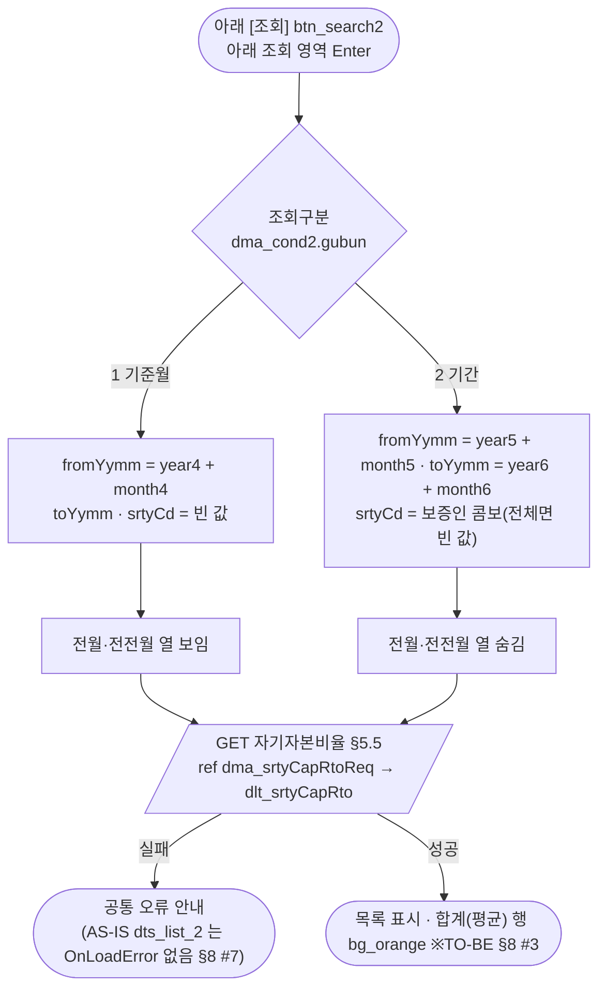
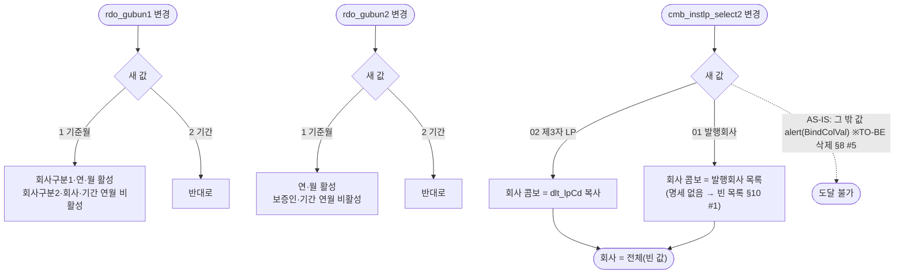
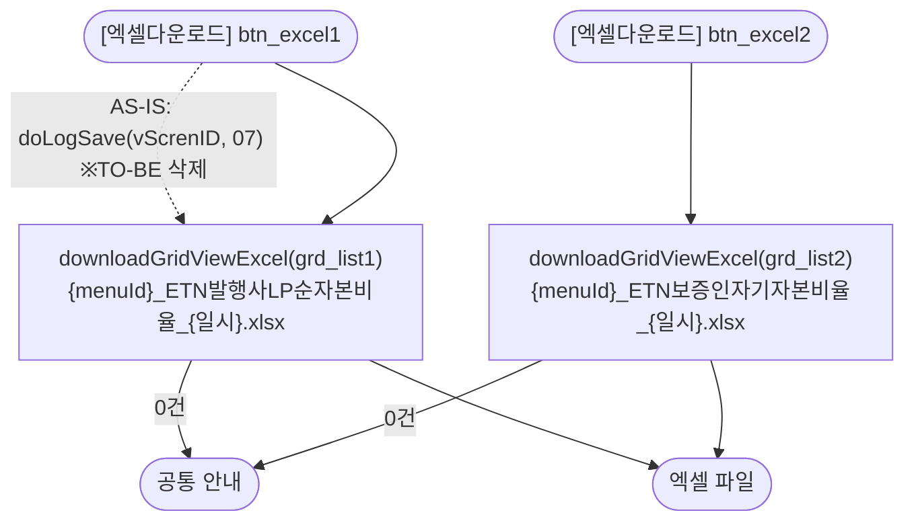

# ULDSTF08061 순자본비율 — 업무 분석 및 전환 내역

| 항목 | 내용 |
|---|---|
| AS-IS | `ULDSTF08061.gfm` (Gauce/X-Internet, 950×810 — 창 제목 "순자본비율(ETN)_STF08061") — 반입 `conversion/conversion-front/ui/ULDSTF08061/ULDSTF08061.gfm` |
| 신규 API 명세 | `ULDSTF08061_API.md` — 블록 5종: ① ETN 유동성공급자(LP) 목록 `GET /api/listing/lstproc/etn/code/list-lpCd`(AS-IS `/etn/EtnCodeAct.do?method=listLPCd&For=R`), ② ETN 보증인 목록 `GET /api/listing/lstproc/etn/code/list-srtyCd`(AS-IS `listSrtyCd&For=R`), ③ 발행사/LP 순자본비율 `GET /api/listing/lstproc/etn/ncr/select-list-isur-lp-ncr`(AS-IS `searchIsurLpNcrDetailList`), ④ 보증인 자기자본비율 `GET /api/listing/lstproc/etn/ncr/select-list-srty-cap-rto`(AS-IS `searchSrtyCapRatioDetailList`), ⑤ 기준년 콤보 `GET /api/listing/lstproc/etn/ncr/select-list-year`(AS-IS `/ElwNcr.do?method=selectElwNcrYear`). **①·② 머리에 화면ID 가 없어** `api_spec_check` 가 두 블록을 읽지 못했다 — 내용은 그대로 두고 머리에 `[ULDSTF08061][ETN]` 만 넣었다(§10 #2). **발행회사 목록(AS-IS `listIsurCd&For=R`) 블록은 없다**(§10 #1). §2.2·§5 는 명세 기준(가이드 §0.3·§5) |
| TO-BE | `conversion/conversion-front/ui-tobe/ULDSTF08061.xml` (배포 경로 미정 — §10 #6). **2026-10-30 전환** — 1단계: 캡처 기준 퍼블리싱(마크업 전용, 사본 `$CLAUDE_JOB_DIR/tmp/ULDSTF08061_stage1.xml`), 2단계: 이 결과서대로 스크립트 전환. 게이트: `gate_screen --pcc stf`·`scan_mixed_compare`(A 1·B 0)·`publish_gate --pcc stf --before {1단계} --allow P20`·`api_spec_check`·`init_binding_check`·`wsxml_lint` 0/0 통과, `convert.py` 고정점 |
| 퍼블리셔 XML | 화면 폴더의 `ULDSTF08061.xml`(W-Craft 1차 스크립트 내장, `conversion/publish/상장/상장처리(대내)/ULDSTF08061.xml` 과 같은 계열) — 본화면(`sub_contents` + `pgtbox`) 꼴, 두 구역 각각 h3 제목·조회조건 2행 표(라디오 th rowspan 2)·단위+엑셀·그리드, 하단 안내문 `msgbox`, [닫기] `btnbox`. 그리드 열 id 는 AS-IS 대문자, 콤보 값에 Gauce `''01` 이 그대로 남아 있다. **캡처를 따라** 정리했다(§2.1, §10 #7) |
| 화면 캡처 | `ULDSTF08061.png` (조회 전 화면 — 두 구역 모두 기준월, 2026년 10월, 기간 콤보 비활성, 회사·보증인 "전체", 하단 [엑셀저장]·안내문 4항) → TO-BE 는 가이드 §13.2 퍼블리싱본부터 만들었다 |
| 업무공통 | gcc 만 쓴다: `$c.data.downloadGridViewExcel`·`$c.date.getServerDateTime`·`$c.win`(`setEnterKeyEvent`·`getProgramId`)·`$c.sbm.executeDynamic`·`$c.exception.handleError`. pcc 함수는 쓰지 않는다(게이트는 `--pcc stf`) |
| 작성 | Inswave / 2026-10-30 |

참고 양식: [websquare_gfm_conversion.md](../../../md/websquare_gfm_conversion.md) — 특히 §1.4 업무 프로세스 흐름, §5 「API 명세 적용」, §6.5 getPar/setPar 전환. Gauce 대응은 [gfm_business_analysis_guide.md](../../../md/gfm_business_analysis_guide.md) §5·§6 을 함께 따랐다. 조회 화면 골격은 선례 [ULDSTF15900.md](../completed/ULDSTF15900/ULDSTF15900.md)(조회·엑셀·customFormatter)를 따랐다.

---

## 1. 화면 개요

ETN 담당자가 **ETN 발행인·제3자 LP 의 순자본비율**과 **보증인의 자기자본비율**을 보는 조회 전용 메인 화면이다. 위아래 두 구역이 서로 독립이다(조회조건·조회 버튼·그리드·엑셀이 각각 있다).

1. 화면을 열면 기준년 콤보 6개·제3자 LP·보증인 목록을 채우고, 월 콤보는 이번 달, 조회구분은 두 구역 모두 **기준월**로 둔다. 자동 조회는 하지 않는다(원본 `//fn_list_sync()` 주석).
2. 위 구역 — **기준월**: 회사구분(발행회사·제3자 LP)·연·월로 그 달의 회사별 순자본비율과 전월·전전월 비율을 본다. **기간**: 회사구분·회사(전체 또는 1곳)·시작 연월~종료 연월로 기간 동안의 비율을 본다(전월·전전월 열은 숨김).
3. 아래 구역 — **기준월**: 연·월로 보증인별 자기자본비율과 전월·전전월. **기간**: 보증인(전체 또는 1곳)·시작 연월~종료 연월.
4. 조회구분을 바꾸면 그 구분의 콤보만 쓸 수 있다. 구역마다 [엑셀다운로드]로 목록을 내려받는다.

### 1.1 호출 화면 (0본)

- 이 화면을 여는 화면은 저장소에 없다. 퍼블리셔 `ULDSTF08066.xml` 에 `//frame.CreateDialogFrame("ULDSTF08061",".ULDSTF08061.gfm", "영업용순자본비율", …, "window")` 가 **주석으로만** 남아 있다. 메뉴에서 여는 **메인 화면**으로 본다. 진입 파라미터는 없다.

### 1.2 호출 규약 (부모 → 이 화면) / 반환 규약

- 해당 없음 — 메뉴 화면이라 받는 파라미터·돌려주는 값이 없다.

### 1.3 이 화면이 여는 하위 팝업

- 해당 없음 — 팝업을 열지 않는다.

### 1.4 업무 프로세스 흐름

흐름은 AS-IS 동작을 기준으로 그렸다. 점선과 `※TO-BE` 는 전환본에서 바뀌는 곳이다(근거는 §8).

| # | 업무 | 시작 (사용자 동작·진입 조건) | 끝 (결과) | 주요 함수 | 관련 절 |
|---|---|---|---|---|---|
| 1 | 진입·로딩 | 메뉴에서 화면을 엶 | 콤보 채움, 기준월 상태(조회 전) | `scwin.onpageload` → `scwin.init` → `scwin.selectYearList`·`scwin.selectLpCdList`·`scwin.selectSrtyCdList` → `scwin.setDefaultYear`·`scwin.setInstLpList`·`scwin.changeGubun1`·`scwin.changeGubun2` | §3, §5.1~§5.3 |
| 2 | 발행사/LP 순자본비율 조회 | 위 [조회] `btn_search1` · 위 조회 영역 Enter | 목록 표시(기준월이면 전월·전전월 열 보임) | `scwin.btn_search1_onclick` → `scwin.selectIsurLpNcr` | §5.4 |
| 3 | 보증인 자기자본비율 조회 | 아래 [조회] `btn_search2` · 아래 조회 영역 Enter | 목록 표시 | `scwin.btn_search2_onclick` → `scwin.selectSrtyCapRto` | §5.5 |
| 4 | 조회구분 변경 | `rdo_gubun1`·`rdo_gubun2` 변경 | 구분에 맞는 콤보만 활성 | `scwin.rdo_gubun1_onviewchange` → `scwin.changeGubun1` / `scwin.rdo_gubun2_onviewchange` → `scwin.changeGubun2` | §6.3 |
| 5 | 기간 회사구분 변경 | `cmb_instlp_select2` 변경 | 회사 콤보 목록 교체·"전체" | `scwin.cmb_instlp_select2_onviewchange` → `scwin.setInstLpList` | §6.2 |
| 6 | 엑셀 | [엑셀다운로드] `btn_excel1`·`btn_excel2` | 목록 엑셀 파일 | `scwin.btn_excel1_onclick` → `scwin.excelDown1` / `scwin.btn_excel2_onclick` → `scwin.excelDown2` | §6.5 |

#### 화면 간 흐름

하위 팝업·부모 화면이 없다. AS-IS 의 [닫기]는 창을 닫았지만, TO-BE 는 메뉴 탭 본화면이라 옮기지 않았다(§8 #10).

#### 업무 1: 진입·로딩

| # | 단계 | 주체 | 내용 | 분기 · 메시지 | 관련 절 |
|---|---|---|---|---|---|
| 1 | 구분 기본값 | 화면 | AS-IS `rdo_gubun1/2.CodeValue = "1"` → `dma_cond1.gubun`·`dma_cond2.gubun` = "1", 회사구분 콤보 index 0 → `isurLpTp1`·`isurLpTp2` = "01" | — | §3 |
| 2 | (장식) | 화면 | AS-IS `PanelToGroupBox(panel_Top_1)`·`(panel_Top_2)` | 삭제 — 퍼블리싱 마크업 | §2.1 |
| 3 | 이번 달 | 화면 | AS-IS `cGetToday("yyyymmdd").substring(4, 6)` → `setObjectValue(cmb_month1~6)` → `$c.date.getServerDateTime` 의 월을 `month1~6` 에 | — | §3 |
| 4 | Enter 키 | 화면 | (AS-IS 없음) 규칙 22 — 구역마다 그 구역의 조회 | — | §3 |
| 5 | 기준년 | 서버 | AS-IS `dts_year1~6.DataID = /ElwNcr.do?method=selectElwNcrYear&inputMessageId=ELW_NCR_YEAR_INOUT` (syncload, 6번) → 명세 ⑤ 1번 | 실패는 공통 오류 안내(AS-IS `alert_error(dts_Year1)` — §8 #1) | §5.1 |
| 6 | 발행회사 목록 | 서버 | AS-IS `dts_inst` `/etn/EtnCodeAct.do?method=listIsurCd&For=R` | **명세에 없어 부르지 않음**(§10 #1) | §6.2 |
| 7 | LP 목록 | 서버 | AS-IS `dts_lp` `listLPCd&For=R` → 명세 ① | — | §5.2 |
| 8 | 보증인 목록 | 서버 | AS-IS `dts_srty` `listSrtyCd&For=R` → 명세 ② | — | §5.3 |
| 9 | 기준년 기본값 | 화면 | AS-IS 콤보 `index="0"` → `dlt_year` 첫 행 값을 `year1~6` 에 | 목록이 비면 그대로 | §6.1 |
| 10 | 기간 회사 콤보 | 화면 | AS-IS `cmb_inst_lp.ComboDataID = "dts_inst"` → `scwin.setInstLpList("01")` | 발행회사는 "전체" 만(§10 #1) | §6.2 |
| 11 | 콤보 활성 | 화면 | AS-IS `fn_change_gubun1("1")`·`fn_change_gubun2("1")` | — | §6.3 |

#### 업무 2: 발행사/LP 순자본비율 조회

| # | 단계 | 주체 | 내용 | 분기 · 메시지 | 관련 절 |
|---|---|---|---|---|---|
| 1 | 요청 만들기 | 화면 | AS-IS URL 인자 `GUBUN`·`FROM_YYMM`(기준월)/+`TO_YYMM`·`ISUR_LP_CD`(기간) → `dma_isurLpNcrReq.setJSON({ gubun, fromYymm, toYymm, isurLpCd })` | 기준월은 `toYymm`·`isurLpCd` 를 빈 값으로 보낸다(원본은 인자 자체가 없음 — §10 #4) | §5.4 |
| 2 | 열 표시 | 화면 | AS-IS `grid_list1.ColumnProp('NCR_PRE1','Show') = true/false` → `grd_list1.setColumnVisible("ncrPre1"·"ncrPre2", 기준월)` | — | §5.4 |
| 3 | 조회 | 서버 | AS-IS `dts_list_1.DataID` + `ShowWin(grid_list1)` → 명세 ③ | 실패는 공통 오류 안내. 기간 선후 검사 없음(원본과 같음 — §8 #6) | §5.4 |
| 4 | 후처리 | 화면 | AS-IS `OnLoadCompleted` → `CloseWin(rowcount, grid_list1)`(대기 표시 닫기) | 삭제 — 공통 처리 | §5.4 |

#### 업무 3: 보증인 자기자본비율 조회

| # | 단계 | 주체 | 내용 | 분기 · 메시지 | 관련 절 |
|---|---|---|---|---|---|
| 1 | 요청 만들기 | 화면 | AS-IS `FROM_YYMM`/+`TO_YYMM`·`SRTY_CD` → `dma_srtyCapRtoReq.setJSON({ fromYymm, toYymm, srtyCd })` | 기준월은 `toYymm`·`srtyCd` 빈 값 | §5.5 |
| 2 | 열 표시 | 화면 | AS-IS `grid_list2.ColumnProp('CAP_RTO_PRE1'·'CAP_RTO_PRE2','Show')` → `grd_list2.setColumnVisible("capRtoPre1"·"capRtoPre2", 기준월)` | — | §5.5 |
| 3 | 조회 | 서버 | AS-IS `dts_list_2.DataID` + `ShowWin(grid_list2)` → 명세 ④ | 실패는 공통 오류 안내 | §5.5 |

#### 업무 4~5: 조회구분 변경 · 기간 회사구분 변경

| # | 단계 | 주체 | 내용 | 분기 · 메시지 | 관련 절 |
|---|---|---|---|---|---|
| 1 | 위 구분 | 화면 | AS-IS `fn_change_gubun1(rdo_gubun1.CodeValue)` — `Enable2` 토글 → `scwin.changeGubun1(info.newValue)` — `setDisabled` | — | §6.3 |
| 2 | 아래 구분 | 화면 | AS-IS `fn_change_gubun2(rdo_gubun2.CodeValue)` → `scwin.changeGubun2(info.newValue)` | AS-IS 의 회사구분 콤보 줄은 주석이라 손대지 않음 | §6.3 |
| 3 | 회사구분 | 화면 | AS-IS `cmb_inst_lp.ComboDataID = "dts_inst"/"dts_lp"` · `index = 0` → `scwin.setInstLpList(info.newValue)` — `dlt_instLp` 교체, `isurLpCd` = "" | — | §6.2 |

#### 업무 6: 엑셀

| # | 단계 | 주체 | 내용 | 분기 · 메시지 | 관련 절 |
|---|---|---|---|---|---|
| 1 | 내려받기 | 화면 | AS-IS `grid_list1.GridToExcel("ETN 발행사/LP (영업용)순자본비율", "", "8")` / `grid_list2.GridToExcel("ETN 보증인 자기자본비율", "", "8")` → `$c.data.downloadGridViewExcel` | 0건 안내는 공통 함수 | §6.5 |

#### 화면 모드 상태 전이

해당 없음 — 조회 전용이라 모드가 없다(조회구분에 따른 콤보 활성은 §6.3).

---

## 2. 화면 구성 및 데이터 정의

### 2.1 화면 구성 (AS-IS 요소 → TO-BE 컴포넌트)

TO-BE 는 본화면 `sub_contents` + contentHeader(`pfmContentHeader`) 아래 **위 구역**(h3 제목 → `schbox#panel_Top_1` → 단위·엑셀 `titbox` → 그리드) · **아래 구역**(같은 꼴, `panel_Top_2`) · 안내문 `msgbox` 순서다(캡처와 같음). 조회조건 표는 2열(라디오 th rowspan 2 + 콤보 td)이다.

| 영역 | AS-IS 요소 (id · 종류) | TO-BE 컴포넌트 | 바인딩 | 비고 |
|---|---|---|---|---|
| 위 제목 | `lbl_1` "발행인/제3자 LP의 순자본비율" (label) | `w2:textbox#lbl_1` h3 (`titbox`) | — | |
| 위 조회 | `panel_Top_1` (panel, `PanelToGroupBox`) | `schbox#panel_Top_1` | — | 장식 함수 삭제, Enter 키 영역 |
| | `rdo_gubun1` (mxradio `1^기준월,2^기간`) | `xf:select1#rdo_gubun1` radiogroup (th, rowspan 2) | `dma_cond1.gubun`, `ev:onviewchange` | |
| | `cmb_instlp_select1` (mxcombo `''01^발행회사,02^제3자 LP`) | `xf:select1#cmb_instlp_select1` (01·02) | `dma_cond1.isurLpTp1` | 값 `''01` → `01`(§8 #4) |
| | `cmb_year1` (mxcombo, `dts_year1`) | `xf:select1#cmb_year1` | `dma_cond1.year1`, itemset `dlt_year` | |
| | `cmb_month1` (mxcombo `''01^01월,…,12^12월`) | `xf:select1#cmb_month1` (01~12) | `dma_cond1.month1` | 값 `''01` → `01` |
| | `cmb_instlp_select2` (mxcombo `01^발행회사,02^제3자 LP`) | `xf:select1#cmb_instlp_select2` | `dma_cond1.isurLpTp2`, `ev:onviewchange` | |
| | `cmb_inst_lp` (mxcombo, `dts_inst`/`dts_lp` 전환) | `xf:select1#cmb_inst_lp` (chooseOption "전체") | `dma_cond1.isurLpCd`, itemset `dlt_instLp` | 캡처의 "전체"(§10 #3) |
| | `cmb_year2`·`cmb_month2` / `cmb_year3`·`cmb_month3` (`dts_year2`·`dts_year3`) | `xf:select1#cmb_year2`·`#cmb_month2` + "~" + `#cmb_year3`·`#cmb_month3` | `dma_cond1.year2`·`month2`·`year3`·`month3` | "~" 는 퍼블리셔 레이아웃(원본 위치 간격) |
| | `btn_search1` (image 조회) | `xf:trigger#btn_search1` `btn_cm sch` | `ev:onclick` | |
| | `image_3` (구분선 이미지) | (옮기지 않음) | — | schbox 레이아웃이 대신함 |
| 위 머리 | `label_7` "(단위 : 백만원, %)" | `w2:textbox#label_7` (`titbox` `rt`) | — | |
| | `btn_excel1` (image 엑셀저장) | `xf:trigger#btn_excel1` `btn_cm download` "엑셀다운로드" | `ev:onclick` | 캡처는 그리드 아래, 퍼블리셔·선례는 머리 오른쪽(§10 #7) |
| 위 그리드 | `grid_list1` (mxgrid, `dts_list_1`) | `w2:gridView#grd_list1` (`dlt_isurLpNcr`, readOnly) | — | id 접두 `grd_`(가이드 §0.1) |
| | 열 `COM_ABBRV` 회사명/연월 | `comAbbrv` | — | 7열 모두 `customFormatter="scwin.fmtIsurLpNcr"`(합계 행 bg_orange — §6.4) |
| | 열 `FBZ_NETCAP` 영업용순자본 (dec 0) | `fbzNetcap` number `#,##0` | — | |
| | 열 `TOT_RISK_AMT` 총위험액 · `REQ_PERSIS_PRINC_CAP_VAL` 필요유지 자기자본 (dec 없음) | `totRiskAmt` · `reqPersisPrincCapVal` number `#,##0` | — | 단위 백만원 정수 가정(§10 #5) |
| | 열 `NCR` 순자본비율 (dec 2) | `ncr` number `#,##0.00` | — | |
| | 열 `NCR_PRE1` 전월 · `NCR_PRE2` 전전월 (dec 0) | `ncrPre1` · `ncrPre2` number `#,##0` | — | 기준월만 보임 |
| 아래 제목 | `lbl_4` "보증인의 자기자본비율" | `w2:textbox#lbl_4` h3 | — | |
| 아래 조회 | `panel_Top_2` (panel) | `schbox#panel_Top_2` | — | Enter 키 영역 |
| | `rdo_gubun2` (mxradio) | `xf:select1#rdo_gubun2` radiogroup | `dma_cond2.gubun`, `ev:onviewchange` | |
| | `cmb_year4`·`cmb_month4` | `xf:select1#cmb_year4`·`#cmb_month4` | `dma_cond2.year4`·`month4` | |
| | `cmb_srty` (mxcombo, `dts_srty`) | `xf:select1#cmb_srty` (chooseOption "전체") | `dma_cond2.srtyCd`, itemset `dlt_srtyCd` | |
| | `cmb_year5`·`cmb_month5` / `cmb_year6`·`cmb_month6` | `xf:select1#cmb_year5`·`#cmb_month5` + "~" + `#cmb_year6`·`#cmb_month6` | `dma_cond2.year5`·`month5`·`year6`·`month6` | |
| | `btn_search2` (image 조회) · `image_2` (구분선) | `xf:trigger#btn_search2` · (옮기지 않음) | `ev:onclick` | |
| 아래 머리 | `label_2` "(단위 : 억원, %)" · `btn_excel2` | `w2:textbox#label_2` · `xf:trigger#btn_excel2` | `ev:onclick` | |
| 아래 그리드 | `grid_list2` (mxgrid, `dts_list_2`) | `w2:gridView#grd_list2` (`dlt_srtyCapRto`, readOnly) | — | 7열 모두 `customFormatter="scwin.fmtSrtyCapRto"` |
| | 열 `SRTY_ABBRV` 회사명/연월 · `PRINC_CAP_RTO_KIND_CD` 비율종류 | `srtyAbbrv` · `princCapRtoKindCd` | — | 비율종류는 서버가 코드명(공통코드 03697)으로 준다 |
| | 열 `BAS_EQTYCAP` (기본)자기자본(A) (dec 2, `edit="any"`) · `RISK_ASST_VAL` 위험자산/책임준비(B) · `ETN_SRTY_PRINC_CAP_RTO` 비율(A/B) · `CAP_RTO_PRE1` 전월 · `CAP_RTO_PRE2` 전전월 (dec 2) | `basEqtycap` · `riskAsstVal` · `etnSrtyPrincCapRto` · `capRtoPre1` · `capRtoPre2` number `#,##0.00` | — | `edit="any"` 는 옮기지 않음(조회 목록 — §8 #12) |
| 안내문 | `label_44` · `label_3` · `label_4` · `label_5`+`label_6` · `label_12`+`lbl_6`+`lbl_9` · `lbl_8` (label 줄 단위) | `msgbox` > `ol.txt_list` 4항 — `w2:textbox#label_44`(+ `ul` `#label_3`·`#label_4`) · `#label_5` · `#label_12` · `#lbl_8` | — | 원본의 줄바꿈용 라벨 `label_6`·`lbl_6`·`lbl_9` 는 앞 항 문장에 합쳤다(퍼블리셔와 같음) |
| 하단 | `btn_Close` (image 닫기, `self.close()`) | **(옮기지 않음)** | — | 본화면(§8 #10) |
| 데이터셋 | `dts_inst` | (옮기지 않음) | — | 발행회사 목록 API 없음(§10 #1) |

### 2.2 데이터 정의 (DataCollection)

| TO-BE | AS-IS | 용도 | 키 (camelCase) |
|---|---|---|---|
| `dma_cond1` | 위 조회조건 컴포넌트 값 | 위 구역 화면 상태(요청 아님) | `gubun`·`isurLpTp1`·`year1`·`month1`·`isurLpTp2`·`isurLpCd`·`year2`·`month2`·`year3`·`month3` |
| `dma_isurLpNcrReq` | URL 인자 `GUBUN`·`FROM_YYMM`·`TO_YYMM`·`ISUR_LP_CD` | 순자본비율 조회 요청(명세 ③ requestData) | `gubun`("isur"/"lp")·`fromYymm`·`toYymm`·`isurLpCd` |
| `dlt_isurLpNcr` | `dts_list_1` | 위 그리드(명세 ③ 응답 `target : "dlt_isurLpNcr=body"`) — **명세 원문 그대로 10열** | `isurCd`·`isurLpCd`·`comAbbrv`·`basYymm`·`fbzNetcap`·`totRiskAmt`·`reqPersisPrincCapVal`·`ncr`·`ncrPre1`·`ncrPre2` |
| `dma_cond2` | 아래 조회조건 컴포넌트 값 | 아래 구역 화면 상태 | `gubun`·`year4`·`month4`·`srtyCd`·`year5`·`month5`·`year6`·`month6` |
| `dma_srtyCapRtoReq` | URL 인자 `FROM_YYMM`·`TO_YYMM`·`SRTY_CD` | 자기자본비율 조회 요청(명세 ④ requestData) | `fromYymm`·`toYymm`·`srtyCd` |
| `dlt_srtyCapRto` | `dts_list_2` | 아래 그리드(명세 ④ 응답 `target : "dlt_srtyCapRto=body"`) — **명세 원문 그대로 9열** | `srtyCd`·`srtyAbbrv`·`basYymm`·`princCapRtoKindCd`·`riskAsstVal`·`basEqtycap`·`etnSrtyPrincCapRto`·`capRtoPre1`·`capRtoPre2` |
| `dlt_lpCd` | `dts_lp` | LP 목록 원천(명세 ① 응답 `target : "dlt_lpCd=body"`) | `value`·`text` |
| `dlt_srtyCd` | `dts_srty` | 보증인 콤보(명세 ② 응답 `target : "dlt_srtyCd=body"`) | `value`·`text` |
| `dlt_year` | `dts_year1`·`dts_year2`·`dts_year3`·`dts_year4`·`dts_year5`·`dts_year6` | 기준년 콤보 6개 공용(명세 ⑤ 응답 `target : "dlt_year=body"`) | `value`·`text` |
| `dlt_instLp` | (`cmb_inst_lp.ComboDataID` 전환) | 기간 회사 콤보 표시용 — `dlt_lpCd` 복사 또는 빈 목록 | `value`·`text` |
| (옮기지 않음) | `dts_inst` | 발행회사 목록 — §10 #1 | — |

AS-IS 그리드 열 ↔ 명세 키: `COM_ABBRV`→`comAbbrv`, `FBZ_NETCAP`→`fbzNetcap`, `TOT_RISK_AMT`→`totRiskAmt`, `REQ_PERSIS_PRINC_CAP_VAL`→`reqPersisPrincCapVal`, `NCR`→`ncr`, `NCR_PRE1`→`ncrPre1`, `NCR_PRE2`→`ncrPre2`; `SRTY_ABBRV`→`srtyAbbrv`, `PRINC_CAP_RTO_KIND_CD`→`princCapRtoKindCd`, `BAS_EQTYCAP`→`basEqtycap`, `RISK_ASST_VAL`→`riskAsstVal`, `ETN_SRTY_PRINC_CAP_RTO`→`etnSrtyPrincCapRto`, `CAP_RTO_PRE1`→`capRtoPre1`, `CAP_RTO_PRE2`→`capRtoPre2`. 모두 명세에 있다. 명세의 `isurCd`·`isurLpCd`·`basYymm`·`srtyCd` 는 그리드에 보이지 않는다.

---

## 3. 로딩 (`scwin.onpageload` → `scwin.init`) — 2구역

- `scwin.onpageload` 는 `await scwin.init()` 만 부른다(try/catch + `$c.exception.handleError`).
- `scwin.init` 순서
  1. `dma_cond1.gubun`·`dma_cond2.gubun` = "1"(기준월), `isurLpTp1`·`isurLpTp2` = "01"(발행회사) — 원본 `rdo_gubun1/2.CodeValue = "1"`, 콤보 index 0.
  2. `$c.date.getServerDateTime("yyyyMMdd")` 의 월 → `month1`~`month6` — 원본 `cGetToday`(클라이언트 날짜 대신 서버 날짜).
  3. `$c.win.setEnterKeyEvent(panel_Top_1, scwin.btn_search1_onclick)`·`(panel_Top_2, scwin.btn_search2_onclick)` — 규칙 22. 날짜 달력이 없어 규칙 37 대상은 없다.
  4. `await scwin.selectYearList()` → `await scwin.selectLpCdList()` → `await scwin.selectSrtyCdList()` — 기준년 기본값과 회사 콤보가 목록에 기대므로 차례로 `await`(원본도 기준년은 syncload).
  5. `scwin.setDefaultYear()`·`scwin.setInstLpList(dma_cond1.get("isurLpTp2"))`.
  6. `scwin.changeGubun1("1")`·`scwin.changeGubun2("1")`.
- 자동 조회 없음(원본 `//fn_list_sync();`).

## 4. 컴포넌트 이벤트 — 3구역

| 컴포넌트 · 이벤트 | AS-IS | TO-BE 핸들러 | 동작 |
|---|---|---|---|
| `rdo_gubun1` `ev:onviewchange` | `OnSelChange()` → `fn_change_gubun1(rdo_gubun1.CodeValue)` | `scwin.rdo_gubun1_onviewchange(info)` | `scwin.changeGubun1(info.newValue)` |
| `rdo_gubun2` `ev:onviewchange` | `OnSelChange()` → `fn_change_gubun2(rdo_gubun2.CodeValue)` | `scwin.rdo_gubun2_onviewchange(info)` | `scwin.changeGubun2(info.newValue)` |
| `cmb_instlp_select2` `ev:onviewchange` | `OnSelChange()` — `ComboDataID` 전환, `index = 0` | `scwin.cmb_instlp_select2_onviewchange(info)` | `scwin.setInstLpList(info.newValue)` |
| `btn_search1` `ev:onclick` (+ 위 영역 Enter) | `onclick` → `fn_list_sync1()` | `scwin.btn_search1_onclick` | `await scwin.selectIsurLpNcr()` |
| `btn_search2` `ev:onclick` (+ 아래 영역 Enter) | `onclick` → `fn_list_sync2()` | `scwin.btn_search2_onclick` | `await scwin.selectSrtyCapRto()` |
| `btn_excel1` `ev:onclick` | `doLogSave(vScrenID, SCREN_PROCS_TP_CD_07)` + `fn_ExcelDown1()` | `scwin.btn_excel1_onclick` | `await scwin.excelDown1()` |
| `btn_excel2` `ev:onclick` | `doLogSave(…)` + `fn_ExcelDown2()` | `scwin.btn_excel2_onclick` | `await scwin.excelDown2()` |
| `btn_Close` `onclick` | `self.close()` | (삭제) | §8 #10 |
| `dts_year1`~`dts_year6` `OnLoadError()` | `alert_error(dts_Year1)` … `(dts_Year6)` | (삭제) | 공통 오류 안내(§8 #1) |
| `dts_list_1` `OnLoadError()` / `OnLoadCompleted(rowcount)` · `dts_list_2` `OnLoadCompleted(rowcount)` | `alert_error(dts_list_1)` / `CloseWin(rowcount, grid_list1·2)` | (삭제) | 공통 오류 안내·대기 표시 |
| `gform` `onload` | `PanelToGroupBox` ×2, 라디오 "1", `fn_init()` | `scwin.onpageload` → `scwin.init` | §3 |

이벤트명은 소문자(규칙 3). 핸들러는 모두 try/catch + `$c.exception.handleError`.

## 5. 서버 통신 — 4구역

모든 통신은 `$c.sbm.executeDynamic`, action 은 전체 경로 리터럴(규칙 38), `getContextPath()` 없음(규칙 39). `result.skipped`(진행 중 중복 호출)면 건너뛰고, 실패 안내는 공통 오류 핸들러가 한다. `gridview` 옵션은 컴포넌트 id 만(규칙 44).

| AS-IS | 명세 (TO-BE) | 함수 |
|---|---|---|
| `/ElwNcr.do?method=selectElwNcrYear&inputMessageId=ELW_NCR_YEAR_INOUT` (dts_year1~6) | ⑤ `GET /api/listing/lstproc/etn/ncr/select-list-year` | `scwin.selectYearList` |
| `/etn/EtnCodeAct.do?method=listLPCd&For=R` (dts_lp) | ① `GET /api/listing/lstproc/etn/code/list-lpCd` | `scwin.selectLpCdList` |
| `/etn/EtnCodeAct.do?method=listSrtyCd&For=R` (dts_srty) | ② `GET /api/listing/lstproc/etn/code/list-srtyCd` | `scwin.selectSrtyCdList` |
| `/etn/EtnCodeAct.do?method=listIsurCd&For=R` (dts_inst) | **없음** | (부르지 않음 — §10 #1) |
| `/etn/EtnStatMgt.do?…&method=searchIsurLpNcrDetailList&inputMessageId=ETN_ISUR_LP_NCR_INOUT…` (dts_list_1) | ③ `GET /api/listing/lstproc/etn/ncr/select-list-isur-lp-ncr` | `scwin.selectIsurLpNcr` |
| `/etn/EtnStatMgt.do?…&method=searchSrtyCapRatioDetailList&inputMessageId=ETN_SRTY_CAP_RATIO_INOUT…` (dts_list_2) | ④ `GET /api/listing/lstproc/etn/ncr/select-list-srty-cap-rto` | `scwin.selectSrtyCapRto` |

### 5.1 기준년 목록 조회 (`scwin.selectYearList`)

- `GET /api/listing/lstproc/etn/ncr/select-list-year`, 요청 없음, `target : "dlt_year=body"`. 기준년 콤보 6개가 `dlt_year` 를 itemset 으로 함께 쓴다.
- 원본은 같은 URL 로 `dts_year1`~`dts_year6` 을 6번 읽었다 — TO-BE 1번.
- 명세 ⑤ 의 AS-IS 칸이 `fn_list_sync2` 로 적혀 있으나 실제로는 `fn_init` 의 `selectElwNcrYear` 다(명세 오기 — §10 #2).

### 5.2 LP 목록 조회 (`scwin.selectLpCdList`)

- `GET /api/listing/lstproc/etn/code/list-lpCd`, 요청 없음(원본 `For=R` 은 명세에 없어 보내지 않음 — §10 #3), `target : "dlt_lpCd=body"`. 기간 회사구분이 제3자 LP 일 때 `dlt_instLp` 로 복사해 쓴다.

### 5.3 보증인 목록 조회 (`scwin.selectSrtyCdList`)

- `GET /api/listing/lstproc/etn/code/list-srtyCd`, 요청 없음, `target : "dlt_srtyCd=body"`. 보증인 콤보 itemset.

### 5.4 발행사/LP 순자본비율 조회 (`scwin.selectIsurLpNcr`)

- 요청 `ref : "dma_isurLpNcrReq"`, `target : "dlt_isurLpNcr=body"`, `gridview : "grd_list1"`.

  | 명세 키 | 기준월(gubun 1) | 기간(gubun 2) | AS-IS |
  |---|---|---|---|
  | `gubun` | 회사구분1 `01` → `"isur"`, 그 밖 → `"lp"` | 회사구분2 같은 규칙 | `GUBUN=isur`/`lp` |
  | `fromYymm` | `year1 + month1` | `year2 + month2` | `FROM_YYMM` |
  | `toYymm` | `""` | `year3 + month3` | `TO_YYMM`(기간만) |
  | `isurLpCd` | `""` | 회사 콤보 값(전체면 `""`) | `ISUR_LP_CD`(기간만) |

- 조회 전에 `grd_list1.setColumnVisible("ncrPre1"·"ncrPre2", 기준월)` — 명세상 전월·전전월은 단월 조회에서만 채워진다.
- 원본 URL 인자 `SCREN_ID`·`SCREN_PROCES_TP_CD`(01)·`inputMessageId`·`outputMessageId` 는 명세에 없어 보내지 않는다(§10 #4).
- 성공 후처리 없음(원본 `CloseWin` 은 대기 표시 닫기 — 공통 처리). 0건 안내도 원본처럼 없다.

### 5.5 보증인 자기자본비율 조회 (`scwin.selectSrtyCapRto`)

- 요청 `ref : "dma_srtyCapRtoReq"`, `target : "dlt_srtyCapRto=body"`, `gridview : "grd_list2"`.

  | 명세 키 | 기준월(gubun 1) | 기간(gubun 2) | AS-IS |
  |---|---|---|---|
  | `fromYymm` | `year4 + month4` | `year5 + month5` | `FROM_YYMM` |
  | `toYymm` | `""` | `year6 + month6` | `TO_YYMM`(기간만) |
  | `srtyCd` | `""` | 보증인 콤보 값(전체면 `""`) | `SRTY_CD`(기간만) |

- 조회 전에 `grd_list2.setColumnVisible("capRtoPre1"·"capRtoPre2", 기준월)`.

## 6. 일반 함수 — 5구역

### 6.1 기준년 기본값 (`scwin.setDefaultYear`)

- `dlt_year` 첫 행의 `value` 를 `year1`~`year6` 에 넣는다(원본 콤보 `index="0"`). 목록이 비면 그대로 둔다. 캡처의 "2026년" 처럼 서버가 최신 연도부터 준다고 본다(§10 #5).

### 6.2 기간 회사 콤보 (`scwin.setInstLpList`)

- 인자: 기간 회사구분(`01`·`02`). `02`(제3자 LP)면 `dlt_instLp.setJSON(dlt_lpCd.getAllJSON())`, 그 밖(발행회사)이면 빈 목록. 이어서 `dma_cond1.isurLpCd = ""`(원본 `cmb_inst_lp.index = 0` — "전체").
- 발행회사 목록 API 가 명세에 없어 발행회사는 "전체" 만 고를 수 있다(§10 #1).

### 6.3 조회구분별 콤보 활성 (`scwin.changeGubun1` · `scwin.changeGubun2`)

| 함수 | 기준월("1") 활성 | 기간("2") 활성 | AS-IS |
|---|---|---|---|
| `scwin.changeGubun1` | `cmb_instlp_select1`·`cmb_year1`·`cmb_month1` | `cmb_instlp_select2`·`cmb_inst_lp`·`cmb_year2`·`cmb_month2`·`cmb_year3`·`cmb_month3` | `fn_change_gubun1` — `Enable2` |
| `scwin.changeGubun2` | `cmb_year4`·`cmb_month4` | `cmb_srty`·`cmb_year5`·`cmb_month5`·`cmb_year6`·`cmb_month6` | `fn_change_gubun2` |

- 나머지는 `setDisabled(true)`. 원본처럼 "1" 이 아니면 기간으로 본다(라디오 값은 1·2 뿐).

### 6.4 그리드 표시 (`scwin.fmtIsurLpNcr` · `scwin.fmtSrtyCapRto`) — 규칙 40·43

- 두 그리드의 7열 모두 `customFormatter`. 같은 행의 회사명/연월(`comAbbrv` / `srtyAbbrv`)이 `"합계(평균)"` 이면 `this.setCellClass(rowIndex, colIndex, "bg_orange")`, 아니면 `this.removeCellClass`. 값은 `formattedData`(표시 형식 적용값) 그대로 돌려준다. 동기 함수(async 금지).
- 원본 `bgcolor="{decode(COM_ABBRV,'합계(평균)','#FFCC99','default')}"` 의 `#FFCC99` → `bg_orange`(base.css 그리드 셀 공통 class — 규칙 40).
- 아래 그리드는 원본도 `COM_ABBRV` 로 판정했지만 그 열이 없어 색이 나오지 않았다 — `srtyAbbrv` 로 고쳤다(§8 #3).
- 숫자 열 표시: 원본 `dec` 0 → `#,##0`, `dec` 2 → `#,##0.00`, `dec` 없음 → `#,##0`(그리드 열 `dataType="number"`, dataList 는 명세대로 text).

### 6.5 엑셀 (`scwin.excelDown1` · `scwin.excelDown2`)

- `$c.data.downloadGridViewExcel(grd_list1 | grd_list2, { fileName, sheetName : "sheet1" })` — 0건 안내는 공통 함수.
- 파일명 `{menuId}_{이름}_{yyyyMMddHHmmss}.xlsx`(규칙 42): `_ETN발행사LP순자본비율_`, `_ETN보증인자기자본비율_`. 원본 제목 "ETN 발행사/LP (영업용)순자본비율" 의 `/` 는 파일명에 쓸 수 없어 뺐다.
- `doLogSave(vScrenID, SCREN_PROCS_TP_CD_07)` 는 옮기지 않는다(선례 15900·25205).

### 6.6 부모 ↔ 팝업 파라미터 전달 (getPar/setPar → `$c.win.openPopup` + `await`)

- 해당 없음 — getPar/setPar·팝업 호출이 없다.

## 7. 업무 코드 · 메시지 목록

| 구분 | 값 | 쓰는 곳 |
|---|---|---|
| 조회구분 | `1` 기준월(단월) · `2` 기간 | §5.4·§5.5·§6.3 |
| 회사구분 | `01` 발행회사 · `02` 제3자 LP | §5.4·§6.2 |
| 조회대상(`gubun`) | `isur` 발행사 · `lp` 유동성공급자 | 명세 ③ |
| 합계 행 | `합계(평균)` (회사명/연월 값) | §6.4 |
| 비율종류 | 공통코드 `03697` 코드명(서버가 이름으로 줌) | 아래 그리드 |
| 화면처리구분 | `SCREN_PROCS_TP_CD_01`(조회)·`_07`(엑셀 로그) | 원본만 — TO-BE 미전송·삭제 |
| 메시지 | (화면 고유 메시지 없음) — 실패는 공통 오류 안내, 엑셀 0건은 공통 안내 | — |

## 8. 원본 특이사항 · 결함

| # | 내용 | 결정 |
|---|---|---|
| 1 | `dts_year1`~`6` `OnLoadError` 가 `alert_error(dts_Year1)` — 대소문자가 다른 없는 id(`dts_Year1`)를 넘겨 오류가 난다 | 옮기지 않음 — 공통 오류 안내 |
| 2 | 같은 기준년 URL 을 데이터셋 6개로 6번 읽는다 | 고침 — 1번 읽고 `dlt_year` 공용 |
| 3 | 보증인 그리드(`grid_list2`)의 bgcolor 가 `decode(COM_ABBRV,…)` — 이 그리드에 `COM_ABBRV` 열이 없어 합계 행 색이 나오지 않는다 | 고침 — `srtyAbbrv` 로 판정(§6.4) |
| 4 | 콤보 항목 `''01^발행회사`·`''01^01월` — Gauce cbdata 의 `''` 가 퍼블리셔 XML 에 값 `''01` 로 그대로 넘어왔다. 그대로 두면 `== "01"` 비교와 `FROM_YYMM` 조립이 깨진다 | 고침 — 값 `01`(원본 의도: `BindColVal == "01"` 비교) |
| 5 | `cmb_instlp_select2 OnSelChange` 의 `else alert(cmb_instlp_select2.BindColVal)` — 항목이 01·02 뿐이라 도달하지 않는 디버그 코드 | 옮기지 않음 |
| 6 | 기간 조회에 시작·종료 연월 선후 검사가 없다 | 유지 — 원본 그대로(§10 #8) |
| 7 | `dts_list_2` 에는 `OnLoadError` 가 없어 보증인 조회 실패가 안내되지 않았다 | 고침 — 공통 오류 안내로 두 조회 통일 |
| 8 | `fn_change_gubun2` 에 위 구역 콤보(`cmb_instlp_select1/2`·`cmb_inst_lp`) 줄이 주석으로 남아 있다 | 옮기지 않음 — 아래 구역 콤보만 다룬다 |
| 9 | 조회 시 `ShowWin`/`CloseWin` 으로 대기 표시 | 옮기지 않음 — 공통 처리 |
| 10 | [닫기] `btn_Close` → `self.close()` — 원본은 별도 창 | 옮기지 않음 — TO-BE 는 메뉴 탭 본화면(선례 05100) |
| 11 | 전월·전전월(`NCR_PRE1/2`)은 `dec="0"`, 당월 순자본비율(`NCR`)은 `dec="2"` — 같은 비율인데 표시 자릿수가 다르다 | 유지 — 원본 그대로(§10 #5) |
| 12 | 보증인 그리드 `BAS_EQTYCAP` 열이 `edit="any"`(편집 가능)인데 저장 기능이 없다 | 옮기지 않음 — 조회 목록이라 readOnly |
| 13 | 전역 `vScrenID = "ULDSTF08061.gfm"` 은 URL 인자·엑셀 로그에만 쓰였다 | 옮기지 않음 — 명세에 없음(§10 #4) |

## 9. 전환 내역 (AS-IS → TO-BE)

| AS-IS | TO-BE |
|---|---|
| 전역 `vScrenID` | 삭제 — §8 #13 |
| `fn_init()` | `scwin.init`(§3) + `scwin.selectYearList`·`scwin.selectLpCdList`·`scwin.selectSrtyCdList`(§5.1~§5.3) + `scwin.setDefaultYear`(§6.1) + `scwin.setInstLpList`(§6.2) |
| `fn_list_sync1()` | `scwin.selectIsurLpNcr`(§5.4) |
| `fn_list_sync2()` | `scwin.selectSrtyCapRto`(§5.5) |
| `fn_change_gubun1(gubun)` · `fn_change_gubun2(gubun)` | `scwin.changeGubun1` · `scwin.changeGubun2`(§6.3) |
| `fn_ExcelDown1()` · `fn_ExcelDown2()` | `scwin.excelDown1` · `scwin.excelDown2`(§6.5) |
| `rdo_gubun1 OnSelChange()` · `rdo_gubun2 OnSelChange()` | `scwin.rdo_gubun1_onviewchange` · `scwin.rdo_gubun2_onviewchange` |
| `cmb_instlp_select2 OnSelChange()` | `scwin.cmb_instlp_select2_onviewchange` → `scwin.setInstLpList` |
| `btn_search1 onclick` · `btn_search2 onclick` | `scwin.btn_search1_onclick` · `scwin.btn_search2_onclick` |
| `btn_excel1 onclick` · `btn_excel2 onclick` | `scwin.btn_excel1_onclick` · `scwin.btn_excel2_onclick`(doLogSave 삭제) |
| `btn_Close onclick` | 삭제 — §8 #10 |
| `dts_year1`~`dts_year6 OnLoadError()` · `dts_list_1 OnLoadError()` · `dts_list_1 OnLoadCompleted(rowcount)` · `dts_list_2 OnLoadCompleted(rowcount)` | 삭제 — 공통 오류 안내·대기 표시(§8 #1·#7·#9) |
| `gform onload` | `scwin.onpageload` → `scwin.init` |
| 그리드 bgcolor decode ×2 | `scwin.fmtIsurLpNcr` · `scwin.fmtSrtyCapRto`(§6.4) |
| `dts_list_1` / `dts_list_2` / `dts_lp` / `dts_srty` / `dts_year1~6` / `dts_inst` | `dlt_isurLpNcr`(+ `dma_isurLpNcrReq`·`dma_cond1`) / `dlt_srtyCapRto`(+ `dma_srtyCapRtoReq`·`dma_cond2`) / `dlt_lpCd`(+ `dlt_instLp`) / `dlt_srtyCd` / `dlt_year` / 삭제(§10 #1) |
| `grid_list1` · `grid_list2` | `grd_list1` · `grd_list2` |

W-Craft 1차 스크립트(퍼블리셔 XML)의 `$c.libRoundPanel.PanelToGroupBox`·`$c.cm.PanelToGroupBox`·`$c.ut.cGetToday`·`ComboDataID`·`/ElwNcr.do`·`/etn/EtnCodeAct.do` 호출 등(미정의·Gauce 잔재)은 쓰지 않고 이 결과서대로 다시 썼다. 1차 스크립트 함수 대응:

| W-Craft 1차 (퍼블리셔 XML) | TO-BE |
|---|---|
| `scwin.onpageload` · `scwin.init` · `scwin.onpageunload`(빈 함수) | `scwin.onpageload` · `scwin.init` · 삭제 |
| `scwin.listSync1` · `scwin.listSync2` | `scwin.selectIsurLpNcr` · `scwin.selectSrtyCapRto` |
| `scwin.changeGubun1` · `scwin.changeGubun2` · `scwin.excelDown1` · `scwin.excelDown2` | 같은 이름으로 다시 씀 |
| `scwin.rdo_gubun1_onselchange` · `scwin.rdo_gubun2_onselchange` · `scwin.cmb_instlp_select2_onselchange` | `scwin.rdo_gubun1_onviewchange` · `scwin.rdo_gubun2_onviewchange` · `scwin.cmb_instlp_select2_onviewchange`(WebSquare 이벤트명) |
| `scwin.btn_search1_onclick` · `scwin.btn_search2_onclick` · `scwin.btn_excel1_onclick` · `scwin.btn_excel2_onclick` | 같은 이름으로 다시 씀 |
| `scwin.btn_Close_onclick` · `scwin.dts_year1_OnLoadError` · `scwin.dts_year2_OnLoadError` · `scwin.dts_year3_OnLoadError` · `scwin.dts_year4_OnLoadError` · `scwin.dts_year5_OnLoadError` · `scwin.dts_year6_OnLoadError` · `scwin.dts_list_1_OnLoadError` · `scwin.dts_list_1_OnLoadCompleted` · `scwin.dts_list_2_OnLoadCompleted` | 삭제(위 표 사유) |
| 그리드 머리글 id `COM_ABBRV_H`·`FBZ_NETCAP_H`·`TOT_RISK_AMT_H`·`REQ_PERSIS_PRINC_CAP_VAL_H`·`NCR_H`·`NCR_PRE1_H`·`NCR_PRE2_H` / `SRTY_ABBRV_H`·`PRINC_CAP_RTO_KIND_CD_H`·`BAS_EQTYCAP_H`·`RISK_ASST_VAL_H`·`ETN_SRTY_PRINC_CAP_RTO_H`·`CAP_RTO_PRE1_H`·`CAP_RTO_PRE2_H`, 본문 열 id 대문자(§2.2 대응) · `caption1`·`header1`·`gBody1`·`caption2`·`header2`·`gBody2` | 머리글 `h_` + 명세 camelCase(`h_comAbbrv` … `h_capRtoPre2`), 본문 camelCase. caption·header·gBody id 는 비움 |

## 10. 남은 작업 (TODO)

1. **발행회사 목록 API 없음** — AS-IS `dts_inst`(`/etn/EtnCodeAct.do?method=listIsurCd&For=R`)에 대응하는 블록이 명세에 없다. 명세에 없는 경로는 `api_spec_check` 가 막으므로(A01) 부르지 않았다 — 기간 조회에서 회사구분이 **발행회사면 회사 콤보에 "전체" 만** 있다(전체 발행사 기간 조회는 된다). 저장소의 `/api/listing/lstproc/etn/code/list-isuCd` 는 종목 목록이라 대신 쓸 수 없다. API 를 받으면 `scwin.setInstLpList` 의 발행회사 분기를 그 목록으로 채운다.
2. **명세 머리 형식 보정** — 명세 ①·② 머리(`## 1. ETN 유동성공급자(LP) 조회`·`## 2. ETN 보증인 조회`)에 화면ID 가 없어 `api_spec_check` 가 두 블록을 읽지 못했고, 두 API 가 A01(명세에 없음)로 막혔다. **내용은 그대로 두고 머리에 `[ULDSTF08061][ETN]` 만 넣었다**(`## 1. [ULDSTF08061][ETN] 유동성공급자(LP) 조회`). 명세 ⑤ 의 AS-IS 칸 `fn_list_sync2` 도 실제로는 `fn_init`(`selectElwNcrYear`)이다. 명세 원본에 반영 필요.
3. **콤보 "전체" 항목** — 캡처의 회사·보증인 콤보는 "전체" 로 보인다. TO-BE 는 `chooseOption="true"`(값 `""`)로 "전체" 를 둔다. 원본 `For=R` 이 서버가 "전체" 행을 붙여 주는 뜻이었다면 명세 응답에도 "전체" 행이 와서 두 번 보일 수 있다 — 응답을 확인하고 그렇다면 `chooseOption` 을 뗀다. `For=R` 인자를 보내지 않아도 되는지도 확인.
4. **명세에 없는 원본 인자** — `SCREN_ID`·`SCREN_PROCES_TP_CD(01)`·`inputMessageId`·`outputMessageId` 를 보내지 않는다. 기준월 조회에서 원본은 `TO_YYMM`·`ISUR_LP_CD`·`SRTY_CD` 인자를 아예 붙이지 않았지만 TO-BE 는 빈 값으로 보낸다 — 서버가 빈 값을 "없음" 으로 보는지 확인. 엑셀 `doLogSave`(07)도 삭제.
5. **표시 형식** — 총위험액·필요유지 자기자본(원본 `dec` 없음)은 `#,##0`(백만원 정수 가정), 전월·전전월 순자본비율은 원본대로 `#,##0`(당월은 `#,##0.00`). 서버 값의 소수 자릿수를 확인해 맞춘다. 기준년 목록의 정렬(첫 항목이 최신 연도인지)도 확인.
6. **배포 경로** — 원본 폴더 미상(ETN 통계). 메뉴 등록 시 확인.
7. **퍼블리셔 XML 과의 차이** — `pgtbox`(제목·breadcrumb) 대신 contentHeader, [닫기] `btnbox` 삭제, 콤보 값 `''01` → `01`, 그리드 id `grid_list*` → `grd_list*`, 열 id 를 명세 camelCase 로, 원본 `userData2` 잔재 속성 삭제. [엑셀다운로드]는 캡처(그리드 아래 "엑셀저장")와 달리 퍼블리셔·선례대로 그리드 머리 오른쪽(단위 표시 옆).
8. **기간 선후 검사** — 원본에 없어 넣지 않았다(시작 연월 > 종료 연월이면 서버 결과에 맡김). 업무에서 막아야 하면 `scwin.selectIsurLpNcr`·`scwin.selectSrtyCapRto` 앞에 검사를 둔다.
9. **실화면 확인** — 숫자 열의 `customFormatter` 가 `displayFormat` 적용값(`formattedData`)을 받는지, 합계 행 `bg_orange` 가 행 전체에 붙는지, `setColumnVisible` 후 `autoFit` 폭이 맞는지 확인.

## 11. 화면 함수 목록 (TO-BE)

| 구역 | 함수 | 설명 |
|---|---|---|
| 1 | `scwin.GUBUN_MONTH` · `scwin.ISUR_LP_TP_LP` · `scwin.TOTAL_ROW_TEXT` | 상수 — 조회구분 기준월, 회사구분 제3자 LP, 합계 행 문구 |
| 2 | `scwin.onpageload` / `scwin.init` | 로딩 |
| 3 | `scwin.rdo_gubun1_onviewchange` · `scwin.rdo_gubun2_onviewchange` · `scwin.cmb_instlp_select2_onviewchange` · `scwin.btn_search1_onclick` · `scwin.btn_search2_onclick` · `scwin.btn_excel1_onclick` · `scwin.btn_excel2_onclick` | 이벤트 |
| 4 | `scwin.selectYearList` · `scwin.selectLpCdList` · `scwin.selectSrtyCdList` · `scwin.selectIsurLpNcr` · `scwin.selectSrtyCapRto` | 기준년 / LP / 보증인 목록, 순자본비율 / 자기자본비율 조회 |
| 5 | `scwin.setDefaultYear` · `scwin.setInstLpList` · `scwin.changeGubun1` · `scwin.changeGubun2` · `scwin.excelDown1` · `scwin.excelDown2` · `scwin.fmtIsurLpNcr` · `scwin.fmtSrtyCapRto` | 기본값·콤보·활성·엑셀·표시 |
