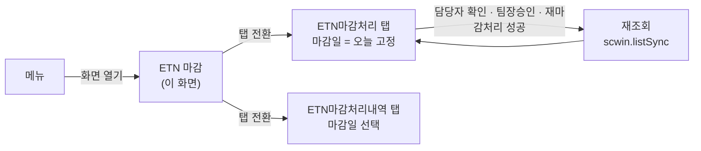
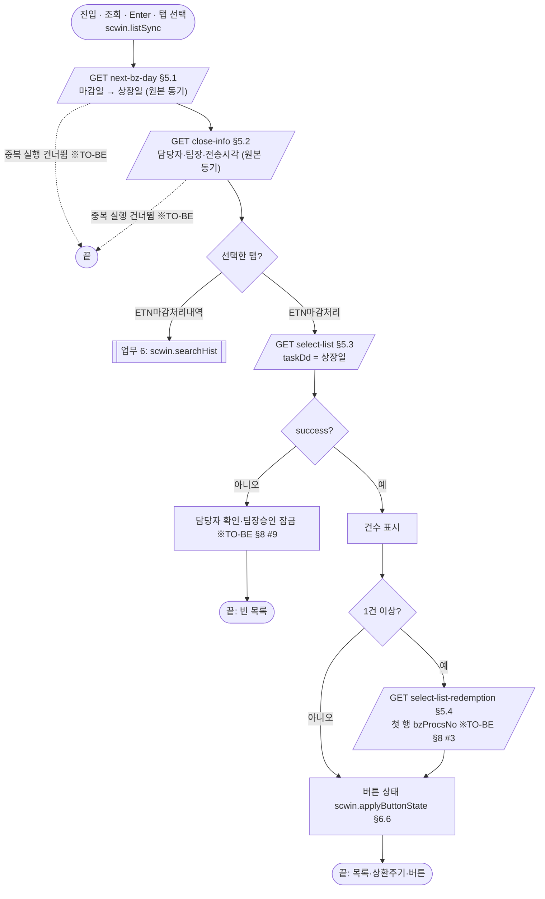
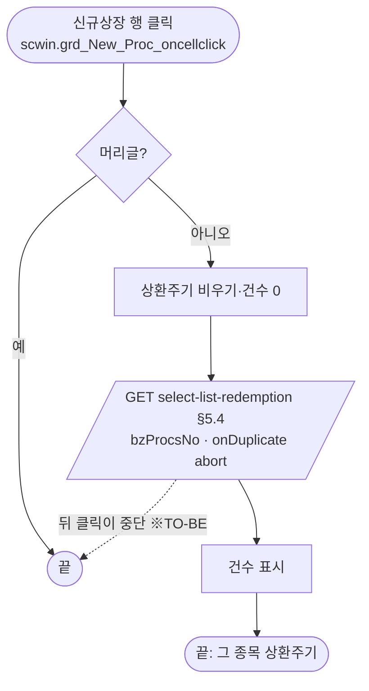
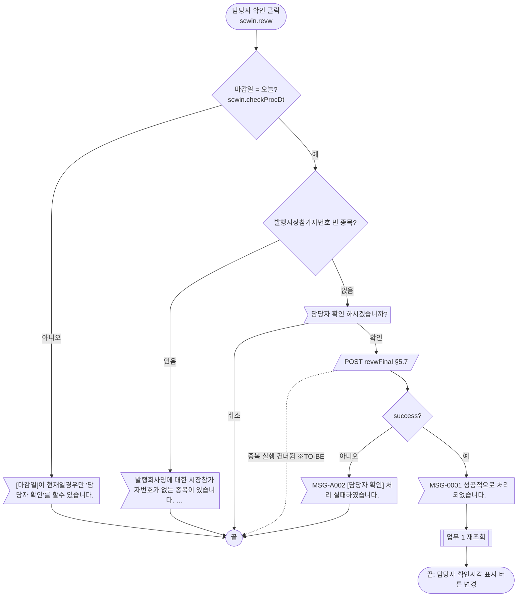
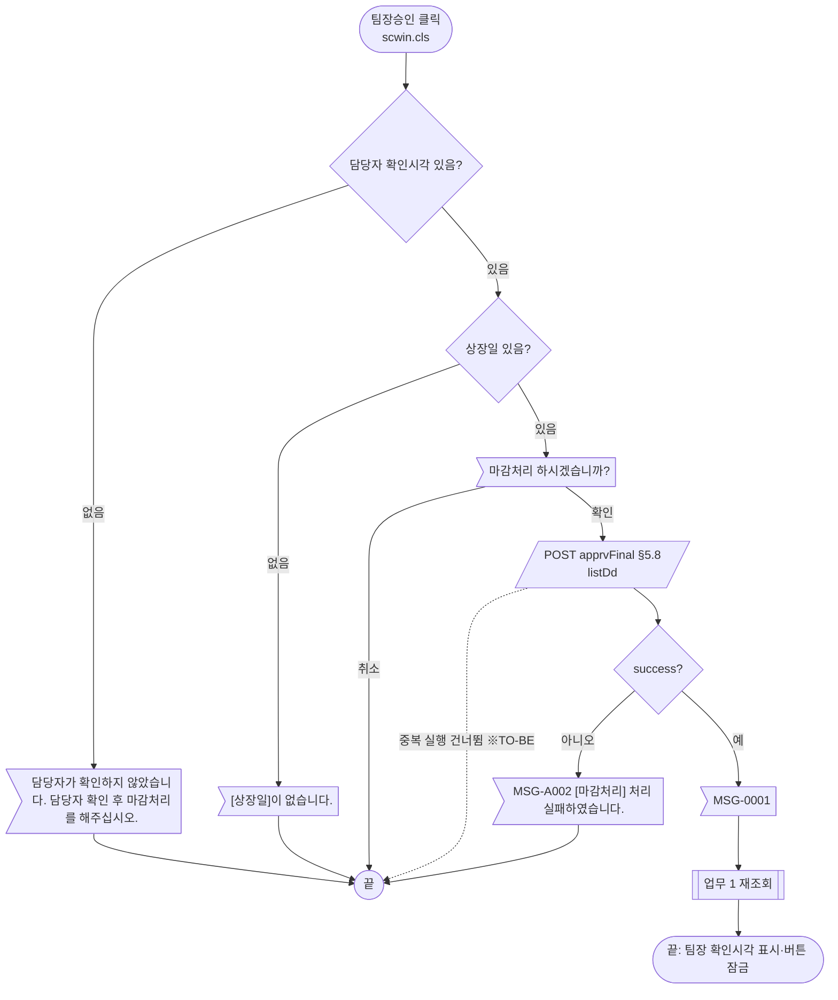
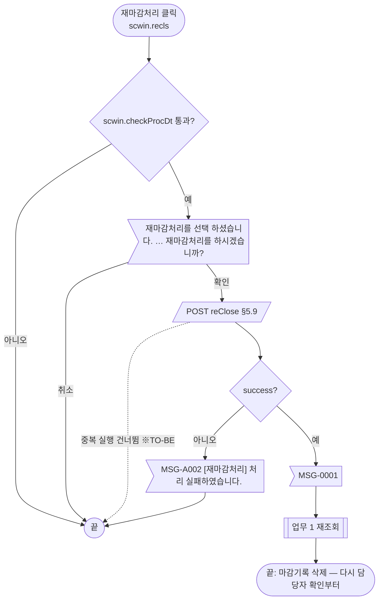
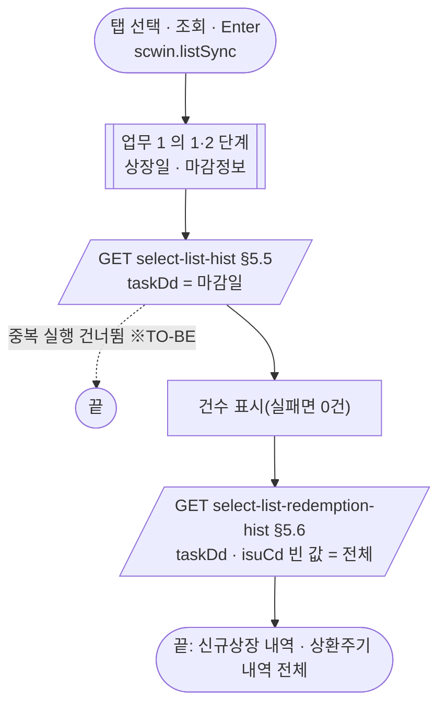
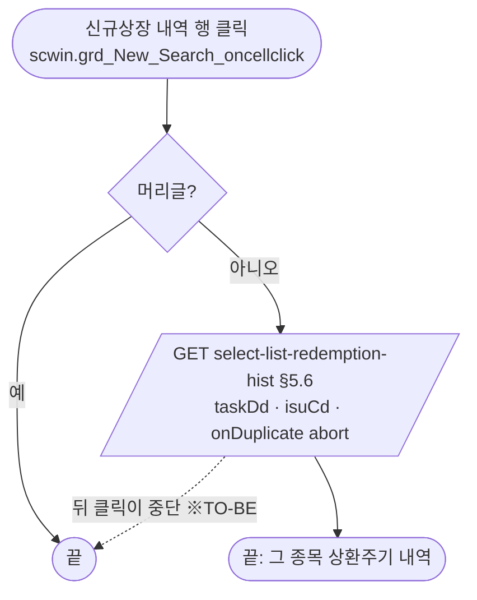
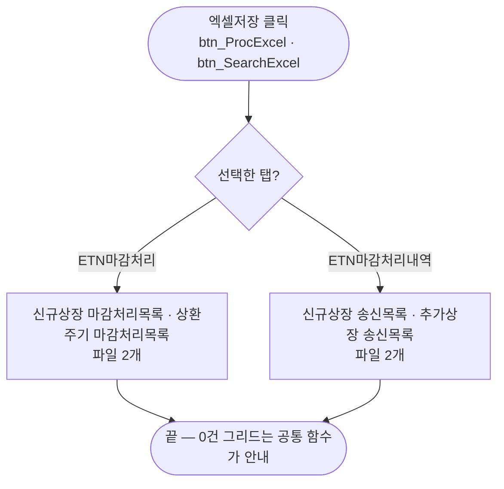
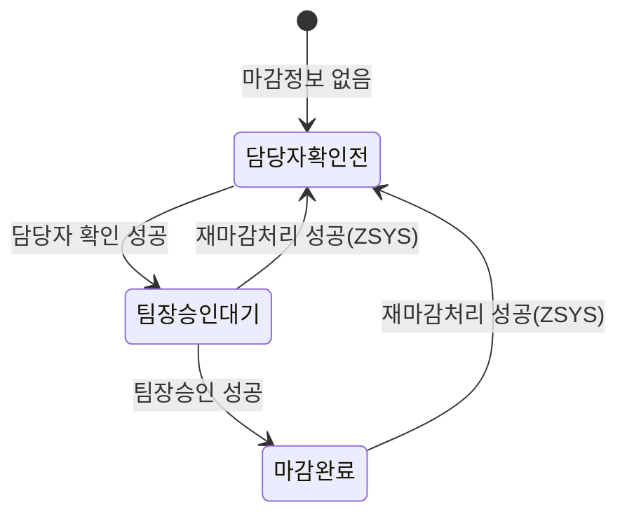

# ULDSTF08200 ETN 마감 — 업무 분석 및 전환 내역

| 항목 | 내용 |
|---|---|
| AS-IS | `/lstproc/ULDSTF08200.gfm` (Gauce/X-Internet, 1270×750 메인 화면, 탭 2개 「ETN마감처리」·「ETN마감처리내역」) — 반입 `conversion/conversion-front/ui/completed/ULDSTF08200/ULDSTF08200.gfm` |
| 신규 API 명세 | `conversion/conversion-front/ui/completed/ULDSTF08200/ULDSTF08200_API.md` — 블록 21종(머리 `[STF08200]`, 전부 이 화면). **이 화면이 쓰는 것은 `close-procs-newlisting` 9종**이고, `close-procs-invst-warn` 12종(투자유의종목 마감)은 이 화면 원본·캡처에 대응 기능이 없어 쓰지 않는다(§5, §10 #1). §2.2·§5 는 명세 기준(가이드 §0.3·§5) |
| TO-BE | `conversion/conversion-front/ui-tobe/ULDSTF08200.xml` (배포 경로 `/ui/lst/lstproc/ULDSTF08200.xml` — 가정, §10 #13) |
| 퍼블리싱 | `conversion/publish/상장/상장처리(대내)/ULDSTF08200.xml`(사본 `conversion/publish/publish-tobe/…`) — **원본과 다르다**: 탭이 「신규상장 마감」·「투자유의종목 마감」이고 조회조건이 1번 탭 안에 있다. 컴포넌트 종류·id 만 참고하고 레이아웃은 캡처를 따랐다(§10 #1) |
| 이전 샘플 전환본 | `conversion/sample-front/ui/ULDSTF08200.xml`(참고만, 수정 안 함) — 원본 두 탭을 「신규상장 마감」 한 탭(조회구분 자동 전환)으로 합치고 ULDSTF08311·08306 을 「투자유의종목 마감」 탭으로 통합한 판. 이번 전환은 캡처대로 원본 두 탭 구조를 유지한다 |
| 화면 캡처 | `ULDSTF08200.png`(「ETN마감처리」 탭, 0건 상태 — 창 제목 「신규상장 마감처리_STF08200」) — TO-BE 는 캡처 기준 퍼블리싱본(1단계)부터 만들었다(가이드 §13.2) |
| 업무공통 | `$c.stf`(`getMessageParam`·`fillGridHeaderTotalCnt`) — `cm/pcc/stf`. 게이트는 `--pcc stf` 로 돌린다 |
| 작성 | Inswave / 2026-10-28 |

참고 양식: [websquare_gfm_conversion.md](../../../md/websquare_gfm_conversion.md) — §1.4 업무 프로세스 흐름, §5 API 명세 적용. Gauce 대응은 [gfm_business_analysis_guide.md](../../../md/gfm_business_analysis_guide.md) §5·§6 을 함께 따랐다.

---

## 1. 화면 개요

상장 담당자·팀장이 **손실제한 ETN 신규상장 종목의 당일 마감**(매매시스템으로 보낼 상장종목·상환주기 데이터 확정)을 처리하고, 지난 마감일의 **마감처리(송신)내역**을 확인하는 메인 화면이다.

1. 화면을 열면 마감일 = 오늘로 「ETN마감처리」 탭을 조회한다. 마감일의 다음 영업일이 상장일이 되고, 그날 상장하는 ETN 신규상장 종목과 (첫 종목의) 상환주기가 나온다. 위쪽에는 마감정보(담당자·팀장 확인시각, 상장종목·상환주기 전송시각)가 보인다.
2. 신규상장 행을 누르면 그 종목(업무처리번호)의 상환주기를 다시 읽는다.
3. 담당자가 [담당자 확인] → 팀장이 [팀장승인](= 마감처리) 순서로 마감한다. 처리하면 다시 조회해 버튼 상태가 바뀐다. 시스템관리자(부서 `ZSYS`)만 [재마감처리]로 이전 마감기록을 지우고 다시 마감할 수 있다.
4. 「ETN마감처리내역」 탭에서는 마감일을 골라 신규상장·상환주기 마감처리(송신)내역을 본다. 신규상장 행을 누르면 그 종목의 상환주기 내역만 본다.
5. 두 탭 모두 [엑셀저장]으로 신규상장·상환주기 그리드를 각각 파일로 받는다.

### 1.1 호출 화면 (0본)

메뉴에서 직접 여는 메인 화면이다. `conversion/publish`·`cm/as-is` 에서 이 화면ID 를 부르는 화면은 없다(`ULDSTF08200.xml` 자기 자신 제외).

### 1.2 호출 규약 (부모 → 이 화면) / 반환 규약

해당 없음 — 메인 화면이라 받는 파라미터·돌려주는 값이 없다. 세션 값 `js_jobtitl`(직책)·`js_dep_cd`(부서)·`js_emp_no`(사번)·`js_id` 를 쓴다(§9).

### 1.3 이 화면이 여는 하위 팝업

| 팝업 | AS-IS 호출 (getPar/setPar) | 넘기는 `data` | 받는 결과 (`closePopup`) / 취소 판정 |
|---|---|---|---|
| 달력 (`PopupCalendar.js`) | `img_TASK_DD onclick` → `popUpCalendar2(edt_TASK_DD)` | — | **(옮기지 않음)** `w2:inputCalendar` 내장 달력으로 대체 |

### 1.4 업무 프로세스 흐름

| # | 업무 | 시작 (사용자 동작·진입 조건) | 끝 (결과) | 주요 함수 | 관련 절 |
|---|---|---|---|---|---|
| 1 | 조회(마감처리 대상) | 화면 진입 / [조회]·Enter / 「ETN마감처리」 탭 선택 | 상장일·마감정보·신규상장·첫 행 상환주기·버튼 상태 | `scwin.listSync` → `scwin.searchList` | §3, §5.1~§5.4 |
| 2 | 상환주기 보기 | 「ETN마감처리」 신규상장 행 클릭 | 그 업무처리번호의 상환주기 | `scwin.searchRedemption` | §5.4 |
| 3 | 담당자 확인 | [담당자 확인] | 완료 안내 → 재조회 | `scwin.revw` → `scwin.postClose` | §5.7, §6.4 |
| 4 | 팀장승인(마감처리) | [팀장승인] | 완료 안내 → 재조회 | `scwin.cls` → `scwin.postClose` | §5.8, §6.5 |
| 5 | 재마감처리 | [재마감처리] (시스템관리자만 보임) | 완료 안내 → 재조회 | `scwin.recls` → `scwin.postClose` | §5.9, §6.3 |
| 6 | 마감처리내역 조회 | 「ETN마감처리내역」 탭 선택 / [조회]·Enter | 신규상장 내역·상환주기 내역 전체 | `scwin.listSync` → `scwin.searchHist` | §5.5, §5.6 |
| 7 | 종목별 상환주기 내역 | 「ETN마감처리내역」 신규상장 행 클릭 | 그 종목의 상환주기 내역 | `scwin.searchRedemptionHist` | §5.6 |
| 8 | 엑셀저장 | 두 탭의 [엑셀저장] | 선택 탭 그리드 2개를 파일 2개로 | `scwin.excelDown` | §6.8 |

#### 화면 간 흐름



하위 팝업은 없다(달력은 컴포넌트 내장).

#### 업무 1: 조회 (마감처리 대상) — 업무 6 과 앞부분 공통



| # | 단계 | 주체 | 내용 | 분기 · 메시지 | 관련 절 |
|---|---|---|---|---|---|
| 1 | 상장일 | 서버 | `next-bz-day` `{ taskDd : 마감일 }` → `dma_nextBzDay.listDd`(상장일 입력란) | 실패해도 다음 단계(원본 `OnLoadError` 는 `MSG-0002` 안내만) | §5.1 |
| 2 | 마감정보 | 서버 | `close-info` `{ taskDd }` → `dma_closeInfo`(위쪽 6칸) | 실패해도 다음 단계 | §5.2 |
| 3 | 신규상장 | 서버 | `select-list` `{ taskDd : 상장일 }` → `dlt_list` | 실패면 버튼 잠금(※TO-BE) | §5.3 |
| 4 | 상환주기 | 서버 | 첫 행 `bzProcsNo` 로 `select-list-redemption` | 0건이면 생략, 상환주기는 0건 | §5.4, §8 #3 |
| 5 | 버튼 | 화면 | 마감정보로 [담당자 확인]·[팀장승인] 활성, [재마감처리] 보임 | §6.6 표 | §6.6, §6.7 |

#### 업무 2: 상환주기 보기 (「ETN마감처리」 행 클릭)



| # | 단계 | 주체 | 내용 | 분기 · 메시지 | 관련 절 |
|---|---|---|---|---|---|
| 1 | 비우기 | 화면 | `dlt_redemption.removeAll()` (원본 `dts_Add_Proc.ClearData()`) | — | §5.4 |
| 2 | 조회 | 서버 | `{ bzProcsNo }` — 마지막 클릭이 이김(`onDuplicate : "abort"`, 중단된 요청은 reject → 조용히 끝) | 실패면 0건 | §5.4 |

#### 업무 3: 담당자 확인



| # | 단계 | 주체 | 내용 | 분기 · 메시지 | 관련 절 |
|---|---|---|---|---|---|
| 1 | 마감일·참가자번호 | 화면 | `scwin.checkProcDt("담당자 확인")` | 실패 안내 후 끝 | §6.2 |
| 2 | 확인 | 사용자 | `await $c.win.confirm("담당자 확인 하시겠습니까?")` | 취소면 끝 | §7 |
| 3 | 전송 | 서버 | `revwFinal` `{ completeYn : "" }` (원본 `CHRG_EMP_NO = js_emp_no`) | 실패 `MSG-A002` | §5.7, §10 #5 |
| 4 | 재조회 | 화면 | `MSG-0001` 안내 → `scwin.listSync` | — | §5 |

#### 업무 4: 팀장승인 (마감처리)



| # | 단계 | 주체 | 내용 | 분기 · 메시지 | 관련 절 |
|---|---|---|---|---|---|
| 1 | 담당자 확인 여부 | 화면 | `dma_closeInfo.approvTm`(담당자 확인시각) 비었으면 안내 | 끝 | §6.5 |
| 2 | (마감일 검사 없음) | — | 원본 `fn_checkProcDt` 주석 처리 — 그대로 | — | §8 #4 |
| 3 | 상장일 | 화면 | `dma_nextBzDay.listDd` 비었으면 안내 + `edt_LIST_DD` 포커스 | 끝 | §6.5 |
| 4 | 확인·전송 | 사용자·서버 | `confirm` → `apprvFinal` `{ listDd }` | 실패 `MSG-A002` | §5.8 |
| 5 | 재조회 | 화면 | `MSG-0001` → `scwin.listSync` | — | §5 |

#### 업무 5: 재마감처리 (시스템관리자)



| # | 단계 | 주체 | 내용 | 분기 · 메시지 | 관련 절 |
|---|---|---|---|---|---|
| 1 | 검사 | 화면 | `scwin.checkProcDt("재마감처리")` | 실패 안내 후 끝 | §6.2 |
| 2 | 확인 | 사용자 | 4줄 경고 확인창 | 취소면 끝 | §7 |
| 3 | 전송 | 서버 | `reClose` `{ completeYn : "" }` (원본 빈 `LOSSLMT_ETN_FINAL_LOG_EMP` 1행, `SCREN_PROCS_TP_CD_04`) | 실패 `MSG-A002` | §5.9, §10 #5 |
| 4 | 재조회 | 화면 | `MSG-0001` → `scwin.listSync` | — | §5 |

#### 업무 6: 마감처리내역 조회



| # | 단계 | 주체 | 내용 | 분기 · 메시지 | 관련 절 |
|---|---|---|---|---|---|
| 1 | 공통 | 서버 | 상장일·마감정보(원본도 탭과 무관하게 먼저 읽음) | — | §5.1, §5.2 |
| 2 | 신규상장 내역 | 서버 | `select-list-hist` `{ taskDd : 마감일 }` → `dlt_newlistingHist` | 실패면 0건 | §5.5 |
| 3 | 상환주기 내역 | 서버 | `select-list-redemption-hist` `{ taskDd, isuCd : "" }` → `dlt_redemptionHist` (원본 `rv.all`) | 실패면 0건 | §5.6, §10 #4 |

#### 업무 7: 종목별 상환주기 내역 (「ETN마감처리내역」 행 클릭)



| # | 단계 | 주체 | 내용 | 분기 · 메시지 | 관련 절 |
|---|---|---|---|---|---|
| 1 | 조회 | 서버 | 원본 `fn_SearchRedmptRv`(`rv.sel`, `{P}param01` 마감일·`param02` 종목코드) | 실패면 0건 | §5.6 |

#### 업무 8: 엑셀저장



| # | 단계 | 주체 | 내용 | 분기 · 메시지 | 관련 절 |
|---|---|---|---|---|---|
| 1 | 내려받기 | 화면 | `$c.data.downloadGridViewExcel` 두 번, 파일명 `{menuId}_{원본 이름}_{yyyyMMddHHmmss}.xlsx` | 0건이면 공통 안내 | §6.8 |

#### 화면 모드 상태 전이 (「ETN마감처리」 탭 버튼)



| 상태 (판정: `dma_closeInfo`) | [담당자 확인] | [팀장승인] — 팀장 | [팀장승인] — 담당자(직책 03) |
|---|---|---|---|
| 담당자확인전 (`approvEmpNm` 빈 값, `bzClsTm` 빈 값) | 활성 | 잠금 | 잠금 |
| 팀장승인대기 (`approvEmpNm` 있음, `bzClsTm` 빈 값) | 잠금 | 활성 | 잠금 |
| 마감완료 (`bzClsTm` 있음) | 잠금 | 잠금 | 잠금 |

[재마감처리]는 상태와 무관하게 부서 `ZSYS` 면 보이고 활성, 아니면 숨김. 마감일이 오늘이 아니어도 버튼 상태는 위 표대로이고, 누르면 `scwin.checkProcDt` 가 막는다(원본 그대로 — [팀장승인]은 그 검사도 없음, §8 #4).

---

## 2. 화면 구성 및 데이터 정의

### 2.1 화면 구성

| 영역 | AS-IS 요소 | TO-BE 컴포넌트 (바인딩) | 설명 |
|---|---|---|---|
| (머리) | — | `pfmContentHeader` (`/cm/xml/contentHeader.xml`) | 본화면 필수 |
| 조회조건 | `panel_Top` (`PanelToGroupBox`) | `xf:group.schbox` `panel_Top` | 캡처대로 **탭 위**(두 탭 공통). Enter 키 → `btn_Search_onclick` |
| 조회조건 | `label_2` 「마감일」 + `edt_TASK_DD` (`mxmaskedit` YYYY-MM-DD) + `img_TASK_DD`(달력 이미지) | `label_2` + `edt_TASK_DD` `w2:inputCalendar` (`ref="data:dma_search.taskDd"`) | 「ETN마감처리」 탭에서는 오늘로 고정·읽기전용(§6.1). `img_TASK_DD` 는 **(옮기지 않음)** 달력 내장 |
| 조회조건 | `label_1` 「상장일」 + `edt_LIST_DD` (읽기전용 `mxmaskedit`, `bnd_LIST_DD` ← `dts_Get_ListDD.LIST_DD`) | `label_1` + `edt_LIST_DD` `xf:input` 읽기전용 `displayFormat="####-##-##"` (`ref="data:dma_nextBzDay.listDd"`) | 캡처에 달력 아이콘이 없어 입력칸으로 둠 |
| 조회조건 | `label_6` 「담당자명」 + `txb_APPROV_EMP_NM` | `label_6` + `txb_APPROV_EMP_NM` 읽기전용 (`ref="data:dma_closeInfo.approvEmpNm"`) | 원본 `bnd_Item` 바인딩(`APPROV_EMP_NM`) |
| 조회조건 | `label_7` 「담당자 확인시각」 + `txb_APPROV_TM` | `label_7` + `txb_APPROV_TM` (`dma_closeInfo.approvTm`) | [팀장승인] 전 담당자 확인 판정에 씀(§6.5) |
| 조회조건 | `label_8` 「팀장명」 + `txb_TEAMLEADR_EMP_NM` (`APPROV_TEAMLEADR_EMP_NM`) | `label_8` + `txb_TEAMLEADR_EMP_NM` (`dma_closeInfo.approvTeamleadrEmpNm`) | |
| 조회조건 | `label_9` 「팀장 확인시각」 + `txb_BZ_CLS_TM` | `label_9` + `txb_BZ_CLS_TM` (`dma_closeInfo.bzClsTm`) | 마감완료 판정(§6.6) |
| 조회조건 | `label_3` 「상장종목전송시각」 + `txb_LIST_TRNSM_END_TM` | `label_3` + `txb_LIST_TRNSM_END_TM` (`dma_closeInfo.listTrnsmEndTm`) | |
| 조회조건 | `label_5` 「상환주기전송시각」 + `txb_REDMPT_TRNSM_END_TM` | `label_5` + `txb_REDMPT_TRNSM_END_TM` (`dma_closeInfo.redmptTrnsmEndTm`) | 원본 textbox 의 굵은 파랑 글자·배경색은 옮기지 않음(읽기전용 공통 스타일) |
| 조회조건 | `img_tmp_11` (구분선 이미지) | **(옮기지 않음)** | 장식 |
| 조회조건 | `btn_Search` (이미지 버튼) | `btn_Search` `btn_cm sch` (`ev:onclick`) | `btn_schbox` |
| 탭 | `MaxTab_01` (`mxtab`, `activeindex="1"`, 탭 `panel_1`「ETN마감처리」·`panel_2`「ETN마감처리내역」) | `tbcbox` > `MaxTab_01` `w2:tabControl` (`ev:onchange`, `selectedIndex="0"`), 탭 `panel_1`·`panel_2`, 본문 `panel_1_01`·`panel_2_01`(인라인 `w2:content`) | 탭 본문이라 contentHeader 없음. 퍼블리싱본의 「신규상장 마감」·「투자유의종목 마감」 대신 캡처의 탭 이름(§10 #1) |
| 탭1 목록 | `label_12` 「신규상장」 + `edt_New_Proc_TotalCnt` (`총 n 건` 문자열) | `titbox` > `label_12` h3 + `count` > `edt_New_Proc_TotalCnt` `w2:span.num` | 건수는 `$c.stf.fillGridHeaderTotalCnt` |
| 탭1 목록 | `grd_New_Proc` (`dts_New_Proc`) | `grd_New_Proc` `gvw row15` (`dataList="data:dlt_list"`, `ev:oncellclick`, 정렬 가능) | 컬럼 §2.3. 번호 열(`NO` `{CurRow}`)은 `rowNumVisible` |
| 탭1 상환주기 | `label_13` 「상환주기」 + `edt_Add_Proc_TotalCnt` | `titbox` > `label_13` + `edt_Add_Proc_TotalCnt` | |
| 탭1 상환주기 | `grd_Add_Proc` (`dts_Add_Proc`) | `grd_Add_Proc` `gvw row5` (`data:dlt_redemption`) | 컬럼 §2.3 |
| 탭1 안내 | `label_50` | `label_50` `txt_info` | 문구 그대로 |
| 탭1 버튼 | `btn_Recls`·`btn_Revw`·`btn_Cls`·`btn_ProcClose`·`btn_ProcExcel` (이미지, 활성 이미지 교체로 상태 표시) | `btnbox` `grpBtnBox` > `rt` > `btn_Recls`「재마감처리」·`btn_Revw`「담당자 확인」·`btn_Cls`「팀장승인」·`btn_ProcExcel`「엑셀저장」(`btn_cm download`) | 캡처 순서. 주요 버튼 5종(규칙 41) 해당 없음. **`btn_ProcClose`「닫기」는 (옮기지 않음)** — 본화면은 창 탭으로 닫는다(§8 #12, §10 #9) |
| 탭2 목록 | `label_10` + `edt_New_Search_TotalCnt` + `grd_New_Search` (`dts_New_Search`) | `label_10` + `edt_New_Search_TotalCnt` + `grd_New_Search` `gvw row15` (`data:dlt_newlistingHist`, `ev:oncellclick`) | 원본 `TASK_DD` 열 파란 글자(`color="blue"`)는 옮기지 않음(§8 #15) |
| 탭2 상환주기 | `label_11` + `edt_Add_Search_TotalCnt` + `grd_Add_Search` (`dts_Add_Search`) | `label_11` + `edt_Add_Search_TotalCnt` + `grd_Add_Search` `gvw row5` (`data:dlt_redemptionHist`) | |
| 탭2 안내 | `label_14` | `label_14` `txt_info` | 「- 데이터 일치여부는 15:30분 이후에 확인가능합니다.」 |
| 탭2 버튼 | `btn_SearchClose`·`btn_SearchExcel` | `btnbox` > `btn_SearchExcel`「엑셀저장」 | `btn_SearchClose` **(옮기지 않음)** |
| (숨김) | `bnd_Item`·`bnd_LIST_DD` (`mxbinder`) | 컴포넌트 `ref` 바인딩 | |

* 캡처와 퍼블리싱본의 차이: 퍼블리싱본(`publish/…/ULDSTF08200.xml`)은 조회조건이 1번 탭 안, 엑셀다운로드가 탭 오른쪽 위(`tbc_btnbox`), 2번 탭이 「투자유의종목 마감」이다. 캡처를 따랐다(§10 #1).

### 2.2 데이터 정의

| TO-BE | 종류 | 키(컬럼) | 출처 / 용도 |
|---|---|---|---|
| `dma_search` | dataMap | `taskDd` | **화면 전용(명세 외)** — 마감일(`edt_TASK_DD`). 요청 값으로 씀 |
| `dma_nextBzDay` | dataMap | `listDd` | 명세 `next-bz-day` 응답 — 상장일(`edt_LIST_DD`) |
| `dma_closeInfo` | dataMap | `listTrnsmEndTm`, `redmptTrnsmEndTm`, `approvEmpNm`, `approvTeamleadrEmpNm`, `approvTm`, `bzClsTm` | 명세 `close-info` 응답 — 위쪽 6칸, 버튼 상태 |
| `dlt_list` | dataList | 명세 `select-list` 응답 49열(`bzProcsNo`·`listBzTpCd`·`listProcsStatCd`·`comNm`·`isuCd`·`listDd`·`isuSrtCd`·`isuNm`·`isuAbbrv`·`isuEngNm`·`isuEngAbbrv`·`repIsuCd`·`isuMktpartcNo`·`listShrs`·`lpHdQty`·`declSpd`·`etnIsuPrc`·`expDd`·`lsttrdDd`·`lstSetlMethdCd/Nm`·`expRedmptAmtPayDd`·`expRedmptPrcDecsnStrtDd/EndDd`·`etpProdTpCd/Nm`·`traceYdMult`·`taxTpCd/Nm`·`distrTpCd/Nm`·`mktpartcNo1`·`earngStructTpCd`·`expEarngStructDscVal`·`expMax/MinRedmptPrc`·`earyRedmptCondYn`·`earyRedmptCycleCd/Nm`·`valuPrc1/2CalcInstCd/Nm`·`idxNm`·`etnIsuQty`·`isuOrgnVal`·`idxLvrgInvrsTpNm`·`fnlEmpNm`·`listBzProcsDdtm`) | 「ETN마감처리」 신규상장 그리드(32열 표시) |
| `dlt_redemption` | dataList | `bzProcsNo`, `redmptSeq`, `earyRedmptValuDd`, `earyRedmptCondRelCd/Nm`, `earyRedmptBas1Idx`, `earyRedmptBas2Idx`, `earyRedmptPrc`, `earyRedmptPayDd`, `earyRedmptCycleTpCd/Nm` | 명세 `select-list-redemption` 응답 — 상환주기 그리드 |
| `dlt_newlistingHist` | dataList | 명세 `select-list-hist` 응답 54열(`taskDd`·`isuCd`·`listDd`·… `ordSpdUplmtVal`·`isuPrc`·… `mktpartcNo1~15`·`multAcntclsMmddContn`·`etnEarngStructId`·`etnEarngStructContn`·`etnMax/MinRedmptPrc`·`etnEaryRedmptPosblYn`·`etnEaryRedmptCycleCd/Nm`·`valuPrcCalcInstCd1/Nm1`·`valuPrcCalcInstCd2/Nm2`) | 「ETN마감처리내역」 신규상장 그리드(31열 표시) |
| `dlt_redemptionHist` | dataList | `taskDd`, `isuCd`, `redmptSeq`, `earyRedmptValuDd`, `earyRedmptCondRelCd/Nm`, `earyRedmptBas1Idx`, `earyRedmptBas2Idx`, `earyRedmptPrc`, `earyRedmptPayDd` | 명세 `select-list-redemption-hist` 응답(명세 `name` 이 `name1`~`name10` — §10 #11) |

* id·name·dataType 은 명세 원문 그대로 옮겼다(가이드 §5 ④). 명세의 `close-procs-invst-warn` 응답 정의 9종(`dma_mdCloseCheck`·`dma_finalLog`·`dlt_design`·`dlt_extn`·`dlt_firstDetect`·`dlt_hist`·`dlt_noti`·`dlt_release`·`dlt_trdHalt`)은 쓰지 않아 넣지 않았다(§10 #1).
* POST 3종(`apprvFinal`·`revwFinal`·`reClose`)은 요청이 키 1개라 dataMap 을 두지 않고 요청 객체를 바로 만든다.
* 원본 dataset → TO-BE:

  | 원본 | TO-BE | 내용 |
  |---|---|---|
  | `dts_Get_ListDD` (동기) | `dma_nextBzDay` | `ELW_LISTING_TR_SEND_LOG_INOUT` 의 `LIST_DD` → `listDd` |
  | `dts_Item` (동기) | `dma_closeInfo` | `LOSSLMT_ETN_FINAL_LOG` — `LIST_TRNSM_END_TM`·`REDMPT_TRNSM_END_TM`·`APPROV_EMP_NM`·`APPROV_TM`·`APPROV_TEAMLEADR_EMP_NM`·`BZ_CLS_TM` → camelCase 같은 이름 |
  | `dts_New_Proc` | `dlt_list` | `LOSSLMT_ETN_NEWLISTING_SEARCH_OUT` |
  | `dts_Add_Proc` | `dlt_redemption` | `LOSSLMT_ETN_NEWLISTING_REDMPT_OUT` |
  | `dts_New_Search` | `dlt_newlistingHist` | `LOSSLMT_ETN_NEWLISTING_SEARCH_RV_OUT` |
  | `dts_Add_Search` | `dlt_redemptionHist` | `LOSSLMT_ETN_NEWLISTING_REDMPT_RV_OUT` |
  | `dts_Cls` (동기, `getGauceDataHeader` `LOSSLMT_ETN_FINAL_LOG_EMP`) | (삭제) 요청 객체 | 원본은 머리만 받아 1행 추가 후 `CHRG_EMP_NO`·`LIST_DD` 를 채워 보냄 → 명세 요청 키로(§5.7~§5.9) |
  | `dts_IsuDelChk`·`dts_CorrYn`·`dts_UnRcvIsuChk` | (삭제) | 정의·`OnLoadError` 만 있고 쓰는 곳 없음(§8 #11) |

### 2.3 그리드 컬럼 대응 (AS-IS `id` / 머리글 `name` → TO-BE)

머리글의 `;` 는 줄바꿈 `<br/>` 로 옮겼다. 번호 `NO`(`번호`, `{CurRow},{ToString}`)는 네 그리드 모두 `rowNumVisible="true"` + `rowNumHeaderValue="번호"`. 날짜(`mask="XXXX-XX-XX"`)는 `dataType="date" displayFormat="yyyy-MM-dd"`, 숫자는 `dataType="number"` + `displayFormat`(가정 — §10 #10).

**`grd_New_Proc` (탭1 신규상장, `dlt_list`)**

| AS-IS id | AS-IS name | TO-BE 열 | 표시 |
|---|---|---|---|
| `BZ_PROCS_NO` | 신청일련번호 | `bzProcsNo` | 가운데 |
| `COM_NM` | 발행회사 | `comNm` | |
| `ISU_CD` | 종목코드 | `isuCd` | 가운데 |
| `LIST_DD` | 상장일자 | `listDd` | 날짜 |
| `ISU_SRT_CD` | 종목단축코드 | `isuSrtCd` | |
| `ISU_NM` | 종목명 | `isuNm` | |
| `ISU_ABBRV` | 종목약명 | `isuAbbrv` | |
| `ISU_ENG_NM` | 종목영문명 | `isuEngNm` | |
| `ISU_ENG_ABBRV` | 종목영문약명 | `isuEngAbbrv` | |
| `ISU_MKTPARTC_NO` | 발행시장;참가자번호 | `isuMktpartcNo` | §6.2 검사 대상 |
| `LIST_SHRS` | 상장주식수 | `listShrs` | `#,##0` |
| `LP_HD_QTY` | LP보유수량 | `lpHdQty` | `#,##0` |
| `DECL_SPD` | 호가스프레드;상한값 | `declSpd` | `#,##0.###` |
| `ETN_ISU_PRC` | 발행가격 | `etnIsuPrc` | `#,##0.###` |
| `EXP_DD` | 만기일자 | `expDd` | 날짜 |
| `LSTTRD_DD` | 최종;거래일자 | `lsttrdDd` | 날짜 |
| `LST_SETL_METHD_NM` | 최종결제방법;코드 | `lstSetlMethdNm` | |
| `EXP_REDMPT_AMT_PAY_DD` | 만기상환금;지급일자 | `expRedmptAmtPayDd` | 날짜 |
| `EXP_REDMPT_PRC_DECSN_STRT_DD` | 만기상환가격결정;시작일자 | `expRedmptPrcDecsnStrtDd` | 날짜 |
| `EXP_REDMPT_PRC_DECSN_END_DD` | 만기상환가격결정;종료일자 | `expRedmptPrcDecsnEndDd` | 날짜 |
| `ETP_PROD_TP_NM` | ETP상품;구분코드 | `etpProdTpNm` | |
| `TAX_TP_NM` | 과세유형코드 | `taxTpNm` | |
| `DISTR_TP_NM` | 분배금;형태코드 | `distrTpNm` | |
| `MKTPARTC_NO1` | 시장참가자;번호1 | `mktpartcNo1` | |
| `EARNG_STRUCT_TP_CD` | 수익구조ID | `earngStructTpCd` | |
| `EXP_EARNG_STRUCT_DSC_VAL` | 수익구조내용 | `expEarngStructDscVal` | |
| `EXP_MAX_REDMPT_PRC` | 최대상환가격 | `expMaxRedmptPrc` | `#,##0.###` |
| `EXP_MIN_REDMPT_PRC` | 최소상환가격 | `expMinRedmptPrc` | `#,##0.###` |
| `EARY_REDMPT_COND_YN` | 조기상환;가능여부 | `earyRedmptCondYn` | |
| `EARY_REDMPT_CYCLE_NM` | 조기상환;주기코드 | `earyRedmptCycleNm` | |
| `VALU_PRC1_CALC_INST_NM` | 평가가격;산출기관코드1 | `valuPrc1CalcInstNm` | |
| `VALU_PRC2_CALC_INST_NM` | 평가가격;산출기관코드2 | `valuPrc2CalcInstNm` | |

**`grd_New_Search` (탭2 신규상장 내역, `dlt_newlistingHist`)** — 위와 같은 열은 같은 이름(`ISU_CD`→`isuCd` …). 다른 열만:

| AS-IS id | AS-IS name | TO-BE 열 | 표시 |
|---|---|---|---|
| `TASK_DD` | 작업일자 | `taskDd` | 날짜 (원본 파란 글자 — 옮기지 않음) |
| `ORD_SPD_UPLMT_VAL` | 호가스프레드;상한값 | `ordSpdUplmtVal` | `#,##0.###` |
| `ISU_PRC` | 발행가격 | `isuPrc` | `#,##0.###` |
| `ETN_EARNG_STRUCT_ID` | 수익구조ID | `etnEarngStructId` | |
| `ETN_EARNG_STRUCT_CONTN` | 수익구조내용 | `etnEarngStructContn` | |
| `ETN_MAX_REDMPT_PRC` | 최대상환가격 | `etnMaxRedmptPrc` | `#,##0.###` |
| `ETN_MIN_REDMPT_PRC` | 최소상환가격 | `etnMinRedmptPrc` | `#,##0.###` |
| `ETN_EARY_REDMPT_POSBL_YN` | 조기상환;가능여부 | `etnEaryRedmptPosblYn` | |
| `ETN_EARY_REDMPT_CYCLE_NM` | 조기상환;주기코드 | `etnEaryRedmptCycleNm` | |
| `VALU_PRC_CALC_INST_NM1` | 평가가격;산출기관코드1 | `valuPrcCalcInstNm1` | |
| `VALU_PRC_CALC_INST_NM2` | 평가가격;산출기관코드2 | `valuPrcCalcInstNm2` | |

(`BZ_PROCS_NO`·`COM_NM` 은 이 그리드에 없음.)

**`grd_Add_Proc` (`dlt_redemption`) / `grd_Add_Search` (`dlt_redemptionHist`)**

| AS-IS id | AS-IS name | TO-BE 열 | 표시 |
|---|---|---|---|
| `BZ_PROCS_NO` (Add_Proc) | 신청일련번호 | `bzProcsNo` | |
| `TASK_DD` (Add_Search) | 작업일자 | `taskDd` | 날짜 |
| `ISU_CD` (Add_Search) | 종목코드 | `isuCd` | |
| `REDMPT_SEQ` | 상환차수 | `redmptSeq` | `#,##0` |
| `EARY_REDMPT_VALU_DD` | 조기상환평가일자 | `earyRedmptValuDd` | 날짜 |
| `EARY_REDMPT_COND_REL_NM` | 조기상환조건관계코드 | `earyRedmptCondRelNm` | |
| `EARY_REDMPT_BAS1_IDX` | 조기상환기준1지수 | `earyRedmptBas1Idx` | `#,##0.######` |
| `EARY_REDMPT_BAS2_IDX` | 조기상환기준2지수 | `earyRedmptBas2Idx` | `#,##0.######` |
| `EARY_REDMPT_PRC` | 조기상환가격 | `earyRedmptPrc` | `#,##0.###` |
| `EARY_REDMPT_PAY_DD` | 조기상환지급일자 | `earyRedmptPayDd` | 날짜 |

---

## 3. 로딩 (`gform onload` → `scwin.onpageload` → `scwin.init`)

`scwin.onpageload` 는 `scwin.init()` 만 부른다(try/catch + `handleError`). `scwin.init` 의 단계:

1. **세션·서버 날짜** — `scwin.jobTitl = $c.session.getUserInfo("jobtitl")`, `scwin.depCd = …("depCd")`, `scwin.todayDd = $c.date.getServerDateTime("yyyyMMdd")` (원본 `js_jobtitl`·`js_dep_cd`·`cGetToday("yyyymmdd")` 클라이언트 날짜 — §8 #7)
2. **init 바인딩** (규칙 22·37)

   | 대상 | 적용 |
   |---|---|
   | 단일 달력 `edt_TASK_DD` (마감일) | `$c.date.checkCalendarFormat(edt_TASK_DD, "yyyyMMdd")` |
   | 기간 달력 | 없음 (`edt_LIST_DD` 는 읽기전용 `xf:input`) |
   | 조회 영역 `panel_Top`(schbox) → 조회 버튼 `btn_Search` | `$c.win.setEnterKeyEvent(panel_Top, scwin.btn_Search_onclick)` |

3. **버튼 초기 상태** — §6.7 `scwin.applyReclsButton()`(ZSYS 만 [재마감처리]), `$c.util.setButtonState("grpBtnBox", "disabled", scwin.BTN_MAP)`(마감정보를 읽기 전까지 [담당자 확인]·[팀장승인] 잠금 — 원본 onload 의 `_d` 이미지·`disabled = true`)
4. **탭 상태** — §6.1 `scwin.applyTabMode(scwin.TAB_PROC)`: 마감일 = 오늘, 읽기전용. 원본 onload 는 `setObjectValue(edt_TASK_DD, 오늘)` 후 `MaxTab_01.ActiveIndex = 1`(그 대입이 `OnSelChanged` 를 부르면 읽기전용까지) — §8 #6. `PanelToGroupBox(panel_Top)` 은 옮기지 않음(마크업 schbox)
5. **조회** — `await scwin.listSync()` (§5). 탭은 마크업 `selectedIndex="0"` 이라 `setSelectedTabIndex` 를 부르지 않는다(onchange 이중 발화 회피 — §10 #12)

---

## 4. 컴포넌트 이벤트

| TO-BE 컴포넌트 | 이벤트 | TO-BE 핸들러 | 동작 (호출 함수) | AS-IS |
|---|---|---|---|---|
| `MaxTab_01` | `onchange` | `scwin.MaxTab_01_onchange` | `scwin.applyTabMode(선택 탭)` → `scwin.listSync()` | `MaxTab_01` `OnSelChanged(nIndex)` (nIndex 1/2 → TO-BE 0/1) |
| `btn_Search` | `onclick` | `scwin.btn_Search_onclick` | `scwin.listSync()` | `btn_Search` `onclick` → `fn_list_sync()` |
| `panel_Top` | Enter 키 | — | `setEnterKeyEvent` 로 `btn_Search_onclick` (§3) | 없음(신규) |
| `edt_TASK_DD` | 달력 | — | 내장 달력 | `img_TASK_DD` `onclick` → `popUpCalendar2(edt_TASK_DD)` |
| `grd_New_Proc` | `oncellclick` | `scwin.grd_New_Proc_oncellclick` | 머리글 아니면 `scwin.searchRedemption(그 행 bzProcsNo)` | `grd_New_Proc` `OnClick(row, colid)` → `dts_Add_Proc.ClearData()`·`vBzProcsNo`·`fn_SearchRedmpt()` |
| `grd_New_Search` | `oncellclick` | `scwin.grd_New_Search_oncellclick` | `scwin.searchRedemptionHist(그 행 isuCd)` | `grd_New_Search` `OnClick(row, colid)` → `dts_Add_Search.ClearData()`·`vIsuCd`·`fn_SearchRedmptRv()` |
| `btn_Recls` | `onclick` | `scwin.btn_Recls_onclick` | `scwin.recls()` | `fn_recls()` |
| `btn_Revw` | `onclick` | `scwin.btn_Revw_onclick` | `scwin.revw()` | `fn_revw()` |
| `btn_Cls` | `onclick` | `scwin.btn_Cls_onclick` | `scwin.cls()` | `fn_cls()` |
| `btn_ProcExcel` | `onclick` | `scwin.btn_ProcExcel_onclick` | `scwin.excelDown()` | `doLogSave(vScrenID, SCREN_PROCS_TP_CD_07)` + `fn_ExcelDown()` |
| `btn_SearchExcel` | `onclick` | `scwin.btn_SearchExcel_onclick` | `scwin.excelDown()` | 같음 |
| (없음) | — | — | — | `btn_ProcClose` `onclick` ×2·`btn_SearchClose` `onclick` → `frame.CloseFrame()` — 옮기지 않음(§8 #12) |
| (없음) | — | — | 공통 오류 핸들러 | `dts_*` `OnLoadError()` — `alert(getMessageParam("MSG-0002", ""))` 또는 `alert_error(...)` |
| (없음) | — | — | `await` 직후 후처리(§5) | `dts_New_Proc`·`dts_New_Search`·`dts_Add_Proc`·`dts_Add_Search` `OnLoadCompleted(rowcount)` |
| (없음) | — | — | `scwin.postClose` 안에서 판정 | `trs_revw`·`trs_Cls` `OnSuccess()`·`OnFail()`, `trs_Save` `OnSuccess()`·`OnFail()`(쓰이지 않음 §8 #11) |
| (없음) | — | — | `scwin.init` | `gform` `onload` |

버튼 활성 규칙은 §1.4 「화면 모드 상태 전이」 표. 전환본은 `$c.util.setButtonState("grpBtnBox", { enable : [...] }, scwin.BTN_MAP)` 즉석 상태로 옮겼다(`BTN_MAP = { revw : "btn_Revw", cls : "btn_Cls" }`).

---

## 5. 서버 통신

공통 방침: 모든 통신은 `await $c.sbm.executeDynamic`, `action` 은 명세 전체 경로 리터럴(규칙 38·39), `submitDoneHandler` 없음, 응답을 쓰기 전에 `result?.skipped` 확인. 원본이 URL 에 붙이던 `SCREN_ID`·`SCREN_PROCES_TP_CD`·`service`·`queryId`·`outputMessageId`·`inputMessageId` 는 명세에 없어 보내지 않는다. 세션 사번(`js_emp_no` → `CHRG_EMP_NO`)도 명세 요청에 없어 서버 세션 처리로 가정한다(§10 #5).

#### API 명세 대응 (`ULDSTF08200_API.md`)

| # | 용도 | AS-IS | TO-BE (명세) | TO-BE 함수 |
|---|---|---|---|---|
| 5.1 | 상장일(다음 영업일) | `dts_Get_ListDD` `/ElwListedReceive.do?method=getElwListingListDd&inputMessageId=ELW_LISTING_TR_SEND_LOG_INOUT&TASK_DD=` (동기) | `GET /api/listing/lstproc/etn/close-procs-newlisting/next-bz-day` (명세 11) | `scwin.searchNextBzDay` |
| 5.2 | 마감정보 | `dts_Item` `/etn/EtnNewList.do?method=searchLosslmtFinalLog&inputMessageId=LOSSLMT_ETN_FINAL_LOG&TASK_DD=` (동기) | `GET …/close-procs-newlisting/close-info` (명세 10) | `scwin.searchCloseInfo` |
| 5.3 | 신규상장 목록 | `dts_New_Proc` `/listingCommon.do?method=listGeneral` `queryId=lds.stf.etn.lstproc.losslmtetn.newlst.select.list.condition` `{P}param01=LIST_DD` | `GET …/close-procs-newlisting/select-list` (명세 15) | `scwin.searchList` |
| 5.4 | 상환주기 목록 | `dts_Add_Proc` `listGeneral` `…newlst.select.redmpt.condition` `{P}param01=vBzProcsNo` | `GET …/close-procs-newlisting/select-list-redemption` (명세 14) | `scwin.searchRedemption` |
| 5.5 | 신규상장 마감처리내역 | `dts_New_Search` `listGeneral` `…newlst.select.list.rv` `{P}param01=TASK_DD` | `GET …/close-procs-newlisting/select-list-hist` (명세 12) | `scwin.searchHist` |
| 5.6 | 상환주기 마감처리내역 | `dts_Add_Search` `…newlst.select.redmpt.rv.all` `{P}param01=TASK_DD` / `fn_SearchRedmptRv` `…redmpt.rv.sel` `param01=TASK_DD`·`param02=vIsuCd` | `GET …/close-procs-newlisting/select-list-redemption-hist` (명세 13) — 두 쿼리를 `isuCd` 유무로 한 API | `scwin.searchRedemptionHist` |
| 5.7 | 담당자 확인 | `trs_revw` `/etn/EtnNewList.do?…&SCREN_PROCES_TP_CD=SCREN_PROCS_TP_CD_02&method=losslmtRevwProcsSave` `KeyValue="JSP(I:pInput=dts_Cls)"` | `POST …/close-procs-newlisting/revwFinal` (명세 21) | `scwin.revw` → `scwin.postClose` |
| 5.8 | 팀장승인(마감처리) | `trs_Cls` `…&SCREN_PROCS_TP_CD_02&method=losslmtClsProcsSave` | `POST …/close-procs-newlisting/apprvFinal` (명세 19) | `scwin.cls` → `scwin.postClose` |
| 5.9 | 재마감처리 | `trs_Cls` `…&SCREN_PROCS_TP_CD_04&method=losslmtReClsProcsSave` | `POST …/close-procs-newlisting/reClose` (명세 20) | `scwin.recls` → `scwin.postClose` |
| — | 머리 정의 | `dts_Cls` `/gauceSystemierAdaptor.do?method=getGauceDataHeader&messageId=LOSSLMT_ETN_FINAL_LOG_EMP` (동기, `fn_trSetHeader`) | (없음) — 요청 객체로 대체 | — |
| — | (명세에만) 투자유의 12종 | 이 화면 원본에 없음 | `GET …/close-procs-invst-warn/md-close-check`·`select-final-log`·`select-list-design`·`select-list-extn`·`select-list-first-detect`·`select-list-hist`·`select-list-noti`·`select-list-release`·`select-list-trd-halt`, `POST …/close-procs-invst-warn/apprvFinal`·`reclose`·`revwFinal` (명세 1~9·16~18) | **쓰지 않음** — 두 탭 유지 확정(2026-10-28)으로 이 화면 범위 밖(§10 #1) |

#### 명세 ↔ AS-IS 차이 (→ §10)

* 명세 머리가 `[STF08200]`(`ULD` 접두 없음)이지만 `api_spec_check.py` 가 접두 없는 화면ID 도 같은 화면으로 판정한다(2026-10-28 보강). 원본 명세로 대조해 newlisting 9종 일치(A01·A02·A05 0건). invst-warn 12종은 범위 밖이라 A03 을 `--allow-unused` 로 낮춘다 — 게이트 명령:

  ```sh
  MSYS_NO_PATHCONV=1 PYTHONUTF8=1 python conversion/tools/api_spec_check.py --allow-unused "$(python -c "p='/api/listing/lstproc/etn/close-procs-invst-warn/'; print(','.join(p+x for x in 'md-close-check select-final-log select-list-design select-list-extn select-list-first-detect select-list-hist select-list-noti select-list-release select-list-trd-halt apprvFinal reclose revwFinal'.split()))")" conversion/conversion-front/ui-tobe/ULDSTF08200.xml
  ```
* `select-list` 요청 키는 `taskDd` 이나 원본 조회조건은 **상장일**(`edt_LIST_DD`) — 상장일을 `taskDd` 로 보낸다(§10 #3).
* `select-list-redemption-hist` 의 `isuCd` 빈 값이 원본 `rv.all`(마감일 전체)인지 명세에 설명이 없다(§10 #4).
* POST 3종 요청: `revwFinal`·`reClose` 는 `completeYn` 하나(의미 불명 — 응답 필드처럼 보임), `apprvFinal` 은 `listDd` 하나. 원본은 `LOSSLMT_ETN_FINAL_LOG_EMP` 1행(`CHRG_EMP_NO`, 마감처리는 `LIST_DD` 도)을 보냈다(§10 #5). 응답 정의가 비어 성공은 `success` 로만 판정한다(§10 #6).
* 명세 `dlt_redemptionHist` 열 이름이 `name1`~`name10`, `dlt_list` 의 `idxLvrgInvrsTpNm` 이 `name1`·`fnlEmpNm` 이 「추적 배수」·`etpProdTpNm` 이 「ETP상품구분코드」 — 명세 원문 그대로 두었다(§10 #11).

### 5.1 상장일 조회 (`scwin.searchNextBzDay`)

| 항목 | 내용 |
|---|---|
| `id` | `sbm_searchNextBzDay` |
| `method` / `action` | `get` / `/api/listing/lstproc/etn/close-procs-newlisting/next-bz-day` *(AS-IS `/ElwListedReceive.do` `getElwListingListDd`)* |
| `ref` / `requestData` | `{ taskDd : dma_search.taskDd }` |
| `target` / `gridview` | `dma_nextBzDay=body` / — |
| 선행 / 순서 | `scwin.listSync` 첫 단계. 원본 동기(`syncload="True"`) → `await` 로 다음 단계 전에 끝냄 |
| 후처리 | 없음(바인딩으로 `edt_LIST_DD` 표시). 요청 전 `dma_nextBzDay.setEmptyValue()` |
| 실패 처리 | 통신 오류는 공통 핸들러. `success:false` 여도 원본처럼 다음 단계 진행 |
| 중복 실행 | 기본(건너뜀) — 건너뛰면 `false` 를 돌려 `listSync` 를 멈춤 |

### 5.2 마감정보 조회 (`scwin.searchCloseInfo`)

| 항목 | 내용 |
|---|---|
| `id` | `sbm_searchCloseInfo` |
| `method` / `action` | `get` / `/api/listing/lstproc/etn/close-procs-newlisting/close-info` *(AS-IS `/etn/EtnNewList.do` `searchLosslmtFinalLog`)* |
| `ref` / `requestData` | `{ taskDd }` |
| `target` / `gridview` | `dma_closeInfo=body` / — |
| 선행 / 순서 | §5.1 다음. 원본 동기 |
| 후처리 | 바인딩으로 위쪽 6칸 표시. 버튼 상태는 §5.3 뒤 §6.6 |
| 실패 처리 | 5.1 과 같음(원본 `OnLoadError` → `alert_error(dts_Item)`) |
| 중복 실행 | 기본(건너뜀) |

### 5.3 신규상장 목록 (`scwin.searchList`) — 「ETN마감처리」 탭

| 항목 | 내용 |
|---|---|
| `id` | `sbm_searchList` |
| `method` / `action` | `get` / `/api/listing/lstproc/etn/close-procs-newlisting/select-list` *(AS-IS `listGeneral` `newlst.select.list.condition`)* |
| `ref` / `requestData` | `{ taskDd : dma_nextBzDay.listDd }` — **상장일**(원본 `{P}param01 = edt_LIST_DD`, §10 #3) |
| `target` / `gridview` | `dlt_list=body` / `grd_New_Proc` |
| 선행 / 순서 | §5.1·§5.2 뒤. 요청 전 `dlt_list`·`dlt_redemption` 비우고 건수 0 |
| 후처리 | 건수(`$c.stf.fillGridHeaderTotalCnt`) → 1건 이상이면 첫 행 `bzProcsNo` 로 §5.4(§8 #3) → §6.6 버튼 상태 (원본 `OnLoadCompleted` 의 `"총 n 건"`·`CloseWin`·`buttonSetDis`) |
| 실패 처리 | `success:false` 면 [담당자 확인]·[팀장승인] 잠금 후 끝(§8 #9) |
| 중복 실행 | 기본(건너뜀) |

### 5.4 상환주기 목록 (`scwin.searchRedemption`)

| 항목 | 내용 |
|---|---|
| `id` | `sbm_searchRedemption` |
| `method` / `action` | `get` / `/api/listing/lstproc/etn/close-procs-newlisting/select-list-redemption` *(AS-IS `newlst.select.redmpt.condition`)* |
| `ref` / `requestData` | `{ bzProcsNo }` |
| `target` / `gridview` | `dlt_redemption=body` / `grd_Add_Proc` |
| 선행 / 순서 | §5.3 의 첫 행, 또는 `grd_New_Proc` 행 클릭. 요청 전 비우고 건수 0(원본 `ClearData`) |
| 후처리 | 건수 |
| 실패 처리 | `success:false` 면 0건으로 끝 |
| 중복 실행 | `onDuplicate : "abort"` — 마지막 클릭이 이김. 중단된 앞 요청은 `{ aborted : true }` 로 reject 되므로 잡아서 조용히 끝낸다 |

### 5.5 신규상장 마감처리내역 (`scwin.searchHist`) — 「ETN마감처리내역」 탭

| 항목 | 내용 |
|---|---|
| `id` | `sbm_searchHist` |
| `method` / `action` | `get` / `/api/listing/lstproc/etn/close-procs-newlisting/select-list-hist` *(AS-IS `newlst.select.list.rv`)* |
| `ref` / `requestData` | `{ taskDd : 마감일 }` |
| `target` / `gridview` | `dlt_newlistingHist=body` / `grd_New_Search` |
| 선행 / 순서 | §5.1·§5.2 뒤. 원본은 §5.6 과 동시(비동기) — TO-BE 는 5.5 → 5.6 차례 |
| 후처리 | 건수 → §5.6 (`isuCd` 빈 값) |
| 실패 처리 | 0건 |
| 중복 실행 | 기본(건너뜀) |

### 5.6 상환주기 마감처리내역 (`scwin.searchRedemptionHist`)

| 항목 | 내용 |
|---|---|
| `id` | `sbm_searchRedemptionHist` |
| `method` / `action` | `get` / `/api/listing/lstproc/etn/close-procs-newlisting/select-list-redemption-hist` *(AS-IS `redmpt.rv.all` / `redmpt.rv.sel`)* |
| `ref` / `requestData` | `{ taskDd : dma_search.taskDd, isuCd }` — 빈 `isuCd` = 전체(가정 §10 #4) |
| `target` / `gridview` | `dlt_redemptionHist=body` / `grd_Add_Search` |
| 선행 / 순서 | §5.5 뒤(전체), 또는 `grd_New_Search` 행 클릭(종목) |
| 후처리 | 건수 |
| 실패 처리 | 0건 |
| 중복 실행 | `onDuplicate : "abort"` (5.4 와 같음) |

### 5.7 / 5.8 / 5.9 담당자 확인 · 팀장승인 · 재마감처리 (`scwin.postClose`)

| 항목 | 담당자 확인 (`scwin.revw`) | 팀장승인 (`scwin.cls`) | 재마감처리 (`scwin.recls`) |
|---|---|---|---|
| `id` | `sbm_revwFinal` | `sbm_apprvFinal` | `sbm_reClose` |
| `method` / `action` | `post` / `…/close-procs-newlisting/revwFinal` | `post` / `…/close-procs-newlisting/apprvFinal` | `post` / `…/close-procs-newlisting/reClose` |
| AS-IS | `fn_trs_revw` — `trs_revw` `losslmtRevwProcsSave` (`SCREN_PROCS_TP_CD_02`) | `fn_trs` — `trs_Cls` `losslmtClsProcsSave` (`SCREN_PROCS_TP_CD_02`) | `fn_recls` — `trs_Cls` `losslmtReClsProcsSave` (`SCREN_PROCS_TP_CD_04`) |
| 원본 요청 | `dts_Cls` 1행 `CHRG_EMP_NO = js_emp_no` | `dts_Cls` 1행 `LIST_DD`·`CHRG_EMP_NO` | `dts_Cls` 빈 1행 |
| `requestData` (명세) | `{ completeYn : "" }` | `{ listDd }` | `{ completeYn : "" }` |
| 선행 | §6.2 검사 → 확인창 | 담당자 확인시각·상장일 → 확인창 | §6.2 검사 → 확인창 |

* 옵션 공통: `mediatype : "application/json"`, `isProcessMsg : false`. 부르는 쪽이 `sbmOptions`(전체 경로 리터럴)를 만들어 `scwin.postClose(sbmOptions, requestData)` 로 넘긴다.
* 후처리: `success` 면 `MSG-0001` 안내 후 `await scwin.listSync()` (원본 `OnSuccess` → `fn_list_sync()`), 아니면 `MSG-A002`(`[procJob] 처리 실패하였습니다.`) — 원본 `OnFail`.
* 중복 실행: 기본(건너뜀) — 원본은 연속 클릭으로 두 번 전송될 수 있었다(§8 #8).

---

## 6. 일반 함수

### 6.1 탭 상태 (`scwin.applyTabMode`) — 원본 `MaxTab_01 OnSelChanged`

* **파라미터:** `index` (0 「ETN마감처리」 / 1 「ETN마감처리내역」) / **Return:** 없음
* 0: `dma_search.taskDd = scwin.todayDd`, `edt_TASK_DD.setReadOnly(true)` (원본 `ReadOnly = true`·`img_TASK_DD.disabled = true`·`ReadOnlyBackColor`·`Text = 오늘`)
* 1: `edt_TASK_DD.setReadOnly(false)` — 마감일은 그대로 두고 사용자가 바꿈(원본 같음)
* 호출: `scwin.init`(0), `scwin.MaxTab_01_onchange`(선택 탭).

### 6.2 마감 처리 전 검사 (`scwin.checkProcDt`) — 원본 `fn_checkProcDt(str)`

* **파라미터:** `jobNm` (처리명) / **Return:** `Promise<Boolean>`
* 마감일(`dma_search.taskDd`)이 서버 오늘이 아니면 「[마감일]이 현재일경우만 '{jobNm}'를 할수 있습니다.」 → false
* `dlt_list` 를 0 부터 `< getRowCount()` 까지 돌며 `isuMktpartcNo` 가 비면 「발행회사명에 대한 시장참가자번호가 없는 종목이 있습니다. 시스템관리자에게 문의바랍니다.」 → false (원본 1-base `for (i=1; i<=CountRow…)`)
* 원본 주석 처리된 LP보유량 0 검사(`ISU_SHRS <= 0`)는 옮기지 않음(규칙 0).
* 호출: `scwin.recls`, `scwin.revw` (팀장승인 `scwin.cls` 는 원본이 주석 처리 — §8 #4).

### 6.3 재마감처리 (`scwin.recls`) — 원본 `fn_recls` + `fn_trSetHeader`

* `procJob = "재마감처리"` → §6.2 → `await $c.win.confirm(4줄 경고)` → §5.9.

### 6.4 담당자 확인 (`scwin.revw`) — 원본 `fn_revw` + `fn_trs_revw`

* `procJob = "담당자 확인"` → §6.2 → `await $c.win.confirm("담당자 확인 하시겠습니까?")` → §5.7.

### 6.5 팀장승인 (`scwin.cls`) — 원본 `fn_cls` + `fn_trs`

* `dma_closeInfo.approvTm`(담당자 확인시각)이 비면 「담당자가 확인하지 않았습니다. 담당자 확인 후 마감처리를 해주십시오.」 후 끝.
* `procJob = "마감처리"`. (원본 `fn_checkProcDt` 주석 처리 — 그대로)
* `dma_nextBzDay.listDd` 가 비면 「[상장일]이 없습니다.」 + `edt_LIST_DD.focus()` 후 끝.
* `await $c.win.confirm("마감처리 하시겠습니까?")` → §5.8 `{ listDd }`.

### 6.6 버튼 상태 (`scwin.applyButtonState`) — 원본 `buttonSetDis`

* `isClosed = bzClsTm 있음`, `isReviewed = approvEmpNm 있음`, `isChrg = jobTitl === "03"`.
* 활성 역할: 마감 전이면 — 담당자 확인 전 `revw`, 확인 후 팀장(`!isChrg`)만 `cls`. `$c.util.setButtonState("grpBtnBox", { enable }, scwin.BTN_MAP)`. 표는 §1.4.
* 원본의 이미지 교체(`btn_revw_d.gif` 등)는 `setButtonState` 의 disabled 표시로 대체. 이어서 §6.7.
* 호출: §5.3 성공 뒤(「ETN마감처리」 탭 조회 때만 — 원본도 `dts_New_Proc OnLoadCompleted` 에서만).

### 6.7 재마감처리 버튼 (`scwin.applyReclsButton`)

* `scwin.depCd === "ZSYS"` 면 `btn_Recls.setDisabled(false)`·`show("")`, 아니면 `hide()` (원본 `showObj(btn_Recls, true|false)`).
* 호출: `scwin.init`, §6.6.

### 6.8 엑셀저장 (`scwin.excelDown`) — 원본 `fn_ExcelDown`

* 선택 탭 기준 두 그리드를 각각 `$c.data.downloadGridViewExcel(grd, { fileName })` (원본 `GridToExcel(이름, "", "8")` 두 번 — 파일 2개).

  | 탭 | 그리드 | 파일명 (`$c.win.getProgramId()` + `_` + 이름 + `_yyyyMMddHHmmss.xlsx`, 규칙 42) |
  |---|---|---|
  | ETN마감처리 | `grd_New_Proc` | `…_손실제한ETN 신규상장 마감처리목록_…` |
  | ETN마감처리 | `grd_Add_Proc` | `…_손실제한ETN 상환주기 마감처리목록_…` |
  | ETN마감처리내역 | `grd_New_Search` | `…_손실제한ETN 신규상장 송신목록_…` |
  | ETN마감처리내역 | `grd_Add_Search` | `…_손실제한ETN 추가상장 송신목록_…` (원본 이름 그대로 — §8 #10) |

* 0건 그리드는 공통 함수가 「조회 결과가 없습니다」류 안내를 하고 그 파일만 건너뜀. 원본 Gauce 옵션 `"8"` 은 옮기지 않음(공통 기본 `type "1"` 보이는 값). `doLogSave` 는 삭제(확정 사항).

---

## 7. 업무 코드 · 메시지 목록

### 7.1 코드

| 값 | 용도 | 위치 |
|---|---|---|
| 직책 `03` | 담당자 — [팀장승인] 불가 (`scwin.JOBTITL_CHRG`) | §6.6 |
| 부서 `ZSYS` | 시스템관리자 — [재마감처리] 보임 (`scwin.DEP_CD_SYS`) | §6.7 |
| 탭 `1`/`2` (원본) → `0`/`1` | `scwin.TAB_PROC` / `scwin.TAB_SEARCH` | §6.1 |
| `SCREN_PROCS_TP_CD_01`·`_02`·`_04`·`_07` | 원본 화면처리구분(조회·저장·재마감·엑셀 로그) — 명세에 없어 보내지 않음 | §5 |
| `vViewCorrYnTyp = '3'` (마감송수신) | 원본 전역 — 쓰지 않음 | §8 #11 |

### 7.2 메시지

| 코드 / 문구 | 위치 | TO-BE |
|---|---|---|
| `MSG-0001` 「성공적으로 처리되었습니다.」 | 처리 성공 (`trs_revw`·`trs_Cls`·`trs_Save` `OnSuccess`) | `$c.stf.getMessageParam("MSG-0001", procJob)` |
| `MSG-A002` 「[^] 처리 실패하였습니다.」 | 처리 실패 (`OnFail`) | `$c.stf.getMessageParam("MSG-A002", procJob)` |
| `MSG-0002` 「작업처리 중 오류가 발생하였습니다.」 | 조회 실패 (`dts_* OnLoadError`) | 공통 오류 핸들러 |
| 「[마감일]이 현재일경우만 '…'를 할수 있습니다.」 | §6.2 | 그대로 |
| 「발행회사명에 대한 시장참가자번호가 없는 종목이 있습니다. 시스템관리자에게 문의바랍니다.」 | §6.2 | 그대로 |
| 「재마감처리를 선택 하셨습니다.\n재마감처리는 이전마감처리기록을 삭제하므로\n재마감처리후 다시 마감처리를 하셔야 됩니다.\n\n재마감처리를 하시겠습니까?」 | §6.3 확인 | 그대로 |
| 「담당자 확인 하시겠습니까?」 | §6.4 확인 | 그대로 |
| 「담당자가 확인하지 않았습니다. 담당자 확인 후 마감처리를 해주십시오.」 | §6.5 | 그대로 |
| 「[상장일]이 없습니다.」 | §6.5 | 그대로 |
| 「마감처리 하시겠습니까?」 | §6.5 확인 | 그대로 |
| procJob: 「재마감처리」·「담당자 확인」·「마감처리」 | 메시지 인자 | `scwin.procJob` |

---

## 8. 원본 특이사항 · 결함

| # | 원본에서 실제로 일어나는 일 (근거) | 전환본 처리 |
|---|---|---|
| 1 | `dts_Get_ListDD`·`dts_Item` 은 동기(`syncload="True"`), 목록 4종은 비동기 — 상장일을 읽은 뒤에야 `{P}param01=LIST_DD` 가 맞는 값이 된다 | 유지 — `await` 순서(§5.1 → §5.2 → 목록) |
| 2 | `fn_list_sync` 가 탭1 에서 `dts_Add_Proc` 를 **직전 `vBzProcsNo`**(처음엔 `undefined` → 문자열 `"undefined"`)로 바로 조회하고, 곧 `dts_New_Proc OnLoadCompleted` 가 지우고 다시 읽는다 | 옮기지 않음 — 목록 뒤 한 번만 조회 |
| 3 | `OnLoadCompleted` 가 `dts_New_Proc.NameValue(0, 'BZ_PROCS_NO')` — Gauce 는 1-base 라 0행은 첫 행이 아니다(빈 값) → 상환주기가 사실상 빈 조회 | 고침 — 첫 행(0-base 0)의 상환주기를 조회. 확인 §10 #7 |
| 4 | `fn_cls` 의 `//if (! fn_checkProcDt(procJob))  return;` 주석 — 팀장승인은 마감일 = 오늘·참가자번호 검사를 하지 않는다 | 그대로 유지(검사 없음) — 다만 「ETN마감처리」 탭은 마감일이 오늘로 고정이라 실제로는 같음 |
| 5 | `fn_revw` 의 `res = window.confirm(...)` — `res` 미선언 암묵 전역 | 고침 — `await $c.win.confirm` 결과를 바로 판정 |
| 6 | onload 는 `edt_TASK_DD` 를 오늘로 둔 뒤 `MaxTab_01.ActiveIndex = 1` (마크업도 `activeindex="1"`). 이 대입이 `OnSelChanged` 를 부르지 않으면 진입 시 탭1 인데 마감일이 **수정 가능**(읽기전용은 탭을 다시 눌러야 걸림) | 고침 — 진입 때도 탭1 규칙(오늘·읽기전용) 적용. 확인 §10 #8 |
| 7 | 오늘 날짜를 `cGetToday`(클라이언트 PC 시각)로 판단 | 고침 — `$c.date.getServerDateTime("yyyyMMdd")` |
| 8 | `trs_revw`·`trs_Cls` 는 비동기 Post — 연속 클릭하면 두 번 전송 가능 | 고침 — `executeDynamic` 중복 실행 건너뜀 + `skipped` 확인 |
| 9 | 신규상장 목록 조회가 실패하면 `buttonSetDis` 를 부르지 않아 버튼이 이전 상태로 남는다(직전 마감정보 기준) | 고침 — 실패면 [담당자 확인]·[팀장승인] 잠금 |
| 10 | 마감처리내역 탭 엑셀의 두 번째 파일명이 「손실제한ETN **추가상장** 송신목록」 — 실제는 상환주기 그리드 | 유지(원본 이름) — 확인 §10 #14 |
| 11 | `trs_Save`(+`OnSuccess`·`OnFail`), `dts_IsuDelChk`·`dts_CorrYn`·`dts_UnRcvIsuChk`(+`OnLoadError`), 전역 `vViewCorrYnTyp`·`pMngId`(`js_id`), `#include` 의 `libRoundPanel.js`·`elw_recv_common.js`·`list_common.js` 등 — 쓰는 곳 없음 | 옮기지 않음 |
| 12 | `btn_ProcClose onclick` 이벤트가 두 번 정의(같은 `frame.CloseFrame()`), `btn_SearchClose` 도 닫기 — 메인 화면 닫기 | 옮기지 않음 — 본화면은 windowContainer 창 탭으로 닫고, gcc 에 본화면 닫기 공통 함수가 없다(§10 #9) |
| 13 | 담당자 확인 여부를 `buttonSetDis` 는 `APPROV_EMP_NM`(담당자명), `fn_cls` 는 `APPROV_TM`(확인시각)으로 판정 — 필드가 다르다 | 유지(각각 같은 필드로) |
| 14 | 팀장도 담당자 확인 전이면 [담당자 확인]이 활성 — 팀장이 담당자 확인을 대신할 수 있다 | 유지 |
| 15 | 마감처리내역 그리드 `TASK_DD` 열만 `color="blue"` | 옮기지 않음(표시 강조, 업무 의미 없음) |
| 16 | 「ETN마감처리내역」 탭에서 마감일을 바꾼 뒤 「ETN마감처리」 탭으로 돌아오면 마감일이 오늘로 돌아간다 | 유지 |
| 17 | `getObjectValue(edt_TASK_DD)` 가 비어도 조회한다(마감일 필수 검사 없음) | 유지 — 내역 탭에서 마감일을 지우고 조회하면 서버에 빈 값이 간다 |

---

## 9. 전환 내역 (AS-IS → TO-BE)

| AS-IS | TO-BE |
|---|---|
| `gform` `onload` | `scwin.onpageload` → `scwin.init` (§3) |
| `fn_list_sync()` | `scwin.listSync()` → `scwin.searchNextBzDay`·`scwin.searchCloseInfo`·`scwin.searchList`/`scwin.searchHist` |
| `fn_SearchRedmpt()` + 전역 `vBzProcsNo` | `scwin.searchRedemption(bzProcsNo)` — 값은 인자로 |
| `fn_SearchRedmptRv()` + 전역 `vIsuCd` | `scwin.searchRedemptionHist(isuCd)` |
| `fn_recls()` | `scwin.recls()` |
| `fn_trSetHeader()` (`dts_Cls` 머리 동기 조회 + `AddRow`) | 삭제 — 요청 객체로 대체(§5.7~§5.9) |
| `fn_revw()` + `fn_trs_revw()` | `scwin.revw()` + `scwin.postClose(sbmOptions, …)` |
| `fn_cls()` + `fn_trs()` | `scwin.cls()` + `scwin.postClose(sbmOptions, …)` |
| `buttonSetDis()` | `scwin.applyButtonState()` + `scwin.applyReclsButton()` |
| `fn_checkProcDt(str)` | `scwin.checkProcDt(jobNm)` (async — `await $c.win.alert`) |
| `fn_ExcelDown()` | `scwin.excelDown()` |
| `MaxTab_01` `OnSelChanged(nIndex)` | `scwin.MaxTab_01_onchange` + `scwin.applyTabMode(index)` |
| `trs_* OnSuccess`/`OnFail`, `dts_* OnLoadCompleted` | `await` 직후 후처리 (규칙 16) |
| `dts_* OnLoadError` (`MSG-0002`, `alert_error`) | 공통 오류 핸들러(`$c.sbm` + `$c.exception.handleError`) |
| `ds.DataID = url; ds.Reset()` / `trs.Action`·`KeyValue`·`Post()` | `await $c.sbm.executeDynamic(sbmOptions, requestData)` — 명세 전체 경로(§5) |
| 전역 `vScrenID`·`SCREN_PROCS_TP_CD_*` | 삭제(규칙 1) — 명세에 없음 |
| 전역 `procJob` | `scwin.procJob` |
| 전역 `pJobTitl = js_jobtitl` | `scwin.jobTitl = $c.session.getUserInfo("jobtitl")` |
| `js_dep_cd` | `scwin.depCd = $c.session.getUserInfo("depCd")` |
| `js_emp_no` (`CHRG_EMP_NO`) | 보내지 않음 — 서버 세션 가정(§10 #5) |
| `pMngId = js_id`, `vViewCorrYnTyp` | 삭제(미사용) |
| `cGetToday("yyyymmdd")` | `$c.date.getServerDateTime("yyyyMMdd")` |
| `getObjectValue(edt_TASK_DD)` / `setObjectValue(...)` | `dma_search.get("taskDd")` / `dma_search.set(...)` (바인딩) |
| `getObjectValue(edt_LIST_DD)` | `dma_nextBzDay.get("listDd")` |
| `getObjectValue(txb_APPROV_TM)` 등 | `dma_closeInfo.get("approvTm")` 등 |
| `edt_X_TotalCnt.value = "총 " + CountRow + " 건"` | `$c.stf.fillGridHeaderTotalCnt(getRowCount(), edt_X_TotalCnt)` |
| `ShowWin(grd)` / `CloseWin(rowcount, grd)` | `gridview` 옵션(스피너) |
| `dts.ClearData()` | `dlt.removeAll()` |
| `dts.NameValue(row, "COL")` (1-base) | `dlt.getCellData(row, "col")` (0-base, 화면 행 번호) |
| `btn.src = "…_d.gif"; btn.disabled = true` | `$c.util.setButtonState(..., { enable }, scwin.BTN_MAP)` |
| `showObj(btn_Recls, true/false)` | `btn_Recls.show("")` / `hide()` |
| `edt_TASK_DD.ReadOnly`·`img_TASK_DD.disabled`·`ReadOnlyBackColor` | `edt_TASK_DD.setReadOnly(true/false)` |
| `popUpCalendar2(edt_TASK_DD)` | 삭제 — `w2:inputCalendar` 내장 달력 + `checkCalendarFormat` |
| `PanelToGroupBox(panel_Top)` | 삭제 — `schbox` 마크업 |
| `window.confirm(...)` | `await $c.win.confirm(...)` |
| `alert(...)` | `await $c.win.alert(...)` |
| `getMessageParam("MSG-…", …)` | `$c.stf.getMessageParam(...)` |
| `grd.GridToExcel(이름, "", "8")` | `$c.data.downloadGridViewExcel(grd, { fileName })` (규칙 42) |
| `doLogSave(vScrenID, SCREN_PROCS_TP_CD_07)` | 삭제(확정) |
| `frame.CloseFrame()` (`btn_ProcClose`·`btn_SearchClose`) | 옮기지 않음(§8 #12) |
| `#include("../js/*.js")` | 삭제(규칙 11) — 쓰는 함수만 `$c.*` 로 |
| 신규 | `scwin.applyTabMode`, `scwin.postClose`, `$c.win.setEnterKeyEvent` (Enter 키) |

* 퍼블리싱 게이트 P20(함수 추가)은 이 절차가 승인한 변경(`--allow P20`). P22(스크립트 변경)·P24(바인딩 8·핸들러 9 추가)는 위 표와 §2.1 대로 의도한 것.

---

## 10. 남은 작업 (TODO)

1. **~~화면 구성(탭) 확정~~ → 결정: 캡처대로 두 탭 유지(사용자 확정 2026-10-28)** — invst-warn 12종은 이 화면 범위 밖이다(투자유의종목 마감은 별도 화면 ULDSTF08311·08306 몫). 경위: 명세 21종 중 `close-procs-invst-warn` 12종(투자유의종목 지정예고·지정연장·지정·지정해제·매매거래정지 조회, 최초적출·시장정보 마감·최종마감정보, 투자유의 담당자 확인·팀장승인·재마감처리)은 이 화면 원본(.gfm)과 캡처(탭 「ETN마감처리」·「ETN마감처리내역」)에 없다. 퍼블리싱 XML 과 sample-front 전환본은 탭을 「신규상장 마감」·「투자유의종목 마감」으로 바꾸고 원본 ULDSTF08311(투자유의종목 마감)·08306 기능을 합쳤다. 이번 TO-BE 는 캡처·원본대로 두 탭을 유지하고 invst-warn 12종은 부르지 않았다(`api_spec_check --allow-unused`). 통합 화면으로 가면 ULDSTF08311·08306 원본·캡처를 받아 2번 탭을 다시 설계해야 한다(§2.1, §5).
2. **~~명세 머리 화면ID~~ → 해소(도구 보강 bc44ef4c, 접두 없는 ID 를 같은 화면으로 판정)** — 명세 정정은 여전히 권장. 경위: `[STF08200]` 이라 `api_spec_check.py` 가 이 화면 블록으로 인식하지 못한다(21종 A06, 대조 생략). 명세를 `[ULDSTF08200]` 으로 고치거나 도구가 `ULD` 접두 없는 ID 를 같은 화면으로 보게 해야 한다. 임시 사본으로 대조한 결과는 §5(9종 일치).
3. **`select-list` 조회조건** — 명세 요청 키는 `taskDd`, 원본 조회조건은 상장일(`{P}param01 = edt_LIST_DD`). TO-BE 는 상장일을 `taskDd` 로 보낸다. 서버가 마감일을 받아 다음 영업일을 스스로 구하는 것이면 `dma_search.taskDd` 로 바꾼다(§5.3, 코드 TODO).
4. **`select-list-redemption-hist` 의 `isuCd` 빈 값** — 원본 `rv.all`(마감일 전체)·`rv.sel`(종목) 두 쿼리가 한 API 가 됐다. 빈 `isuCd` 가 전체인지 확인(§5.6, 코드 TODO).
5. **POST 3종 요청 본문** — `revwFinal`·`reClose` 요청은 `completeYn` 하나(의미 불명, 응답 필드로 보임), `apprvFinal` 은 `listDd` 하나. 원본은 `CHRG_EMP_NO`(세션 사번)를 보냈다 — 서버가 세션으로 처리하는지, `completeYn` 에 무엇을 넣는지 확인(§5.7~§5.9, 코드 TODO).
6. **POST 응답** — 명세 응답 정의가 비어 성공은 `success` 로만 판정한다. sample-front 판은 `body.completeYn === true` 를 함께 봤다 — 업무 결과 코드가 있으면 `scwin.postClose` 판정에 더한다(코드 TODO).
7. **첫 행 상환주기 자동 조회** — 원본 `NameValue(0, …)`(1-base 0행)는 사실상 빈 조회였다. TO-BE 는 첫 행의 상환주기를 보여 준다(§8 #3). 원본처럼 비워 두어야 하면 `scwin.searchList` 의 첫 행 조회를 뺀다.
8. **진입 시 마감일 잠금** — 원본은 진입 때 `OnSelChanged` 가 불리지 않으면 마감일이 수정 가능했다(§8 #6). TO-BE 는 진입부터 오늘·읽기전용. 실화면 확인.
9. **[닫기] 버튼** — 캡처의 [닫기](`btn_ProcClose`·`btn_SearchClose`)는 옮기지 않았다. 본화면을 버튼으로 닫아야 하면 windowContainer 창 닫기 공통 함수(gcc 에 없음)가 필요하다.
10. **그리드 표시 형식** — 숫자 열 소수 자릿수(`#,##0.###`·지수 `#,##0.######`)는 원본에 형식이 없어 가정했다. 실데이터로 확인.
11. **명세 정의 이상** — `dlt_redemptionHist` 열 `name` 이 `name1`~`name10`, `dlt_list` 의 `idxLvrgInvrsTpNm` `name1`·`fnlEmpNm` 「추적 배수」·`etpProdTpNm` 「ETP상품구분코드」(코드명 중복). 명세 원문 그대로 두었다(화면 표시에는 영향 없음).
12. **탭 `onchange` 발화 시점** — 초기 렌더·코드 변경 때 `onchange` 가 발화하는지 실측. 발화하면 진입 조회가 한 번 더 시도되고 중복 실행 건너뜀으로 끝난다.
13. **배포 경로·메뉴명** — `/ui/lst/lstproc/ULDSTF08200.xml`(가정), 화면명은 퍼블리싱 「ETN 마감」(캡처 창 제목은 「신규상장 마감처리」). 메뉴 등록과 맞춘다.
14. **엑셀 파일명 「추가상장 송신목록」** — 원본 이름을 그대로 두었다(§8 #10). 「상환주기 송신목록」으로 바로잡을지 확인.
15. **엑셀 두 파일 연속 다운로드** — 브라우저가 두 번째 다운로드를 막을 수 있다(실화면 확인). 막히면 `$c.data.downloadMultipleGridView` 로 한 파일 두 시트로 바꾼다.
