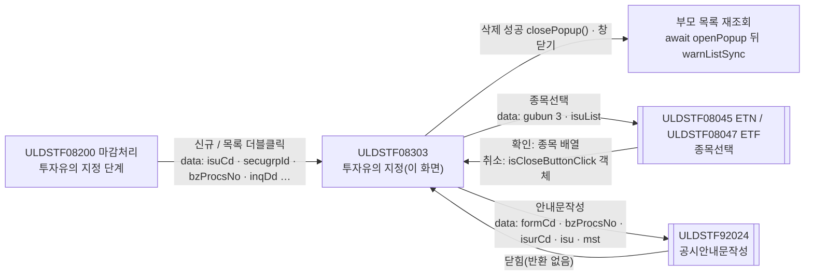
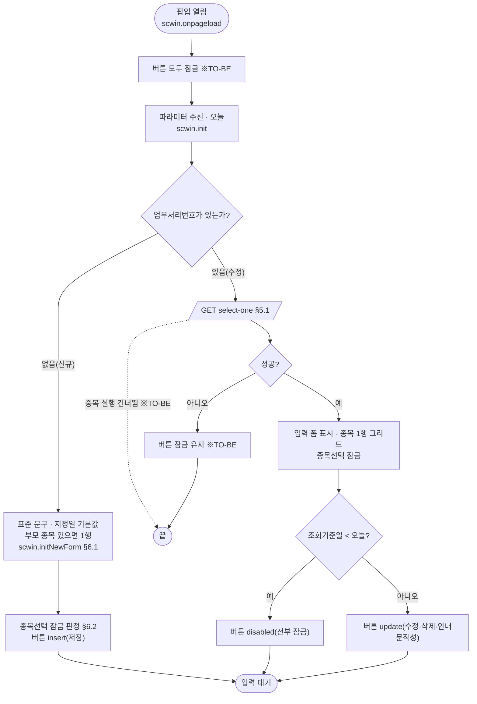
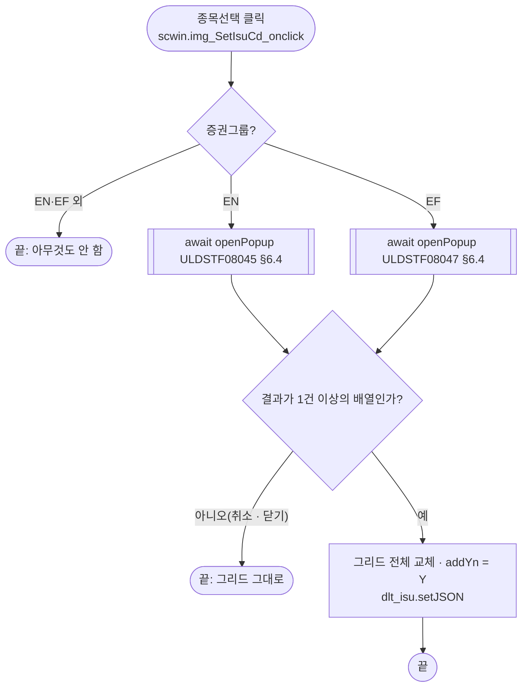
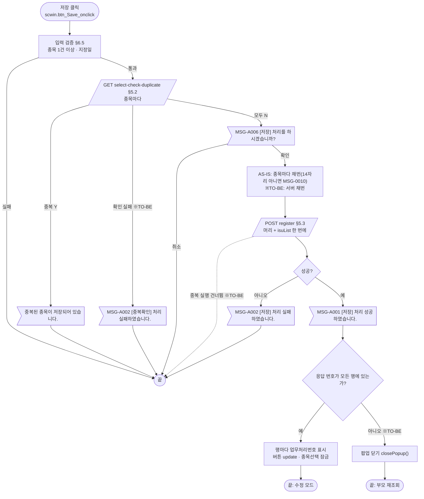
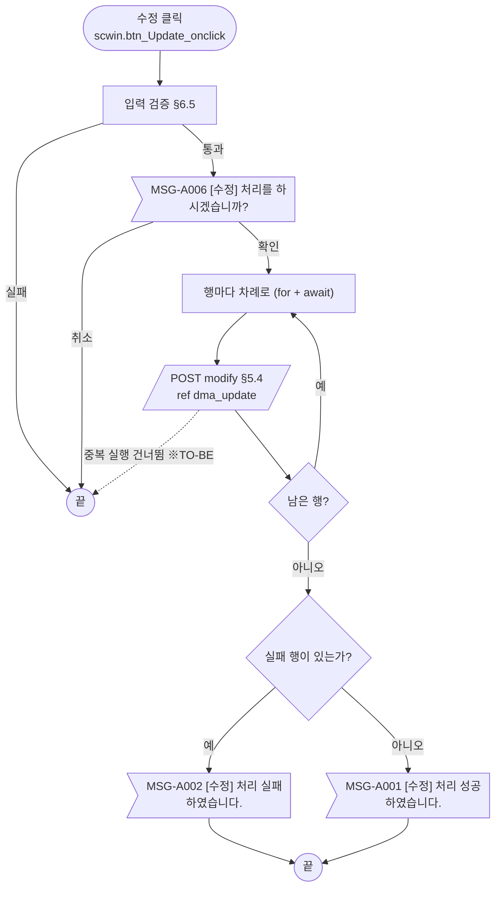
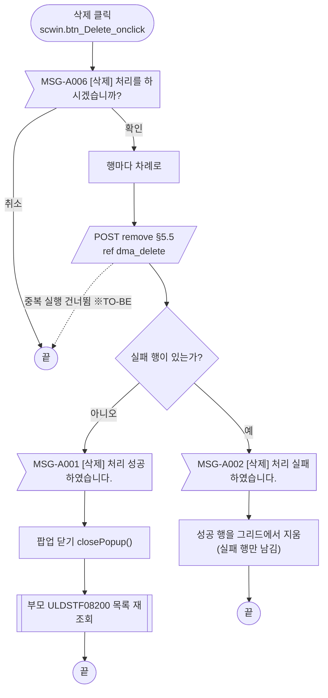
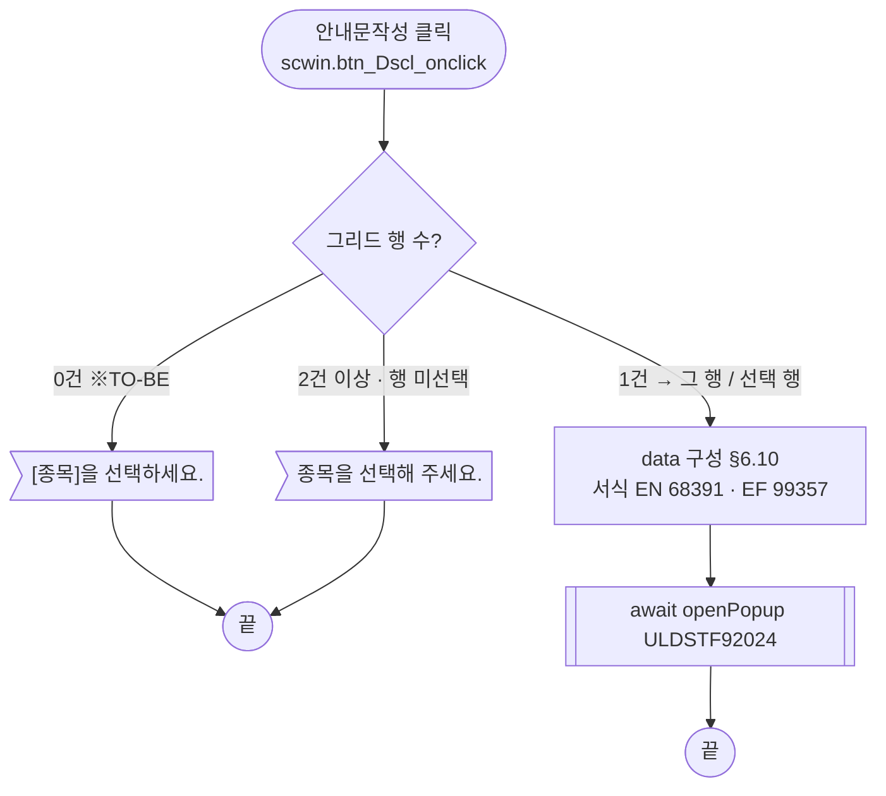
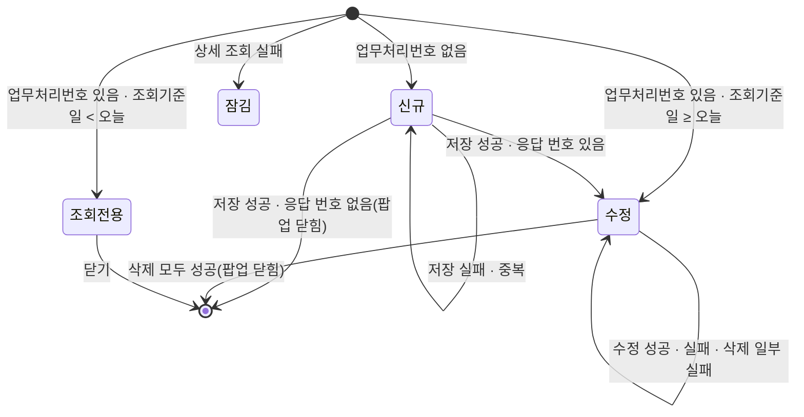

# ULDSTF08303 (팝업)ETN 투자유의 지정 — 업무 분석 및 전환 내역

| 항목 | 내용 |
|---|---|
| AS-IS | `/etn/ULDSTF08303.gfm` (Gauce/X-Internet, 690×510 모달 창 — 부모가 `window` 로 연다) — 반입 `conversion/conversion-front/ui/completed/ULDSTF08303/ULDSTF08303.gfm`. W-Craft 1차 변환본 `ULDSTF08303.xml` 은 참고만 |
| 신규 API 명세 | `conversion/conversion-front/ui/completed/ULDSTF08303/ULDSTF08303_API.md` — 블록 6종(이 화면 5종, 다른 화면 1종 `[ULDSTF08304, ULDSTF08305]` 최초지정일자 조회). 형제 화면 08301~08305 가 같은 명세를 공유한다. §2.2·§5 는 명세 기준(가이드 §0.3·§5) |
| TO-BE | `conversion/conversion-front/ui-tobe/ULDSTF08303.xml` (배포 경로 `/ui/lst/etn/ULDSTF08303.xml` — 부모 샘플 전환본 기준 가정, §10 #11) |
| 퍼블리싱 | `conversion/publish/publish-tobe/상장/상장처리(대내)/ULDSTF08303.xml`(원본 `conversion/publish/상장/상장처리(대내)/ULDSTF08303.xml`) — 컴포넌트 id 는 AS-IS 와 같음, 그리드 컬럼 id 는 대문자. 레이아웃은 캡처를 따랐다(종목선택 버튼은 캡처대로 라벨 칸 아래) |
| 화면 캡처 | `ULDSTF08303.png`(신규 진입 — 빈 그리드·빈 지정일, 하단 저장·수정·삭제·안내문작성·닫기). TO-BE 는 1단계 퍼블리싱본(마크업 전용)부터 만들었다(가이드 §13.2) |
| 이전 샘플 전환본 | `conversion/sample-front/ui/ULDSTF08303.xml`(97e3cfbb·db60a6f8) — 참고만. 당시 명세의 register·modify 가 지정코드를 01 로 고정해 저장·수정을 TODO 로 막아 두었으나, 이번 명세는 `etpInvstwarnDesignCd` 로 03 을 받으므로 연결했다 |
| 업무공통 | `$c.lc`(`isProcess`)·`$c.stf`(`getMessageParam`) — `cm/pcc/stf`. 게이트는 `--pcc stf` 로 돌린다 |
| 작성 | Inswave / 2026-10-28 |

참고 양식: [websquare_gfm_conversion.md](../../../md/websquare_gfm_conversion.md) — 특히 §1.4 업무 프로세스 흐름, §6.5 getPar/setPar 전환. Gauce 대응은 [gfm_business_analysis_guide.md](../../../md/gfm_business_analysis_guide.md) 를 함께 따랐다. 선례: `ui/completed/ULDSTF05710`·`ULDSTF05911`.

---

## 1. 화면 개요

상장 담당자가 **ETN/ETF 마감처리 화면(ULDSTF08200, AS-IS 투자유의 탭 ULDSTF08306)** 의 투자유의 [지정] 단계에서, 괴리율 기준을 넘은 종목을 **투자유의종목으로 지정**(지정코드 03)하는 내역을 여러 종목 한꺼번에 등록하거나, 등록한 건을 수정·삭제하고 공시안내문을 작성하는 팝업이다.

1. 부모가 종목·업무처리번호·조회기준일 등을 넘겨 연다. 업무처리번호가 없으면 신규, 있으면 수정이다.
2. 신규는 지정일·지정사유·투자유의사항·기타가 표준 문구로 채워진다. 부모가 종목을 넘겼으면 그 한 건, 아니면 [종목선택]으로 여러 종목을 담는다.
3. [저장]: 입력 검증 → 종목마다 같은 기준일 중복 지정 확인 → 확인 → 등록(서버 채번). 성공하면 수정 모드가 되고 종목선택이 잠긴다.
4. 수정 모드: [수정]·[삭제]는 그리드 행마다 차례로 처리한다. 조회기준일이 오늘보다 앞이면 모든 처리 버튼이 잠긴다. 삭제에 모두 성공하면 팝업이 닫힌다.
5. [안내문작성]: 고른 종목으로 공시안내문작성(ULDSTF92024)을 연다.

### 1.1 호출 화면 (1본)

- `ULDSTF08200` ETN/ETF 마감처리 — 원본은 투자유의 탭(`ULDSTF08306`)의 [지정] 단계. 저장소의 부모 전환본은 `conversion/sample-front/ui/ULDSTF08200.xml`(`scwin.WARN_STEPS` key "4" 지정 → `ULDSTF08303`, 창 제목 `증권그룹명 + " 투자유의종목 지정"`, 800×650 `pageFramePopup`). conversion-front 의 `ui/ULDSTF08200/` 은 다른 작업 대상이라 이 결과서는 sample-front 전환본의 계약을 기준으로 적는다.
  - 단계 [신규](`warnRegist("4")`) → 신규. 조회기준일이 오늘보다 앞이면 부모가 "과거 조회일자인 경우 조회만 가능합니다." 로 막는다.
  - 단계 목록 더블클릭(`warnOpenDetail("4", row)`) → 업무처리번호가 있으면 수정, 없으면(목록에만 있는 종목) 그 종목을 넘긴 신규.
  - 팝업이 닫히면 부모가 `await openPopup` 뒤에서 목록을 다시 조회한다(`warnListSync`).

### 1.2 호출 규약 (부모 → 이 화면) / 반환 규약

AS-IS 는 팝업이 로딩 때 `frame.Provider("../").fn_GetPar(arrPar)` 로 부모 함수를 불러 배열을 채워 받는다.

| arr | TO-BE 키 | 의미 | 빈 값일 때 / 분기 |
|---|---|---|---|
| `arr[0]` | `isuCd` | 종목코드 (`Isu_cd`) | 신규인데 있으면 그 종목 한 건으로 시작하고 [종목선택]을 잠근다 |
| `arr[1]` | `isuNm` | 종목명 (`Isu_nm`) | 위 행의 종목명 |
| `arr[2]` | `secugrpId` | 증권그룹ID (`Secugrp_id`) — `EN` ETN / `EF` ETF | 종목선택 팝업 종류, 공시 서식, 요청 `secugrpId` |
| `arr[3]` | (`fr_MktId` — 받지 않음) | 시장구분 (`Mkt_id`) | 원본도 쓰지 않음(미선언 전역에 대입, §8 #11) |
| `arr[4]` | `bzProcsNo` | 업무처리번호 (`fr_bz_procs_no`) | **비면 신규**, 있으면 상세 조회(수정) |
| `arr[5]` | `designDd` | 지정일 기본값 (`design_dd`) | 신규 지정일 입력란 초기값 |
| `arr[6]` | `inqDd` | 조회기준일 (`Inq_dd`) | 중복확인·저장 `basDd`, 수정 모드에서 오늘보다 앞이면 조회 전용 |
| `arr[7]` | `fstDtectDd` | 최초적출일 (`fst_dtect_dd`) | 부모가 넘긴 종목(addYn 빈 값)의 최초지정일 |
| `arr[8]` | `isurCd` | 발행기관코드 (`Isur_cd`) | 부모가 넘긴 종목의 발행기관 |

- **TO-BE** (가이드 §6.5): `$c.data.getParameter()` 로 위 키의 객체를 받는다. 키 이름은 부모 sample-front 전환본 `scwin.getWarnParam` 과 같다(`fr_MktId` 는 받지 않음). 부모 conversion-front 전환 때 키를 확인한다(§10 #1).
- **반환**: 없음. 원본은 저장·수정·삭제마다 `fn_parentRefresh()`(부모 `fn_search` 직접 호출)로 부모 목록을 다시 조회하고, 삭제 성공이면 `frame.CloseFrame()`. TO-BE 는 `$c.win.closePopup()`(인자 없음)만 하고, 부모가 `await` 가 끝나면 다시 조회한다(§8 #12).

### 1.3 이 화면이 여는 하위 팝업

| 팝업 | AS-IS 호출 (getPar/setPar) | 넘기는 `data` (TO-BE) | 받는 결과 (`closePopup`) / 취소 판정 |
|---|---|---|---|
| `ULDSTF08045` ETN 종목선택 (520×440) — `secugrpId` EN | `fn_GetPar = fn_GetParIsu; fn_SetPar = fn_SetParIsu;` → `fn_PopFindEtnCode()`. 팝업이 `fn_GetParIsu(arrPar, param_dts)` 로 `arr[0]=""`, `arr[1]="3"`(상장전체)와 **현재 그리드 전체**(`CopyDataSet(dts_Isu_Temp → param_dts)`)를 받고, 확인 때 `fn_SetParIsu(param_dts)` 로 **그리드 전체를 덮어쓰고 ADD_YN=Y** | `{ isurCd : "", isuCd : "", gubun : "3", secugrpId, isuList : dlt_isu.getAllJSON() }` — §6.4 | 종목 배열(08045 전환본 `closePopup(dlt_selList.getInsertedJSON())`). 취소 판정: `!Array.isArray(result) \|\| result.length === 0` 이면 그대로 둠 |
| `ULDSTF08047` ETF 종목선택 (520×440) — `secugrpId` EF | 같은 계약, `fn_PopFindEtfCode(Secugrp_id)` | 같음 | 같음(가정 — 08047 전환본 없음, §10 #7) |
| `ULDSTF92024` 공시안내문작성 (745×825) | `fn_GetPar` 를 익명 함수로 바꿔 끼우고 `CreateDialogFrame(…"window")` 뒤 되돌림. `arr[0]`=서식, `arr[1]`=업무처리번호, `arr[2]`=발행기관, `arr[3]`='1', `arr[5]`=종목명(ETN), `CopyDataSet(dts_Isu)`·`CopyDataSet(dts_Mst)` + `COM_NM` | `{ formCd, bzProcsNo, isurCd, mktId : "1", isuNm, isu : [행], mst : [행] }` — §6.10 | 돌려받는 값 없음(원본 `fn_SetPar` 빈 함수). 92024 전환본이 아직 부모 `scwin.getPar` 를 부르므로 호환용 `scwin.getPar` 를 임시로 둔다(§10 #9) |

- pcc/stf 에 ETN·ETF 종목선택 공통 함수가 없다(`cm/as-is/stf/list_common_bnd.xml` 의 `fn_PopFindEtnCode`·`fn_PopFindEtfCode` 는 레거시 `CreateDialogFrame`). 화면에서 `$c.win.openPopup` 을 직접 부른다(가이드 §6.5 예외).

### 1.4 업무 프로세스 흐름

흐름은 AS-IS 동작을 기준으로 그렸다. 점선과 `※TO-BE` 는 전환본에서 바뀌는 곳이다(근거는 §8).

| # | 업무 | 시작 (사용자 동작·진입 조건) | 끝 (결과) | 주요 함수 | 관련 절 |
|---|---|---|---|---|---|
| 1 | 진입·로딩 | 부모가 팝업을 엶 (업무처리번호 유무로 신규/수정) | 입력 대기 (모드별 버튼) | `scwin.onpageload` → `scwin.init` → `scwin.initNewForm` / `scwin.selectDetail` | §3, §5.1, §6.1 |
| 2 | 종목 선택 | [종목선택] `img_SetIsuCd` (신규·부모 종목 없음) | 선택 결과로 그리드 전체 교체(addYn Y) | `scwin.img_SetIsuCd_onclick` → `scwin.openIsuPopup` | §6.4 |
| 3 | 신규 저장 | [저장] (신규 모드) | 저장 안내 후 수정 모드(종목선택 잠금) | `scwin.save` → `checkDuplicate` → `registerTrs` | §5.2, §5.3, §6.5, §6.7 |
| 4 | 수정 | [수정] (수정 모드, 조회기준일 ≥ 오늘) | 수정 성공/실패 안내 | `scwin.update` → `modifyTrs`(행마다) | §5.4, §6.8 |
| 5 | 삭제 | [삭제] (수정 모드, 조회기준일 ≥ 오늘) | 모두 성공이면 팝업 닫힘 → 부모 재조회 / 실패면 실패 행만 남김 | `scwin.remove` → `removeTrs`(행마다) | §5.5, §6.9 |
| 6 | 안내문작성 | [안내문작성] (수정 모드) | 공시안내문작성 팝업 | `scwin.writeDscl` | §6.10 |
| 7 | 행 선택 | 그리드 셀 클릭 | 안내문작성 대상 행 확정 | `scwin.grd_isu_oncellclick` → `scwin.selectGridRow` | §6.3 |

#### 화면 간 흐름



AS-IS 는 `fn_GetPar`/`fn_SetPar` 를 바꿔 끼우고, 종목선택 팝업이 `fn_SetParIsu(param_dts)` 로 이 화면 그리드를 직접 덮어썼다. 저장·수정·삭제 뒤에는 `fn_parentRefresh` 로 부모 `fn_search` 를 직접 불렀다. TO-BE 는 `await $c.win.openPopup` 반환값으로 그리드를 바꾸고, 부모 재조회는 부모가 팝업이 닫힌 뒤 한다(가이드 §6.5, §8 #12).

#### 업무 1: 진입·로딩



| # | 단계 | 주체 | 내용 | 분기 · 메시지 | 관련 절 |
|---|---|---|---|---|---|
| 1 | 파라미터 수신 | 화면 | `$c.data.getParameter()` → §1.2 키 | `bzProcsNo` 가 비면 신규 | §1.2, §3 |
| 2 | 오늘 | 화면 | AS-IS `fn_todayDate`(DB 조회 `invstwarn_today_dd`, 동기) → TO-BE 서버 현재일 | — | §5.6, §10 #6 |
| 3a | 신규 준비 | 화면 | AS-IS 는 빈 헤더 조회 3회(`dts_Mst`·`dts_Isu`·`dts_Isu_Temp`) 뒤 `OnLoadCompleted` 에서 표준 문구 → TO-BE 는 통신 없이 `initNewForm` | 부모 종목이 있으면 그리드 1행 | §5.7, §6.1 |
| 3b | 수정 조회 | 서버 | `select-one` (AS-IS `searchEtnInvstwarn` `DIV_IDX_ETN_INVSTWARN_MST`, 비동기) | 실패면 버튼 잠금 | §5.1 |
| 4 | 버튼 상태 | 화면 | 신규 `insert`, 수정은 조회기준일 < 오늘이면 `disabled`, 아니면 `update` | 조회기준일이 비어도 `disabled`(원본과 같음, §8 #9) | §4 |

#### 업무 2: 종목 선택



- [종목선택]은 업무처리번호가 있거나 부모가 종목을 넘겼으면 잠긴다(§6.2). 원본은 이미지 버튼을 `disabled` + 회색 이미지로 바꿨다.

#### 업무 3: 신규 저장



| # | 단계 | 주체 | 내용 | 분기 · 메시지 | 관련 절 |
|---|---|---|---|---|---|
| 1 | 입력 검증 | 화면 | 종목 0건이면 "[종목]을 선택하세요." + 종목선택 포커스, 지정일 필수·날짜(공통 검증) | 실패면 끝 | §6.5 |
| 2 | 중복 확인 | 서버 | 종목마다 `select-check-duplicate`(지정코드 03, 기준일 `inqDd`, 종목코드). 원본은 동기 조회 | `dupChk === "Y"` 면 안내 후 끝 | §5.2 |
| 3 | 저장 확인 | 사용자 | `await $c.lc.isProcess("I")` | 취소면 끝 | §6.7 |
| 4 | 채번 | 화면→서버 | AS-IS `fn_getNewBzProcNo` 종목마다(14자리 아니면 `MSG-0010` 후 그 행 건너뜀). **명세는 서버 채번** → TO-BE 생략 | — | §5.8 |
| 5 | 등록 | 서버 | AS-IS 종목마다 `trs.Post()` → TO-BE `register` 1회(머리 + `isuList`) | `skipped` 면 끝, 실패 `MSG-A002` | §5.3 |
| 6 | 결과 반영 | 화면 | `MSG-A001` → `bzProcsNoList` 를 행마다 표시, 한 건이면 그 행 선택, 버튼 `update`, 종목선택 잠금 | 번호가 비면 팝업 닫기(부모 재조회, §10 #4) | §6.7 |

#### 업무 4: 수정



- 원본은 바뀐 내용이 없어도 전송하고, 중복 확인을 하지 않는다(그대로 유지).

#### 업무 5: 삭제



- 삭제는 입력 검증을 하지 않는다(원본 `fn_delete`). 원본의 `buttonSet.setDeleteStatus()` 는 응답 이벤트에서 삭제를 가르기 위한 것이라 필요 없다.

#### 업무 6: 안내문작성



#### 업무 7: 행 선택

- 그리드 셀 클릭 → `scwin.selectGridRow(row)`: 고른 행 index, 그 행의 발행기관코드·업무처리번호를 화면 상태값으로 둔다(원본 `fn_SelectGridRow`). 안내문작성의 대상 행 판정에 쓴다.

#### 화면 모드 상태 전이



| 상태 | 저장 | 수정 | 삭제 | 안내문작성 | 종목선택 | TO-BE |
|---|---|---|---|---|---|---|
| 신규 (부모 종목 없음) | O | | | | O | `insert` |
| 신규 (부모 종목 있음) | O | | | | | `insert` + `img_SetIsuCd` 잠금 |
| 수정 | | O | O | O | | `update` |
| 조회전용 · 잠김 | | | | | | `disabled` |

---

## 2. 화면 구성 및 데이터 정의

### 2.1 화면 구성

| 영역 | AS-IS 요소 | TO-BE 컴포넌트 (바인딩) | 설명 |
|---|---|---|---|
| 입력 영역 | `panel_3` (`PanelToGroupBox`) | `panel_3` (`xf:group.tblbox` + 2열 표) | 공통 검증(`validateDataCollect`) 컨테이너 |
| 필수 표시 | `label_10`·`lbl_1` "*" | (옮기지 않음) → 라벨 `class="req"` | 지정종목·지정일 |
| 1. 지정종목 라벨 | `label_isu` | `label_isu` (`w2:textbox.req`) | |
| 종목선택 | `img_SetIsuCd` (이미지 `btn_isu_select.gif`) | `img_SetIsuCd` (`xf:trigger.btn_cm`, 라벨 칸 안 — 캡처 위치) | §6.4, 잠금 §6.2 |
| 지정종목 그리드 | `grid_1` (`dts_Isu_Temp`) | `grd_isu` (`dlt_isu`, `readOnly`) | 열: `isuCd` 종목코드·`isuNm` 종목명·`bzProcsNo` 업무처리번호. 원본 숨김 열 `BZ_PROCS_NO`(첫 열, name 동일)·`ISUR_CD`(name 발행회사)는 **표시하지 않음** — 같은 dataList 키로 들고 있다. 원본 행 줄무늬 `bgcolor decode(...)`·`selectioncolor` 는 그리드 기본 스타일로 대체 |
| 2. 지정일 | `label_designdd`, `edt_DesignDd` (mxmaskedit) + `img_DesignDd` (달력 이미지) | `edt_DesignDd` (`w2:inputCalendar`, `dma_detail.designDd`) | 달력 이미지 **(옮기지 않음)** — inputCalendar 내장 달력. 원본 바인더 `bnd_Invstwarn` `DESIGN_DD` |
| 3. 지정사유 | `label_rsn`, `txa_Rsn` | `txa_Rsn` (`xf:textarea`, `dma_detail.designRsn`) | 원본 바인더 `DESIGN_RSN` |
| 4. 투자유의사항 | `label_4`, `txa_InvstwarnContn` | `txa_InvstwarnContn` (`dma_detail.etpInvstwarnContn`) | 원본 바인더 `ETP_INVSTWARN_CONTN` |
| 5. 기타 | `label_5`, `txa_Remk` | `txa_Remk` (`dma_detail.misc`) | 원본 바인더 `MISC` |
| 버튼 | `btn_Save`·`btn_Update`·`btn_Delete`·`btn_Dscl`·`btn_Close` (이미지) | `btn_Dscl`(안내문작성, `btn_cm`) · `btn_Delete`(삭제, pt) · `btn_Update`(수정, pt) · `btn_Save`(저장, pt) — `btnbox#grpBtnBox` 의 `rt`(규칙 41: 일반 버튼 → 주요 버튼 순). `btn_Close` 는 **옮기지 않음** — 팝업 하단 닫기 금지(팝업 창의 닫기 사용) | 활성 상태는 `buttonSet` → `$c.util.setButtonState` — §4 |
| 머리 | (없음) | `pfmContentHeader` (`/cm/xml/contentHeader.xml`) | 팝업도 contentHeader 필수 |

- 캡처 대조: 영역 순서(지정종목 그리드 → 지정일 → 지정사유 → 투자유의사항 → 기타), 라벨 문구, 종목선택 버튼 위치(라벨 아래), 하단 버튼 4종(닫기 제외)은 캡처와 같다. 버튼 순서는 캡처(저장·수정·삭제·안내문작성)가 아니라 규칙 41 순서(안내문작성·삭제·수정·저장)를 따른다.

### 2.2 데이터 정의

| AS-IS | TO-BE | 종류 | 키(컬럼) | 출처 / 용도 |
|---|---|---|---|---|
| `dts_Isu_Temp` | `dlt_isu` (**화면 전용 — 명세 외**) | dataList | `isuCd`, `isuNm`, `bzProcsNo`, `isurCd`, `comNm`, `addYn`, `status` | 그리드 바인딩. 상세 조회 1행·종목선택 결과·부모 종목. `status`(Y/N)는 행별 처리 결과(원본 `STATUS`) |
| `dts_Mst` (+ `bnd_Invstwarn`) | `dma_detail` | dataMap | 명세 `select-one` 응답 keyInfo 14개 그대로 — `bzProcsNo`, `isuCd`, `isuNm`, `isurCd`, `etpInvstwarnDesignCd`, `fstDesignDd`, `designDd`, `designRsn`, `etpInvstwarnContn`, `misc`, `addYn`, `basDd`, `lstEmpNm`, `dscYn` | 수정 조회 응답 + 입력 폼 바인딩(신규·수정 공통) |
| `trs` 등록 전문 `dts_Mst` | `dma_register` · `dlt_register` | dataMap · dataList | 명세 `register` 요청 그대로 — 머리 `secugrpId`, `etpInvstwarnDesignCd`, `designDd`, `designRsn`, `etpInvstwarnContn`, `misc`, `basDd`, `fstDesignDd` + 목록 `bzProcsNo`(빈 값 — 서버 채번), `isuCd`, `isurCd`, `addYn` | 신규 등록 전문 (`requestData = { ...dma_register, isuList : dlt_register }`) |
| `trs` 수정 전문 `dts_Mst` | `dma_update` | dataMap | 명세 `modify` 요청 12키 그대로 | 행별 수정 전문 (`ref : "dma_update"`) |
| `trs` 삭제 전문 `dts_Mst` | `dma_delete` | dataMap | `bzProcsNo`, `secugrpId`, `isuCd`, `isurCd` | 행별 삭제 전문 (`ref : "dma_delete"`) |
| (`trs` 응답 없음) | `dma_resultSave` | dataMap | `completeYn`, `bzProcsNo`, `bzProcsNoList` | 등록·수정·삭제 응답 (명세) |
| `dts_Isu` | (삭제) | — | — | 원본은 처리 대상 한 행을 담는 작업 dataset(`fn_copy_dts`) — TO-BE 는 행 값을 바로 요청 정의에 넣는다. 안내문 `isu` 는 대상 행으로 만든다(§6.10) |
| `dtsChk` | (삭제) | — | `DUP_CHK` → 응답 `dupChk` | 중복 확인 응답은 `responseJSON.dupChk` 를 바로 읽는다(명세 처리 예시) |
| `dts_Cand` | (삭제) | — | `TODAY_DD` | 오늘 조회 — 서버 현재일로 대체(§5.6) |
| `dts_BzProcsNo` | (삭제) | — | — | 채번 — 서버 채번(§5.8) |
| `trs` (`mxlogicaltr`) | (삭제) | — | — | 저장·수정·삭제 통신 → `executeDynamic` |

- **TO-BE DataCollection 은 `ULDSTF08303_API.md` 의 정의 블록(id·name·dataType)을 그대로 옮긴다**(가이드 §5 「API 명세 적용」). 예외는 그리드 `dlt_isu` 하나다 — 명세에 그리드용 목록 정의가 없고(`dlt_register` 는 `isuNm` 이 없음), 종목명 표시·행별 결과가 필요해 화면 전용으로 둔다.
- AS-IS 컬럼 → TO-BE 키: `ISU_CD→isuCd`, `ISU_NM→isuNm`, `BZ_PROCS_NO→bzProcsNo`, `ISUR_CD→isurCd`, `COM_NM→comNm`, `ADD_YN→addYn`, `STATUS→status`, `DESIGN_DD→designDd`, `DESIGN_RSN→designRsn`, `ETP_INVSTWARN_CONTN→etpInvstwarnContn`, `MISC→misc`, `ETP_INVSTWARN_DESIGN_CD→etpInvstwarnDesignCd`, `FST_DESIGN_DD→fstDesignDd`, `BAS_DD→basDd`, `DUP_CHK→dupChk`.
- 명세에만 있는 키: `lstEmpNm`(최종처리자명)·`dscYn`(공시여부) — 원본 화면에 없어 표시·판정에 쓰지 않는다(§10 #8). 명세에 없는 AS-IS 값: `COM_NM`(안내문 mst 에 넣던 발행회사명 — 상세 조회 응답에 없음, §10 #8).

---

## 3. 로딩 (`gform onload` → `scwin.onpageload` → `scwin.init`)

원본 `gform onload` 순서: ① `fn_GetPar` 로 파라미터 9개 수신 → ② `buttonSet.setSaveInfo/UpdateInfo/DeleteInfo/DsclInfo` 버튼 등록 → ③ `fn_SetIsuCdBtnShow()` → ④ `fn_todayDate()`(동기 조회) → ⑤ `fn_onload()`(신규: 빈 헤더 조회 3회 / 수정: 상세 조회) → ⑥ `PanelToGroupBox(panel_3)`. 결과 처리는 `dts_Mst`·`dts_Isu_Temp` 의 `OnLoadCompleted` 이벤트에서 한다.

`scwin.init` 의 단계:

1. **버튼 잠금** — `$c.util.setButtonState("grpBtnBox", "disabled", scwin.BTN_MAP)`. 조회가 예외로 끝나도 버튼이 XML 기본값(전부 활성)으로 남지 않게 한다(※TO-BE).
2. **파라미터 수신** — `const param = $c.data.getParameter() ?? {};` → `scwin.isuCd`·`isuNm`·`secugrpId`·`bzProcsNo`·`designDd`·`inqDd`·`fstDtectDd`·`isurCd` (§1.2, 모두 `String(… ?? "")`).
3. **오늘** — `scwin.todayDd = $c.date.getServerDateTime("yyyyMMdd")` (원본 `fn_todayDate` 의 DB 조회 대체, §5.6).
4. **init 바인딩** (규칙 22·37):

   | 대상 | 적용 |
   |---|---|
   | 단일 달력 `edt_DesignDd` (지정일) | `$c.date.checkCalendarFormat(edt_DesignDd, "yyyyMMdd");` |
   | 기간 달력 | 해당 없음 |
   | 조회 영역(`schbox`/`tbl_search`) | 해당 없음 — 조회 조건 영역이 없는 입력 팝업 |

5. **신규·수정 분기**
   - 업무처리번호 없음 → `scwin.initNewForm()`(§6.1) → `scwin.setIsuBtnState()`(§6.2) → 버튼 `insert`.
   - 있음 → `await scwin.selectDetail()`(§5.1) — 후처리에서 종목선택 잠금·버튼 상태.
6. `PanelToGroupBox(panel_3)` — 삭제(퍼블리싱 마크업이 대신함).

```javascript
scwin.onpageload = async function () {
    try {
        await scwin.init();
    } catch (ex) {
        await $c.exception.handleError(ex, { context : "ULDSTF08303.onpageload" });
    }
};

scwin.init = async function () {
    $c.util.setButtonState("grpBtnBox", "disabled", scwin.BTN_MAP);        // 1)
    const param = $c.data.getParameter() ?? {};                             // 2)
    // … scwin.* 수신
    scwin.todayDd = $c.date.getServerDateTime("yyyyMMdd");                  // 3)
    $c.date.checkCalendarFormat(edt_DesignDd, "yyyyMMdd");                  // 4)
    if ($c.util.isEmpty(scwin.bzProcsNo)) {                                 // 5)
        scwin.initNewForm();
        scwin.setIsuBtnState();
        $c.util.setButtonState("grpBtnBox", "insert", scwin.BTN_MAP);
        return;
    }
    await scwin.selectDetail();
};
```

---

## 4. 컴포넌트 이벤트

| TO-BE 컴포넌트 | 이벤트 | TO-BE 핸들러 | 동작 (호출 함수) | AS-IS |
|---|---|---|---|---|
| `img_SetIsuCd` (종목선택) | `onclick` | `scwin.img_SetIsuCd_onclick` | `scwin.openIsuPopup()` — §6.4 | `img_SetIsuCd onclick`: `fn_GetPar = fn_GetParIsu; fn_SetPar = fn_SetParIsu;` + `fn_PopFindEtnCode()` / `fn_PopFindEtfCode(Secugrp_id)` |
| `grd_isu` (그리드) | `oncellclick` | `scwin.grd_isu_oncellclick` | `scwin.selectGridRow(row)` — §6.3 | `grid_1 OnClick(row, colid)` → `fn_SelectGridRow(row)` |
| `btn_Save` (저장) | `onclick` | `scwin.btn_Save_onclick` | `scwin.save()` — §6.7 | `buttonSet.setSaveInfo(btn_Save, fn_save)` |
| `btn_Update` (수정) | `onclick` | `scwin.btn_Update_onclick` | `scwin.update()` — §6.8 | `buttonSet.setUpdateInfo(btn_Update, fn_update)` |
| `btn_Delete` (삭제) | `onclick` | `scwin.btn_Delete_onclick` | `scwin.remove()` — §6.9 | `buttonSet.setDeleteInfo(btn_Delete, fn_delete)` |
| `btn_Dscl` (안내문작성) | `onclick` | `scwin.btn_Dscl_onclick` | `scwin.writeDscl()` — §6.10 | `buttonSet.setDsclInfo(btn_Dscl, fn_dscl)` |
| `btn_Close` (닫기) | — | **(옮기지 않음)** | 팝업 창의 닫기(X) 사용 | `frame.CloseFrame()` |
| `img_DesignDd` (달력) | — | **(옮기지 않음)** | inputCalendar 내장 달력 | `popUpCalendar2(edt_DesignDd)` |
| (데이터셋 이벤트) | `OnLoadCompleted(rowcount)`·`OnLoadError()` (`dts_Mst`·`dts_Isu`·`dts_Isu_Temp`·`dtsChk`·`dts_Cand`), `trs` `OnSuccess()`·`OnFail()` | — | `await executeDynamic` 뒤 후처리로 옮김(§5), 오류 안내는 공통 오류 핸들러 | `alert_error(…)` |

**버튼 상태 (모드 × 버튼)** — 원본 `buttonSet` → `$c.util.setButtonState("grpBtnBox", 상태, scwin.BTN_MAP)`, `BTN_MAP = { save : "btn_Save", modify : "btn_Update", "delete" : "btn_Delete", guide : "btn_Dscl" }`.

| 원본 상태 | 저장 | 수정 | 삭제 | 안내문작성 | TO-BE 상태 |
|---|---|---|---|---|---|
| `setInsertStatus` (신규) | O | | | | `insert` |
| `setUpdateStatus` (수정, 저장 성공 뒤) | | O | O | O | `update` |
| `setDisableStatus` (조회기준일 < 오늘) | | | | | `disabled` |
| `setDeleteStatus` (삭제 중 표지) | — | — | — | — | 쓰지 않음(처리구분은 `scwin.trJob`) |
| (로딩 중·조회 실패) | | | | | `disabled` (※TO-BE) |

- [종목선택]은 `buttonSet` 밖이다 — `scwin.setIsuBtnState()` 로 따로 잠근다(§6.2). 원본도 조회전용 판정과 별개로 업무처리번호·부모 종목 유무로만 잠갔다.

---

## 5. 서버 통신

공통: AS-IS 는 URL·`trs.Parameters` 에 `SCREN_ID`(값이 `ULDSTF05343.gfm` — 다른 화면 ID, §8 #1)·`SCREN_PROCES_TP_CD`·`TRS_IDX`·`DIV_IDX`·`COUNT`·`LIST_BZ_TP_CD`(EN 716 / EF 750)를 붙이고, 저장은 `fn_encodeNSession` 으로 세션을 붙였다. 신규 API 명세에는 이 값이 없으므로 **TO-BE 는 넘기지 않는다**(`LIST_BZ_TP_CD` 는 명세상 `secugrpId` 로 서버가 분기, §10 #10). 모든 통신은 응답을 쓰기 전에 `skipped` 를 확인한다.

| # | 용도 | AS-IS | TO-BE (API 명세) |
|---|---|---|---|
| 5.1 | 수정: 상세 조회 | `dts_Mst` ← `/etn/EtnMktAct.do?method=searchEtnInvstwarn&DIV_IDX=ETN_INVSTWARN_MST&TRS_IDX=SELECT&SECUGRP_ID&GUBUN_CD=03&BZ_PROCS_NO` | `GET …/select-one` |
| 5.2 | 신규 저장 전 중복 확인 | `dtsChk` ← `/etn/EtnMktAct.do?method=checkDuplicate&inputMessageId=ETN_INVSTWARNISU_DUK_INOUT&ETP_INVSTWARN_DESIGN_CD&ISU_CD&BAS_DD` (종목마다, 동기) | `GET …/select-check-duplicate` |
| 5.3 | 신규 저장 | 종목마다 `fn_getNewBzProcNo` + `trs` `/etn/EtnMktAct.do?method=saveEtnInvstwarn` `TRS_IDX_INSERT` `KeyValue: dtsParm1=dts_Mst` | `POST …/register` (1회, 서버 채번) |
| 5.4 | 수정 | 같은 `trs` `TRS_IDX_UPDATE` (행마다) | `POST …/modify` (행마다) |
| 5.5 | 삭제 | 같은 `trs` `TRS_IDX_DELETE` (행마다) | `POST …/remove` (행마다) |
| 5.6 | 오늘 | `dts_Cand` ← `/listingCommon.do?method=listGeneral&queryId=lds.stf.etn.lstproc.invstwarn_today_dd.select` (동기) | (명세 없음) → `$c.date.getServerDateTime("yyyyMMdd")` |
| 5.7 | 신규 빈 헤더 | `dts_Mst`·`dts_Isu`·`dts_Isu_Temp` ← `/gauceSystemierAdaptor.do?method=getGauceDataHeader&messageId=ETN_INVSTWARNISU_MST_INOUT` | (삭제) — DataCollection 정의가 대신함 |
| 5.8 | 채번 | `fn_getNewBzProcNo(dts_BzProcsNo)` | (삭제) — 명세 "등록 시 서버채번" |

(`…` = `/api/listing/lstproc/etn/invstwarn`)

#### API 명세 대응 (`ULDSTF08303_API.md`)

| # | 명세 블록 | method · 경로 | 요청 (명세 정의) | 응답 (명세 정의) | AS-IS 대응 | TO-BE 함수 |
|---|---|---|---|---|---|---|
| 1 | [ULDSTF08301~08305] 중복체크 | `GET …/select-check-duplicate` | `etpInvstwarnDesignCd`·`basDd`·`isuCd` | `responseJSON.dupChk` (Y/N) | `fn_duplicate_check` | `scwin.checkDuplicate` |
| 2 | [ULDSTF08304, ULDSTF08305] 최초지정일자 조회 | `GET …/select-fst-design-dd` | — | — | (이 화면 없음 — 형제 화면 `fn_Instwarn_fstdd`) | **쓰지 않음** (다른 화면 블록, 게이트 A06) |
| 3 | [ULDSTF08301~08305] 상세 조회 | `GET …/select-one` | `secugrpId`·`bzProcsNo`, `target : "dma_detail=body"` | `dma_detail` (14키) | `fn_onload` 수정 분기 + `dts_Mst OnLoadCompleted` | `scwin.selectDetail` |
| 4 | [ULDSTF08301~08305] 수정 | `POST …/modify` | `dma_update`, `ref : "dma_update"`, `target : "dma_resultSave=body"` | `dma_resultSave` | `fn_update` | `scwin.modifyTrs` |
| 5 | [ULDSTF08301~08305] 등록 | `POST …/register` | `{ ...dma_register.getJSON(), isuList : dlt_register.getAllJSON() }`, `target : "dma_resultSave=body"` | `dma_resultSave` | `fn_save` (`fn_duplicate_check` + 종목별 `saveEtnInvstwarn`) | `scwin.registerTrs` |
| 6 | [ULDSTF08301~08305] 삭제 | `POST …/remove` | `dma_delete`, `ref : "dma_delete"`, `target : "dma_resultSave=body"` | `dma_resultSave` | `fn_delete` | `scwin.removeTrs` |

명세에 없는 AS-IS 통신: 오늘(§5.6) — 서버 현재일로 대체(§10 #6), 빈 헤더(§5.7)·채번(§5.8) — 삭제, 종목선택 팝업의 조회 — 팝업 소관.

#### 명세 ↔ AS-IS 차이 (→ §10)

| # | 차이 | 처리 | §10 |
|---|---|---|---|
| 1 | 상세 조회 요청에 원본 `GUBUN_CD=03`(지정코드)이 없다 — 업무처리번호만으로 건을 찾는다 | 명세대로 `secugrpId`·`bzProcsNo` 만 | #3 |
| 2 | 중복체크 응답은 `result.responseJSON.dupChk` 로 적혀 있다(다른 API 는 `body`) | 명세대로 읽고 `body.dupChk` 도 받는다 | #2 |
| 3 | 원본은 종목마다 채번·전송(14자리 아니면 그 행 건너뜀) — 명세는 등록 1회·서버 채번, 응답 `bzProcsNoList`(요청 순서) | `register` 1회, 응답 번호를 행에 표시 | #4 |
| 4 | `register` 머리의 `fstDesignDd` 는 하나인데 원본은 행마다(`ADD_YN` Y → 지정일, 아니면 최초적출일) | 첫 행 `addYn` 기준으로 머리 값 계산, 등록 1회 유지(전 행 ADD_YN 이 같음이 AS-IS 로 보장 — §5.3 근거). 목록 `addYn` 도 보낸다 | #5 |
| 5 | `completeYn` 성공 값, `bzProcsNoList` 형태(배열/쉼표 문자열)가 명세에 없다 | `"Y"` 가정, 둘 다 받음 | #4 |
| 6 | 원본이 보내던 `SCREN_ID`·`SCREN_PROCES_TP_CD`·`TRS_IDX`·`DIV_IDX`·`COUNT`·`LIST_BZ_TP_CD`·세션이 명세에 없다 | 보내지 않음 | #10 |
| 7 | 응답 `dma_detail` 에 `COM_NM`(안내문 mst 용)이 없고, 명세에만 `lstEmpNm`·`dscYn` 이 있다 | `comNm` 빈 값, `lstEmpNm`·`dscYn` 미사용 | #8 |
| 8 | 명세 머리글이 `[ULDSTF08301~08305]`·`[ULDSTF08304, ULDSTF08305]` 형식이라 `api_spec_check.py` 가 블록을 읽지 못한다(A01 5건) | 해소 — 도구 보강 뒤 원본 명세로 대조 OK | #12 |

### 5.1 상세 조회 (`scwin.selectDetail`)

| 항목 | 내용 |
|---|---|
| `id` / `method` / `action` | `sbm_selectDetail` / `get` / `/api/listing/lstproc/etn/invstwarn/select-one` *(AS-IS `/etn/EtnMktAct.do?method=searchEtnInvstwarn`)* |
| `requestData` | `{ secugrpId : scwin.secugrpId, bzProcsNo : scwin.bzProcsNo }` |
| `target` | `dma_detail=body` (gridview 없음 — 그리드는 후처리로 채움) |
| 선행 / 순서 | `scwin.init` 5단계. 원본은 비동기 조회 + `dts_Mst OnLoadCompleted` |
| 후처리 | ① 그리드 1행 `dlt_isu.setJSON([{ isuCd, isuNm, bzProcsNo, isurCd, comNm : "", addYn, status : "" }])`(원본 `CopyDataSet(dts_Mst, dts_Isu_Temp)`) ② `scwin.isurCd`·`scwin.bzProcsNo` = 응답 값(원본 첫 행 `Isur_cd`·`fr_bz_procs_no`) ③ `scwin.setIsuBtnState()` ④ `scwin.inqDd < scwin.todayDd` 이면 `disabled`, 아니면 `update` |
| 실패 처리 | `success:false` 면 버튼 `disabled` 로 두고 끝(원본은 `alert_error` 뒤 이벤트 없음 → 버튼 기본 상태) |
| 중복 실행 | 기본(건너뜀) — `skipped` 면 끝 |

### 5.2 중복 확인 (`scwin.checkDuplicate`)

| 항목 | 내용 |
|---|---|
| `id` / `method` / `action` | `sbm_checkDuplicate` / `get` / `/api/listing/lstproc/etn/invstwarn/select-check-duplicate` *(AS-IS `/etn/EtnMktAct.do?method=checkDuplicate`)* |
| `requestData` | 행마다 `{ etpInvstwarnDesignCd : "03", basDd : scwin.inqDd, isuCd : 행 종목코드 }` |
| `target` | 없음 — 명세 처리 예시대로 `result.responseJSON.dupChk` 를 읽는다(`body.dupChk` 도 허용, §10 #2) |
| 선행 / 순서 | `scwin.save` 에서 검증 뒤·저장 확인 앞(원본 순서). 행마다 `for + await` — 원본 동기 조회 순서 |
| 후처리 | `dupChk === "Y"` 면 "중복된 종목이 저장되어 있습니다." 안내 후 true(저장 중단). 모두 아니면 false |
| 실패 처리 | `success:false` 면 `MSG-A002` "[중복확인] 처리 실패하였습니다." 후 true(저장 중단). 원본은 `alert_error` 뒤 `DUP_CHK` 가 비어 중복 아님으로 계속했다(§8 #6) |
| 중복 실행 | 기본(건너뜀) — `skipped` 면 저장 중단 |

### 5.3 신규 등록 (`scwin.registerTrs`)

| 항목 | 내용 |
|---|---|
| `id` / `method` / `action` | `sbm_registerTrs` / `post` / `/api/listing/lstproc/etn/invstwarn/register`, `mediatype : "application/json"` *(AS-IS `/etn/EtnMktAct.do?method=saveEtnInvstwarn` `TRS_IDX_INSERT`)* |
| `requestData` | `{ ...dma_register.getJSON(), isuList : dlt_register.getAllJSON() }` — 명세가 명시한 전달 방식(`ref` 미사용). 머리 = `secugrpId`·`etpInvstwarnDesignCd "03"`·입력 폼 4항목·`basDd = inqDd`·`fstDesignDd`(§6.6), 목록 = 그리드 행마다 `{ bzProcsNo : "", isuCd, isurCd, addYn }`(`setJSON` 이 정의된 열만 남김) |
| `target` | `dma_resultSave=body` |
| 채번 | 원본은 종목마다 화면 채번(`MSG-0010`). 명세는 서버 채번 → 화면 채번 없음 |
| 1회 등록 근거 | 머리 `fstDesignDd` 가 하나여도 행별 최초지정일이 보존된다. AS-IS gfm 근거: 그리드(`dts_Isu_Temp`)에 행이 들어오는 길은 두 곳뿐이다 — ① `dts_Isu_Temp OnLoadCompleted` 가 부모 종목(`Isu_cd`) 1행을 `AddRow`(ADD_YN 미설정 = 빈 값), ② `fn_SetParIsu` 가 `CopyDataSet(param_dts, dts_Isu_Temp)` 로 그리드 전체를 바꾼 뒤 **모든 행** `ADD_YN = "Y"`. 부모 종목이 있으면 `gform onload` 의 `fn_SetIsuCdBtnShow()` 가 `img_SetIsuCd.disabled = true` 로 ②를 막고, 설령 ②가 실행돼도 루프가 전 행을 Y 로 덮는다. 등록(`fn_save`)은 신규(`setInsertStatus`)에서만 가능하고 성공하면 `setUpdateStatus` 로 [저장]이 잠긴다 → 등록 시점의 ADD_YN 은 전 행이 같다(부모 종목 1행 → 최초적출일, 종목선택 결과 → 지정일). 형제 08304·08305 의 행별 등록과 달리 명세의 `isuList` 다건 전송을 그대로 쓴다. 행별 결과는 등록이 전부/전무라 `status` 를 일괄 Y 로 둔다 |
| 후처리 | 성공이면 응답 `body.bzProcsNoList`(`scwin.toNoList` — 배열/쉼표 문자열)를 행 순서대로 `bzProcsNo` 에, `status` Y. 안내·모드 전환은 `scwin.save`(§6.7) |
| 실패 처리 | `scwin.isSaveSuccess` false → `scwin.save` 가 `MSG-A002` |
| 중복 실행 | 기본(건너뜀) — `null` 을 돌려 `save` 가 안내 없이 끝 |

### 5.4 수정 (`scwin.modifyTrs(row)`)

| 항목 | 내용 |
|---|---|
| `id` / `method` / `action` | `sbm_modifyTrs` / `post` / `/api/listing/lstproc/etn/invstwarn/modify` *(AS-IS `trs` `TRS_IDX_UPDATE`)* |
| `ref` | `dma_update` — 행마다 `{ bzProcsNo·isuCd·isurCd·addYn : 행 값, secugrpId, designDd·designRsn·etpInvstwarnContn·misc : 입력 폼, basDd : inqDd, etpInvstwarnDesignCd : "03", fstDesignDd : §6.6 }` (원본 `fn_copy_dts` + `fn_save_trs`) |
| `target` | `dma_resultSave=body` |
| 선행 / 순서 | `scwin.update` 의 `for + await` — 앞 행 응답 뒤 다음 행(원본은 응답을 기다리지 않고 연달아 `Post`, §8 #3) |
| 후처리 | 행 `status` 에 Y/N, 성공 여부 반환. 안내는 `scwin.update` |
| 실패 처리 | false 반환(실패 건수로 `MSG-A002`) |
| 중복 실행 | 기본(건너뜀) — `null` 이면 루프 중단 |

### 5.5 삭제 (`scwin.removeTrs(row)`)

| 항목 | 내용 |
|---|---|
| `id` / `method` / `action` | `sbm_removeTrs` / `post` / `/api/listing/lstproc/etn/invstwarn/remove` *(AS-IS `trs` `TRS_IDX_DELETE`)* |
| `ref` | `dma_delete` — `{ bzProcsNo, secugrpId, isuCd, isurCd }` (행 값) |
| `target` | `dma_resultSave=body` |
| 후처리 | 행 `status` 에 Y/N. 모두 성공이면 `scwin.remove` 가 `MSG-A001` → `closePopup()`, 실패가 있으면 `MSG-A002` → 성공 행 삭제 |
| 중복 실행 | 기본(건너뜀) — `null` 이면 루프 중단 |

---

## 6. 일반 함수

### 6.1 신규 준비 (`scwin.initNewForm`)

- 원본: `fn_onload` 신규 분기의 빈 헤더 조회 3회 → `dts_Mst OnLoadCompleted`(`AddRow`, 지정일 = `design_dd`, 표준 문구 3종) · `dts_Isu OnLoadCompleted`(`AddRow`) · `dts_Isu_Temp OnLoadCompleted`(부모 종목이 있으면 1행 — `ISU_CD`·`ISU_NM`·`ISUR_CD`, `ADD_YN` 은 비움).
- TO-BE: `dma_detail.setEmptyValue()`, `dlt_isu.removeAll()`, 부모 종목이 있으면 1행(`addYn : ""`), `designDd = scwin.designDd`, `designRsn`·`etpInvstwarnContn` = 표준 문구(`scwin.DEFAULT_DESIGN_RSN`·`DEFAULT_INVSTWARN_CONTN`, 원본 `\r\n` → `\n`), `misc = "-"`. 통신 없음.
- 지정일 기본값이 비면 원본처럼 비운 채 둔다(현재일로 채우지 않음).

### 6.2 종목선택 잠금 (`scwin.setIsuBtnState`) — 원본 `fn_SetIsuCdBtnShow`

- `img_SetIsuCd.setDisabled(!isEmpty(scwin.bzProcsNo) || !isEmpty(scwin.isuCd))` — 업무처리번호가 있거나 부모가 종목을 넘겼으면 잠금. 원본의 이미지 교체(`btn_isu_select_d.gif`)는 버튼 비활성 스타일로 대체.
- 부르는 곳: 신규 로딩(§3), 상세 조회 후(§5.1), 저장 성공 후(§6.7).

### 6.3 행 선택 (`scwin.selectGridRow`) — 원본 `fn_SelectGridRow`

- **파라미터:** `row`(0-base). 범위 밖이면 무시.
- `scwin.selectedRow = row`, `scwin.isurCd`·`scwin.bzProcsNo` = 그 행 값(원본 `selectedGrdNum`·`Isur_cd`·`fr_bz_procs_no`). 원본 1-base `selectedGrdNum`(0 = 미선택)은 TO-BE `-1` = 미선택.

### 6.4 종목 선택 (`scwin.openIsuPopup`) — getPar/setPar → `openPopup` data + `await`

- 원본: 클릭 때 `fn_GetPar = fn_GetParIsu; fn_SetPar = fn_SetParIsu;` 로 바꿔 끼우고(되돌리지 않음) EN 이면 `fn_PopFindEtnCode()`(ULDSTF08045), EF 면 `fn_PopFindEtfCode(Secugrp_id)`(ULDSTF08047), 그 밖이면 아무것도 하지 않는다.
  - `fn_GetParIsu(arrPar, param_dts)`: `arrPar[0] = ""`, `arrPar[1] = "3"`(상장전체), `CopyDataSet(dts_Isu_Temp → param_dts)`.
  - `fn_SetParIsu(param_dts)`: `CopyDataSet(param_dts → dts_Isu_Temp)` 후 모든 행 `ADD_YN = "Y"`.
- **TO-BE** (가이드 §6.5):

  ```javascript
  const popupId = { [scwin.SECUGRP_ID_EN] : "ULDSTF08045", [scwin.SECUGRP_ID_EF] : "ULDSTF08047" }[scwin.secugrpId];
  if (!popupId) return;
  const data = { isurCd : "", isuCd : "", gubun : "3", secugrpId : scwin.secugrpId, isuList : dlt_isu.getAllJSON() };
  const options = { id : popupId, popupName : "종목선택", width : 520, height : 440, type : "pageFramePopup" };
  const result = await $c.win.openPopup("/ui/lst/common/" + popupId + ".xml", options, data);
  if (!Array.isArray(result) || result.length === 0) return;      // 취소·닫기(X)는 { isCloseButtonClick } 객체
  dlt_isu.setJSON(result.map(row => ({ isuCd, isuNm, bzProcsNo : "", isurCd, comNm, addYn : "Y", status : "" })));
  ```

- 08045 전환본(`conversion/sample-front/ui/stf/lst/common/ULDSTF08045.xml`)은 `isurCd`·`isuCd`·`gubun` 만 받고 `closePopup(dlt_selList.getInsertedJSON())` 로 배열을 돌려준다 — 원본처럼 현재 그리드(`isuList`)를 미리 선택 목록에 넣는지는 확인이 필요하다. 08047 전환본은 없다. 경로·반환 키는 **가정**(§10 #7).

### 6.5 입력 검증 (`scwin.validate`) — 원본 `fn_CheckForm`

- **Return:** `Promise<Boolean>`
- **업무 검증:** 그리드 0건이면 "[종목]을 선택하세요." + `img_SetIsuCd.focus()`(그리드 행 수라 공통 검증 대상이 아님).
- **공통 검증** (`$c.validate.validateDataCollect(panel_3, …)`, 규칙 24):

  | 컴포넌트 | 규칙 | 이름 |
  |---|---|---|
  | `edt_DesignDd` | 필수, 날짜 형식 | 지정일 |

- 원본 안내 "[지정일]을 입력하세요." 는 공통 검증의 표준 문구로 바뀐다(§7.2).

### 6.6 최초지정일 (`scwin.getFstDesignDd`)

- **파라미터:** `addYn` / **Return:** 최초지정일
- 원본 `fn_save_trs`: `ADD_YN == "Y"` → 이번 지정일(`edt_DesignDd`), 아니면 부모가 넘긴 최초적출일 `fst_dtect_dd`.
- 신규 그리드는 부모 종목 1행(addYn 빈 값)이거나 종목선택 결과 전체(addYn Y)라 한 화면 안에서 섞이지 않는다(근거 §5.3 「1회 등록 근거」) → 등록 머리 `fstDesignDd` 는 첫 행 `addYn` 으로 계산한다. 수정은 행마다 계산(§10 #5).

### 6.7 저장 (`scwin.save`) — 원본 `fn_save` + `trs OnSuccess`

1. `scwin.trJob = "I"`, `await scwin.validate()` 실패면 끝.
2. `await scwin.checkDuplicate()` 가 true 면 끝(원본 순서 — 확인보다 앞).
3. `await $c.lc.isProcess("I")` — `MSG-A006` "[저장] 처리를 하시겠습니까?".
4. `await scwin.registerTrs()` — `null`(건너뜀)이면 끝, false 면 `MSG-A002` "[저장] 처리 실패하였습니다.".
5. `MSG-A001` "[저장] 처리 성공하였습니다." → 번호가 빈 행이 있으면 `$c.win.closePopup()`(부모 재조회, §10 #4).
6. `scwin.bzProcsNo` = 마지막 행 번호(원본 루프의 마지막 `fr_bz_procs_no`), 한 건이면 `selectGridRow(0)`, 버튼 `update`, `setIsuBtnState()`(잠금).

### 6.8 수정 (`scwin.update`) — 원본 `fn_update`

1. `scwin.trJob = "U"`, `await scwin.validate()`.
2. `await $c.lc.isProcess("U")`.
3. 행마다 `await scwin.modifyTrs(i)` — `null` 이면 중단(안내 없음), false 는 실패 건수.
4. 실패가 있으면 `MSG-A002`, 없으면 `MSG-A001` "[수정]".

### 6.9 삭제 (`scwin.remove`) — 원본 `fn_delete`

1. `scwin.trJob = "D"`, `await $c.lc.isProcess("D")` (원본도 검증 없음).
2. 행마다 `await scwin.removeTrs(i)`.
3. 모두 성공: `MSG-A001` "[삭제]" → `$c.win.closePopup()`.
4. 실패 있음: `MSG-A002` "[삭제]" → `status` Y 행을 뒤에서부터 `removeRow`(`setBroadcast` 가드, 규칙 28), `selectedRow = -1`.

### 6.10 공시안내문작성 (`scwin.writeDscl` · `scwin.getDsclData` · `scwin.getPar` · `scwin.fillDataList`) — 원본 `fn_dscl`

- **대상 행:** 2건 이상인데 고른 행이 없으면 "종목을 선택해 주세요.", 1건이면 그 행(`selectGridRow(0)`), 0건이면 "[종목]을 선택하세요."(※TO-BE — 원본은 0건 가드 없음, §8 #8).
- **`scwin.getDsclData(row)`** — 원본 `fn_GetPar` 익명 함수가 채우던 값:

  | AS-IS | TO-BE `data` 키 | 값 |
  |---|---|---|
  | `arr[0]` `discls_form_cd` | `formCd` | EN `68391`(상장지수증권 투자유의종목 지정 안내공시), EF `99357`(ETF 투자유의종목 지정), 그 밖 "" |
  | `arr[1]` `fr_bz_procs_no` | `bzProcsNo` | 대상 행 업무처리번호 |
  | `arr[2]` `Isur_cd` | `isurCd` | 대상 행 발행기관코드 |
  | `arr[3]` `'1'` | `mktId` | `"1"` |
  | `arr[5]` | `isuNm` | EN 이면 대상 행 종목명, EF 는 "" |
  | `CopyDataSet(dts_Isu, param_dts_isu)` | `isu` | `[{ bzProcsNo, isuCd, isuNm, isurCd, addYn }]` (원본 `fn_copy_dts` 로 채운 대상 행) |
  | `CopyDataSet(dts_Mst, param_dts_mst)` + `COM_NM` | `mst` | `[{ ...dma_detail.getJSON(), bzProcsNo, isuCd, isurCd, comNm }]` |

- **`scwin.writeDscl`**: `await $c.win.openPopup("/ui/listingcommon/ULDSTF92024.xml", { id : "ULDSTF92024", popupName : "공시안내문작성", width : 745, height : 825, type : "pageFramePopup" }, data)` — 돌려받는 값 없음.
- **`scwin.getPar(arr, dltIsu, dltMst)`** [호환용·임시]: 92024 전환본(`sample-front/ui/ULDSTF92024.xml`)은 아직 `$c.win.getParent()?.scwin.getPar(arr, dlt_Isu, dlt_Mst, …)` 로 부모를 부른다. 같은 `getDsclData` 결과로 `arr[0..3]`·`arr[5]` 와 `dltIsu`·`dltMst` 를 채운다(`scwin.fillDataList` — 컬럼 정의가 빈 dataList 에 첫 행 키로 컬럼을 만든 뒤 `setJSON`). 92024 가 `getParameter()` 수신으로 바뀌면 지운다(가이드 §6.5 예외, §10 #9).

### 6.11 응답 판정 · 번호 목록 (`scwin.isSaveSuccess` · `scwin.toNoList`)

- `isSaveSuccess(result)`: `responseJSON.success === true` 이고 `dma_resultSave.completeYn === "Y"`(가정 — 선례 05710 과 같음, §10 #4).
- `toNoList(value)`: 배열이면 문자열 배열로, 비면 `[]`, 문자열이면 쉼표로 나눔(명세 dataType text, §10 #4).

---

## 7. 업무 코드 · 메시지 목록

### 7.1 코드

| 용도 | 값 | 출처 |
|---|---|---|
| ETP투자유의지정코드 `etpInvstwarnDesignCd` | `03` 지정 (이 화면 고정). 형제: 01 최초적출(08301), 02 지정예고(08302), 04 지정연장(08304), 05 지정해제(08305) | 원본 `etp_Invstwarn_design_cd = "03"`, 명세 `register` 설명 |
| 증권그룹ID `secugrpId` | `EN` ETN, `EF` ETF | 원본 `SECUGRP_ID_EN`/`SECUGRP_ID_EF` (pcc `$c.lc.glb` 에 EN 상수 없음 → 화면 상수) |
| 상장업무유형 `LIST_BZ_TP_CD` | EN `716`, EF `750` | 원본 `fn_save_trs` — TO-BE 미전송(서버가 `secugrpId` 로 분기, 명세 주석) |
| 공시안내문 서식 | EN `68391`, EF `99357` | 원본 `fn_dscl` |
| 종목선택 구분 `gubun` | `3` 상장전체 | 원본 `fn_GetParIsu` |
| 추가여부 `addYn` | `Y` 종목선택으로 추가한 종목 / 빈 값 부모 종목·조회 종목(DB 값) | 원본 `fn_SetParIsu`·`fn_save_trs` |
| 처리결과 `status` | `Y` 성공 / `N` 실패 | 원본 `STATUS` |
| 처리구분 `TRS_IDX` | INSERT·UPDATE·DELETE → TO-BE `scwin.trJob` I/U/D, 경로로 대체 | `$c.lc.glb` |
| 화면처리구분 `SCREN_PROCS_TP_CD` | 01 조회, 02 입력, 03 수정, 04 삭제 | TO-BE 미전송 |
| `completeYn` 성공 값 | `Y` (가정) | §10 #4 |

### 7.2 메시지

| 코드 / 문구 | 등장 위치 | TO-BE |
|---|---|---|
| "[종목]을 선택하세요." | 검증(종목 0건), 안내문작성 0건(※TO-BE) | 그대로 |
| "[지정일]을 입력하세요." | 검증(지정일) | `validateDataCollect` 표준 필수 문구(이름 "지정일") |
| "중복된 종목이 저장되어 있습니다." | 중복 확인 Y | 그대로 |
| `MSG-A006` "[^] 처리를 하시겠습니까?" | 저장·수정·삭제 확인(`fn_isProcess`) | `await $c.lc.isProcess("I"/"U"/"D")` |
| `MSG-0010` "업무처리번호생성실패" | 채번 실패 | 서버 채번이라 쓰지 않음 |
| `fn_alertMsg('S')` / `('F')` | `trs OnSuccess`/`OnFail` | `$c.stf.getMessageParam("MSG-A001"/"MSG-A002", 처리명)` — "[저장/수정/삭제] 처리 성공하였습니다./실패하였습니다." |
| `MSG-A002` "[중복확인] 처리 실패하였습니다." | 중복 확인 통신 실패(※TO-BE) | 신규 |
| "종목을 선택해 주세요." | 안내문작성 다건·미선택 | 그대로 |
| `alert_error(…)` | 데이터셋·`trs` 오류 | 공통 오류 핸들러(`executeDynamic`) |
| 표준 문구 3종 (지정사유·투자유의사항·기타 "-") | 신규 기본값 | 화면 상수 |

---

## 8. 원본 특이사항 · 결함

| # | 원본에서 실제로 일어나는 일 (근거) | 전환본 처리 |
|---|---|---|
| 1 | `vScrenID = "ULDSTF05343.gfm"` — 다른 화면 ID 로 화면 이력을 남긴다 | 옮기지 않음 — `vScrenID`·`SCREN_ID` 삭제(규칙 1) |
| 2 | 행 루프가 1-base(`i = 1; i <= CountRow`) | 고침 — `0 ≤ i < getRowCount()` (규칙 29) |
| 3 | 저장·수정·삭제가 종목마다 `trs.Post()` 를 응답을 기다리지 않고 연달아 보낸다(공유 `trs`). `trsCnt` 는 루프에서 먼저 끝까지 올라가므로 첫 `OnSuccess` 에서 `trsCnt == trsTotalCnt` 가 참이 되어 **첫 응답만으로 성공 안내·부모 재조회**가 나가고, 응답마다 `NameString(trsCnt, …)` 로 **마지막 행에만** 번호·STATUS 를 쓴다 | 고침 — 신규는 `register` 1회, 수정·삭제는 `for + await` 로 행마다 결과를 받아 끝난 뒤 한 번 안내 |
| 4 | 신규에서 채번이 14자리가 아니면 `MSG-0010` 후 그 행만 건너뛰지만 `trsTotalCnt` 에는 포함돼 완료 판정이 어긋난다 | 옮기지 않음 — 서버 채번(§5.8) |
| 5 | 신규 저장이 실패해도 `fr_bz_procs_no` 에 채번 값이 남는다 | 고침 — 성공 응답의 번호만 행·상태값에 반영 |
| 6 | 중복 확인 조회가 실패하면 `alert_error` 뒤 `DUP_CHK` 가 비어 중복이 아닌 것으로 저장을 계속한다 | 고침 — 확인 실패면 `MSG-A002` 후 저장 중단 |
| 7 | `fn_GetPar`/`fn_SetPar` 를 종목선택 때 바꿔 끼우고 되돌리지 않는다. 안내문작성은 `CreateDialogFrame` 직후 되돌린다(`window` 모달 전제) | 고침 — `openPopup` 의 `data`/반환값(가이드 §6.5) |
| 8 | `fn_dscl` 은 그리드 0건일 때 `selectedGrdNum = 0` 으로 `fn_copy_dts(0)` 을 불러 빈 값으로 팝업을 연다. ETN 의 `arr[5]` 는 `dts_Isu.NameValue(selectedGrdNum, "ISU_NM")` 인데 `dts_Isu` 는 1행뿐이라 2행 이상을 고르면 종목명이 빈다 | 고침 — 0건 안내 추가, 종목명은 대상 행 값 |
| 9 | 수정 모드 조회전용 판정 `Inq_dd < today_dd` 는 문자열 비교라 조회기준일이 비면 늘 조회전용이 된다 | 그대로 유지(부모가 항상 넘김) |
| 10 | 신규 모드는 조회기준일과 오늘을 비교하지 않는다(부모가 과거 조회일 신규를 막음) | 그대로 유지 |
| 11 | 쓰지 않는 것: 전역 `Mkt_id`(미선언 대입)·`Isur_nm`(대입만 하고 읽지 않음), `dts_Isu OnLoadCompleted` 의 `AddRow`, `dtsChk OnLoadCompleted` 빈 이벤트, `label_10`·`lbl_1`("*" 라벨) | 옮기지 않음 (규칙 0·1) — "*" 는 `req` class |
| 12 | 저장·수정·삭제마다 `fn_parentRefresh()` 가 부모 `fn_search` 를 이름으로 직접 부른다 | 고침 — 부모가 `await openPopup` 뒤 재조회(§1.2). 팝업이 열린 동안 부모 목록은 갱신되지 않는다 |
| 13 | `fn_save` 는 중복 확인을 저장 확인(`fn_isProcess`)보다 먼저 한다 — 취소할 건에도 조회가 나간다 | 그대로 유지(순서 보존) |
| 14 | 수정 모드에서 `fn_SelectGridRow` 가 `fr_bz_procs_no` 를 바꾸므로, 다건 저장 뒤 행을 클릭하면 화면 상태 업무처리번호가 그 행 번호로 바뀐다 | 그대로 유지 — 수정·삭제는 행 값으로 보내므로 영향 없음 |
| 15 | 원본은 동기 처리 위주라 연속 클릭이 막혔다. 비동기 전환본은 같은 요청이 두 번 나갈 수 있다 | 고침 — `executeDynamic` 중복 실행 건너뜀 + `skipped` 확인 |
| 16 | 수정이 일부 실패해도 원본은 행 상태를 바꾸지 않고 실패 안내만 한다(`OnFail` 의 수정 분기 빈 블록) | 그대로 유지 — `status` 만 남기고 안내 |

---

## 9. 전환 내역 (AS-IS → TO-BE)

| AS-IS | TO-BE |
|---|---|
| `gform onload` | `scwin.onpageload` → `scwin.init`(버튼 잠금 → 파라미터 → 오늘 → 달력 바인딩 → `initNewForm`/`selectDetail`) |
| `frame.Provider("../").fn_GetPar(arrPar)` + 전역 `Isu_cd`·`Isu_nm`·`Secugrp_id`·`fr_bz_procs_no`·`design_dd`·`Inq_dd`·`fst_dtect_dd`·`Isur_cd` | `$c.data.getParameter()` → `scwin.isuCd`·`isuNm`·`secugrpId`·`bzProcsNo`·`designDd`·`inqDd`·`fstDtectDd`·`isurCd` (§1.2) |
| 전역 `trsIdx`·`selectedGrdNum`·`today_dd`·`etp_Invstwarn_design_cd`·`list_bz_tp_cd`·`discls_form_cd` | `scwin.trJob`·`scwin.selectedRow`·`scwin.todayDd`·`scwin.DESIGN_CD`·(삭제)·`scwin.DSCL_FORM_CD` |
| `trsCnt`·`trsTotalCnt`·`trsErrCnt` | 삭제 — `for + await` 와 지역 `errCnt` |
| `fn_onload` (신규 빈 헤더 3회 / 수정 상세) + `dts_Mst`·`dts_Isu_Temp` `OnLoadCompleted` | `scwin.initNewForm` / `scwin.selectDetail` |
| `fn_todayDate` (`dts_Cand` 동기 조회) | `$c.date.getServerDateTime("yyyyMMdd")` (§10 #6) |
| `fn_CheckForm` | `scwin.validate` (+ `validateDataCollect`) |
| `fn_duplicate_check` (`dtsChk` 동기) | `scwin.checkDuplicate` — `GET select-check-duplicate` |
| `fn_save` + `fn_getNewBzProcNo` + `fn_copy_dts` + `fn_save_trs` | `scwin.save` + `scwin.registerTrs` (서버 채번, 1회 — 행별 `FST_DESIGN_DD` 는 전 행 ADD_YN 이 같아 머리 하나로 보존: `dts_Isu_Temp OnLoadCompleted` 부모 1행 빈 값 / `fn_SetParIsu` 전 행 Y / 부모 종목이 있으면 `fn_SetIsuCdBtnShow` 가 종목선택 잠금, §5.3) |
| `fn_update` + `fn_copy_dts` + `fn_save_trs` | `scwin.update` + `scwin.modifyTrs(row)` |
| `fn_delete` + `fn_copy_dts` + `fn_save_trs` | `scwin.remove` + `scwin.removeTrs(row)` |
| `fn_save_trs` 의 `FST_DESIGN_DD` 분기 | `scwin.getFstDesignDd(addYn)` |
| `fn_copy_dts` (`dts_Isu` 작업 행·`Isur_cd`·`Isur_nm`) | 삭제 — 행 값을 요청 정의에 직접(`dma_update`·`dma_delete`·`dlt_register`), 안내문 `isu` 는 `getDsclData` |
| `trs OnSuccess`/`OnFail` + `fn_alertMsg('S'/'F')` | `await executeDynamic` 뒤 `scwin.isSaveSuccess` + `$c.win.alert($c.stf.getMessageParam("MSG-A001"/"MSG-A002", 처리명))` |
| `fn_isProcess('I'/'U'/'D')` | `await $c.lc.isProcess(...)` |
| `fn_parentRefresh` (부모 `fn_search` 직접 호출) | 삭제 — 부모가 `await openPopup` 뒤 재조회 |
| `fn_SetIsuCdBtnShow` | `scwin.setIsuBtnState` |
| `fn_SelectGridRow` + `grid_1 OnClick` | `scwin.selectGridRow` + `scwin.grd_isu_oncellclick` |
| `img_SetIsuCd onclick` + `fn_GetParIsu`/`fn_SetParIsu` + `fn_PopFindEtnCode`/`fn_PopFindEtfCode` | `scwin.img_SetIsuCd_onclick` → `scwin.openIsuPopup` — `await $c.win.openPopup(08045/08047, options, { gubun, isuList })` → 배열로 그리드 교체(가이드 §6.5) |
| `fn_dscl` + `fn_GetPar` 바꿔 끼우기 + `CreateDialogFrame("ULDSTF92024", …)` | `scwin.writeDscl` + `scwin.getDsclData` — `await $c.win.openPopup(…ULDSTF92024…, options, data)`; 호환용 `scwin.getPar` + `scwin.fillDataList`(임시, §10 #9) |
| `CopyDataSet(dts_Isu_Temp, param_dts)` / `CopyDataSet(param_dts, dts_Isu_Temp)` | `data.isuList = dlt_isu.getAllJSON()` / `dlt_isu.setJSON(result.map(…))` |
| `buttonSet.set*Info` / `setInsertStatus`·`setUpdateStatus`·`setDisableStatus`·`setDeleteStatus` | `ev:onclick` + `$c.util.setButtonState("grpBtnBox", "insert"/"update"/"disabled", scwin.BTN_MAP)` (`setDeleteStatus` 삭제) |
| `bnd_Invstwarn` 바인더 (`DESIGN_DD`·`DESIGN_RSN`·`ETP_INVSTWARN_CONTN`·`MISC`) | `ref="data:dma_detail.designDd/designRsn/etpInvstwarnContn/misc"` |
| `txa_Rsn.Text = …` 등 표준 문구 직접 대입 | `dma_detail.set(...)` (바인딩) |
| `ds.NameString(i, "COL")`·`NameValue`·`CountRow`·`AddRow`·`DeleteRow` | `getCellData`·`setCellData`·`getRowCount`·`setJSON`·`removeRow` (규칙 29) |
| `img_SetIsuCd.src = …_d.gif; .disabled = true` | `img_SetIsuCd.setDisabled(true)` |
| `btn_Close onclick` → `frame.CloseFrame()` | 삭제 — 팝업 창의 닫기(X). 삭제 성공 닫기는 `$c.win.closePopup()` |
| `img_DesignDd onclick` → `popUpCalendar2(edt_DesignDd)` | 삭제 — inputCalendar 내장 + `checkCalendarFormat` |
| `alert(...)` | `await $c.win.alert(...)` |
| `alert_error(dts_*)` (`OnLoadError` 6종) | 삭제 — 공통 오류 핸들러 |
| `#include(...)` 7종, `PanelToGroupBox(panel_3)`, `vScrenID` | 삭제 (규칙 11·1) |
| (없음 — 화면 보조) | `scwin.isSaveSuccess`(completeYn 판정), `scwin.toNoList`(등록 번호 목록), `scwin.fillDataList`(92024 호환) |

---

## 10. 남은 작업 (TODO)

1. **부모(ULDSTF08200) 계약** — 이 화면은 부모 sample-front 전환본 `scwin.getWarnParam` 의 키(`isuCd`·`isuNm`·`secugrpId`·`bzProcsNo`·`designDd`·`inqDd`·`fstDtectDd`·`isurCd`)를 받는다. conversion-front 부모 전환 때 같은 키·`pageFramePopup`·`await` 뒤 재조회를 맞춘다(§1.2).
2. **중복체크 응답 위치** — 명세 처리 예시는 `result.responseJSON.dupChk`(최상위)다. 다른 API 처럼 `body` 아래로 오는지 확인하고, 확정되면 한쪽만 읽게 줄인다(§5.2).
3. **상세 조회 키** — 원본은 `GUBUN_CD=03`(지정코드)을 함께 보냈다. 명세 `select-one` 은 `secugrpId`·`bzProcsNo` 뿐이다 — 업무처리번호로 지정 건이 하나로 정해지는지 확인한다(§5.1).
4. **등록·수정·삭제 응답** — `completeYn` 의 성공 값(`"Y"` 가정), `bzProcsNoList` 형태(배열/쉼표 문자열 — 둘 다 받음)를 확인한다. 등록 응답에 번호가 없으면 수정 모드로 갈 수 없어 지금은 팝업을 닫는다(§6.7).
5. **`fstDesignDd` 단위** — `register` 머리 하나인데 원본은 행마다(`ADD_YN`) 계산했다. AS-IS 상 등록 시점의 전 행 ADD_YN 이 같음이 보장돼(§5.3 근거) 첫 행 기준 1회 등록으로 둔다(형제 08304·08305 는 행별 등록 — 방식 통일 여부는 서버 담당과 확정). 서버가 목록 `addYn` 으로 다시 정하는지도 확인한다(§6.6).
6. **오늘 기준** — 원본 `fn_todayDate` 는 DB 조회(`invstwarn_today_dd`, `TODAY_DD`)였다. 명세가 없어 서버 현재일로 대체했다 — 영업일 등으로 다를 수 있는지 확인한다(§5.6).
7. **종목선택 팝업 계약** — 08045 전환본(sample-front `ui/stf/lst/common`)은 `isurCd`·`isuCd`·`gubun` 만 받고 배열을 돌려준다. ① 배포 경로(`/ui/lst/common/` 가정) ② 원본처럼 현재 그리드(`isuList`)를 선택 목록에 미리 넣는지 ③ ETF 용 08047 전환본·계약(없음)을 확정한다(§6.4).
8. **발행회사명·명세 전용 키** — 상세 조회 응답에 `comNm` 이 없어 수정 모드의 안내문 mst `comNm` 이 빈다. 응답에 추가할지 정한다. 명세에만 있는 `lstEmpNm`(최종처리자)·`dscYn`(공시여부)을 화면에 쓸지(예: 공시 뒤 수정 잠금) 확인한다(§2.2).
9. **공시안내문작성(ULDSTF92024) 계약** — 92024 전환본이 `getParameter()` 수신으로 바뀌면 호환용 `scwin.getPar`·`scwin.fillDataList` 를 지운다. 92024 가 기대하는 dataList 컬럼 이름(원본 대문자 vs camelCase), 경로(`/ui/listingcommon/` 가정)를 확인한다(§6.10).
10. **화면 이력·세션·업무유형** — 원본 `SCREN_ID`·`SCREN_PROCES_TP_CD`·`fn_encodeNSession`·`LIST_BZ_TP_CD 716/750`·`DIV_IDX`·`COUNT` 를 서버가 대신 처리하는지 확인한다(§5 공통).
11. **TO-BE 배포 경로·창 크기** — `/ui/lst/etn/ULDSTF08303.xml`(부모 샘플 기준 가정), 원본 크기 690×510(부모 샘플은 800×650).
12. ~~**명세 머리글 형식(도구)**~~ — 해소(2026-10-28): `api_spec_check.py` 가 범위·쉼표 머리글을 읽게 되어 원본 명세로 대조 OK(A06 1건). 임시 사본은 폐기.
13. **일부 실패 뒤 상태** — 수정이 일부 실패해도 원본처럼 안내만 한다. 실패 행 표시(그리드에 처리결과 열 노출 등)가 필요한지 정한다(§8 #16).
