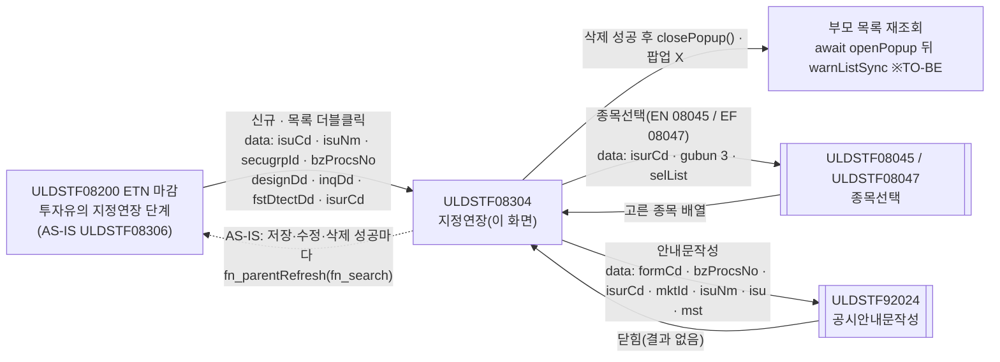
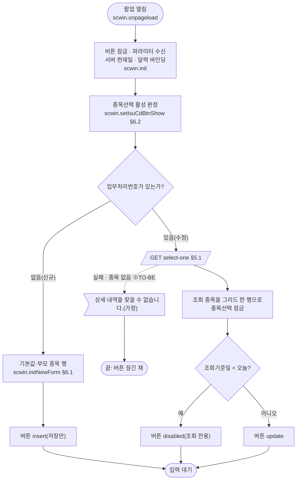
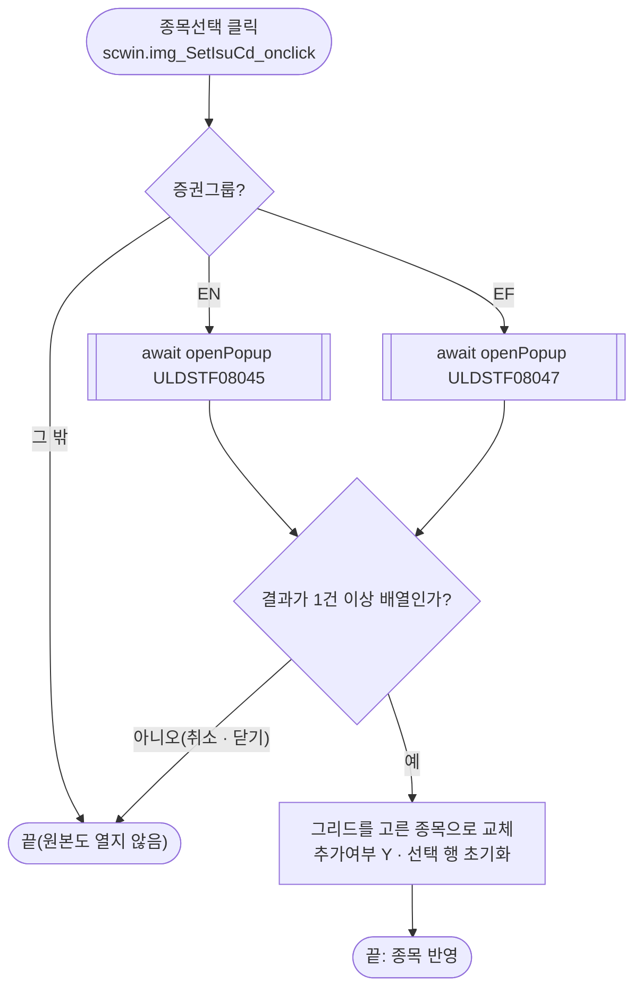
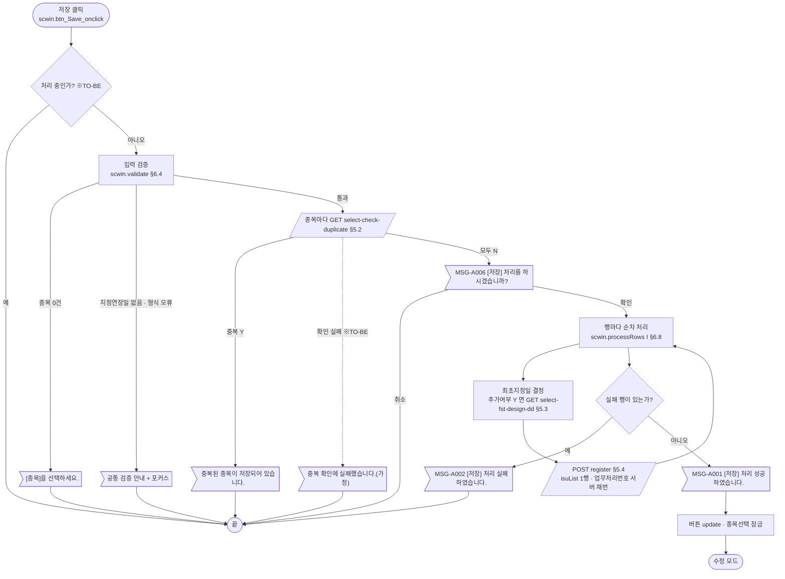
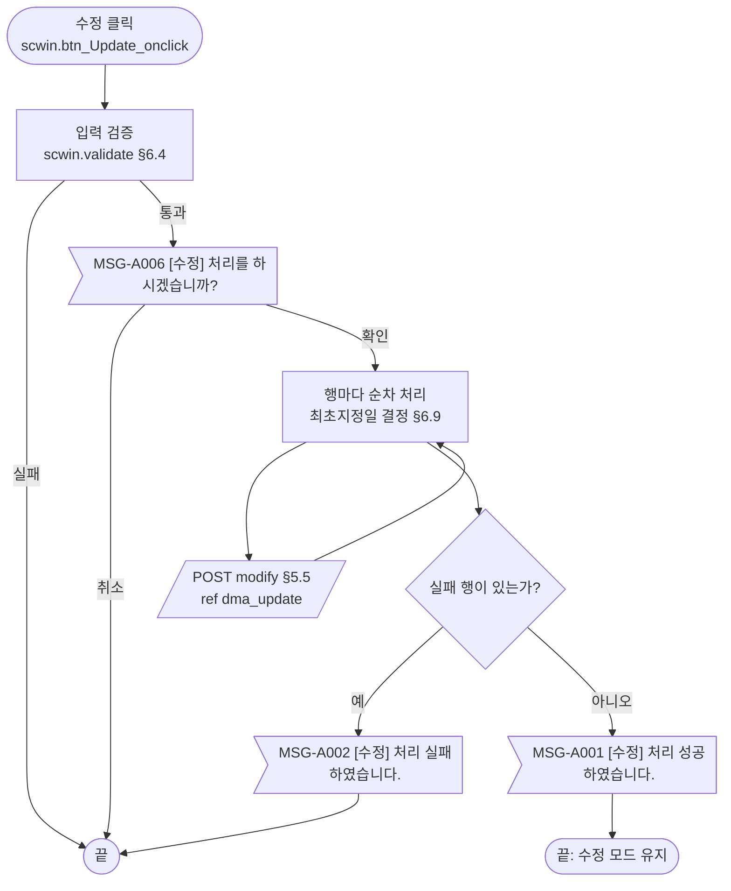
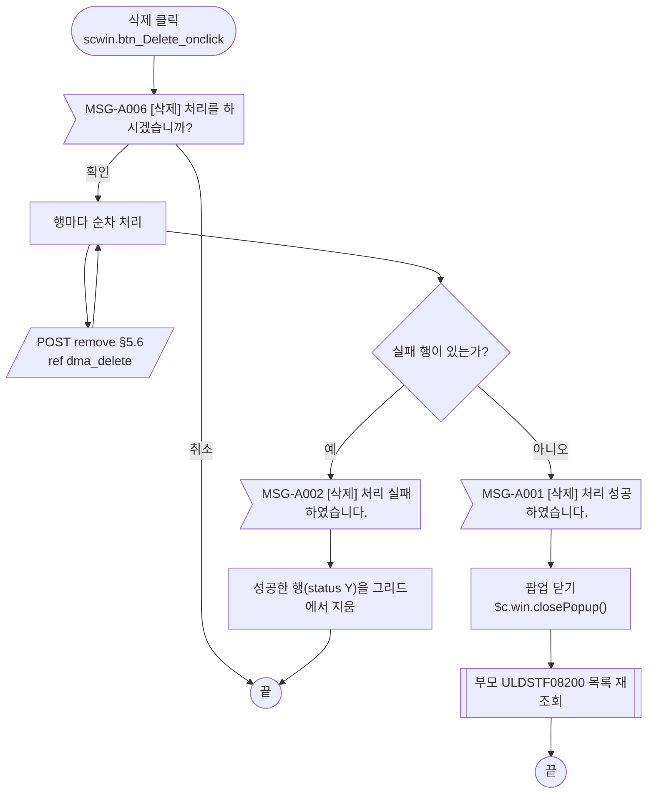
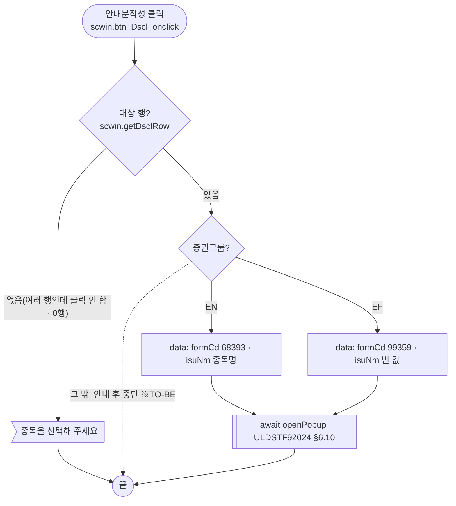
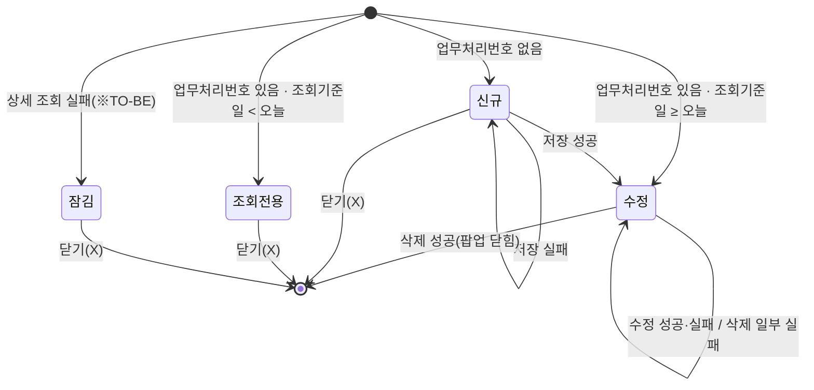

# ULDSTF08304 (팝업)투자유의종목 지정연장 — 업무 분석 및 전환 내역

| 항목 | 내용 |
|---|---|
| AS-IS | `/etn/ULDSTF08304.gfm` (Gauce/X-Internet, 690×510 모달 창 — 부모 ETN 마감 화면이 `CreateDialogFrame` 으로 연다) — 반입 `conversion/conversion-front/ui/completed/ULDSTF08304/ULDSTF08304.gfm` |
| 신규 API 명세 | `conversion/conversion-front/ui/completed/ULDSTF08304/ULDSTF08304_API.md` — 블록 6종(`/api/listing/lstproc/etn/invstwarn/` 아래 `GET select-check-duplicate`·`GET select-fst-design-dd`·`GET select-one`·`POST modify`·`POST register`·`POST remove`). 블록 머리가 **화면ID 범위·목록형**(`[ULDSTF08301~08305]` 5종, `[ULDSTF08304, ULDSTF08305]` 1종)이고 6종 모두 이 화면을 포함하므로 **전부 이 화면의 API** 다(형제 ULDSTF08301~08303·08305 와 같은 명세 파일, 내용 동일). §2.2·§5 는 명세 기준(가이드 §0.3·§5). 게이트 `api_spec_check` 는 이 머리 형식을 읽는다(2026-10-28 도구 보강 — §10 #1) |
| TO-BE | `conversion/conversion-front/ui-tobe/ULDSTF08304.xml` (배포 경로 `/ui/lst/etn/ULDSTF08304.xml` — 가정, §10 #13). **2026-10-28 전환** — 1단계: 캡처 기준 퍼블리싱(contentHeader, 5행 입력 표, 하단 [닫기] 없음, 잡 임시 폴더 `stage1/ULDSTF08304.xml` 에 기준본 보관), 2단계: 이 결과서대로 스크립트 전환. 게이트 결과는 §10 끝 「게이트」 |
| 퍼블리셔 XML | `conversion/publish/상장/상장처리(대내)/ULDSTF08304.xml`(사본 `publish/publish-tobe/…`) — 컴포넌트 id 는 AS-IS 와 같음(`grid_1`·`img_SetIsuCd`·`edt_DesignDd`·`txa_*`·`btn_*`). [종목선택] 을 그리드 오른쪽 칸에 두고, 숨은 열(`BZ_PROCS_NO`·`ISUR_CD`)과 같은 id 두 열을 그대로 옮겼다 → TO-BE 는 **캡처 기준**(§2.1, §10 #14) |
| 화면 캡처 | `ULDSTF08304.png` (빈 입력 상태 — 신규, 그리드 0행, 기본 문구 미표시, 하단 [저장]·[수정]·[삭제]·[안내문작성]·[닫기]) → **TO-BE 는 가이드 §13.2 퍼블리싱본부터 만들었다**. 캡처 하단 [닫기] 버튼은 **(옮기지 않음)** — 팝업 하단 닫기 금지(퍼블리싱 규칙) |
| 이전 전환본 | `conversion/sample-front/ui/ULDSTF08304.xml`(참고만 — 등록·수정 API 가 지정코드를 01 로 고정하던 옛 명세라 저장·수정을 TODO 로 막아 둔 사본. 이번 명세 `register` 는 `etpInvstwarnDesignCd` 를 받으므로 연결함). 결함 수정 이력 `db60a6f8`(종목선택 취소 시 빈 행) 반영 |
| 업무공통 | pcc(`cm/pcc/stf`): `$c.lc.isProcess`, `$c.stf.getMessageParam`. gcc: `$c.data.getParameter`·`$c.date`(`getServerDateTime`·`checkCalendarFormat`)·`$c.validate.validateDataCollect`·`$c.util`(`setButtonState`·`isEmpty`)·`$c.win`(`alert`·`openPopup`·`closePopup`)·`$c.sbm.executeDynamic`·`$c.exception.handleError`. 게이트는 `--pcc stf` 로 돌린다 |
| 작성 | Inswave / 2026-10-28 |

참고 양식: [websquare_gfm_conversion.md](../../../md/websquare_gfm_conversion.md) — 특히 §1.4 업무 프로세스 흐름, §5 「API 명세 적용」, §6.5 getPar/setPar 전환. Gauce 대응은 [gfm_business_analysis_guide.md](../../../md/gfm_business_analysis_guide.md) §5·§6 을 함께 따랐다. 같은 모듈 선례 [ULDSTF05710.md](../completed/ULDSTF05710/ULDSTF05710.md) 의 구성을 따랐다.

---

## 1. 화면 개요

상장 담당자가 **ETN(또는 ETF) 마감 화면의 투자유의종목 마감 탭**에서 「지정연장」 단계의 종목을 골라, 그 종목의 **투자유의종목 지정연장 내역**(지정연장일·지정연장사유·투자유의사항·기타)을 신규 등록하거나, 등록한 건을 수정·삭제하는 팝업이다. 등록한 건으로 공시안내문(지정연장 안내공시)도 작성한다.

1. 부모가 넘긴 **업무처리번호가 없으면 신규**, 있으면 **수정** 모드다. 신규는 표준 문구(사유·투자유의사항·기타 "-")와 부모가 넘긴 지정연장일이 미리 채워진다.
2. 신규는 부모가 넘긴 종목 한 건으로 시작하거나, 부모가 종목을 넘기지 않았으면 [종목선택] 팝업으로 여러 종목을 고른다(고른 종목은 추가여부 `Y`).
3. [저장] 하면 종목마다 같은 기준일에 지정연장이 이미 있는지 확인한 뒤, **종목마다 한 건씩** 등록한다. 성공하면 수정 모드가 된다.
4. 수정 모드는 [수정]·[삭제]·[안내문작성] 이 열린다. 조회기준일이 오늘보다 앞이면 조회 전용(버튼 모두 잠김)이다. 삭제에 모두 성공하면 팝업이 닫힌다.
5. [안내문작성] 은 대상 종목(한 건이면 그 종목, 여러 건이면 그리드에서 클릭한 종목)으로 공시안내문작성(ULDSTF92024)을 연다.

### 1.1 호출 화면 (1본)

- AS-IS 부모는 ETN 투자유의종목 마감 상세 `ULDSTF08306.gfm`(이 리포에 원본 없음). TO-BE 에서는 **ETN 마감 `ULDSTF08200`** 이 투자유의 단계 탭을 합쳤다 — `conversion/sample-front/ui/ULDSTF08200.xml` 의 `scwin.WARN_STEPS` 에 `{ key : "3", name : "지정연장", popup : { id : "ULDSTF08304" } }`, `scwin.openWarnPopup` 이 `"/ui/lst/etn/" + id + ".xml"` 을 800×650 `pageFramePopup` 으로 열고, **닫힌 뒤 `scwin.warnListSync()` 로 다시 조회**한다. conversion-front `ui/ULDSTF08200/` 도 전환 대상(다른 작업)이다.
  - [신규] (`scwin.warnRegist` — AS-IS `img_Regist`): 과거 조회일이면 "과거 조회일자인 경우 조회만 가능합니다." 로 막고, 업무처리번호·종목 없이 연다.
  - 목록 더블클릭 (`scwin.warnOpenDetail` — AS-IS `grd_2~6 OnDblClick`): 행의 업무처리번호(없으면 "")·종목으로 연다.
- 형제 화면 `ULDSTF08301`(최초적출)·`08302`(지정예고)·`08303`(지정)·`08305`(지정해제)가 같은 API 를 지정코드(`etpInvstwarnDesignCd` 01~05)만 바꿔 쓴다(명세 `register` 주석).

### 1.2 호출 규약 (부모 → 이 화면) / 반환 규약

AS-IS 는 `gform onload` 에서 `frame.Provider("../").fn_GetPar(arrPar)` 로 **부모 함수를 불러 배열 9칸을 받는다**. TO-BE 는 부모가 아래 키의 객체를 `openPopup` 세 번째 인자 `data` 로 넘기고, 이 화면은 `$c.data.getParameter()` 로 받는다([가이드 §6.5](../../../md/websquare_gfm_conversion.md)). 키 이름은 sample-front 부모 `ULDSTF08200` 의 `scwin.getWarnParam` 과 같다.

| AS-IS `arrPar[i]` (전역) | TO-BE 키 | 의미 | 빈 값일 때 / 분기 |
|---|---|---|---|
| `[0]` `Isu_cd` | `isuCd` | 부모 목록에서 고른 종목코드 | 신규인데 값이 있으면 그 종목을 그리드 한 행으로 두고 [종목선택] 을 잠근다 |
| `[1]` `Isu_nm` | `isuNm` | 종목명 | 위 행의 종목명 |
| `[2]` `Secugrp_id` | `secugrpId` | 증권그룹ID `EN`(ETN)/`EF`(ETF) | 종목선택 팝업(08045/08047)·공시 서식(68393/99359) 분기, 명세 요청 `secugrpId` |
| `[3]` `Mkt_id` | (받지 않음) | 시장ID | 원본에서 대입만 하고 쓰지 않음(§8 #10). 부모는 `fr_MktId` 로 넘긴다 |
| `[4]` `fr_bz_procs_no` | `bzProcsNo` | 업무처리번호 | **비면 신규**, 있으면 상세 조회(수정) |
| `[5]` `design_dd` | `designDd` | 지정연장일 기본값(부모 마감일의 다음 영업일) | 신규 기본값. 비면 빈 칸(원본 그대로) |
| `[6]` `Inq_dd` | `inqDd` | 조회기준일 | 중복 확인·저장의 `basDd`. 오늘보다 앞이면 조회 전용 |
| `[7]` `fst_dtect_dd` | `fstDtectDd` | 최초적출일 | 추가여부가 `Y` 가 아닌 종목의 최초지정일(§6.9) |
| `[8]` `Isur_cd` | `isurCd` | 발행기관코드 | 부모 종목 행의 발행기관 |

- **반환**: 없음. 원본은 삭제 성공 때만 `frame.CloseFrame()` 하고, 저장·수정·삭제 성공마다 부모의 `fn_search` 를 이름으로 부른다(`fn_parentRefresh`). TO-BE 는 `$c.win.closePopup()`(인자 없음)으로 닫기만 하고, 부모가 `await openPopup` 뒤 다시 조회한다(§8 #16).

### 1.3 이 화면이 여는 하위 팝업

| 팝업 | AS-IS 호출 (getPar/setPar) | 넘기는 `data` (TO-BE) | 받는 결과 (`closePopup`) / 취소 판정 |
|---|---|---|---|
| `ULDSTF08045` ETN 종목선택 / `ULDSTF08047` ETF 종목선택 (520×440) | `img_SetIsuCd onclick` → `fn_GetPar = fn_GetParIsu`(`arrPar[0] = ""`, `arrPar[1] = "3"` 상장전체, `CopyDataSet(dts_Isu_Temp, param_dts)`), `fn_SetPar = fn_SetParIsu` → EN `fn_PopFindEtnCode()` / EF `fn_PopFindEtfCode(Secugrp_id)` (`CreateDialogFrame("DLG_ETN_CODE", "../etn/ULDSTF08045.gfm", "종목선택", 10, 10, 520, 440, "window")`, ETF 는 `ULDSTF08047.gfm`) | `{ isurCd : "", secugrpId, gubun : "3", selList : 그리드 행 목록 }` (`secugrpId` 는 AS-IS `fn_PopFindEtfCode(Secugrp_id)` 인자) — 08045 전환본(`sample-front/ui/stf/lst/common/ULDSTF08045.xml`)은 `isurCd`·`isuCd`·`gubun` 만 받고 `selList` 는 받지 않는다(§10 #6) | **고른 종목 배열**(`dlt_selList.getInsertedJSON()` — `isuCd`·`isuNm`·`isurCd`·`comNm` 등). 취소·닫기(X)는 `{ isCloseButtonClick }` 객체 → **배열이 아니거나 0건이면 취소**(가이드 §6.5, `db60a6f8` 결함 수정과 같음) |
| `ULDSTF92024` 공시안내문작성 (745×825) | `fn_dscl` — `fn_GetPar` 바꿔 끼우기: `arr = [서식코드, 업무처리번호, 발행기관코드, "1", (빈칸), 종목명(EN만)]` + `CopyDataSet(dts_Isu → param_dts_isu)`·`CopyDataSet(dts_Mst → param_dts_mst)` + `param_dts_mst.COM_NM` → `frame.CreateDialogFrame("ULDSTF92024", "/listingcommon/ULDSTF92024.gfm", "공시안내문작성", 중앙, 745, 825, "window")` | `{ formCd : "68393"/"99359", bzProcsNo, isurCd, mktId : "1", isuNm, isu : [대상 행], mst : [상세 + 대상 행 + comNm] }` — §6.10 | 없음(원본 `fn_SetPar` 는 빈 함수). `await` 뒤 처리 없음. 92024 전환본이 아직 부모 `scwin.getPar` 를 부르므로 호환용 `scwin.getPar` 를 임시로 둔다(§10 #7) |

### 1.4 업무 프로세스 흐름

흐름은 AS-IS 동작을 기준으로 그렸다. 점선과 `※TO-BE` 는 전환본에서 바뀌는 곳이다(근거는 §8).

| # | 업무 | 시작 (사용자 동작·진입 조건) | 끝 (결과) | 주요 함수 | 관련 절 |
|---|---|---|---|---|---|
| 1 | 진입·로딩 | 부모가 팝업을 엶 (`bzProcsNo` 유무) | 신규: 기본값·[저장] / 수정: 상세·[수정]·[삭제]·[안내문작성] / 조회 전용 | `scwin.onpageload` → `scwin.init` → `scwin.initNewForm` / `scwin.selectOne` | §3, §5.1, §6.1·§6.2 |
| 2 | 종목선택 | [종목선택] (신규 + 부모 종목 없음) | 고른 종목 목록으로 그리드 교체(추가여부 Y) | `scwin.img_SetIsuCd_onclick` → `scwin.openIsuPopup` | §6.3 |
| 3 | 신규 저장 | [저장] (신규) | 저장 성공 안내 → 수정 모드 | `scwin.save` → `validate` → `checkDuplicate` → `processRows("I")` → `sendRow` | §5.2~§5.4, §6.4·§6.5·§6.8 |
| 4 | 수정 | [수정] (수정 모드) | 수정 성공 안내 | `scwin.update` → `validate` → `processRows("U")` | §5.3·§5.5, §6.6 |
| 5 | 삭제 | [삭제] (수정 모드) | 삭제 성공 안내 → 팝업 닫힘 → 부모 재조회 / 일부 실패면 성공 행만 그리드에서 지움 | `scwin.remove` → `processRows("D")` | §5.6, §6.7 |
| 6 | 공시안내문작성 | [안내문작성] (수정 모드) | 92024 팝업에서 작성·전송 후 닫힘 | `scwin.writeDscl` | §6.10 |

#### 화면 간 흐름



AS-IS 는 하위 팝업마다 `fn_GetPar`/`fn_SetPar` 를 바꿔 끼우고 모달 창이 닫힐 때까지 기다리는 방식이었다. TO-BE 는 하위 팝업 화살표가 모두 `await $c.win.openPopup(url, options, data)` 이고, 결과를 돌려받는 팝업은 종목선택 하나다(가이드 §6.5).

#### 업무 1: 진입·로딩



| # | 단계 | 주체 | 내용 | 분기 · 메시지 | 관련 절 |
|---|---|---|---|---|---|
| 0 | 버튼 잠금 | 화면 | `$c.util.setButtonState("grpBtnBox", "disabled", scwin.BTN_MAP)` (※TO-BE — 조회 실패·예외 때 XML 기본값이 남지 않게) | — | §3 |
| 1 | 파라미터 수신 | 화면 | `$c.data.getParameter()` → `isuCd`·`isuNm`·`secugrpId`·`bzProcsNo`·`designDd`·`inqDd`·`fstDtectDd`·`isurCd` | — | §1.2 |
| 2 | 서버 현재일 | 화면 | AS-IS `fn_todayDate` — `queryId=…invstwarn_today_dd.select` **동기** 조회 → TO-BE `$c.date.getServerDateTime("yyyyMMdd")` (명세에 없음, §10 #8) | — | §5.8 |
| 3 | 달력 바인딩 | 화면 | `$c.date.checkCalendarFormat(edt_DesignDd, "yyyyMMdd")` (규칙 37) | — | §3 |
| 4 | 종목선택 활성 | 화면 | 업무처리번호 또는 부모 종목이 있으면 잠금 | — | §6.2 |
| 5a | 신규 | 화면 | AS-IS `fn_onload` else — `dts_Mst`·`dts_Isu`·`dts_Isu_Temp` 헤더 조회(`gauceSystemierAdaptor`) + `OnLoadCompleted` 들 → TO-BE 통신 없이 `scwin.initNewForm()` | 버튼 `insert` | §6.1, §5.7 |
| 5b | 수정 | 서버 | AS-IS `fn_onload` — `dts_Mst` 조회(`searchEtnInvstwarn`, `GUBUN_CD=04`) → `OnLoadCompleted` 수정 분기 → TO-BE `GET select-one` | `Inq_dd < today_dd` 면 `disabled`, 아니면 `update` | §5.1 |

#### 업무 2: 종목선택



| # | 단계 | 주체 | 내용 | 분기 · 메시지 | 관련 절 |
|---|---|---|---|---|---|
| 1 | 팝업 | 사용자 | 증권그룹별 종목선택 팝업 — `data { isurCd : "", gubun : "3", selList }` | 버튼이 잠겨 있으면(업무처리번호·부모 종목 있음) 누를 수 없음 | §6.3 |
| 2 | 반영 | 화면 | AS-IS `fn_SetParIsu` — `CopyDataSet(param_dts, dts_Isu_Temp)` 후 모든 행 `ADD_YN = "Y"` | 취소면 그리드 그대로(※TO-BE — 빈 행 방지) | §6.3 |

#### 업무 3: 신규 저장



| # | 단계 | 주체 | 내용 | 분기 · 메시지 | 관련 절 |
|---|---|---|---|---|---|
| 1 | 입력 검증 | 화면 | 그리드 행 수 → `validateDataCollect`(지정연장일 필수·날짜) | "[종목]을 선택하세요." + [종목선택] 포커스 / 공통 안내 | §6.4 |
| 2 | 중복 확인 | 서버 | AS-IS `fn_duplicate_check` — 행마다 **동기** `checkDuplicate`(`ETP_INVSTWARN_DESIGN_CD=04`·`ISU_CD`·`BAS_DD=Inq_dd`) | `DUP_CHK == "Y"` 면 안내 후 중단. **확인 전에 저장 확인을 묻지 않는다**(원본 순서) | §5.2 |
| 3 | 저장 확인 | 사용자 | `await $c.lc.isProcess("I")` | 취소면 끝 | §6.5 |
| 4 | 채번 | (서버) | AS-IS 행마다 `fn_getNewBzProcNo(dts_BzProcsNo)` + 14자리 검사(`MSG-0010`) → TO-BE **채번하지 않음** — 명세 `register` 는 `bzProcsNo` 를 비우면 서버 채번 | — | §5.4, §10 #5 |
| 5 | 행 전문 | 화면 | `dma_detail` 에 행의 종목·발행기관·추가여부, 지정코드 `04`, 기준일, 최초지정일(§6.9) | 추가여부 Y 면 최초지정일 조회(없으면 지정연장일) | §6.9, §5.3 |
| 6 | 등록 | 서버 | `POST register` — `{ ...dma_register, isuList : [행 1개] }` | `success` + `completeYn === "Y"`(가정) 면 성공 — 응답 `bzProcsNoList` 첫 값을 그 행에 기록 | §5.4 |
| 7 | 결과 | 화면 | 모든 행이 끝난 뒤 한 번 안내(※TO-BE — 원본은 마지막 행 결과로 안내, §8 #4) | 성공: 한 행이면 그 행 선택, `update` 버튼, 종목선택 잠금. 부모 재조회는 닫힌 뒤(§8 #16) | §6.8 |

#### 업무 4: 수정



- 원본은 "변경된 내용 없음" 확인·중복 확인을 하지 않는다 — 그대로 유지.

#### 업무 5: 삭제



| # | 단계 | 주체 | 내용 | 분기 · 메시지 | 관련 절 |
|---|---|---|---|---|---|
| 1 | 삭제 확인 | 사용자 | `await $c.lc.isProcess("D")` — 입력 검증 없음 | 취소면 끝 | §6.7 |
| 2 | 삭제 | 서버 | 행마다 `POST remove`(`ref : "dma_delete"` — 업무처리번호·증권그룹·종목·발행기관) | 원본 `buttonSet.setDeleteStatus()` 는 TO-BE `trJob` 으로 대체 | §5.6 |
| 3 | 결과 | 화면 | 모두 성공 → `MSG-A001` → 닫기 / 일부 실패 → `MSG-A002` + 성공 행 제거(원본 `OnFail` 의 D 분기) | — | §6.8 |

#### 업무 6: 공시안내문작성



- 확인 메시지 없이 바로 연다(원본에 `fn_isProcess('DSCL')` 없음).

#### 화면 모드 상태 전이



| 상태 | 활성 버튼 | [종목선택] | 근거 |
|---|---|---|---|
| 신규 | 저장 | 부모 종목이 없을 때만 | `insert` · `fn_SetIsuCdBtnShow` |
| 수정 | 수정 · 삭제 · 안내문작성 | 잠김 | `update`(저장만 제외) |
| 조회전용 | 없음(닫기만) | 잠김 | `disabled` (원본 `setDisableStatus`) |
| 잠김 | 없음 | 잠김 | 로딩 첫 단계의 `disabled` 가 남음(※TO-BE, §8 #12) |

---

## 2. 화면 구성 및 데이터 정의

### 2.1 화면 구성

캡처(`ULDSTF08304.png`) 기준 위→아래, 왼→오른. TO-BE id 는 AS-IS·퍼블리셔 XML 과 같은 id 를 쓰고(그리드만 `grid_1` → `grd_isuTemp`, 가이드 §0.1 접두), 바인딩은 §2.2 의 camelCase 키다. 필수 표시(*)는 AS-IS 의 별도 라벨(`label_10`·`lbl_1`)을 TO-BE 라벨의 `class="req"` 로 옮긴다.

| 영역 | AS-IS 요소 | TO-BE 컴포넌트 (바인딩) | 설명 |
|---|---|---|---|
| (외곽) | `panel_3` (`PanelToGroupBox`, 배경 `#d9e9fc`) | `panel_3` (`tblbox` 그룹 — `validateDataCollect` 범위) | `PanelToGroupBox` **(옮기지 않음)** — 퍼블리싱 마크업이 대신함. 인라인 배경색 금지(규칙 40) |
| 1. 지정연장종목 (*) | `label_10`(*) · `label_isu` · `img_SetIsuCd`(이미지 「종목선택」, 라벨 아래) | `label_isu`(req) · `img_SetIsuCd` (`xf:trigger btn_cm`, `ev:onclick`) — th 안 `flex flex_column` 으로 라벨 아래에 둔다(캡처) | 종목선택(§6.3). 잠금은 원본 이미지 교체(`btn_isu_select_d.gif`)·`disabled` → `setDisabled` |
| 종목 목록 | `grid_1` (`mxgrid`, `dts_Isu_Temp`) — 열 `BZ_PROCS_NO`(숨김) · `ISU_CD` 종목코드 · `ISUR_CD` 발행회사(숨김) · `ISU_NM` 종목명 · `BZ_PROCS_NO` 업무처리번호 | `grd_isuTemp` (`gridView`, `dataList="data:dlt_isuTemp"`, `ev:oncellclick`) — 열 `isuCd`·`isuNm`·`bzProcsNo` (머리글 `h_` 접두) | 숨은 두 열 **(옮기지 않음)** — 값은 dataList 에만 둔다. 같은 id 두 열(원본 `BZ_PROCS_NO` 중복)은 하나로. 행 배경 교대색(`bgcolor decode`)·선택색은 엔진 기본 스타일(규칙 40). 읽기 전용(원본 `edit="none"`) |
| 2. 지정연장일 (*) | `lbl_1`(*) · `label_designdd` · `edt_DesignDd` (`mxmaskedit`, 날짜) + `img_DesignDd`(달력) | `label_designdd`(req) · `edt_DesignDd` (`w2:inputCalendar`, `dma_detail.designDd`) | `img_DesignDd` **(옮기지 않음)** — inputCalendar 내장 달력(`popUpCalendar2` 대체) |
| 3. 지정연장사유 | `label_rsn` · `txa_Rsn` (`mxtextarea`, 높이 40) | `txa_Rsn` (`xf:textarea`, `dma_detail.designRsn`) | 검증 없음 |
| 4. 투자유의사항 | `label_4` · `txa_InvstwarnContn` (높이 100) | `txa_InvstwarnContn` (`dma_detail.etpInvstwarnContn`) | 검증 없음 |
| 5. 기타 | `label_5` · `txa_Remk` (높이 100) | `txa_Remk` (`dma_detail.misc`) | 검증 없음 |
| 하단 버튼 | `btn_Save` · `btn_Update` · `btn_Delete` · `btn_Dscl`(안내문작성) · `btn_Close` (이미지) | `btnbox#grpBtnBox` 의 `rt`: `btn_Dscl`(안내문작성) · `btn_Delete`(삭제, `pt`) · `btn_Update`(수정, `pt`) · `btn_Save`(저장, `pt`) (`xf:trigger`) — 규칙 41: 일반 버튼 → 주요 버튼(삭제·수정·저장) 순. 캡처 순서(저장·수정·삭제·안내문작성)와 다르다 | `btn_Close`(하단 닫기)는 **(옮기지 않음)** — 팝업 하단 닫기 금지, 팝업 창의 닫기(X) 사용. 활성 상태는 `buttonSet` → `$c.util.setButtonState` (§4) |
| (데이터 장식) | `bnd_Invstwarn` (`mxbinder` — `DESIGN_DD`·`DESIGN_RSN`·`ETP_INVSTWARN_CONTN`·`MISC` ↔ `dts_Mst`) | 컴포넌트 `ref="data:dma_detail.*"` | |

- 퍼블리싱 1단계(§13.2)는 캡처 기준으로 새로 만들었다(2026-10-28): 팝업이므로 contentHeader(`pfmContentHeader`) 필수, 입력 표 5행(colgroup 2칸), 하단 닫기 버튼 없음. 퍼블리셔 XML 과 다른 점(§10 #14): [종목선택] 위치(퍼블리셔는 그리드 오른쪽 칸, 캡처는 라벨 아래), 숨은 열 제외, `userData2`·`hierarchy`·`orgid` 잔여 속성 제외.
- 캡처의 업무 상태: 신규 진입인데 기본 문구가 비어 있다(캡처 시점 데이터 차이로 보고 원본 코드대로 기본 문구를 채운다).

### 2.2 데이터 정의

| AS-IS | TO-BE | 종류 | 키(컬럼) | 출처 / 용도 |
|---|---|---|---|---|
| `dts_Mst` (1행, `bnd_Invstwarn` 바인딩 + 저장 전문 `dtsParm1`) | `dma_detail` | dataMap | 명세 `select-one` RESPONSE 원문 14키(아래) | 수정 모드 상세 조회 응답(`target "dma_detail=body"`) + 입력 바인딩 + **행별 전문 작업 영역**(원본 `fn_save_trs` 가 `dts_Mst` 에 행 값을 채우던 것 — §6.9) |
| `dts_Isu_Temp` (그리드) | `dlt_isuTemp` | dataList | `isuCd`·`isuNm`·`isurCd`·`bzProcsNo`·`addYn`·`comNm`·`status` | **화면 전용**(명세에 없음) — 지정연장 종목 목록. `status` 는 원본 `STATUS`(Y 성공 / N 실패) |
| `dts_Isu` (1행 복사본) | (없음 — 행 JSON 으로 대체) | — | — | 원본 `fn_copy_dts` 가 처리 행을 옮겨 두던 1행 사본. TO-BE 는 `dlt_isuTemp.getRowJSON(row)` 를 바로 쓴다. 공시안내문의 `param_dts_isu` 는 `data.isu`(§6.10) |
| (요청 전용) | `dma_update` | dataMap | 명세 `modify` REQUEST 원문 12키 | 수정 요청(`ref : "dma_update"`) |
| (요청 전용) | `dma_register` + `dlt_register` | dataMap + dataList | 명세 `register` REQUEST 원문 8키 + 4열 | 등록 요청(`requestData { ...dma_register.getJSON(), isuList : dlt_register.getAllJSON() }`) |
| (요청 전용) | `dma_delete` | dataMap | 명세 `remove` REQUEST 원문 4키 | 삭제 요청(`ref : "dma_delete"`) |
| (응답 전용) | `dma_resultSave` | dataMap | 명세 `register`·`modify` RESPONSE 원문 — `completeYn`·`bzProcsNo`·`bzProcsNoList` | 등록·수정·삭제 결과 판정(§5.4~5.6). `remove` 명세는 RESPONSE 가 없어 같은 dataMap 을 쓴다(§10 #4) |
| `dts_DUP_CHK` | (삭제) | — | — | 중복 확인 응답은 명세대로 `result.responseJSON.dupChk` 를 바로 읽는다(§5.2) |
| `dts_Instwarn` | (삭제) | — | — | 최초지정일자 응답은 `result.responseJSON.fstDesignDd` 를 바로 읽는다(§5.3) |
| `dts_BzProcsNo` | (삭제) | — | — | 화면 채번 없음 — 등록 서버 채번(§5.4) |
| `dts_Cand` | (삭제) | — | — | 오늘 일자 조회 → `$c.date.getServerDateTime`(§5.8) |
| `trs` (`mxlogicaltr`) | (삭제) | — | — | 저장·수정·삭제 통신 → `executeDynamic` |

**명세 원문 (가이드 §5 「API 명세 적용」 — id·name·dataType 그대로 옮겼다. 정의 본문은 TO-BE `<w2:dataCollection>` 참고)**

| dataMap/dataList | 키 (명세 원문 순서) |
|---|---|
| `dma_detail` (select-one 응답) | `bzProcsNo` 업무처리번호 · `isuCd` 종목코드 · `isuNm` 종목명 · `isurCd` 발행기관코드 · `etpInvstwarnDesignCd` ETP투자유의지정코드 · `fstDesignDd` 최초지정일자 · `designDd` 지정일자 · `designRsn` 지정사유 · `etpInvstwarnContn` ETP투자유의사항 · `misc` 기타 · `addYn` 추가여부 · `basDd` 기준일자 · `lstEmpNm` 최종처리자명 · `dscYn` 공시여부 (모두 text) |
| `dma_update` (modify 요청) | `bzProcsNo` · `secugrpId` · `isuCd` · `isurCd` · `designDd` · `designRsn` · `etpInvstwarnContn` · `misc` · `addYn` · `basDd` · `etpInvstwarnDesignCd` · `fstDesignDd` (모두 text) |
| `dma_register` (register 요청) | `secugrpId` · `etpInvstwarnDesignCd`("비우면 01") · `designDd` · `designRsn` · `etpInvstwarnContn` · `misc` · `basDd` · `fstDesignDd` (모두 text) |
| `dlt_register` (register `isuList`) | `bzProcsNo`("비우면 서버 채번") · `isuCd` · `isurCd` · `addYn` (모두 text) |
| `dma_delete` (remove 요청) | `bzProcsNo` · `secugrpId` · `isuCd` · `isurCd` (모두 text) |
| `dma_resultSave` (register·modify 응답) | `completeYn` 처리 완료 여부 · `bzProcsNo` 업무처리번호(수정·삭제) · `bzProcsNoList` 등록한 업무처리번호 목록(등록, isuList 순서) (모두 text) |
| (select-check-duplicate 응답) | `responseJSON.dupChk` (`"Y"` 중복) — dataMap 정의 없음, 명세 처리 예시 그대로 |
| (select-fst-design-dd 응답) | `responseJSON.fstDesignDd` — dataMap 정의 없음, 명세 처리 예시 그대로 |

**AS-IS 대문자 컬럼 → 명세 키**: `BZ_PROCS_NO`→`bzProcsNo`, `ISU_CD`→`isuCd`, `ISU_NM`→`isuNm`, `ISUR_CD`→`isurCd`, `ETP_INVSTWARN_DESIGN_CD`→`etpInvstwarnDesignCd`, `FST_DESIGN_DD`→`fstDesignDd`, `DESIGN_DD`→`designDd`, `DESIGN_RSN`→`designRsn`, `ETP_INVSTWARN_CONTN`→`etpInvstwarnContn`, `MISC`→`misc`, `ADD_YN`→`addYn`, `BAS_DD`→`basDd`, `DUP_CHK`→`dupChk`, `COM_NM`→`comNm`(화면 전용), `STATUS`→`status`(화면 전용), `TODAY_DD`→(서버 현재일).
**명세에 없는 AS-IS 값** (→ §10 #3): 요청 `SCREN_ID`·`SCREN_PROCES_TP_CD`·`GUBUN_CD`·`TRS_IDX`·`DIV_IDX`·`COUNT`·`LIST_BZ_TP_CD`(716/750 — 명세는 `secugrpId` 로 서버가 정함), 응답 `COM_NM`(발행기관명 — 공시안내문 `param_dts_mst.COM_NM`). **명세에만 있는 키**: `lstEmpNm`·`dscYn`(화면에서 쓰지 않음 — 원본도 공시여부로 버튼을 가르지 않음).

---

## 3. 로딩 (`gform onload` → `scwin.onpageload` → `scwin.init`)

원본 `gform onload` 순서(조회는 모두 **동기**):

1. **파라미터 수신** — `frame.Provider("../").fn_GetPar(arrPar)` 로 배열 9칸(§1.2). TO-BE: `const param = $c.data.getParameter() ?? {};` → `scwin.isuCd`·`isuNm`·`secugrpId`·`bzProcsNo`·`designDd`·`inqDd`·`fstDtectDd`·`isurCd` (`String()` 정규화). `Mkt_id` 는 받지 않는다(§8 #10).
2. **버튼 매핑** — AS-IS `buttonSet.setSaveInfo(btn_Save, fn_save)`·`setUpdateInfo(btn_Update, fn_update)`·`setDeleteInfo(btn_Delete, fn_delete)`·`setDsclInfo(btn_Dscl, fn_dscl)`. TO-BE 는 `ev:onclick` 바인딩(§4) + 역할 매핑 `scwin.BTN_MAP = { save : "btn_Save", modify : "btn_Update", "delete" : "btn_Delete", guide : "btn_Dscl" }`. 로딩 시작에 `$c.util.setButtonState("grpBtnBox", "disabled", scwin.BTN_MAP)` 로 잠가 둔다(※TO-BE).
3. **종목선택 활성** — `fn_SetIsuCdBtnShow()` → §6.2 `scwin.setIsuCdBtnShow()`.
4. **오늘 일자** — `fn_todayDate()`(동기 조회) → `scwin.curDate = $c.date.getServerDateTime("yyyyMMdd")` (§5.8).
5. **모드 분기** — `fn_onload()`:
   - 업무처리번호 없음(신규): §6.1 `scwin.initNewForm()` → 버튼 `insert`. 원본은 헤더 조회 세 번(`dts_Mst`·`dts_Isu`·`dts_Isu_Temp`)이 각각 `OnLoadCompleted` 를 일으켜 기본값·부모 종목 행을 채웠다(§5.7).
   - 업무처리번호 있음(수정): `await scwin.selectOne()` (§5.1) — 후처리에서 그리드 행·종목선택 잠금·버튼 상태.
6. `PanelToGroupBox(panel_3)` — 삭제(퍼블리싱 마크업).
7. **달력 검사 바인딩** (TO-BE 신설, 전환 규칙 37 — `scwin.init` 에서 1회)

   | 대상 | 적용 |
   |---|---|
   | 단일 달력 `edt_DesignDd`(지정연장일) | `$c.date.checkCalendarFormat(edt_DesignDd, "yyyyMMdd");` |
   | 기간 쌍 | 없음 |

   달력에 마크업 `ev:onviewchange` 업무 로직은 없다.
8. **조회 Enter 키**(규칙 22) — 해당 없음(조회 영역 `schbox`·`tbl_search` 와 조회 버튼이 없는 입력 팝업).

```javascript
scwin.onpageload = async function () {
    try {
        await scwin.init();
    } catch (ex) {
        await $c.exception.handleError(ex, { context : "ULDSTF08304.onpageload" });
    }
};

scwin.init = async function () {
    // 1) 로딩 동안 버튼 잠금
    $c.util.setButtonState("grpBtnBox", "disabled", scwin.BTN_MAP);
    // 2) 파라미터 수신 — $c.data.getParameter() (§1.2)
    // 3) 서버 현재일 — scwin.curDate = $c.date.getServerDateTime("yyyyMMdd")
    // 4) 달력 검사 바인딩(규칙 37)
    $c.date.checkCalendarFormat(edt_DesignDd, "yyyyMMdd");
    // 5) 종목선택 활성
    scwin.setIsuCdBtnShow();
    // 6) 모드 분기
    if ($c.util.isEmpty(scwin.bzProcsNo)) {
        scwin.initNewForm();
        $c.util.setButtonState("grpBtnBox", "insert", scwin.BTN_MAP);
        return;
    }
    await scwin.selectOne();
};
```

실제 순서: 버튼 잠금 → 파라미터 수신 → 서버 현재일 → 달력 바인딩 → 종목선택 활성 → 모드 분기. `onpageload` 는 `scwin.init()` 만 호출하고 로딩 로직은 `scwin.init` 하나에 둔다(`init_*` 분리 없음, 2026-10-26). 다시 부르는 로직(신규 기본값·종목선택 활성)은 5구역 함수다. 수정 모드의 버튼 상태는 상세 조회 결과(그리드 행)가 있어야 정할 수 있어 `selectOne` 후처리에 둔다 — `await` 근거.

---

## 4. 컴포넌트 이벤트

| TO-BE 컴포넌트 | 이벤트 | TO-BE 핸들러 | 동작 (호출 함수) | AS-IS |
|---|---|---|---|---|
| `img_SetIsuCd` (종목선택) | `onclick` | `scwin.img_SetIsuCd_onclick` | `scwin.openIsuPopup()` — §6.3 | `img_SetIsuCd onclick` (`fn_GetPar = fn_GetParIsu`, `fn_SetPar = fn_SetParIsu`, EN `fn_PopFindEtnCode()` / EF `fn_PopFindEtfCode(Secugrp_id)`) |
| `grd_isuTemp` (종목 목록) | `oncellclick` | `scwin.grd_isuTemp_oncellclick` | `scwin.selectedRow = rowIndex` — 공시안내문작성 대상 행(§6.10) | `grid_1 OnClick(row, colid)` → `fn_SelectGridRow(row)` (`selectedGrdNum`·`Isur_cd`·`fr_bz_procs_no` 갱신) |
| `btn_Save` (저장) | `onclick` | `scwin.btn_Save_onclick` | `scwin.save()` — §6.5 | `buttonSet.setSaveInfo(btn_Save, fn_save)` |
| `btn_Update` (수정) | `onclick` | `scwin.btn_Update_onclick` | `scwin.update()` — §6.6 | `fn_update` |
| `btn_Delete` (삭제) | `onclick` | `scwin.btn_Delete_onclick` | `scwin.remove()` — §6.7 | `fn_delete` |
| `btn_Dscl` (안내문작성) | `onclick` | `scwin.btn_Dscl_onclick` | `scwin.writeDscl()` — §6.10 | `buttonSet.setDsclInfo(btn_Dscl, fn_dscl)` |
| `btn_Close` (닫기) | — | **(옮기지 않음)** | 팝업 창의 닫기(X)를 쓴다(팝업 하단 닫기 금지) | `frame.CloseFrame()` |
| `img_DesignDd` (달력) | `onclick` | **(옮기지 않음)** | inputCalendar 내장 달력 + init 바인딩(§3 단계 7) | `popUpCalendar2(edt_DesignDd)` |
| `dts_Mst` | `OnLoadCompleted(rowcount)` | (핸들러 없음) | 신규: §6.1 `scwin.initNewForm` / 수정: `scwin.selectOne` 후처리(그리드 행 · `setIsuCdBtnShow` · 버튼 상태) | 신규: `setInsertStatus` + `AddRow` + 기본값 / 수정: `CopyDataSet(dts_Mst → dts_Isu_Temp·dts_Isu)` + `fn_SetIsuCdBtnShow` + `Inq_dd < today_dd` 버튼 |
| `dts_Isu` | `OnLoadCompleted(rowcount)` | (핸들러 없음) | 삭제 — `dts_Isu` 자체를 없앰(§8 #3) | `dts_Isu.AddRow()` |
| `dts_Isu_Temp` | `OnLoadCompleted(rowcount)` | (핸들러 없음) | §6.1 `scwin.initNewForm` 의 부모 종목 행 | 신규 + `Isu_cd` 있으면 행 추가 |
| `dts_Mst`·`dts_Isu`·`dts_Isu_Temp`·`dts_Cand`·`dts_Instwarn` | `OnLoadError()` | (핸들러 없음) | 공통 오류 핸들러(`executeDynamic` 실패 처리) | `alert_error(dts_…)` |
| `trs` | `OnSuccess()` / `OnFail()` | (핸들러 없음) | `scwin.sendRow` 의 `await` 뒤 행 결과 + `scwin.processRows` 의 마지막 안내(§6.8) | 행 `STATUS`·`BZ_PROCS_NO` 기록, 마지막 행에서 `fn_alertMsg('S'/'F')` + `fn_parentRefresh` + 모드 전환/닫기/성공 행 삭제 |
| `gform` | `onload` | `scwin.onpageload` | §3 | 파라미터 수신 · `buttonSet` · `fn_SetIsuCdBtnShow` · `fn_todayDate` · `fn_onload` · `PanelToGroupBox` |

모든 버튼 핸들러는 try/catch + `$c.exception.handleError`(규칙 26)이고, 위임 대상이 async 라 `await` 한다(Thin Event — 로직은 5구역). 그리드 셀 클릭은 동기 핸들러(catch 에서 `handleError` 를 await 없이 — 규칙 26 동기 진입점 규약).

**버튼 상태 (모드 × 버튼)** — 원본 `buttonSet` 은 이미지 버튼의 활성을 바꾼다.

| 상태 | 저장 | 수정 | 삭제 | 안내문작성 | 종목선택 | TO-BE |
|---|---|---|---|---|---|---|
| 로딩 중 · 상세 조회 실패 | | | | | (판정값) | `setButtonState("grpBtnBox", "disabled", BTN_MAP)` |
| 신규 | O | | | | 부모 종목 없을 때 O | `insert` |
| 수정 (조회기준일 ≥ 오늘) | | O | O | O | | `update` |
| 조회전용 (조회기준일 < 오늘) | | | | | | `disabled` (원본 `setDisableStatus`) |
| 저장 성공 후 | | O | O | O | | `update` + `setIsuCdBtnShow` (원본 `buttonSet.status == "I"` 분기) |

- 닫기는 `BTN_MAP` 에 넣지 않는다(팝업 X 버튼). `insert` 상태의 활성 목록은 `["new", "save"]` — 이 화면에 `new` 버튼이 없어 [저장]만 켜진다.
- 원본 이미지 교체(`btn_isu_select.gif` ↔ `btn_isu_select_d.gif`)는 `setDisabled` 로 대체한다.

---

## 5. 서버 통신

공통: AS-IS 는 URL 에 `SCREN_ID=ULDSTF05344.gfm`(원본 값 그대로 — 다른 화면 ID, §8 #10)·`SCREN_PROCES_TP_CD`(01 조회 / 02 입력 / 03 수정 / 04 삭제)를 붙이고, 저장 `trs.Action` 은 `fn_encodeNSession` 으로 세션 정보를 붙인다. 신규 API 명세에는 이 파라미터가 없으므로 **TO-BE 는 넘기지 않는다**(화면 이력·세션은 서버 처리 전제 — §10 #3). 모든 통신은 응답을 쓰기 전에 `skipped` 를 확인한다. `action` 은 명세 경로 **전체 리터럴**(규칙 38), `$c.sbm.getContextPath()` 는 붙이지 않는다(규칙 39). 통신 함수는 4구역이다. 그리드에 `target` 하는 통신이 없어 `gridview` 옵션은 쓰지 않는다(규칙 44 해당 없음).

| # | 용도 | AS-IS | TO-BE |
|---|---|---|---|
| 5.1 | 상세 조회 (수정 진입) | `fn_onload` — `/etn/EtnMktAct.do?SCREN_ID=…&SCREN_PROCES_TP_CD=01&method=searchEtnInvstwarn&DIV_IDX=DIV_IDX_ETN_INVSTWARN_MST&TRS_IDX=TRS_IDX_SELECT&SECUGRP_ID=&GUBUN_CD=04&BZ_PROCS_NO=` → `dts_Mst` (동기) | `GET /api/listing/lstproc/etn/invstwarn/select-one` (`secugrpId`·`bzProcsNo`) → `dma_detail` |
| 5.2 | 종목 중복 확인 | `fn_duplicate_check` — 행마다 `/etn/EtnMktAct.do?method=checkDuplicate&inputMessageId=ETN_INVSTWARNISU_DUK_INOUT&ETP_INVSTWARN_DESIGN_CD=04&ISU_CD=&BAS_DD=` → `dts_DUP_CHK` (동기) | `GET /api/listing/lstproc/etn/invstwarn/select-check-duplicate` (`etpInvstwarnDesignCd`·`basDd`·`isuCd`) — 행마다 |
| 5.3 | 최초지정일자 조회 | `fn_Instwarn_fstdd` — `/listingCommon.do?method=listGeneral&outputMessageId=ETN_INVSTWARNISU_MST_INOUT&service=…ListingCommonApp&queryId=lds.stf.lstproc.invstwarnisu.isu_fst_design_dd.select&{P}param01=종목코드` → `dts_Instwarn` (동기) | `GET /api/listing/lstproc/etn/invstwarn/select-fst-design-dd` (`isuCd`) |
| 5.4 | 신규 등록 | `fn_save` → 행마다 `fn_getNewBzProcNo` + `fn_save_trs` — `trs.Action = fn_encodeNSession("/etn/EtnMktAct.do?method=saveEtnInvstwarn&SCREN_ID=…&SCREN_PROCES_TP_CD=02")`, `KeyValue "JSP(I: dtsParm1= dts_Mst)"`, `Parameters TRS_IDX=INSERT, BZ_PROCS_NO, COUNT=1, LIST_BZ_TP_CD=716/750, DIV_IDX[0]` | `POST /api/listing/lstproc/etn/invstwarn/register` — 행마다 `isuList` 1행 |
| 5.5 | 수정 | `fn_update` → 행마다 같은 `trs`, `TRS_IDX_UPDATE`, `SCREN_PROCES_TP_CD=03` | `POST /api/listing/lstproc/etn/invstwarn/modify` (`ref : "dma_update"`) — 행마다 |
| 5.6 | 삭제 | `fn_delete` → 행마다 같은 `trs`, `TRS_IDX_DELETE`, `SCREN_PROCES_TP_CD=04` (`dts_Mst` 전체 전송) | `POST /api/listing/lstproc/etn/invstwarn/remove` (`ref : "dma_delete"`) — 행마다 |
| 5.7 | 빈 전문 헤더 (신규) | `fn_onload` else — `dts_Mst`·`dts_Isu`·`dts_Isu_Temp.DataID = "/gauceSystemierAdaptor.do?method=getGauceDataHeader&messageId=ETN_INVSTWARNISU_MST_INOUT"` + `reset()` | **통신 없음** — dataMap/dataList 정의가 헤더를 대신함(§6.1) |
| 5.8 | 오늘 일자 | `fn_todayDate` — `/listingCommon.do?method=listGeneral&outputMessageId=ETN_INVSTWARN_DATE_OUT&service=…&queryId=lds.stf.etn.lstproc.invstwarn_today_dd.select` → `dts_Cand.TODAY_DD` (동기) | **통신 없음** — `$c.date.getServerDateTime("yyyyMMdd")` (명세에 없음, §10 #8) |

#### API 명세 대응 (`ULDSTF08304_API.md`, 블록 6종 — 모두 이 화면 포함)

| # | 명세 블록 (머리 화면ID) | method · 경로 | 요청 (명세) | 응답 (명세) | AS-IS 대응 (명세 AS-IS 줄) | TO-BE 함수 |
|---|---|---|---|---|---|---|
| 1 | [ULDSTF08301~08305] 중복체크 | `GET …/select-check-duplicate` | `requestData { etpInvstwarnDesignCd, basDd, isuCd }` | `result.responseJSON.dupChk === "Y"` | `fn_duplicate_check` | `scwin.checkDuplicate` |
| 2 | [ULDSTF08304, ULDSTF08305] 최초지정일자 조회 | `GET …/select-fst-design-dd` | `requestData { isuCd }` | `result.responseJSON.fstDesignDd` | `fn_Instwarn_fstdd` | `scwin.selectFstDesignDd` |
| 3 | [ULDSTF08301~08305] 상세 조회 | `GET …/select-one` | `target "dma_detail=body"`, `requestData { secugrpId, bzProcsNo }` | `dma_detail` (14키) | "업무처리번호 기준 상세(입력폼 채움) 조회. AS-IS fn_onload" | `scwin.selectOne` |
| 4 | [ULDSTF08301~08305] 수정 | `POST …/modify` | `dma_update` (12키), `{ ref : "dma_update", target : "dma_resultSave=body" }` | `dma_resultSave` (3키) | `fn_update` | `scwin.sendRow("U")` |
| 4(중복 번호) | [ULDSTF08301~08305] 등록 | `POST …/register` | `dma_register` (8키) + `dlt_register` (4열), `{ target : "dma_resultSave=body" }`, `requestData { ...dma_register.getJSON(), isuList : dlt_register.getAllJSON() }` | (명세에 RESPONSE 절 없음 — `target` 이 `dma_resultSave`) | `fn_save (fn_duplicate_check + 종목별 saveEtnInvstwarn)` | `scwin.sendRow("I")` |
| 5 | [ULDSTF08301~08305] 삭제 | `POST …/remove` | `dma_delete` (4키), `{ ref : "dma_delete", target : "dma_resultSave=body" }` | (명세에 RESPONSE 절 없음) | `fn_delete` | `scwin.sendRow("D")` |

(`…` = `/api/listing/lstproc/etn/invstwarn`)

명세에 없는 AS-IS 통신: 채번(`fn_getNewBzProcNo`) → 명세 `register` 서버 채번으로 대체, 헤더 조회(`gauceSystemierAdaptor`, §5.7) → 통신 없앰, 오늘 일자(§5.8) → gcc 서버 시각.

#### 명세 ↔ AS-IS 차이 (→ §10)

| # | 차이 | 처리 | §10 |
|---|---|---|---|
| 1 | 블록 머리가 범위형 `[ULDSTF08301~08305]`·목록형 `[ULDSTF08304, ULDSTF08305]` — 형제 화면과 공유 | 도구가 두 형식을 읽어 원본 명세로 대조 통과(6종 모두 사용) | #1 |
| 2 | 중복체크·최초지정일자 응답을 `responseJSON` **최상위**(`dupChk`·`fstDesignDd`)에서 읽음 — 다른 블록은 `body` | 명세 그대로 최상위를 읽고 `// TODO:` | #2 |
| 3 | `select-one` 요청에 AS-IS `GUBUN_CD=04` 가 없음, 응답에 발행기관명(`COM_NM`) 없음 | 보내지 않음 / `comNm` 빈 값 | #3·#7 |
| 4 | `register`·`remove` 블록에 RESPONSE 절이 없고 `completeYn` 값 의미가 없음 | `dma_resultSave` + `success` + `completeYn === "Y"`(가정) | #4 |
| 5 | `register` 의 `fstDesignDd` 가 **map 수준 1개**인데 원본은 행(추가여부)마다 최초지정일이 다르다. `bzProcsNo` 를 비우면 서버 채번(원본은 화면 채번) | **행마다 `register` 1회(isuList 1행)** 로 보내 행별 최초지정일을 지킨다. 채번은 서버, 응답 `bzProcsNoList` 첫 값 사용 | #5 |
| 6 | AS-IS `LIST_BZ_TP_CD=716/750`·`TRS_IDX`·`DIV_IDX[0]`·`COUNT=1`·`SCREN_*`·`fn_encodeNSession` 이 요청에 없음 | 보내지 않음. 716/750 은 `secugrpId`(EN/EF)로 서버가 정함(명세 주석) | #3 |
| 7 | 명세 블록 번호 「4.」 가 두 번(수정·등록) | 대응표에 "4(중복 번호)" 로 표시 | #1 |

### 5.1 상세 조회 (`scwin.selectOne`)

| 항목 | 내용 |
|---|---|
| `id` | `sbm_selectOne` |
| `method` / `action` | `get` / `"/api/listing/lstproc/etn/invstwarn/select-one"` *(AS-IS `/etn/EtnMktAct.do?method=searchEtnInvstwarn&GUBUN_CD=04&BZ_PROCS_NO=`)* |
| `ref` / `requestData` | `ref : ""` / `{ secugrpId : scwin.secugrpId, bzProcsNo : scwin.bzProcsNo }` (명세 그대로 — `GUBUN_CD` 없음, §10 #3) |
| `target` | `dma_detail=body` |
| 선행 / 순서 | 로딩(수정 모드)에서만. AS-IS 는 동기 — 뒤의 그리드 행·버튼 상태가 결과에 의존하므로 `await` |
| 후처리 | ① 조회 종목을 `dlt_isuTemp` 한 행으로(원본 `CopyDataSet(dts_Mst, dts_Isu_Temp)` — `isuCd`·`isuNm`·`isurCd`·`bzProcsNo`·`addYn`, `comNm` 빈 값) ② `scwin.bzProcsNo = dma_detail.bzProcsNo`, 선택 행 초기화 ③ §6.2 종목선택 잠금 ④ `scwin.inqDd < scwin.curDate` 면 `disabled`, 아니면 `update` |
| 실패 처리 | `success:false` 이거나 `isuCd` 가 비면 "상세 내역을 찾을 수 없습니다."(가정 문구) 안내 후 버튼을 잠긴 채 둔다(※TO-BE, §8 #12) |
| 중복 실행 | 기본(건너뜀) — `skipped` 면 그대로 끝 |

### 5.2 종목 중복 확인 (`scwin.checkDuplicate`)

| 항목 | 내용 |
|---|---|
| `id` / `method` / `action` | `sbm_checkDuplicate` / `get` / `"/api/listing/lstproc/etn/invstwarn/select-check-duplicate"` *(AS-IS `method=checkDuplicate`)* |
| `requestData` | 행마다 `{ etpInvstwarnDesignCd : "04", basDd : scwin.inqDd, isuCd : 행 종목코드 }` |
| `target` | 없음 — 명세대로 `result.responseJSON.dupChk` 를 읽는다(§10 #2) |
| 선행 / 순서 | 신규 저장의 입력 검증 뒤·저장 확인 **앞**(원본 순서). 행 순서대로 `await`(원본 동기) |
| 후처리 | 하나라도 `"Y"` 면 "중복된 종목이 저장되어 있습니다." 후 `true`(저장 중단). 모두 아니면 `false` |
| 실패 처리 | `success:false` 면 "중복 확인에 실패했습니다."(가정 문구) 후 `true` — 원본은 확인 실패를 중복 아님으로 넘겼다(§8 #6) |
| 중복 실행 | 기본 — `skipped` 면 `true`(저장하지 않음) |

### 5.3 최초지정일자 조회 (`scwin.selectFstDesignDd`)

| 항목 | 내용 |
|---|---|
| `id` / `method` / `action` | `sbm_selectFstDesignDd` / `get` / `"/api/listing/lstproc/etn/invstwarn/select-fst-design-dd"` *(AS-IS `queryId=lds.stf.lstproc.invstwarnisu.isu_fst_design_dd.select`)* |
| `requestData` | `{ isuCd }` |
| `target` | 없음 — 명세대로 `result.responseJSON.fstDesignDd` (§10 #2) |
| 선행 / 순서 | §6.9 `scwin.getFstDesignDd` 안 — 저장·수정에서 **추가여부 Y 인 행만** 전송 직전에(원본 `fn_save_trs` 의 `ADD_YN == "Y"` 분기) |
| 후처리 | 값을 문자열로 돌려준다. 호출부가 비면 지정연장일로 대신한다(원본 `fst_design_dd != ""` 분기) |
| 실패 처리 | `skipped`·`success:false` 면 `""` → 지정연장일로 대신(원본도 조회 실패 시 빈 값 → 지정연장일) |
| 중복 실행 | 기본(건너뜀) |

### 5.4 신규 등록 (`scwin.sendRow("I", row)`)

| 항목 | 내용 |
|---|---|
| `id` / `method` / `action` | `sbm_sendRow` / `post` / `"/api/listing/lstproc/etn/invstwarn/register"`, `mediatype : "application/json"` |
| `requestData` | `{ ...dma_register.getJSON(), isuList : dlt_register.getAllJSON() }` (명세 그대로) — `dma_register` = 증권그룹·지정코드 `04`·지정연장일·사유·투자유의사항·기타·기준일·최초지정일, `dlt_register` = `[{ bzProcsNo : "", isuCd, isurCd, addYn }]` **1행** |
| 전문 준비 | §6.9 `scwin.copyRowToDetail("I", row)` 로 `dma_detail` 에 행 값을 옮긴 뒤 위 두 전문을 만든다 |
| `target` | `dma_resultSave=body` |
| 후처리 | 성공(`success` + `completeYn === "Y"` 가정): `scwin.getRegBzProcsNo()` — `bzProcsNoList` 첫 값(배열·쉼표 문자열 모두), 없으면 `bzProcsNo` — 를 그 행 `bzProcsNo`·`dma_detail.bzProcsNo` 에 기록. 행 `status` Y/N |
| 실패 처리 | 행 `status = "N"`, 번호는 기록하지 않음(§8 #9). 안내는 모든 행 처리 뒤 한 번(§6.8). **통신 오류**(공통 오류 핸들러가 안내 후 예외)는 `try/catch` 로 그 행만 실패로 남기고 다음 행으로 간다 — 원본 `trs OnFail`(`alert_error` 후 계속)과 같게, 삭제 성공 행 제거·최종 안내가 돌도록 |
| 중복 실행 | `scwin.processing` 가드(§8 #11) + 기본(건너뜀) — `skipped` 는 실패로 센다 |

- **한 건씩 보내는 이유**: 명세 `register` 는 `isuList` 로 여러 종목을 한 번에 받지만 최초지정일(`fstDesignDd`)은 map 에 하나뿐이다. 원본은 종목마다 추가여부(`ADD_YN`)로 최초지정일을 따로 정해(조회 값 또는 부모 최초적출일) 종목마다 따로 저장했다. 한 번에 보내면 행별 최초지정일을 잃으므로, 명세 형식을 지키되 `isuList` 를 1행씩 보낸다(§10 #5).
- **채번**: 원본은 행마다 `fn_getNewBzProcNo` 로 화면에서 번호를 받고 14자리가 아니면 `MSG-0010` 후 그 행을 건너뛰었다. 명세 `register` 는 `bzProcsNo` 를 비우면 서버 채번이므로 TO-BE 는 채번 통신·`MSG-0010` 을 두지 않는다.

### 5.5 수정 (`scwin.sendRow("U", row)`)

| 항목 | 내용 |
|---|---|
| `id` / `method` / `action` | `sbm_sendRow` / `post` / `"/api/listing/lstproc/etn/invstwarn/modify"`, `mediatype : "application/json"` |
| `ref` / `requestData` | `ref : "dma_update"` (명세) / 없음 |
| 전문 준비 | `copyRowToDetail("U", row)` 뒤 `dma_update.setJSON(...)` — 행의 업무처리번호·종목·발행기관·추가여부, `secugrpId`, 바인딩된 지정연장일·사유·투자유의사항·기타, 기준일, 지정코드 `04`, 최초지정일(§6.9) |
| `target` | `dma_resultSave=body` |
| 후처리 / 실패 | 행 `status` Y/N. 안내는 §6.8 |
| 중복 실행 | 5.4 와 같음 |

### 5.6 삭제 (`scwin.sendRow("D", row)`)

| 항목 | 내용 |
|---|---|
| `id` / `method` / `action` | `sbm_sendRow` / `post` / `"/api/listing/lstproc/etn/invstwarn/remove"`, `mediatype : "application/json"` |
| `ref` / `requestData` | `ref : "dma_delete"` (명세) — `{ bzProcsNo, secugrpId, isuCd, isurCd }` |
| 전문 준비 | `copyRowToDetail("D", row)` — 최초지정일은 조회하지 않는다(원본은 삭제에도 `fn_Instwarn_fstdd` 를 불렀다, §8 #8) |
| `target` | `dma_resultSave=body` |
| 후처리 / 실패 | 행 `status` Y/N. 모두 성공이면 닫기, 일부 실패면 성공 행 제거(§6.8) |
| 중복 실행 | 5.4 와 같음 |

### 5.7 빈 전문 헤더 — 통신 없앰

- 원본은 Gauce 데이터셋 헤더만 받으려고 `gauceSystemierAdaptor.do?method=getGauceDataHeader&messageId=ETN_INVSTWARNISU_MST_INOUT` 을 세 데이터셋에 부르고, 그 `reset()` 이 일으킨 `OnLoadCompleted` 들에서 기본값·부모 종목 행을 채웠다. TO-BE 는 dataMap/dataList 정의가 키를 갖고 있으므로 §6.1 `scwin.initNewForm()` 이 같은 일을 통신 없이 한다.

### 5.8 오늘 일자 — 통신 없앰

- 원본 `fn_todayDate` 는 `invstwarn_today_dd` 쿼리로 `TODAY_DD` 를 동기 조회해 `today_dd` 에 둔다(수정 모드 조회 전용 판정 `Inq_dd < today_dd` 에만 쓰임). 명세에 이 API 가 없어 `$c.date.getServerDateTime("yyyyMMdd")`(서버 시각)로 대신한다 — 쿼리가 영업일 등 다른 기준이면 §10 #8.

---

## 6. 일반 함수

### 6.1 신규 기본값 (`scwin.initNewForm`) — 원본 `fn_onload` else + `dts_Mst`·`dts_Isu_Temp OnLoadCompleted` 신규 분기

- **파라미터:** 없음 / **Return:** 없음
- **로직:** `dma_detail.setEmptyValue()`, `dlt_isuTemp.removeAll()`, 선택 행 초기화 →
  - `designDd` = 부모 `designDd`(비면 빈 칸 — 원본 `DESIGN_DD = design_dd`)
  - `designRsn` = "투자유의종목 지정단위기간(3매매거래일) 장종료시 실시간 괴리율이⏎규정상 관리의무 비율을 1일 이상 초과에 해당"
  - `etpInvstwarnContn` = "투자유의종목 지정이 연장됨에 따라 지정연장일부터 새로운 투자유의종목 지정단위기간이⏎시작됩니다. … 의무범위의 3배를 이상인 경우⏎매매거래가 정지될 수 있습니다."(원문 그대로 — 끝 공백·"3배를 이상인" 포함)
  - `misc` = "-"
  - 부모 `isuCd` 가 있으면 그리드 한 행 `{ isuCd, isuNm, isurCd, bzProcsNo : "", addYn : "", comNm : "", status : "" }` (원본 `dts_Isu_Temp OnLoadCompleted` — 추가여부를 비워 저장 때 부모 최초적출일을 쓴다)
- 원본 줄바꿈 `\r\n` 은 `\n` 으로 둔다(textarea 값은 브라우저에서 `\n` 으로 정규화됨).

### 6.2 종목선택 활성 (`scwin.setIsuCdBtnShow`) — 원본 `fn_SetIsuCdBtnShow`

- `img_SetIsuCd.setDisabled(!isEmpty(scwin.bzProcsNo) || !isEmpty(scwin.isuCd))` — 업무처리번호(수정·저장 후) 또는 부모 종목이 있으면 잠근다. 원본 이미지 교체는 `setDisabled` 로.
- 부르는 곳: 로딩(§3 단계 5), 상세 조회 후처리(§5.1), 저장 성공 후(§6.8). 원본은 그리드 클릭으로 바뀐 `fr_bz_procs_no` 도 이 판정에 섞였다 — TO-BE 는 화면 상태값 `scwin.bzProcsNo` 만 본다(§8 #9).

### 6.3 종목선택 (`scwin.openIsuPopup`) — 원본 `img_SetIsuCd onclick` + `fn_GetParIsu` + `fn_SetParIsu`

- **파라미터:** 없음 / **Return:** 없음
- **로직:**
  1. 증권그룹이 `EN` 이면 `ULDSTF08045`, `EF` 면 `ULDSTF08047`, 그 밖이면 아무것도 하지 않는다(원본 그대로).
  2. `const result = await $c.win.openPopup(url, { id, popupName : "종목선택", width : 800, height : 650, type : "pageFramePopup" }, { isurCd : "", secugrpId, gubun : "3", selList : dlt_isuTemp.getAllJSON() });` — 경로 `/ui/lst/common/{ID}.xml`·크기는 가정(부모·sample 과 같은 값, AS-IS 520×440 — §10 #6).
  3. **취소 판정**: 결과가 배열이 아니거나 0건이면 끝(취소·X 는 `{ isCloseButtonClick }` 객체 — `isEmpty(result)` 로 판정하지 않음, 가이드 §6.5·함정 8a).
  4. 그리드를 결과로 바꾼다 — 행마다 `{ isuCd, isuNm, isurCd, bzProcsNo : "", addYn : "Y", comNm, status : "" }`(원본 `CopyDataSet(param_dts, dts_Isu_Temp)` + `ADD_YN = "Y"`), 선택 행 초기화.
- 원본은 현재 그리드(`dts_Isu_Temp`)를 팝업에 복사해 기존 선택을 이어서 고치게 했다(`fn_GetParIsu` 의 `CopyDataSet`). 08045 전환본은 넘긴 목록을 받지 않으므로 `selList` 로 넘겨 두고 §10 #6 에 올린다.

### 6.4 입력 검증 (`scwin.validate`) — 원본 `fn_CheckForm`

- **Return:** `Promise<Boolean>`
- **순서 (원본 그대로):**
  1. 그리드 0행 → "[종목]을 선택하세요." + `img_SetIsuCd.focus()`, false. (그리드 행이라 DataMap 공통 검증 대상이 아니다.)
  2. **공통 검증으로 옮길 항목** (`$c.validate.validateDataCollect(panel_3, …)`, 규칙 24 — 실패 시 표준 안내·포커스는 공통이 처리, async 라 `await`):

     | 컴포넌트 | 규칙 | 이름 (메시지용 — 화면 라벨과 같게) |
     |---|---|---|
     | `edt_DesignDd` | 필수, 날짜 형식 | 지정연장일 |

     원본 문구 "[지정연장일]을 입력하세요." 는 공통 문구로 바뀐다(§10 #15).
- **업무 검증**: 없음. 중복 확인(§5.2)은 신규 저장에서만 검증 뒤에 따로 부른다(통신이라 공통 검증으로 옮기지 않음).

### 6.5 저장 (`scwin.save`) — 원본 `fn_save`

- `scwin.processing` 이면 끝(※TO-BE). `trJob = "I"` → `validate()` → `checkDuplicate()`(중복이면 끝) → `await $c.lc.isProcess("I")`(MSG-A006, 취소면 끝) → `processRows("I")`.
- 원본 순서: `fn_CheckForm` → `fn_duplicate_check` → `fn_isProcess('I')` → 행 반복(채번 → `fn_copy_dts` → 14자리 검사 → `fn_save_trs`).

### 6.6 수정 (`scwin.update`) — 원본 `fn_update`

- `processing` 가드 → `trJob = "U"` → `validate()` → `isProcess("U")` → `processRows("U")`. 중복 확인·변경 여부 확인 없음(원본 그대로).

### 6.7 삭제 (`scwin.remove`) — 원본 `fn_delete`

- `processing` 가드 → `trJob = "D"` → `isProcess("D")` → `processRows("D")`. 입력 검증 없음. 원본 `buttonSet.setDeleteStatus()`(OnSuccess 의 닫기 분기용 상태 `D`)는 `trJob` 으로 대체(§8 #18).

### 6.8 행 순차 처리 (`scwin.processRows(trJob)`) — 원본 행 반복 + `trs OnSuccess`/`OnFail`

- **파라미터:** `trJob` (`I`/`U`/`D`) / **Return:** 없음
- **로직:**
  1. 행이 없으면 끝(원본도 안내 없음).
  2. `scwin.processing = true` → 행 `0 … rowCount-1` 마다 `await scwin.sendRow(trJob, i)`, 실패 수를 센다 → `finally` 에서 `processing = false`. (원본 Gauce `trs.Post()` 는 동기라 앞 건이 끝난 뒤 다음 건이 갔다 — `for` + `await` 가 같은 순서를 보장. 1-base → 0-base.)
  3. 실패가 있으면 `MSG-A002 [{처리}] 처리 실패하였습니다.` — 삭제면 성공 행(`status Y`)을 뒤에서부터 지운다(`setBroadcast(false)` … `setBroadcast(true, true)` — 규칙 28). 끝.
  4. 모두 성공이면 `MSG-A001 [{처리}] 처리 성공하였습니다.` — 삭제면 `$c.win.closePopup()` 후 끝.
  5. 저장·수정: 한 행이면 그 행을 선택 행으로(원본 `fn_SelectGridRow(1)`), `scwin.bzProcsNo = 첫 행 업무처리번호`. 저장이면 `update` 버튼 + §6.2 종목선택 잠금(원본 `buttonSet.status == "I"` 분기).
- 원본은 **마지막 행**의 결과로만 안내했다(`trsCnt == trsTotalCnt` 조건이 OnSuccess·OnFail 각각에 있음) → TO-BE 는 전체 결과로 한 번(§8 #4). 부모 재조회(`fn_parentRefresh`)는 팝업이 닫힌 뒤 부모가 한다(§8 #16).

### 6.9 행 전문 (`scwin.copyRowToDetail(trJob, row)` · `scwin.getFstDesignDd(isu)` · `scwin.getRegBzProcsNo()`) — 원본 `fn_copy_dts` + `fn_save_trs` + `fn_Instwarn_fstdd`

- `copyRowToDetail`: 행 JSON(`getRowJSON`)을 `dma_detail` 에 옮긴다 — `bzProcsNo`(신규는 `""` — 서버 채번, 수정·삭제는 행 번호), `isuCd`·`isuNm`·`isurCd`·`addYn`, `etpInvstwarnDesignCd = "04"`, `basDd = scwin.inqDd`. 저장·수정이면 `fstDesignDd = await getFstDesignDd(isu)`. 지정연장일·사유·투자유의사항·기타는 바인딩으로 이미 들어 있다.
- `getFstDesignDd`: 추가여부가 `"Y"` 가 아니면 부모 `fstDtectDd`. `"Y"` 면 §5.3 조회 값, 비면 `dma_detail.designDd`(지정연장일).
- `getRegBzProcsNo`: 등록 응답 `bzProcsNoList` 의 첫 값(배열이면 `[0]`, 문자열이면 쉼표 앞), 없으면 `dma_resultSave.bzProcsNo`(§10 #5).
- 원본 `fn_save_trs` 의 `vScrenProcsTpCD`·`list_bz_tp_cd`(716/750)·`trs.*` 는 명세에 없어 옮기지 않는다(§5 차이 #6).

### 6.10 공시안내문작성 (`scwin.writeDscl` · `getDsclRow` · `getDsclData` · `getPar` · `fillDataList`) — getPar → `openPopup` data + `await`

- **대상 행** (`getDsclRow`): 그리드가 1행이면 그 행, 여러 행이면 클릭한 행(`scwin.selectedRow`), 없으면 -1 → "종목을 선택해 주세요." (원본 `dts_Isu_Temp.CountRow > 1 && selectedGrdNum == 0` 분기. 0행이면 원본은 그대로 열었다 — §8 #13).
- **data** (`getDsclData(row)`):

  | 키 | 값 | AS-IS |
  |---|---|---|
  | `formCd` | EN `"68393"`(상장지수증권 투자유의종목 지정연장 안내공시) / EF `"99359"`(ETF 투자유의종목 지정연장) — 그 밖이면 `null` → "안내문을 작성할 수 없는 증권그룹입니다."(가정, §8 #14) | `arr[0] = discls_form_cd` |
  | `bzProcsNo` | 대상 행 업무처리번호 | `arr[1] = fr_bz_procs_no` |
  | `isurCd` | 대상 행 발행기관코드 | `arr[2] = Isur_cd` |
  | `mktId` | `"1"` | `arr[3] = '1'` |
  | `isuNm` | EN 이면 대상 행 종목명, EF 면 `""` | `arr[5]` (`arr[4]` 는 원본도 비움) |
  | `isu` | `[대상 행 { bzProcsNo, isuCd, isuNm, isurCd, addYn }]` | `CopyDataSet(dts_Isu, param_dts_isu)` |
  | `mst` | `[{ ...dma_detail.getJSON(), ...대상 행, comNm }]` | `CopyDataSet(dts_Mst, param_dts_mst)` + `COM_NM` |

- **열기**: `scwin.dsclRow = row` 후 `await $c.win.openPopup("/ui/listingcommon/ULDSTF92024.xml", { id : "ULDSTF92024", popupName : "공시안내문작성", width : 745, height : 825, type : "pageFramePopup" }, data)` — 경로 가정(05710 과 같은 값), 확인 메시지 없음, 결과 없음.
- **호환용 `scwin.getPar(arr, dltIsu, dltMst)`** — 92024 전환본(`sample-front/ui/ULDSTF92024.xml`)은 아직 `$c.win.getParent()?.scwin.getPar(arr, dlt_Isu, dlt_Mst, …)` 로 부모를 부른다. 그 계약에 맞춰 `getDsclData(scwin.dsclRow)` 로 `arr[0]~[3]`·`arr[5]` 와 `dltIsu`·`dltMst` 를 채운다(`fillDataList` — 빈 dataList 에 `insertColumn` 후 `setJSON`, 05710 과 같은 방식). 92024 수신부가 `$c.data.getParameter()` 로 바뀌면 지운다(가이드 §6.5 예외, §10 #7).

---

## 7. 업무 코드 · 메시지 목록

### 7.1 코드

| 용도 | 값 | 출처 |
|---|---|---|
| ETP투자유의지정코드 | `04` 지정연장 (형제: `01` 최초적출, `02` 지정예고, `03` 지정, `05` 지정해제) | 원본 `etp_Invstwarn_design_cd = "04"`, 명세 `register` 주석 |
| 증권그룹ID | `EN` ETN, `EF` ETF (`SECUGRP_ID_EN`·`SECUGRP_ID_EF`) | 종목선택 팝업·공시 서식 분기, 명세 `secugrpId` |
| 상장업무유형코드 | `716`(EN)·`750`(EF) (`LIST_BZ_TP_CD_716`·`_750`) | 원본 `fn_save_trs` — TO-BE 는 `secugrpId` 로 대체(명세) |
| 공시 서식코드 | EN `68393`, EF `99359` | `fn_dscl` |
| 공시 시장구분 | `"1"` | `fn_dscl` `arr[3]` |
| 종목선택 구분 | `"3"` 상장전체 | `fn_GetParIsu` `arrPar[1]` |
| 추가여부 `ADD_YN` | `Y` = 종목선택 팝업으로 추가한 종목(최초지정일을 조회), 그 밖 = 부모 종목(최초적출일 사용) | `fn_SetParIsu`, `fn_save_trs` |
| 중복 여부 `DUP_CHK` | `Y` 중복 | `fn_duplicate_check` |
| 처리 결과 `STATUS` | `Y` 성공, `N` 실패 | `trs OnSuccess`/`OnFail` |
| 화면처리구분 | `01` 조회, `02` 입력, `03` 수정, `04` 삭제 (`SCREN_PROCS_TP_CD_0x`) | TO-BE 미전송 |
| 처리구분 `TRS_IDX` | `TRS_IDX_SELECT`·`INSERT`·`UPDATE`·`DELETE` | TO-BE 는 API 경로로 대체 |
| 업무처리번호 | 14자리 | 원본 채번 검사(TO-BE 서버 채번) |
| 등록·수정·삭제 성공 값 `completeYn` | `"Y"` (가정, §10 #4) | 명세에 값 없음 |

**TO-BE 1구역 상수·상태값** (05710 과 같은 소제목 「부모 화면에서 넘겨받는 값 / 화면 상태값 / 고정값」):

| 구분 | 이름 | 값 · 용도 |
|---|---|---|
| 고정값 | `scwin.DESIGN_CD` | `"04"` — 지정연장 |
| 고정값 | `scwin.COMPLETE_YN_OK` | `"Y"`(가정) |
| 고정값 | `scwin.DSCL_FORM_CD` | `{ EN : "68393", EF : "99359" }` |
| 고정값 | `scwin.DSCL_MKT_ID` | `"1"` |
| 고정값 | `scwin.BTN_MAP` | `{ save : "btn_Save", modify : "btn_Update", "delete" : "btn_Delete", guide : "btn_Dscl" }` |
| 화면 상태값 | `scwin.trJob` | 처리구분 `I`/`U`/`D` |
| 화면 상태값 | `scwin.curDate` | 서버 현재일 |
| 화면 상태값 | `scwin.selectedRow` | 그리드 클릭 행(-1 = 없음) |
| 화면 상태값 | `scwin.dsclRow` | 공시안내문 대상 행 — 호환용 `getPar` 가 읽음 |
| 화면 상태값 | `scwin.processing` | 저장·수정·삭제 진행 중 |
| 부모 값 | `scwin.isuCd`·`isuNm`·`secugrpId`·`bzProcsNo`·`designDd`·`inqDd`·`fstDtectDd`·`isurCd` | §1.2 |

### 7.2 메시지

| 코드 / 문구 | 등장 위치 | TO-BE |
|---|---|---|
| `MSG-A006` "[^] 처리를 하시겠습니까?" | 저장·수정·삭제 확인 (`fn_isProcess`) | `await $c.lc.isProcess("I"/"U"/"D")` |
| `MSG-A001` / `MSG-A002` (`fn_alertMsg('S'/'F')` — `LastJob` 저장·수정·삭제) | `trs OnSuccess` / `OnFail` | `await $c.win.alert($c.stf.getMessageParam("MSG-A001"/"MSG-A002", 처리명))` — pcc/stf 에 `fn_alertMsg` 없음 |
| `MSG-0010` "업무처리번호생성실패" | 채번 실패 (`fn_save`) | (옮기지 않음) — 서버 채번(§5.4) |
| "[종목]을 선택하세요." | `fn_CheckForm` | 그대로 |
| "[지정연장일]을 입력하세요." | `fn_CheckForm` | 공통 검증 문구(§6.4, §10 #15) |
| "중복된 종목이 저장되어 있습니다." | `fn_duplicate_check` | 그대로 |
| "종목을 선택해 주세요." | `fn_dscl` | 그대로 (0행일 때도 — §8 #13) |
| "상세 내역을 찾을 수 없습니다." / "중복 확인에 실패했습니다." / "안내문을 작성할 수 없는 증권그룹입니다." | (TO-BE 신설) | **가정 문구** — §10 #10 |

---

## 8. 원본 특이사항 · 결함

| # | 원본에서 실제로 일어나는 일 (근거) | 전환본 처리 |
|---|---|---|
| 1 | 팝업이 `frame.Provider("../").fn_GetPar(arrPar)` 로 부모 함수를 이름으로 불러 배열 9칸을 받는다 — 부모 함수 이름·배열 순서가 계약 | 고침 — `openPopup` `data` + `$c.data.getParameter()` (§1.2) |
| 2 | 로딩의 조회 두 건(`fn_todayDate`·`fn_onload`)이 동기이고, `fn_SetIsuCdBtnShow` 가 조회보다 먼저 불린다 | 순서 유지 — 오늘 일자는 서버 시각, 상세 조회는 `await` |
| 3 | 신규 진입에서 `dts_Isu.reset()` 이 `OnLoadCompleted`(→ `AddRow`)를 일으키고 `fn_onload` 가 또 `AddRow` 해 1행 사본이 2행이 된다(`fn_copy_dts` 는 1행만 씀) | 옮기지 않음 — `dts_Isu` 사본 자체를 없애고 행 JSON 을 쓴다 |
| 4 | 다건 처리의 성공·실패 안내가 **마지막 행** 결과로만 정해진다(`OnSuccess`·`OnFail` 각각 `trsCnt == trsTotalCnt` 검사) — 앞 행이 실패해도 마지막이 성공하면 성공 안내 + 모드 전환 | 고침 — 모든 행 처리 뒤 실패가 하나라도 있으면 `MSG-A002`, 없으면 `MSG-A001`(§6.8) |
| 5 | 채번이 14자리가 아니면 그 행은 `MSG-0010` 후 건너뛰고 `trsCnt` 가 늘지 않아 완료 안내가 영영 나오지 않는다 | 옮기지 않음 — 서버 채번(§5.4) |
| 6 | `dts_DUP_CHK` 에 `OnLoadError` 가 없어 중복 확인 조회가 실패하면 `DUP_CHK` 가 빈 값 → 중복 아님으로 저장이 진행된다. `fn_duplicate_check` 안에서 `var url` 을 두 번 선언 | 고침 — `success:false` 면 "중복 확인에 실패했습니다."(가정) 후 저장 중단. `url` 재선언은 옮기지 않음 |
| 7 | `fn_Instwarn_fstdd` 의 `fst_design_dd` 가 미선언 암묵 전역 | 고침 — 지역 상수(§6.9) |
| 8 | 삭제에서도 `fn_save_trs` 가 추가여부 Y 행의 최초지정일을 동기 조회하고 `dts_Mst` 전체를 보낸다 | 고침 — 삭제는 명세 `remove` 4키만 보내고 조회하지 않음 |
| 9 | 신규 저장이 실패해도 채번한 번호가 `fr_bz_procs_no` 에 남아 [종목선택] 잠금·안내문 `arr[1]` 에 쓰인다. 그리드 클릭도 `fr_bz_procs_no` 를 바꾼다 | 고침 — 성공한 행에만 번호 기록, 화면 상태값 `scwin.bzProcsNo` 는 로딩·처리 성공 때만 바꿈 |
| 10 | 쓰지 않는 것: `Mkt_id`(암묵 전역, 대입만), `Isur_nm`(대입만), `vScrenID = "ULDSTF05344.gfm"`(다른 화면 ID), `trsIdx`·`trsCnt`·`trsTotalCnt`·`trsErrCnt`·`list_bz_tp_cd`·`discls_form_cd` 전역 | 옮기지 않음 (`vScrenID` 규칙 1, 카운터는 `for` + `await` 로 대체) |
| 11 | 원본은 동기 처리라 연속 클릭이 막혔다. 비동기 전환본은 행 단위 순차 전송 중에 다시 누르면 같은 종목이 두 번 갈 수 있다 | 고침 — `scwin.processing` 가드 + `executeDynamic` 중복 실행 건너뜀(`skipped` 는 실패로 셈) |
| 12 | 상세 조회가 실패하면 `alert_error` 만 하고 `OnLoadCompleted` 가 없어 버튼이 초기(전부 활성) 그대로 남는다 | 고침 — 로딩 첫 단계에서 버튼을 잠그고, 실패·종목 없음이면 안내(가정 문구) 후 잠긴 채 둔다 |
| 13 | `fn_dscl`: 그리드를 종목선택으로 바꿔도 `selectedGrdNum` 이 남아 범위 밖 행을 가리킬 수 있다. 0행이면 검사 없이 빈 값으로 92024 를 연다. `arr[5]` 를 1행짜리 `dts_Isu` 의 `selectedGrdNum` 행에서 읽어 2번째 이후 행이면 종목명이 빈다. `param_dts_mst` 는 마지막으로 처리한 행의 `dts_Mst` 라 `arr` 의 종목과 다를 수 있다 | 고침 — 그리드를 바꾸면 선택 행 초기화, 0행·미선택은 "종목을 선택해 주세요.", 종목명·`mst` 모두 대상 행 기준(§6.10). 업무 결과가 달라질 수 있어 §10 #7 에서 확인 |
| 14 | `fn_dscl`: 증권그룹이 EN·EF 밖이면 `discls_form_cd` 가 `""`(또는 이전 값)로 92024 를 연다 | 고침 — 안내(가정 문구) 후 중단 |
| 15 | `img_SetIsuCd` 가 `fn_GetPar`·`fn_SetPar` 를 `fn_GetParIsu`·`fn_SetParIsu` 로 바꿔 끼우고 **되돌리지 않는다**(`fn_dscl` 은 `OldGet`·`OldSet` 으로 되돌림) | 고침 — 바꿔 끼우기 제거(`data` 전달) |
| 16 | 저장·수정·삭제 성공마다 팝업이 부모 `fn_search` 를 이름으로 부른다(`fn_parentRefresh`) | 고침 — 부모가 `await openPopup` 뒤 재조회(sample-front 부모 `openWarnPopup` 이 이미 그렇게 함). 모달이라 사용자가 보는 결과는 같음 |
| 17 | 조회 전용 판정 `Inq_dd < today_dd` — 부모가 조회기준일을 넘기지 않으면 빈 문자열이라 늘 조회 전용 | 그대로 유지 |
| 18 | `fn_delete` 가 `buttonSet.setDeleteStatus()` 로 상태를 `D` 로 바꾸고, 일부 실패해도 그대로 둔다 | 옮기지 않음 — 처리구분은 `scwin.trJob`, 실패 뒤 버튼은 `update` 유지 |
| 19 | 느슨한 비교(`==`) — `fr_bz_procs_no != ""`, `Secugrp_id == SECUGRP_ID_EN`, `DUP_CHK == "Y"`, `ADD_YN == "Y"`, `buttonSet.status == "I"` 모두 문자열끼리 | `===` 로 바꿔도 결과 같음(부모 값은 `String()` 정규화) |
| 20 | 행 반복이 1-base(`for (i = 1; i <= CountRow; i++)`) | 0-base(`for (let i = 0; i < getRowCount(); i++)`), 삭제는 뒤에서부터 |
| 21 | 신규 저장에서 중복 확인이 저장 확인(`fn_isProcess`)보다 먼저 통신한다 | 그대로 유지(원본 순서) |

---

## 9. 전환 내역 (AS-IS → TO-BE)

| AS-IS | TO-BE |
|---|---|
| `gform onload` | `scwin.onpageload` → `scwin.init`(버튼 잠금 → 파라미터 → 서버 현재일 → 달력 바인딩 → 종목선택 활성 → 모드 분기) |
| `frame.Provider("../").fn_GetPar(arrPar)` + `arrPar[0]~[8]` | `$c.data.getParameter()` → `scwin.isuCd`·`isuNm`·`secugrpId`·`bzProcsNo`·`designDd`·`inqDd`·`fstDtectDd`·`isurCd` (§1.2) |
| 전역 `Isu_cd`·`Isu_nm`·`Secugrp_id`·`fr_bz_procs_no`·`design_dd`·`Inq_dd`·`fst_dtect_dd`·`Isur_cd`·`today_dd`·`selectedGrdNum` | `scwin.isuCd`·`isuNm`·`secugrpId`·`bzProcsNo`·`designDd`·`inqDd`·`fstDtectDd`·`isurCd`·`curDate`·`selectedRow` |
| `etp_Invstwarn_design_cd = "04"` / `discls_form_cd` | `scwin.DESIGN_CD` / `scwin.DSCL_FORM_CD` |
| `vScrenID`·`list_bz_tp_cd`·`trsIdx`·`trsCnt`·`trsTotalCnt`·`trsErrCnt`·`Mkt_id`·`Isur_nm` | 삭제 (규칙 1, 명세 외, `for` + `await` 로 대체 — §8 #10) |
| `var fn_GetPar, fn_SetPar` + `fn_GetParIsu` / `fn_SetParIsu` + `fn_PopFindEtnCode()` / `fn_PopFindEtfCode()` | `scwin.openIsuPopup` — `await $c.win.openPopup(08045/08047, options, { isurCd, gubun, selList })` → 배열 결과로 그리드 교체(가이드 §6.5) |
| `fn_onload` | `scwin.init` 모드 분기 → `scwin.initNewForm`(신규) / `scwin.selectOne`(수정) |
| `fn_todayDate` (`dts_Cand`) | `$c.date.getServerDateTime("yyyyMMdd")` (§5.8) |
| `dts_Mst`·`dts_Isu`·`dts_Isu_Temp OnLoadCompleted` | `scwin.initNewForm` / `scwin.selectOne` 후처리 |
| `dts_*` · `dts_Cand` · `dts_Instwarn` `OnLoadError` (`alert_error`) | 삭제 — 공통 오류 핸들러 |
| `fn_CheckForm` | `scwin.validate` (+ `validateDataCollect` — 지정연장일) |
| `fn_duplicate_check` (`dts_DUP_CHK`) | `scwin.checkDuplicate` (`GET select-check-duplicate`, 행마다) |
| `fn_Instwarn_fstdd` (`dts_Instwarn`) | `scwin.selectFstDesignDd` (`GET select-fst-design-dd`) + `scwin.getFstDesignDd` |
| `fn_copy_dts(index)` | `scwin.copyRowToDetail(trJob, row)` (행 JSON → `dma_detail`) |
| `fn_save_trs` + `trs.Action/KeyName/KeyValue/Parameters/Post` + `OnSuccess`/`OnFail` | `scwin.sendRow(trJob, row)` — `await $c.sbm.executeDynamic` (register `requestData` / modify `ref dma_update` / remove `ref dma_delete`) + `scwin.processRows(trJob)` 의 결과 안내(규칙 16) |
| `fn_save` / `fn_update` / `fn_delete` | `scwin.save` / `scwin.update` / `scwin.remove` → `scwin.processRows` |
| `fn_getNewBzProcNo(dts_BzProcsNo)` + 14자리 검사 | 삭제 — 명세 `register` 서버 채번, `scwin.getRegBzProcsNo`(응답 번호 추출) |
| `fn_isProcess('I'/'U'/'D')` | `await $c.lc.isProcess(...)` |
| `fn_alertMsg('S'/'F')` | `await $c.win.alert($c.stf.getMessageParam("MSG-A001"/"MSG-A002", 처리명))` |
| `fn_dscl` + `fn_GetPar` 바꿔 끼우기 + `CopyDataSet` + `fn_getModalCenterPos` + `CreateDialogFrame` | `scwin.writeDscl` — `scwin.getDsclRow` + `scwin.getDsclData` → `await $c.win.openPopup(…ULDSTF92024…, options, data)` (규칙 17, 가이드 §6.5). 92024 수신부 변경 전까지 호환용 `scwin.getPar` + `scwin.fillDataList` (§10 #7) |
| `fn_parentRefresh` (`frame.Provider("../").fn_search`) | 삭제 — 부모가 `await openPopup` 뒤 재조회(§8 #16) |
| `fn_SetIsuCdBtnShow` | `scwin.setIsuCdBtnShow` (`setDisabled`) |
| `fn_SelectGridRow(row)` + `grid_1 OnClick` | `scwin.grd_isuTemp_oncellclick` (`scwin.selectedRow`) |
| `buttonSet.set*Info` / `setInsertStatus` / `setUpdateStatus` / `setDisableStatus` / `setDeleteStatus` | `ev:onclick` + `$c.util.setButtonState("grpBtnBox", "insert"/"update"/"disabled", scwin.BTN_MAP)` (`setDeleteStatus` 삭제) |
| `btn_Close onclick` → `frame.CloseFrame()` | 삭제 — 팝업 창의 닫기(X). 삭제 성공 시 닫기는 `$c.win.closePopup()` |
| `img_DesignDd onclick` → `popUpCalendar2(edt_DesignDd)` | 삭제 (inputCalendar 내장) + 달력 init 바인딩(규칙 37) |
| `getObjectValue(edt_DesignDd)` / `txa_*.Text = …` / `dts.NameString(i, "COL")` / `NameValue` | `dma_detail.get/set("col")` / `dlt_isuTemp.getCellData/setCellData` (규칙 29) |
| `alert(...)` | `await $c.win.alert(...)` |
| `#include(...)` 7종, `PanelToGroupBox(panel_3)` | 삭제 (규칙 11) |
| (없음 — 화면 보조) | `scwin.getDsclRow`·`scwin.getDsclData`·`scwin.getPar`(92024 호환 임시)·`scwin.fillDataList`·`scwin.getRegBzProcsNo`·`scwin.getFstDesignDd` |

---

## 10. 남은 작업 (TODO)

1. **명세 블록 번호** — 머리 형식(`~` 범위·`,` 목록)은 `api_spec_check.py` 가 2026-10-28 부터 읽는다(원본 명세로 통과). 명세의 블록 번호 「4.」 중복(수정·등록)만 명세 쪽에서 정리한다(형제 08301~08305 공통).
2. **중복체크·최초지정일자 응답 위치** — 명세 처리 예시가 `result.responseJSON.dupChk`·`result.responseJSON.fstDesignDd`(봉투 **최상위**)를 읽는다. 다른 블록은 `body` 에 담는다(`dma_detail=body`). 명세대로 최상위를 읽고 코드에 `// TODO:` 를 남겼다 — `body.dupChk`·`body.fstDesignDd` 라면 두 곳을 고친다(§5.2·§5.3).
3. **명세에 없는 AS-IS 값** — `select-one` 의 `GUBUN_CD=04`(지정연장 구분), 저장의 `LIST_BZ_TP_CD`(716/750 — 명세 주석상 `secugrpId` 로 서버 결정), `SCREN_ID`·`SCREN_PROCES_TP_CD`·`TRS_IDX`·`DIV_IDX`·`COUNT`·`fn_encodeNSession` 을 보내지 않는다. 같은 업무처리번호로 지정코드만 다른 건이 없다면 `GUBUN_CD` 는 필요 없다 — 서버가 상세를 지정코드로 거르는지 확인(§5.1).
4. **등록·수정·삭제 성공 판정** — 응답 `dma_resultSave.completeYn` 의 성공 값(`"Y"` 가정 — 값이 비어 오면 `success` 만으로 성공 처리, 그 밖의 값은 실패)과, RESPONSE 절이 없는 `register`·`remove` 도 같은 응답인지 확인한다(§5.4~5.6, 코드 `scwin.COMPLETE_YN_OK`).
5. **등록 방식 · 채번** — 명세 `register` 는 `isuList` 다건을 받지만 `fstDesignDd` 가 map 에 하나라 행(추가여부)별 최초지정일을 담을 수 없다 → TO-BE 는 **행마다 `register` 1회(isuList 1행)** 로 보낸다. 서버가 추가여부 Y 종목의 최초지정일을 스스로 정한다면(또는 `isuList` 에 `fstDesignDd` 열을 추가하면) 한 번에 보내도록 바꾼다. 채번은 `bzProcsNo` 를 비워 서버에 맡겼다(원본은 화면 채번 `fn_getNewBzProcNo`). 응답 `bzProcsNoList` 의 형태(배열 / 쉼표 문자열 — 명세 dataType text)를 확인한다 — 지금은 둘 다 받는다(`scwin.getRegBzProcsNo`).
6. **종목선택 팝업** — ① ETN `ULDSTF08045` 의 TO-BE 경로(`/ui/lst/common/ULDSTF08045.xml` — sample-front 전환본 위치는 `sample-front/ui/stf/lst/common/`)·크기(800×650 가정, AS-IS 520×440). ② ETF `ULDSTF08047` 은 전환본이 없다(경로 가정). ③ 원본은 현재 그리드를 팝업에 복사해(`CopyDataSet(dts_Isu_Temp, param_dts)`) 기존 선택을 이어 고치게 했는데 08045 전환본은 `selList` 를 받지 않는다 — 팝업에 받는 코드를 넣을지 결정. ④ 반환 배열의 키(`isuCd`·`isuNm`·`isurCd`·`comNm`) 확인.
7. **공시안내문(ULDSTF92024) 연동** — ① 92024 전환본의 수신부를 `scwin.getPar` 호출에서 `$c.data.getParameter()`(`formCd`·`bzProcsNo`·`isurCd`·`mktId`·`isuNm`·`isu`·`mst`)로 바꾼다(공통 팝업 단위로 다른 호출 화면과 함께). 그 전까지 호환용 `scwin.getPar` 를 둔다. ② 서식 68393/99359 생성이 읽는 컬럼 이름(원본 대문자 `COM_NM` 등 ↔ TO-BE camelCase `comNm`). ③ 수정 모드는 `select-one` 응답에 발행기관명이 없어 `comNm` 이 빈 값이다 — 응답에 `comNm` 추가 필요 여부. ④ 대상 행 기준으로 바꾼 `arr[5]`·`mst`(§8 #13)가 업무에 맞는지. ⑤ 경로 `/ui/listingcommon/ULDSTF92024.xml`(가정).
8. **오늘 일자** — 원본 `invstwarn_today_dd` 쿼리(명세 외)를 서버 시각(`$c.date.getServerDateTime`)으로 대신했다. 쿼리가 영업일 등 다른 기준이면 API 추가가 필요하다(§5.8).
9. **부모(ULDSTF08200) 계약** — 키 이름은 sample-front 부모 `scwin.getWarnParam` 과 같다(`isuCd`·`isuNm`·`secugrpId`·`bzProcsNo`·`designDd`·`inqDd`·`fstDtectDd`·`isurCd`, `fr_MktId` 는 이 화면이 안 씀). conversion-front 의 ULDSTF08200 전환과 맞추고, 부모가 `await openPopup` 뒤 재조회하는지 확인. 부모 주석 "ETN 상세 팝업은 등록/수정 API 연결 전"은 이 전환으로 해소된다.
10. **TO-BE 신설 문구** — "상세 내역을 찾을 수 없습니다."·"중복 확인에 실패했습니다."·"안내문을 작성할 수 없는 증권그룹입니다." 는 가정 문구다(§7.2) — 업무 확정.
11. **저장 일부 실패** — 여러 종목 중 일부만 등록되면 실패 안내 후 신규 모드에 남는다. 다시 [저장] 하면 이미 등록된 종목이 중복 확인에 걸려 저장이 막힌다(원본도 마지막 행이 실패하면 같은 상태). 성공 행을 그리드에서 빼거나 수정 모드로 넘길지 업무 확인.
12. **기본 문구 줄바꿈** — 원본 `\r\n` → TO-BE `\n`. 공시안내문 생성이 줄바꿈 문자를 구분하는지 확인.
13. **TO-BE 배포 경로·창 크기** — `/ui/lst/etn/ULDSTF08304.xml`(sample 부모가 여는 경로, 가정), 부모가 여는 크기 800×650(AS-IS 690×510).
14. **퍼블리셔 XML 과의 차이** — 캡처 기준으로 [종목선택] 을 라벨 아래(th)에 두었다(퍼블리셔는 그리드 오른쪽 `col_fix` 칸). 숨은 열·잔여 속성은 옮기지 않았다. 퍼블리싱 담당 확인.
15. **검증 문구** — 지정연장일 필수는 `validateDataCollect` 공통 문구로 나간다(원본 "[지정연장일]을 입력하세요."). 공통 문구로 둘지 확인.

**게이트 (2026-10-28, `conversion/conversion-front/ui-tobe/ULDSTF08304.xml`)**

| 게이트 | 결과 |
|---|---|
| `publish_gate.py --pcc stf` (1단계 퍼블리싱본) | OK — lint·gate·markup 통과 |
| `gate_screen.py --pcc stf` | GATE: OK |
| `scan_mixed_compare.py` | A 5건(`getRowCount()`·`rowCount`·`length` 의 `=== 0` — 모두 숫자끼리라 회귀 아님) · B 0건 |
| `publish_gate.py --pcc stf --before {1단계 사본} --allow P20` | OK — WARN P22(스크립트)·P24(ref 4·핸들러 7 추가)·허용 P20(함수 28) 모두 §9 의 의도한 변경 |
| `api_spec_check.py` (원본 `ULDSTF08304_API.md`) | API SPEC: OK — 6종 모두 사용, A01~A08 없음 |
| `init_binding_check.py` | INIT BINDING: OK |
| `python -m wsxml_lint` | 1 files, 0 errors, 0 warnings |
