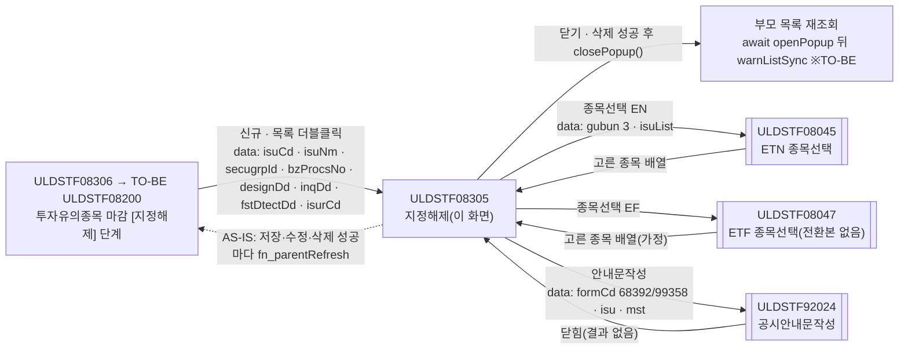
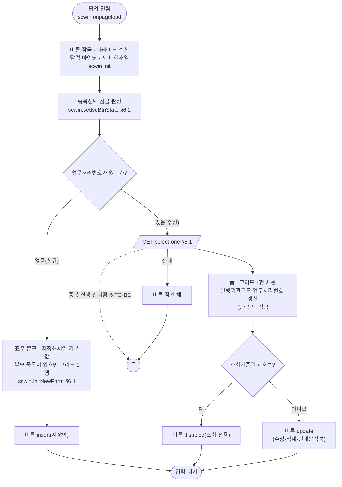
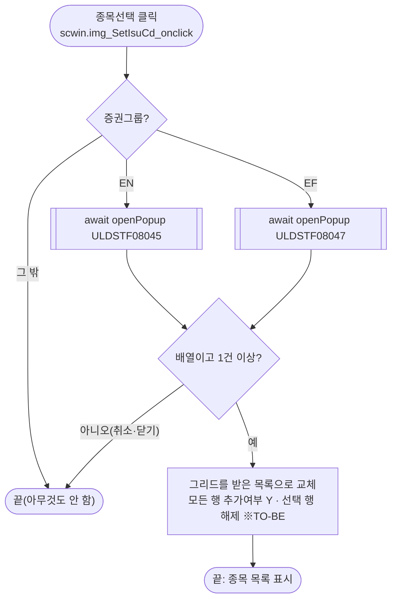
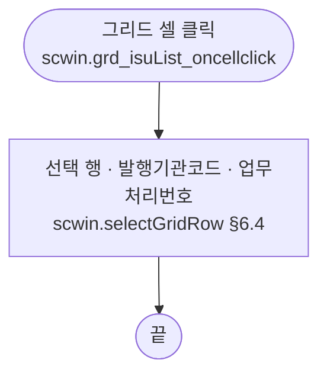
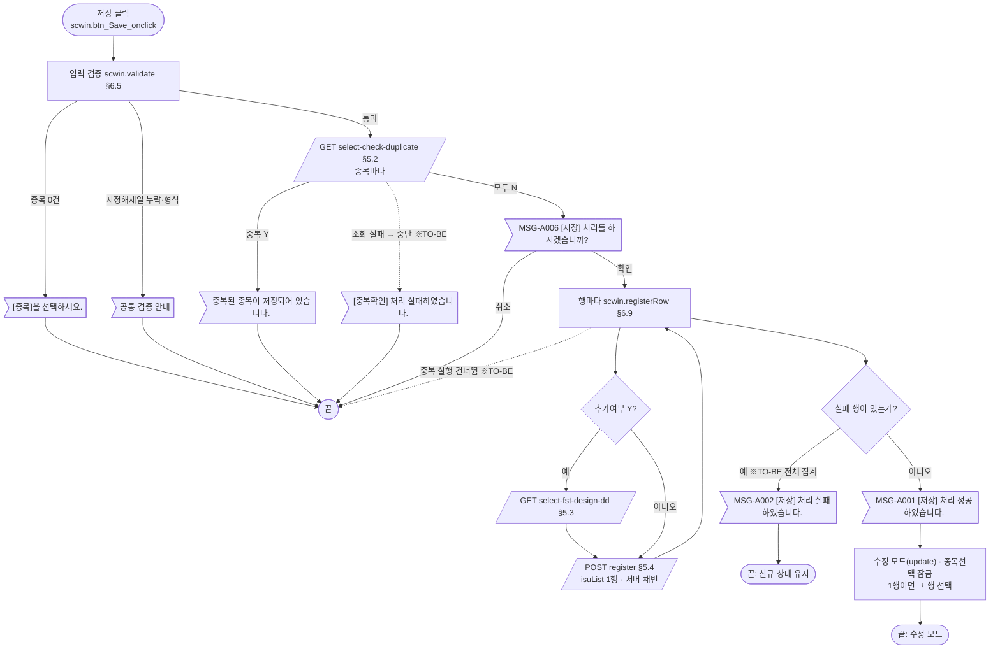
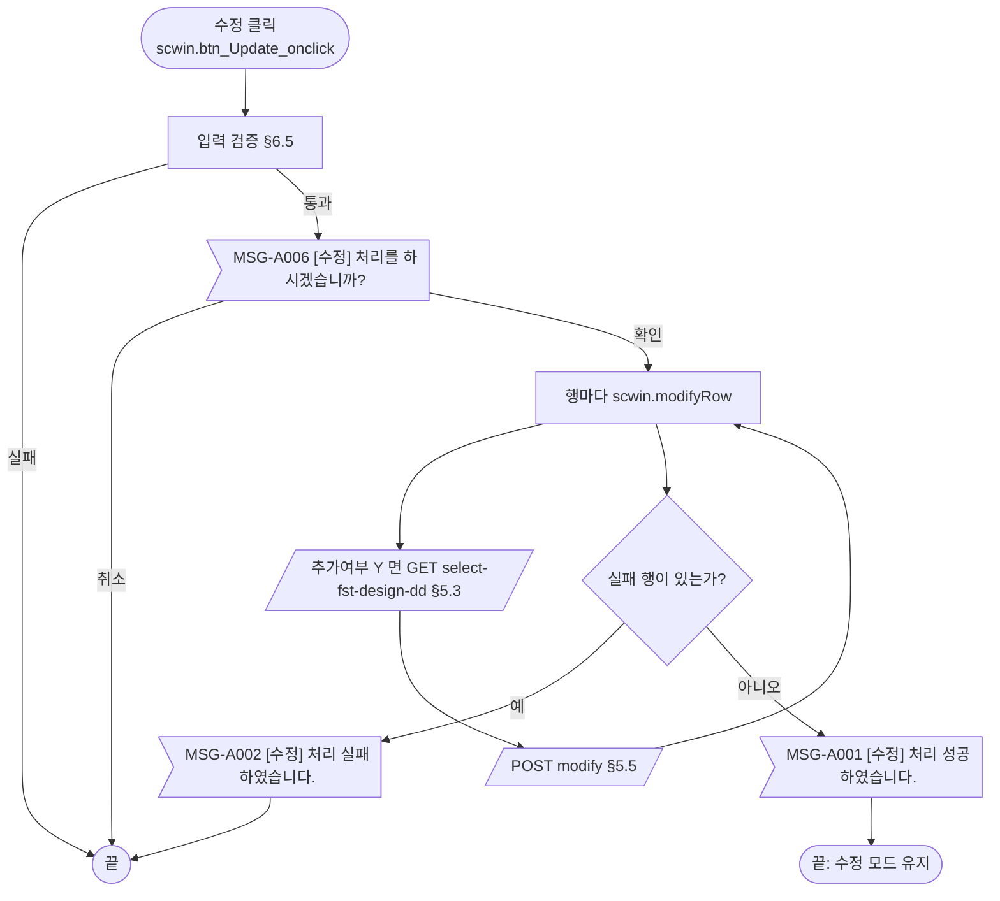
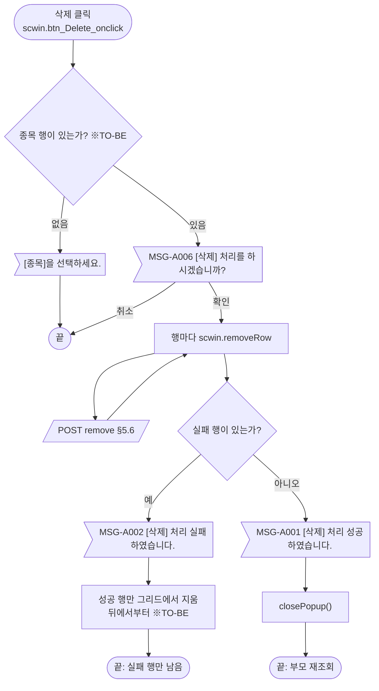
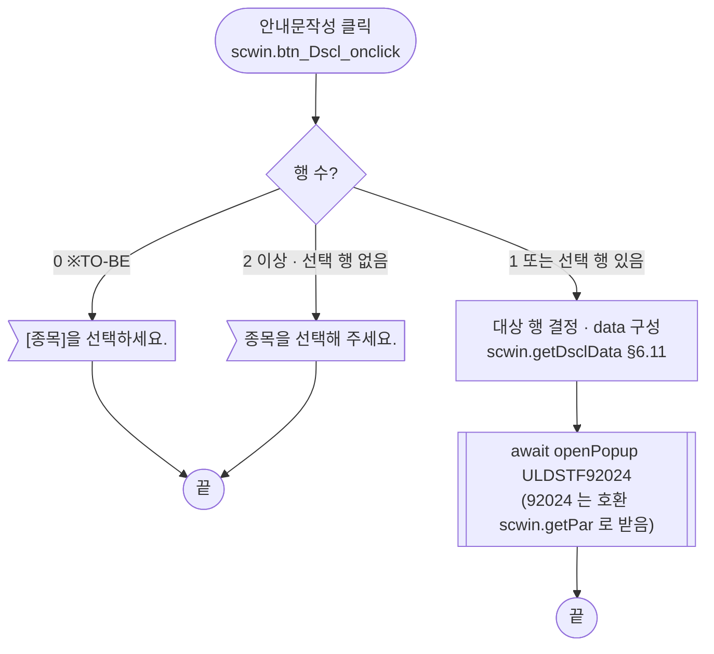
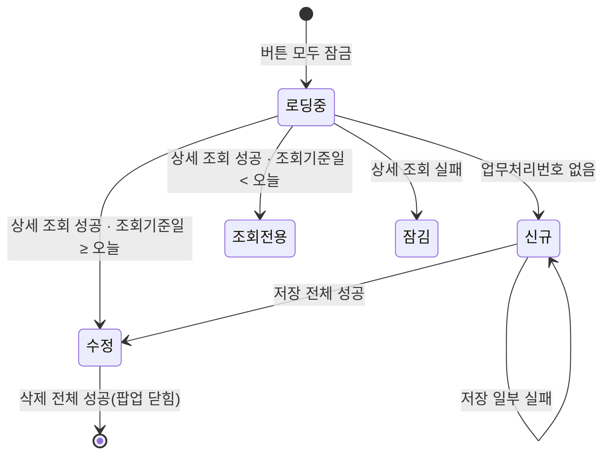

# ULDSTF08305 (팝업)ETN/ETF 투자유의종목 지정해제 — 업무 분석 및 전환 내역

| 항목 | 내용 |
|---|---|
| AS-IS | `/etn/ULDSTF08305.gfm` (Gauce/X-Internet, 690×470 모달 창 — 부모 ULDSTF08306 투자유의종목 마감이 `fn_GetPar` 를 바꿔 끼우고 연다) — 반입 `conversion/conversion-front/ui/completed/ULDSTF08305/ULDSTF08305.gfm`. W-Craft 1차 변환본 xml 은 이 폴더에 없다(퍼블리싱 사본 `conversion/publish/publish-tobe/상장/상장처리(대내)/ULDSTF08305.xml` 의 W-Craft 스크립트만 참고) |
| 신규 API 명세 | `conversion/conversion-front/ui/completed/ULDSTF08305/ULDSTF08305_API.md` — 블록 6종(`/api/listing/lstproc/etn/invstwarn/` 아래 `GET select-check-duplicate`·`GET select-fst-design-dd`·`GET select-one`·`POST modify`·`POST register`·`POST remove`). 블록 머리가 **화면ID 범위·묶음형**(`[ULDSTF08301~08305]` 5종, `[ULDSTF08304, ULDSTF08305]` 1종)이고 6종 모두 이 화면ID 를 포함하므로 **전부 이 화면의 API** 다(형제 ULDSTF08301~08304 와 공유, 같은 내용의 명세 파일). §2.2·§5 는 명세 기준(가이드 §0.3·§5). 게이트 `api_spec_check.py` 는 범위(`~`)·쉼표 머리를 읽으므로 원본 명세 그대로 대조해 통과(6종 모두 사용) |
| TO-BE | `conversion/conversion-front/ui-tobe/ULDSTF08305.xml` (배포 경로 `/ui/lst/etn/ULDSTF08305.xml` — 부모 전환본 `sample-front/ui/ULDSTF08200.xml` 의 `openWarnPopup` 기준 가정, §10 #9). **2026-10-28 전환** — 1단계: 캡처 기준 퍼블리싱(contentHeader, 5행 입력 표, 종목 그리드 3열, 하단 [닫기] 없음), 2단계: 이 결과서대로 스크립트 전환 |
| 퍼블리셔 XML | `conversion/publish/상장/상장처리(대내)/ULDSTF08305.xml` (사본 `publish-tobe/…`) — 1단 표(`panel_3`), 그리드 `grid_1`(숨김 `BZ_PROCS_NO`·`ISUR_CD` 포함 5열), `img_SetIsuCd`·`btn_Save`·`btn_Update`·`btn_Delete`·`btn_Dscl`·`btn_Close` 를 `xf:trigger` 로, 달력 `edt_DesignDd` 를 `w2:inputCalendar` 로 둠(`img_DesignDd` 없음). TO-BE id 는 그리드만 `grd_isuList` 로 바꾸고 나머지는 이 id 를 따른다 |
| 이전 샘플 전환본 | `conversion/sample-front/ui/ULDSTF08305.xml` (2026-09-18, 참고만 — 수정 안 함). 당시는 등록·수정 API 가 지정코드를 01 로 고정해 저장·수정을 TODO 로 막았으나, 이번 명세 `register` 는 `etpInvstwarnDesignCd`(05 지정해제)를 받으므로 저장·수정을 연결했다 |
| 화면 캡처 | `ULDSTF08305.png` (빈 입력 상태 — 신규, 종목 그리드 빈 상태, 지정해제일 빈칸) → **TO-BE 는 가이드 §13.2 퍼블리싱본부터 만들었다**(1단계 사본 `$CLAUDE_JOB_DIR/tmp/stage1/ULDSTF08305.xml`). 캡처 하단 [닫기] 는 **(옮기지 않음)** — 팝업 하단 닫기 금지 |
| 업무공통 | pcc(`cm/pcc/stf`): `$c.lc.isProcess`(MSG-A006 확인)·`$c.stf.getMessageParam`(MSG-A001·A002). gcc: `$c.data.getParameter`·`$c.date`(`getServerDateTime`·`checkCalendarFormat`)·`$c.validate.validateDataCollect`·`$c.util`(`setButtonState`·`isEmpty`)·`$c.win`(`alert`·`openPopup`·`closePopup`)·`$c.sbm.executeDynamic`·`$c.exception.handleError`. AS-IS `fn_getNewBzProcNo`(채번)은 명세 `register` 의 서버 채번으로 대체해 쓰지 않는다. 게이트는 `--pcc stf` 로 돌린다 |
| 작성 | Inswave / 2026-10-28 |

참고 양식: [websquare_gfm_conversion.md](../../../md/websquare_gfm_conversion.md) — 특히 §1.4 업무 프로세스 흐름, §5 「API 명세 적용」, §6.5 getPar/setPar 전환. Gauce 대응은 [gfm_business_analysis_guide.md](../../../md/gfm_business_analysis_guide.md) §5·§6 을 함께 따랐다. 같은 절차의 선례 [ULDSTF05710.md](../completed/ULDSTF05710/ULDSTF05710.md) 의 구성을 따랐다.

---

## 1. 화면 개요

상장 담당자가 **ETN/ETF 투자유의종목 마감 화면**(AS-IS ULDSTF08306, TO-BE 통합본 ULDSTF08200 「투자유의종목 마감」의 [지정해제] 단계)에서 투자유의종목 지정해제 건을 **신규 등록**하거나, 등록한 건을 **수정·삭제**하고, **공시안내문을 작성**하는 팝업이다. 신규는 종목을 여러 개 골라 한 번에 등록할 수 있고(종목마다 한 건씩 등록), 수정·삭제·안내문작성은 한 건 단위다.

1. 부모가 넘긴 업무처리번호가 비면 **신규**, 있으면 **수정**(상세 조회) 모드다. 신규는 지정해제사유·투자유의사항·기타에 표준 문구를 미리 넣는다.
2. 신규에서 부모가 종목을 넘기지 않았으면 [종목선택](ETN ULDSTF08045 / ETF ULDSTF08047)으로 종목을 여러 개 고른다. 부모가 종목을 넘겼으면 그 종목 한 행이 들어가고 [종목선택]은 잠긴다.
3. 지정해제일을 입력해 [저장] 한다. 저장 전에 종목마다 같은 기준일 중복 저장 여부를 확인하고, 저장 확인 후 종목마다 등록한다(최초지정일자는 종목별로 정함).
4. 저장에 성공하면 수정 모드가 되고, 수정·삭제·안내문작성을 할 수 있다. 삭제에 모두 성공하면 팝업을 닫는다. 조회기준일이 오늘보다 앞선 건은 조회만 한다.

### 1.1 호출 화면 (1본)

- AS-IS `ULDSTF08306` 투자유의종목 마감(상세·신규등록) — 단계별 [신규]·목록 더블클릭에서 `fn_GetPar` 를 `fn_GetParNew`/`fn_GetParUpdate` 로 바꿔 끼우고 `CreateDialogFrame` 으로 연다(원본은 이 폴더에 없음, 반입된 다른 전환본 기준).
- TO-BE 부모 `conversion/sample-front/ui/ULDSTF08200.xml`(ETN 마감 — ULDSTF08311 + ULDSTF08306 통합 전환본): `scwin.WARN_STEPS` 의 key `"5"` 지정해제 → `scwin.openWarnPopup(step, scwin.getWarnParam(ctx))` 가 `/ui/lst/etn/ULDSTF08305.xml` 을 `pageFramePopup`(800×650) 으로 열고 `await` 뒤 `scwin.warnListSync()` 로 목록을 다시 조회한다.
- 명세 머리의 형제 화면: ULDSTF08301(최초적출)·08302(지정예고)·08303(지정)·08304(지정연장) — 같은 API 를 `etpInvstwarnDesignCd` 01~05 로 구분해 쓴다. 형제 화면은 다른 담당이 동시에 전환 중이다.

### 1.2 호출 규약 (부모 → 이 화면) / 반환 규약

AS-IS 는 `gform onload` 에서 `frame.Provider("../").fn_GetPar(arrPar)` 로 **부모 함수를 불러 배열을 받는다**(배열 길이로 각 값 유무를 판단).

| AS-IS (`arrPar`) | 전역 | TO-BE 키 (부모 ULDSTF08200 `getWarnParam`) | 의미 | 빈 값일 때 / 분기 |
|---|---|---|---|---|
| `arr[0]` | `Isu_cd` | `isuCd` | 부모 목록 종목코드 | 신규인데 값이 있으면 그리드 한 행 + 종목선택 잠금(§6.1·§6.2) |
| `arr[1]` | `Isu_nm` | `isuNm` | 종목명 | — |
| `arr[2]` | `Secugrp_id` | `secugrpId` | 증권그룹 `EN` ETN / `EF` ETF | 종목선택 팝업(08045/08047), 안내문 서식코드(68392/99358), 명세 `secugrpId` |
| `arr[3]` | `Mkt_id`(미선언) | `fr_MktId` | 시장ID | **받기만 하고 쓰지 않음** → 받지 않는다(§8 #9) |
| `arr[4]` | `fr_bz_procs_no` | `bzProcsNo` | 업무처리번호 | 비면 신규, 있으면 상세 조회(§3) |
| `arr[5]` | `design_dd` | `designDd` | 지정해제일 기본값 (부모 `warnCalDd` — 마감일의 다음 영업일) | 신규 폼 지정해제일. 비면 빈칸 그대로(§8 #21) |
| `arr[6]` | `Inq_dd` | `inqDd` | 조회기준일(부모 확정일) | 오늘보다 앞이면 수정 모드 조회 전용, 중복 확인·저장 `basDd` |
| `arr[7]` | `fst_dtect_dd` | `fstDtectDd` | 최초적출일(목록 `fstDesignDd`) | 추가여부 Y 가 아닌 종목의 최초지정일자(§6.10) |
| `arr[8]` | `Isur_cd` | `isurCd` | 발행기관코드 | 부모 종목 행·삭제 요청 |

- **TO-BE** ([가이드 §6.5](../../../md/websquare_gfm_conversion.md)): 부모가 위 키의 객체를 `openPopup` 세 번째 인자 `data` 로 넘기고 이 화면은 `$c.data.getParameter()` 로 받는다. 키 이름은 부모 전환본(sample-front ULDSTF08200)의 `getWarnParam` 을 그대로 쓴다(그 전환본이 정식 부모로 확정되는지는 §10 #9).
- **반환**: 없음. 원본은 삭제 성공 때 `frame.CloseFrame()` 만 한다 → TO-BE `$c.win.closePopup()`(인자 없음). 부모는 `await` 가 끝나면(삭제·닫기 어느 경우든) 목록을 다시 조회한다. AS-IS `fn_parentRefresh`(성공 때마다 부모 `fn_search` 를 이름으로 부름)는 없앤다(§8 #12).

### 1.3 이 화면이 여는 하위 팝업

| 팝업 | AS-IS 호출 (getPar/setPar) | 넘기는 `data` (TO-BE) | 받는 결과 (`closePopup`) / 취소 판정 |
|---|---|---|---|
| `ULDSTF08045` ETN 종목선택 (AS-IS 520×440 `window`) | `img_SetIsuCd onclick` → `fn_GetPar = fn_GetParIsu`(`arr[0] = ""`, `arr[1] = "3"` 상장전체, `CopyDataSet(dts_Isu_Temp, param_dts)`), `fn_SetPar = fn_SetParIsu` → `fn_PopFindEtnCode()`(`list_common_etn.js` — `CreateDialogFrame("DLG_ETN_CODE", "../etn/ULDSTF08045.gfm", …)`) | `$c.win.openPopup("/ui/lst/common/ULDSTF08045.xml", { pageFramePopup 800×650 }, { isurCd : "", gubun : "3", isuList : 현재 그리드 })` — pcc 에 래퍼 없음(`$c.lc.popFindEtnCode` 없음). 전환본 `sample-front/ui/stf/lst/common/ULDSTF08045.xml` 은 `isurCd`·`isuCd`·`gubun` 만 받는다(`isuList` 미수신, §10 #8) | 고른 종목 **배열**(`dlt_selList.getInsertedJSON()` — `isuCd`·`isuNm`·`isurCd`·`comNm` …). **배열이 아니거나 0건이면 취소**(취소·X 는 `{ isCloseButtonClick }` 객체) — §6.3 |
| `ULDSTF08047` ETF 종목선택 | `fn_PopFindEtfCode(Secugrp_id)` (`CreateDialogFrame("DLG_ETF_CODE", "../etn/ULDSTF08047.gfm", …)`, 인자는 무시됨) | 위와 같은 `data`, 경로 `/ui/lst/common/ULDSTF08047.xml` — **전환본 없음, 경로·반환 형태 가정**(§10 #8) | 위와 같음 |
| `ULDSTF92024` 공시안내문작성 (745×825) | `fn_dscl` — `OldGet = fn_GetPar` 보관 후 `fn_GetPar` 를 익명 함수로 바꿔 끼움: `arr = [서식코드, fr_bz_procs_no, Isur_cd, '1', (비움), ETN 종목명/ETF ""]` + `CopyDataSet(dts_Isu → param_dts_isu)`·`CopyDataSet(dts_Mst → param_dts_mst)` + `param_dts_mst.COM_NM = dts_Isu_Temp.COM_NM` → `frame.CreateDialogFrame("ULDSTF92024", "/listingcommon/ULDSTF92024.gfm", "공시안내문작성", 중앙, 745, 825, "window")` → `fn_GetPar = OldGet` 되돌림 | `{ formCd : "68392"/"99358", bzProcsNo, isurCd, mktId : "1", title, isu : [행], mst : [폼+행+comNm] }` — §6.11. 92024 전환본(`sample-front/ui/ULDSTF92024.xml`)이 아직 부모 `scwin.getPar(arr, dlt_Isu, dlt_Mst, …)` 를 부르므로 호환용 `scwin.getPar` 를 둔다(§10 #7) | 없음(원본 `fn_SetPar` 는 빈 함수). `await` 뒤 처리 없음 |
| (달력) | `img_DesignDd onclick` → `popUpCalendar2(edt_DesignDd)` | **(옮기지 않음)** — `w2:inputCalendar` 내장 달력 | — |

### 1.4 업무 프로세스 흐름

흐름은 AS-IS 동작을 기준으로 그렸다. 점선과 `※TO-BE` 는 전환본에서 바뀌는 곳이다(근거는 §8).

| # | 업무 | 시작 (사용자 동작·진입 조건) | 끝 (결과) | 주요 함수 | 관련 절 |
|---|---|---|---|---|---|
| 1 | 진입·로딩 | 부모가 팝업을 엶(업무처리번호 유무) | 신규 폼(저장만 활성) / 상세 표시(수정·조회 전용) | `scwin.onpageload` → `scwin.init` → `scwin.initNewForm` / `scwin.selectOne` | §3, §5.1, §6.1 |
| 2 | 종목선택 | [종목선택] (신규 + 부모가 종목을 넘기지 않음) | 그리드를 고른 종목으로 교체(추가여부 Y) | `scwin.img_SetIsuCd_onclick` → `scwin.openIsuPopup` | §6.3 |
| 3 | 대상 행 선택 | 그리드 셀 클릭 | 선택 행·발행기관코드·업무처리번호 갱신 | `scwin.grd_isuList_oncellclick` → `scwin.selectGridRow` | §6.4 |
| 4 | 신규 저장 | [저장] (신규) | 성공 안내 → 수정 모드·종목선택 잠금 / 실패 안내(행별 status) | `scwin.save` → `validate` → `checkDuplicate` → `isProcess` → `processRows("I")` → `registerRow` | §5.2~5.4, §6.6·§6.9 |
| 5 | 수정 | [수정] (수정 모드) | 성공·실패 안내 | `scwin.update` → `validate` → `isProcess` → `processRows("U")` → `modifyRow` | §5.3·§5.5, §6.7 |
| 6 | 삭제 | [삭제] (수정 모드) | 성공 안내 → 팝업 닫힘 → 부모 재조회 / 실패면 성공 행만 지움 | `scwin.remove` → `isProcess` → `processRows("D")` → `removeRow` | §5.6, §6.8 |
| 7 | 공시안내문작성 | [안내문작성] (수정 모드) | 92024 팝업에서 작성·전송 후 닫힘 | `scwin.writeDscl` (+ 호환 `scwin.getPar`) | §6.11 |

#### 화면 간 흐름

AS-IS 는 하위 팝업에 `fn_GetPar`/`fn_SetPar` 를 바꿔 끼우고 모달 창이 닫힐 때까지 기다리는 방식이었다. TO-BE 는 하위 팝업 화살표가 모두 `await $c.win.openPopup(url, options, data)` 이고, 결과를 돌려받는 팝업은 종목선택 하나다(가이드 §6.5).

#### 업무 1: 진입·로딩

| # | 단계 | 주체 | 내용 | 분기 · 메시지 | 관련 절 |
|---|---|---|---|---|---|
| 0 | 버튼 잠금 | 화면 | `$c.util.setButtonState("grpBtnBox", "disabled", scwin.BTN_MAP)` (※TO-BE — 조회가 예외로 끝나도 XML 기본값(전부 활성)이 남지 않게) | — | §3 |
| 1 | 파라미터 수신 | 화면 | `$c.data.getParameter()` → §1.2 표의 8키 | — | §1.2 |
| 2 | 달력 바인딩 | 화면 | `$c.date.checkCalendarFormat(edt_DesignDd, "yyyyMMdd")` (규칙 37, 단일 달력) | — | §3 |
| 3 | 서버 현재일 | 화면 | AS-IS `fn_todayDate`(동기 조회 `invstwarn_today_dd` → `TODAY_DD`) → `$c.date.getServerDateTime()` | — | §5.7 |
| 4 | 종목선택 잠금 | 화면 | `fn_SetIsuCdBtnShow` — 업무처리번호나 부모 종목이 있으면 잠금 | — | §6.2 |
| 5a | 신규 | 화면 | AS-IS `fn_onload` 신규 분기(헤더 전용 조회 3회 `getGauceDataHeader` + `AddRow`) → 통신 없이 `scwin.initNewForm()`. `dts_Mst OnLoadCompleted` 의 기본 문구, `dts_Isu_Temp OnLoadCompleted` 의 부모 종목 1행 | 버튼 `insert` | §6.1 |
| 5b | 수정 | 서버 | AS-IS `fn_onload` 수정 분기 `/etn/EtnMktAct.do?method=searchEtnInvstwarn&DIV_IDX=…&TRS_IDX=SELECT&SECUGRP_ID&GUBUN_CD=05&BZ_PROCS_NO` → `dts_Mst`. TO-BE `GET select-one` | `success:false` 면 버튼 잠긴 채 끝, 통신 오류는 공통 안내 | §5.1 |
| 6 | 버튼 상태 | 화면 | `dts_Mst OnLoadCompleted`: `Inq_dd < today_dd` 면 `setDisableStatus`, 아니면 `setUpdateStatus` | 문자열 비교 그대로(§8 #8) | §4 |

#### 업무 2: 종목선택

| # | 단계 | 주체 | 내용 | 분기 · 메시지 | 관련 절 |
|---|---|---|---|---|---|
| 1 | 팝업 결정 | 화면 | `Secugrp_id` EN → 08045, EF → 08047 | 그 밖이면 끝(원본 같음) | §6.3 |
| 2 | 팝업 | 팝업 | `data { isurCd : "", gubun : "3", isuList }` | 취소·X 는 `{ isCloseButtonClick }` → 끝 | §1.3 |
| 3 | 반영 | 화면 | AS-IS `fn_SetParIsu`: `CopyDataSet(param_dts, dts_Isu_Temp)` 후 전 행 `ADD_YN = "Y"` | — | §6.3 |

#### 업무 3: 대상 행 선택

| # | 단계 | 주체 | 내용 | 분기 · 메시지 | 관련 절 |
|---|---|---|---|---|---|
| 1 | 행 선택 | 화면 | AS-IS `grid_1 OnClick(row)` → `fn_SelectGridRow(row)`: `selectedGrdNum`, `Isur_cd`, `fr_bz_procs_no` | 안내문작성 대상 행이 된다 | §6.4 |

#### 업무 4: 신규 저장

| # | 단계 | 주체 | 내용 | 분기 · 메시지 | 관련 절 |
|---|---|---|---|---|---|
| 1 | 입력 검증 | 화면 | `fn_CheckForm` — 종목 행 0건, 지정해제일 빈 값 | "[종목]을 선택하세요." + `img_SetIsuCd` 포커스 / 지정해제일은 공통 검증 표준 안내 | §6.5 |
| 2 | 중복 확인 | 서버 | `fn_duplicate_check` — 종목마다 `ETP_INVSTWARN_DESIGN_CD=05`·`ISU_CD`·`BAS_DD=Inq_dd` (동기) | `DUP_CHK = "Y"` 면 "중복된 종목이 저장되어 있습니다." 후 끝 | §5.2 |
| 3 | 저장 확인 | 사용자 | `fn_isProcess('I')` → `await $c.lc.isProcess("I")` | 취소면 끝 | §7 |
| 4 | 행별 등록 | 서버 | AS-IS 행마다 채번(`fn_getNewBzProcNo`) → `fn_copy_dts(i)` → `fn_save_trs()`(`trs.Post`) → TO-BE 행마다 `register`(isuList 1행, 업무처리번호 빈 값 = 서버 채번) | 채번 단계 없음(§8 #2). 행 `status` Y/N | §5.4, §6.9 |
| 5 | 결과 | 화면 | AS-IS `trs OnSuccess`/`OnFail` 의 마지막 행 판정 → TO-BE 전체 집계(§8 #1) | 성공: MSG-A001 → `update` 상태 + 종목선택 잠금, 실패: MSG-A002 | §6.9 |

#### 업무 5: 수정

| # | 단계 | 주체 | 내용 | 분기 · 메시지 | 관련 절 |
|---|---|---|---|---|---|
| 1 | 입력 검증 | 화면 | `fn_CheckForm` (중복 확인 없음) | 실패면 끝 | §6.5 |
| 2 | 수정 확인 | 사용자 | `await $c.lc.isProcess("U")` | 취소면 끝 | §7 |
| 3 | 행별 수정 | 서버 | AS-IS `fn_copy_dts(i)` + `fn_save_trs()`(TRS_IDX_UPDATE) → `POST modify`(`ref : "dma_update"`) | 행 `status` Y/N | §5.5 |
| 4 | 결과 | 화면 | 성공 MSG-A001(1행이면 그 행 선택), 실패 MSG-A002 | — | §6.9 |

#### 업무 6: 삭제

| # | 단계 | 주체 | 내용 | 분기 · 메시지 | 관련 절 |
|---|---|---|---|---|---|
| 1 | 삭제 확인 | 사용자 | `fn_isProcess('D')` 후 `buttonSet.setDeleteStatus()` → TO-BE `trJob = "D"` | 취소면 끝 | §6.8 |
| 2 | 행별 삭제 | 서버 | `POST remove`(`ref : "dma_delete"`) | 행 `status` Y/N | §5.6 |
| 3 | 결과 | 화면 | 모두 성공: MSG-A001 → `frame.CloseFrame()` → `$c.win.closePopup()`. 실패: MSG-A002 + `status = "Y"` 행 삭제 | 정방향 삭제 결함 고침(§8 #4) | §6.9 |

#### 업무 7: 공시안내문작성

| # | 단계 | 주체 | 내용 | 분기 · 메시지 | 관련 절 |
|---|---|---|---|---|---|
| 1 | 대상 행 | 화면 | `CountRow > 1 && selectedGrdNum == 0` → 안내, `CountRow == 1` → 1행 | '종목을 선택해 주세요.' | §6.11 |
| 2 | 값 구성 | 화면 | `fn_copy_dts(selectedGrdNum)` + `fn_GetPar` 익명 함수(arr·dataset) → `data` 객체 | 서식코드 EN 68392 / EF 99358 | §6.11 |
| 3 | 팝업 | 팝업 | `CreateDialogFrame(…"window")` 모달 → `await $c.win.openPopup(…pageFramePopup)` | 결과 없음 | §1.3 |

#### 화면 모드 상태 전이

| 상태 | [저장] | [수정] | [삭제] | [안내문작성] | [종목선택] |
|---|---|---|---|---|---|
| 로딩중·잠김 (`disabled`) | 잠금 | 잠금 | 잠금 | 잠금 | 업무처리번호·부모 종목 유무로 |
| 신규 (`insert`) | 활성 | 잠금 | 잠금 | 잠금 | 부모 종목 없으면 활성 |
| 수정 (`update`) | 잠금 | 활성 | 활성 | 활성 | 잠금 |
| 조회전용 (`disabled`) | 잠금 | 잠금 | 잠금 | 잠금 | 잠금 |

---

## 2. 화면 구성 및 데이터 정의

### 2.1 화면 구성

| 영역 | AS-IS 요소 | TO-BE 컴포넌트 (바인딩) | 설명 |
|---|---|---|---|
| 머리 | (없음) | `pfmContentHeader` (`/cm/xml/contentHeader.xml`) | 팝업 contentHeader 필수 |
| 입력 표 | `panel_3` (+ `PanelToGroupBox(panel_3)` 둥근 테두리) | `panel_3` (`xf:group.tblbox` > `w2tb tbl`, 2열 colgroup 150px) | `PanelToGroupBox` 는 옮기지 않음(CSS 표) |
| 1. 지정해제종목 | `label_10`("*") + `label_isu` | `label_isu` (`class="req"`) | 필수 표시는 `req` class 로(`label_10` 옮기지 않음) |
| 종목선택 | `img_SetIsuCd` (이미지 `btn_isu_select.gif` / 잠금 `_d.gif`) | `img_SetIsuCd` (`xf:trigger.btn_cm` "종목선택", 라벨 아래 — 캡처 기준) `ev:onclick` | 잠금은 `setDisabled`(이미지 교체 없음) |
| 종목 그리드 | `grid_1` (`dts_Isu_Temp`) — 숨김 `BZ_PROCS_NO`, `ISU_CD` 종목코드, 숨김 `ISUR_CD` 발행회사, `ISU_NM` 종목명, `BZ_PROCS_NO` 업무처리번호 | `grd_isuList` (`dataList="data:dlt_isuList"`, `readOnly`) — `isuCd` 종목코드 / `isuNm` 종목명 / `bzProcsNo` 업무처리번호, `ev:oncellclick` | 숨김 열 2개는 dataList 에만 둔다(캡처 3열) |
| 2. 지정해제일 | `lbl_1`("*") + `label_designdd` + `edt_DesignDd`(mxmaskedit) + `img_DesignDd`(달력 이미지) | `label_designdd`(`req`) + `edt_DesignDd` (`w2:inputCalendar`, `ref="data:dma_detail.designDd"`) | `img_DesignDd`·`popUpCalendar2` 는 옮기지 않음(내장 달력) |
| 3. 지정해제사유 | `label_rsn` + `txa_Rsn` (bnd `DESIGN_RSN`) | `label_rsn` + `txa_Rsn` (`ref="data:dma_detail.designRsn"`) | |
| 4. 투자유의사항 | `label_4` + `txa_InvstwarnContn` (bnd `ETP_INVSTWARN_CONTN`) | `label_4` + `txa_InvstwarnContn` (`ref="data:dma_detail.etpInvstwarnContn"`) | |
| 5. 기타 | `label_5` + `txa_Remk` (bnd `MISC`) | `label_5` + `txa_Remk` (`ref="data:dma_detail.misc"`) | |
| 하단 버튼 | `btn_Save`·`btn_Update`·`btn_Delete`·`btn_Dscl`·`btn_Close` (이미지) | `grpBtnBox` > `rt`: `btn_Dscl`(btn_cm) · `btn_Delete`·`btn_Update`·`btn_Save`(btn_cm pt) | 규칙 41 순서. `btn_Close` **(옮기지 않음)** — 팝업 하단 닫기 금지(§10 #12) |
| (바인더) | `bnd_Invstwarn` (`dts_Mst` ↔ 입력 4종) | 컴포넌트 `ref` | |

### 2.2 데이터 정의

| TO-BE | 종류 | 키(컬럼) | 출처 / 용도 |
|---|---|---|---|
| `dma_detail` | dataMap | `bzProcsNo`, `isuCd`, `isuNm`, `isurCd`, `etpInvstwarnDesignCd`, `fstDesignDd`, `designDd`, `designRsn`, `etpInvstwarnContn`, `misc`, `addYn`, `basDd`, `lstEmpNm`, `dscYn` | **명세 `select-one` 응답** 그대로 + 입력 4종 바인딩(AS-IS `dts_Mst` + `bnd_Invstwarn`) |
| `dlt_isuList` | dataList | `bzProcsNo`, `isuCd`, `isuNm`, `isurCd`, `comNm`, `addYn`, `status` | **화면 전용(명세 외)** — 종목 그리드(AS-IS `dts_Isu_Temp`). `status` 는 행별 처리 결과 Y/N(AS-IS `STATUS`) |
| `dma_register` | dataMap | `secugrpId`, `etpInvstwarnDesignCd`, `designDd`, `designRsn`, `etpInvstwarnContn`, `misc`, `basDd`, `fstDesignDd` | **명세 `register` 요청 머리** |
| `dlt_register` | dataList | `bzProcsNo`, `isuCd`, `isurCd`, `addYn` | **명세 `register` 요청 `isuList`** (이 화면은 1행씩 — §5.4) |
| `dma_update` | dataMap | `bzProcsNo`, `secugrpId`, `isuCd`, `isurCd`, `designDd`, `designRsn`, `etpInvstwarnContn`, `misc`, `addYn`, `basDd`, `etpInvstwarnDesignCd`, `fstDesignDd` | **명세 `modify` 요청** (`ref : "dma_update"`) |
| `dma_delete` | dataMap | `bzProcsNo`, `secugrpId`, `isuCd`, `isurCd` | **명세 `remove` 요청** (`ref : "dma_delete"`) |
| `dma_resultSave` | dataMap | `completeYn`, `bzProcsNo`, `bzProcsNoList` | **명세 register·modify·remove 응답** |
| (없음) | — | `dupChk` | 명세 `select-check-duplicate` 응답 — `result.responseJSON.dupChk` 로 읽음(target 없음, §10 #4) |
| (없음) | — | `fstDesignDd` | 명세 `select-fst-design-dd` 응답 — `result.responseJSON.fstDesignDd`(§10 #4) |

AS-IS 대문자 컬럼 → 명세 키: `BZ_PROCS_NO`→`bzProcsNo`, `ISU_CD`→`isuCd`, `ISU_NM`→`isuNm`, `ISUR_CD`→`isurCd`, `COM_NM`→`comNm`(화면 전용), `ADD_YN`→`addYn`, `STATUS`→`status`(화면 전용), `ETP_INVSTWARN_DESIGN_CD`→`etpInvstwarnDesignCd`, `FST_DESIGN_DD`→`fstDesignDd`, `DESIGN_DD`→`designDd`, `DESIGN_RSN`→`designRsn`, `ETP_INVSTWARN_CONTN`→`etpInvstwarnContn`, `MISC`→`misc`, `BAS_DD`→`basDd`, `DUP_CHK`→`dupChk`, `TODAY_DD`→(gcc 서버일). 명세에만 있는 키: `lstEmpNm`·`dscYn`(화면 미사용), `bzProcsNoList`. 명세에 없는 AS-IS 값: `COM_NM`(select-one 응답에 없음 — §10 #6), `SCREN_ID`·`SCREN_PROCES_TP_CD`·`DIV_IDX`·`TRS_IDX`·`COUNT`·`LIST_BZ_TP_CD`(§10 #10).

AS-IS dataset 정리: `dts_Mst`(→ `dma_detail`), `dts_Isu_Temp`(→ `dlt_isuList`), `dts_Isu`(1행 전송용 사본 → 행별 요청 객체로 대체, 안내문 `isu` 로만 남음), `dts_BzProcsNo`(채번 → 서버 채번으로 없앰), `dts_DUP_CHK`(→ 응답 직접 읽기), `dts_Cand`(오늘 일자 → gcc), `dts_Instwarn`(최초지정일 → 응답 직접 읽기), `trs`(→ `executeDynamic`).

---

## 3. 로딩 (`gform onload` → `scwin.onpageload` → `scwin.init`)

`scwin.onpageload` 는 `scwin.init()` 만 try/catch + `handleError` 로 부른다. `scwin.init` 단계:

1. **버튼 잠금** — `$c.util.setButtonState("grpBtnBox", "disabled", scwin.BTN_MAP)` (※TO-BE). AS-IS `buttonSet.setSaveInfo/setUpdateInfo/setDeleteInfo/setDsclInfo` 등록은 `scwin.BTN_MAP` 선언 + 각 버튼 `ev:onclick` 으로 옮겼다.
2. **파라미터 수신** — `const param = $c.data.getParameter() ?? {};` → `isuCd`·`isuNm`·`secugrpId`·`bzProcsNo`·`designDd`·`inqDd`·`fstDtectDd`·`isurCd` 를 `String(… ?? "")` 로 받음(AS-IS `arrPar.length >= n ? arr[n-1] : ""`).
3. **init 바인딩** (규칙 22·37):

   | 대상 | 적용 |
   |---|---|
   | 단일 달력 `edt_DesignDd`(지정해제일) | `$c.date.checkCalendarFormat(edt_DesignDd, "yyyyMMdd")` |
   | 기간 달력 쌍 | 없음 |
   | 조회 영역(`schbox`·`tbl_search`) | 없음 — 조회 버튼이 없는 입력 팝업이라 `setEnterKeyEvent` 대상 아님 |

   달력에 마크업 `ev:onviewchange` 업무 로직은 없다.
4. **서버 현재일** — `scwin.todayDd = $c.date.getServerDateTime()` (AS-IS `fn_todayDate` 동기 조회 → §5.7).
5. **종목선택 잠금** — §6.2 `scwin.setIsuBtnState()` (AS-IS 순서대로 모드 분기 전).
6. **모드 분기** — 업무처리번호가 비면 §6.1 `scwin.initNewForm()` 후 버튼 `insert` 하고 끝. 있으면 `await scwin.selectOne()`(§5.1 — 뒤의 버튼 상태가 조회 결과에 의존하므로 `await`).

AS-IS 의 `PanelToGroupBox(panel_3)`(둥근 테두리 그리기)는 CSS 표로 대체해 옮기지 않는다.

## 4. 컴포넌트 이벤트

| TO-BE 컴포넌트 | 이벤트 | TO-BE 핸들러 | 동작 (호출 함수) | AS-IS |
|---|---|---|---|---|
| `img_SetIsuCd` (종목선택) | `onclick` | `scwin.img_SetIsuCd_onclick` | `await scwin.openIsuPopup()` (§6.3) | `img_SetIsuCd onclick` (`fn_GetPar = fn_GetParIsu` … `fn_PopFindEtnCode/EtfCode`) |
| `grd_isuList` (종목 그리드) | `oncellclick` | `scwin.grd_isuList_oncellclick` | `scwin.selectGridRow(row)` (§6.4) | `grid_1 OnClick(row, colid)` |
| `btn_Save` (저장) | `onclick` | `scwin.btn_Save_onclick` | `await scwin.save()` (§6.6) | `buttonSet.setSaveInfo(btn_Save, fn_save)` |
| `btn_Update` (수정) | `onclick` | `scwin.btn_Update_onclick` | `await scwin.update()` (§6.7) | `buttonSet.setUpdateInfo(btn_Update, fn_update)` |
| `btn_Delete` (삭제) | `onclick` | `scwin.btn_Delete_onclick` | `await scwin.remove()` (§6.8) | `buttonSet.setDeleteInfo(btn_Delete, fn_delete)` |
| `btn_Dscl` (안내문작성) | `onclick` | `scwin.btn_Dscl_onclick` | `await scwin.writeDscl()` (§6.11) | `buttonSet.setDsclInfo(btn_Dscl, fn_dscl)` |
| (옮기지 않음) `btn_Close` | `onclick` | — | 팝업 창 닫기 사용 | `frame.CloseFrame()` |
| (옮기지 않음) `img_DesignDd` | `onclick` | — | `w2:inputCalendar` 내장 달력 | `popUpCalendar2(edt_DesignDd)` |

AS-IS dataset/트랜잭션 이벤트(`trs OnSuccess()`·`OnFail()`, `dts_Mst`·`dts_Isu`·`dts_Isu_Temp`·`dts_Cand`·`dts_Instwarn` 의 `OnLoadCompleted(rowcount)`·`OnLoadError()`)는 컴포넌트 이벤트가 아니라 통신 후처리라 §5·§6 의 `await` 뒤로 옮겼다(§9). `OnLoadError()` 의 `alert_error(…)` 는 공통 오류 핸들러가 대신한다.

버튼 모드 × 활성 표는 §1.4 「화면 모드 상태 전이」 표. AS-IS `buttonSet` 상태 → `$c.util.setButtonState` 상태: `setInsertStatus` → `insert`(저장만), `setUpdateStatus` → `update`(저장 외 전부), `setDisableStatus` → `disabled`, `setDeleteStatus` → (상태 없음 — `scwin.trJob = "D"` 로 삭제 분기).

## 5. 서버 통신

공통: AS-IS 는 URL 에 `SCREN_ID=ULDSTF05345.gfm`(화면ID 오기 — §8 #13)·`SCREN_PROCES_TP_CD`(01 조회 / 02 입력 / 03 수정 / 04 삭제)를 붙이고, 저장 `trs.Action` 은 `fn_encodeNSession` 으로 세션 정보를 붙인다. 신규 API 명세에는 이 파라미터가 없으므로 **TO-BE 는 넘기지 않는다**(화면 이력·세션은 서버 처리 전제 — §10 #10). 모든 통신은 응답을 쓰기 전에 `skipped` 를 확인한다. `action` 은 명세 경로 **전체 리터럴**(규칙 38), `$c.sbm.getContextPath()` 는 붙이지 않는다(규칙 39). 통신 함수는 4구역이다. 그리드 스피너(`gridview`)는 그리드를 target 으로 받는 조회가 없어 쓰지 않는다.

| # | 용도 | AS-IS | TO-BE |
|---|---|---|---|
| 5.1 | 상세 조회 | `fn_onload` 수정 분기 — `/etn/EtnMktAct.do?method=searchEtnInvstwarn&DIV_IDX=DIV_IDX_ETN_INVSTWARN_MST&TRS_IDX=TRS_IDX_SELECT&SECUGRP_ID&GUBUN_CD=05&BZ_PROCS_NO` → `dts_Mst` | `GET /api/listing/lstproc/etn/invstwarn/select-one` (`secugrpId`·`bzProcsNo`) → `dma_detail` |
| 5.2 | 중복 확인 | `fn_duplicate_check` — `/etn/EtnMktAct.do?method=checkDuplicate&inputMessageId=ETN_INVSTWARNISU_DUK_INOUT&ETP_INVSTWARN_DESIGN_CD&ISU_CD&BAS_DD` → `dts_DUP_CHK` (동기, 종목마다) | `GET /api/listing/lstproc/etn/invstwarn/select-check-duplicate` (`etpInvstwarnDesignCd`·`basDd`·`isuCd`) |
| 5.3 | 최초지정일자 | `fn_Instwarn_fstdd` — `/listingCommon.do?method=listGeneral&queryId=lds.stf.lstproc.invstwarnisu.isu_fst_design_dd.select&{P}param01=ISU_CD` → `dts_Instwarn` (동기) | `GET /api/listing/lstproc/etn/invstwarn/select-fst-design-dd` (`isuCd`) |
| 5.4 | 신규 등록 | `fn_save` → 행마다 `fn_getNewBzProcNo` + `fn_save_trs()` — `trs` `/etn/EtnMktAct.do?method=saveEtnInvstwarn&SCREN_PROCES_TP_CD=02` `KeyValue: JSP(I: dtsParm1= dts_Mst)`, `Parameters: TRS_IDX·BZ_PROCS_NO·COUNT=1·LIST_BZ_TP_CD(716/750)·DIV_IDX[0]` | `POST /api/listing/lstproc/etn/invstwarn/register` (행마다 `isuList` 1행) |
| 5.5 | 수정 | 같은 `trs`, `TRS_IDX_UPDATE`, `SCREN_PROCES_TP_CD=03` | `POST /api/listing/lstproc/etn/invstwarn/modify` (`ref : "dma_update"`) |
| 5.6 | 삭제 | 같은 `trs`, `TRS_IDX_DELETE`, `SCREN_PROCES_TP_CD=04` | `POST /api/listing/lstproc/etn/invstwarn/remove` (`ref : "dma_delete"`) |
| 5.7 | 오늘 일자 | `fn_todayDate` — `/listingCommon.do?method=listGeneral&queryId=lds.stf.etn.lstproc.invstwarn_today_dd.select` → `dts_Cand.TODAY_DD` (동기) | **명세 없음** → `$c.date.getServerDateTime()`(gcc, `yyyyMMdd`) — §10 #2 |
| 5.8 | 빈 헤더 | `fn_onload` 신규 분기 — `/gauceSystemierAdaptor.do?method=getGauceDataHeader&messageId=ETN_INVSTWARNISU_MST_INOUT` → `dts_Mst`·`dts_Isu`·`dts_Isu_Temp` (3회) | **통신 없음** — dataMap/dataList 정의가 헤더를 대신 |
| 5.9 | 채번 | `fn_getNewBzProcNo(dts_BzProcsNo)` (행마다) | **없앰** — 명세 `register` 의 `bzProcsNo` "비우면 서버 채번"(§10 #3) |

#### API 명세 대응 (`ULDSTF08305_API.md`, 블록 6종 — 모두 이 화면ID 포함)

| # | 명세 블록 (머리 화면ID) | method · 경로 | 요청 (명세) | 응답 (명세) | AS-IS 대응 (명세 AS-IS 줄) | TO-BE 함수 |
|---|---|---|---|---|---|---|
| 1 | [ULDSTF08301~08305] 중복체크 | `GET …/select-check-duplicate` | `requestData { etpInvstwarnDesignCd, basDd, isuCd }` | `result.responseJSON.dupChk` (Y/N) | `fn_duplicate_check` | `scwin.checkDuplicate` |
| 2 | [ULDSTF08304, ULDSTF08305] 최초지정일자 조회 | `GET …/select-fst-design-dd` | `requestData { isuCd }` | `result.responseJSON.fstDesignDd` | `fn_Instwarn_fstdd` | `scwin.selectFstDesignDd` |
| 3 | [ULDSTF08301~08305] 상세 조회 | `GET …/select-one` | `target "dma_detail=body"`, `requestData { secugrpId, bzProcsNo }` | `dma_detail` (14키) | `fn_onload` (업무처리번호 기준 상세) | `scwin.selectOne` |
| 4 | [ULDSTF08301~08305] 수정 | `POST …/modify` | `dma_update` (12키), `{ ref : "dma_update", target : "dma_resultSave=body" }` | `dma_resultSave` | `fn_update` | `scwin.modifyRow` |
| 4 | [ULDSTF08301~08305] 등록 | `POST …/register` | `dma_register` (8키) + `dlt_register` (4열), `target "dma_resultSave=body"`, `requestData { ...dma_register.getJSON(), isuList : dlt_register.getAllJSON() }` | `dma_resultSave` | `fn_save (fn_duplicate_check + 종목별 saveEtnInvstwarn)` | `scwin.registerRow` |
| 5 | [ULDSTF08301~08305] 삭제 | `POST …/remove` | `dma_delete` (4키), `{ ref : "dma_delete", target : "dma_resultSave=body" }` | `dma_resultSave` | `fn_delete` | `scwin.removeRow` |

(`…` = `/api/listing/lstproc/etn/invstwarn`. 명세의 블록 번호 4 가 두 번 쓰였다 — 수정·등록.)

명세에 없는 AS-IS 통신: 오늘 일자(§5.7) → gcc `getServerDateTime`, 빈 헤더(§5.8) → 통신 없앰, 채번(§5.9) → 서버 채번.

#### 명세 ↔ AS-IS 차이 (→ §10)

| # | 차이 | 처리 | §10 |
|---|---|---|---|
| 1 | 블록 머리가 범위형 `[ULDSTF08301~08305]`·쉼표형 `[ULDSTF08304, ULDSTF08305]` — 형제 화면과 공유 | 6종 전부 이 화면 대상으로 사용(게이트도 이 형식을 읽음) | #1 |
| 2 | `register` 는 종목 목록(`isuList`)을 한 번에 받지만 `fstDesignDd` 는 머리 하나 — AS-IS 는 종목마다 최초지정일자가 다름(추가여부 Y 면 종목별 조회 값) | **행마다 `isuList` 1행으로 register 를 부른다**(종목별 최초지정일자·행별 결과 보존) | #3 |
| 3 | `register` 업무처리번호 "비우면 서버 채번", 응답 `bzProcsNoList` 의 형태(배열/문자열) 미기재 | 서버 채번(빈 값). 응답은 배열·쉼표 문자열·`bzProcsNo` 모두 받음 | #3 |
| 4 | 중복체크·최초지정일자 응답을 `result.responseJSON.dupChk`·`.fstDesignDd` 로 적음(target 없음) — 다른 API 는 `body` 아래 | `responseJSON.body` 가 객체면 그 아래, 아니면 `responseJSON` 바로 아래에서 읽음(`scwin.getResBody`) | #4 |
| 5 | `completeYn` 성공 값 미기재 | `success` + `completeYn === "Y"`(가정) | #5 |
| 6 | `select-one` 응답에 발행기관명(`COM_NM`) 없음 — AS-IS 안내문 mst `COM_NM` 에 넣던 값 | 수정 모드는 빈 값(신규는 종목선택 결과 `comNm`) | #6 |
| 7 | AS-IS `LIST_BZ_TP_CD`(716/750)·`TRS_IDX`·`DIV_IDX`·`COUNT`·`SCREN_*` 가 요청에 없음 | 보내지 않음. 716/750 은 `secugrpId` 로 서버가 정함(명세 주석) | #10 |
| 8 | `register` 설명에 `fn_duplicate_check` 가 포함 — 서버도 중복을 막는지 불명 | 화면에서도 명세 1(중복체크)로 확인(AS-IS 순서 유지) | #14 |
| 9 | 오늘 일자 조회 API 없음 | gcc 서버일 | #2 |

### 5.1 상세 조회 (`scwin.selectOne`)

| 항목 | 내용 |
|---|---|
| `id` | `sbm_selectOne` |
| `method` / `action` | `get` / `"/api/listing/lstproc/etn/invstwarn/select-one"` *(AS-IS `/etn/EtnMktAct.do?method=searchEtnInvstwarn&GUBUN_CD=05…`)* |
| `ref` / `requestData` | — / `{ secugrpId : scwin.secugrpId, bzProcsNo : scwin.bzProcsNo }` (AS-IS `GUBUN_CD=05` 는 명세에 없어 보내지 않음) |
| `target` / `gridview` | `dma_detail=body` / 없음 |
| 선행 / 순서 | 로딩(수정). 뒤의 버튼 상태가 결과에 의존 → `await` |
| 후처리 | ① AS-IS `CopyDataSet(dts_Mst, dts_Isu_Temp)` — 응답의 `bzProcsNo`·`isuCd`·`isuNm`·`isurCd`·`addYn` 으로 그리드 1행(`comNm` 빈 값, §10 #6), 선택 행 해제 ② `scwin.isurCd`·`scwin.bzProcsNo` 갱신 ③ 종목선택 잠금(§6.2) ④ `inqDd < todayDd` 면 `disabled`, 아니면 `update` |
| 실패 처리 | `success:false` 면 버튼을 잠긴 채(init 단계 0) 끝. 통신 오류는 공통 안내 + 예외(`onpageload` 의 `handleError`) |
| 중복 실행 | 기본(건너뜀) — `skipped` 면 끝 |

### 5.2 중복 확인 (`scwin.checkDuplicate`)

| 항목 | 내용 |
|---|---|
| `id` | `sbm_checkDuplicate` |
| `method` / `action` | `get` / `"/api/listing/lstproc/etn/invstwarn/select-check-duplicate"` *(AS-IS `method=checkDuplicate`)* |
| `requestData` | 행마다 `{ etpInvstwarnDesignCd : "05", basDd : scwin.inqDd, isuCd : 행 종목코드 }` |
| `target` | 없음 — 응답 `dupChk` 를 직접 읽음(§10 #4) |
| 선행 / 순서 | 저장의 검증 뒤, 확인 전(AS-IS 순서). AS-IS 동기 루프 → `for` + `await` |
| 후처리 | `dupChk === "Y"` 면 "중복된 종목이 저장되어 있습니다." 후 `true`(중단) |
| 실패 처리 | `success:false` 면 `MSG-A002`("[중복확인] 처리 실패하였습니다.") 후 `true`(※TO-BE — AS-IS 는 오류 안내 뒤 통과, §8 #6) |
| 반환 / 중복 실행 | `Promise<Boolean|null>` — 중복·실패 `true`, 없음 `false`, `skipped` 면 `null`(호출부는 `!== false` 면 멈춤) |

### 5.3 최초지정일자 (`scwin.selectFstDesignDd`)

| 항목 | 내용 |
|---|---|
| `id` | `sbm_selectFstDesignDd` |
| `method` / `action` | `get` / `"/api/listing/lstproc/etn/invstwarn/select-fst-design-dd"` *(AS-IS `queryId=…isu_fst_design_dd.select`)* |
| `requestData` | `{ isuCd }` |
| 선행 / 순서 | 등록·수정 행 처리 안, 추가여부 Y 인 행만(§6.10). AS-IS 동기 → `await` |
| 후처리 | `fstDesignDd`(문자열) 반환 — 비면 호출부가 지정해제일로 대체 |
| 실패 처리 | `success:false` 면 `""`(AS-IS 도 오류 안내 뒤 빈 값 → 지정해제일, §8 #7) |
| 중복 실행 | 기본 — `skipped` 면 `null`(행 처리 중단) |

### 5.4 신규 등록 (`scwin.registerRow(row)`)

| 항목 | 내용 |
|---|---|
| `id` | `sbm_registerRow` |
| `method` / `action` | `post` / `"/api/listing/lstproc/etn/invstwarn/register"` *(AS-IS `method=saveEtnInvstwarn` TRS_IDX_INSERT)* |
| `requestData` | `{ ...dma_register.getJSON(), isuList : dlt_register.getAllJSON() }` — 명세 그대로. 머리: `secugrpId`, `etpInvstwarnDesignCd "05"`, `designDd`·`designRsn`·`etpInvstwarnContn`·`misc`(입력 폼 `dma_detail`), `basDd = inqDd`, `fstDesignDd`(§6.10). `isuList` 1행: `bzProcsNo ""`(서버 채번), `isuCd`·`isurCd`·`addYn` |
| `target` | `dma_resultSave=body`, `mediatype : "application/json"` |
| 선행 / 순서 | 검증 → 중복 확인 → 확인 → 행마다 순서대로(`for` + `await`) |
| 후처리 | 성공(§6.12 `isSaveSuccess`)이면 응답 `bzProcsNoList` 첫 값(없으면 `bzProcsNo`)을 그 행 `bzProcsNo` 에 기록(성공 행에만) |
| 실패 처리 | `false` 반환 → 행 `status = "N"`, 끝에 MSG-A002 |
| 중복 실행 | 기본 — `skipped` 면 `null` → `processRows` 가 조용히 멈춤 |

### 5.5 수정 (`scwin.modifyRow(row)`)

| 항목 | 내용 |
|---|---|
| `id` | `sbm_modifyRow` |
| `method` / `action` | `post` / `"/api/listing/lstproc/etn/invstwarn/modify"` |
| `ref` | `dma_update` — 행의 `bzProcsNo`·`isuCd`·`isurCd`·`addYn`, `secugrpId`, 입력 폼 4종, `basDd = inqDd`, `etpInvstwarnDesignCd "05"`, `fstDesignDd`(§6.10 — AS-IS `fn_save_trs` 가 수정에도 같은 규칙) |
| `target` | `dma_resultSave=body` |
| 후처리 / 실패 / 중복 | `isSaveSuccess` 결과 반환 / `false` → MSG-A002 / `skipped` → `null` |

### 5.6 삭제 (`scwin.removeRow(row)`)

| 항목 | 내용 |
|---|---|
| `id` | `sbm_removeRow` |
| `method` / `action` | `post` / `"/api/listing/lstproc/etn/invstwarn/remove"` |
| `ref` | `dma_delete` — 행의 `bzProcsNo`·`isuCd`·`isurCd`, `secugrpId` |
| `target` | `dma_resultSave=body` |
| 후처리 / 실패 / 중복 | §5.5 와 같음. AS-IS 는 삭제에도 `fn_save_trs` 의 최초지정일 조회를 탔으나 TO-BE 는 하지 않는다(전송하지 않는 값, §8 #14) |

### 5.7 오늘 일자 — 통신 없앰

- AS-IS `fn_todayDate()` 는 `dts_Cand` 동기 조회로 `TODAY_DD` 를 받아 `today_dd` 에 둔다(수정 모드 조회 전용 판정용). 명세에 없어 `$c.date.getServerDateTime()`(서버 시각 기준 `yyyyMMdd`)으로 바꾼다. 쿼리가 영업일 등 다른 기준을 쓰는지는 §10 #2.

## 6. 일반 함수

### 6.1 신규 폼 준비 (`scwin.initNewForm`) — 원본 `fn_onload` 신규 분기 + `dts_Mst`·`dts_Isu_Temp OnLoadCompleted`

* **파라미터:** 없음 / **Return:** 없음
* **로직:** `dma_detail.setEmptyValue()` → `designDd` = 부모 `designDd`, `designRsn` = "투자유의종목 지정단위기간(3매매거래일) 종료", `etpInvstwarnContn` = "지정해제일부터 투자유의종목 지정을 해제하며, 접속매매의 매매거래방식이 적용됩니다.", `misc` = "-". `dlt_isuList.removeAll()`, 선택 행 해제. 부모 `isuCd` 가 있으면 `{ isuCd, isuNm, isurCd, addYn : "" }` 1행(AS-IS `dts_Isu_Temp OnLoadCompleted` — `ADD_YN` 미지정이라 최초적출일 규칙).
* AS-IS `dts_Isu OnLoadCompleted` 의 `dts_Isu.AddRow()`(전송용 사본 준비)는 행별 요청 객체로 대체해 없앤다.

### 6.2 종목선택 잠금 (`scwin.setIsuBtnState`) — 원본 `fn_SetIsuCdBtnShow`

* 업무처리번호(`scwin.bzProcsNo`)나 부모 종목(`scwin.isuCd`)이 있으면 `img_SetIsuCd.setDisabled(true)`, 아니면 `false`. AS-IS 는 `src` 를 `_d.gif` 로 바꾸고 `disabled` 를 세웠다.
* 부르는 곳: `scwin.init`(5단계), `scwin.selectOne`, 저장 전체 성공 뒤(`scwin.processRows`).

### 6.3 종목선택 (`scwin.openIsuPopup`) — 원본 `img_SetIsuCd onclick` + `fn_GetParIsu` + `fn_SetParIsu` + `fn_PopFindEtnCode`·`fn_PopFindEtfCode`

* **로직:** `secugrpId` EN → `ULDSTF08045`, EF → `ULDSTF08047`, 그 밖 → 끝. `await $c.win.openPopup("/ui/lst/common/{id}.xml", { id, popupName : "종목선택", width : 800, height : 650, frameModal : "top", type : "pageFramePopup" }, { isurCd : "", gubun : "3", isuList : dlt_isuList.getAllJSON() })`.
* **취소 판정:** `!Array.isArray(result) || result.length === 0` 이면 끝(가이드 §6.5 — `isEmpty(result)` 금지).
* **반영:** `dlt_isuList.setJSON(result.map(…))` — `isuCd`·`isuNm`·`isurCd`·`comNm` + `addYn "Y"`, `bzProcsNo ""`, `status ""`. 선택 행 해제(※TO-BE, §8 #10).
* pcc 에 ETN/ETF 종목선택 래퍼가 없어 화면에서 `openPopup` 을 직접 부른다(선례 sample-front ULDSTF08303/04/05/07). `isuList`(AS-IS `CopyDataSet(dts_Isu_Temp, param_dts)`) 는 08045 전환본이 받지 않는다 — §10 #8.

### 6.4 그리드 행 선택 (`scwin.selectGridRow`) — 원본 `fn_SelectGridRow`

* **파라미터:** `row`(0-base) / **Return:** 없음
* 범위 밖이면 무시. `scwin.selectedRow = row`, `scwin.isurCd`·`scwin.bzProcsNo` = 그 행 값(AS-IS `Isur_cd`·`fr_bz_procs_no`).

### 6.5 입력 검증 (`scwin.validate`) — 원본 `fn_CheckForm`

* **Return:** `Promise<Boolean>`
* **업무 검증:** 그리드 행 0건이면 "[종목]을 선택하세요." + `img_SetIsuCd.focus()`, false.
* **공통 검증** (`$c.validate.validateDataCollect(panel_3, …)`, 규칙 24 — 실패 시 표준 안내·포커스는 공통):

  | 컴포넌트 | 규칙 | 이름 |
  |---|---|---|
  | `edt_DesignDd` | 필수, 날짜 형식 | 지정해제일 |

  AS-IS 문구 "[지정해제일]을 입력하세요." 는 공통 표준 문구로 바뀐다(날짜 형식 검사가 더해짐).

### 6.6 저장 (`scwin.save`) — 원본 `fn_save`

* `trJob = "I"` → `validate` → `checkDuplicate()` 가 `false` 가 아니면 끝 → `await $c.lc.isProcess("I")` → `processRows("I")`.
* AS-IS 의 행별 채번 + 14자리 검사(`MSG-0010`)는 서버 채번으로 없어진다(§8 #2).

### 6.7 수정 (`scwin.update`) — 원본 `fn_update`

* `trJob = "U"` → `validate` → `isProcess("U")` → `processRows("U")`. 중복 확인 없음(원본 같음).

### 6.8 삭제 (`scwin.remove`) — 원본 `fn_delete`

* `trJob = "D"` → 행 0건이면 "[종목]을 선택하세요."(※TO-BE, §8 #11) → `isProcess("D")` → `processRows("D")`. 입력 검증 없음(원본 같음). AS-IS `buttonSet.setDeleteStatus()` 는 `trJob` 으로 대체.

### 6.9 행별 처리 (`scwin.processRows(trJob)`) — 원본 행 루프 + `fn_copy_dts` + `fn_save_trs` + `trs OnSuccess/OnFail`

* 행마다 `registerRow`/`modifyRow`/`removeRow` 를 `await` 로 순서대로 부르고 `status` 에 Y/N. `null`(중복 실행 건너뜀)이면 조용히 끝.
* 실패 행이 있으면 `MSG-A002`. 삭제면 `status === "Y"` 행을 **뒤에서부터** 지운다(§8 #4). 저장은 신규 상태 그대로(성공 행은 번호가 남고, 다시 저장하면 중복 확인에서 걸림 — 원본과 같음).
* 모두 성공이면 `MSG-A001`. 삭제는 `$c.win.closePopup()`. 저장은 마지막 행 업무처리번호를 `scwin.bzProcsNo` 로(AS-IS `fr_bz_procs_no` 의 마지막 값), 1행이면 `selectGridRow(0)`, 버튼 `update` + 종목선택 잠금. 수정은 1행이면 `selectGridRow(0)`.
* AS-IS `fn_parentRefresh()` 는 부르지 않는다 — 부모가 팝업이 닫힌 뒤 재조회(§8 #12).
* AS-IS `fn_copy_dts(i)` 가 `dts_Isu` 에 행을 옮기고 `Isur_cd`·`Isur_nm` 를 바꾸던 일은 행별 요청 객체 구성(§5.4~5.6)으로 대체. `Isur_nm` 은 어디서도 읽지 않아 옮기지 않는다.

### 6.10 최초지정일자 결정 (`scwin.getFstDesignDd(isu)`) — 원본 `fn_save_trs` 분기 + `fn_Instwarn_fstdd`

* `addYn !== "Y"` → `scwin.fstDtectDd`(부모 최초적출일).
* `addYn === "Y"` → `await scwin.selectFstDesignDd(isuCd)` 값, 비면 지정해제일(`dma_detail.designDd`). `null`(건너뜀)이면 `null`.

### 6.11 공시안내문작성 (`scwin.writeDscl` / `scwin.getDsclData` / 호환 `scwin.getPar` / `scwin.fillDataList`) — getPar → `openPopup` data + `await`

* **대상 행:** 0건 → "[종목]을 선택하세요."(※TO-BE), 2건 이상인데 선택 행 없음 → "종목을 선택해 주세요.", 1건 → 0행. `scwin.dsclRow` 에 둔다.
* **`getDsclData(row)`** — AS-IS `fn_GetPar` 익명 함수가 채우던 값:

  | `data` 키 | AS-IS | 값 |
  |---|---|---|
  | `formCd` | `arr[0] = discls_form_cd` | EN "68392"(상장지수증권 투자유의종목 지정해제 안내공시) / EF "99358"(ETF 투자유의종목 지정해제) / 그 밖 "" |
  | `bzProcsNo` | `arr[1] = fr_bz_procs_no` | 대상 행 업무처리번호 |
  | `isurCd` | `arr[2] = Isur_cd` | 대상 행 발행기관코드 |
  | `mktId` | `arr[3] = '1'` | "1" |
  | (없음) | `arr[4]` | 원본도 비움 |
  | `title` | `arr[5]` = EN 이면 `dts_Isu.NameValue(selectedGrdNum, "ISU_NM")`, EF 면 "" | EN 대상 행 종목명 / EF "" (§8 #5) |
  | `isu` | `CopyDataSet(dts_Isu, param_dts_isu)` | `[{ bzProcsNo, isuCd, isuNm, isurCd, addYn }]` |
  | `mst` | `CopyDataSet(dts_Mst, param_dts_mst)` + `COM_NM` | `[{ ...dma_detail, ...대상 행, comNm }]` |

* **`writeDscl`** — `await $c.win.openPopup("/ui/listingcommon/ULDSTF92024.xml", { id : "ULDSTF92024", popupName : "공시안내문작성", width : 745, height : 825, type : "pageFramePopup" }, data)`. 돌려받는 값 없음. AS-IS `OldGet`/`OldSet` 바꿔 끼우기·되돌리기는 없앤다.
* **호환 `scwin.getPar(arr, dltIsu, dltMst)`** — 92024 전환본이 `$c.win.getParent()?.scwin.getPar(arr, dlt_Isu, dlt_Mst, …)` 로 부르므로 같은 값을 `arr[0..3]`·`arr[5]` 와 두 dataList 에 채운다. **`arr[4]` 를 비운 채 `arr[5]` 를 채워 길이 6** 을 원본과 같게 맞춘다(92024 는 `arr.length >= 5` 로 본문 생성 여부를 가른다). 92024 가 `getParameter` 수신으로 바뀌면 지운다(§10 #7).
* **`fillDataList`** — 컬럼 정의가 빈 92024 dataList 에 첫 행 키로 컬럼을 만들고 `setJSON`(선례 05621·05710 과 같음).

### 6.12 응답 판정 (`scwin.getResBody` / `scwin.isSaveSuccess` / `scwin.getRegisteredNo`)

* `getResBody(result)` — `responseJSON.body` 가 객체면 그것, 아니면 `responseJSON`(명세 표기 `responseJSON.dupChk` 대응, §10 #4).
* `isSaveSuccess(result)` — `success === true && dma_resultSave.completeYn === "Y"`(가정, §10 #5).
* `getRegisteredNo(result)` — 응답 본문 `bzProcsNoList` 가 배열이면 첫 값(객체면 `.bzProcsNo`), 문자열이면 쉼표 앞, 없으면 `bzProcsNo`(§10 #3).

## 7. 업무 코드 · 메시지 목록

### 7.1 코드

| 용도 | 값 | TO-BE |
|---|---|---|
| ETP투자유의지정코드 | `05` 지정해제 (AS-IS `etp_Invstwarn_design_cd`; 형제 01 최초적출·02 지정예고·03 지정·04 지정연장) | `scwin.DESIGN_CD` |
| 증권그룹 | `EN` ETN (`SECUGRP_ID_EN`), `EF` ETF (`SECUGRP_ID_EF`) | `scwin.SECUGRP_ID_EN`·`_EF` |
| 상장업무유형코드 | EN `716`(`LIST_BZ_TP_CD_716`), EF `750`(`LIST_BZ_TP_CD_750`) | 보내지 않음 — 서버가 `secugrpId` 로 정함(§10 #10) |
| 공시안내문 서식코드 | EN `68392`, EF `99358` | `scwin.DSCL_FORM_CD` |
| 공시안내문 시장구분 | `'1'` 고정 | `scwin.DSCL_MKT_ID` |
| 종목선택 구분 | `"3"` 상장전체 | `scwin.ISU_GUBUN_ALL` |
| 추가여부 | `Y` 종목선택으로 고른 종목 | `addYn` |
| 처리결과 | `STATUS` `Y` 성공 / `N` 실패 | `status` |
| 처리구분 | `TRS_IDX_INSERT`/`UPDATE`/`DELETE`, `SCREN_PROCS_TP_CD_01~04`, buttonSet `I`/`D` | `scwin.trJob` I/U/D (서버 전송 없음) |
| 저장 성공 | (없음) | `completeYn === "Y"` (가정) |

### 7.2 메시지

| 코드 / 문구 | 쓰는 곳 | TO-BE |
|---|---|---|
| "[종목]을 선택하세요." | `fn_CheckForm` | `scwin.validate` (+ ※TO-BE `remove`·`writeDscl` 0건) |
| "[지정해제일]을 입력하세요." | `fn_CheckForm` | 공통 검증 표준 문구(`name : "지정해제일"`) |
| "중복된 종목이 저장되어 있습니다." | `fn_duplicate_check` | `scwin.checkDuplicate` |
| '종목을 선택해 주세요.' | `fn_dscl` | `scwin.writeDscl` |
| `MSG-A006` "[^] 처리를 하시겠습니까?" | `fn_isProcess('I'/'U'/'D')` | `$c.lc.isProcess` |
| `MSG-A001` "[^] 처리 성공하였습니다." | `fn_alertMsg('S')` (`list_common_etn.js`, `LastJob`) | `$c.stf.getMessageParam("MSG-A001", 저장/수정/삭제)` |
| `MSG-A002` "[^] 처리 실패하였습니다." | `fn_alertMsg('F')` | `$c.stf.getMessageParam("MSG-A002", …)` (+ ※TO-BE "중복확인" 실패) |
| `MSG-0010` "업무처리번호생성실패" | `fn_save` 채번 실패 | **없앰**(서버 채번) |
| `alert_error(trs/dts_*)` | 통신 오류 | 공통 오류 핸들러 |

## 8. 원본 특이사항 · 결함

| # | 원본에서 실제로 일어나는 일 (근거) | 전환본 처리 |
|---|---|---|
| 1 | 성공·실패 안내를 **마지막 행 결과로만** 정한다 — `trs OnSuccess` 는 `trsCnt == trsTotalCnt` 이면 앞 행이 실패했어도 'S' 안내 + (삭제면) `CloseFrame`, `OnFail` 은 마지막 행 실패일 때만 'F' | 고침 — 전 행 처리 뒤 실패 건수로 집계(하나라도 실패면 MSG-A002, 삭제는 닫지 않음) |
| 2 | `fn_save` 에서 채번이 14자리가 아니면 `trsCnt` 를 올리지 않아 `trsCnt == trsTotalCnt` 가 끝내 성립하지 않음 — 결과 안내·수정 모드 전환이 없다 | 옮기지 않음 — 서버 채번(명세)이라 화면 채번 단계가 없다 |
| 3 | `trs.Post()` 응답 이벤트가 전역 카운터 `trsCnt` 를 행 번호로 쓴다(1-base) — 동기 Post 에 기대는 구조 | 고침 — `for` + `await`, 0-base 행 index |
| 4 | `OnFail` 삭제 분기: `for (i = 1; i <= CountRow; i++) if (STATUS == "Y") DeleteRow(i)` — 지우면 뒤 행이 당겨져 연속된 성공 행을 건너뛴다 | 고침 — 뒤에서부터 지움 |
| 5 | `fn_dscl` 의 `arr[5] = dts_Isu.NameValue(selectedGrdNum, "ISU_NM")` — `dts_Isu` 는 1행뿐이라 2행째 이후를 고르면 제목이 빈 값 | 고침 — 대상 행의 종목명(§10 #15 확인) |
| 6 | `fn_duplicate_check` 조회가 오류면 `alert_error` 없이(dts_DUP_CHK 에 OnLoadError 없음) `DUP_CHK` 빈 값으로 통과해 저장이 진행된다 | 고침 — 통신 오류는 공통 핸들러가 예외로 멈추고, `success:false` 는 "[중복확인] 처리 실패하였습니다." 후 중단 |
| 7 | `fn_Instwarn_fstdd` 의 `fst_design_dd` 미선언(암묵 전역). 조회 오류면 안내 뒤 지정해제일로 진행 | 지역 변수로. 실패·빈 값이면 지정해제일(유지) |
| 8 | `Inq_dd < today_dd` 문자열 비교 — 조회기준일이 비면 항상 조회 전용 | 그대로 유지(부모가 항상 넘김) |
| 9 | `Mkt_id` 미선언 암묵 전역, 받기만 하고 쓰지 않음 | 옮기지 않음(`fr_MktId` 받지 않음) |
| 10 | 종목선택으로 목록을 바꿔도 `selectedGrdNum` 이 남아 다른 행을 가리킬 수 있다 | 고침 — 목록이 바뀌면 선택 해제 |
| 11 | 행 0건에서 [삭제] 는 확인만 받고 아무것도 안 함, [안내문작성] 은 `fn_copy_dts(0)` 로 빈 값을 채워 92024 를 연다(버튼은 수정 모드에서만 활성이라 실제로는 드묾) | 고침 — "[종목]을 선택하세요." 후 끝 |
| 12 | `fn_parentRefresh` — 성공 때마다 부모 `fn_search` 를 이름으로 부름(팝업이 열린 채 부모 갱신) | 옮기지 않음 — 부모가 `await` 뒤 재조회(§10 #13) |
| 13 | `vScrenID = "ULDSTF05345.gfm"` — 다른 화면ID(복사 흔적)로 화면 이력이 남는다 | 삭제 — `SCREN_ID` 는 명세에 없어 보내지 않음(§10 #10) |
| 14 | `fn_save_trs` 를 삭제에도 써서 추가여부 Y 면 삭제 때도 최초지정일 조회 통신이 난다 | 고침 — 삭제는 조회하지 않음(전송하지 않는 값) |
| 15 | `fn_PopFindEtfCode(Secugrp_id)` — 정의는 인자를 받지 않음(무해) | 무시 |
| 16 | 종목선택 잠금을 이미지 교체(`_d.gif`) + `disabled` 로 표현 | `setDisabled` |
| 17 | 그리드 `editable="True"` 이지만 표시 열이 모두 `edit="none"` | `readOnly="true"` |
| 18 | 연속 클릭 — 동기 `Post`·동기 조회로 막히던 중복 전송 | `executeDynamic` 중복 실행 건너뜀(`skipped` → `null` → 조용히 끝) |
| 19 | `fn_duplicate_check` 가 저장 확인(MSG-A006) **전에** 통신한다 — 취소해도 조회는 난다 | 유지(원본 순서) |
| 20 | 저장 일부 실패 시 성공 행에도 번호가 남은 채 신규 상태 — 다시 저장하면 성공 행이 중복 확인에 걸려 전체가 멈춘다 | 유지(원본과 같은 결과). 실패 행만 다시 보내는 기능은 §10 #16 |
| 21 | 신규 지정해제일은 부모 `design_dd` 그대로(비면 빈칸). sample-front 이전 전환본은 비면 현재일로 채웠다 | 원본대로 유지 |

## 9. 전환 내역 (AS-IS → TO-BE)

| AS-IS | TO-BE |
|---|---|
| `gform onload` | `scwin.onpageload` → `scwin.init` (§3) |
| `frame.Provider("../").fn_GetPar(arrPar)` + `arrPar.length >= n` | `$c.data.getParameter()` 키 8종 (§1.2) |
| `#include(stf.js·PopupCalendar.js·session.js·list_common_etn.js·buttonSet.js·utils.js·libRoundPanel.js)` | 삭제 — 필요한 것만 `$c.lc`·`$c.stf`·gcc 로 |
| 전역 `var Isur_cd, Isur_nm, Isu_cd, Isu_nm, Secugrp_id, fr_bz_procs_no, design_dd, Inq_dd, today_dd, fst_dtect_dd, selectedGrdNum` | `scwin.isurCd`·(삭제)·`scwin.isuCd`·`scwin.isuNm`·`scwin.secugrpId`·`scwin.bzProcsNo`·`scwin.designDd`·`scwin.inqDd`·`scwin.todayDd`·`scwin.fstDtectDd`·`scwin.selectedRow` |
| `trsCnt`·`trsTotalCnt`·`trsErrCnt`·`trsIdx` | 삭제 — `processRows` 지역 변수 + `scwin.trJob` |
| `fn_GetPar`·`fn_SetPar` 전역 + `OldGet`/`OldSet` | 삭제 — `openPopup` data + `await` (§6.3·§6.11), 92024 호환용 `scwin.getPar` 만 임시 |
| `etp_Invstwarn_design_cd`·`list_bz_tp_cd`·`discls_form_cd` | `scwin.DESIGN_CD`·(삭제, 서버)·`scwin.DSCL_FORM_CD` |
| `vScrenID` | 삭제 |
| `fn_onload` | `scwin.init` 6단계 + `scwin.initNewForm`(§6.1) / `scwin.selectOne`(§5.1) |
| `fn_todayDate` | `$c.date.getServerDateTime()` (§5.7) |
| `fn_CheckForm` | `scwin.validate` (§6.5) |
| `fn_copy_dts` | 삭제 — `registerRow`·`modifyRow`·`removeRow` 의 요청 구성, 안내문은 `getDsclData` |
| `fn_save_trs` | `scwin.registerRow`/`modifyRow`/`removeRow` (§5.4~5.6) + `scwin.getFstDesignDd` (§6.10) |
| `fn_save` | `scwin.save` → `scwin.processRows("I")` |
| `fn_update` | `scwin.update` → `scwin.processRows("U")` |
| `fn_delete` | `scwin.remove` → `scwin.processRows("D")` |
| `fn_dscl` | `scwin.writeDscl` + `scwin.getDsclData` (+ 호환 `scwin.getPar`·`scwin.fillDataList`) |
| `fn_duplicate_check` | `scwin.checkDuplicate` (§5.2) |
| `fn_parentRefresh` | 삭제 — 부모 `await openPopup` 뒤 재조회 |
| `fn_SetIsuCdBtnShow` | `scwin.setIsuBtnState` (§6.2) |
| `fn_SelectGridRow` | `scwin.selectGridRow` (§6.4) |
| `fn_GetParIsu`·`fn_SetParIsu` + `fn_PopFindEtnCode`/`fn_PopFindEtfCode` | `scwin.openIsuPopup` (§6.3) |
| `fn_Instwarn_fstdd` | `scwin.selectFstDesignDd` (§5.3) + `scwin.getFstDesignDd` (§6.10) |
| `fn_getNewBzProcNo(dts_BzProcsNo)` | 삭제 — 서버 채번 |
| `fn_isProcess('I'/'U'/'D')` | `await $c.lc.isProcess(…)` |
| `fn_alertMsg('S'/'F')` | `await $c.win.alert($c.stf.getMessageParam("MSG-A001"/"MSG-A002", 처리명))` |
| `alert(...)` | `await $c.win.alert(...)` |
| `alert_error(…)` (OnFail·OnLoadError) | 공통 오류 핸들러 + `handleError` |
| `trs.Action/KeyValue/Parameters` + `trs.Post()` | `await $c.sbm.executeDynamic(sbmOptions[, requestData])` |
| `ds.DataID = url; ds.reset()` (동기) | `await $c.sbm.executeDynamic` (GET) |
| `trs OnSuccess()`·`OnFail()` | `processRows` 의 `await` 뒤 집계 |
| `dts_Mst OnLoadCompleted(rowcount)` | `scwin.initNewForm`(신규) / `scwin.selectOne` 후처리(수정) |
| `dts_Isu OnLoadCompleted` (`AddRow`) | 삭제 — 전송용 사본 불필요 |
| `dts_Isu_Temp OnLoadCompleted` | `scwin.initNewForm` 의 부모 종목 1행 |
| `dts_*` `OnLoadError()` | 공통 오류 핸들러 |
| `CopyDataSet(a, b)` | `setJSON`/`getAllJSON`/객체 구성 |
| `dts.NameString/NameValue(i, COL)` (1-base) | `getCellData(i, key)`·`getRowJSON(i)` (0-base) |
| `buttonSet.setSaveInfo/…/setDsclInfo` + `setInsertStatus/setUpdateStatus/setDisableStatus/setDeleteStatus` | `scwin.BTN_MAP` + `$c.util.setButtonState("grpBtnBox", insert/update/disabled)`, 삭제 상태는 `scwin.trJob` |
| `img_SetIsuCd.src/disabled` | `img_SetIsuCd.setDisabled(b)` |
| `getObjectValue(edt_DesignDd)` | `dma_detail.get("designDd")` (바인딩) |
| `txa_*.Text = …` | `dma_detail.set(…)` (바인딩) |
| `popUpCalendar2(edt_DesignDd)` | `w2:inputCalendar` + `checkCalendarFormat` |
| `PanelToGroupBox(panel_3)` | 삭제 — CSS 표 |
| `frame.CreateDialogFrame(...)` | `await $c.win.openPopup(..., { type : "pageFramePopup" }, data)` |
| `frame.CloseFrame()` | `$c.win.closePopup()` (삭제 성공), `btn_Close` 는 옮기지 않음 |
| 그리드 `grid_1` | `grd_isuList` (`dlt_isuList`) |

게이트 메모: `scwin.getPar` 는 호환용으로 남긴 부모 계약 함수다(§6.11, §10 #7). `scan_mixed_compare` A 6건은 모두 `getRowCount()`·`length`(숫자)와 숫자 리터럴 비교라 타입 혼용이 아니다.

## 10. 남은 작업 (TODO)

1. **공유 명세** — 명세 6종은 형제 08301~08304 와 같은 API 를 `etpInvstwarnDesignCd`(01~05)로 구분해 쓴다. 명세가 바뀌면 다섯 화면을 함께 맞춘다. (§5 차이 #1)
2. **오늘 일자** — AS-IS `invstwarn_today_dd` 쿼리가 서버 달력일인지 영업일 등 다른 기준인지 확인. 다르면 전용 API 를 받아 `scwin.todayDd` 를 바꾼다. (§5.7)
3. **등록 채번·호출 단위** — 명세는 업무처리번호를 비우면 서버가 채번한다고만 적었다. ① 응답 `bzProcsNoList` 형태(배열/쉼표 문자열/객체 배열) 확정 → `scwin.getRegisteredNo` 정리 ② `fstDesignDd` 가 머리 하나라 종목별 최초지정일자를 담을 수 없어 행마다 `isuList` 1행으로 부른다 — 서버가 행별 최초지정일자를 정하거나 `isuList` 에 `fstDesignDd` 열을 추가하면 한 번 호출로 바꾼다(`processRows("I")`). (§5.4, §5 차이 #2·#3)
4. **조회 응답 위치** — 명세 1·2 는 `result.responseJSON.dupChk`·`.fstDesignDd` 로 적었다. 실제로 `body` 아래인지 확인 후 `scwin.getResBody` 를 한쪽으로 정리. (§5.2·§5.3)
5. **저장 성공 값** — `completeYn` 의 성공 값 "Y" 는 가정(`scwin.COMPLETE_YN_OK`). (§6.12)
6. **발행기관명** — `select-one` 응답에 `comNm` 이 없어 수정 모드에서 안내문 mst `comNm` 이 빈 값. 92024 서식(68392/99358)이 회사명을 쓰면 응답 키 추가 필요. (§5.1, §6.11)
7. **공시안내문작성 ULDSTF92024** — 경로 `/ui/listingcommon/ULDSTF92024.xml` 가정. 92024 전환본이 `getParameter` 수신으로 바뀌면 호환용 `scwin.getPar`·`scwin.fillDataList`·`scwin.dsclRow` 를 지운다(선례 05621·05710 과 같은 TODO). (§6.11)
8. **종목선택 팝업** — 08045 전환본(`sample-front/ui/stf/lst/common/ULDSTF08045.xml`)의 배포 경로 `/ui/lst/common/` 확정, `isuList`(이미 고른 종목) 수신 여부. **ETF 08047 은 전환본이 없다** — 경로·받는 키·반환(배열) 형태 가정. pcc 에 ETN/ETF 종목선택 래퍼를 둘지(형제 08301~08304 공통). (§6.3)
9. **호출 규약·배포 경로** — 부모는 sample-front ULDSTF08200(ETN 마감 통합 전환본) 기준 키(`isuCd`·`isuNm`·`secugrpId`·`bzProcsNo`·`designDd`·`inqDd`·`fstDtectDd`·`isurCd`)와 경로 `/ui/lst/etn/ULDSTF08305.xml`. 정식 부모 TO-BE 가 다르면 맞춘다. (§1.2)
10. **AS-IS 전송값** — `SCREN_ID`·`SCREN_PROCES_TP_CD`·`TRS_IDX`·`DIV_IDX`·`COUNT`·`LIST_BZ_TP_CD`(716/750)·세션(`fn_encodeNSession`)을 보내지 않는다. 화면 이력·상장업무처리로그를 서버가 `secugrpId` 등으로 남기는지 확인. (§5)
11. **ETF 동작 확인** — 이전 sample-front 전환본·부모 ULDSTF08200 은 ETN(EN) 기준으로만 작성됐다. ETF(EF) 로 열릴 때 같은 API·서식코드 99358 이 맞는지 확인.
12. **캡처와 다른 점** — 하단 [닫기] 제거(팝업 규칙), 버튼 순서 [안내문작성]-[삭제]-[수정]-[저장](규칙 41, 캡처는 저장·수정·삭제·안내문작성·닫기), 그리드 숨김 열(`BZ_PROCS_NO`·`ISUR_CD`) 미표시, 달력 이미지 버튼 → 내장 달력. 실화면 확인 필요. (§2.1)
13. **부모 재조회 시점** — AS-IS 는 저장·수정 성공 즉시 부모 목록을 갱신했으나 TO-BE 는 팝업이 닫힌 뒤 부모가 재조회한다. 팝업을 연 채 부모 목록을 봐야 하면 `$c.win.getParent()` 호출을 검토. (§8 #12)
14. **서버 중복 확인** — 명세 `register` 설명에 `fn_duplicate_check` 가 포함돼 있다. 서버도 중복을 막으면 화면 `checkDuplicate`(행마다 GET)를 뺄 수 있다. 확인 실패 문구 "[중복확인] 처리 실패하였습니다."(MSG-A002 재사용)는 가정. (§5.2)
15. **안내문 제목(arr[5])** — 원본 결함(2행째 이후 선택 시 빈 제목)을 고쳐 대상 행 종목명을 넘긴다. 업무 확인. (§8 #5)
16. **일부 실패 후 재저장** — 원본과 같이 전 행을 다시 보내므로 성공 행이 중복 확인에 걸린다. 실패 행만 다시 보내도록 바꿀지 업무 확인. (§8 #20)
