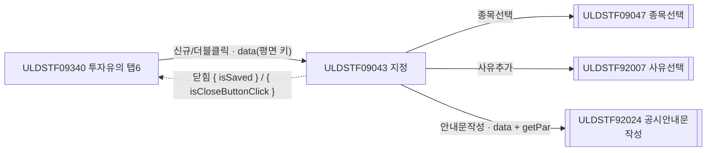
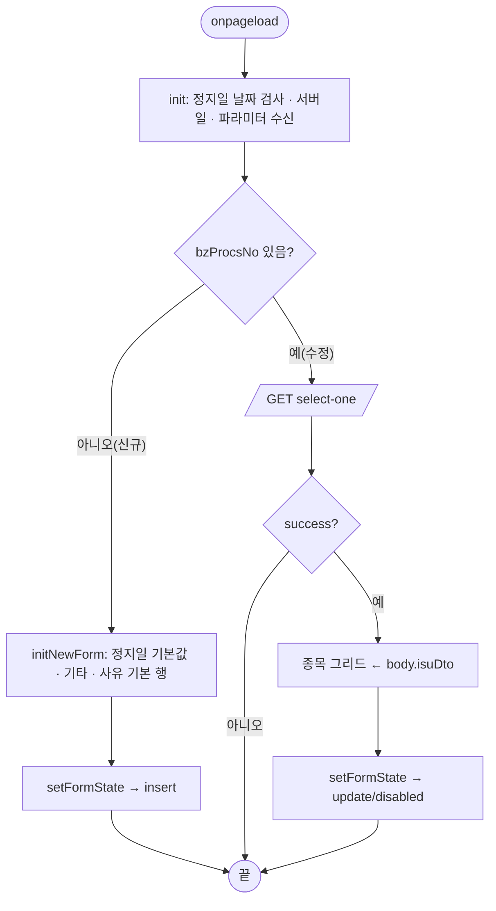
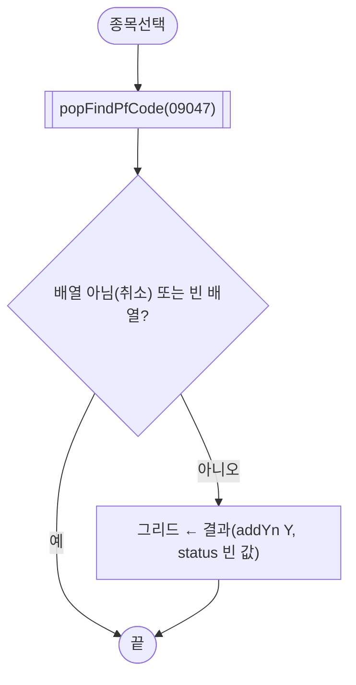
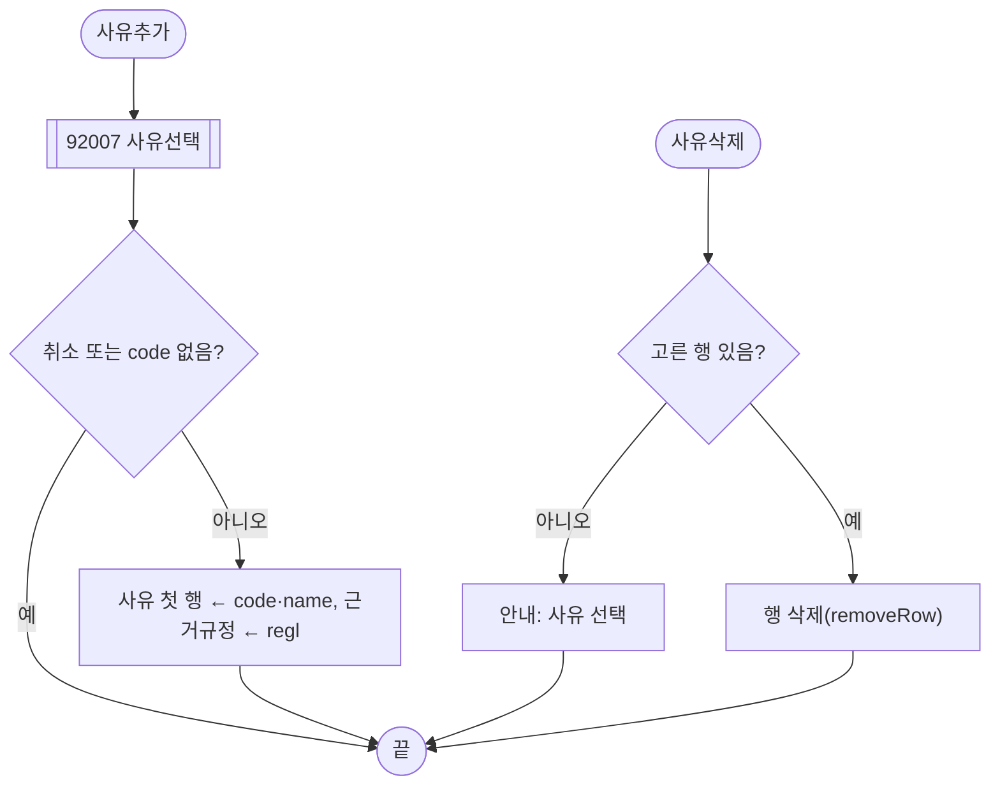
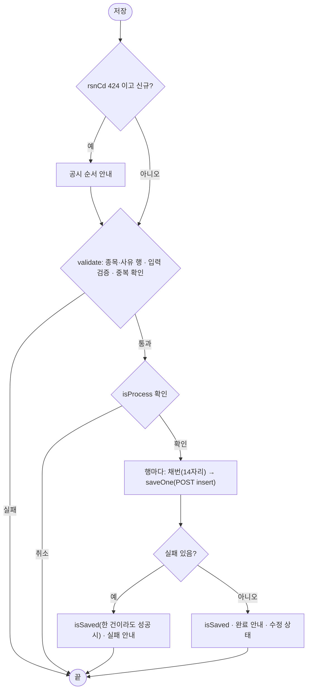
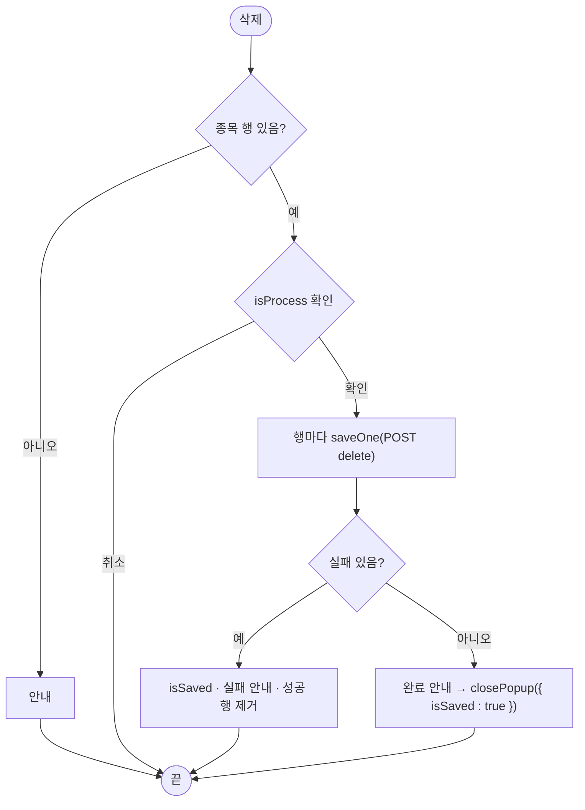
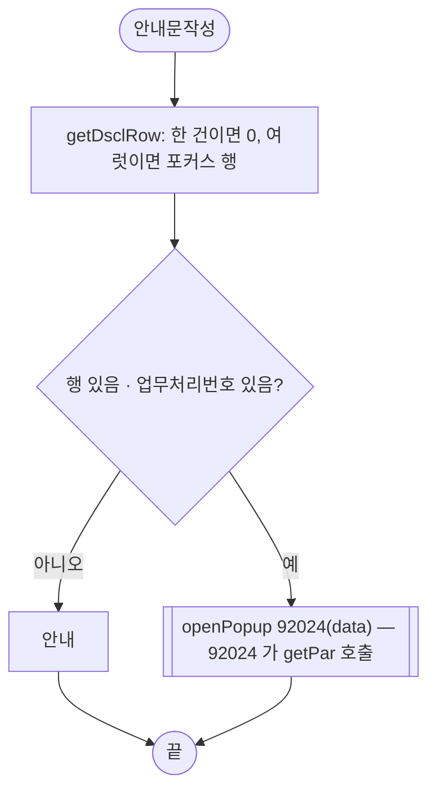

# ULDSTF09043 (팝업)매매거래정지 지정 — 업무 분석 및 전환 내역

| 항목 | 내용 |
|---|---|
| AS-IS 원본 | `ULDSTF09043.xml` — W-Craft 1차 변환본(원본 gfm 은 저장소에 없음)에 **API 적용까지 마친 개발 사본**. 개발 사본이 이미 현대식으로 작성됨(meta_asisFileNm `ULDSTF05320.gfm` — ETN 대응본 기준 작성, 2026-09-21 배성우). 업무 로직은 이 스크립트로 분석했고, 최초지정일 조회 옛 코드는 같은 계열 ULDSTF09042 개발 사본의 주석(`fn_Instwarn_fstdd`)을 참고했다. 반입 `conversion/conversion-front/ui/ULDSTF09043/ULDSTF09043.xml` (pf 묶음 21본 중 하나) |
| 신규 API 명세 | 없음 — **화면에 적용된 `/api/...` 경로·method·dataCollection keyInfo 를 명세로 간주**(사용자 결정 2026-10-29 준용). §5 는 "화면 적용 API ↔ AS-IS" 대응표. `api_spec_check` 는 SKIP(형식 검사 A07·A08 만) |
| 퍼블리싱 파일 | 화면 폴더 `ULDSTF09043.xml` 의 body 를 1단계 기준(선례 ULDBNS30400 "캡처 없음, 기존 마크업 정비"). publish 원본 없음 |
| 화면 캡처 | 없음 |
| 공통 계약 | pf 21본 공통 계약서 §2 「09042·09043·09044 매매거래정지 3종」(부모 ULDSTF09340 탭6) |
| TO-BE | `conversion/conversion-front/ui-tobe/ULDSTF09043.xml` |

참고 양식: [websquare_gfm_conversion.md](../../../md/websquare_gfm_conversion.md) — §1.4 업무 프로세스 흐름, §6.5 getPar/setPar 전환. 같은 계열 3본: ULDSTF09042(지정 및 해제)·**ULDSTF09043(지정)**·ULDSTF09044(해제) — 공통 함수로 묶지 않고 같은 패턴으로 각자 정비했다.

---

## 1. 화면 개요

상장형 수익증권(PF) 투자유의종목의 **매매거래정지 지정**(해제일 없이)을 등록하는 팝업이다(정지구분 `haltDesnrelsTpCd` = 0). 부모 투자유의(ULDSTF09340) 탭6 「매매거래정지」에서 신규등록구분 「지정」으로 [신규]를 누르거나, 정지구분 0 인 행을 더블클릭하면 열린다. 해제는 ULDSTF09044 에서 따로 한다.

1. 신규: 종목선택(ULDSTF09047)으로 대상 종목을 고르고, 정지일·정지사유(사유선택 ULDSTF92007)·근거규정·기타를 입력해 [저장]한다. 종목마다 업무처리번호를 채번해 순차 저장한다.
2. 수정: 업무처리번호로 상세(마스터·정지사유·종목)를 읽어 [수정]·[삭제]한다. 조회기준일이 현재일보다 앞이면 조회 전용.
3. [안내문작성]: 공시안내문작성(ULDSTF92024, 서식 69809)을 연다.

### 1.1 호출 화면 (1본)

| 화면 | 여는 곳 | 비고 |
|---|---|---|
| ULDSTF09340 투자유의(메뉴) | `fn_new_create_frame_trdHalt("0")`(신규), `fn_update_create_frame_trdHalt`(정지구분 0 행 더블클릭) | 크기 850×800 (신규·수정 같음) |

### 1.2 호출 규약 (부모 → 이 화면) / 반환 규약

`$c.win.openPopup("/ui/lst/pf/ULDSTF09043.xml", opts, data)` — data 는 평면 객체, 이 화면은 `$c.data.getParameter() ?? {}` 로 받는다.

| TO-BE 키 | 원본(개발 사본) 키 | 신규 값 | 수정 값 | 이 화면에서 쓰는 곳 |
|---|---|---|---|---|
| `isurCd` | `isurCd` | 부모 회사코드 | 같음 | 상세 조회 요청 |
| `isurNm` | `isurNm` | 회사명 | 같음 | (받기만) |
| `secugrpId` | `secugrpId` | `PF` | 같음 | 상장업무유형코드 선택(`LIST_BZ_TP_CD`) |
| `mktId` | `fr_MktId` | 시장구분 | 같음 | (받기만) — 키 정정 |
| `bzProcsNo` | `bzProcsNo` | `""` | 행 업무처리번호 | 신규/수정 판정 |
| `haltTpCd` | `haltTpCd` | `"0"` | 행 정지구분 | (받기만) |
| `gubun` | `gubun` | `""` | `""` | (받기만 — 쓰지 않음) |
| `selectGubun` | `select_gubun` | `"3"` | `"3"` | 상세 조회 `gubun` — 키 정정 |
| `fstDtectDd`·`designDd`·`inqDd` | 같음 | 부모 값 | 같음 | 최초지정일 대체값·정지일 기본값·조회기준일 |
| `rsnCd`·`rsnNm`·`rsnDsc` | `arrRsn1`·`arrRsn2`·`arrRsn3` | `"424"`·`"투자유의종목(상장형 수익증권)"`·`""` | (없음) | 정지사유 기본 행·424 공시 순서 안내 — 키 정정 |
| `remk` | `remk` | 정지 안내 문구(「…매매거래가 정지됩니다…」) | (없음) | 기타 기본값 |
| `isuCd`·`isuNm` | 같음 | 부모 선택 종목 | 같음 | 종목선택 가능 여부 |

반환: **`{ isSaved }`** — 저장·수정·삭제가 한 건이라도 성공하면 `scwin.isSaved = true`, 전부 삭제 성공 시 `closePopup({ isSaved : true })`. X 로 닫으면 `{ isCloseButtonClick : true }`. 부모(09340, 묶음 C)는 `res?.isSaved === true || res?.isCloseButtonClick === true` 면 탭6 재조회 + `sbx_registType` 초기화(계약서 §2 공통 규칙).

### 1.3 이 화면이 여는 하위 팝업

| 팝업 | 여는 함수 | data | 반환 / 취소 판정 |
|---|---|---|---|
| ULDSTF09047 종목선택(pcc `$c.lc.popFindPfCode`) | `scwin.img_SetIsuCd_onclick` | `{ srchType : "pfAll", isuList }`(09047 은 `srchType` 만 읽음) | `getInsertedJSON()` 배열 / 배열이 아니거나(취소·X `{ isCloseButtonClick }`) 빈 배열이면 취소 |
| ULDSTF92007 사유선택(`/ui/lst/common/`) | `scwin.openRsnPopup` | `{ mktIdx : "1", rsnIdx : "06" }` | `{ code, name, regl }` / `isCloseButtonClick` 또는 `code` 없음 |
| ULDSTF92024 공시안내문작성(`/ui/listingcommon/`) | `scwin.writeDscl` | `getDsclData(row)` + 호환용 `scwin.getPar` | 없음(닫힐 때까지 await) |

### 1.4 업무 프로세스 흐름

#### 화면 간 흐름

#### 업무 1: 진입

| 단계 | 처리 | 근거 |
|---|---|---|
| 1 | `checkCalendarFormat(edt_TrdHaltStrtDd, "yyyyMMdd", "매매거래정지일")` | 규칙 37 단일 달력 |
| 2 | 파라미터 수신(§1.2) | `scwin.init` |
| 3 | 신규면 기본값, 수정이면 `selectOne` | `scwin.initNewForm` / `scwin.selectOne` |

#### 업무 2: 종목 선택

#### 업무 3: 정지사유 추가·삭제

#### 업무 4: 저장(신규)

#### 업무 5: 수정

검증(`validate`, 중복 확인 없음) → `isProcess("U")` → 행마다 `saveOne("U")`(POST update) → 업무 4 와 같은 결과 처리.

#### 업무 6: 삭제

#### 업무 7: 안내문작성

#### 화면 모드 상태 전이

| 상태 | 조건 | 버튼(`setButtonState`) | 종목선택 |
|---|---|---|---|
| insert | 업무처리번호 없음 | [저장] | 부모가 종목을 넘기지 않았을 때만 |
| update | 업무처리번호 있음, 조회기준일 ≥ 현재일 | [수정]·[삭제]·[안내문작성] | 잠금 |
| disabled | 조회기준일 < 현재일 | 전부 잠금 | 잠금 |

---

## 2. 화면 구성 및 데이터 정의

### 2.1 화면 구성 (AS-IS 요소 → TO-BE 컴포넌트)

| AS-IS(개발 사본) | TO-BE | 비고 |
|---|---|---|
| `panel_Main`(`pop_contents`) | 같음 + `pfmContentHeader` | 팝업 contentHeader 필수 |
| `panel_1` 표(8칸 colgroup, td colspan 7) | `panel_1` 표(2칸) | 모든 행이 th 1 + td 1 이라 칸 수를 맞춤 |
| `label_isu` + `img_SetIsuCd` [종목선택] | 같음 | W-Craft 잔재 속성 제거 — `hierarchy`·`orgid`(`label_22`·`label_23`·`label_24`·`label_25`·`label_26`·`txa_SYNTH_COST_DTL`·`txa_3`·`btn_lineadd`·`btn_linedelete` 등 복사 원본 id)·`src`·`cursor`·`metaev_onclick_name`(「파일추가/파일삭제 버튼 클릭」 — 파일 버튼에서 복사된 잔재)·`text` |
| `grd_list`(`header1`·`gBody1`, `h_isuCd`·`h_comNm`·`h_isuNm`·`h_bzProcsNo`, 열 폭 203·149·329·218) | `grd_list`(`h_grd_list`·`b_grd_list`) | 중복 id 정정, 발행회사 열 `readOnly`·`displayMode` 보강, 열 폭은 개발 사본 그대로 |
| `label_designdd` + `edt_TrdHaltStrtDd` | 같음 | |
| (해제일·주석 행 없음) | (없음) | 지정 전용 화면 — 09042 의 해제일 행이 없다 |
| `label_rsn`(3. 정지사유) + `grd_rsn`(`header1`·`gBody1`, `h_LD_HALT_RSN_CD`·`h_HALT_RSN_NM`) | `grd_rsn`(`h_grd_rsn`·`b_grd_rsn`, `h_haltRsnCd`·`h_haltRsnNm`) | 사유내용 머리글이 「종목명」으로 잘못돼 있어 「사유내용」으로 |
| `btn_rsn_add` [사유추가]·`btn_rsn_del` [사유삭제] | 같음 | |
| `muc`(`w2:multiupload`, `display:none`) | (옮기지 않음) | 핸들러 4개(`scwin.muc_*`·`scwin.selectCallback`)가 정의돼 있지 않은 복사 잔재 |
| `label_4`(4. 근거규정) + `txa_InvstwarnContn` | 같음 | 바인딩 `haltReleastmRefContn` → `trdHaltGrndRegulNm`(§8 #4) |
| `label_5`(5. 기타) + `txa_Remk` | 같음 | |
| `grpBtnBox` [안내문작성]·[삭제]·[수정]·[저장] | 같음 | 규칙 41 순서 그대로, 하단 [닫기] 없음 |

### 2.2 데이터 정의 (DataCollection)

| id | 종류 | 키(요약) | 용도 |
|---|---|---|---|
| `dma_mst` | dataMap | `bzProcsNo`·`dscYn`·`isurCd`·`haltDesnrelsTpCd`·`trdHaltStrtDd`·`trdHaltStrtTm`·`trdHaltEndDd`·`trdHaltEndTm`·`trdHaltEndDdDsc`·`trdHaltGrndRegulNm`·`haltReleastmRefContn`·`trdHaltReleasBzProcsNo`·`remk`·`ulyTrdHaltBzProcsNo`·`tgtNm`·`mktactApplObjTpCd`·`haltReleasRsnNm`·`haltReleasGrndRegulNm`·`comNm`·`trdHaltEndDdDscl`·`trdHaltStrtDdTm`·`trdHaltTpNm`·`cableCsltNm`·`pnlt`·`applNo`·`haltYn`·`eqtyoptIsuObjDesc` (27키, 개발 사본 그대로) + 선언 추가 8키 `isuCd`·`isuNm`·`addYn`·`etpInvstwarnDesignCd`·`listBzTpCd`·`basDd`·`fstDesignDd`·`fstDtectDd` | 상세 조회 `body.mstDto`, 저장 요청 `mstDto`. 추가 8키는 개발 사본이 `copyRowToMap`·`initNewForm` 에서 `set` 하던 키인데 keyInfo 에 없던 것 |
| `dlt_isuTemp` | dataList | `isuCd`·`isurCd`·`isuNm`·`bzProcsNo`·`status`·`comNm`·`addYn` | 화면 종목 그리드 |
| `dma_chk` | dataMap | `dupChk` | 중복 확인 응답 |
| `dlt_rsn` | dataList | `haltRsnCd`·`haltRsnNm`·`bzProcsNo`·`ulyHaltYn` | 정지사유(`body.rsnDto` / `rsnDto`) |
| `dlt_isu` | dataList | `bzProcsNo`·`isuCd`·`isuNm`·`isurCd`·`isurNm` | 상세 조회 `body.isuDto` |

열 명칭 「종목코드·발행기관코드·종목명·업무처리번호·처리결과(Y 성공/N 실패)·발행기관명·신규지정여부」(`dlt_isuTemp`), 「사유코드·사유내용」(`dlt_rsn`), 「중복여부」(`dma_chk`)는 그대로다. 표의 `tagname="table"` 그룹 구조도 유지. 키 이름·dataType 은 개발 사본(명세 대용) 그대로이고, 자리표 `name`(`name1` 등)만 뜻이 확실한 키에 한글 명칭을 붙였다.

---

## 3. 로딩 (`scwin.onpageload` → `scwin.init`)

- `scwin.onpageload` 는 `scwin.init()` 만 부른다(try/catch + `handleError`).
- `scwin.init`:
  1. `$c.date.checkCalendarFormat(edt_TrdHaltStrtDd, "yyyyMMdd", "매매거래정지일")` — 단일 달력(규칙 37).
  2. `scwin.curDate = $c.date.getServerDateTime()`(기본 `yyyyMMdd`).
  3. 파라미터 수신(§1.2).
  4. 신규 → `initNewForm` + `setFormState`, 수정 → `await selectOne()`(조회 뒤 상태를 정하므로 await).
- 조회 영역(`schbox`)이 없어 Enter 키 바인딩 대상은 없다.

## 4. 컴포넌트 이벤트

| 컴포넌트 · 이벤트 | 핸들러 | 처리 |
|---|---|---|
| `img_SetIsuCd` onclick | `scwin.img_SetIsuCd_onclick` | 업무 2 |
| `btn_rsn_add` onclick | `scwin.btn_rsn_add_onclick` | 업무 3 (개발 사본은 JSDoc·try/catch 없음 → 보강) |
| `btn_rsn_del` onclick | `scwin.btn_rsn_del_onclick` | 업무 3 |
| `btn_save` onclick | `scwin.btn_save_onclick` → `scwin.save` | 업무 4 |
| `btn_update` onclick | `scwin.btn_update_onclick` → `scwin.update` | 업무 5 |
| `btn_delete` onclick | `scwin.btn_delete_onclick` → `scwin.remove` | 업무 6 |
| `btn_dscl` onclick | `scwin.btn_dscl_onclick` → `scwin.writeDscl` | 업무 7 |

## 5. 서버 통신

| 용도 | 화면 적용 API(명세 대용) | AS-IS(원본) | 요청 | 응답 |
|---|---|---|---|---|
| 상세 조회 | `GET /api/listing/lstproc/pf/invst-warn-trdsusprls-dsgnrls/select-one`(개발 사본 그대로 — 지정 화면도 지정및해제 상세 경로를 쓴다, §10 #10) | 원본 gfm 의 상세 조회(저장소 없음) | `{ bzProcsNo, gubun : selectGubun, isurCd }` | `dma_mst=body.mstDto, dlt_rsn=body.rsnDto, dlt_isu=body.isuDto` |
| 중복 지정 확인 | `GET /api/listing/lstproc/pf/invst-warn/select-duplicate` | (같음) | `{ etpInvstwarnDesignCd : "01", basDd : inqDd, isuCd }` | `dma_chk=body` (`dupChk` Y 면 중복) |
| 저장·수정·삭제 | `POST /api/listing/lstproc/pf/invst-warn-trdsusp-dsgn/insert` · `/update` · `/delete` (application/json) | 원본 TRS(저장소 없음) | `{ bzProcsNo, count : "3", listBzTpCd : getGlbValue("LIST_BZ_TP_CD_813"), mstDto, isuDto, rsnDto }` | 응답 정의 없음 — `responseJSON.success === true` 로만 판정 |
| 채번 | pcc `$c.stf.getNewBzProcNo()` | 같음 | — | 14자리 아니면 실패 |

### 5.1 상세 조회 (`scwin.selectOne`)
`dma_mst` 를 비우고 조회 → 성공이면 `scwin.bzProcsNo = dma_mst.bzProcsNo`, 종목 그리드를 `dlt_isu` 로 바꾸고 `setFormState`. 통신 오류는 공통 핸들러가 안내하고 예외를 던진다.

### 5.2 중복 지정 확인 (`scwin.checkDuplicate`)
신규 저장(`trJob === "I"`)일 때만. 그리드 행마다 차례로 묻고 하나라도 `dupChk === "Y"` 면 `[종목명] 중복된 종목이 저장되어 있습니다.` 안내 후 중단.

### 5.3 저장·수정·삭제 (`scwin.saveOne` · `scwin.processRows`)
- `processRows`: 행마다 (신규면 채번) → `saveOne`. 성공 행에만 업무처리번호, `status` Y/N.
- `saveOne`: `copyRowToMap` → 정지사유 행마다 `bzProcsNo`·`ulyHaltYn "N"`, 종목 그리드 전 행 `bzProcsNo` 를 이번 번호로 → `haltDesnrelsTpCd "0"` → POST. action 은 처리구분별 전체 경로 리터럴(규칙 38).
- 결과: 한 건이라도 성공이면 `scwin.isSaved = true`. 실패가 있으면 `com_complete_0151` 안내(삭제는 성공 행 제거), 전부 성공이면 `com_complete_0096` 안내 → 삭제는 `closePopup({ isSaved : true })`, 저장·수정은 수정 상태.
- 중복 실행: 버튼 상태(insert→update)로 막는다. 전송 구조의 의문점은 §10 #1.

## 6. 일반 함수

### 6.1 검증 (`scwin.validate`)
- 공통: 종목 행 0 → `com_req_select("종목")`, 정지사유 행 0 → `com_req_select("정지사유")`(정지사유 라벨이 필수 표시인데 검사가 없어 추가).
- `validateDataCollect(panel_1)`: `edt_TrdHaltStrtDd`(필수·날짜)·`txa_InvstwarnContn`(필수·200자)·`txa_Remk`(2000자). 개발 사본은 화면에 없는 `edt_TrdHaltEndDd` 를 필수 검증 대상으로 남겼다(§8 #13).
- 업무: 신규면 `checkDuplicate`.

### 6.2 화면 상태 (`scwin.setFormState`)
§1.4 상태 전이 표. `img_SetIsuCd.setDisabled(isReadOnly || !(isNew && isEmpty(isuCd)))`.

### 6.3 전문 마스터 채우기 (`scwin.copyRowToMap`)
행의 종목코드·종목명·발행기관코드·신규지정여부, 고정값 `etpInvstwarnDesignCd "01"`·`listBzTpCd`(증권그룹별 `LIST_BZ_TP_CD`)·`basDd`(조회기준일)·`fstDesignDd`(§8 #3).

### 6.4 사유선택 (`scwin.openRsnPopup`)
pcc `$c.lc.popFindLstRsnCd` 는 browserPopup + 콜백 수신형이라 반환값이 없다(개발 사본은 `res.isCloseButtonClick` 에서 TypeError — §8 #2). 선례 sample-front ULDSTF08052 처럼 `/ui/lst/common/ULDSTF92007.xml` 을 pageFramePopup 으로 직접 열고 await 한다.

### 6.5 부모 ↔ 팝업 파라미터 전달 (getPar/setPar → `openPopup` data + `await`)
- 부모 09340 의 `fn_GetParNewTrdHalt`·`fn_GetParUpdateTrdHalt` 는 이미 객체에 키를 채워 data 로 넘긴다(배열 getPar 잔재는 주석). 키 정정만 계약서대로: `fr_MktId`→`mktId`, `select_gubun`→`selectGubun`, `arrRsn1/2/3`→`rsnCd/rsnNm/rsnDsc`.
- 부모를 직접 부르던 `scwin.refreshParent`(`getParent().scwin.fn_list_sync`)는 삭제 — 부모 09340 에는 `fn_list_sync` 가 없어 원본에서도 동작하지 않던 호출이다. 반환 `{ isSaved }` 로 대체.
- 예외: 92024 호환용 `scwin.getPar`(§6.6).

### 6.6 공시안내문작성 (`scwin.writeDscl` · `scwin.getDsclRow` · `scwin.getDsclData` · `scwin.getPar` · `scwin.fillDataList`)
- 대상 행: 종목 한 건이면 0, 여럿이면 `grd_list.getFocusedRowIndex()`(개발 사본의 `grd_list.getRowIndex()` 는 gridView API 가 아님). 업무처리번호가 없으면(저장 전) 안내.
- data: `{ formCd : "69809", bzProcsNo, isurCd, mktId : "1", isu : [대상 행], mst : [dma_mst] }`.
- 92024 전환본(sample-front)은 아직 부모 `scwin.getPar(arr, dlt_Isu, dlt_Mst, …)` 를 이름으로 부른다 → 호환용 `scwin.getPar` 가 `arr[0..3]` 과 종목·마스터 dataList 를 채운다(4칸 → 92024 가 본문을 생성, `arr.length >= 5` 면 미생성). 선례 ULDSTF05918.
- 개발 사본은 `alert("추후 편집기 적용예정(TODO)")` 만 띄웠다.

## 7. 업무 코드 · 메시지 목록

| 구분 | 값 | 뜻 |
|---|---|---|
| `haltDesnrelsTpCd` | 0·1·2·(3) | 지정·해제·지정및해제·(부모 판정용 지정→해제) — 이 화면 0 |
| 정지사유 | `424` | 투자유의종목(상장형 수익증권) — 신규 기본 |
| `etpInvstwarnDesignCd` | `01` | 투자유의 최초적출(개발 사본 고정값) |
| `LIST_BZ_TP_CD` | EN 716·EF 750·PF 816 | 전문 마스터 `listBzTpCd` |
| `LIST_BZ_TP_CD_813` | pcc 전역값 | 요청 최상위 `listBzTpCd` |
| 공시 서식 | `69809`, 시장 `1` | 92024 |
| 사유선택 | `mktIdx 1`·`rsnIdx 06` | 92007 |
| 메시지 | `com_req_select`("$[0]{을/를} 선택해 주세요.")·`com_complete_0151`("$[0] 처리 실패하였습니다.")·`com_complete_0096`("성공적으로 $[0] 처리 되었습니다.") · `$c.lc.isProcess` MSG-A006 확인 · 424 공시 순서 안내 · 중복 안내 · 「저장한 뒤 안내문을 작성해 주세요.」(신규) | |

## 8. 원본 특이사항 · 결함

| # | 내용 | 결정 |
|---|---|---|
| 1 | `scwin.refreshParent` 가 부르는 부모 `fn_list_sync` 가 09340 에 없음 — 저장 후 부모 갱신이 원본에서도 안 됨 | **고침** — 반환 `{ isSaved }` + 부모 재조회 규약 |
| 2 | 사유추가가 콜백형 pcc `popFindLstRsnCd` 의 반환값(`undefined`)을 읽어 TypeError, `rsnList` 는 92007 이 읽지 않음 | **고침** — 92007 직접 열고 await, `rsnList` 미전달 |
| 3 | `copyRowToMap` 이 없는 키 `dma_mst.get("designDd")` 로 최초지정일을 채워 신규 종목은 늘 빈 값 | **고침** — 09042 개발 사본 주석 `fn_Instwarn_fstdd` 의 대체값처럼 「부모 최초적출일, 없으면 이번 정지일」. 원본의 투자유의 최초지정일 조회(옛 `listGeneral` 쿼리)는 대응 API 가 없어 옮기지 않음(§10 #3) |
| 4 | 근거규정 칸이 `haltReleastmRefContn`(정지해제 참고내용)에 바인딩 — 사유추가는 근거규정(`regl`)을 이 칸에 넣는데 키는 해제 참고내용이라 근거규정 키 `trdHaltGrndRegulNm` 은 늘 비어 감 | **고침** — `trdHaltGrndRegulNm` 으로(§10 #4 확인) |
| 5 | `dma_mst` keyInfo 에 없는 키 8개를 `set` | **고침** — keyInfo 에 선언 추가 |
| 6 | 중복 id `header1`·`gBody1` 2쌍(WS120) | **고침** |
| 7 | 정의 없는 핸들러를 가리키는 숨은 `muc`(multiupload) | **옮기지 않음** |
| 8 | 정지사유 머리글 「종목명」 | **고침** — 「사유내용」 |
| 9 | `grd_list.getRowIndex()`(gridView API 아님) | **고침** — `getFocusedRowIndex()` |
| 10 | 정지사유 라벨은 필수 표시인데 검증 없음 | **고침** — 행 0 이면 안내 |
| 11 | 사유추가는 이름과 달리 첫 행을 바꿈(한 행 유지) | **유지**(원본 동작) |
| 12 | 신규 저장 전송이 행마다 호출되며 `isuDto` 에 그리드 전 종목을 싣고, 그때마다 전 행 `bzProcsNo` 를 이번 번호로 덮어씀 | **유지 + §10 #1** — API 전송 구조 확인 전에는 바꾸지 않음 |
| 13 | 검증 대상에 화면에 없는 `edt_TrdHaltEndDd`(필수·날짜)가 남아 있음(09042 에서 복사) | **고침** — 제거 |
| 14 | 사유삭제가 `deleteRow` — 삭제 표시 행이 `getAllJSON()` 에 남아 `rsnDto` 로 전송될 수 있음(09042 는 `removeRow`) | **고침** — `removeRow` 로 3본 통일 |
| 15 | `LIST_BZ_RSN_CD_424` 상수 없이 리터럴 `"424"` 비교 | **고침** — 상수 추가 |

## 9. 전환 내역 (AS-IS → TO-BE)

| AS-IS(개발 사본) | TO-BE |
|---|---|
| `scwin.onpageload` · `scwin.init` | 같음 — 단일 달력 바인딩 추가, 키 정정 수신 |
| `scwin.initNewForm` | 같음 — 사유 기본 행을 `rsnCd`·`rsnNm` 으로, `dlt_rsn` 초기화 |
| `scwin.img_SetIsuCd_onclick` | 같음 — 반환이 배열이 아니거나 비면 취소(묶음 A 09341~09345 와 같은 판정) |
| `scwin.btn_rsn_add_onclick` | 같음 — `scwin.openRsnPopup` 사용, 근거규정은 `dma_mst.trdHaltGrndRegulNm` |
| `scwin.btn_rsn_del_onclick` | `deleteRow` → `removeRow`, 고른 행 없음 안내 |
| `scwin.btn_save_onclick` · `btn_update_onclick` · `btn_delete_onclick` · `btn_dscl_onclick` | 같음 |
| `scwin.selectOne` · `scwin.checkDuplicate` | 같음 |
| `scwin.saveOne` | 같음 — action 을 처리구분별 전체 경로 리터럴로(문자열 조립 제거, 규칙 38) |
| `scwin.setFormState` · `scwin.save` · `scwin.update` · `scwin.remove` | 같음 — `==` → `===`, 상수 `LIST_BZ_RSN_CD_424` 사용 |
| `scwin.validate` | 정지사유 행 검사 추가, 없는 `edt_TrdHaltEndDd` 제거 |
| `scwin.processRows` | `refreshParent()` → `scwin.isSaved = true`, 삭제 닫기 `closePopup({ isSaved : true })` |
| `scwin.copyRowToMap` | 최초지정일 대체값(§8 #3) |
| `scwin.writeDscl` | 92024 실제 호출 — `scwin.getDsclRow`·`scwin.getDsclData` 신설 |
| `scwin.refreshParent` | **삭제**(§8 #1) |
| (신설) | `scwin.openRsnPopup`, 92024 호환용 `scwin.getPar`·`scwin.fillDataList` |
| 상수·상태 `scwin.screenId`·`scwin.BTN_MAP`·`scwin.DESIGN_CD`·`scwin.LIST_BZ_TP_CD`·`scwin.trJob`·`scwin.curDate` | 같음 — `scwin.LIST_BZ_RSN_CD_424`·`scwin.DSCL_FORM_CD`·`scwin.DSCL_MKT_ID`·`scwin.RSN_MKT_IDX`·`scwin.RSN_RSN_IDX` 추가 |
| 변수 `scwin.select_gubun`·`scwin.arrRsn1/2/3` | `scwin.selectGubun`·`scwin.rsnCd/rsnNm/rsnDsc`, `scwin.mktId`·`scwin.isSaved`·`scwin.dsclRow` 추가 |

- publicInfo: 정의한 26함수 전부. 전역 상수·상태는 등재하지 않는다.
- 게이트: `gate_screen --pcc stf`·`scan_mixed_compare`(A 8건 — `getRowCount() === 0` 등 숫자 비교, 의도)·`publish_gate --before 1단계 사본 --allow P20`(P22·P24 는 스크립트 전환분)·`api_spec_check`(명세 SKIP)·`init_binding_check`·`wsxml_lint` 0/0.

## 10. 남은 작업 (TODO)

1. **저장 전송 구조(확인 필수)** — 상세 조회가 업무처리번호 하나에 종목 목록(`body.isuDto`)을 돌려주므로 「번호 하나 ↔ 종목 여럿」 모델로 보인다. 그런데 개발 사본은 행마다 채번·호출하면서 매번 `isuDto` 에 그리드 전 종목을 싣는다 → 종목 N개 신규 저장 시 번호 N개가 각각 N종목을 등록할 수 있다. 서버 계약을 확인해 「한 번 채번 + 한 번 호출」 또는 「행마다 그 행만」 중 하나로 바꿔야 한다(09043·09044 같음).
2. **응답 판정** — insert/update/delete 응답 정의가 없어 `success` 만 본다.
3. **최초지정일 조회** — 원본은 사유 424 이고 최초지정일이 없으면 투자유의 최초지정일을 조회했다(`fn_Instwarn_fstdd`). 대응 API 가 필요한지 확인.
4. **근거규정 키** — `trdHaltGrndRegulNm` 으로 바꾼 것이 서버 전문과 맞는지(해제 근거규정 `haltReleasGrndRegulNm` 을 따로 받아야 하는지도).
5. **중복 확인·전문 고정값** — 매매거래정지인데 투자유의 최초적출 지정구분 `01` 로 중복을 확인하고, `listBzTpCd` 가 전문 마스터(816)와 요청 최상위(813)에서 다르다. ETN 대응본에서 옮긴 값인지 확인.
6. **92024** — 경로 `/ui/listingcommon/ULDSTF92024.xml`(conversion-front 선례), 92024 가 `$c.data.getParameter()` 수신으로 바뀌면 `scwin.getPar`·`scwin.fillDataList` 삭제. arr[4]·arr[5](메시지·공시제목)는 원본 근거가 없어 넘기지 않음.
7. **09047 `isuList`** — 09047 은 `isuList` 를 읽지 않는다(이미 고른 종목 선택 표시 안 됨).
8. **부모 09340(묶음 C)** — 정정 키(`mktId`·`selectGubun`·`rsnCd/rsnNm/rsnDsc`) 송신과 `isSaved || isCloseButtonClick` 재조회 반영 확인. 크기 850×800.
9. **배포 경로** — `/ui/lst/pf/ULDSTF09043.xml`(부모 원본 리터럴).
10. **상세 조회 경로** — 지정 화면인데 상세 조회는 지정및해제 경로(`invst-warn-trdsusprls-dsgnrls/select-one`)다(저장은 `invst-warn-trdsusp-dsgn`). 개발 사본 그대로 두었다 — 서버가 정지구분 0 건도 이 경로로 돌려주는지 확인.
