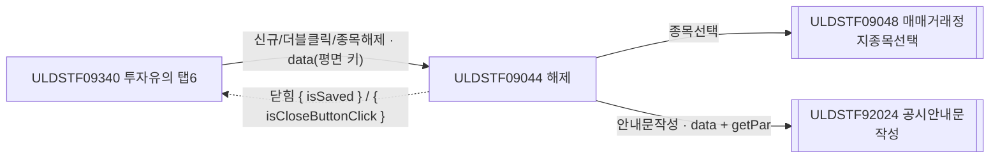
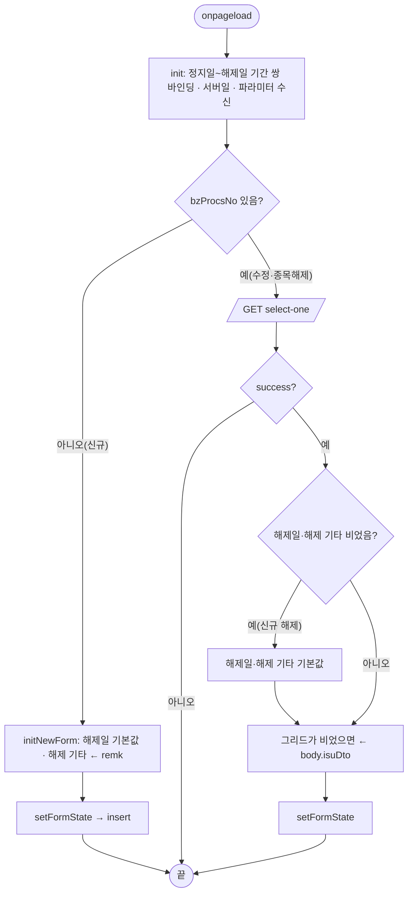
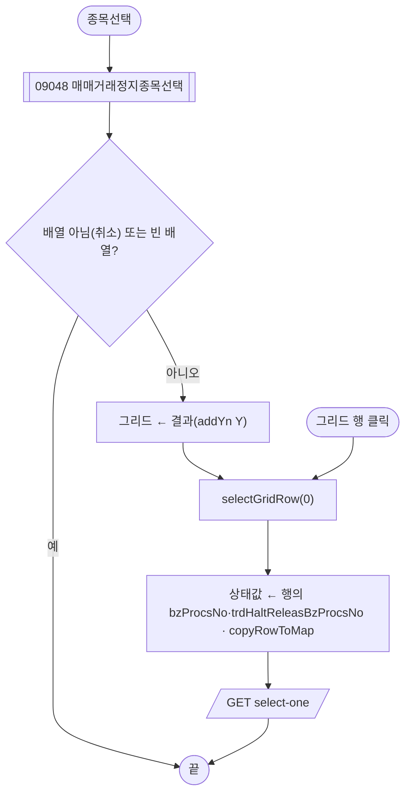
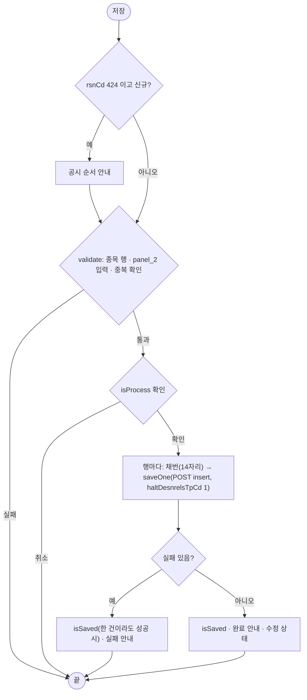

# ULDSTF09044 (팝업)매매거래정지 해제 — 업무 분석 및 전환 내역

| 항목 | 내용 |
|---|---|
| AS-IS 원본 | `ULDSTF09044.xml` — W-Craft 1차 변환본(원본 gfm 은 저장소에 없음)에 **API 적용까지 마친 개발 사본**. 개발 사본이 이미 현대식으로 작성됨(meta_asisFileNm `ULDSTF05320.gfm` — ETN 대응본 기준 작성, 2026-09-21 배성우). 업무 로직은 이 스크립트로 분석했다. 반입 `conversion/conversion-front/ui/ULDSTF09044/ULDSTF09044.xml` (pf 묶음 21본 중 하나) |
| 신규 API 명세 | 없음 — **화면에 적용된 `/api/...` 경로·method·dataCollection keyInfo 를 명세로 간주**(사용자 결정 2026-10-29 준용). §5 는 "화면 적용 API ↔ AS-IS" 대응표. `api_spec_check` 는 SKIP(형식 검사 A07·A08 만) |
| 퍼블리싱 파일 | 화면 폴더 `ULDSTF09044.xml` 의 body 를 1단계 기준(선례 ULDBNS30400 "캡처 없음, 기존 마크업 정비"). publish 원본 없음 |
| 화면 캡처 | 없음 |
| 공통 계약 | pf 21본 공통 계약서 §2 「09042·09043·09044 매매거래정지 3종」(부모 ULDSTF09340 탭6) |
| TO-BE | `conversion/conversion-front/ui-tobe/ULDSTF09044.xml` |

참고 양식: [websquare_gfm_conversion.md](../../../md/websquare_gfm_conversion.md) — §1.4 업무 프로세스 흐름, §6.5 getPar/setPar 전환. 같은 계열 3본: ULDSTF09042(지정 및 해제)·ULDSTF09043(지정)·**ULDSTF09044(해제)** — 공통 함수로 묶지 않고 같은 패턴으로 각자 정비했다.

---

## 1. 화면 개요

상장형 수익증권(PF) 투자유의종목의 **매매거래정지를 해제**하는 팝업이다(정지구분 `haltDesnrelsTpCd` = 1). 위 표(`panel_1`)는 고른 정지 건의 정보(정지일·정지사유·근거규정·기타 — 조회 전용), 아래 표(`panel_2`)는 해제 입력(해제일·해제 기타)이다.

1. 신규(부모 신규등록구분 「해제」): 매매거래정지종목선택(ULDSTF09048)으로 정지 종목을 고르면 첫 행의 정지 건 상세를 읽는다. 행을 누르면 그 정지 건을 읽는다. 해제일·해제 기타를 입력해 저장한다.
2. 수정(정지구분 1, 또는 1+시작일 있음 → 부모 판정 3): 업무처리번호로 상세를 읽어 [수정]·[삭제].
3. 종목해제(부모 「종목해제」, `fn_GetParRelease`): 업무처리번호와 해제 안내 문구·`openTyp "new"` 로 연다.
4. [안내문작성]: 공시안내문작성(ULDSTF92024, 서식 69809).

### 1.1 호출 화면 (1본)

| 화면 | 여는 곳 | 비고 |
|---|---|---|
| ULDSTF09340 투자유의(메뉴) | `fn_new_create_frame_trdHalt("1")`(신규), `fn_update_create_frame_trdHalt`(정지구분 1·3 행 더블클릭), 종목해제(`fn_GetParRelease`) | 크기 850×900 (계약서 §2 — 원본 신규 820·수정 900 불일치를 900 으로 통일) |

### 1.2 호출 규약 (부모 → 이 화면) / 반환 규약

`$c.win.openPopup("/ui/lst/pf/ULDSTF09044.xml", opts, data)` — data 는 평면 객체, `$c.data.getParameter() ?? {}` 로 받는다.

| TO-BE 키 | 원본(개발 사본) 키 | 신규 값 | 수정·종목해제 값 | 이 화면에서 쓰는 곳 |
|---|---|---|---|---|
| `isurCd` | `isurCd` | 부모 회사코드 | 같음 | 상세 조회 요청(§8 #3) |
| `isurNm` | `isurNm` | 회사명 | 같음 | (받기만) |
| `secugrpId` | `secugrpId` | `PF` | 같음 | `LIST_BZ_TP_CD` 선택 |
| `mktId` | `fr_MktId` | 시장구분 | 같음 | (받기만) — 키 정정 |
| `bzProcsNo` | `bzProcsNo` | `""` | 행 업무처리번호 | 신규/수정 판정 |
| `haltTpCd` | `haltTpCd` | `"1"` | 행 정지구분 / 종목해제 `"1"` | (받기만) |
| `gubun` | `gubun` | `""` | `""` | (받기만 — 개발 사본은 이 값을 상세 조회 `isurCd` 로 보냈다, §8 #3) |
| `selectGubun` | `select_gubun` | `"3"` | `"3"` | 상세 조회 `gubun` — 키 정정 |
| `fstDtectDd`·`designDd`·`inqDd` | 같음 | 부모 값 | 같음 | (최초지정일 미사용)·해제일 기본값·조회기준일 |
| `rsnCd`·`rsnNm`·`rsnDsc` | `arrRsn1`·`arrRsn2`·`arrRsn3` | `"424"`·`"투자유의종목(상장형 수익증권)"`·`""` | (없음) | 424 공시 순서 안내 — 키 정정 |
| `remk` | `remk`(신규) / `arrRsn1`(종목해제, 해제 안내 문구) | 해제 안내 문구 | 종목해제: 해제 안내 문구 | 해제 기타 기본값 — 계약서 §2 키 정정 |
| `openTyp` | `arrRsn2`(종목해제 `"new"`) | (없음) | 종목해제 `"new"` | (받기만 — §10 #5) |
| `isuCd`·`isuNm` | 같음 | 부모 선택 종목 | 같음 | 종목선택 가능 여부 |

반환: **`{ isSaved }`** — 저장·수정·삭제가 한 건이라도 성공하면 `scwin.isSaved = true`, 전부 삭제 성공 시 `closePopup({ isSaved : true })`. X 로 닫으면 `{ isCloseButtonClick : true }`. 부모(09340, 묶음 C)는 `res?.isSaved === true || res?.isCloseButtonClick === true` 면 탭6 재조회.

### 1.3 이 화면이 여는 하위 팝업

| 팝업 | 여는 함수 | data | 반환 / 취소 판정 |
|---|---|---|---|
| ULDSTF09048 매매거래정지종목선택(`/ui/lst/common/`, 850×800) | `scwin.img_SetIsuCd_onclick` | `{ srchType : "pfAll", isuList }`(09048 은 `srchType`·`gubun`·`isurCd` 만 읽음) | `getInsertedJSON()` 배열 / 배열이 아니거나(취소·X) 빈 배열이면 취소 |
| ULDSTF92024 공시안내문작성(`/ui/listingcommon/`) | `scwin.writeDscl` | `getDsclData(row)` + 호환용 `scwin.getPar` | 없음(닫힐 때까지 await) |

### 1.4 업무 프로세스 흐름

#### 화면 간 흐름

#### 업무 1: 진입

#### 업무 2: 정지 종목 선택 · 정지 건 읽기

#### 업무 3: 저장(신규 해제)

#### 업무 4: 수정 · 업무 5: 삭제

수정: 검증(중복 확인 없음) → `isProcess("U")` → 행마다 `saveOne("U")`(POST update).
삭제: 종목 행 확인 → `isProcess("D")` → 행마다 `saveOne("D")`(POST delete) → 전부 성공이면 `closePopup({ isSaved : true })`, 실패가 있으면 성공 행 제거.

#### 업무 6: 안내문작성

대상 행(한 건이면 0, 여럿이면 포커스 행) → 업무처리번호 확인 → `openPopup` 92024(data) — 92024 가 호환용 `scwin.getPar` 를 부른다.

#### 화면 모드 상태 전이

| 상태 | 조건 | 버튼(`setButtonState`) | 종목선택 |
|---|---|---|---|
| insert | 업무처리번호 없음 | [저장] | 부모가 종목을 넘기지 않았을 때만 |
| update | 업무처리번호 있음(정지 건을 고른 뒤 포함), 조회기준일 ≥ 현재일 | [수정]·[삭제]·[안내문작성] | 잠금 |
| disabled | 조회기준일 < 현재일 | 전부 잠금 | 잠금 |

정지 종목을 고르면 그 정지 건의 업무처리번호가 상태값이 되어 update 로 바뀐다(개발 사본 그대로 — §10 #5).

---

## 2. 화면 구성 및 데이터 정의

### 2.1 화면 구성 (AS-IS 요소 → TO-BE 컴포넌트)

| AS-IS(개발 사본) | TO-BE | 비고 |
|---|---|---|
| `panel_Main`(`pop_contents`) | 같음 + `pfmContentHeader` | 팝업 contentHeader 필수 |
| `panel_1` 표(8칸 colgroup, td colspan 7) | `panel_1` 표(2칸) | 모든 행이 th 1 + td 1 |
| `label_isu` + `img_SetIsuCd` [종목선택] | 같음 | W-Craft 잔재 속성 제거 — `hierarchy`·`orgid`(`label_22`·`label_23`·`label_24`·`label_25`·`label_26`·`txa_SYNTH_COST_DTL`·`txa_3` 등 복사 원본 id)·`src`·`cursor`·`text` |
| `grd_list`(`header1`·`gBody1`, `h_isuCd`·`h_comNm`·`h_isuNm`·`h_bzProcsNo`, `ev:oncellclick`) | `grd_list`(`h_grd_list`·`b_grd_list`) | 중복 id 정정, 발행회사 열 보강 |
| `label_designdd` + `edt_TrdHaltStrtDd`(읽기 전용) | 같음 | |
| `label_rsn` + `grd_rsn`(`header1`·`gBody1`, `h_LD_HALT_RSN_CD`·`h_HALT_RSN_NM`) | `grd_rsn`(`h_grd_rsn`·`b_grd_rsn`, `h_haltRsnCd`·`h_haltRsnNm`) | 사유내용 머리글 「종목명」 → 「사유내용」, 조회 전용(사유추가·삭제 없음) |
| `label_4` + `txa_InvstwarnContn` 근거규정(읽기 전용) | 같음 | 바인딩 `haltReleastmRefContn` → `trdHaltGrndRegulNm`(§8 #1) |
| `label_5` + `txa_Remk` 기타(읽기 전용) | 같음 | |
| `panel_2` 표 — `label_TrdHaltEndDd` + `edt_TrdHaltEndDd` | 같음(2칸 colgroup) | |
| `label_6` + `txa_HaltReleastmRefContn` 해제 기타 | 같음 | `haltReleastmRefContn` |
| `grpBtnBox` [안내문작성]·[삭제]·[수정]·[저장] | 같음 | 규칙 41 순서 그대로 |

### 2.2 데이터 정의 (DataCollection)

| id | 종류 | 키(요약) | 용도 |
|---|---|---|---|
| `dma_mst` | dataMap | 개발 사본 27키(09042 와 같음 — `bzProcsNo`·`dscYn`·`isurCd`·`haltDesnrelsTpCd`·`trdHaltStrtDd`·`trdHaltStrtTm`·`trdHaltEndDd`·`trdHaltEndTm`·`trdHaltEndDdDsc`·`trdHaltGrndRegulNm`·`haltReleastmRefContn`·`trdHaltReleasBzProcsNo`·`remk`·`ulyTrdHaltBzProcsNo`·`tgtNm`·`mktactApplObjTpCd`·`haltReleasRsnNm`·`haltReleasGrndRegulNm`·`comNm`·`trdHaltEndDdDscl`·`trdHaltStrtDdTm`·`trdHaltTpNm`·`cableCsltNm`·`pnlt`·`applNo`·`haltYn`·`eqtyoptIsuObjDesc`) + 선언 추가 8키(`isuCd`·`isuNm`·`addYn`·`etpInvstwarnDesignCd`·`listBzTpCd`·`basDd`·`fstDesignDd`·`fstDtectDd`) | 상세 조회 `body.mstDto`, 저장 `mstDto` |
| `dlt_isuTemp` | dataList | `isuCd`·`isurCd`·`isuNm`·`bzProcsNo`·`status`·`comNm`·`addYn` + 정지 건 열 `haltDesnrelsTpCd`·`trdHaltStrtDd`·`trdHaltEndDd`·`trdHaltGrndRegulNm`·`haltReleasGrndRegulNm`·`haltReleastmRefContn`·`remk`·`haltReleasRsnNm`·`trdHaltReleasBzProcsNo` | 정지 종목 그리드(09048 결과) |
| `dma_chk` | dataMap | `dupChk`(중복여부) | 중복 확인 응답 |
| `dlt_rsn` | dataList | `haltRsnCd`(사유코드)·`haltRsnNm`·`bzProcsNo` | 정지사유(조회 전용) |
| `dlt_isu` | dataList | `bzProcsNo`·`isuCd`·`isuNm`·`isurCd`·`isurNm` | 상세 조회 `body.isuDto`, 저장 `isuDto` |

열 명칭 「종목코드·발행기관코드·종목명·업무처리번호·처리결과(Y 성공/N 실패)·발행기관명·신규지정여부」는 그대로, 자리표 `name`(`name8`~`name16` 등)은 뜻이 확실한 열에 한글 명칭을 붙였다. 표의 `tagname="table"` 그룹 구조 유지.

---

## 3. 로딩 (`scwin.onpageload` → `scwin.init`)

- `scwin.onpageload` 는 `scwin.init()` 만 부른다.
- `scwin.init`:
  1. `$c.date.compareFromToDate(edt_TrdHaltStrtDd, edt_TrdHaltEndDd, ["매매거래정지일", "매매거래정지해제일"])` — 읽기 전용 정지일과 해제일의 기간 쌍(규칙 37) — 해제일이 정지일보다 앞서지 않게 한다.
  2. 서버일, 파라미터 수신(§1.2, `openTyp` 포함).
  3. 신규 → `initNewForm` + `setFormState`, 수정·종목해제 → `await selectOne()`.
- 조회 영역(`schbox`)이 없어 Enter 키 바인딩 대상은 없다.

## 4. 컴포넌트 이벤트

| 컴포넌트 · 이벤트 | 핸들러 | 처리 |
|---|---|---|
| `img_SetIsuCd` onclick | `scwin.img_SetIsuCd_onclick` | 업무 2 |
| `grd_list` oncellclick | `scwin.grd_list_oncellclick` → `scwin.selectGridRow` | 업무 2 (개발 사본은 JSDoc·try/catch 없음 → 보강) |
| `btn_save`·`btn_update`·`btn_delete`·`btn_dscl` onclick | `scwin.btn_save_onclick`·`scwin.btn_update_onclick`·`scwin.btn_delete_onclick`·`scwin.btn_dscl_onclick` | 업무 3·4·5·6 |

## 5. 서버 통신

| 용도 | 화면 적용 API(명세 대용) | 요청 | 응답 |
|---|---|---|---|
| 상세 조회 | `GET /api/listing/lstproc/pf/invst-warn-trdsusprls-dsgnrls/select-one` | `{ bzProcsNo, gubun : selectGubun, isurCd }` | `dma_mst=body.mstDto, dlt_rsn=body.rsnDto, dlt_isu=body.isuDto` |
| 중복 지정 확인 | `GET /api/listing/lstproc/pf/invst-warn/select-duplicate` | `{ etpInvstwarnDesignCd : "01", basDd : inqDd, isuCd }` | `dma_chk=body` |
| 저장·수정·삭제 | `POST /api/listing/lstproc/pf/invst-warn-trdsusp-rls/insert` · `/update` · `/delete` | `{ bzProcsNo, count : "3", listBzTpCd : getGlbValue("LIST_BZ_TP_CD_813"), mstDto, isuDto : dlt_isu, rsnDto }` | 응답 정의 없음 — `success` 로만 판정 |
| 채번 | pcc `$c.stf.getNewBzProcNo()` | — | 14자리 |

### 5.1 상세 조회 (`scwin.selectOne`)
`dma_mst` 비우고 조회 → `scwin.bzProcsNo` 갱신 → 해제 정보가 비었으면(신규 해제) 해제일·해제 기타 기본값 → 그리드가 비었을 때만 `dlt_isu` 로 채움(종목선택 직후의 정지 종목 목록은 유지 — §8 #5) → `setFormState`.

### 5.2 저장·수정·삭제 (`scwin.saveOne` · `scwin.processRows`)
- `saveOne`: `copyRowToMap`(정지 건 정보·해제 업무처리번호) → `haltDesnrelsTpCd "1"` → POST(처리구분별 전체 경로 리터럴, 규칙 38). `isuDto` 는 마지막으로 읽은 정지 건의 종목(`dlt_isu`, 개발 사본 그대로).
- `processRows`: 09042 와 같다 — 신규 채번, 한 건이라도 성공이면 `scwin.isSaved = true`, 삭제 전부 성공이면 `closePopup({ isSaved : true })`.

## 6. 일반 함수

### 6.1 검증 (`scwin.validate`)
종목 행 0 → 안내. `validateDataCollect(panel_2)`: `edt_TrdHaltEndDd`(필수·날짜)·`txa_HaltReleastmRefContn`(2000자). 신규면 `checkDuplicate`.

### 6.2 정지 건 선택 (`scwin.selectGridRow`) · 전문 마스터 (`scwin.copyRowToMap`)
- `selectGridRow(rowIndex)`: 범위 밖이면 무시. `scwin.frRelBzProcsNo`·`scwin.bzProcsNo` ← 행, `copyRowToMap`, `await selectOne()`.
- `copyRowToMap`: 종목코드·종목명·발행기관코드·발행기관명·정지일·정지 근거규정, 고정값 `etpInvstwarnDesignCd`·`listBzTpCd`, `trdHaltReleasBzProcsNo` ← `scwin.frRelBzProcsNo`.

### 6.3 화면 상태 (`scwin.setFormState`)
§1.4 상태 전이 표.

### 6.4 부모 ↔ 팝업 파라미터 전달 (getPar/setPar → `openPopup` data + `await`)
- 부모 09340 의 `fn_GetParNewTrdHalt`·`fn_GetParUpdateTrdHalt`·`fn_GetParRelease` 가 객체로 넘긴다. 키 정정: `fr_MktId`→`mktId`, `select_gubun`→`selectGubun`, `arrRsn1/2/3`→`rsnCd/rsnNm/rsnDsc`, 종목해제의 `arrRsn1`(안내 문구)→`remk`·`arrRsn2 "new"`→`openTyp`.
- `scwin.refreshParent` 삭제(부모에 `fn_list_sync` 없음) → `{ isSaved }`.

### 6.5 공시안내문작성 (`scwin.writeDscl` · `scwin.getDsclRow` · `scwin.getDsclData` · `scwin.getPar` · `scwin.fillDataList`)
09042 와 같다 — data `{ formCd : "69809", bzProcsNo, isurCd, mktId : "1", isu : [대상 행], mst : [dma_mst] }`, 호환용 `scwin.getPar` 가 `arr[0..3]`(4칸 → 본문 생성)과 종목·마스터를 채운다. 개발 사본은 `alert("추후 편집기 적용예정(TODO)")` 만 띄웠다.

## 7. 업무 코드 · 메시지 목록

| 구분 | 값 | 뜻 |
|---|---|---|
| `haltDesnrelsTpCd` | 0·1·2·(3) | 이 화면 1(해제), 부모가 1+시작일이면 3 으로 이 화면을 연다 |
| 정지사유 | `424` | 424 공시 순서 안내 판정 |
| `etpInvstwarnDesignCd` | `01` | 개발 사본 고정값 |
| `LIST_BZ_TP_CD` / `LIST_BZ_TP_CD_813` | PF 816 / pcc 전역값 | 전문 마스터 / 요청 최상위 |
| 공시 서식 | `69809`, 시장 `1` | 92024 |
| 메시지 | `com_req_select`·`com_complete_0151`·`com_complete_0096`·MSG-A006 확인·424 안내·중복 안내·「저장한 뒤 안내문을 작성해 주세요.」 | |

## 8. 원본 특이사항 · 결함

| # | 내용 | 결정 |
|---|---|---|
| 1 | 근거규정(`txa_InvstwarnContn`, 읽기 전용)과 해제 기타(`txa_HaltReleastmRefContn`)가 **같은 키 `haltReleastmRefContn`** 에 바인딩 — 해제 기타를 입력하면 근거규정 칸도 같은 글로 바뀌고, 정지 근거규정은 보이지 않음 | **고침** — 근거규정은 `trdHaltGrndRegulNm`(copyRowToMap 이 정지 건에서 채우는 키) |
| 2 | 검증을 `panel_1` 로 불러 `panel_2` 의 해제일 필수 검사가 동작하지 않음(공통 검증은 넘긴 그룹의 하위만 본다) | **고침** — `panel_2` |
| 3 | 상세 조회 `isurCd` 자리에 부모 `gubun`(늘 `""`)을 보냄(주석은 "증권그룹ID") | **고침** — 09042·09043 과 같게 `scwin.isurCd` |
| 4 | `scwin.refreshParent` 가 부르는 부모 `fn_list_sync` 가 없음 | **고침** — `{ isSaved }` |
| 5 | 정지 건을 고를 때마다 `selectOne` 이 그리드를 그 건의 종목으로 바꿔 09048 에서 고른 다른 정지 종목이 사라짐 | **고침** — 그리드가 비었을 때(진입 조회)만 채움 |
| 6 | 종목선택 결과가 비거나 취소면 `selectGridRow(0)` 이 빈 행을 읽음 | **고침** — 배열이 아니거나 비면 취소 |
| 7 | 중복 id `header1`·`gBody1` 2쌍(WS120), 정지사유 머리글 「종목명」 | **고침** |
| 8 | `grd_list.getRowIndex()`(gridView API 아님) | **고침** — `getFocusedRowIndex()` |
| 9 | `dma_mst` keyInfo 에 없는 키를 `set` | **고침** — 선언 추가 |
| 10 | 종목해제 경로의 안내 문구가 `arrRsn1` 로 와서 해제 기타 기본값(`remk`)에 쓰이지 않음 | **고침** — 계약서 키 정정으로 `remk` 로 받음(부모 묶음 C 반영 필요) |
| 11 | 해제 화면에도 424 공시 순서 안내가 뜸 | **유지**(원본 동작) |
| 12 | 행마다 호출하며 `isuDto` 에 마지막으로 읽은 정지 건 종목(`dlt_isu`)을 실음 | **유지 + §10 #1** |

## 9. 전환 내역 (AS-IS → TO-BE)

| AS-IS(개발 사본) | TO-BE |
|---|---|
| `scwin.onpageload` · `scwin.init` | 같음 — 기간 쌍 바인딩 추가, 키 정정 수신, `openTyp` 수신 |
| `scwin.initNewForm` | 같음(해제일·해제 기타 기본값) |
| `scwin.img_SetIsuCd_onclick` | 같음 — 배열 아님·빈 배열 취소 판정, 09048 직접 열기 유지 |
| `scwin.grd_list_oncellclick` · `scwin.selectGridRow` | 같음 — JSDoc·try/catch, 행 범위 검사 |
| `scwin.btn_save_onclick` · `btn_update_onclick` · `btn_delete_onclick` · `btn_dscl_onclick` | 같음 |
| `scwin.selectOne` | `isurCd` 정정, 그리드 유지(§8 #5) |
| `scwin.checkDuplicate` · `scwin.setFormState` · `scwin.save` · `scwin.update` · `scwin.remove` | 같음 — `==` → `===`, 상수 사용 |
| `scwin.saveOne` | action 전체 경로 리터럴(규칙 38) |
| `scwin.validate` | `panel_1` → `panel_2`, 해제 기타 길이 검사 |
| `scwin.processRows` | `refreshParent()` → `scwin.isSaved`, `closePopup({ isSaved : true })` |
| `scwin.copyRowToMap` | 같음(불필요한 `await` 제거) |
| `scwin.writeDscl` | 92024 실제 호출 — `scwin.getDsclRow`·`scwin.getDsclData` 신설 |
| `scwin.refreshParent` | **삭제** |
| (신설) | 92024 호환용 `scwin.getPar`·`scwin.fillDataList` |
| 상수·상태 `scwin.screenId`·`scwin.BTN_MAP`·`scwin.DESIGN_CD`·`scwin.LIST_BZ_TP_CD`·`scwin.trJob`·`scwin.curDate`·`scwin.frRelBzProcsNo` | 같음 — `scwin.LIST_BZ_RSN_CD_424`·`scwin.DSCL_FORM_CD`·`scwin.DSCL_MKT_ID`·`scwin.isSaved`·`scwin.dsclRow`·`scwin.openTyp`·`scwin.mktId` 추가 |
| 변수 `scwin.select_gubun`·`scwin.arrRsn1/2/3` | `scwin.selectGubun`·`scwin.rsnCd/rsnNm/rsnDsc` |

- publicInfo: 정의한 25함수 전부.
- 게이트: `gate_screen --pcc stf`·`scan_mixed_compare`(A 7건 — 숫자 비교, 의도)·`publish_gate --before 1단계 사본 --allow P20`·`api_spec_check`(명세 SKIP)·`init_binding_check`·`wsxml_lint` 0/0.

## 10. 남은 작업 (TODO)

1. **저장 전송 구조(확인 필수)** — 정지 종목을 여러 개 고르면 행마다 채번·호출하지만 `isuDto` 는 마지막으로 읽은 정지 건의 종목이다. 해제가 「정지 건(업무처리번호) 하나씩」인지 「여러 정지 건을 한 해제 번호로」인지 서버 계약을 확인해 전송 단위를 정해야 한다(09042·09043 의 같은 문제와 함께).
2. **응답 판정** — 응답 정의가 없어 `success` 만 본다.
3. **근거규정 키** — 읽기 전용 근거규정을 `trdHaltGrndRegulNm` 으로 바꾼 것이 상세 조회 응답과 맞는지.
4. **해제 업무처리번호** — 신규 해제는 새로 채번한 번호를 `bzProcsNo` 로, 고른 정지 건의 `trdHaltReleasBzProcsNo` 를 그대로 보낸다(개발 사본). 진입 수정 경로에서는 `selectGridRow` 를 거치지 않아 `trdHaltReleasBzProcsNo` 가 빈 값이다 — 서버 기대값 확인.
5. **신규 해제 흐름 · `openTyp`** — 정지 종목을 고르면 그 정지 건의 업무처리번호가 상태값이 되어 [저장] 이 잠기고 [수정] 만 열린다(개발 사본). 종목해제(`openTyp "new"`)도 업무처리번호로 열려 수정 상태다. 신규 해제를 저장(insert)으로 해야 하는지 확인하고 `openTyp` 로 상태를 가를지 정한다.
6. **중복 확인·전문 고정값** — 해제인데 투자유의 최초적출 `01` 로 중복을 확인하고, `listBzTpCd` 816/813 이 섞였다.
7. **92024** — 경로 `/ui/listingcommon/ULDSTF92024.xml`, 수신부 전환 시 `scwin.getPar`·`scwin.fillDataList` 삭제.
8. **09048 `isuList`** — 09048 은 읽지 않는다.
9. **부모 09340(묶음 C)** — 정정 키(종목해제 `remk`·`openTyp` 포함) 송신, 재조회 규약, 크기 850×900.
10. **배포 경로** — `/ui/lst/pf/ULDSTF09044.xml`, 09048 `/ui/lst/common/ULDSTF09048.xml`(개발 사본).
