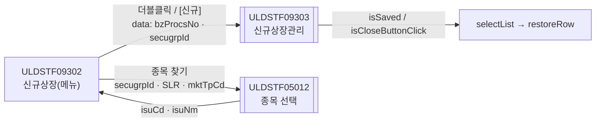
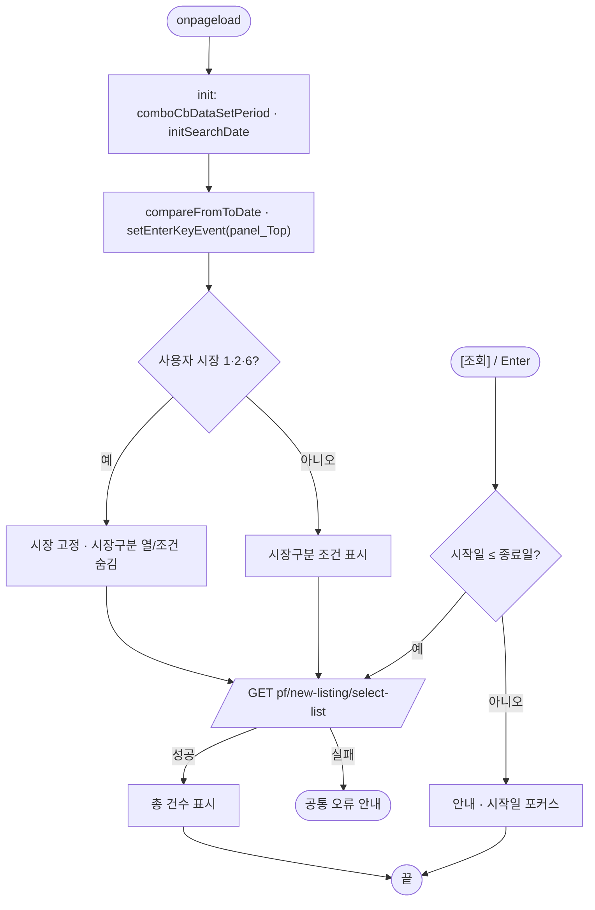
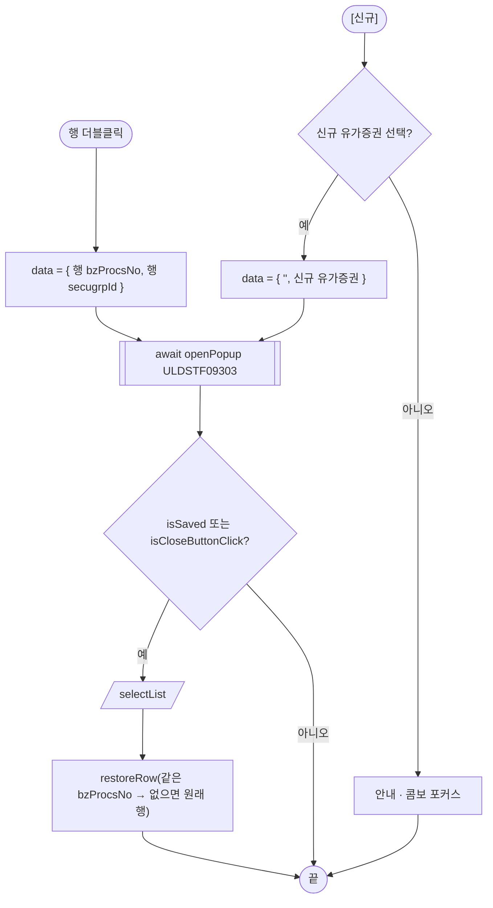

# ULDSTF09302 신규상장(상장형 수익증권) — 업무 분석 및 전환 내역

| 항목 | 내용 |
|---|---|
| AS-IS 원본 | `ULDSTF09302.xml` — W-Craft 1차 변환본(`meta_asisFileNm="ULDSTF09302.gfm"`, 원본 gfm 은 저장소에 없음)에 **API 적용까지 마친 개발 사본**. 업무 로직은 이 스크립트와 남은 옛 코드 주석으로 분석했다 — 반입 `conversion/conversion-front/ui/ULDSTF09302/ULDSTF09302.xml` (pf 묶음) |
| 신규 API 명세 | 없음 — **화면에 적용된 `/api/...` 경로·method·dataCollection keyInfo 를 명세로 간주**(사용자 결정 2026-10-29 준용). §5 는 "화면 적용 API ↔ AS-IS(주석에 남은 옛 호출)" 대응표. `api_spec_check` 는 SKIP |
| TO-BE | `conversion/conversion-front/ui-tobe/ULDSTF09302.xml` (메뉴 본화면) |
| 퍼블리싱 | 화면 폴더 `ULDSTF09302.xml` 의 body 를 1단계 기준으로 정비했다(선례 ULDBNS30400 「캡처 없음, 기존 마크업 정비」). `conversion/publish/상장/상장처리(대내)/ULDSTF09302.xml` 은 참고만 했다 — 차이는 바인딩·폭 정도(body diff 120줄, 라벨 같음) |
| 화면 캡처 | 없음 |
| 업무공통 | `$c.stf`(`setFromToDate`)·`$c.lc`(`initSearchDate`) — `cm/pcc/stf`. 게이트는 `--pcc stf` |
| 공통 계약 | pf 21본 공통 계약서 — 09302 → 09303 `{ bzProcsNo, secugrpId }`, 재조회 규약 `isSaved || isCloseButtonClick`, 배포 경로 `/ui/lst/pf/` |
| 작성 | Inswave / 2026-10-30 |

참고 양식: [websquare_gfm_conversion.md](../../../md/websquare_gfm_conversion.md) — §1.4 업무 프로세스 흐름, §6.5 getPar/setPar 전환. Gauce 대응은 [gfm_business_analysis_guide.md](../../../md/gfm_business_analysis_guide.md) 를 함께 따랐다. 선례: ULDSTF05100(kindstk 목록 — 기간 콤보·재조회·행 복원·엑셀 규칙 42).

---

## 1. 화면 개요

상장형 수익증권(PF) **신규상장 목록**을 조회하고, 건별 **신규상장관리 팝업(ULDSTF09303)** 을 여는 메뉴 본화면이다.

1. 진입하면 기간선택 콤보와 기본 상장일기간(19000101 ~ 오늘+60일)을 채우고 바로 조회한다.
2. 증권구분(전체 A3 / 상장형 수익증권 PF)·상장일기간·종목코드·시장구분(전체·유가·코스닥)으로 조회한다. 유가·코스닥·(6) 사용자는 자기 시장으로 고정되고 시장구분 열·조건이 숨는다.
3. 행 더블클릭 → 그 건으로, 하단 [신규] → 고른 유가증권(상장형 수익증권)으로 신규상장관리 팝업을 연다. 닫히면 다시 조회해 보던 행으로 돌아간다.
4. [엑셀다운로드]는 목록을 내려받는다.

### 1.1 호출 화면

해당 없음 — 메뉴에서 바로 연다.

### 1.2 호출 규약 (부모 → 이 화면) / 반환 규약

해당 없음(메뉴 본화면).

### 1.3 이 화면이 여는 하위 팝업

| 팝업 | AS-IS 호출 | 넘기는 `data` (TO-BE) | 받는 결과 / 취소 판정 |
|---|---|---|---|
| `ULDSTF09303` 상장형 수익증권 신규상장관리 (1320×900) | `openDetail(row)` — data 없이 열고, 팝업이 이 화면의 `scwin.clickBzProcsNo`·`grd_List.getFocusedRowIndex()`·`cmb_NEW_SECUGRP_ID` 를 직접 읽음 | `{ bzProcsNo, secugrpId }` — 행이면 그 행 값, 신규면 `""`·신규 유가증권 | `{ isSaved }`(저장)·`{ isCloseButtonClick }`(X) → 둘 다 **재조회 + 행 복원** |
| `ULDSTF05012` 종목 선택(공통, 600×640) | `img_IsuSearch_onclick` — 이미 data 로 열고 반환을 씀 | `{ secugrpId, searchTyp : "SLR", mktTpCd }` | 행 JSON `isuCd`·`isuNm` — `isEmpty(res?.isuCd)` 면 취소 |

### 1.4 업무 프로세스 흐름

#### 화면 간 흐름

#### 업무 1: 로딩·조회

| 단계 | 주체 | 내용 | 분기 | 근거 |
|---|---|---|---|---|
| 1 | 화면 | 기간선택 콤보·기본 기간 | — | §3 |
| 2 | 화면 | 시장 사용자 분기 | 1·2·6 → 고정 | §3, §8 #5 |
| 3 | 서버 | 목록 조회 | 실패 → 공통 안내 | §5.1 |
| 4 | 화면 | [조회] 기간 선후 검사 | 늦으면 안내 | §4, §8 #6 |

#### 업무 2: 상세·신규 (신규상장관리 팝업)

#### 업무 3: 종목 찾기 · 엑셀

- 종목 찾기: 05012 를 열고 고르면 종목코드·종목명을 채운다(취소면 그대로). 종목코드를 비우고 칸을 벗어나면 종목명도 비운다.
- 엑셀: 목록이 0건이면 안내, 아니면 `{menuId}_신규상장_{yyyyMMddHHmmss}.xlsx` 로 내려받는다(규칙 42).

---

## 2. 화면 구성 및 데이터 정의

### 2.1 화면 구성 (AS-IS 요소 → TO-BE 컴포넌트)

| 영역 | AS-IS id (개발 사본) | TO-BE | 비고 |
|---|---|---|---|
| 머리 | `pfm_pageFrame1` | `pfmContentHeader` | 표준 contentHeader |
| 조회 | `panel_Top`·`grp_search`(schbox) | 같음 | Enter 키는 `panel_Top` (규칙 22) |
| 증권구분 | `rdo_SECUGRP_ID`(A3 전체 / PF) | 같음 | `dma_selectListReq.secugrpId` |
| 상장일기간 | `edt_SDate`·`edt_EDate`·`label_3`(~)·`cmb_PeriodTp` | 같음 | 기간 쌍 `compareFromToDate`(규칙 37). 콤보는 `ev:onviewchange`, 항목은 공통이 채움(05100 선례) |
| 종목 | `txb_ISU_CD`·`txb_ISU_NM`(읽기)·`img_IsuSearch` | 같음 | `txb_ISU_CD` 에 `ev:onblur` 연결(§8 #3) |
| 시장구분 | `panel_mkt_gubun`·`lblMkNm`·`rdo_SPOT_ISU_TRD_MKT_TP_CD`(A·1·2) | 같음 | 시장 사용자는 숨김 |
| 조회 버튼 | `btn_Search` | 같음 | |
| 건수·엑셀 | `panel_page`·`btn_Excel` | 같음 | |
| 목록 | `grd_List`(21열, 행번호, 고정 5열) | 같음 | 높이 오타 `153x` 제거, `readOnly`·`focusMode="row"`, 더블클릭 `scwin.grd_List_oncelldblclick`. 머리글 `&lt;/br&gt;` → `&lt;br/&gt;`(선례 표기) |
| 목록 열 | `isuKorNm`(노란 배경 인라인) | `class="bg_orange"` | 규칙 40 |
| 목록 열 | `listDd`·`expDd`(`####-##-##`) | `dataType="date" displayFormat="yyyy-MM-dd"` | 규칙 46(AS-IS mask XXXX-XX-XX) |
| 하단 | `label_6`(TU 단위 안내)·`label_4`·`cmb_NEW_SECUGRP_ID`·`btn_New` | 같음 | 콤보의 Gauce 값 `''` 항목 → `chooseOption`(§8 #4), [신규] `btn_cm pt`(규칙 41) |
| (삭제) | `position:absolute` 빈 그룹 | — | W-Craft 잔재 |

W-Craft 잔재 속성(`hierarchy`·`orgid`·`userData2`·`meta_snippet*`·trigger `src`·`text`·select1 `item`·`cbdatacolumns`·`listexprformat`)은 모두 지웠다.

### 2.2 데이터 정의 (DataCollection)

화면에 적용된 keyInfo 를 그대로 쓴다(명세 대용).

| id | 종류 | 키 | 용도 |
|---|---|---|---|
| `dma_selectListReq` | dataMap | `secugrpId`·`isuCd`·`mktTpCd`·`startDate`·`endDate` | 조회 요청 — 조회 컴포넌트에 `ref` |
| `dlt_selectListRes` | dataList | `bzProcsNo`·`isurCd`·`isuCd`·`spotIsuTrdMktTpCd`·`trMktNm`·`secugrpId`·`secugrpNm`·`isuSrtCd`·`isuKorNm`·`comNm`·`isuPrc`(n)·`listShrs`(n)·`trstProprtTotAmt`(n)·`pfNetasstTotamt`(n)·`pfLstNav`(n)·`cu1Shrs`(n)·`listDd`·`draftYn`·`disclsYn`·`mktactYn`·`fnlEmpNm`·`declSpd`(n)·`declSpdStr`·`bzAdmComIsurCd`·`bzAdmComNm`·`pfTotFee`(n)·`cisCostRt`(n)·`apCmpLpCostRt`(n)·`trstComCostRt`(n)·`transagntCostRt`(n)·`expDd`·`taxTpNm`·`etfReplicaMethdTpNm` | 목록 응답 — `grd_List` |

- 삭제: `xf:submission sbm_dts_List`(Gauce 잔재, 쓰는 곳 없음).
- 날짜 열 `listDd`·`expDd` 는 AS-IS 마스크 열이라 규칙 46 대상 — 서버 값이 8자리인지 §10 #6.

### 2.3 원본 요소 전체 대응 (자동 추출 — 누락 점검용)

원본 XML 의 모든 id·명칭을 TO-BE 와 대조했다. 「같음」은 TO-BE 에 같은 id 가 있는 것이다.

#### DataCollection (원본 head)

| AS-IS id | TO-BE | 키(명칭) |
|---|---|---|
| `dma_selectListReq` (dataMap) | 같음 | `secugrpId`(증권그룹ID)·`isuCd`(종목코드)·`mktTpCd`(시장구분)·`startDate`(상장일기간 시작일)·`endDate`(상장일기간 종료일) |
| `dlt_selectListRes` (dataList) | 같음 | `bzProcsNo`(업무처리번호)·`isurCd`(발행회사코드)·`isuCd`(종목코드)·`spotIsuTrdMktTpCd`(시장구분코드)·`trMktNm`(시장구분)·`secugrpId`(증권그룹ID)·`secugrpNm`(증권그룹)·`isuSrtCd`(종목단축코드)·`isuKorNm`(종목명)·`comNm`(회사명)·`isuPrc`(발행가격)·`listShrs`(상장증권수)·`trstProprtTotAmt`(신탁원본액)·`pfNetasstTotamt`(PF순자산총액)·`pfLstNav`(PF최종순자산가치)·`cu1Shrs`(1CU단위증권수)·`listDd`(상장일)·`draftYn`(기안여부)·`disclsYn`(공시여부)·`mktactYn`(시장조치여부)·`fnlEmpNm`(최종처리자)·`declSpd`(신고스프레드)·`declSpdStr`(신고스프레드)·`bzAdmComIsurCd`(사무관리회사발행기관코드)·`bzAdmComNm`(사무관리회사)·`pfTotFee`(PF총수수료)·`cisCostRt`(집합투자기구비용율)·`apCmpLpCostRt`(AP대비LP비용율)·`trstComCostRt`(신탁회사비용율)·`transagntCostRt`(일반사무수탁회사비용율)·`expDd`(존속기한 만료일)·`taxTpNm`(과세유형)·`etfReplicaMethdTpNm`(복제유형) |

#### 컴포넌트 (원본 body, 문서 순서)

| AS-IS id | 태그 | 라벨·바인딩 | TO-BE |
|---|---|---|---|
| `pfm_pageFrame1` | w2:pageFrame |  | `pfmContentHeader`(표준 머리) |
| `panel_Top` | xf:group |  | 같음 |
| `grp_search` | xf:group |  | 같음 |
| `label_5` | w2:textbox | 증권구분 | 같음 |
| `rdo_SECUGRP_ID` | xf:select1 |  — `dma_selectListReq.secugrpId` | 같음 |
| `label_1` | w2:textbox | 상장일기간 | 같음 |
| `edt_SDate` | w2:inputCalendar |  — `dma_selectListReq.startDate` | 같음 |
| `label_3` | w2:textbox | ~ | 같음 |
| `edt_EDate` | w2:inputCalendar |  — `dma_selectListReq.endDate` | 같음 |
| `cmb_PeriodTp` | xf:select1 |  | 같음 |
| `label_2` | w2:textbox | 종목코드(명) | 같음 |
| `txb_ISU_CD` | xf:input |  — `dma_selectListReq.isuCd` | 같음 |
| `txb_ISU_NM` | xf:input |  | 같음 |
| `img_IsuSearch` | xf:trigger |  | 같음 |
| `panel_mkt_gubun` | xf:group |  | 같음 |
| `lblMkNm` | w2:textbox | 시장구분 | 같음 |
| `rdo_SPOT_ISU_TRD_MKT_TP_CD` | xf:select1 |  — `dma_selectListReq.mktTpCd` | 같음 |
| `btn_Search` | xf:trigger |  | 같음 |
| `panel_page` | w2:span | 0 | 같음 |
| `btn_Excel` | xf:trigger |  | 같음 |
| `grd_List` | w2:gridView |  | 같음 |
| `caption1` | w2:caption | this is a grid caption. | 같음 |
| `header1` | w2:header |  | 같음 |
| `h_DISCLS_YN` | w2:column | 공시검토 여부 | 같음 |
| `h_TR_MKT_NM` | w2:column | 시장구분 | 같음 |
| `h_SECUGRP_NM` | w2:column | 증권구분 | 같음 |
| `h_ISU_KOR_NM` | w2:column | 종목명 | 같음 |
| `h_ISU_CD` | w2:column | 종목코드 | 같음 |
| `h_LIST_DD` | w2:column | 상장일 | 같음 |
| `h_EXP_DD` | w2:column | 존속기한 만료일 | 같음 |
| `h_TRST_PROPRT_TOT_AMT` | w2:column | 신탁원본액 | 같음 |
| `h_TAX_TP_NM` | w2:column | 과세유형 | 같음 |
| `h_DECL_SPD_STR` | w2:column | 신고 스프레드 | 같음 |
| `h_ETF_REPLICA_METHD_TP_NM` | w2:column | 복제유형 | 같음 |
| `h_LIST_SHRS` | w2:column | 상장증권수 | 같음 |
| `h_PF_LST_NAV` | w2:column | 최종NAV | 같음 |
| `h_PF_TOT_FEE` | w2:column | 총보수 (%) | 같음 |
| `h_CIS_COST_RT` | w2:column | 집합투자업자 보수 | 같음 |
| `h_AP_CMP_LP_COST_RT` | w2:column | AP/LP 보수 | 같음 |
| `h_TRST_COM_COST_RT` | w2:column | 신탁회사 보수 | 같음 |
| `h_TRANSAGNT_COST_RT` | w2:column | 사무관리회사 보수 | 같음 |
| `h_BZ_ADM_COM_NM` | w2:column | 일반사무관리회사 | 같음 |
| `h_FNL_EMP_NM` | w2:column | 최종처리자 | 같음 |
| `h_BZ_PROCS_NO` | w2:column | 업무처리번호 | 같음 |
| `gBody1` | w2:gBody |  | 같음 |
| `disclsYn` | w2:column |  | 같음 |
| `trMktNm` | w2:column |  | 같음 |
| `secugrpNm` | w2:column |  | 같음 |
| `isuKorNm` | w2:column |  | 같음 |
| `isuCd` | w2:column |  | 같음 |
| `listDd` | w2:column |  | 같음 |
| `expDd` | w2:column |  | 같음 |
| `trstProprtTotAmt` | w2:column |  | 같음 |
| `taxTpNm` | w2:column |  | 같음 |
| `declSpdStr` | w2:column |  | 같음 |
| `etfReplicaMethdTpNm` | w2:column |  | 같음 |
| `listShrs` | w2:column |  | 같음 |
| `pfLstNav` | w2:column |  | 같음 |
| `pfTotFee` | w2:column |  | 같음 |
| `cisCostRt` | w2:column |  | 같음 |
| `apCmpLpCostRt` | w2:column |  | 같음 |
| `trstComCostRt` | w2:column |  | 같음 |
| `transagntCostRt` | w2:column |  | 같음 |
| `bzAdmComNm` | w2:column |  | 같음 |
| `fnlEmpNm` | w2:column |  | 같음 |
| `bzProcsNo` | w2:column |  | 같음 |
| `label_6` | w2:textbox | 상장증권수 및 최종NAV는 TU 단위로 표시된 값임 | 같음 |
| `label_4` | w2:textbox | 유가증권 | 같음 |
| `cmb_NEW_SECUGRP_ID` | xf:select1 |  | 같음 |
| `btn_New` | xf:trigger |  | 같음 |

---

## 3. 로딩 (`scwin.onpageload` → `scwin.init`)

`onpageload` 는 `scwin.init()` 호출만 한다(try/`handleError`).

1. `$c.data.comboCbDataSetPeriod(cmb_PeriodTp)` — 기간선택 항목. `$c.lc.initSearchDate(edt_SDate, edt_EDate)` — 시작 19000101, 종료 오늘+60일(원본 주석의 60일과 같음).
2. 기간 쌍 `$c.date.compareFromToDate(edt_SDate, edt_EDate, ["상장일기간 시작일", "상장일기간 종료일"])`(규칙 37), `$c.win.setEnterKeyEvent(panel_Top, scwin.btn_Search_onclick)`(규칙 22).
3. 세션 `market` 이 1·2·6 이면 `grd_List.setColumnVisible("trMktNm", false)` + 시장구분을 그 값으로 + `panel_mkt_gubun` 숨김, 아니면 표시(원본 `$c.cm.setColumnProp(…"TR_MKT_NM"…)` — 대문자 열 이름이라 동작하지 않던 호출을 실제 열 id 로).
4. `await scwin.selectList()` — 콤보가 정적이라 기다릴 선행 조회는 없다.

---

## 4. 컴포넌트 이벤트

| 컴포넌트 · 이벤트 | AS-IS 핸들러 | TO-BE 핸들러 | 동작 |
|---|---|---|---|
| `btn_Search` click / Enter | `btn_Search_onclick` | `scwin.btn_Search_onclick` | 기간 선후 검사 → `selectList` (§8 #6) |
| `img_IsuSearch` click | `img_IsuSearch_onclick` | `scwin.img_IsuSearch_onclick` → `scwin.openIsuPopup` | §6.3 |
| `txb_ISU_CD` blur | `txb_ISU_CD_onblur`(userData2 에만 — 미연결) | `scwin.txb_ISU_CD_onblur` | 종목코드가 비면 종목명 비움 (§8 #3) |
| `cmb_PeriodTp` 값 변경 | `cmb_PeriodTp_OnSelChange`(`ev:onchange`) | `scwin.cmb_PeriodTp_onviewchange` | `$c.stf.setFromToDate(getSelectedIndex(), …)` — 공통은 숫자로 비교(05100 §8 #8 선례). 원본은 `$c.cp.valueOfIndex(…"value"…)` |
| `grd_List` 더블클릭 | `grd_List_OnDblClick` | `scwin.grd_List_oncelldblclick` → `scwin.openDetail` | §6.2 |
| `btn_Excel` click | `btn_Excel_onclick` | `scwin.btn_Excel_onclick` → `scwin.excelDown` | §6.4 |
| `btn_New` click | `btn_New_onclick` | `scwin.btn_New_onclick` → `scwin.openNew` | §6.1 |
| (버튼 없음) | `btn_EDate_onclick`·`btn_SDate_onclick`(`popUpCalendar2`) | 삭제 | Gauce 달력 — inputCalendar 로 대체, 버튼도 없다 |
| (body) | `onpageunload`(빈 함수) | 삭제 | |

---

## 5. 서버 통신

| # | 용도 | 화면 적용 API (명세 대용) | AS-IS(주석) | TO-BE 함수 |
|---|---|---|---|---|
| 5.1 | 목록 조회 | `GET /api/listing/lstproc/pf/new-listing/select-list` — ref `dma_selectListReq`, target `dlt_selectListRes=body` | Gauce `dts_List` 조회(`sbm_dts_List`) | `scwin.selectList` |

### 5.1 목록 조회 (`scwin.selectList`)

- `executeDynamic({ id : "sbm_selectList", method : "get", action : "…/select-list", ref : "dma_selectListReq", target : "dlt_selectListRes=body", gridview : "grd_List" })`(규칙 38 전체 경로, 규칙 44 gridview id 만).
- `skipped`(진행 중) → false. 실패는 공통 오류 핸들러가 안내(원본 `dts_List_OnLoadError → $c.stf.alert_error` — pcc 에 없는 함수, 삭제).
- 성공 → `panel_page.setValue(행 수)`(원본 `$c.stf.fillGridHeaderTotalCnt` 와 같은 결과).
- 중복 실행: 공통 `$c.sbm` 이 진행 중 호출을 건너뛴다.

---

## 6. 일반 함수

### 6.1 신규 (`scwin.openNew`)

`cmb_NEW_SECUGRP_ID` 가 비면 "신규등록할 [유가증권]을 선택하세요." + 포커스, 아니면 `openDetail(-1)`.

### 6.2 상세 팝업 (`scwin.openDetail` · `scwin.restoreRow`)

- data `{ bzProcsNo, secugrpId }` — 행이면 `dlt_selectListRes` 의 그 행 값, 신규면 `""`·`cmb_NEW_SECUGRP_ID`.
- `openPopup("/ui/lst/pf/ULDSTF09303.xml", { id : "ULDSTF09303", popupName : "상장형 수익증권 신규상장관리", width : 1320, height : 900, frameModal : "top", type : "pageFramePopup" }, data)`.
- `isSaved === true || isCloseButtonClick === true` → `selectList` → `restoreRow(bzProcsNo, rowIndex)`: 같은 업무처리번호 행, 없으면 원래 행 번호, 신규(-1)는 그대로.
- 원본: 팝업이 저장 뒤 `parentWin.scwin.fn_list_sync()`(이 화면에 없는 함수 — 이 화면 조회는 `list_sync`) 를 부르고 `parentWin.grd_List.setFocusedCell(rowPos, 0)` 로 행을 옮겼다 → 부모가 처리(가이드 §6.5).

### 6.3 종목 선택 (`scwin.openIsuPopup`)

data `{ secugrpId : rdo_SECUGRP_ID, searchTyp : "SLR", mktTpCd : rdo_SPOT_ISU_TRD_MKT_TP_CD }`, 05012 반환 행의 `isuCd`·`isuNm`. 취소·X 도 객체라 `isEmpty(res?.isuCd)` 로 판정(원본 `!isEmpty(res)` 는 X 닫기에도 참이라 `undefined` 를 채웠다).

### 6.4 엑셀 (`scwin.excelDown`)

0건 → "해당데이터가 없습니다. 조회후 다운받으십시요.", 아니면 `$c.data.downloadGridViewExcel(grd_List, { fileName : getProgramId() + "_신규상장_" + yyyyMMddHHmmss + ".xlsx", sheetName : "sheet1" })`(규칙 42). `doLogSave` 는 옮기지 않는다.

### 6.5 부모 ↔ 팝업 파라미터 전달

이 화면은 부모 쪽이다. 원본 09303 이 이 화면의 컴포넌트·전역(`clickBzProcsNo`·`grd_List`·`cmb_NEW_SECUGRP_ID`)을 직접 읽던 것을 `openPopup` data + `await` 반환으로 바꿨다(§6.2). 그래서 부모 직접 참조용이던 `scwin.clickBzProcsNo`·`setBzProcsNo`·`getBzProcsNo` 는 지웠다.

---

## 7. 업무 코드 · 메시지 목록

| 구분 | 값 | 의미 |
|---|---|---|
| 증권구분 | `A3` 전체 · `PF` 상장형 수익증권 | 조회 조건 |
| 시장구분 | `A` 전체 · `1` 유가 · `2` 코스닥 | 조회 조건 |
| 사용자 시장 | `1`·`2`·`6` | 시장 고정 대상 |
| 조회유형 | `SLR` | 05012 종목 선택 |
| 메시지 | "신규등록할 [유가증권]을 선택하세요." / "해당데이터가 없습니다. 조회후 다운받으십시요." / (신규) "상장일기간 시작일이 종료일보다 늦습니다." | |

---

## 8. 원본 특이사항 · 결함

| # | 내용 | 결정 |
|---|---|---|
| 1 | 하위 팝업 09303 이 이 화면의 전역·그리드·콤보를 직접 읽고, 저장 뒤 이 화면 그리드를 직접 움직임 | **고침** — data/반환 + 부모 재조회·행 복원(§6.2) |
| 2 | `dts_List_OnLoadError → $c.stf.alert_error(dts_List)`(pcc 에 없음, `dts_List` 도 없음), `btn_SDate/EDate_onclick → popUpCalendar2`(버튼 없음) | **옮기지 않음** |
| 3 | `txb_ISU_CD_onblur` 가 userData2(Gauce 잔재)에만 있어 연결되지 않음 | **고침** — `ev:onblur` |
| 4 | `cmb_NEW_SECUGRP_ID` 첫 항목 값이 문자 그대로 `''`(따옴표 2개) — 빈 값 검사가 늘 통과해 `''` 로 신규 팝업을 열 수 있었다 | **고침** — `chooseOption="true"`(빈 값) |
| 5 | 사용자 시장 `6` 이면 시장구분 라디오에 없는 값(`6`)을 넣는다 | **유지** — 원본 그대로, §10 #2 |
| 6 | [조회] 시 기간이 거꾸로면 안내 없이 아무것도 안 함 | **고침** — 안내 후 시작일 포커스 |
| 7 | 그리드 높이 `153x`(오타), 날짜 열 `####-##-##`, 종목명 인라인 배경 | **고침** — 규칙 46·40 |
| 8 | 시장구분 열 숨김이 대문자 `TR_MKT_NM` 이라 동작하지 않음(`$c.cm.setColumnProp`) | **고침** — `setColumnVisible("trMktNm", false)` |

---

## 9. 전환 내역 (AS-IS → TO-BE)

| AS-IS | TO-BE | 비고 |
|---|---|---|
| `scwin.onpageload` | `scwin.onpageload` | init 호출만 |
| `scwin.init` | `scwin.init` | §3 |
| `scwin.onpageunload` | 삭제 | 빈 함수 |
| `scwin.vScrenID`·`scwin.clickBzProcsNo` | 삭제 | 화면 로그·부모 직접 참조용 |
| `scwin.setBzProcsNo`·`scwin.getBzProcsNo` | 삭제 | §6.5 |
| `scwin.list_sync` + `scwin.dts_List_OnLoadCompleted` | `scwin.selectList` | §5.1 |
| `scwin.dts_List_OnLoadError` | 삭제 | §8 #2 |
| `scwin.excelDown` | `scwin.excelDown` | 규칙 42 |
| `scwin.openDetail` | `scwin.openDetail` + `scwin.restoreRow` | §6.2 |
| `scwin.btn_Search_onclick` | `scwin.btn_Search_onclick` | §8 #6 |
| `scwin.btn_Excel_onclick` | `scwin.btn_Excel_onclick` | |
| `scwin.grd_List_OnDblClick` | `scwin.grd_List_oncelldblclick` | 규칙 3 |
| `scwin.btn_New_onclick` | `scwin.btn_New_onclick` + `scwin.openNew` | |
| `scwin.btn_EDate_onclick`·`scwin.btn_SDate_onclick` | 삭제 | §8 #2 |
| `scwin.img_IsuSearch_onclick` | `scwin.img_IsuSearch_onclick` + `scwin.openIsuPopup` | §6.3 |
| `scwin.txb_ISU_CD_onblur` | `scwin.txb_ISU_CD_onblur` | §8 #3 |
| `scwin.cmb_PeriodTp_OnSelChange` | `scwin.cmb_PeriodTp_onviewchange` | |

- publicInfo: 정의한 15함수 전부. 상수(`POPUP_URL_*`·`USER_MKT_FIXED`)는 등재하지 않는다.
- 게이트: `gate_screen --pcc stf`·`scan_mixed_compare`(A 2건: `getRowCount() === 0`·`rowCount === 0` 숫자 비교 — 의도)·`publish_gate --before 1단계 사본 --allow P20`(P22·P24 는 스크립트 전환분)·`api_spec_check`(명세 SKIP, A07·A08 통과)·`init_binding_check`·`wsxml_lint` 0/0, `convert.py` 고정점.

---

## 10. 남은 작업 (TODO)

1. **자식 09303 계약** — 같은 묶음(D)에서 09303 이 `{ bzProcsNo, secugrpId }` 를 받고 저장 시 `isSaved` 를 남기도록 맞췄다(대조 완료). 09303 은 스스로 닫는 경로가 없어 X 닫기 → `isCloseButtonClick` 으로 재조회된다.
2. **사용자 시장 6** — 시장구분 라디오에 `6` 항목이 없어 조회 조건 `mktTpCd` 가 빈 값이 될 수 있다(원본 그대로). 6 사용자의 조회 범위 확인.
3. **05012 반환 키** — `isuCd`·`isuNm` 가정(공통 계약서 §3). 05012 전환본의 반환 행 키 확인.
4. **배포 경로** — `/ui/lst/pf/` (공통 계약서 — 원본 리터럴 기준).
5. **publish 원본과의 차이** — 1단계는 개발 사본 body 기준. 캡처를 받으면 레이아웃을 다시 대조한다.
6. **날짜 열 8자리** — `listDd`·`expDd` 서버 값이 `yyyyMMdd` 인지(규칙 46).
