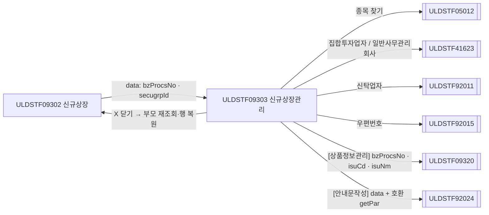
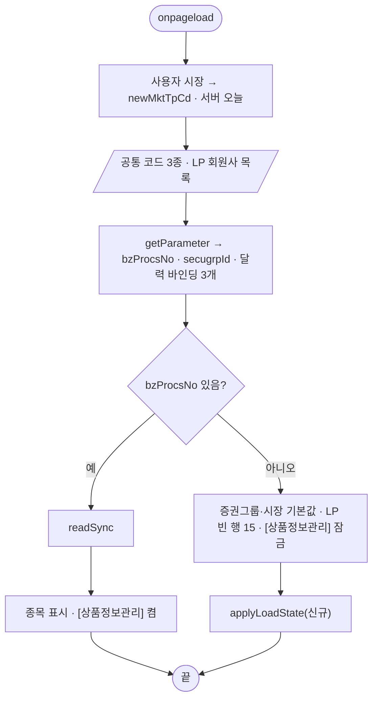
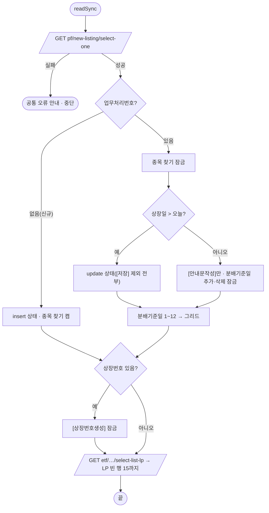
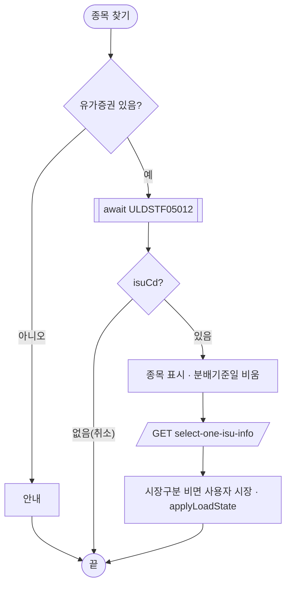
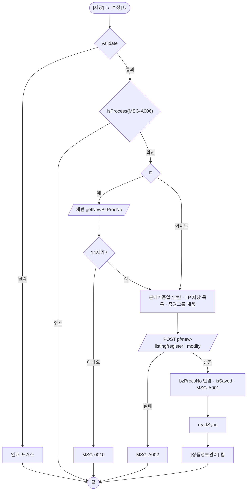
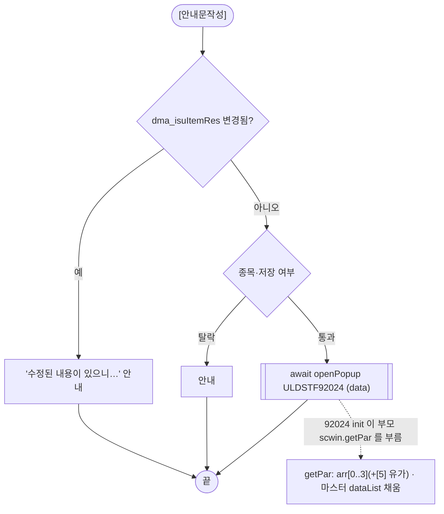

# ULDSTF09303 (팝업)상장형수익증권신규상장관리 — 업무 분석 및 전환 내역

| 항목 | 내용 |
|---|---|
| AS-IS 원본 | `ULDSTF09303.xml` — W-Craft 1차 변환본(`meta_asisFileNm="ULDSTF09303.gfm"`, 원본 gfm 은 저장소에 없음)에 **API 적용까지 마친 개발 사본**. 업무 로직은 이 스크립트와 남은 옛 코드 주석으로 분석했다 — 반입 `conversion/conversion-front/ui/ULDSTF09303/ULDSTF09303.xml` (pf 묶음) |
| 신규 API 명세 | 없음 — **화면에 적용된 `/api/...` 경로·method·dataCollection keyInfo 를 명세로 간주**(사용자 결정 2026-10-29 준용). §5 는 "화면 적용 API ↔ AS-IS(주석에 남은 옛 호출)" 대응표. `api_spec_check` 는 SKIP |
| TO-BE | `conversion/conversion-front/ui-tobe/ULDSTF09303.xml` (배포 경로 `/ui/lst/pf/ULDSTF09303.xml` — 부모 09302 의 원본 리터럴) |
| 퍼블리싱 | 화면 폴더 `ULDSTF09303.xml` 의 body 를 1단계 기준으로 정비했다(선례 ULDBNS30400 「캡처 없음, 기존 마크업 정비」). `conversion/publish/상장/상장처리(대내)/ULDSTF09303.xml` 은 참고만 — 차이는 바인딩·폭·버튼 영역(body diff 185줄, 라벨 같음) |
| 화면 캡처 | 없음 |
| 업무공통 | `$c.lc`(`isProcess`·`checkDoubleInput`·`engSymblCheck`·`chkEtfCorpSymblDoubleInput`·`chkIsuSymblDoubleInput`·`getGlbValue`·`checkGridDataSet`·`initLPGridData`·`createListNo`·`popFindZipCd`·`getDsclsTitle`)·`$c.stf`(`getNewBzProcNo`·`checkMaxLength`·`getMessageParam`) — `cm/pcc/stf`. 게이트는 `--pcc stf` |
| 공통 계약 | pf 21본 공통 계약서 — 09302 → 09303 `{ bzProcsNo, secugrpId }`, 09303 → 09320 `{ bzProcsNo, isuCd, isuNm }`, 92024 호환 `scwin.getPar`(서식 68152H, arr 길이 유가 6·코스닥 4), 재조회 규약 `isSaved || isCloseButtonClick` |
| 작성 | Inswave / 2026-10-30 |

참고 양식: [websquare_gfm_conversion.md](../../../md/websquare_gfm_conversion.md) — §1.4 업무 프로세스 흐름, §6.5 getPar/setPar 전환(이 결과서는 §6.6·§6.11·§6.13·§6.14 가 그 절이다). Gauce 대응은 [gfm_business_analysis_guide.md](../../../md/gfm_business_analysis_guide.md). 선례: ULDSTF05103(kindstk 관리 팝업 — 채번·`checkResult`·92024 `getPar`)·ULDSTF05232(92024 호환).

---

## 1. 화면 개요

상장형 수익증권(PF) **신규상장 건의 법인·종목정보**를 등록·수정하는 팝업이다. 부모 **신규상장(ULDSTF09302)** 이 행 더블클릭이나 [신규]로 연다.

1. 업무처리번호가 있으면 기존 건, 없으면 신규다.
2. 신규: 종목 찾기(ULDSTF05012)로 종목을 고르면 서버에서 종목정보를 받는다(법인·종목명·심볼·NAV 등). 집합투자업자·일반사무관리회사(회사선택 ULDSTF41623), 신탁업자(기관선택 ULDSTF92011), 우편번호, 상장번호(생성), LP 회원(최대 15), 분배기준일(최대 12)을 채우고 [저장] → 확인 → 업무처리번호 채번 → 등록 → 그 번호로 다시 조회.
3. 기존: 조회하고 종목 찾기를 잠근다. 상장일이 오늘 뒤면 [수정]·[안내문작성], 지났으면 [안내문작성]만 켜고 분배기준일 추가·삭제를 잠근다.
4. 유가증권시장이면 영문법인심볼·영문종목심볼이 필수이고 저장 때 중복을 검사한다(중복체크 버튼으로 미리 확인).
5. [상품정보관리] → ULDSTF09320(저장된 건만), [안내문작성] → 공시안내문작성 ULDSTF92024.

### 1.1 호출 화면 (1본)

- `ULDSTF09302` 신규상장(메뉴 본화면, 같은 pf 묶음 D) — 행 더블클릭·[신규]가 1320×900 으로 연다. 원본은 data 없이 열고 이 화면이 부모의 `scwin.clickBzProcsNo`·`grd_List.getFocusedRowIndex()`·`cmb_NEW_SECUGRP_ID` 를 직접 읽었으며, 저장 뒤 부모의 `fn_list_sync`(부모에 없는 이름)·`grd_List.setFocusedCell` 을 직접 불렀다.

### 1.2 호출 규약 (부모 → 이 화면) / 반환 규약

| TO-BE 키 | 의미 (부모 09302 값) | AS-IS | 빈 값일 때 / 분기 |
|---|---|---|---|
| `bzProcsNo` | 업무처리번호 — 신규 `""`, 기존은 선택 행 | `parentWin.scwin.clickBzProcsNo` | **비면 신규**, 있으면 기존 건 조회 |
| `secugrpId` | 증권그룹 — 신규는 부모 신규 유가증권(PF), 행이면 그 행 | `parentWin.cmb_NEW_SECUGRP_ID` | 신규 건 `cmb_SECUGRP_ID` 값 |
| (넘기지 않음) | — | `parentWin.grd_List.getFocusedRowIndex()`(`rowPos`) | 행 복원은 부모가 한다 |

- **반환**: 스스로 닫는 경로가 없다(하단 [닫기] 금지 — 원본도 주석). 저장·수정 성공 시 `scwin.isSaved = true`. X·ESC 로 닫히면 `{ isCloseButtonClick : true }` 가 가므로 부모는 **다시 조회하고 같은 업무처리번호 행으로 돌아간다**(공통 계약서 재조회 규약).

```javascript
// 부모 ULDSTF09302
const res = await $c.win.openPopup("/ui/lst/pf/ULDSTF09303.xml",
    { id : "ULDSTF09303", popupName : "상장형 수익증권 신규상장관리", width : 1320, height : 900, frameModal : "top", type : "pageFramePopup" },
    { bzProcsNo, secugrpId });
if (res?.isSaved === true || res?.isCloseButtonClick === true) { /* selectList + restoreRow */ }
```

### 1.3 이 화면이 여는 하위 팝업

| 팝업 | AS-IS 호출 | 넘기는 `data` (TO-BE) | 받는 결과 / 취소 판정 |
|---|---|---|---|
| `ULDSTF05012` 종목 선택(공통, 600×640) | `img_SearchIsu_onclick`(개발 사본 data 사용, 원본 `fn_GetParIsuCd`/`fn_SetParIsuCd`) | `{ secugrpId, searchTyp : "SEC", mktTpCd }` | 행 JSON `isuCd`·`isuNm` — `isEmpty(res?.isuCd)` 면 취소 |
| `ULDSTF41623` 회사 선택(저장소에 없음, 550×700) ×2 | `img_TRST_COM_NM_onclick`·`img_BZ_ADM_COM_NM_onclick`(원본 `fn_getParTrstComInstCd`·`fn_getParBzAdmComNm` + `ISUR_ALL`) | 없음 | `isurCd`·`comNm` 가정 — `isEmpty(res?.isurCd)` 면 취소(§10 #7) |
| `ULDSTF92011` 기관 선택(공통, 500×700) | `img_TRST_INST_NM_onclick`(원본 `fn_SetParTrstnIstCd`) | 없음 | `instCd`·`instNm` — `isEmpty(res?.instCd)` 면 취소(원본은 판정 없음 — §8 #3) |
| 우편번호(`$c.lc.popFindZipCd` → ULDSTF92015) | `img_ZIPCD_onclick`(원본 `fn_SetParZipCd`) | 없음 | `zipNo`·`addr` — `isEmpty(res?.zipNo)` 면 취소 |
| `ULDSTF09320` 상품정보관리(1000×900) | `btn_sim_onclick`(원본 `?nIndex=`, 09320 이 이 화면을 직접 읽음) | `{ bzProcsNo, isuCd, isuNm }` | 반환 없음 — 원본처럼 재조회하지 않음 |
| `ULDSTF92024` 공시안내문작성(공통, 793×851) | `fn_dscl`(임시 `fn_GetPar` + `CreateDialogFrame` — 개발 사본은 첫 줄 `return`) | `{ formCd, bzProcsNo, isurCd, mktId, title, mst }` + 호환용 `scwin.getPar` | 반환 없음(닫힐 때까지 `await`) |

### 1.4 업무 프로세스 흐름

#### 화면 간 흐름



#### 업무 1: 로딩



#### 업무 2: 다시 조회 · 상태 (`readSync` · `applyLoadState`)



#### 업무 3: 종목 찾기(신규)



#### 업무 4: 저장(등록)·수정



| 단계 | 주체 | 내용 | 분기 | 근거 |
|---|---|---|---|---|
| 1 | 화면 | 검사(필수·중복·심볼·상장일·LP) | 탈락 → 안내 | §6.3 |
| 2 | 화면 | 처리 확인 | 취소 → 끝 | §6.5 |
| 3 | 서버 | (등록) 채번 | 14자리 아님 → MSG-0010 | §6.5, §10 #3 |
| 4 | 서버 | 등록·수정 | 실패 → MSG-A002 | §5.6 |
| 5 | 화면 | 안내 → 다시 조회 → [상품정보관리] | — | §6.5 |

#### 업무 5: 안내문작성



#### 업무 6: 보조 — 상장번호·심볼·회사/기관·우편번호·분배기준일·법인명 일치

| 업무 | 흐름 | 근거 |
|---|---|---|
| 상장번호생성 | 시장구분으로 새 번호 → `listNo`. 실패면 안내 | §6.8 |
| 심볼 중복체크 | 비면 안내 → 형식 → 중복 검사 → 결과 문구 | §6.9 |
| 회사·기관 선택 | 팝업 → 코드·이름 채움, 취소면 그대로 | §6.11 |
| 우편번호 | pcc 팝업 → 우편번호·주소 | §6.7 |
| 분배기준일 | 추가(최대 12, MMDD 검사) · 삭제(확인) · 행 클릭 표시 | §6.12 |
| 법인명 일치 | 법인명 4종 → 종목명 4종 복사 | §6.10 |

---

## 2. 화면 구성 및 데이터 정의

### 2.1 화면 구성 (AS-IS 요소 → TO-BE 컴포넌트)

| 영역 | AS-IS | TO-BE | 비고 |
|---|---|---|---|
| 머리 | (없음) | `pfmContentHeader` | 팝업 contentHeader 필수 |
| 종목 찾기 | `panel_Top`(schbox)·`label_2_top`·`txb_SearchIsuCd`·`txb_SearchIsuNm`(읽기)·`img_SearchIsu`, 빈 `btn_schbox` | 같음, 빈 `btn_schbox` 삭제 | 조회 버튼이 없어 Enter 키 대상 아님 |
| 유가증권 | `label_15`·`cmb_SECUGRP_ID`(항목 PF, 비활성 — 원본 script 로 숨김) | 같음, 마크업 `display:none`, **바인딩 없음** | 저장 때 `secugrpId` 로 넣음(원본 trs Parameters SECUGRP_ID) |
| 안내 | `label_45`(필수 표시) | 같음 | |
| 법인정보 | `label_47`·`panel_1`: `txb_ISUR_CD`(읽기)·`txb_COM_NM`·`txb_ZIPCD`·`img_ZIPCD`·`txb_ADDR`·`txb_COM_ABBRV`·`txb_DTL_ADDR`·`txb_COM_ENG_NM`·`txb_LIST_NO`·`img_LIST_NO`·`txb_COM_ENG_ABBRV`·`txb_CORP_TEL_NO`·`panel_ISUR_SYMBL`·`txb_ISUR_SYMBL`·`img_ISUR_SYMBL`·`cmb_TRANSSTK_AGNT_CD`·`img_isu_nm_identify` | 같음 | 라벨 `label_7`~`label_10`·`label_1`·`label_56`·`label_2`·`label_44`·`label_52`·`label_54`·`label_4`·`label_17` |
| 종목정보 | `label_42`·`panel_12`: `txb_ISU_CD`·`txb_ISU_SRT_CD`·`edt_LIST_DD`·`cmb_SPOT_ISU_TRD_MKT_TP_CD`(비활성)·`txb_ISU_KOR_NM`·`edt_LIST_SHRS`·`edt_ISU_DD`·`txb_ISU_KOR_ABBRV`·`edt_PF_NETASST_TOTAMT`·`edt_ISU_PRC`·`txb_ISU_ENG_NM`·`edt_FLOW_NETASST_TOTAMT`·`edt_FORNCURR_NETASST_TOTAMT`·`txb_ISU_ENG_ABBRV`·`edt_PF_LST_NAV`·`edt_FORNFLOW_NETASST_TOTAMT`·`txb_ISU_ENG_SYMBL`·`img_ISU_ENG_SYMBL`·`edt_CU1_SHRS`·`edt_FORNCURR_LST_NAV`·`txb_TRST_COM_NM`·`img_TRST_COM_NM`·`edt_FLOW_SHRS`·`txb_BZ_ADM_COM_NM`·`img_BZ_ADM_COM_NM`·`edt_DECL_SPD`·`txb_TRST_INST_NM`·`img_TRST_INST_NM`·`cmb_DIVRG_RT_EXCS_OCCR_DECL_BASVAL`·`edt_EXP_DD`·`cmb_TAX_TP_CD`·`txb_SALE_COM_NM`·`txb_ASSTCUSTD_NM` | 같음 | `txb_ISU_ENG_SYMBL` 에 `ref` 추가(§8 #6). 달력 3개 `checkCalendarFormat`(규칙 37) |
| 숫자 입력(규칙 48) | `edt_*` 11칸(Gauce numeric·maxdecimalplace) | 정수형 `edt_LIST_SHRS`·`edt_PF_NETASST_TOTAMT`·`edt_FLOW_NETASST_TOTAMT`·`edt_CU1_SHRS`(`number`·`#,###`), 소수형 `edt_ISU_PRC`·`edt_PF_LST_NAV`(4자리), `edt_FORNCURR_NETASST_TOTAMT`·`edt_FORNFLOW_NETASST_TOTAMT`·`edt_FORNCURR_LST_NAV`·`edt_FLOW_SHRS`(3자리), `edt_DECL_SPD`(2자리) — 모두 `class="tar"` | 원본 maxdecimalplace 를 소수 자리로 |
| LP·분배기준일 | `grd_LP`(`dlt_grdLPList`, 열 `lpMbrNo` select ← `dlt_LPList`)·`label_16`·`img_Add`·`img_del`·`label_66`·`txb_DISTR_BAS_MMDD`·`label_67`·`label_70`·`label_71`·`label_69`·`grd_DISTR_BAS_MMDD`(`dlt_distrBasMmDd`) | 같음 | 그리드 자동 id 중복 해소(§2.3), `txb_DISTR_BAS_MMDD` 키 필터 → `allowChar="0-9"`, 잘못된 `ref="distrbasmmd"` 제거, 분배기준일 그리드 `ev:oncellclick`·`readOnly` |
| 장외파생 | `label_60`·`panel_2`: `cmb_ETF_REPLICA_METHD_TP_CD`·`txb_OTC_DRV_CLSS_TR_CTPART_NM`~`NM10`, 라벨 `label_58`·`label_59`·`label_28`~`label_31`·`label_72`·`label_21`·`label_23`·`label_25`·`label_38` | 같음 | |
| 버튼 | lt `label_19`·`btn_sim` / rt `txb_IDX_TOTAL_CD`·`btn_Dscl`·`btn_Update`·`btn_Save`·(주석) `btn_Close` | `grp_btnBox`: lt `label_19`(`txt_info`)·`btn_sim` / rt `btn_Dscl`·`btn_Update`(pt)·`btn_Save`(pt) | 규칙 41, `txb_IDX_TOTAL_CD`·`btn_Close` 삭제 |

W-Craft 잔재 속성(`hierarchy`·`orgid`·`userData2`·`meta_snippet*`·`cursor`·trigger `src`·`text`·select1 `item`·`cbdatacolumns`·`listexprformat`)은 모두 지웠다.

### 2.2 데이터 정의 (DataCollection)

| id | 종류 | 키 | 용도 |
|---|---|---|---|
| `dma_codReq` | dataMap | `codeList` | 공통 코드 요청 |
| `dlt_transstkAgntCd`·`dlt_taxTpCd`·`dlt_etfReplicaMethdTpCd` | dataList | `text`·`value` | 명의개서대행기관·과세유형·복제유형 콤보 |
| `dlt_LPList` | dataList | `text`·`value` | LP 회원사 선택 목록 |
| `dlt_grdLPList` | dataList | `lpMbrNo` | LP 그리드 |
| `dlt_grdLPSaveList` | dataList | `bzProcsNo`(**추가**)·`lpMbrNo`·`lpContrtDd`·`lpStrtDd`·`lpEndDd` | LP 저장 목록 → `lpInfoList`. 원본은 없는 `bzProcsNo` 열에 값을 넣었다 |
| `dma_isuItemRes` | dataMap | 개발 사본 keyInfo 79키 그대로 + **추가** `ceoNm`·`stdIndCd`·`listMethdTpCd`·`isuRsnContn`·`remk` | 조회 응답 + 등록·수정 요청. 추가 5키는 원본 `fn_CheckForm` 끝에서 채우던 값인데 keyInfo 에 없어 `set` 이 먹지 않을 수 있었다 |
| `dlt_distrBasMmDd` | dataList | `earngDistrBasMmdd` | 분배기준일 그리드 — 저장 때 `earngDistrBasMmdd1~12` 로 |

- 삭제: `bnd_IsuItem`(Gauce 바인드 맵 잔재).
- 숫자 키(`isuPrc`·`listShrs` 등 `number`)는 화면 keyInfo 그대로다.

### 2.3 원본 요소 전체 대응 (자동 추출 — 누락 점검용)

원본 XML 의 모든 id·명칭을 TO-BE 와 대조했다. 「같음」은 TO-BE 에 같은 id 가 있는 것이다.

#### DataCollection (원본 head)

| AS-IS id | TO-BE | 키(명칭) |
|---|---|---|
| `bnd_IsuItem` (dataMap) | 삭제(Gauce 바인드 맵 잔재 — §2.2) |  |
| `dma_codReq` (dataMap) | 같음 | `codeList`(코드정보 List) |
| `dlt_transstkAgntCd` (dataList) | 같음 | `text`(name1)·`value`(name2) |
| `dlt_taxTpCd` (dataList) | 같음 | `text`(name1)·`value`(name2) |
| `dlt_etfReplicaMethdTpCd` (dataList) | 같음 | `text`(name1)·`value`(name2) |
| `dlt_LPList` (dataList) | 같음 | `text`(name1)·`value`(name2) |
| `dlt_grdLPList` (dataList) | 같음 | `lpMbrNo`(name1) |
| `dlt_grdLPSaveList` (dataList) | 같음 | `lpMbrNo`(LP회원사명)·`lpContrtDd`(유동성공급계약일자)·`lpStrtDd`(유동성공급개시일자)·`lpEndDd`(유동성공급종료일자) |
| `dma_isuItemRes` (dataMap) | 같음 | `bzProcsNo`(업무처리번호)·`isurCd`(발행기관코드)·`isuCd`(종목코드)·`isuSrtCd`(종목단축코드)·`isuKorNm`(종목명)·`isuKorAbbrv`(종목약어)·`isuEngNm`(종목영문명)·`isuEngAbbrv`(종목영문약어)·`isuEngSymbl`(종목영문심볼)·`comNm`(법인명)·`comAbbrv`(법인약명)·`comEngNm`(법인영문명)·`comEngAbbrv`(법인영문약명)·`zipcd`(우편번호)·`addr`(주소)·`dtlAddr`(나머지 주소)·`listNo`(상장번호)·`isurSymbl`(영문심볼)·`acntclsMmdd1`(결산일월)·`transstkAgntCd`(명의개서대행기관코드)·`transstkAgntNm`(명의개서대행기관)·`trstInstCd`(신탁업자코드)·`trstInstNm`(신탁업자)·`trstComIsurCd`(신탁회사발행코드)·`trstComNm`(집합투자업자)·`saleComNm`(판매회사명)·`bzAdmComIsurCd`(일반사무관리회사코드)·`bzAdmComNm`(일반사무관리회사)·`isuPrc`(1좌(주)당 신탁원본액(자본금))·`trstProprtTotAmt`(신탁재산총액)·`listShrs`(상장증권수)·`flowShrs`(유통증권수)·`flowNetasstTotamt`(유통순자산총액(원화))·`fornflowNetasstTotamt`(유통순자산총액(외화))·`pfNetasstTotamt`(순자산총액(원화))·`forncurrNetasstTotamt`(순자산총액(외화))·`forncurrLstNav`(최종NAV(외화))·`pfLstNav`(최종NAV(원화))·`cu1Shrs`(CU당 좌수)·`isuDd`(발행일)·`convIsuDd`(발행일)·`listDd`(상장일)·`convListDd`(상장일)·`spotIsuTrdMktTpCd`(시장구분)·`secugrpId`(증권구분ID)·`corpTelNo`(전화번호)·`cntrIsoCd`(통화코드)·`asstcustdNm`(자산보관회사명)·`lpMbrNm`(LP회원명)·`otcDrvClssTrCtpartNm`(거래상대방명01)·`declSpd`(신고스프레드)·`taxTpCd`(과세유형구분코드)·`taxTpNm`(과세유형)·`etfReplicaMethdTpCd`(복제유형)·`otcDrvClssTrCtpartNm2`(거래상대방명02)·`otcDrvClssTrCtpartNm3`(거래상대방명03)·`otcDrvClssTrCtpartNm4`(거래상대방명04)·`otcDrvClssTrCtpartNm5`(거래상대방명05)·`otcDrvClssTrCtpartNm6`(거래상대방명06)·`otcDrvClssTrCtpartNm7`(거래상대방명07)·`otcDrvClssTrCtpartNm8`(거래상대방명08)·`otcDrvClssTrCtpartNm9`(거래상대방명09)·`otcDrvClssTrCtpartNm10`(거래상대방명10)·`divrgRtExcsOccrDeclBasval`(괴리율 초과발생 신고기준(%))·`trstCalcPdContn`(신탁계산기간내용)·`earngDistrBasMmdd1`(수익분배기준월일1)·`earngDistrBasMmdd2`(수익분배기준월일2)·`earngDistrBasMmdd3`(수익분배기준월일3)·`earngDistrBasMmdd4`(수익분배기준월일4)·`earngDistrBasMmdd5`(수익분배기준월일5)·`earngDistrBasMmdd6`(수익분배기준월일6)·`earngDistrBasMmdd7`(수익분배기준월일7)·`earngDistrBasMmdd8`(수익분배기준월일8)·`earngDistrBasMmdd9`(수익분배기준월일9)·`earngDistrBasMmdd10`(수익분배기준월일10)·`earngDistrBasMmdd11`(수익분배기준월일11)·`earngDistrBasMmdd12`(수익분배기준월일12)·`expDd`(만료일)·`chgListMktactAdmNo`(변경상장시장조치관리번호)·`lpInfoList`(LP리스트) |
| `dlt_distrBasMmDd` (dataList) | 같음 | `earngDistrBasMmdd`(분배기준일) |

#### 컴포넌트 (원본 body, 문서 순서)

| AS-IS id | 태그 | 라벨·바인딩 | TO-BE |
|---|---|---|---|
| `panel_Top` | xf:group |  | 같음 |
| `label_2_top` | w2:textbox | 종목코드(명) | 같음 |
| `txb_SearchIsuCd` | xf:input |  | 같음 |
| `txb_SearchIsuNm` | xf:input |  | 같음 |
| `img_SearchIsu` | xf:trigger |  | 같음 |
| `label_15` | w2:textbox | 유가증권 | 같음 |
| `cmb_SECUGRP_ID` | xf:select1 |  | 같음 |
| `label_45` | w2:textbox | ※ 항목 앞에 * 표시는 필수 항목 입니다. | 같음 |
| `panel_Item` | xf:group |  | 같음 |
| `label_47` | w2:textbox | 법인정보 | 같음 |
| `panel_1` | xf:group |  | 같음 |
| `label_7` | w2:textbox | 법인코드 | 같음 |
| `txb_ISUR_CD` | xf:input |  — `dma_isuItemRes.isurCd` | 같음 |
| `label_8` | w2:textbox | 한글법인명 | 같음 |
| `txb_COM_NM` | xf:input |  — `dma_isuItemRes.comNm` | 같음 |
| `label_1` | w2:textbox | 우편번호 | 같음 |
| `txb_ZIPCD` | xf:input |  — `dma_isuItemRes.zipcd` | 같음 |
| `img_ZIPCD` | xf:trigger |  | 같음 |
| `txb_ADDR` | xf:input |  — `dma_isuItemRes.addr` | 같음 |
| `label_9` | w2:textbox | 한글법인약명 | 같음 |
| `txb_COM_ABBRV` | xf:input |  — `dma_isuItemRes.comAbbrv` | 같음 |
| `label_56` | w2:textbox | 나머지 주소 | 같음 |
| `txb_DTL_ADDR` | xf:input |  — `dma_isuItemRes.dtlAddr` | 같음 |
| `label_2` | w2:textbox | 영문법인명 | 같음 |
| `txb_COM_ENG_NM` | xf:input |  — `dma_isuItemRes.comEngNm` | 같음 |
| `label_44` | w2:textbox | 상장번호 | 같음 |
| `txb_LIST_NO` | xf:input |  — `dma_isuItemRes.listNo` | 같음 |
| `img_LIST_NO` | xf:trigger |  | 같음 |
| `label_10` | w2:textbox | 영문법인약명 | 같음 |
| `txb_COM_ENG_ABBRV` | xf:input |  — `dma_isuItemRes.comEngAbbrv` | 같음 |
| `label_52` | w2:textbox | 법인전화번호 | 같음 |
| `txb_CORP_TEL_NO` | xf:input |  — `dma_isuItemRes.corpTelNo` | 같음 |
| `panel_ISUR_SYMBL` | xf:group |  | 같음 |
| `label_54` | w2:textbox | 영문심볼 | 같음 |
| `txb_ISUR_SYMBL` | xf:input |  — `dma_isuItemRes.isurSymbl` | 같음 |
| `img_ISUR_SYMBL` | xf:trigger |  | 같음 |
| `label_4` | w2:textbox | 명의개서대행기관 | 같음 |
| `cmb_TRANSSTK_AGNT_CD` | xf:select1 |  — `dma_isuItemRes.transstkAgntCd` | 같음 |
| `label_17` | w2:textbox | 법인명 일치 | 같음 |
| `img_isu_nm_identify` | xf:trigger |  | 같음 |
| `label_42` | w2:textbox | 종목정보 | 같음 |
| `panel_12` | xf:group |  | 같음 |
| `label_34` | w2:textbox | 종목코드 | 같음 |
| `txb_ISU_CD` | xf:input |  — `dma_isuItemRes.isuCd` | 같음 |
| `label_3` | w2:textbox | *종목단축코드 | 같음 |
| `txb_ISU_SRT_CD` | xf:input |  — `dma_isuItemRes.isuSrtCd` | 같음 |
| `label_46` | w2:textbox | 상장일 | 같음 |
| `edt_LIST_DD` | w2:inputCalendar |  — `dma_isuItemRes.listDd` | 같음 |
| `label_48` | w2:textbox | 시장구분 | 같음 |
| `cmb_SPOT_ISU_TRD_MKT_TP_CD` | xf:select1 |  — `dma_isuItemRes.spotIsuTrdMktTpCd` | 같음 |
| `label_33` | w2:textbox | 한글종목명 | 같음 |
| `txb_ISU_KOR_NM` | xf:input |  — `dma_isuItemRes.isuKorNm` | 같음 |
| `label_5` | w2:textbox | 상장증권수 | 같음 |
| `edt_LIST_SHRS` | xf:input |  — `dma_isuItemRes.listShrs` | 같음 |
| `label_49` | w2:textbox | 발행일(설정일) | 같음 |
| `edt_ISU_DD` | w2:inputCalendar |  — `dma_isuItemRes.isuDd` | 같음 |
| `label_11` | w2:textbox | 한글종목약명 | 같음 |
| `txb_ISU_KOR_ABBRV` | xf:input |  — `dma_isuItemRes.isuKorAbbrv` | 같음 |
| `label_6` | w2:textbox | 순자산총액(원화) | 같음 |
| `edt_PF_NETASST_TOTAMT` | xf:input |  — `dma_isuItemRes.pfNetasstTotamt` | 같음 |
| `label_43` | w2:textbox | 1좌(주)당 신탁원본액(자본금) | 같음 |
| `edt_ISU_PRC` | xf:input |  — `dma_isuItemRes.isuPrc` | 같음 |
| `label_36` | w2:textbox | 영문종목명 | 같음 |
| `txb_ISU_ENG_NM` | xf:input |  — `dma_isuItemRes.isuEngNm` | 같음 |
| `label_26` | w2:textbox | 유통순자산총액(원화) | 같음 |
| `edt_FLOW_NETASST_TOTAMT` | xf:input |  — `dma_isuItemRes.flowNetasstTotamt` | 같음 |
| `label_18` | w2:textbox | 순자산총액(외화) | 같음 |
| `edt_FORNCURR_NETASST_TOTAMT` | xf:input |  — `dma_isuItemRes.forncurrNetasstTotamt` | 같음 |
| `label_35` | w2:textbox | 영문종목약명 | 같음 |
| `txb_ISU_ENG_ABBRV` | xf:input |  — `dma_isuItemRes.isuEngAbbrv` | 같음 |
| `label_24` | w2:textbox | 최종NAV(원화) | 같음 |
| `edt_PF_LST_NAV` | xf:input |  — `dma_isuItemRes.pfLstNav` | 같음 |
| `label_27` | w2:textbox | 유통순자산총액(외화) | 같음 |
| `edt_FORNFLOW_NETASST_TOTAMT` | xf:input |  — `dma_isuItemRes.fornflowNetasstTotamt` | 같음 |
| `label_22` | w2:textbox | 영문심볼 | 같음 |
| `txb_ISU_ENG_SYMBL` | xf:input |  | 같음 |
| `img_ISU_ENG_SYMBL` | xf:trigger |  | 같음 |
| `label_20` | w2:textbox | CU당 좌수 | 같음 |
| `edt_CU1_SHRS` | xf:input |  — `dma_isuItemRes.cu1Shrs` | 같음 |
| `label_37` | w2:textbox | 최종NAV(외화) | 같음 |
| `edt_FORNCURR_LST_NAV` | xf:input |  — `dma_isuItemRes.forncurrLstNav` | 같음 |
| `label_12` | w2:textbox | 집합투자업자 | 같음 |
| `txb_TRST_COM_NM` | xf:input |  — `dma_isuItemRes.trstComNm` | 같음 |
| `img_TRST_COM_NM` | xf:trigger |  | 같음 |
| `label_40` | w2:textbox | 유통증권수 | 같음 |
| `edt_FLOW_SHRS` | xf:input |  — `dma_isuItemRes.flowShrs` | 같음 |
| `label_13` | w2:textbox | 일반사무관리회사 | 같음 |
| `txb_BZ_ADM_COM_NM` | xf:input |  — `dma_isuItemRes.bzAdmComNm` | 같음 |
| `img_BZ_ADM_COM_NM` | xf:trigger |  | 같음 |
| `label_51` | w2:textbox | 신고스프레드(%) | 같음 |
| `edt_DECL_SPD` | xf:input |  — `dma_isuItemRes.declSpd` | 같음 |
| `label_14` | w2:textbox | 신탁업자 | 같음 |
| `txb_TRST_INST_NM` | xf:input |  — `dma_isuItemRes.trstInstNm` | 같음 |
| `img_TRST_INST_NM` | xf:trigger |  | 같음 |
| `label_32` | w2:textbox | 괴리율 초과발생 신고기준(%) | 같음 |
| `cmb_DIVRG_RT_EXCS_OCCR_DECL_BASVAL` | xf:select1 |  — `dma_isuItemRes.divrgRtExcsOccrDeclBasval` | 같음 |
| `label_73` | w2:textbox | 존속기한 만료일 | 같음 |
| `edt_EXP_DD` | w2:inputCalendar |  — `dma_isuItemRes.expDd` | 같음 |
| `label_62` | w2:textbox | 과세유형 | 같음 |
| `cmb_TAX_TP_CD` | xf:select1 |  — `dma_isuItemRes.taxTpCd` | 같음 |
| `label_41` | w2:textbox | 지정참가회사 | 같음 |
| `txb_SALE_COM_NM` | xf:input |  — `dma_isuItemRes.saleComNm` | 같음 |
| `label_53` | w2:textbox | 자산보관회사 | 같음 |
| `txb_ASSTCUSTD_NM` | xf:input |  — `dma_isuItemRes.asstcustdNm` | 같음 |
| `label_16` | w2:textbox | 최대15개 | 같음 |
| `grd_LP` | w2:gridView |  | 같음 |
| `caption1` | w2:caption | this is a grid caption. | `cap_LP`(grd_LP)·`cap_DISTR`(grd_DISTR_BAS_MMDD) — 중복 해소 |
| `header1` | w2:header |  | `hdr_LP`·`hdr_DISTR` — 중복 해소 |
| `LP_MBR_NO` | w2:column | LP회원명 | `h_lpMbrNo`(머리글 h_ 접두) |
| `gBody1` | w2:gBody |  | `gBody_LP`·`gBody_DISTR` — 중복 해소 |
| `lpMbrNo` | w2:column |  | 같음 |
| `img_Add` | xf:trigger |  | 같음 |
| `img_del` | xf:trigger |  | 같음 |
| `label_66` | w2:textbox | 분배기준일 | 같음 |
| `txb_DISTR_BAS_MMDD` | xf:input |  | 같음 |
| `label_67` | w2:textbox | 예) 분배기준일이 | 같음 |
| `label_70` | w2:textbox | 1월1일이라면, | 같음 |
| `label_71` | w2:textbox |  0101로 입력 | 같음 |
| `label_69` | w2:textbox | 최대12개 | 같음 |
| `grd_DISTR_BAS_MMDD` | w2:gridView |  | 같음 |
| `EARNG_DISTR_BAS_MMDD` | w2:column | 분배기준일 | `h_earngDistrBasMmdd`(머리글 h_ 접두) |
| `earngDistrBasMmdd` | w2:column |  | 같음 |
| `label_60` | w2:textbox | 장외파생상품 관련 | 같음 |
| `panel_2` | xf:group |  | 같음 |
| `label_58` | w2:textbox | 복제유형 | 같음 |
| `cmb_ETF_REPLICA_METHD_TP_CD` | xf:select1 |  — `dma_isuItemRes.etfReplicaMethdTpCd` | 같음 |
| `label_59` | w2:textbox | 거래상대방명01 | 같음 |
| `txb_OTC_DRV_CLSS_TR_CTPART_NM` | xf:input |  — `dma_isuItemRes.otcDrvClssTrCtpartNm` | 같음 |
| `label_28` | w2:textbox | 거래상대방명02 | 같음 |
| `txb_OTC_DRV_CLSS_TR_CTPART_NM2` | xf:input |  — `dma_isuItemRes.otcDrvClssTrCtpartNm2` | 같음 |
| `label_29` | w2:textbox | 거래상대방명03 | 같음 |
| `txb_OTC_DRV_CLSS_TR_CTPART_NM3` | xf:input |  — `dma_isuItemRes.otcDrvClssTrCtpartNm3` | 같음 |
| `label_30` | w2:textbox | 거래상대방명04 | 같음 |
| `txb_OTC_DRV_CLSS_TR_CTPART_NM4` | xf:input |  — `dma_isuItemRes.otcDrvClssTrCtpartNm4` | 같음 |
| `label_31` | w2:textbox | 거래상대방명05 | 같음 |
| `txb_OTC_DRV_CLSS_TR_CTPART_NM5` | xf:input |  — `dma_isuItemRes.otcDrvClssTrCtpartNm5` | 같음 |
| `label_72` | w2:textbox | 거래상대방명06 | 같음 |
| `txb_OTC_DRV_CLSS_TR_CTPART_NM6` | xf:input |  — `dma_isuItemRes.otcDrvClssTrCtpartNm6` | 같음 |
| `label_21` | w2:textbox | 거래상대방명07 | 같음 |
| `txb_OTC_DRV_CLSS_TR_CTPART_NM7` | xf:input |  — `dma_isuItemRes.otcDrvClssTrCtpartNm7` | 같음 |
| `label_23` | w2:textbox | 거래상대방명08 | 같음 |
| `txb_OTC_DRV_CLSS_TR_CTPART_NM8` | xf:input |  — `dma_isuItemRes.otcDrvClssTrCtpartNm8` | 같음 |
| `label_25` | w2:textbox | 거래상대방명09 | 같음 |
| `txb_OTC_DRV_CLSS_TR_CTPART_NM9` | xf:input |  — `dma_isuItemRes.otcDrvClssTrCtpartNm9` | 같음 |
| `label_38` | w2:textbox | 거래상대방명10 | 같음 |
| `txb_OTC_DRV_CLSS_TR_CTPART_NM10` | xf:input |  — `dma_isuItemRes.otcDrvClssTrCtpartNm10` | 같음 |
| `label_19` | w2:textbox | 상장증권수 및 최종NAV는 TU 단위로 표시된 값임 | 같음 |
| `btn_sim` | xf:trigger |  | 같음 |
| `txb_IDX_TOTAL_CD` | xf:input |  | 삭제(쓰지 않는 W-Craft 잔재 — §8 #15) |
| `btn_Dscl` | xf:trigger |  | 같음 |
| `btn_Update` | xf:trigger |  | 같음 |
| `btn_Save` | xf:trigger |  | 같음 |
| `btn_Close` | xf:trigger |  | 삭제(주석 처리돼 있던 [닫기] — 팝업 하단 닫기 금지) |

---

## 3. 로딩 (`scwin.onpageload` → `scwin.init`)

`onpageload` 는 `scwin.init()` 호출만 한다(try/`handleError`).

1. 사용자 시장(세션 `market`) 1·2 면 그 값, 아니면 `"1"` → `scwin.newMktTpCd`(원본 `pJsMarket`). 서버 오늘 → `scwin.curDate`.
2. `await scwin.selectCode()` · `await scwin.selectLpCode()` — 콤보·LP 목록이 먼저 있어야 조회 값이 표시된다.
3. `getParameter()` → `scwin.vBzProcsNo`·`scwin.secugrpId`(원본 `parentWin` 직접 읽기).
4. 달력 `edt_LIST_DD`·`edt_ISU_DD`·`edt_EXP_DD` 에 `checkCalendarFormat(…, "yyyyMMdd")`(규칙 37). 조회 버튼이 있는 schbox 가 없어 Enter 키 바인딩은 없다.
5. 기존 건: `readSync` → 종목 찾기 칸에 종목코드·종목명 → [상품정보관리] 켬. 신규: `cmb_SECUGRP_ID`·시장구분 기본값 → `initLPGridData(dlt_grdLPList, "N")`(빈 행 15) → [상품정보관리] 잠금 → `applyLoadState`.
- 원본 init 의 `txb_IDX_TOTAL_CD.hide()`·`label_15.hide()`·`cmb_SECUGRP_ID.hide()` 는 마크업(`display:none`·삭제)으로, 끝의 `fn_disableDistrMmDd` 는 `applyLoadState` 안으로 옮겼다. `fn_initLabel`(외화 칸 읽기 전용)은 원본도 호출이 주석이라 옮기지 않았다(§10 #10).

---

## 4. 컴포넌트 이벤트

| 컴포넌트 · 이벤트 | AS-IS 핸들러 | TO-BE 핸들러 | 동작 |
|---|---|---|---|
| `img_SearchIsu` click | `img_SearchIsu_onclick` | `scwin.img_SearchIsu_onclick` → `scwin.openIsuPopup` | §6.6 |
| `img_ZIPCD` click | `img_ZIPCD_onclick` | `scwin.img_ZIPCD_onclick` → `scwin.openZipPopup` | §6.7 |
| `img_LIST_NO` click | `img_LIST_NO_onclick` | `scwin.img_LIST_NO_onclick` → `scwin.createListNo` | §6.8 |
| `img_ISUR_SYMBL` click | `img_ISUR_SYMBL_onclick` | `scwin.img_ISUR_SYMBL_onclick` → `scwin.checkSymbolDup("isur")` | §6.9 |
| `img_ISU_ENG_SYMBL` click | `img_ISU_ENG_SYMBL_onclick` | `scwin.img_ISU_ENG_SYMBL_onclick` → `scwin.checkSymbolDup("isu")` | §6.9 |
| `img_isu_nm_identify` click | `img_isu_nm_identify_onclick` → `fn_isu_nm_identify` | `scwin.img_isu_nm_identify_onclick` | §6.10 |
| `img_TRST_COM_NM`·`img_BZ_ADM_COM_NM` click | 같은 이름 | 같은 이름 → `scwin.openCorpPopup(코드키, 이름키)` | §6.11 |
| `img_TRST_INST_NM` click | `img_TRST_INST_NM_onclick` | 같은 이름 → `scwin.openInstPopup` | §6.11 |
| `img_Add` click | `img_Add_onclick` → `fn_addDistrBasMmDd` | `scwin.img_Add_onclick` → `scwin.addDistrBasMmDd` | §6.12 |
| `img_del` click | `img_del_onclick`(`window.confirm`) → `fn_delDistrBasMmDd` | `scwin.img_del_onclick` → `scwin.removeDistrBasMmDd`(`await $c.win.confirm`) | §6.12 |
| `grd_DISTR_BAS_MMDD` 셀 클릭 | `grd_DISTR_BAS_MMDD_OnClick`(userData2 에만) | `scwin.grd_DISTR_BAS_MMDD_oncellclick` | 그 행 값을 입력 칸에(§8 #9) |
| `txb_DISTR_BAS_MMDD` keydown | `txb_DISTR_BAS_MMDD_onkeydown`(`window.event` 숫자 필터) | 삭제 — `allowChar="0-9"` | V47 |
| `btn_sim` click | `btn_sim_onclick` | `scwin.btn_sim_onclick` → `scwin.openProdInfoPopup` | §6.13 |
| `btn_Dscl` click | `btn_Dscl_onclick` → `fn_dscl` | `scwin.btn_Dscl_onclick` → `scwin.writeDscl` | §6.14 |
| `btn_Update` click | `btn_Update_onclick` → `fn_update` | `scwin.btn_Update_onclick` → `scwin.save("U")` | §6.5 |
| `btn_Save` click | `btn_Save_onclick` → `fn_save` | `scwin.btn_Save_onclick` → `scwin.save("I")` | §6.5 |
| (주석) `btn_Close` | `btn_Close_onclick`(`$c.frame.CloseFrame`) | 삭제 | 팝업 하단 [닫기] 금지 |
| (body) | `onpageunload`(빈 함수) | 삭제 | |

---

## 5. 서버 통신

| # | 용도 | 화면 적용 API (명세 대용) | AS-IS(주석) | TO-BE 함수 |
|---|---|---|---|---|
| 5.1 | 공통 코드 3종 | `GET /api/listing/common/code/list-code-value` (ref `dma_codReq`) | Gauce 코드 데이터셋 | `scwin.selectCode` |
| 5.2 | LP 회원사 목록 | `GET /api/listing/common/code/list-leadcom-all` | `/listingCommon.do?method=listLeadCom` | `scwin.selectLpCode` |
| 5.3 | 신규상장 조회 | `GET /api/listing/lstproc/pf/new-listing/select-one` `{ bzProcsNo }` | `/pf/PfLstinvstg.do?method=selectManagement` DIV_R_LISTING_PF_ISU | `scwin.selectOne` |
| 5.4 | LP 목록 | `GET /api/listing/lstproc/etf/newlisting/management/select-list-lp` `{ bzProcsNo }` | `/Newlisting.do?method=selectManagement` DIV_R_LISTING_LP_MBR_NO | `scwin.selectLpList` |
| 5.5 | 종목정보 | `GET /api/listing/lstproc/pf/new-listing/select-one-isu-info` `{ isuCd }` | `/pf/PfLstinvstg.do?method=selectManagement` DIV_R_LISTING_EXEM_PF | `scwin.selectIsuInfo` |
| 5.6 | 등록·수정 | `POST /api/listing/lstproc/pf/new-listing/register` · `…/modify` (ref `dma_isuItemRes`, `lpInfoList` 포함) | `/pf/PfLstinvstg.do?method=saveNewListing` JSP(pInput, pInputLP) + Parameters(TRS_IDX·SECUGRP_ID·BZ_PROCS_NO·ISUR_CD·LIST_BZ_TP_CD 810) | `scwin.saveTrs` |
| (pcc) | 신규상장 중복 | `$c.lc.checkDoubleInput` → `GET …/stock/newlisting/select-check-duplicate` | — | §6.3, §10 #4 |
| (pcc) | 심볼 중복 | `$c.lc.chk*SymblDoubleInput` → `GET …/listinvstg-common/select-one-symbl` | — | §6.3·§6.9 |
| (pcc) | 상장번호 | `$c.lc.createListNo` → `GET …/listinvstg-common/select-new-listno` | — | §6.8 |
| (pcc) | 채번 | `$c.stf.getNewBzProcNo` → `GET …/stock/chglisting/new-bzprocsno` | `/listingCommon.do?method=createBzProcsNo` | §6.5, §10 #3 |

- 모든 GET 은 `executeDynamic(opts, requestData)` — 개발 사본의 query string `+` 연결을 없앴다(규칙 38).

### 5.1 공통 코드 (`scwin.selectCode`)

`codeList="TRANSSTK_AGNT_CD, TAX_TP_CD, ETF_REPLICA_METHD_TP_CD"`, target 세 dataList 한 번에(공통 계약서 §4.5 B형). 복제유형만 맨 앞에 빈 행을 넣는다(원본).

### 5.2 LP 회원사 목록 (`scwin.selectLpCode`)

target `dlt_LPList=body`, 맨 앞에 빈 행(LP 선택 해제용, 원본).

### 5.3 신규상장 조회 (`scwin.selectOne`)

target `dma_isuItemRes=body`. 실패는 공통 오류 핸들러.

### 5.4 LP 목록 (`scwin.selectLpList`)

먼저 `dlt_grdLPList.removeAll()`, target `dlt_grdLPList=body`. 화면에 적용된 경로가 **ETF 신규상장** 경로다(§10 #5).

### 5.5 종목정보 (`scwin.selectIsuInfo`)

target `dma_isuItemRes=body`(전체 교체). 시장구분이 비어 오면 사용자 시장으로 채운다(원본 Gauce 는 늘 사용자 시장으로 덮었고, 개발 사본은 그 줄을 주석 처리 — §8 #7). 이어서 `applyLoadState`.

### 5.6 등록·수정 (`scwin.saveTrs` · `scwin.checkResult`)

1. `setDistrBasMmDdToItem`(분배기준일 12칸), `buildLpSaveList(bzProcsNo)`.
2. `dma_isuItemRes` 에 `bzProcsNo`·`secugrpId`(= `cmb_SECUGRP_ID`)·`lpInfoList`(= `dlt_grdLPSaveList.getAllJSON()`) 를 넣는다. 원본이 Parameters 로 보내던 `ISUR_CD` 는 dataMap 의 `isurCd`, `LIST_BZ_TP_CD 810`·`TRS_IDX` 는 경로(register/modify)로 갈음한다.
3. 응답 정의가 없어 `checkResult` — `success` 이고 `completeYn` 이 없거나 `true`/`Y` 면 성공, 아니면 MSG-A002(§10 #2).

---

## 6. 일반 함수

### 6.1 다시 조회 (`scwin.readSync`)

`selectOne` → `applyLoadState` → `selectLpList` → `initLPGridData(dlt_grdLPList, "N")`(15행까지 빈 행) → LP 그리드 맨 위로.

### 6.2 조회 뒤 상태 (`scwin.applyLoadState`)

- 신규: `setButtonState("grp_btnBox", "insert", BTN_MAP)`(= [저장]만), 종목 찾기 켬.
- 기존: 종목 찾기 잠금. 상장일 > 오늘 → `"update"`([저장] 제외 — [수정]·[안내문작성]), 아니면 `{ enable : ["guide"] }`. 분배기준일을 그리드로(`loadDistrBasMmDd`).
- 상장번호가 있으면 [상장번호생성] 잠금. 분배기준일 추가·삭제는 [저장]·[수정]이 모두 잠긴 경우에만 잠금(원본 `fn_disableDistrMmDd` 는 버튼 이미지·비활성 여부를 읽었다 — TO-BE 는 같은 조건을 상태로 계산).
- `BTN_MAP = { save : "btn_Save", modify : "btn_Update", guide : "btn_Dscl" }`(원본 그대로).

### 6.3 저장 전 검사 (`scwin.validate` · `scwin.checkRequiredText` · `scwin.checkSymbolInput`)

순서·문구는 원본 `fn_CheckForm` 그대로다.
1. 시장구분·유가증권·종목·종목단축코드.
2. (등록) `$c.lc.checkDoubleInput(종목코드)` — 이미 신규상장 처리 중이면 공통이 안내(§10 #4).
3. 법인명·약명·영문명·영문약명, 종목명 4종 — 비면 "{항목}을 입력하세요.", byte 초과는 `$c.stf.checkMaxLength`(최대 = 화면 maxlength 80·40). 원본 `fn_checkValueNullMaxlength` 는 `$c.str.getByteLength(컴포넌트)`·`vObj.maxLength` 로 동작하지 않던 검사였다(§8 #10).
4. 유가(1): 영문법인심볼·영문종목심볼 — 비면 안내, `engSymblCheck` 형식, `chkEtfCorpSymblDoubleInput`/`chkIsuSymblDoubleInput` 중복(공통 안내 문구 `MSG_SYMBL_DOUBLE_INPUT`). 원본은 중복 검사를 `await` 하지 않아 Promise 가 늘 참으로 판정돼 통과했다(§8 #5).
5. 우편번호·상장번호·법인전화번호·상장일, 상장일 > 오늘, 발행일·집합투자업자·일반사무관리회사·신탁업자.
6. LP 회원 1명 이상(`checkGridDataSet(dlt_grdLPList, "lpMbrNo")` — 원본은 그리드 객체를 넘김).
7. 통과 → `ceoNm`·`stdIndCd` = `"-"`, `listMethdTpCd` = `LIST_METHD_TP_CD_4`("4" 신규상장), `isuRsnContn` = "신규상장", `remk` = "".

### 6.4 LP 저장 목록 (`scwin.buildLpSaveList`)

LP 그리드에서 회원번호가 빈칸·공백이 아닌 행만 `{ bzProcsNo, lpMbrNo, lpContrtDd : "", lpStrtDd : "" }` 로 모아 `setJSON`. 원본은 `insertRow(i-1)` 로 넣어 빈 행을 건너뛰면 위치가 어긋났다(§8 #8).

### 6.5 저장·수정 (`scwin.save` · `scwin.getNewBzProcsNo`)

`validate` → `isProcess(I|U)`(MSG-A006) → (I) `getNewBzProcsNo` — 14자리가 아니면 MSG-0010 → `saveTrs` → 성공하면 `vBzProcsNo` 반영·`isSaved = true`·MSG-A001 → `readSync` → [상품정보관리] 켬. 원본은 채번 결과를 성공 전에 `vBzProcsNo` 에 넣었고, 저장 뒤 부모 목록·그리드를 직접 움직였다(부모 재조회로 대체). `getNewBzProcsNo` 는 05103 선례 — 공통이 응답 봉투를 돌려줄 수 있어 `body` 문자열/`{ bzProcsNo }` 둘 다 받는다(§10 #3).

### 6.6 종목 선택 (`scwin.openIsuPopup`) — getPar/setPar → `openPopup` data + `await`

유가증권이 없으면 안내. data `{ secugrpId : cmb_SECUGRP_ID, searchTyp : "SEC", mktTpCd : cmb_SPOT_ISU_TRD_MKT_TP_CD }`(원본 `fn_GetParIsuCd` arr[2]·arr[4]·arr[3]). 고르면 종목 찾기 칸 표시 → 분배기준일 비움 → `selectIsuInfo`. 취소면 아무것도 안 한다(개발 사본은 취소해도 분배기준일을 비웠다).

### 6.7 우편번호 (`scwin.openZipPopup`)

`$c.lc.popFindZipCd()` → `zipNo`·`addr` 를 `zipcd`·`addr` 로. 원본 판정 `typeof res.zipNo != undefined`(문자열과 비교 — 늘 참)를 `isEmpty(res?.zipNo)` 로(§8 #3). Gauce 원본의 `ZIPCD_SEQ` 는 옮기지 않았다(키 없음).

### 6.8 상장번호 (`scwin.createListNo`)

`$c.lc.createListNo(시장구분)` → 번호를 `listNo` 로, 비어 오면 "상장번호를 생성하지 못했습니다." 개발 사본은 `createListNo(dts_ListNo, dma_isuItemRes)` — 없는 객체와 맞지 않는 인자로 불렀다(§8 #4).

### 6.9 심볼 중복체크 (`scwin.checkSymbolDup`)

비면 "[영문회사심볼]/[영문종목심볼]을 입력하세요.", 형식이 맞으면 중복 검사 후 공통 결과 문구(사용 가능/중복)를 보인다(원본 그대로).

### 6.10 법인명 일치 (`scwin.img_isu_nm_identify_onclick`)

법인명·약명·영문명·영문약명 → 종목명 4종(원본 `fn_isu_nm_identify`).

### 6.11 회사·기관 선택 (`scwin.openCorpPopup` · `scwin.openInstPopup`) — getPar/setPar → `openPopup` + `await`

- 회사(41623): 집합투자업자 → `trstComIsurCd`·`trstComNm`, 일반사무관리회사 → `bzAdmComIsurCd`·`bzAdmComNm`. 원본 판정 `res == ""`(객체라 늘 거짓 → 취소에도 `undefined` 를 채움)를 `isEmpty(res?.isurCd)` 로.
- 기관(92011): `instCd`·`instNm` → `trstInstCd`·`trstInstNm`, 취소 판정 추가(§8 #3).

### 6.12 분배기준일 (`scwin.loadDistrBasMmDd` · `showDistrBasMmDd` · `checkDistrBasMmDd` · `addDistrBasMmDd` · `removeDistrBasMmDd` · `setDistrBasMmDdToItem`)

- 불러오기: `earngDistrBasMmdd1~12` 중 값 있는 것만 순서대로 → `setJSON`, 첫 값 표시(원본은 빈 칸을 건너뛰면 `setCellData(i-1)` 위치가 어긋났다 — §8 #8).
- 추가: 12개 이상이면 "[분배기준일]은  최대12개 입니다.", MMDD 검사(4자리·월 1~12·일 1~31, "올바른 [분배기준일]을 입력하세요.") 후 끝에 더한다.
- 삭제: 0건이면 "삭제할 [분배기준일]이 없습니다.", 확인 후 고른 행(없으면 첫 행) 삭제.
- 표시: 클릭한 행 값(원본은 인자를 무시하고 늘 첫 행 — §8 #9).
- 저장: 그리드 → 12칸(남는 칸은 빈 값), 반복 중 화면 갱신 보류(`setBroadcast` — 규칙 28).

### 6.13 상품정보관리 (`scwin.openProdInfoPopup`) — getPar/setPar → `openPopup` data

`{ bzProcsNo, isuCd : txb_SearchIsuCd, isuNm : txb_SearchIsuNm }` — 원본 09320 이 이 화면을 직접 읽던 값. 닫힌 뒤 재조회하지 않는다(원본).

### 6.14 공시안내문작성 (`scwin.checkBiz` · `getDsclData` · `writeDscl` · `getPar` · `fillDataList`) — getPar/setPar → `openPopup` data + `await`

- 사전 확인: `$c.data.isModified(dma_isuItemRes)` 면 "수정된 내용이 있으니, 수정후  안내문 작성 버튼을 눌러주세요."(원본 jackal_23.07.28), `checkBiz`(종목·저장 여부).
- data: `formCd` = 유가(1)만 `68152H`, `bzProcsNo`·`isurCd`·`mktId`, `title` = 유가만 `$c.lc.getDsclsTitle(한글종목명, 상장일)`, `mst` = `dma_isuItemRes` 에서 `lpInfoList` 를 뺀 한 행(원본 `CopyDataSet(dts_IsuItem, param_dts_mst)`). 종목 dataList 는 원본도 채우지 않는다.
- 호환용 `scwin.getPar(arr, dltIsu, dltMst)`: 92024 전환본이 부모 `getPar` 를 이름으로 부르므로 arr[0..3] + (유가) arr[5] 를 채우고 마스터 dataList 를 채운다 — arr 길이 유가 6·코스닥 4(원본 재현, 92024 는 5 이상이면 본문 미생성). `fillDataList` 는 05103 선례.
- 개발 사본은 첫 줄 `alert("…미완"); return;` 으로 늘 막혀 있었다(§8 #1). 원본 `dma_isuItemRes.getCellData(getRowPosition(), …)`(dataMap 에 없는 API)는 `get` 으로(§8 #13).

---

## 7. 업무 코드 · 메시지 목록

| 구분 | 값 | 의미 |
|---|---|---|
| 시장구분 | `1` 유가증권시장 · `2` 코스닥시장 | 심볼 필수(1)·공시 서식 |
| 증권그룹 | `PF` | `cmb_SECUGRP_ID` 항목 |
| 조회유형 | `SEC` | 05012 종목 선택 (`SEARCH_TYP_SEC`) |
| 공시 서식 | `68152H` | 유가 신규상장 안내문 |
| 상장방법 | `LIST_METHD_TP_CD_4` = "4" | 신규상장 |
| 괴리율 신고기준 | `1` 1% · `2` 2% | `cmb_DIVRG_RT_EXCS_OCCR_DECL_BASVAL` |
| 버튼 상태 | `insert` · `update` · `{ enable : ["guide"] }` | `$c.util.setButtonState` |
| 메시지 | MSG-A006(처리 확인) · MSG-A001(완료) · MSG-A002(실패) · MSG-0010(채번 실패) · `MSG_SYMBL_DOUBLE_INPUT`(심볼 결과) | 공통 |
| 문구 | "[시장구분]을 선택하세요." · "[유가증권]을 선택하세요." · "[종목]을 선택하세요." · "[종목단축코드]항목값이  없습니다." · "[영문법인심볼]을 입력하세요." · "[우편번호]를 선택하세요." · "[상장번호]를 선택하세요." · "[법인전화번호]을 입력하세요." · "[상장일]을 입력하세요." · "[상장일]을 현재일이후로 입력하세요." · "[발행일(설정일)]을 입력하세요." · "[집합투자업자]을 선택하세요." · "[일반사무관리회사]을 입력하세요." · "[신탁업자(신탁회사)]을 입력하세요." · "[LP회원명을]을 선택하세요." · "종목을 저장후 선택하세요." · "[분배기준일]은  최대12개 입니다." · "올바른 [분배기준일]을 입력하세요." · "삭제할 [분배기준일]이 없습니다." · "'분배기준일'을 삭제하시겠습니까?" | 원본 그대로 |

---

## 8. 원본 특이사항 · 결함

| # | 내용 | 결정 |
|---|---|---|
| 1 | `fn_dscl` 첫 줄 `alert("공시안내문작성(ULDSTF92024) 미완"); return;` — 안내문작성이 늘 막힘 | **고침** — 92024 연결(§6.14) |
| 2 | 부모의 전역·그리드·콤보를 직접 읽고, 저장 뒤 부모 `fn_list_sync`(부모에 없는 이름)·그리드 포커스를 직접 조작 | **고침** — data/반환 + 부모 재조회(§1.2) |
| 3 | 취소 판정 결함 — 92011 판정 없음(취소에도 `undefined` 로 덮음), 우편번호 `typeof … != undefined`(늘 참), 41623 `res == ""`(늘 거짓) | **고침** — 필요한 필드로 판정 |
| 4 | `createListNo(dts_ListNo, dma_isuItemRes)` — 없는 객체·맞지 않는 인자 | **고침** — `createListNo(시장구분)` 반환값 사용 |
| 5 | 저장 전 심볼 중복 검사를 `await` 하지 않아 늘 통과 | **고침** — await. 이제 실제로 막힐 수 있다(05105 선례와 같음) |
| 6 | `txb_ISU_ENG_SYMBL` 바인딩 없음 — 영문종목심볼이 조회·저장되지 않음 | **고침** — `ref` 추가 |
| 7 | 종목 선택 뒤 시장구분: Gauce 원본은 사용자 시장으로 덮음, 개발 사본은 주석 | **변경** — 응답이 비었을 때만 사용자 시장 |
| 8 | 행 위치 어긋남 — 분배기준일 불러오기(빈 칸 건너뜀), LP 저장 목록(빈 행 건너뜀) | **고침** — 배열로 모아 `setJSON` |
| 9 | 분배기준일 행 클릭이 인자를 무시하고 늘 첫 행 값을 보임 | **고침** — 클릭한 행 |
| 10 | `fn_checkValueNullMaxlength` 가 `$c.str.getByteLength(컴포넌트)`·`vObj.maxLength` 사용 — byte 검사가 동작하지 않음 | **고침** — `$c.stf.checkMaxLength` |
| 11 | `window.confirm`·`window.event` 키 필터·`debugger` 3곳·`$c.frame.CloseFrame`·`$c.stf.CopyDataSet`·`$c.stf.fn_getModalCenterPos`·`grd.Redraw` | **옮기지 않음/대체** — `$c.win.confirm`·`allowChar`·삭제 |
| 12 | `dlt_grdLPSaveList` 에 `bzProcsNo` 열 없음, `dma_isuItemRes` 에 `ceoNm` 등 5키 없음 | **고침** — 열·키 추가(§2.2) |
| 13 | `dma_isuItemRes.getCellData(getRowPosition(), …)` — dataMap API 아님 | **고침** — `get` |
| 14 | `fn_initLabel`(외화 칸 읽기 전용) — 원본도 호출 주석 | **옮기지 않음** — §10 #10 |
| 15 | `txb_IDX_TOTAL_CD`(숨김, 바인딩 없음) | **삭제** — W-Craft 잔재 |
| 16 | 두 그리드가 같은 자동 id(`caption1`·`header1`·`gBody1`) | **고침** — 그리드별 id(§2.3) |
| 17 | `fn_GetParIsuCd`·`fn_getParTrstComInstCd`·`fn_getParBzAdmComNm` 의 `return` 뒤 `arrPar, length;`(W-Craft 변환 오류) | **옮기지 않음** — data 방식으로 대체 |

---

## 9. 전환 내역 (AS-IS → TO-BE)

| AS-IS | TO-BE | 비고 |
|---|---|---|
| `scwin.onpageload`·`scwin.init` | 같은 이름 | §3 |
| `scwin.onpageunload` | 삭제 | |
| `scwin.vScrenID`·`vScrenTpCD`·`fn_GetPar`·`fn_SetPar`·`vSecugrpID`·`TR_JOB`·`rowPos`·`pJsMarket`·`gDepCd`·`gBasIdx` | 삭제 / `scwin.newMktTpCd`(pJsMarket) | 잔재·부모 직접 참조용 |
| `scwin.fn_initForm` | `scwin.applyLoadState` 안(종목 찾기 켬/잠금) | §6.2 |
| `scwin.fn_initLabel` | 삭제 | §8 #14 |
| `scwin.fn_searchCode` | `scwin.selectCode` | §5.1 |
| `scwin.fn_searchLPCode` | `scwin.selectLpCode` | §5.2 |
| `scwin.fn_disableDistrMmDd` | `scwin.applyLoadState` 안 | §6.2 |
| `scwin.fn_getDistrBasMmDd` | `scwin.loadDistrBasMmDd` | §8 #8 |
| `scwin.fn_DistrBasMmDdSetting` | `scwin.showDistrBasMmDd` | §8 #9 |
| `scwin.fn_addDistrBasMmDd` | `scwin.addDistrBasMmDd` | |
| `scwin.fn_delDistrBasMmDd` | `scwin.removeDistrBasMmDd` | |
| `scwin.fn_SaveDistrBasMmDd` | `scwin.setDistrBasMmDdToItem` | 규칙 28 |
| `scwin.fn_dateCheck` | `scwin.checkDistrBasMmDd` | |
| `scwin.fn_SetParZipCd` | `scwin.openZipPopup` | |
| `scwin.fn_GetParIsuCd`·`scwin.fn_SetParIsuCd` | `scwin.openIsuPopup` | §6.6 |
| `scwin.fn_getParTrstComInstCd`·`scwin.fn_SetParTrstComInstCd`·`scwin.fn_getParBzAdmComNm`·`scwin.fn_SetParBzAdmComNm` | `scwin.openCorpPopup(코드키, 이름키)` | §6.11 |
| `scwin.fn_SetParTrstnIstCd` | `scwin.openInstPopup` | §6.11 |
| `scwin.fn_getPfIsu_read_sync` | `scwin.selectIsuInfo` | §5.5 |
| `scwin.fn_read_sync` | `scwin.readSync` + `scwin.selectOne` + `scwin.selectLpList` | §6.1 |
| `scwin.fn_checkValueNullMaxlength` | `scwin.checkRequiredText` | §8 #10 |
| `scwin.fn_CheckForm` | `scwin.validate` + `scwin.checkSymbolInput` | §6.3 |
| `scwin.fn_initLpAndDistrPayGridData` | `$c.lc.initLPGridData` 직접 호출 | |
| `scwin.fn_setGridDataSet` | `scwin.buildLpSaveList` | §6.4 |
| `scwin.fn_save`·`scwin.fn_update` | `scwin.save(I|U)` + `scwin.getNewBzProcsNo` | §6.5 |
| (주석) `scwin.fn_delete` | 옮기지 않음 | 원본 주석 |
| `scwin.fn_trs` | `scwin.saveTrs` | §5.6 |
| `scwin.fn_CheckBiz` | `scwin.checkBiz` | |
| `scwin.fn_dscl` | `scwin.writeDscl` + `scwin.getDsclData` + `scwin.getPar` + `scwin.fillDataList` | §6.14 |
| `scwin.fn_parentRefresh` | 삭제 | 부모 재조회 |
| `scwin.fn_isu_nm_identify` | `scwin.img_isu_nm_identify_onclick` 본문 | §6.10 |
| `scwin.dts_IsuItem_OnLoadCompleted` | `scwin.applyLoadState` | §6.2 |
| `scwin.trs_Save_OnSuccess` | `scwin.save` 뒷부분 + `scwin.checkResult` | §6.5 |
| (주석) `trs_Save_OnFail`·`dts_LP_OnLoadError`·`dlt_distrBasMmDd_OnLoadError`·`dts_DoubleChk_OnLoadError`·`dts_IsuItem_OnLoadError` | 옮기지 않음 | 공통 오류 핸들러 |
| (주석) `img_LIST_DD_onclick`·`img_ISU_DD_onclick`·`img_EXP_DD_onclick`(`popUpCalendar2`) | 옮기지 않음 | inputCalendar 로 대체 |
| `scwin.btn_Close_onclick` | 삭제 | |
| `scwin.img_*_onclick`·`scwin.btn_*_onclick` | 같은 이름(위임) | §4 |
| `scwin.txb_DISTR_BAS_MMDD_onkeydown` | 삭제 — `allowChar` | |
| `scwin.grd_DISTR_BAS_MMDD_OnClick` | `scwin.grd_DISTR_BAS_MMDD_oncellclick` | 규칙 3 |
| `scwin.img_Add_onclick`·`scwin.img_del_onclick`·`scwin.btn_sim_onclick`·`scwin.btn_Save_onclick`·`scwin.btn_Update_onclick`·`scwin.btn_Dscl_onclick` | 같은 이름 | |

- publicInfo: 정의한 51함수 전부. 상수·상태(`POPUP_URL_*`·`DSCL_FORM_CD`·`DISTR_MAX`·`BTN_MAP`·`vBzProcsNo` 등)는 등재하지 않는다.
- 게이트: `gate_screen --pcc stf`·`scan_mixed_compare`(A 3건: `length !== 4`·`getRowCount() === 0` 등 숫자 비교 — 의도)·`publish_gate --before 1단계 사본 --allow P20`(P22·P24 는 스크립트 전환분)·`api_spec_check`(SKIP, A07·A08 통과)·`init_binding_check`·`wsxml_lint` 0/0, `convert.py` 고정점.

---

## 10. 남은 작업 (TODO)

1. **부모 09302 계약** — 같은 묶음(D)에서 09302 가 `{ bzProcsNo, secugrpId }` 로 열고 `isSaved || isCloseButtonClick` 이면 재조회·행 복원하도록 맞췄다(대조 완료).
2. **register·modify 응답** — 응답 정의가 없어 `success`(+ `completeYn`)로 판정한다. 서버가 등록 때 다른 업무처리번호를 돌려주는지도 확인.
3. **채번** — 공통 `$c.stf.getNewBzProcNo` 가 주식 변경상장 경로(`/stock/chglisting/new-bzprocsno`)를 부른다. PF 신규상장도 같은 채번인지, body 모양(문자열/`{ bzProcsNo }`).
4. **신규상장 중복 검사** — 공통 `checkDoubleInput` 이 주식 신규상장 경로(`/stock/newlisting/select-check-duplicate`)에 `isurCd` 키로 **종목코드**를 보낸다(원본 그대로). PF 에 맞는 검사인지.
5. **LP 목록 API** — 화면에 적용된 경로가 ETF 신규상장(`/etf/newlisting/management/select-list-lp`)이다. PF 전용 경로가 있는지.
6. **영문종목심볼 중복 비교** — 원본처럼 법인코드(`txb_ISUR_CD`)로 소유를 비교한다. 서버 응답 `cd` 가 종목코드라면 자기 심볼도 중복으로 볼 수 있다.
7. **ULDSTF41623 회사 선택** — 저장소에 전환본이 없다. 경로 `/ui/lst/lstmgt/`·반환 키 `isurCd`·`comNm` 은 개발 사본 기준.
8. **ULDSTF92024** — 경로 `/ui/listingcommon/` 는 conversion-front 선례 가정. 92024 가 `getParameter()` 수신으로 바뀌면 `scwin.getPar`·`scwin.fillDataList` 를 지운다.
9. **안내문작성 전 변경 판정** — `$c.data.isModified(dma_isuItemRes)` 가 조회 직후 「변경 없음」으로 보는지 실화면 확인(submission target 적재 뒤 상태).
10. **외화 칸 읽기 전용** — 원본 `fn_initLabel`(외화 순자산·유통순자산·최종NAV·유통증권수 읽기 전용)은 호출이 주석이라 옮기지 않았다. 입력 가능해야 하는지 업무 확인.
11. **숫자 칸 소수 자리** — 규칙 48 로 원본 maxdecimalplace 를 표시 자리로 썼다(신탁원본 4·NAV 4·외화 3·유통증권수 3·신고스프레드 2). 서버 값 자리 수 확인.
12. **배포 경로** — `/ui/lst/pf/ULDSTF09303.xml`(부모 원본 리터럴).
13. **publish 원본과의 차이** — 1단계는 개발 사본 body 기준. 캡처를 받으면 다시 대조한다.
