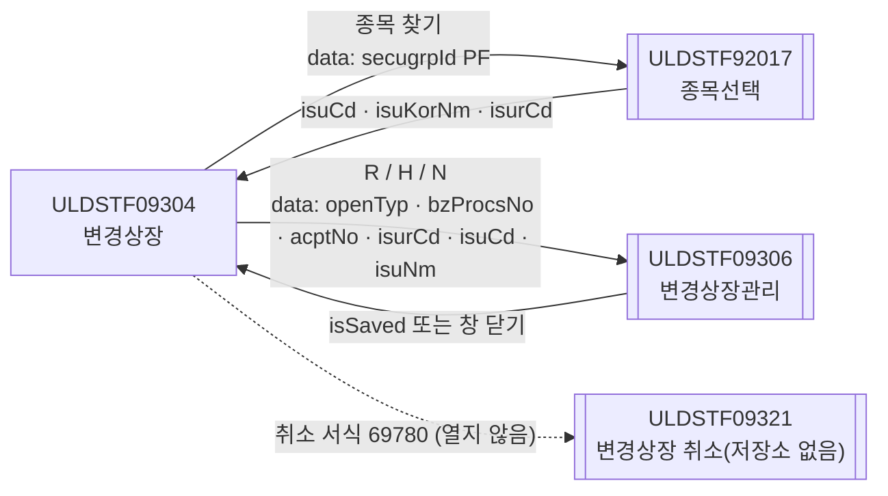
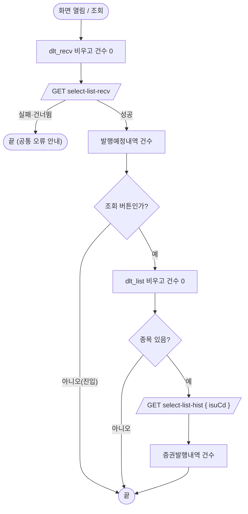
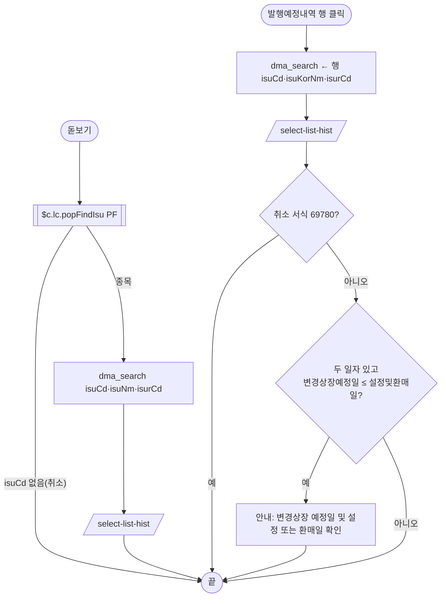
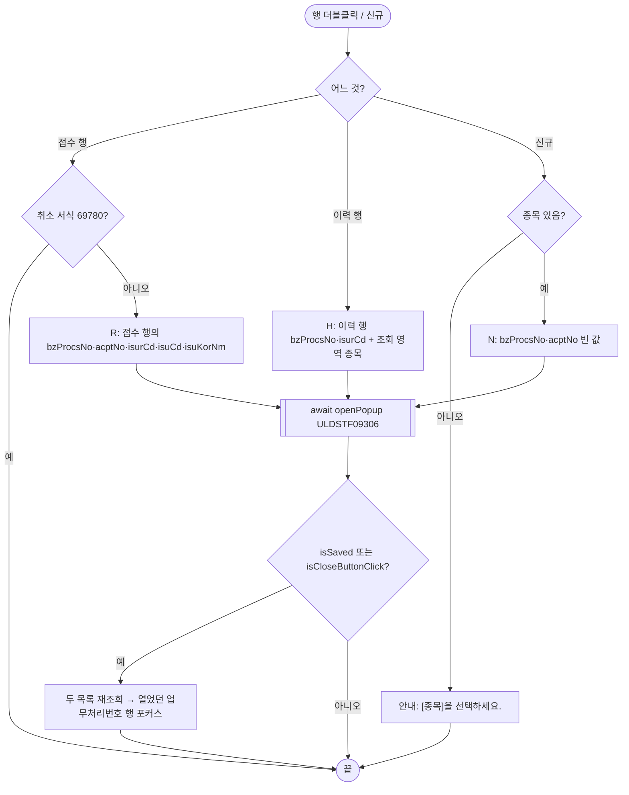

# ULDSTF09304 변경상장 — 업무 분석 및 전환 내역

| 항목 | 내용 |
|---|---|
| AS-IS 원본 | `ULDSTF09304.xml` — W-Craft 1차 변환본(`meta_asisFileNm="ULDSTF09304.gfm"`, 원본 gfm 은 저장소에 없음)에 **API 적용까지 마친 개발 사본**. 업무 로직은 이 스크립트와 남은 옛 코드 주석으로 분석했다. 반입 `conversion/conversion-front/ui/ULDSTF09304/ULDSTF09304.xml` (pf 묶음 21본 중 하나) |
| 신규 API 명세 | 없음 — **화면에 적용된 `/api/...` 경로·method·dataCollection keyInfo 를 명세로 간주**(사용자 결정 2026-10-29 준용). §5 는 "화면 적용 API ↔ AS-IS(주석에 남은 옛 호출)" 대응표로 쓴다. `api_spec_check` 는 SKIP(형식 검사 A07·A08 만) |
| TO-BE | `conversion/conversion-front/ui-tobe/ULDSTF09304.xml` (메뉴 본화면). **2026-10-30 전환** — 1단계: 캡처 없음 → 기존 마크업 정비(마크업 전용, 사본 `$CLAUDE_JOB_DIR/tmp/ULDSTF09304_stage1.xml`), 2단계: 이 결과서대로 스크립트 재전환. 게이트: `gate_screen --pcc stf`·`scan_mixed_compare`·`publish_gate --pcc stf --before {1단계} --allow P20`·`api_spec_check`(SKIP)·`init_binding_check`·`wsxml_lint` 0/0, `convert.py` 고정점 |
| 퍼블리싱 파일 | 화면 폴더 `ULDSTF09304.xml` 의 body(이미 퍼블리싱 반영)를 1단계 기준으로 했다. publish 원본 `conversion/publish/상장/상장처리(대내)/ULDSTF09304.xml` 은 참고만 — 차이는 breadcrumb 목업(Home·1Depth·2Depth·3Depth)·제목·하단 [닫기] 뿐이고(개발 사본은 contentHeader 로 바꾸고 [닫기]를 남김), 둘 다 [닫기]는 본화면 규칙으로 옮기지 않았다 |
| 화면 캡처 | 없음 — 가이드 §13.2 1단계는 선례 ULDBNS30400 처럼 "캡처 없음, 기존 마크업 정비" |
| 업무공통 | gcc: `$c.win.openPopup`·`$c.win.setEnterKeyEvent`·`$c.data.downloadGridViewExcel`·`$c.sbm.executeDynamic`·`$c.exception.handleError`. pcc(stf): `$c.lc.popFindIsu`·`$c.lc.glb.SECUGRP_ID_PF`·`$c.stf.fillGridHeaderTotalCnt`. 게이트는 `--pcc stf` |
| 작성 | Inswave / 2026-10-30 |

참고 양식: [websquare_gfm_conversion.md](../../../md/websquare_gfm_conversion.md) — 특히 §1.4 업무 프로세스 흐름, §6.5 getPar/setPar 전환. Gauce 대응은 [gfm_business_analysis_guide.md](../../../md/gfm_business_analysis_guide.md) 를 함께 따랐다. 호출·반환 키는 pf 21본 공통 계약서(§2 09306)를 따른다. 같은 꼴의 선례는 `ui-tobe/ULDSTF05700.xml`(신주상장 목록 → 관리 팝업 R/H/N).

---

## 1. 화면 개요

상장 담당자가 **상장형 수익증권(PF)의 변경상장(수량 변경)** 을 처리하는 메뉴 화면이다. 운용사가 낸 변경상장신청서(접수)를 보고, 종목별 증권발행내역(이력)을 확인하며, 변경상장관리 팝업에서 등록·수정·삭제한다.

1. 열리면 발행예정내역(변경상장신청서 접수 — 전체 종목)을 조회한다.
2. [종목 찾기](ULDSTF92017, PF)로 종목을 고르거나 발행예정내역 행을 클릭하면 그 종목의 증권발행내역을 조회한다. 행 클릭 때는 변경상장 예정일이 설정및환매일과 같거나 앞이면 안내한다.
3. 발행예정내역 행 더블클릭 → 접수(R), 증권발행내역 행 더블클릭 → 이력(H), [신규] → 신규(N)로 변경상장관리 팝업(ULDSTF09306)을 연다. 변경상장 취소 서식(69780) 행은 열지 않는다.
4. 팝업이 닫히면 두 목록을 다시 조회한다.
5. [엑셀다운로드]는 증권발행내역을 내려받는다.

### 1.1 호출 화면

해당 없음 — 메뉴 본화면(`sub_contents`). 이 화면을 여는 다른 화면은 없다(pf 공통 계약서 §1).

### 1.2 호출 규약 (부모 → 이 화면) / 반환 규약

해당 없음(메뉴 화면). 진입 파라미터를 읽지 않는다.

### 1.3 이 화면이 여는 하위 팝업

| 팝업 | AS-IS 호출 | 넘기는 `data` (TO-BE) | 받는 결과 / 취소 판정 |
|---|---|---|---|
| `ULDSTF09306` 상장형수익증권변경상장관리 (1400×430) | `fn_OpenPopup` — `openPopup(url, { id : "ULDSTF41621", … }, { pData : { clickBzProcsNo, vAcptNo, vIsurCd, vOpenTyp, isuCd, isuNm } })` | 평면 `{ openTyp, bzProcsNo, acptNo, isurCd, isuCd, isuNm }` (계약서 §2 09306, 05710 키 이름) | `{ isSaved }`(저장·수정·삭제 성공) 또는 창 닫기 `{ isCloseButtonClick }` → 두 목록 재조회 + 열었던 업무처리번호 행 포커스 |
| `ULDSTF92017` 종목선택 | `openPopup("/ui/lst/common/ULDSTF92017.xml", { id, popupName:"종목 선택", 1180×880 }, { secugrpId })` | `$c.lc.popFindIsu($c.lc.glb.SECUGRP_ID_PF)` — `{ secugrpId : "PF" }` | 행 JSON(`isuCd`·`isuKorNm`·`isurCd`). 취소는 `isEmpty(res?.isuCd)` |
| `ULDSTF09321` 변경상장 취소 | `fn_OpenPopupCancel` — 빈 함수(주석에 `CreateDialogFrame` 만) | 열지 않음 | 저장소에 없다(§10 #2) |

### 1.4 업무 프로세스 흐름

| 업무 | 시작 | 2~5구역 함수 순서 |
|---|---|---|
| 1. 진입 | 화면 열림 | `onpageload` → `init` → `selectRecvList` |
| 2. 조회 | [조회]·Enter | `btn_Search_onclick` → `search` → `allListSync` → `selectRecvList` → `selectHistList` |
| 3. 종목 찾기 | 돋보기 | `img_ISU_CD_onclick` → `openIsuPopup` → `$c.lc.popFindIsu` → `selectHistList` |
| 4. 접수 행 선택 | 발행예정내역 행 클릭 | `grd_Recv_oncellclick` → `selectRecv` → `selectHistList` → `checkRecvDate` |
| 5. 관리 팝업(R/H/N) | 행 더블클릭·[신규] | `grd_Recv_oncelldblclick`→`openDetailRecv` / `grd_List_oncelldblclick`→`openDetailHist` / `btn_New_onclick`→`openNew` → `openDetailPopup` → (닫힘) `allListSync` → `focusHistRow` |
| 6. 엑셀 | [엑셀다운로드] | `btn_Excel_onclick` → `excelDown` |

#### 화면 간 흐름

#### 업무 1·2: 진입·조회

| 단계 | 내용 | 근거 |
|---|---|---|
| 1 | 진입은 발행예정내역만 조회(원본 `init` → `fn_recv_list_sync`) | 원본 :73-75 |
| 2 | 조회는 두 목록. 원본은 종목이 없으면 아무것도 하지 않았다 — TO-BE 는 발행예정내역을 다시 조회하고 증권발행내역을 비운다(§9) | 원본 :224-228 |

#### 업무 3·4: 종목 찾기 / 접수 행 선택

#### 업무 5: 관리 팝업

#### 화면 모드 상태 전이

해당 없음 — 목록 화면이라 모드가 없다. [신규]는 종목이 있을 때만 팝업을 연다.

---

## 2. 화면 구성 및 데이터 정의

### 2.1 화면 구성 (AS-IS 요소 → TO-BE 컴포넌트)

| 영역 | AS-IS | TO-BE | 비고 |
|---|---|---|---|
| 머리 | `pfmContentHeader` | 같음 | publish 원본 breadcrumb 목업은 contentHeader 로 |
| 조회조건 | `panel_Top` / `label_2_top` 종목코드(명) / `txb_ISU_CD`·`txb_ISU_NM`(읽기전용, 바인딩 없음) / `img_ISU_CD`(`src` 이미지) / `btn_Search` | 같은 id. 입력칸은 `dma_search.isuCd`·`isuNm` 바인딩, `flex flex_no`, 돋보기 라벨 「종목 찾기」, colgroup 4칸(td colspan 3) → 2칸 | `maxlength="1000"`·`userData2`·`src` 잔재 제거 |
| 목록 1 제목 | `label_18` 「발행예정내역(변경상장신청서(수량변경))」 + `panel_page`(건수) | `label_18` + `edt_TotalCnt_1` | 건수 칸 id 를 목록 2 와 같은 꼴로(원본 `panel_page`) |
| 목록 1 | `grd_Recv`(`dlt_recv`, `visibleRowNum="5"`, `caption1`·`header1`·`gBody1`) | `grd_Recv` `gvw row5`, `caption1`·`header1`·`gBody1`, `readOnly`·`focusMode="row"` | 열은 아래 |
| 목록 2 제목 | `label_2` 「증권발행내역」 + `edt_TotalCnt_1` + `btn_Excel` | `label_2` + `edt_TotalCnt_2` + `btn_Excel` | 엑셀은 목록 2 를 내려받으므로 목록 2 머리에(원본은 목록 1 머리) |
| 목록 2 | `grd_List`(`dlt_list`, `visibleRowNum="15"`, `caption1`·`header1`·`gBody1` — 목록 1 과 **같은 id**) | `grd_List` `gvw row15`, `caption2`·`header2`·`gBody2` | 중복 id 정정(§8 #11) |
| 하단 | `label_6` 「수량 및 증권수는 TU단위로 표시된 값임」(lt) / `btn_new` [신규] | `label_6`(`txt_info`) / `btn_New` [신규](pt) | 버튼 id 를 핸들러 이름(`btn_New_onclick`)과 맞춤 |

**그리드 열** (AS-IS 머리 id → TO-BE 머리 id / 본문 id):

- `grd_Recv`: `NO`(숨김 번호 — `rowNumVisible` 과 겹침, 옮기지 않음) · `DISCLS_ACPT_TP_NM`→`h_disclsAcptTpNm`/`disclsAcptTpNm` · `ISU_KOR_NM`→`h_isuKorNm`/`isuKorNm` · `LIST_SHRS`→`h_listShrs`/`listShrs` · `INCDEC_LIST_SHRS`→`h_incdecListShrs`/`incdecListShrs` · `BF_LIST_SHRS`→`h_bfListShrs`/`bfListShrs` · `INC_LIST_SHRS`→`h_incListShrs`/`incListShrs` · `DEC_LIST_SHRS`→`h_decListShrs`/`decListShrs` · `AF_LIST_SHRS`→`h_afListShrs`/`afListShrs` · `BENFCERT_ESTBREPUR_DD`→`h_benfcertEstbrepurDd`/`benfcertEstbrepurDd` · `LIST_DD`→`h_listDd`/`listDd` · `ISU_RSN_CONTN`→`h_isuRsnContn`/`isuRsnContn` · `ISU_CD`→`h_isuCd`/`isuCd` · `ACPT_NO`→`h_acptNo`/`acptNo`
- `grd_List`: `NO`(옮기지 않음) · `DISCLS_YN`→`h_disclsYn`/`disclsYn` · `LIST_DD`→`h_listDd2`/`listDd` · `BENFCERT_ESTBREPUR_DD`→`h_benfcertEstbrepurDd2`/`benfcertEstbrepurDd` · `ISU_RSN_CONTN`→`h_isuRsnContn2`/`isuRsnContn`(선택 열: 01 설정·02 환매) · `LIST_METHD_TP_NM`→`h_listMethdTpNm`/`listMethdTpNm` · `INCDEC_LIST_SHRS`→`h_incdecListShrs2`/`incdecListShrs` · `LIST_SHRS`→`h_listShrs2`/`listShrs` · `TRST_ORGN_VAL`→`h_trstOrgnVal`/`trstOrgnVal` · `TRST_DISTR_PAY_BAS_DD`→`h_trstDistrPayBasDd`/`trstDistrPayBasDd` · `REMK`→`h_remk`/`remk` · `FNL_EMP_NM`→`h_fnlEmpNm`/`fnlEmpNm` · `BZ_PROCS_NO`→`h_bzProcsNo`/`bzProcsNo` · `ACPT_NO`→`h_acptNo2`/`acptNo`
- 표시 형식: 수량·금액 열 `dataType="number" displayFormat="#,###"`(원본은 `grd_List.listShrs`·`grd_Recv.incdecListShrs` 에 dataType 이 빠졌다), 날짜 열(원본 머리 `mask:XXXX-XX-XX`) `dataType="date" displayFormat="yyyy-MM-dd"`(규칙 46 — 원본 본문의 `####-##-##` 문자열 마스크 대체, `grd_Recv.benfcertEstbrepurDd` 는 형식이 빠져 있었다).

### 2.2 데이터 정의 (DataCollection)

| DataCollection | 용도 | 키 (name) | 비고 |
|---|---|---|---|
| `dma_search` (신설, 화면 전용) | 조회 영역 | `isuCd` 종목코드 · `isuNm` 종목명 · `isurCd` 발행기관코드 | 원본 `txb_ISU_CD`·`txb_ISU_NM` 값 + 전역 `scwin.vIsurCd` |
| `dlt_recv` | select-list-recv 응답 — 발행예정내역 | `acptNo` 접수번호 · `disclsAcptTpNm` 제출유형 · `isurCd` 회사코드 · `isuCd` 종목코드 · `isuKorNm` 종목명 · `isuRsnContn` 변경사유 · `listShrs` 현재상장 수량(number) · `trstOrgnVal` 신탁원본액(원)(number) · `incdecListShrs` 변경상장신청 수량(number) · `benfcertEstbrepurDd` 설정및환매일 · `listDd` 변경상장 예정일 · `bfListShrs` 변경전 수량 · `incListShrs` 증가 수량 · `decListShrs` 감소 수량 · `afListShrs` 변경후 수량(이상 number) · `remk` 비고 · `bzProcsNo` 업무처리번호 · `disclsMaindocFormCd` 공시본문서식코드 · `bzProcsNoRecent` 최근 업무처리번호 | 개발 사본 그대로 |
| `dlt_list` | select-list-hist 응답 — 증권발행내역 | `bzProcsNo` 업무처리번호 · `acptNo` 접수번호 · `isurCd` 회사코드 · `isuCd` 종목코드 · `listMethdTpCd` 상장방식유형코드 · `listMethdTpNm` 상장방식 · `benfcertEstbrepurDd` 설정및환매일 · `listDd` 변경상장일 · `isuRsnContn` 변경사유 · `incdecListShrs` 증감증권수 · `listShrs` 변경후상장증권수 · `trstOrgnVal` 신탁원본액(자본금)(이상 number) · `trstDistrPayBasDd` 분배지급기준일 · `remk` 기타 · `disclsYn` 공시검토 여부 · `fnlEmpNm` 최종처리자 · `spotIsuTrdMktTpCd` 현물종목거래시장구분코드 | 개발 사본 그대로(name `분배지급;기준일` 의 `;` 만 정리) |

---

## 3. 로딩 (`scwin.onpageload` → `scwin.init`)

1. `onpageload` 는 `scwin.init()` 만 부른다(예외는 `handleError`).
2. `init`: 증권그룹ID `$c.lc.glb.SECUGRP_ID_PF` → 조회 영역 Enter 키 `$c.win.setEnterKeyEvent(panel_Top, scwin.btn_Search_onclick)`(규칙 22) → `await selectRecvList()`.
- 날짜 달력이 없어 규칙 37 바인딩은 해당 없음.
- 원본 전역 `fr_MktId`(로그인 시장)·`vScrenID` 는 쓰는 곳이 없어 옮기지 않았다.

## 4. 컴포넌트 이벤트

| 컴포넌트 · 이벤트 | AS-IS | TO-BE 핸들러 → 함수 |
|---|---|---|
| `btn_Search` onclick (+ Enter) | `btn_Search_onclick` → `fn_all_list_sync`(종목 있을 때만) | `btn_Search_onclick` → `search` |
| `img_ISU_CD` onclick | `img_ISU_CD_onclick`(92017 직접 open) | `img_ISU_CD_onclick` → `openIsuPopup` |
| `grd_Recv` oncellclick | `grd_Recv_oncellclick` | 같은 이름 → `selectRecv` |
| `grd_Recv` oncelldblclick | `grd_Recv_oncelldblclick` → `fn_OpenDetailRecv` | 같은 이름 → `openDetailRecv` |
| `grd_List` oncelldblclick | `grd_List_oncelldblclick` → `fn_OpenDetailMng` | 같은 이름 → `openDetailHist` |
| `btn_Excel` onclick | `btn_Excel_onclick` | 같은 이름 → `excelDown` |
| `btn_new` onclick | `btn_New_onclick` | `btn_New`(id 정정) → `btn_New_onclick` → `openNew` |
| `btn_Close` | `btn_Close_onclick` → `closePopup`(본화면에 버튼 없음) | 옮기지 않음(본화면 [닫기] 금지, 계약서 §4.4-12) |
| body `onpageunload` | `scwin.onpageunload`(정의 없음) | 바인딩 삭제 |

## 5. 서버 통신

| # | 용도 | 화면 적용 API (명세 대용) | AS-IS(주석·원본 함수) | 요청 | 응답 → target |
|---|---|---|---|---|---|
| 5.1 | 발행예정내역 | `GET /api/listing/lstproc/pf/chglisting/select-list-recv` | `fn_recv_list_sync` | 없음 | `dlt_recv=body` |
| 5.2 | 증권발행내역 | `GET /api/listing/lstproc/pf/chglisting/select-list-hist` | `fn_list_sync` | `{ isuCd }` | `dlt_list=body` |

### 5.1 발행예정내역 조회 (`scwin.selectRecvList`)
- 보내기 전에 목록·건수를 비운다. `gridview : "grd_Recv"`. 성공하면 `fillGridHeaderTotalCnt(dlt_recv 건수, edt_TotalCnt_1)` — 원본은 이 자리에 `dlt_list` 건수를 적었다(§8 #2).
- 실패 안내는 공통 오류 핸들러. 진행 중 호출이면(`skipped`) 아무것도 하지 않는다.

### 5.2 증권발행내역 조회 (`scwin.selectHistList`)
- 목록·건수를 비우고, 조회 영역 종목이 없으면 거기서 끝(원본은 빈 `isuCd` 로도 보냈다). 성공하면 `edt_TotalCnt_2` 에 건수 — 원본은 발행예정내역 건수 칸(`panel_page`)에 적었다(§8 #2).

## 6. 일반 함수

### 6.1 조회 (`scwin.search` · `scwin.allListSync`)
두 목록을 발행예정내역 → 증권발행내역 순서로 조회한다(원본 `fn_all_list_sync`).

### 6.2 종목 찾기 (`scwin.openIsuPopup`)
`$c.lc.popFindIsu(PF)`. 반환 행의 `isuCd`·`isuKorNm`·`isurCd` 를 `dma_search` 에 넣고 증권발행내역만 다시 조회(원본과 같다). 원본 `!isEmpty(result)` 는 창 닫기의 `{ isCloseButtonClick }` 객체도 통과시켜 종목을 `undefined` 로 덮었다 → `isEmpty(res?.isuCd)` 로 판정(§8 #6).

### 6.3 접수 행 선택 (`scwin.selectRecv`)
행의 종목코드·종목명·발행기관코드를 조회 영역에 넣고 증권발행내역 조회 → 일자 확인. 원본은 발행기관코드를 더블클릭 때만 바꿨다(§8 #5). 원본 전역 `clickDisclsMainDocFormCd`·`clickBzProcsNoRecent` 는 행에서 바로 읽으므로 옮기지 않았다(`bzProcsNoRecent` 는 원본에서도 쓰는 곳이 없다 — §10 #3).

### 6.4 접수 일자 확인 (`scwin.checkRecvDate`)
취소 서식(69780)이 아니고 두 일자가 있을 때 `변경상장 예정일 ≤ 설정및환매일` 이면 "변경상장 예정일 및 설정 또는 환매일을 확인해 주시기 바랍니다." (원본 `fn_List_Benf_Estb_DD_check` — 빈 값도 비교했다, §8 #7).

### 6.5 관리 팝업 열기 (`scwin.openDetailRecv` · `scwin.openDetailHist`)
- R: 취소 서식이면 열지 않는다(TODO §10 #2). 접수 행의 `bzProcsNo`·`acptNo`·`isurCd`·`isuCd`·`isuKorNm` 으로 연다. 원본은 앞서 이력 행 더블클릭 때 남은 `clickBzProcsNo` 를 넘겼다(§8 #3).
- H: 이력 행 `bzProcsNo`·`isurCd` + 조회 영역 종목코드·종목명(원본 `fn_setBzProcsNo` + `txb_ISU_*`).

### 6.6 신규 (`scwin.openNew`)
종목이 없으면 "[종목]을 선택하세요." 후 `txb_ISU_CD` 포커스. 있으면 N 으로 연다. 원본의 "X"(목록 0건일 때 최초 신규) 대입은 다음 줄에서 "N" 으로 덮여 쓰이지 않았다(§8 #8).

### 6.7 팝업 호출·재조회 (`scwin.openDetailPopup` · `scwin.focusHistRow`)
`await $c.win.openPopup("/ui/lst/pf/ULDSTF09306.xml", { id : "ULDSTF09306", popupName : "상장형수익증권변경상장관리", width : 1400, height : 430, type : "pageFramePopup" }, data)`. 닫힌 뒤 `res?.isSaved === true || res?.isCloseButtonClick === true` 면 `allListSync` → 증권발행내역에서 같은 업무처리번호 행에 포커스(없으면 그대로).

### 6.8 엑셀 (`scwin.excelDown`)
`downloadGridViewExcel(grd_List, { fileName : getProgramId() + "_PF변경상장내역_" + yyyyMMddHHmmss + ".xlsx", sheetName : "리스트" })`(규칙 42). 0건 안내는 공통 함수(원본 `com_search_0027` 직접 안내와 같은 동작).

### 6.9 부모 ↔ 팝업 파라미터 전달 (getPar/setPar → `openPopup` data + `await`)
원본 개발 사본은 이미 `openPopup` 이었지만 `{ pData : {...} }` 로 감싸고 `v` 접두 키를 썼다. 팝업도 `getParameter().pData` 로 읽었다. TO-BE 는 평면 키(§1.3) — 팝업 ULDSTF09306 결과서 §1.2 와 같은 계약. 옛 방식의 `fn_getBzProcsNo`(팝업이 부모 함수로 업무처리번호를 읽던 잔재)는 부르는 곳이 없어 옮기지 않았다.

## 7. 업무 코드 · 메시지 목록

| 구분 | 값 | 의미 |
|---|---|---|
| 증권그룹ID | `PF` (`$c.lc.glb.SECUGRP_ID_PF`) | 상장형 수익증권 |
| 공시본문서식 | `69780` | 변경상장 취소 — 관리 팝업을 열지 않음 |
| 여는 방식 | `R` 접수 · `H` 이력 · `N` 신규 | 팝업 계약 |
| 메시지 | "변경상장 예정일 및 설정 또는 환매일을 확인해 주시기 바랍니다." | 접수 일자 확인 |
| 메시지 | "[종목]을 선택하세요." | 신규 |

## 8. 원본 특이사항 · 결함

| # | 내용 | 결정 |
|---|---|---|
| 1 | 팝업 `id : "ULDSTF41621"`(다른 화면 ID) | 고침 → `ULDSTF09306` |
| 2 | 발행예정내역 조회 후 건수 칸에 `dlt_list` 건수, 증권발행내역 건수도 같은 칸(`panel_page`)에 — 목록 2 건수 칸 `edt_TotalCnt_1` 은 늘 0 | 고침 → 각자 칸(`edt_TotalCnt_1`·`edt_TotalCnt_2`) |
| 3 | 접수(R) 열기에서 업무처리번호로 앞서 이력 행 더블클릭 때 남은 `clickBzProcsNo` 를 넘김 | 고침 → 접수 행 `bzProcsNo` |
| 4 | 취소 서식(69780) 행은 `fn_OpenPopupCancel`(빈 함수, "TOBE에서 사용X") | 유지 — 열지 않음, §10 #2 |
| 5 | 발행기관코드(`vIsurCd`)를 접수 행 더블클릭 때만 바꿔, 행 클릭 뒤 [신규]가 앞 종목의 발행기관으로 열림 | 고침 → 행 클릭 때도 채움 |
| 6 | 종목 찾기 취소(`{ isCloseButtonClick }`)도 `!isEmpty(result)` 를 통과해 종목을 `undefined` 로 덮음 | 고침 → `isuCd` 로 판정 |
| 7 | 일자 확인이 두 값이 비어도(`"" <= ""`) 안내 | 고침 → 두 일자가 있을 때만 |
| 8 | [신규] 의 최초 신규 `"X"` 대입이 다음 줄 `"N"` 에 덮임(팝업의 신규상장 분기가 죽은 코드) | 옮기지 않음 — N 만, §10 #4 |
| 9 | 팝업 data 를 `{ pData }` 로 감싸고 `v` 접두 키 | 고침 → 평면 camelCase(계약서 §2) |
| 10 | 닫힌 뒤 `if (res)` — 객체가 늘 참이라 늘 재조회, 그것도 증권발행내역만(팝업은 저장마다 부모 `fn_all_list_sync` 직접 호출) | 고침 → 계약(`isSaved`·`isCloseButtonClick`)대로 두 목록 재조회 |
| 11 | 두 그리드의 `caption1`·`header1`·`gBody1` 중복, 숨김 번호 열 `NO` 가 두 그리드에 같은 id | 고침 → 그리드별 id, `NO` 는 `rowNumVisible` 과 겹쳐 삭제 |
| 12 | 본화면에 `btn_Close_onclick` → `closePopup` (버튼은 없음) | 옮기지 않음 |
| 13 | `var` 사용, `result.responseJSON.success` 를 `?.` 없이 읽음 | 고침 → `const`, `?.` |

## 9. 전환 내역 (AS-IS → TO-BE)

| AS-IS | TO-BE | 비고 |
|---|---|---|
| `scwin.onpageload` | `scwin.onpageload` | `handleError` |
| `scwin.init` | `scwin.init` | Enter 키 바인딩 추가 |
| `scwin.fn_all_list_sync` | `scwin.allListSync` | |
| `scwin.fn_recv_list_sync` | `scwin.selectRecvList` | 건수 칸 정정 |
| `scwin.fn_list_sync` | `scwin.selectHistList` | 종목 없으면 비움, 건수 칸 정정 |
| `scwin.fn_OpenDetailRecv` | `scwin.openDetailRecv` | 접수 행 업무처리번호 |
| `scwin.fn_OpenDetailMng` + `scwin.fn_setBzProcsNo` | `scwin.openDetailHist` | |
| `scwin.fn_OpenPopup` | `scwin.openDetailPopup` | 평면 data, id 정정, 재조회 조건 |
| `scwin.fn_OpenPopupCancel` | 삭제 | 빈 함수 — 취소 서식은 열지 않음(§10 #2) |
| `scwin.fn_getBzProcsNo` | 삭제 | 부르는 곳 없음(옛 getPar 잔재) |
| `scwin.fn_List_Benf_Estb_DD_check` | `scwin.checkRecvDate` | 빈 값 비교 제외 |
| `scwin.img_ISU_CD_onclick` | `scwin.img_ISU_CD_onclick` → `scwin.openIsuPopup` | `$c.lc.popFindIsu` |
| `scwin.btn_Search_onclick` | `scwin.btn_Search_onclick` → `scwin.search` | 종목 없어도 발행예정내역 재조회 |
| `scwin.btn_New_onclick` | `scwin.btn_New_onclick` → `scwin.openNew` | |
| `scwin.btn_Excel_onclick` | `scwin.btn_Excel_onclick` → `scwin.excelDown` | 규칙 42 파일명 |
| `scwin.btn_Close_onclick` | 삭제 | 본화면 |
| `scwin.grd_Recv_oncellclick` | 같은 이름 → `scwin.selectRecv` | 발행기관코드도 채움 |
| `scwin.grd_Recv_oncelldblclick` | 같은 이름 | |
| `scwin.grd_List_oncelldblclick` | 같은 이름 | |
| (신규) | `scwin.focusHistRow` | 재조회 뒤 행 복원(계약서 §2 공통 규칙) |
| 전역 `vScrenID`·`clickBzProcsNo`·`vAcptNo`·`vIsurCd`·`vOpenTyp`·`fr_MktId`·`fr_SecuGrpId`·`clickDisclsMainDocFormCd`·`clickBzProcsNoRecent` | `scwin.secugrpId` + `dma_search` + 함수 인자 | 화면 상태를 전역에 두지 않고 행·조회 영역에서 바로 읽는다 |

- publicInfo: 정의한 22함수 전부. 상수(`POPUP_URL`·`FORM_CD_CANCEL`)·전역은 등재하지 않는다.
- 게이트: `gate_screen`·`scan_mixed_compare`(A 0·B 0)·`publish_gate --before 1단계 --allow P20`(P22·P24 는 스크립트 전환분)·`api_spec_check`(SKIP)·`init_binding_check`·`wsxml_lint` 0/0, `convert.py` 고정점.

## 10. 남은 작업 (TODO)

1. **select-list-recv 조건** — 조건 없이 전체 종목 접수를 받는다(개발 사본 그대로). 원본 gfm 이 시장·담당 등으로 걸렀는지 확인.
2. **변경상장 취소(서식 69780)** — 취소 팝업 ULDSTF09321 이 저장소에 없고 원본도 막았다. 취소 접수를 처리할 화면·계약이 정해지면 `openDetailRecv` 에 연결.
3. **`bzProcsNoRecent`(최근 업무처리번호)** — 응답에 오지만 원본에서도 쓰는 곳이 없다. 접수(R) 열기에 이 번호를 넘겨야 하는지(접수 행 `bzProcsNo` 대신) 확인.
4. **최초 신규("X" → 신규상장 4)** — 원본은 목록이 모두 0건이면 신규상장으로 열려 했지만 죽은 코드였다. 종목의 첫 상장도 이 화면에서 등록하는지 확인.
5. **팝업 크기** — 1400×430 은 개발 사본 값. 팝업에 contentHeader 가 생겨 높이가 모자랄 수 있다(실화면 확인).
6. **배포 경로** — 팝업 `/ui/lst/pf/ULDSTF09306.xml`(원본 리터럴).
