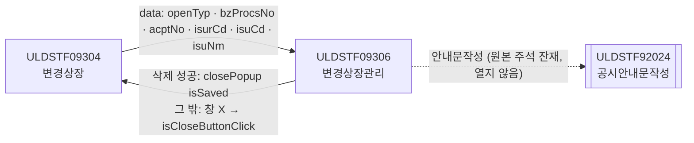
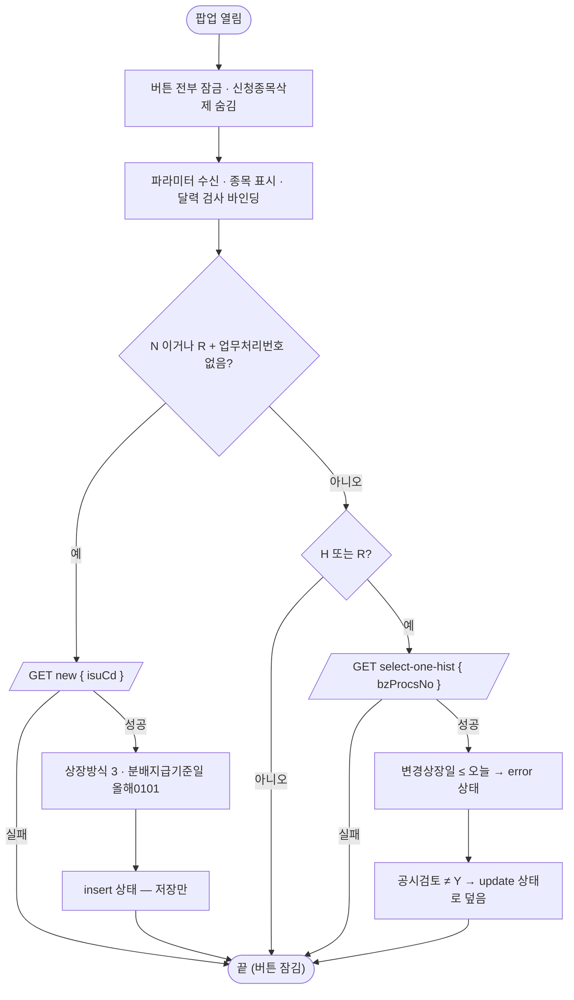
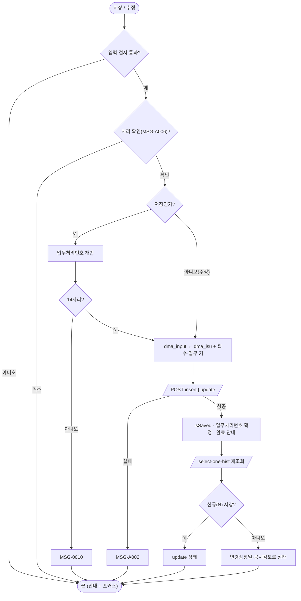
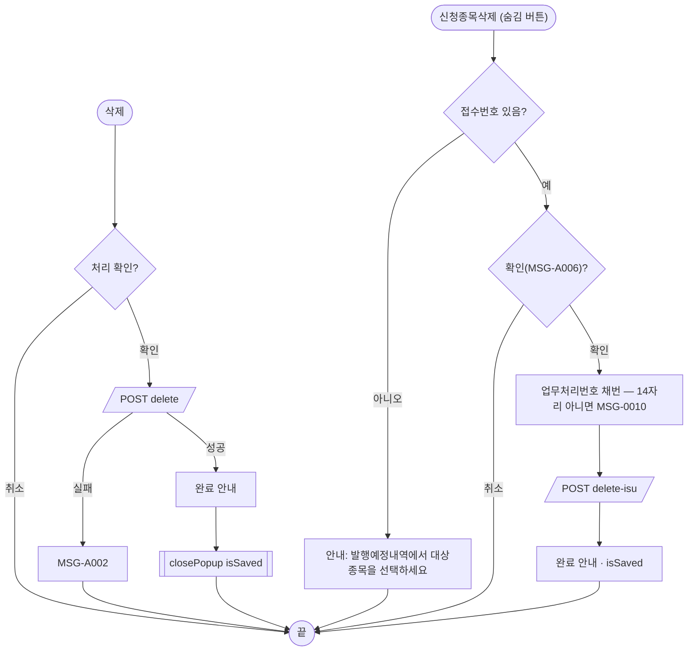

# ULDSTF09306 (팝업)상장형수익증권변경상장관리 — 업무 분석 및 전환 내역

| 항목 | 내용 |
|---|---|
| AS-IS 원본 | `ULDSTF09306.xml` — W-Craft 1차 변환본(`meta_asisFileNm="ULDSTF09306.gfm"`, 원본 gfm 은 저장소에 없음)에 **API 적용까지 마친 개발 사본**(작성 김영하 2026-08-28, 담당 변경 배성우 2026-09-03). 업무 로직은 이 스크립트와 남은 옛 코드 주석으로 분석했다. 반입 `conversion/conversion-front/ui/ULDSTF09306/ULDSTF09306.xml` (pf 묶음 21본 중 하나) |
| 신규 API 명세 | 없음 — **화면에 적용된 `/api/...` 경로·method·dataCollection keyInfo 를 명세로 간주**(사용자 결정 2026-10-29 준용). §5 는 "화면 적용 API ↔ AS-IS(주석에 남은 옛 호출)" 대응표로 쓴다. `api_spec_check` 는 SKIP(형식 검사 A07·A08 만) |
| TO-BE | `conversion/conversion-front/ui-tobe/ULDSTF09306.xml` (배포 경로 `/ui/lst/pf/ULDSTF09306.xml` — 부모 09304 의 원본 리터럴, pf 공통 계약서 §2). **2026-10-30 전환** — 1단계: 캡처 없음 → 기존 마크업 정비(마크업 전용, 사본 `$CLAUDE_JOB_DIR/tmp/ULDSTF09306_stage1.xml`), 2단계: 이 결과서대로 스크립트 재전환. 게이트: `gate_screen --pcc stf`·`scan_mixed_compare`·`publish_gate --pcc stf --before {1단계} --allow P20`·`api_spec_check`(SKIP)·`init_binding_check`·`wsxml_lint` 0/0, `convert.py` 고정점 |
| 퍼블리싱 파일 | 화면 폴더 `ULDSTF09306.xml` 의 body 를 1단계 기준으로 했다. publish 원본 `conversion/publish/상장/상장처리(대내)/ULDSTF09306.xml` 과의 차이는 [삭제] 버튼 `label` 속성뿐이다. 둘 다 팝업인데 contentHeader 가 없어 넣었다(팝업 contentHeader 필수) |
| 화면 캡처 | 없음 — 가이드 §13.2 1단계는 선례 ULDBNS30400 처럼 "캡처 없음, 기존 마크업 정비" |
| 업무공통 | gcc: `$c.data.getParameter`·`$c.win.closePopup`·`$c.win.confirm`·`$c.util.setButtonState`·`$c.date.checkCalendarFormat`·`$c.date.isDate`·`$c.sbm.executeDynamic`·`$c.exception.handleError`. pcc(stf): `$c.lc.isProcess`·`$c.lc.glb.LIST_METHD_TP_CD_3`·`$c.stf.getNewBzProcNo`·`$c.stf.setButtonSetWithDate`·`$c.stf.setButtonSetWithDate2`·`$c.stf.getMessageParam`. 게이트는 `--pcc stf` |
| 작성 | Inswave / 2026-10-30 |

참고 양식: [websquare_gfm_conversion.md](../../../md/websquare_gfm_conversion.md) — 특히 §1.4 업무 프로세스 흐름, §6.5 getPar/setPar 전환. Gauce 대응은 [gfm_business_analysis_guide.md](../../../md/gfm_business_analysis_guide.md) 를 함께 따랐다. 호출·반환 키는 pf 21본 공통 계약서(§2 09306)를 따른다. 같은 꼴의 선례는 `ui-tobe/ULDSTF05710.xml`(신주상장 관리 팝업 R/H/N).

---

## 1. 화면 개요

상장형 수익증권(PF)의 **변경상장(수량 변경) 한 건을 등록·수정·삭제하는 팝업**이다. 부모 ULDSTF09304 가 접수(R)·이력(H)·신규(N) 중 하나로 연다.

1. 신규(N)·업무처리번호가 없는 접수(R): 종목의 신규 기본값(변경전 상장증권수 등)을 받고, 상장방식 「변경상장」·분배지급기준일 「올해 1월 1일」을 넣는다. [저장]만 쓸 수 있다.
2. 이력(H)·업무처리번호가 있는 접수(R): 그 건을 조회한다. 변경상장일이 지났으면 조회 상태, 공시검토 전이면 수정 상태.
3. 증감증권수를 입력하고 나가면 변경후 상장증권수 = 변경전 + 증감 으로 계산한다.
4. [저장]은 업무처리번호를 채번해 등록, [수정]·[삭제]는 지금 건을 고친다. 삭제하면 닫힌다.
5. [안내문작성]은 안내만 띄운다(원본 개발 사본과 같음 — 공시안내문 연동은 주석 잔재).

### 1.1 호출 화면 (1본)

| 부모 | 여는 함수 | 크기 | 근거 |
|---|---|---|---|
| ULDSTF09304 변경상장(메뉴) | `fn_OpenPopup`(TO-BE `scwin.openDetailPopup`) | 1400×430 | `ui/ULDSTF09304/ULDSTF09304.xml:157-184` |

### 1.2 호출 규약 (부모 → 이 화면) / 반환 규약

**받는 값** — `$c.data.getParameter()` (계약서 §2 09306, 05710 키 이름)

| 키 | 의미 | AS-IS 키(`pData.*`) | 이 화면에서 |
|---|---|---|---|
| `openTyp` | 여는 방식 R/H/N | `vOpenTyp` | 모드 분기 |
| `bzProcsNo` | 업무처리번호 (N 은 "") | `clickBzProcsNo` | 상세 조회·수정·삭제 키 |
| `acptNo` | 접수번호 (R 만) | `vAcptNo` | 전송 본문 `acptNo`, 신청종목삭제 가능 여부 |
| `isurCd` | 발행기관코드 | `vIsurCd` | 전송 본문 `isurCd` |
| `isuCd` | 종목코드 | `isuCd` | `txb_ISU_CD`, new 조회 조건, 전송 본문 |
| `isuNm` | 종목명 | `isuNm` | `txb_ISU_NM` |

- AS-IS: `$c.data.getParameter().pData` 한 겹 아래에서 읽고, 값이 없으면 아무것도 하지 않았다. TO-BE 는 평면 키로 받고, `openTyp` 가 R/H/N 이 아니면 버튼이 잠긴 채 끝난다.
- 더 옛 방식(전역 선언 `scwin.fn_GetPar, scwin.fn_SetPar`)은 쓰이지 않는 잔재라 옮기지 않았다.

**반환** — 저장·수정·삭제·신청종목삭제가 성공하면 `scwin.isSaved = true`. 삭제 성공 때만 스스로 `closePopup({ isSaved : true })`. 하단 [닫기]가 없으므로 그 밖에는 창 X 로 닫히고 `{ isCloseButtonClick : true }` 가 간다 → 부모는 둘 중 하나면 재조회(계약서 §2 공통 규칙).

- 원본은 처리 성공마다 `fn_parentRefresh` 로 부모의 `fn_all_list_sync` 를 직접 불렀다 — 없앴다(§8 #8).

### 1.3 이 화면이 여는 하위 팝업

없음. 원본 주석에 공시안내문작성(ULDSTF92024, 서식 68155A) 호출이 남아 있지만 개발 사본은 "추후 편집기 적용예정(TODO)" 안내만 띄운다 — 계약서 §3 대로 옮기지 않았다(§10 #1).

### 1.4 업무 프로세스 흐름

| 업무 | 시작 | 2~5구역 함수 순서 |
|---|---|---|
| 1. 진입 | 팝업 열림 | `onpageload` → `init` → (`isNewMode`) `selectNew` → `initNewForm` / `selectDetail` → `applyButtonState` |
| 2. 증감 계산 | 증감증권수 포커스 아웃 | `edt_INCDEC_LIST_SHRS_onblur` → `calcListShrs` |
| 3. 저장 | [저장] | `btn_save_onclick` → `save` → `validate` → `$c.lc.isProcess` → `getNewBzProcsNo` → `saveTrs` → `buildInput` → `selectDetail` |
| 4. 수정 | [수정] | `btn_update_onclick` → `update` → `validate` → `$c.lc.isProcess` → `saveTrs` → `selectDetail` → `applyButtonState` |
| 5. 삭제 | [삭제] | `btn_delete_onclick` → `remove` → `$c.lc.isProcess` → `removeTrs` → `closePopup` |
| 6. 신청종목삭제 | [신청종목삭제](늘 숨김) | `btn_RecvIsuDel_onclick` → `removeRecvIsu` → `$c.win.confirm` → `getNewBzProcsNo` → `removeRecvIsuTrs` |
| 7. 안내문작성 | [안내문작성] | `btn_dscl_onclick` → `writeDscl` (안내만) |

#### 화면 간 흐름

#### 업무 1: 진입

#### 업무 3·4: 저장·수정

#### 업무 5·6: 삭제 / 신청종목삭제

#### 화면 모드 상태 전이

| 상태 | 들어가는 때 | [저장] | [수정] | [삭제] | [안내문작성] |
|---|---|---|---|---|---|
| disabled | 로딩 중·파라미터 없음·조회 실패 | × | × | × | × |
| insert | N·업무처리번호 없는 R | ○ | × | × | × |
| update | 신규 저장 성공 뒤 / 공시검토 전 기존 건 | × | ○ | ○ | ○ |
| error | 변경상장일 ≤ 오늘이고 공시검토 완료(Y) | × | × | × | × |

(활성 정책 자체는 공통 `$c.util.setButtonState` 의 BTN_STATE_MAP 이 보유한다.)

---

## 2. 화면 구성 및 데이터 정의

### 2.1 화면 구성 (AS-IS 요소 → TO-BE 컴포넌트)

| 영역 | AS-IS | TO-BE | 비고 |
|---|---|---|---|
| 머리 | 없음 | `pfmContentHeader` | 팝업 contentHeader 필수 |
| 상세 표 | `panel_Item`(tblbox, 4칸) | 같음 | `userData2`·`tabIndex` 잔재 제거 |
| 종목 | `label_2_top` / `txb_ISU_CD`·`txb_ISU_NM`(읽기전용) | 같은 id, `flex flex_no` | 파라미터 값 표시(바인딩 없음) |
| 상장방식 | `label_6`(req) / `cmb_LIST_METHD_TP_CD`(disabled, 4 신규상장·3 변경상장) | 같음, `dma_isu.listMethdTpCd` | W-Craft `item` 속성 제거 |
| 변경사유 | `label_4`(req) / `cmb_ISU_RSN_CONTN`(01 설정·02 환매) | 같음 + 「선택」 항목 | |
| 변경전 상장증권수 | `label_8` / `edt_BF_LIST_SHRS`(읽기전용) | 같음 — `tar`·`number`·`#,###`(규칙 48 이미 적용) | |
| 변경상장일 | `label_1` / `edt_LIST_DD`(달력) | 같음 | 규칙 37 바인딩 |
| 증감증권수 | `label_19` / `edt_INCDEC_LIST_SHRS`(`allowChar="0-9"`) | 같음, `ev:onblur` → `edt_INCDEC_LIST_SHRS_onblur` | 규칙 48 이미 적용 |
| 설정및환매일 | `label_5` / `edt_BENFCERT_ESTBREPUR_DD`(달력) | 같음 | 규칙 37 |
| 변경후 상장증권수 | `label_16` / `edt_LIST_SHRS`(읽기전용) | 같음 | 계산 결과 |
| 분배지급기준일 | `label_3` / `edt_TRST_DISTR_PAY_BAS_DD`(달력) | 같음 | 규칙 37 |
| 기타 | `label_7` / `txa_REMK` | 같음 | 500자 검사 |
| 버튼 | `grp_btnBox`: `btn_RecvIsuDel`·`btn_dscl`·`btn_delete`·`btn_update`·`btn_save`·`btn_Close`(숨김) | `grpBtnBox`: 앞 5개 그대로(규칙 41 — [삭제][수정][저장] pt 오른쪽 고정), `btn_Close` 제거 | 팝업 하단 [닫기] 금지 |

- 원본 이미지 달력 핸들러(`img_BENFCERT_ESTBREPUR_DD`·`img_LIST_DD`·`img_TRST_DISTR_PAY_BAS_DD` → `popUpCalendar2`)는 body 에 그 컴포넌트가 없는 Gauce 잔재 — `w2:inputCalendar` 가 대신한다.

### 2.2 데이터 정의 (DataCollection)

| DataCollection | 용도 | 키 (name) | 비고 |
|---|---|---|---|
| `dma_isu` | new·select-one-hist 응답, 화면 바인딩 | `bzProcsNo` 업무처리번호 · `isurCd` 회사코드 · `isuCd` 종목코드 · `listMethdTpCd` 상장방식유형코드 · `listMethdTpNm` 상장방식 · `benfcertEstbrepurDd` 설정및환매일 · `listDd` 변경상장일 · `isuRsnContn` 변경사유 · `incdecListShrs` 증감증권수 · `listShrs` 변경후상장증권수 · `isuPrc` 발행가액(원) · `pfNetasstTotamt` 신탁원본액(이상 number) · `trstDistrPayBasDd` 분배지급기준일 · `remk` 기타 · `disclsYn` 공시검토 여부 · `fnlEmpNm` 최종처리자 · `spotIsuTrdMktTpCd` 현물종목거래시장구분코드 · `secugrpId` 증권그룹ID · `isuKorNm` 종목명 · `disclsIncdecListShrs` 공시용 증감주식수 · `incListShrs` 증가주식수 · `decListShrs` 감소주식수 · `bfListShrs` 변경전 수량(이상 number) · `incdecSign` 음수표시 · `trstComNm` 운용사 | 개발 사본 그대로(name `분배지급;기준일` 의 `;` 정리) |
| `dma_input` | insert·update·delete·delete-isu 요청 본문 | `acptNo` 접수번호 · `byacptnoSeq` 접수일련번호 · `bzProcsNo` 업무처리번호 · `count` 건수 · `isurCd` 회사코드 · `listBzTpCd` 상장업무구분코드 · `isuCd` 종목코드 · `listMethdTpCd` 상장방식유형코드 · `benfcertEstbrepurDd` 설정및환매일 · `listDd` 변경상장일 · `isuRsnContn` 변경사유 · `incdecListShrs` 증감증권수(number) · `listShrs` 변경후상장증권수(number) · `trstDistrPayBasDd` 분배일지급기준일(number) · `remk` 기타 | `count` 의 name 이 원본은 「회사코드」(오기) — 「건수」로. `trstDistrPayBasDd` 가 number 인 것은 개발 사본 그대로(§10 #7) |

## 3. 로딩 (`scwin.onpageload` → `scwin.init`)

1. `onpageload` 는 `scwin.init()` 만 부른다(예외는 `handleError`).
2. `init`:
   1. 버튼 전부 잠금(`setButtonState("grpBtnBox", "disabled")`), `btn_RecvIsuDel.hide()`.
   2. 파라미터 수신(§1.2) → `txb_ISU_CD`·`txb_ISU_NM` 표시.
   3. 단일 달력 3개 `$c.date.checkCalendarFormat(…, "yyyyMMdd")`(규칙 37).
   4. 모드 분기 — `isNewMode()` 면 `await selectNew()` 뒤 `initNewForm()` → insert 상태. H·R 이면 `await selectDetail()` 뒤 `applyButtonState()`. 원본은 new 조회를 기다리지 않고 기본값을 넣어 응답이 기본값을 덮을 수 있었다(§8 #3).
- 조회 영역(schbox)이 없어 Enter 키 바인딩은 해당 없음.

## 4. 컴포넌트 이벤트

| 컴포넌트 · 이벤트 | AS-IS | TO-BE 핸들러 → 함수 |
|---|---|---|
| `btn_save` onclick | `btn_save_onclick` → `fn_save` | 같은 이름 → `save` |
| `btn_update` onclick | `btn_update_onclick` → `fn_update` | 같은 이름 → `update` |
| `btn_delete` onclick | `btn_delete_onclick` → `fn_delete` | 같은 이름 → `remove` |
| `btn_dscl` onclick | `btn_dscl_onclick` → `fn_dscl` | 같은 이름 → `writeDscl` |
| `btn_RecvIsuDel` onclick | `btn_RecvIsuDel_onclick` → `fn_RecvtIsuDel` | 같은 이름 → `removeRecvIsu` |
| `edt_INCDEC_LIST_SHRS` onblur | `edt_INCDEC_LIST_SHRS_OnKillFocus` → `fn_calcuate` | `edt_INCDEC_LIST_SHRS_onblur`(규칙 3 이벤트명 소문자) → `calcListShrs` |
| `btn_Close` onclick | `btn_Close_onclick` → `closePopup`(숨김 버튼) | 옮기지 않음 |
| body `onpageunload` | `scwin.onpageunload`(정의 없음) | 바인딩 삭제 |
| (없는 컴포넌트) | `img_*_onclick` → `popUpCalendar2`, `dts_Isu_OnLoadError` → `$c.stf.alert_error`, `trs_Save_OnFail` → `$c.lcp.fn_alertMsg('F')` | 삭제 — 바인딩된 컴포넌트·서브미션이 없는 잔재 |

## 5. 서버 통신

| # | 용도 | 화면 적용 API (명세 대용) | AS-IS(원본 함수) | 요청 | 응답 → target |
|---|---|---|---|---|---|
| 5.1 | 신규 기본값 | `GET /api/listing/lstproc/pf/chglisting/new` | `search("N")` | `{ isuCd }` | `dma_isu=body` |
| 5.2 | 이력 상세 | `GET /api/listing/lstproc/pf/chglisting/select-one-hist` | `search()` | `{ bzProcsNo }` | `dma_isu=body` |
| 5.3 | 저장·수정 | `POST /api/listing/lstproc/pf/chglisting/insert` · `…/update` | `fn_trs`(TRS_IDX_INSERT·UPDATE) | `ref : "dma_input"`(JSON) | 없음(`success` 만) |
| 5.4 | 삭제 | `POST /api/listing/lstproc/pf/chglisting/delete` | `fn_trs`(TRS_IDX_DELETE) | `ref : "dma_input"` | 없음 |
| 5.5 | 신청종목삭제 | `POST /api/listing/lstproc/pf/chglisting/delete-isu` | `fn_RecvtIsuDel` | `ref : "dma_input"` | 없음 |
| (pcc) | 업무처리번호 채번 | `$c.stf.getNewBzProcNo` → `GET /api/listing/lstproc/stock/chglisting/new-bzprocsno` | `$c.stf.getNewBzProcNo` | 없음 | responseJSON |

### 5.1·5.2 조회 (`scwin.selectNew` · `scwin.selectDetail`)
보내기 전에 `dma_isu.setEmptyValue()`. 실패 안내는 공통 오류 핸들러, `success` 여부를 돌려준다.

### 5.3 저장·수정 (`scwin.saveTrs`)
- `buildInput(bzProcsNo)` — `dma_input` 에 `dma_isu` 전체 + `acptNo`·`byacptnoSeq "1"`·`bzProcsNo`·`count "1"`·`listBzTpCd "811"`·`isurCd`·`isuCd`(원본 `fn_trs` 앞부분과 같다).
- action 은 처리구분으로 두 전체 경로 리터럴 중 하나(규칙 38). 원본은 `"…/" + svcId`(선언 안 된 전역 `svcId`) 조립.
- 실패: `MSG-A002`(원본 `trs_Save_OnFail` 의 `fn_alertMsg('F')` 의도 — 원본은 서브미션에 연결되지 않아 안내가 없었다, §8 #9).
- 성공: `isSaved` · 업무처리번호 확정(성공한 뒤에만, §8 #6) · `com_complete_0096`(저장/수정) → `selectDetail` → 신규(N) 저장이면 update 상태, 그 밖은 `applyButtonState`(원본 `search()` 분기와 같다).
- TODO: 응답 정의가 없어 `success` 만으로 판정(§10 #2).

### 5.4 삭제 (`scwin.removeTrs`)
성공하면 `isSaved` · `com_complete_0096`(삭제) → `closePopup({ isSaved : true })`. 원본은 닫은 뒤 `search()` 를 또 불렀다(§8 #7).

### 5.5 신청종목삭제 (`scwin.removeRecvIsuTrs`)
새로 채번한 업무처리번호로 `buildInput` 후 전송. 성공하면 `isSaved` · 삭제 완료 안내(원본과 같이 닫지 않음).

## 6. 일반 함수

### 6.1 신규 등록 판정 (`scwin.isNewMode`)
`openTyp === "N"` 또는 `openTyp === "R"` 이면서 업무처리번호가 없음 — 원본 `search` 의 insert 상태 조건. 원본은 이 조건의 R 도 `select-one-hist`(빈 업무처리번호)로 조회하고 update 상태로 두었다 — 접수 건 신규 등록이 막혔다(§8 #2).

### 6.2 신규 기본값 (`scwin.initNewForm`)
상장방식 `$c.lc.glb.LIST_METHD_TP_CD_3`(변경상장), 분배지급기준일 `올해 + "0101"`. 원본 `fn_initItem` 의 `vOpenTyp === "X"` → 신규상장(4) 분기는 부모가 "X" 를 보내지 않아 죽은 코드다(§8 #4).

### 6.3 기존 건 버튼 상태 (`scwin.applyButtonState`)
`$c.stf.setButtonSetWithDate(edt_LIST_DD, false, "grpBtnBox", BTN_MAP)`(변경상장일 ≤ 오늘 → error, 아니면 update) → `$c.stf.setButtonSetWithDate2(disclsYn, "grpBtnBox", BTN_MAP)`(공시검토 ≠ Y → update 로 덮음). 원본은 두 번째 호출에 그룹·매핑 인자가 없었다(§8 #5).

### 6.4 증감 계산 (`scwin.calcListShrs`)
증감증권수가 있으면 `변경후 = parseInt(변경전 || 0) + parseInt(증감)` 을 `dma_isu.listShrs` 에. 숫자가 아니면 "[증권수 합산처리 중 오류]". 변경사유가 환매(02)여도 더한다(원본과 같음 — §10 #5).

### 6.5 입력 검사 (`scwin.validate` · `scwin.checkNotZero`)
원본 `fn_CheckForm` 순서 그대로: 종목 → 변경상장일(필수·오늘 이후·날짜) → 설정및환매일(필수·날짜) → 상장방식 → 증감증권수(필수·0 아님) → 변경후 상장증권수(필수·0 아님) → 변경사유 → 분배지급기준일(필수·날짜) → 기타 500자.
- 날짜 형식은 `$c.date.isDate` + `com_date_compare_0014`. 원본은 `checkCalendarFormat` 을 검사에 불러, 부를 때마다 달력 이벤트를 다시 묶었다.
- 원본 "현재일 이후" 비교는 14자리 서버 시각과 8자리 날짜를 문자열로 비교했다 → 8자리끼리.
- 증감증권수 빈 값 안내에 `await` 가 빠져 있었다(§8 #10). 「초과하였씁니다」 오타 정정.

### 6.6 채번 (`scwin.getNewBzProcsNo`)
pcc `getNewBzProcNo` 는 `responseJSON` 전체를 돌려준다 — `body` 가 문자열이면 그대로, `{ bzProcsNo }` 면 그 값(05710 선례). 원본은 그 객체를 `toString()` 해 길이 검사가 늘 실패했다(§8 #6).

### 6.7 저장·수정·삭제 (`scwin.save` · `scwin.update` · `scwin.remove`)
`trJob` 설정 → (저장·수정) `validate` → `$c.lc.isProcess(trJob)`(MSG-A006) → 저장은 채번·14자리 검사(MSG-0010) 후 `saveTrs("I", 번호)`, 수정은 `saveTrs("U", 지금 번호)`, 삭제는 `removeTrs`. 삭제 전 공시 처리상태 검사(원본 주석 `fn_check_delete_discls_procsstat`)는 대응 API 가 없다(§10 #6).

### 6.8 신청종목삭제 (`scwin.removeRecvIsu`)
접수번호가 없으면 "발행예정내역에서 대상종목을 선택하세요" → `$c.win.confirm(MSG-A006 신청종목삭제)` → 채번·14자리 검사 → `removeRecvIsuTrs`. 버튼은 원본처럼 늘 숨김(§10 #4).

### 6.9 안내문작성 (`scwin.writeDscl`)
"추후 편집기 적용예정입니다." 안내만(원본 개발 사본과 같음). 원본 주석의 92024 호출(서식 `68155A`, arr[0..5], `CopyDataSet(dts_Isu, …)`, `fn_getModalCenterPos`)은 옮기지 않았다(계약서 §3, §10 #1).

### 6.10 부모 ↔ 팝업 파라미터 전달 (getPar/setPar → `openPopup` data + `await`)
원본도 이미 `openPopup` + `getParameter` 였지만 `pData` 한 겹·`v` 접두 키 → 평면 camelCase(§1.2). 부모 직접 호출 `fn_parentRefresh`(getParent().scwin.fn_all_list_sync)는 없애고 반환 규약(`isSaved` / 창 닫기)으로 바꿨다.

## 7. 업무 코드 · 메시지 목록

| 구분 | 값 | 의미 |
|---|---|---|
| 여는 방식 | `R` 접수 · `H` 이력 · `N` 신규 (`X` 최초 신규 — 쓰이지 않음) | 부모 계약 |
| 상장방식 | `3` 변경상장(`LIST_METHD_TP_CD_3`) · `4` 신규상장(`LIST_METHD_TP_CD_4`) | 신규 기본 3 |
| 변경사유 | `01` 설정 · `02` 환매 | |
| 상장업무구분 | `811` | PF 변경상장 |
| 처리구분 | `I` 저장 · `U` 수정 · `D` 삭제 | `$c.lc.isProcess` |
| 메시지 | `MSG-A006`(처리 확인) · `MSG-0010`(채번 실패) · `MSG-A002`(처리 실패) · `com_complete_0096`(완료) · `com_date_compare_0014`(날짜 형식) | |
| 메시지 | "[변경상장일]을 현재일이후로 입력하세요." 등 필수 안내, "[증권수 합산처리 중 오류]", "발행예정내역에서 대상종목을 선택하세요" | |

## 8. 원본 특이사항 · 결함

| # | 내용 | 결정 |
|---|---|---|
| 1 | 부모가 팝업 id 를 다른 화면 ID(`ULDSTF41621`)로 엶 | 부모 09304 에서 고침 |
| 2 | 업무처리번호 없는 접수(R)도 `select-one-hist`(빈 번호)로 조회하고, 그 조건에서 insert 가 아니라 update 상태 | 고침 → 신규처럼 new 조회 + insert(원본 insert 조건의 의도) |
| 3 | 신규 진입에서 new 조회를 기다리지 않고 기본값을 넣음 — 응답이 기본값을 덮을 수 있음 | 고침 → 조회 뒤 기본값 |
| 4 | `vOpenTyp === "X"` → 신규상장(4) 분기 — 부모가 "X" 를 보내지 않음 | 옮기지 않음(§10 #4) |
| 5 | `setButtonSetWithDate2(disclsYn)` 에 그룹·매핑 인자 누락 — 공시검토 여부가 버튼에 반영 안 됨 | 고침 |
| 6 | 채번 결과(responseJSON 객체)를 `toString()` 해 길이 14 검사 → 늘 실패, 실패해도 `vBzProcsNo` 를 먼저 바꿈 | 고침 → body 에서 꺼내고, 성공한 뒤에만 확정 |
| 7 | 삭제 성공 후 `closePopup()` 뒤에 또 `search()` | 고침 → 닫고 끝 |
| 8 | 처리 성공마다 부모 `fn_all_list_sync` 직접 호출(`fn_parentRefresh`) | 고침 → 반환 규약 |
| 9 | 처리 실패 안내(`trs_Save_OnFail` → `fn_alertMsg('F')`)가 서브미션에 연결되지 않음, `$c.lcp` 오타 | 고침 → 실패면 `MSG-A002` |
| 10 | 증감증권수 빈 값 안내에 `await` 누락 | 고침 |
| 11 | `svcId` 선언 없음(전역 누수), `console.log` 4곳, `var` | 고침 |
| 12 | 팝업인데 contentHeader 없음, 숨김 [닫기] | 고침 → contentHeader 추가, [닫기] 제거 |
| 13 | `scwin.setbtn`(버튼 I/U 수동 제어)·`fn_50mcalcuate`(주석)·`MSG_50M_LOW`·`vScrenID`·`vScrenTpCD`·`TR_JOB` 전역 | `setbtn` 은 부르는 곳이 없어 삭제, 50억 검사는 주석이라 옮기지 않음(§10 #8) |

## 9. 전환 내역 (AS-IS → TO-BE)

| AS-IS | TO-BE | 비고 |
|---|---|---|
| `scwin.onpageload` | `scwin.onpageload` | `handleError` |
| `scwin.init` | `scwin.init` | 평면 파라미터·달력 바인딩·조회 await |
| `scwin.search("N")` / `scwin.search()` | `scwin.selectNew` / `scwin.selectDetail` | 상태 결정은 init·saveTrs 로 |
| `scwin.setbtn` | 삭제 | 부르는 곳 없음 |
| `scwin.fn_initItem` | `scwin.initNewForm` | |
| `scwin.fn_calcuate` | `scwin.calcListShrs` | |
| `scwin.fn_CheckForm` | `scwin.validate` | `isDate`, await |
| `scwin.fn_checkNumber` | `scwin.checkNotZero` | |
| `scwin.fn_save` | `scwin.save` | 채번 파싱 정정 |
| `scwin.fn_update` | `scwin.update` | |
| `scwin.fn_delete` | `scwin.remove` | |
| `scwin.fn_trs` | `scwin.saveTrs` · `scwin.removeTrs` · `scwin.buildInput` | 경로 리터럴, 실패 안내 |
| `scwin.fn_RecvtIsuDel` | `scwin.removeRecvIsu` · `scwin.removeRecvIsuTrs` | |
| `scwin.fn_dscl` | `scwin.writeDscl` | 안내만(원본과 같음) |
| `scwin.fn_parentRefresh` | 삭제 | 반환 규약 |
| `scwin.btn_Close_onclick` | 삭제 | 팝업 [닫기] 금지 |
| `scwin.btn_RecvIsuDel_onclick` | 같은 이름 | |
| `scwin.edt_INCDEC_LIST_SHRS_OnKillFocus` | `scwin.edt_INCDEC_LIST_SHRS_onblur` | 규칙 3 |
| `scwin.img_BENFCERT_ESTBREPUR_DD_onclick` · `scwin.img_LIST_DD_onclick` · `scwin.img_TRST_DISTR_PAY_BAS_DD_onclick` | 삭제 | Gauce 달력 잔재 |
| `scwin.dts_Isu_OnLoadError` · `scwin.trs_Save_OnFail` | 삭제 | 바인딩 없는 잔재 |
| `scwin.btn_update_onclick` · `scwin.btn_save_onclick` · `scwin.btn_delete_onclick` · `scwin.btn_dscl_onclick` | 같은 이름 | `handleError` |
| (신규) | `scwin.isNewMode` · `scwin.applyButtonState` · `scwin.getNewBzProcsNo` | |
| 전역 `vScrenID`·`vScrenTpCD`·`fn_GetPar`·`fn_SetPar`·`vBzProcsNo`·`vAcptNo`·`vIsurCd`·`vOpenTyp`·`TR_JOB`·`VListBzTpCd`·`MSG_50M_LOW`·`BTN_MAP` | `scwin.openTyp`·`bzProcsNo`·`acptNo`·`isurCd`·`trJob`·`isSaved`·`LIST_BZ_TP_CD`·`BTN_MAP` | 쓰이지 않는 것은 삭제 |

- publicInfo: 정의한 26함수 전부. 전역·상수는 등재하지 않는다.
- 게이트: `gate_screen`·`scan_mixed_compare`(A 3: `length !== 14` 2곳·`Number(val) !== 0` — 숫자 비교, 의도)·`publish_gate --before 1단계 --allow P20`(P22·P24 는 스크립트 전환분)·`api_spec_check`(SKIP)·`init_binding_check`·`wsxml_lint` 0/0, `convert.py` 고정점.

## 10. 남은 작업 (TODO)

1. **공시안내문작성(ULDSTF92024, 서식 68155A)** — 개발 사본은 안내만 띄운다. 연동하면 다른 pf 화면처럼 호환용 `scwin.getPar` + `openPopup` data 로(계약서 §3).
2. **처리 응답 판정** — insert·update·delete·delete-isu 응답 정의가 없어 `success` 만 본다. `completeYn` 등 결과 키가 있는지 확인.
3. **채번 경로** — pcc `getNewBzProcNo` 는 주식 변경상장 경로(`/stock/chglisting/new-bzprocsno`)다. PF 변경상장도 같은 채번인지, 응답 body 모양(문자열/`{ bzProcsNo }`) 확인.
4. **[신청종목삭제] 노출** — 원본도 보이게 하는 곳이 없다(숨김 유지). 05710 선례처럼 접수(R)일 때 보여야 하는지 확인. 최초 신규("X" → 신규상장 4) 분기도 함께 확인.
5. **환매 시 계산** — 증감증권수는 숫자만 입력되고 변경후 = 변경전 + 증감 으로 늘 더한다. 변경사유 환매(02)면 빼야 하는지, 서버가 `incdecSign`·`decListShrs` 로 처리하는지 확인.
6. **삭제 전 공시 처리상태 검사** — 원본 주석 `fn_check_delete_discls_procsstat` 에 대응하는 API 가 없다.
7. **`dma_input.trstDistrPayBasDd` dataType number** — 날짜(yyyyMMdd)를 숫자로 보낸다(개발 사본 그대로). 서버가 문자열을 기대하면 keyInfo 를 text 로.
8. **신탁원본액 50억 미만 안내** — 원본 주석(`fn_50mcalcuate`, `MSG_50M_LOW`)으로만 남았다. 필요한지 확인.
9. **팝업 크기** — 부모가 1400×430 으로 연다. contentHeader 가 생겨 높이가 모자랄 수 있다(실화면 확인).
