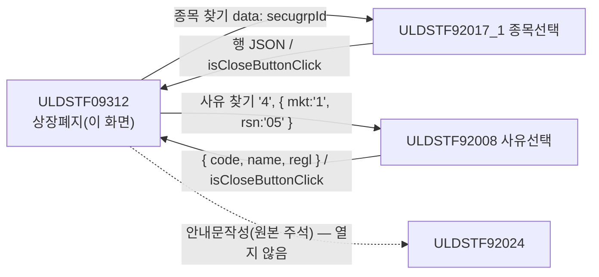
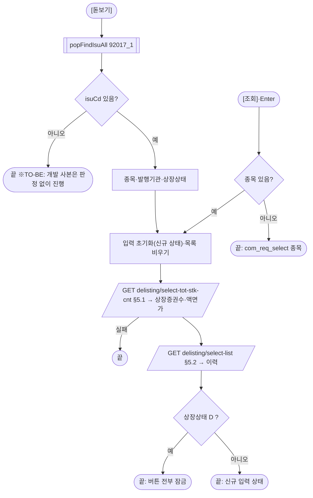
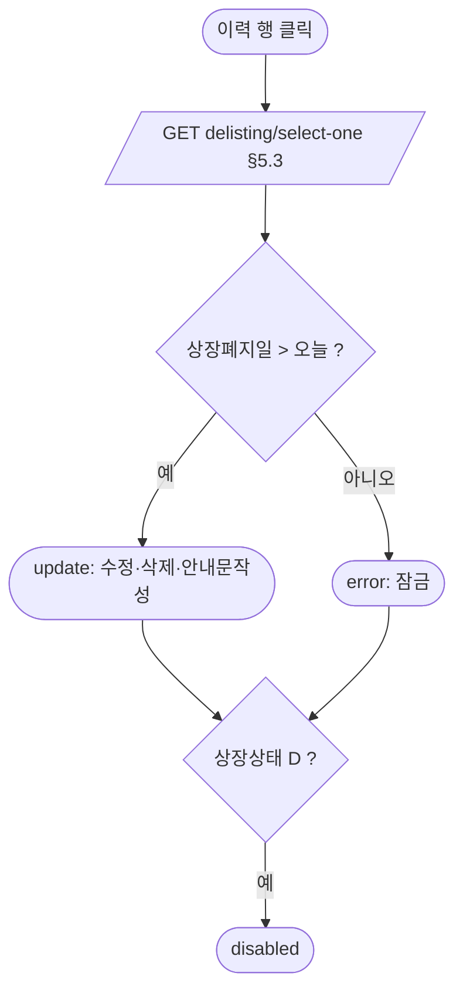
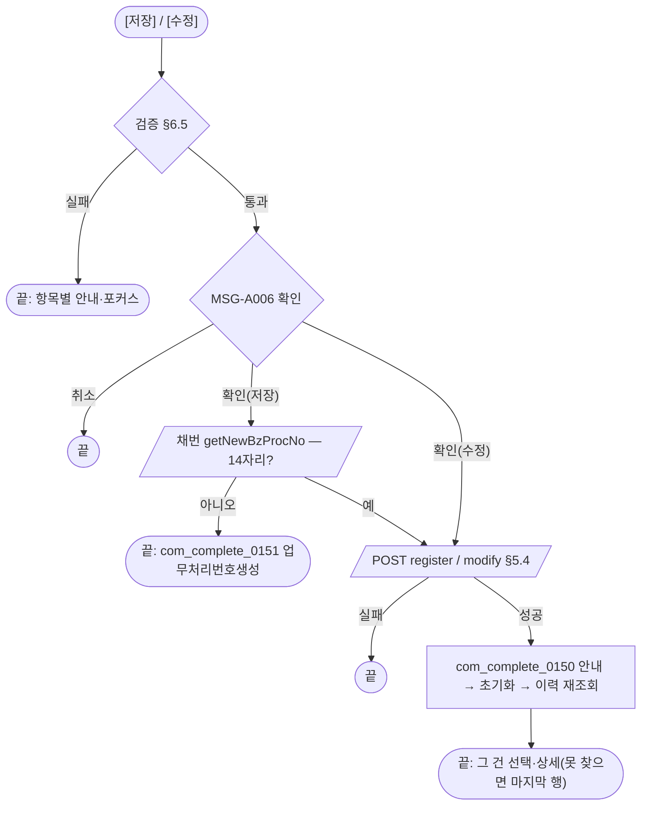
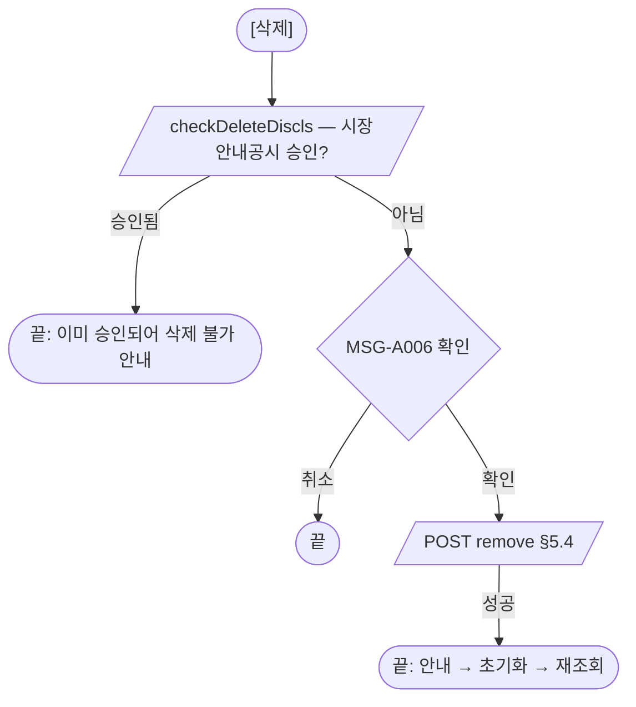
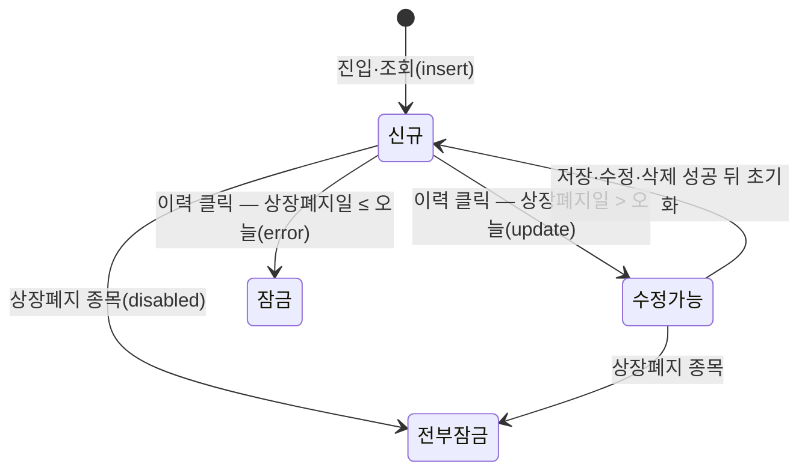

# ULDSTF09312 상장폐지 — 업무 분석 및 전환 내역

| 항목 | 내용 |
|---|---|
| AS-IS 원본 | `ULDSTF09312.xml` — W-Craft 1차 변환본(`meta_asisFileNm="ULDSTF09312.gfm"`, 원본 gfm 은 저장소에 없음)에 **API 적용까지 마친 개발 사본**(작성 배성우 2026-09-07, `scwin.init`·`setButtonState` 일부 현대화). 반입 `conversion/conversion-front/ui/ULDSTF09312/ULDSTF09312.xml` (pf 묶음 21본 중 하나) |
| 신규 API 명세 | 없음 — **화면에 적용된 `/api/...` 경로·method·dataCollection keyInfo 를 명세로 간주**(사용자 결정 2026-10-29 준용, pf 계약서). §5 는 "화면 적용 API ↔ AS-IS" 대응표. `api_spec_check` 는 SKIP(형식 검사 A07·A08 만) |
| TO-BE | `conversion/conversion-front/ui-tobe/ULDSTF09312.xml` (메뉴 본화면 — 배포 경로 `/ui/lst/pf/ULDSTF09312.xml` 가정). **2026-10-30 전환** — 1단계: 캡처 없음 → 기존 마크업 정비(사본 `$CLAUDE_JOB_DIR/tmp/ULDSTF09312_stage1.xml`), 2단계: 스크립트 재전환. 게이트: `gate_screen --pcc stf`·`scan_mixed_compare`(A 2건 — 숫자 비교 `bzProcsNo.length !== 14`·`rowCount === 0`, 의도)·`publish_gate --pcc stf --before {1단계} --allow P20`·`api_spec_check`(SKIP)·`init_binding_check`·`wsxml_lint` 0/0, `convert.py` 고정점 |
| 퍼블리싱 파일 | 화면 폴더 `ULDSTF09312.xml` body 를 1단계 기준. publish 원본 `conversion/publish/상장/상장처리(대내)/ULDSTF09312.xml` 은 참고만 — 입력 항목 구성이 같다. 개발 사본은 페이지 머리가 breadcrumb 목업(`pgtbox`) → 공통 contentHeader 로 |
| 화면 캡처 | 없음 |
| 업무공통 | pcc: `$c.lc.getGlbValue`·`$c.lc.popFindIsuAll`·`$c.lc.popFindClssLstRsnCd`·`$c.lc.isProcess`·`$c.lc.checkDeleteDiscls`·`$c.stf.getNewBzProcNo`·`$c.stf.setButtonSetWithDate`. gcc: `$c.util.setButtonState`·`$c.date.checkCalendarFormat`·`$c.win.setEnterKeyEvent`·`$c.validate.validateDataCollect`·`$c.data.getMessage`·`$c.sbm.executeDynamic`·`$c.exception.handleError`. 게이트는 `--pcc stf` |
| 작성 | Inswave / 2026-10-30 |

참고 양식: [websquare_gfm_conversion.md](../../../md/websquare_gfm_conversion.md) — §1.4, §6.5. 같은 업무 선례는 `ui-tobe/ULDSTF05806.xml`(상장폐지 — 신주인수권증서·증권). 92024 공시안내문 연동은 pf 계약서 §3 대로 **옮기지 않았다**(원본 주석 잔재).

---

## 1. 화면 개요

상장 담당자가 **상장형 수익증권(PF) 종목의 상장폐지(상장폐지일·사유·근거규정)를 등록·수정·삭제하는** 메뉴 화면이다.

1. [종목 찾기]로 종목을 고르면 상장증권수(액면가)와 상장폐지 이력을 조회하고 신규 입력 상태가 된다.
2. 이력 행을 누르면 그 건을 상세로 읽는다. 상장폐지일이 오늘 뒤면 수정·삭제·안내문작성, 오늘이거나 지났으면 버튼이 잠긴다(기안 역할만 — 이 화면엔 기안 없음).
3. 상장폐지 종목(상장상태 D)은 버튼을 전부 잠근다.
4. [저장]은 업무처리번호를 채번해 등록, [수정]·[삭제]는 고른 건을 처리한다. 성공하면 다시 조회해 그 건을 상세로 읽는다.

### 1.1 호출 화면 (메뉴)

메뉴 본화면(body `sub_contents`). 이 화면을 여는 다른 화면은 없다.

### 1.2 호출 규약 (부모 → 이 화면) / 반환 규약

해당 없음 — 메뉴 본화면.

### 1.3 이 화면이 여는 하위 팝업

| 팝업 | AS-IS 호출 | 넘기는 `data` (TO-BE) | 받는 결과 / 취소 판정 |
|---|---|---|---|
| ULDSTF92017_1 종목선택(pcc `$c.lc.popFindIsuAll`) | `popFindIsuAll({ secugrpId })` — 반환을 판정 없이 바로 씀 | `{ secugrpId }` | 행 JSON `isuCd`·`isuKorNm`·`isurCd`·`listStatCd` / `isCloseButtonClick`·`isuCd` 빈 값이면 취소 |
| ULDSTF92008 사유선택(pcc `$c.lc.popFindClssLstRsnCd`) | `popFindClssLstRsnCd("4", { mkt:"1", rsn:"05" })` — `name`·`regl` 만 반영 | `"4"`(상장폐지사유), `{ mkt:"1", rsn:"05" }` | `code`·`name`·`regl` → `delistRsnCd`·`delistRsnDsc`·`grndRegulNm` / `code` 빈 값이면 취소 |
| (ULDSTF92024 공시안내문작성) | `fn_dscl` 전체 주석 — 서식 `68051C`, arr 6칸, `CopyDataSet(dma_selectOneRes)` | 열지 않음 | — (pf 계약서 §3: 주석 잔재라 옮기지 않음) |

### 1.4 업무 프로세스 흐름

| # | 업무 | 시작 | 끝 | 주요 함수 | 관련 절 |
|---|---|---|---|---|---|
| 1 | 진입 | 메뉴 | 신규 상태, 사유 입력 방식, 달력·Enter 키 | `scwin.init` → `scwin.setComponentByMkt` | §3 |
| 2 | 종목 찾기·조회 | [돋보기]·[조회]·Enter | 상장증권수 + 이력, 신규 상태 | `scwin.openIsuPopup` → `scwin.search` → `scwin.selectTotStkCnt`·`scwin.selectList` | §6.2, §5.1, §5.2 |
| 3 | 이력 상세 | 이력 행 클릭 | 상세 + 버튼 상태 | `scwin.grd_List_oncellclick` → `scwin.selectDetail` → `scwin.applyButtonState` | §5.3, §6.5 |
| 4 | 사유 찾기 | [돋보기] `btn_FindRsn` | 사유 코드·사유·근거규정 | `scwin.openRsnPopup` | §6.4 |
| 5 | 저장 | [저장] | 검증 → 확인 → 채번 → 등록 → 재조회·상세 | `scwin.save` → `scwin.saveTrs` | §6.6, §5.4 |
| 6 | 수정 | [수정] | 검증 → 확인 → 수정 → 재조회·상세 | `scwin.update` → `scwin.saveTrs` | §6.7 |
| 7 | 삭제 | [삭제] | 공시 승인 확인 → 확인 → 삭제 → 재조회 | `scwin.remove` → `scwin.saveTrs` | §6.8 |
| 8 | 안내문작성 | [안내문작성] | 안내만 | `scwin.writeDscl` | §6.11 |

#### 화면 간 흐름

#### 업무 2: 종목 찾기·조회

#### 업무 3: 이력 상세

#### 업무 5·6: 저장·수정

#### 업무 7: 삭제

#### 화면 모드 상태 전이

## 2. 화면 구성 및 데이터 정의

### 2.1 화면 구성

| 영역 | AS-IS 요소 | TO-BE 컴포넌트 (바인딩) | 설명 |
|---|---|---|---|
| 머리 | `pgtbox` breadcrumb 목업 | `pfmContentHeader` | 공통 머리 |
| 조회 | `tbl_search`(schbox id) — colgroup 4칸 + td colspan 3 | schbox 안 표 `tbl_search`(colgroup 2칸) | Enter 키 영역(규칙 22) |
| 조회 | `label_2_top` 「종목코드(명)」 | `label_2_top`(`req`) | |
| 조회 | `ibx_isuCd`(`dma_selectReq.isuCd`)·`ibx_isuNm` | `ibx_isuCd`(`dma_search.isuCd`)·`ibx_isuNm`(`dma_search.isuNm`) | 읽기 전용 |
| 조회 | `btn_isuNm`(돋보기) | `btn_FindIsu` | |
| 조회 | `btn_search` [조회] | `btn_Search` | |
| 입력 | `panel_Item` > `grp_table` | 같음 | |
| 입력 | `label_18` 「상장증권수」 + `ibx_listShrs`(number `#,###`, 인라인 `text-align:right`) | `ibx_listShrs`(`class="tar"`, `dma_detail.listShrs`) | 규칙 48 |
| 입력 | `label_1` 「상장폐지일」 + `cal_delistDd` | `cal_delistDd`(`dma_detail.delistDd`) | 필수 |
| 입력 | `label_4` 「상장폐지사유」 + `ibx_delistRsnDsc`(읽기 전용) + `panel_DELIST_RSN_DSC` > `btn_delistRsnDsc` | `ibx_delistRsnDsc`(유가 읽기 전용·코스닥 입력) + `btn_FindRsn` | 감싸던 `panel_DELIST_RSN_DSC` 그룹은 제거 |
| 입력 | `label_5` 「근거규정」 + `ibx_grndRegulNm`(200) | 같음(`dma_detail.grndRegulNm`) | |
| 입력 | `label_7` 「기타」 + `ibx_remk` | 같음(`dma_detail.remk`) | |
| 이력 | titbox 건수 `tbx_totCnt` | h3 「상장폐지 이력」 + `tbx_totCnt` | |
| 이력 | `grd_list`(`caption1`·`header1`·`gBody1`, 머리글 `DISCLS_YN`·`LIST_SHRS`·`DELIST_DD`·`DELIST_RSN_DSC`·`GRND_REGUL_NM`·`REMK`·`FNL_EMP_NM`·`BZ_PROCS_NO`) | `grd_List`(`cap_List`·`hdr_List`·`gbd_List`, `h_` + camelCase) | 상장폐지일 열 `inputType="calendar"` + mask → 표시 열 `dataType="date" displayFormat="yyyy-MM-dd"`(규칙 46) |
| 하단 | `grpBtnBox` — `btn_dscl`·`btn_delete`·`btn_update`·`btn_save` | `btn_Dscl`·`btn_Delete`·`btn_Update`·`btn_Save` | 규칙 41 순서 그대로 |

### 2.2 데이터 정의

| TO-BE | 종류 | 키(컬럼) | 출처 / 용도 |
|---|---|---|---|
| `dma_search` | dataMap(화면 전용) | `isuCd`, `isuNm` | 개발 사본 `dma_selectReq`(isuCd) 대체 — 조회 조건 |
| `dma_detail` | dataMap | `bzProcsNo`, `delistDd`, `delistAdvnotiStrtDd`, `delistAdvnotiEndDd`, `arrantrdMktactEnforceDd`, `arrantrdEndDd`, `parval`, `listShrs`, `delistRsnCd`, `delistRsnDsc`, `grndRegulNm`, `remk`, `isuKorNm`, `isuEngNm`, `isuCd`, `trstComNm`, `trdHaltDd`, `trdHaltTYy`, `trdHaltTMm`, `trdHaltTDd`, `trdHaltDdT`, `isurCd`, `mktactApplObjTpCd` | `select-one`·`select-tot-stk-cnt` 응답, `register`·`modify`·`remove` 요청(ref) — 개발 사본 `dma_selectOneRes` 키 그대로(name 자리표 `name1`… 는 한글 명칭으로) |
| `dlt_list` | dataList | `draftYn`, `disclsYn`, `mktactYn`, `fnlEmpNm`, `bzProcsNo`, `delistDd`, `parval`, `listShrs`, `delistRsnCd`, `delistRsnDsc`, `grndRegulNm`, `remk` | `select-list` 응답 — 개발 사본 `dlt_selectListRes` |
| `dma_bzCheck` | dataMap | `disclsProcsDdtm` | pcc `checkDeleteDiscls` 응답 자리(개발 사본 `dma_BZ_CHECK`) |

- 옮기지 않은 것: `bnd_mst`(Gauce 바인더 `multicolumn` 잔재), `dma_selectTotStkCntRes`(정의만 — 조회는 `dma_selectOneRes` 로 받음), `dma_selectOneReq`(→ requestData).
- 전역 `vScrenID`·`vScrenTpCD`·`rowPos`·`trsIdx`(→ `scwin.trJob`)·`vBzProcsNo`(→ `scwin.bzProcsNo`)·`vIsurCd`(→ `scwin.isurCd`)·`vListStatCd`(→ `scwin.listStatCd`)·`fr_MktId`(→ `scwin.mktId`)·`fr_SecuGrpId`(→ `scwin.secugrpId`).

## 3. 로딩 (`scwin.onpageload` → `scwin.init`)

1. **증권그룹·사용자 시장** — `getGlbValue("SECUGRP_ID_PF")`, session market.
2. **버튼** — `setButtonState("grpBtnBox", "insert", BTN_MAP)`(저장만).
3. **사유 입력 방식** — `scwin.setComponentByMkt(mktId)`: 코스닥(2)이면 사유 직접 입력·찾기 잠금, 유가는 찾기로만(§6.1).
4. **바인딩** — `checkCalendarFormat(cal_delistDd)`(규칙 37), `setEnterKeyEvent(tbl_search, scwin.btn_Search_onclick)`(규칙 22). 초기 조회 없음.

## 4. 컴포넌트 이벤트

| TO-BE 컴포넌트 | 이벤트 | TO-BE 핸들러 | 동작 | AS-IS |
|---|---|---|---|---|
| `btn_FindIsu` | onclick | `scwin.btn_FindIsu_onclick` | `scwin.openIsuPopup` | `btn_isuNm` → `scwin.btn_isuNm_onclick` |
| `btn_Search` | onclick | `scwin.btn_Search_onclick` | 종목 확인 → `scwin.search` | `btn_search` → `scwin.btn_search_onclick` |
| `btn_FindRsn` | onclick | `scwin.btn_FindRsn_onclick` | `scwin.openRsnPopup` | `btn_delistRsnDsc` → `scwin.btn_delistRsnDsc_onclick` |
| `grd_List` | oncellclick | `scwin.grd_List_oncellclick` | `scwin.selectDetail` | `grd_list` → `scwin.grd_list_oncellclick` |
| `btn_Save` | onclick | `scwin.btn_Save_onclick` | `scwin.save` | `btn_save` → `scwin.btn_save_onclick` → `fn_save` |
| `btn_Update` | onclick | `scwin.btn_Update_onclick` | `scwin.update` | `btn_update` → `scwin.btn_update_onclick` → `fn_update` |
| `btn_Delete` | onclick | `scwin.btn_Delete_onclick` | `scwin.remove` | `btn_delete` → `scwin.btn_delete_onclick` → `fn_delete` |
| `btn_Dscl` | onclick | `scwin.btn_Dscl_onclick` | `scwin.writeDscl` | `btn_dscl` → `scwin.btn_dscl_onclick` → `fn_dscl` |
| (없음) | — | — | — | `scwin.trs_Save_OnSuccess`·`scwin.trs_Save_OnFail`·`scwin.dts_BZ_CHECK_OnLoadError`(Gauce 이벤트 이름 — 연결 없음), `scwin.onpageunload`(빈 함수) — 옮기지 않음 |

## 5. 서버 통신

| # | 용도 | AS-IS | TO-BE (화면 적용 API) |
|---|---|---|---|
| 5.1 | 액면가·상장증권수 | `fn_isubook_read_sync` | `GET /api/listing/lstproc/pf/delisting/select-tot-stk-cnt` |
| 5.2 | 상장폐지 이력 | `fn_list_sync` | `GET /api/listing/lstproc/pf/delisting/select-list` |
| 5.3 | 상장폐지 상세 | `fn_read_sync` | `GET /api/listing/lstproc/pf/delisting/select-one` |
| 5.4 | 등록·수정·삭제 | `fn_trs` (trsIdx 1·2·3) | `POST /api/listing/lstproc/pf/delisting/register` · `/api/listing/lstproc/pf/delisting/modify` · `/api/listing/lstproc/pf/delisting/remove` |
| (pcc) | 업무처리번호 채번 | `$c.stf.getNewBzProcNo()` | pcc 내부 `GET /api/listing/lstproc/stock/chglisting/new-bzprocsno` |
| (pcc) | 삭제 전 공시 승인 확인 | `$c.lc.checkDeleteDiscls(dma_BZ_CHECK, …)` | pcc 내부 `GET /api/listing/common/discls/select-procs-ddtm` |

### 5.1 액면가·상장증권수 (`scwin.selectTotStkCnt`)

| 항목 | 내용 |
|---|---|
| `requestData` | `{ isuCd }`(개발 사본 ref `dma_selectReq`) |
| `target` | `dma_detail=body` — 상세를 비운 직후라 `parval`·`listShrs` 만 채워진다(개발 사본도 `dma_selectOneRes` 로 받음) |
| 실패 · 중복 | 공통 안내 → 이력 조회 생략 / `skipped` |

### 5.2 상장폐지 이력 (`scwin.selectList`)

| 항목 | 내용 |
|---|---|
| `requestData` | `{ isuCd }` |
| `target` / `gridview` | `dlt_list=body` / `"grd_List"`(규칙 44 — 개발 사본은 컴포넌트 객체 `grd_list`) |
| 후처리 | 건수(`scwin.search`·`scwin.saveTrs`) |

### 5.3 상장폐지 상세 (`scwin.selectDetail`)

| 항목 | 내용 |
|---|---|
| `requestData` | `{ bzProcsNo }`(개발 사본 ref `dma_selectOneReq`) |
| `target` | `dma_detail=body` |
| 후처리 | `scwin.applyButtonState`(§6.5) |

### 5.4 등록·수정·삭제 (`scwin.saveTrs`)

| 항목 | 내용 |
|---|---|
| `method` / `action` | `post` / 처리구분 I `register` · U `modify` · D `remove` — 전체 경로 리터럴 삼항식(규칙 38) |
| `ref` | `dma_detail` — 보내기 전에 `isuCd`(고른 종목)·`isurCd`·`mktactApplObjTpCd = "1"`(종목별) |
| 후처리 | `com_complete_0150`({저장/수정/삭제}) 안내 → `initItem` → 이력 재조회·건수 → 저장·수정이면 `openSavedDetail(업무처리번호)` |
| 실패 처리 | 공통 안내(개발 사본 `trs_Save_OnFail` 의 `fn_alertMsg('F')`·`alert_error` 는 연결 없는 Gauce 핸들러) |
| 응답 판정 | `success` 만 — 응답 정의가 화면에 없다(§10 #4) |

## 6. 일반 함수

### 6.1 사유 입력 방식 (`scwin.setComponentByMkt`)
* 코스닥(2): `ibx_delistRsnDsc.setReadOnly(false)` · `btn_FindRsn.setDisabled(true)`. 그 밖: 읽기 전용 · 찾기 활성. 개발 사본은 입력칸이 늘 읽기 전용이라 코스닥 사용자는 찾기로만 채울 수 있었다(검증은 직접 입력을 가정) — 05806 선례와 같게(§8 #3).

### 6.2 종목 찾기 (`scwin.openIsuPopup`) · 조회 (`scwin.search`)
* openIsuPopup: `popFindIsuAll({ secugrpId })` → 취소면 끝 → 종목·발행기관·상장상태 → `search`.
* search: `initItem` + 목록·건수 비움 → `selectTotStkCnt` → `selectList` → 건수 → 상장상태 D 면 `disabled`.

### 6.3 입력 초기화 (`scwin.initItem`)
* `insert` 상태, `dma_detail.setEmptyValue()`, `bzProcsNo = ""`.

### 6.4 사유 찾기 (`scwin.openRsnPopup`)
* `popFindClssLstRsnCd("4", { mkt:"1", rsn:"05" })` → `code` 빈 값이면 끝 → `delistRsnCd`·`delistRsnDsc`·`grndRegulNm`. 개발 사본은 `name`·`regl` 만 입력칸에 넣고 **`delistRsnCd` 를 채우지 않아 유가 검증이 늘 실패**했다(§8 #1).

### 6.5 버튼 상태 (`scwin.applyButtonState`) · 검증 (`scwin.validate`)
* applyButtonState: 업무처리번호 없으면 `insert`, 있으면 `$c.stf.setButtonSetWithDate(cal_delistDd, false, "grpBtnBox", BTN_MAP)`(상장폐지일 ≤ 오늘 → `error`, 아니면 `update`), 상장상태 D → `disabled`.
* validate(원본 `fn_CheckForm` 순서):

  | # | 검사 | 메시지 · 포커스 |
  |---|---|---|
  | 1 | 종목 | 「[종목코드]를 선택하세요.」 `ibx_isuCd` |
  | 2 | 상장폐지일 필수 | 「[상장폐지일]을 입력하세요.」 `cal_delistDd` |
  | 3 | 상장폐지일 > 오늘(서버 시각) | 「[상장폐지일]을 현재일이후로 입력하세요.」 |
  | 4 | 코스닥: 사유 입력 / 유가: 사유 코드 | 「[상장폐지사유]를 입력하세요.」 / 「[상장폐지사유]를 선택하세요.」 |
  | 5 | 근거규정 필수 · 200자 | 「[근거규정]을 입력하세요.」 / `validateDataCollect(panel_Item, { ibx_grndRegulNm : { maxLength : 200 } })` |

  개발 사본은 `validateDataCollect(grp_table, …)` 에 조회 영역의 `ibx_isuCd` 를 넣어 찾지 못했고, `getServerDateTime()`(14자리)과 8자리를 비교했다 → `yyyyMMdd` 로(§8 #5).

### 6.6 저장 (`scwin.save`) · 6.7 수정 (`scwin.update`) · 6.8 삭제 (`scwin.remove`)
* save: `trJob = "I"` → validate → `isProcess("I")` → `getNewBzProcNo()` → `getBzProcsNoOf(res.body ?? res)` 14자리 아니면 `com_complete_0151` → `bzProcsNo` 설정 → `saveTrs("I")`. pcc 는 응답 JSON 을 그대로 돌려줘 개발 사본 `String(응답).length != 14` 는 늘 참이었다(§8 #6).
* update: `trJob = "U"` → validate → `isProcess("U")` → `saveTrs("U")`.
* remove: `trJob = "D"` → `checkDeleteDiscls(dma_bzCheck, bzProcsNo)` → `isProcess("D")` → `saveTrs("D")`. 개발 사본의 `setButtonState(…, "delete", …)` 는 공통에 없는 상태라 지웠다.

### 6.9 채번 응답 (`scwin.getBzProcsNoOf`)
* 문자열이면 그대로, 객체면 `bzProcsNo`(05105 선례).

### 6.10 저장 뒤 상세 (`scwin.openSavedDetail`)
* 재조회한 이력에서 업무처리번호가 같은 행, 없으면 마지막 행 → `setFocusedCell` → `selectDetail`. 원본은 늘 마지막 행(`getTotalRow() - 1`).

### 6.11 안내문작성 (`scwin.writeDscl`)
* 개발 사본처럼 「공시 편집기 예정」 안내만. 원본 92024 연동은 주석(서식 `68051C`, arr[0..5], `CopyDataSet`)이라 옮기지 않았다(pf 계약서 §3, §10 #6).

## 7. 업무 코드 · 메시지 목록

| 구분 | 값 | 의미 |
|---|---|---|
| 처리구분 `trJob` | I · U · D | 저장 · 수정 · 삭제 (원본 trsIdx 1·2·3, `TRS_IDX_INSERT/UPDATE/DELETE`) |
| 사용자 시장 | 1 · 2 | 유가(사유 찾기) · 코스닥(사유 입력) |
| 사유 찾기 | `RSNCD_DELIST = "4"`, `{ mkt:"1", rsn:"05" }` | 상장폐지사유 |
| 시장조치적용대상 | 1 | 종목별 |
| 상장상태 | D | 상장폐지 — 버튼 전부 잠금 |
| 메시지 | `com_req_select`(종목) · `com_complete_0150`(처리) · `com_complete_0151`(업무처리번호생성) · MSG-A006(처리 확인, pcc `isProcess`) | |

## 8. 원본 특이사항 · 결함

| # | 원본에서 실제로 일어나는 일 (근거) | 전환본 처리 |
|---|---|---|
| 1 | 사유 찾기 결과로 `delistRsnCd` 를 채우지 않음 → 유가 사용자 저장·수정이 「[상장폐지사유]를 선택하세요.」로 늘 막힘 | **고침** — `code` 반영 |
| 2 | 종목 찾기 취소 판정 없음 — 닫기 객체로 `undefined` 를 넣고 조회 | **고침** |
| 3 | 사유 입력칸이 늘 읽기 전용인데 코스닥 검증은 직접 입력을 가정 | **고침** — 코스닥은 입력·찾기 잠금 |
| 4 | `setButtonSetWithDate(cal_delistDd, false)` 를 그룹·매핑 없이 호출 → 버튼 상태가 바뀌지 않음 | **고침** — `"grpBtnBox"`, `BTN_MAP` |
| 5 | 검증이 조회 영역 `ibx_isuCd` 를 `grp_table` 에서 찾음, 서버 시각 14자리와 8자리 비교 | **고침** |
| 6 | pcc `getNewBzProcNo` 는 응답 JSON 을 돌려줌 → `String(…).length != 14` 늘 참 → 저장 불가 | **고침** — `getBzProcsNoOf` |
| 7 | `setButtonState(…, "delete", …)` — 공통 BTN_STATE_MAP 에 없는 상태 | **삭제** |
| 8 | Gauce 이벤트 이름 함수 `trs_Save_OnSuccess`(없는 `buttonSet`·`dts_List`)·`trs_Save_OnFail`·`dts_BZ_CHECK_OnLoadError`, `bnd_mst` 바인더 | **옮기지 않음** |
| 9 | 저장 뒤 늘 마지막 행을 상세로 읽음 | **바꿈** — 그 건을 찾고 없으면 마지막 행 |
| 10 | pcc `checkDeleteDiscls` 가 target 을 `dtsObj + "=body"`(문자열 조립)로 만든다 — dataMap 을 넘기면 target 이 깨질 수 있음(05232 와 같음) | 유지 + TODO(§10 #5) |
| 11 | 안내문작성은 「공시 편집기 예정」 안내만, 92024 호출은 주석 | 유지(pf 계약서 §3) |

## 9. 전환 내역 (AS-IS → TO-BE)

| AS-IS | TO-BE |
|---|---|
| `scwin.onpageload` / `scwin.init` | `scwin.onpageload` → `scwin.init` |
| `scwin.onpageunload` | 삭제(빈 함수) |
| `scwin.fn_isubook_read_sync` | `scwin.selectTotStkCnt` |
| `scwin.fn_list_sync` | `scwin.selectList` |
| `scwin.fn_read_sync` | `scwin.selectDetail` + `scwin.applyButtonState` |
| `scwin.fn_initItem` | `scwin.initItem` |
| `scwin.fn_CheckForm` | `scwin.validate` |
| `scwin.fn_save` / `scwin.fn_update` / `scwin.fn_delete` | `scwin.save` / `scwin.update` / `scwin.remove` (+ `scwin.getBzProcsNoOf`) |
| `scwin.fn_trs` | `scwin.saveTrs` + `scwin.openSavedDetail` |
| `scwin.fn_dscl` | `scwin.writeDscl` |
| `scwin.btn_search_onclick` | `scwin.btn_Search_onclick` (+ `scwin.search`) |
| `scwin.btn_isuNm_onclick` | `scwin.btn_FindIsu_onclick` → `scwin.openIsuPopup` |
| `scwin.btn_delistRsnDsc_onclick` | `scwin.btn_FindRsn_onclick` → `scwin.openRsnPopup` |
| `scwin.trs_Save_OnSuccess` · `scwin.trs_Save_OnFail` · `scwin.dts_BZ_CHECK_OnLoadError` | 삭제(Gauce 잔재 — 처리는 `saveTrs` 와 공통 안내) |
| `scwin.btn_dscl_onclick` · `scwin.btn_delete_onclick` · `scwin.btn_update_onclick` · `scwin.btn_save_onclick` | `scwin.btn_Dscl_onclick` · `scwin.btn_Delete_onclick` · `scwin.btn_Update_onclick` · `scwin.btn_Save_onclick` |
| `scwin.grd_list_oncellclick` | `scwin.grd_List_oncellclick` |
| (신규) | `scwin.setComponentByMkt` |
| `dma_selectReq` · `dma_selectOneRes` · `dlt_selectListRes` · `dma_BZ_CHECK` | `dma_search` · `dma_detail` · `dlt_list` · `dma_bzCheck` |

- publicInfo: 정의한 27함수 전부.

## 10. 남은 작업 (TODO)

1. **상장폐지예고·정리매매 기간** — 상세 응답에 `delistAdvnotiStrtDd`·`arrantrdEndDd` 등이 있지만 화면에 입력칸이 없다(개발 사본·publish 원본 모두). PF 에 필요 없는 항목인지 확인(05806 은 유가에서 입력).
2. **사용자 시장 기준** — 사유 입력 방식·검증을 사용자 시장(session)으로 가른다(원본 그대로). PF 종목 시장으로 갈라야 하는지 확인.
3. **채번 경로** — pcc 채번은 주식 변경상장 `stock/chglisting/new-bzprocsno`. PF 상장폐지도 같은 채번인지.
4. **register·modify·remove 응답** — 응답 정의가 없어 `success` 만 본다.
5. **pcc `checkDeleteDiscls`** — target 문자열 조립 결함 수정 요청(05232 §10 #9 와 같은 건).
6. **안내문작성** — 공시 편집기(92024) 연동 여부를 정하면 05806 선례(호환용 `scwin.getPar`, 서식 `68051C`)로 구현.
7. **배포 경로** — `/ui/lst/pf/ULDSTF09312.xml` 가정.
