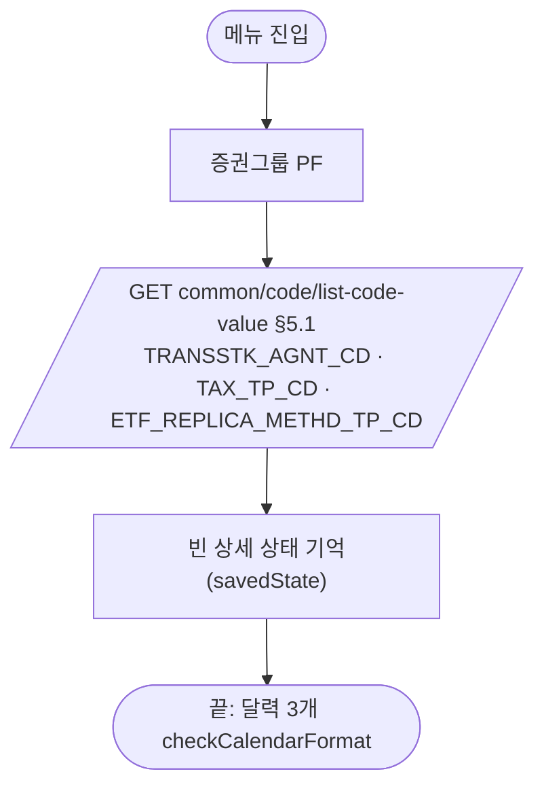
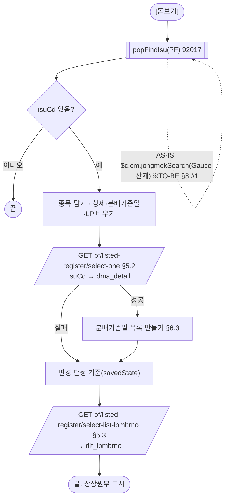
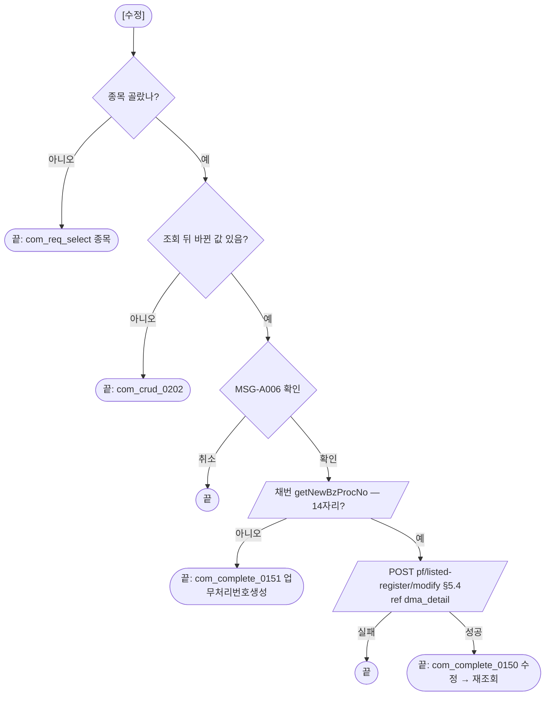

# ULDSTF09314 상장원부 — 업무 분석 및 전환 내역

| 항목 | 내용 |
|---|---|
| AS-IS 원본 | `ULDSTF09314.xml` — W-Craft 1차 변환본(`meta_asisFileNm="ULDSTF09314.gfm"`, 원본 gfm 은 저장소에 없음)에 **API 적용까지 마친 개발 사본**(작성 배성우 2026-09-11, `scwin.init` 현대화). 반입 `conversion/conversion-front/ui/ULDSTF09314/ULDSTF09314.xml` (pf 묶음 21본 중 하나) |
| 신규 API 명세 | 없음 — **화면에 적용된 `/api/...` 경로·method·dataCollection keyInfo 를 명세로 간주**(사용자 결정 2026-10-29 준용, pf 계약서). §5 는 "화면 적용 API ↔ AS-IS" 대응표. `api_spec_check` 는 SKIP(형식 검사 A07·A08 만) |
| TO-BE | `conversion/conversion-front/ui-tobe/ULDSTF09314.xml` (메뉴 본화면 — 배포 경로 `/ui/lst/pf/ULDSTF09314.xml` 가정). **2026-10-30 전환** — 1단계: 캡처 없음 → 기존 마크업 정비(사본 `$CLAUDE_JOB_DIR/tmp/ULDSTF09314_stage1.xml`), 2단계: 스크립트 재전환. 게이트: `gate_screen --pcc stf`·`scan_mixed_compare`(A 1건 `bzProcsNo.length !== 14` — 의도)·`publish_gate --pcc stf --before {1단계} --allow P20`·`api_spec_check`(SKIP)·`init_binding_check`·`wsxml_lint` 0/0, `convert.py` 고정점 |
| 퍼블리싱 파일 | 화면 폴더 `ULDSTF09314.xml` body 를 1단계 기준. publish 원본 `conversion/publish/상장/상장처리(대내)/ULDSTF09314.xml` 은 참고만 — 항목 구성이 같다(publish 는 페이지 머리 breadcrumb 목업) |
| 화면 캡처 | 없음 |
| 업무공통 | pcc: `$c.lc.getGlbValue`·`$c.lc.popFindIsu`·`$c.lc.isProcess`·`$c.stf.getNewBzProcNo`. gcc: `$c.date.checkCalendarFormat`·`$c.data.getMessage`·`$c.sbm.executeDynamic`·`$c.exception.handleError`. 게이트는 `--pcc stf` |
| 작성 | Inswave / 2026-10-30 |

참고 양식: [websquare_gfm_conversion.md](../../../md/websquare_gfm_conversion.md) — §1.4, §6.5. 같은 업무 선례는 `ui-tobe/ULDSTF05807.xml`(상장원부 — 신주인수권증서, 종목 팝업 92017 대체).

---

## 1. 화면 개요

상장 담당자가 **상장된 상장형 수익증권(PF) 종목의 상장원부(법인정보·종목정보·LP회원·수익분배기준일·장외파생상품 거래상대방)를 조회하고, 일부 항목(지정참가회사·거래상대방명01~10)을 수정하는** 메뉴 화면이다.

1. 진입하면 명의개서대행기관·과세유형·복제유형 콤보 코드를 받는다.
2. [종목 찾기]로 종목을 고르면 상장원부 상세와 LP회원 목록을 조회하고, 분배기준일01~12 중 값이 있는 것을 목록으로 보여 준다. **조회 버튼은 없다**(종목을 고르면 바로 조회).
3. 지정참가회사·거래상대방명만 입력할 수 있고, [수정]은 바뀐 값이 있을 때 업무처리번호를 채번해 수정한 뒤 다시 조회한다.

### 1.1 호출 화면 (메뉴)

메뉴 본화면(body `sub_contents`). 이 화면을 여는 다른 화면은 없다.

### 1.2 호출 규약 (부모 → 이 화면) / 반환 규약

해당 없음 — 메뉴 본화면.

### 1.3 이 화면이 여는 하위 팝업

| 팝업 | AS-IS 호출 | 넘기는 `data` (TO-BE) | 받는 결과 / 취소 판정 |
|---|---|---|---|
| ULDSTF92017 종목선택(pcc `$c.lc.popFindIsu`) | `$c.cm.jongmokSearch(ibx_searchIsuCd, ibx_searchIsuNm, vSecugrpID, market, "A")` — Gauce `stockSearch.JongmokSearch`(ULDCOM00003) 잔재, 반환 계약 없음(주석 `$c.stockSearch.JongmokSearch`) | `secugrpId`(PF) | 행 JSON `isuCd`·`isuKorNm` / `isCloseButtonClick`·`isuCd` 빈 값이면 취소 |

- 05807 선례와 같이 미전환 ULDCOM00003 대신 92017 로 연다(§10 #1).

### 1.4 업무 프로세스 흐름

| # | 업무 | 시작 | 끝 | 주요 함수 | 관련 절 |
|---|---|---|---|---|---|
| 1 | 진입 | 메뉴 | 콤보 코드 3종, 빈 상세 상태, 달력 바인딩 | `scwin.init` → `scwin.selectCodeList` | §3, §5.1 |
| 2 | 종목 찾기·조회 | [돋보기] `btn_FindIsu` | 상세 + 분배기준일 + LP회원 | `scwin.openIsuPopup` → `scwin.search` → `scwin.selectDetail`·`scwin.setDistrBasMmdd`·`scwin.selectLpList` | §6.1, §6.2, §5.2, §5.3 |
| 3 | 수정 | [수정] `btn_Update` | 변경 확인 → 확인 → 채번 → 수정 → 재조회 | `scwin.update` → `scwin.modifyTrs` | §6.5, §5.4 |

#### 화면 간 흐름

#### 업무 1: 진입

#### 업무 2: 종목 찾기·조회

| # | 단계 | 주체 | 내용 | 분기 · 메시지 | 관련 절 |
|---|---|---|---|---|---|
| 1 | 비우기 | 화면 | 이전 종목 상세·분배기준일·LP 목록 | — | §6.2 |
| 2 | 상세 | 서버 | `{ isuCd }`(개발 사본은 상세 dataMap 전체를 ref 로 보냄) | — | §5.2 |
| 3 | 분배기준일 | 화면 | `earngDistrBasMmdd1~12` 중 값 있는 것 → `dlt_distrBasMmdd` | — | §6.3 |
| 4 | LP회원 | 서버 | `{ isuCd }` | — | §5.3 |

#### 업무 3: 수정

#### 화면 모드 상태 전이

해당 없음 — 조회·수정 단일 모드([수정]은 늘 활성, 원본도 버튼 상태 제어 없음).

## 2. 화면 구성 및 데이터 정의

### 2.1 화면 구성

| 영역 | AS-IS 요소 (th 라벨 + td 컴포넌트) | TO-BE 컴포넌트 (바인딩) |
|---|---|---|
| 조회 | `label_2_top` 「종목코드(명)」 + `ibx_searchIsuCd` · `ibx_searchIsuNm` · `btn_searchIsu` | `ibx_searchIsuCd`(dma_search.isuCd) · `ibx_searchIsuNm`(dma_search.isuNm) · `btn_FindIsu` |
| 조회 | `label_15` 「유가증권」 + `sbx_secugrpId` | (삭제 — init 에서 숨기던 칸) |
| 법인정보 | `label_7` 「법인코드」 + `ibx_isurCd`(dma_selectOne.isurCd) | `ibx_isurCd`(dma_detail.isurCd) |
| 법인정보 | `label_8` 「한글법인명」 + `ibx_comNm`(dma_selectOne.comNm) | `ibx_comNm`(dma_detail.comNm) |
| 법인정보 | `label_1` 「우편번호」 + `ibx_zipcd`(dma_selectOne.zipcd) · `ibx_addr`(dma_selectOne.addr) | `ibx_zipcd`(dma_detail.zipcd) · `ibx_addr`(dma_detail.addr) |
| 법인정보 | `label_9` 「한글법인약명」 + `ibx_comAbbrv`(dma_selectOne.comAbbrv) | `ibx_comAbbrv`(dma_detail.comAbbrv) |
| 법인정보 | `label_56` 「나머지 주소」 + `ibx_dtlAddr`(dma_selectOne.dtlAddr) | `ibx_dtlAddr`(dma_detail.dtlAddr) |
| 법인정보 | `label_2` 「영문법인명」 + `ibx_comEngNm`(dma_selectOne.comEngNm) | `ibx_comEngNm`(dma_detail.comEngNm) |
| 법인정보 | `label_44` 「상장번호」 + `ibx_listNo`(dma_selectOne.listNo) | `ibx_listNo`(dma_detail.listNo) |
| 법인정보 | `label_52` 「법인전화번호」 + `ibx_corpTelNo`(dma_selectOne.corpTelNo) | `ibx_corpTelNo`(dma_detail.corpTelNo) |
| 법인정보 | `label_10` 「영문법인약명」 + `ibx_comEngAbbrv`(dma_selectOne.comEngAbbrv) | `ibx_comEngAbbrv`(dma_detail.comEngAbbrv) |
| 법인정보 | `label_25` 「결산월일」 + `ibx_acntclsMmdd1`(dma_selectOne.acntclsMmdd1) | `ibx_acntclsMmdd1`(dma_detail.acntclsMmdd1) |
| 법인정보 | `label_21` 「종목담당팀」 + `ibx_depNm`(dma_selectOne.depNm) | `ibx_depNm`(dma_detail.depNm) |
| 법인정보 | `label_54` 「영문심볼」 + `ibx_isurSymbl`(dma_selectOne.isurSymbl) | `ibx_isurSymbl`(dma_detail.isurSymbl) |
| 법인정보 | `label_4` 「명의개서대행기관」 + `sbx_transstkAgntCd`(dma_selectOne.transstkAgntCd) | `sbx_transstkAgntCd`(dma_detail.transstkAgntCd) |
| 법인정보 | `label_23` 「종목담당자」 + `ibx_empNm`(dma_selectOne.empNm) | `ibx_empNm`(dma_detail.empNm) |
| 종목정보 | `label_34` 「종목코드」 + `ibx_isuCd`(dma_selectOne.isuCd) | `ibx_isuCd`(dma_detail.isuCd) |
| 종목정보 | `label_3` 「종목단축코드」 + `ibx_isuSrtCd`(dma_selectOne.isuSrtCd) | `ibx_isuSrtCd`(dma_detail.isuSrtCd) |
| 종목정보 | `label_46` 「상장일」 + `cal_listDd`(dma_selectOne.listDd) | `cal_listDd`(dma_detail.listDd) |
| 종목정보 | `label_48` 「시장구분」 + `sbx_spotIsuTrdMktTpCd`(dma_selectOne.spotIsuTrdMktTpCd) | `sbx_spotIsuTrdMktTpCd`(dma_detail.spotIsuTrdMktTpCd) |
| 종목정보 | `label_33` 「한글종목명」 + `ibx_isuKorNm`(dma_selectOne.isuKorNm) | `ibx_isuKorNm`(dma_detail.isuKorNm) |
| 종목정보 | `label_5` 「상장증권수」 + `ibx_listShrs`(dma_selectOne.listShrs) | `ibx_listShrs`(dma_detail.listShrs) tar·number |
| 종목정보 | `label_49` 「발행일(설정일)」 + `cal_isuDd`(dma_selectOne.isuDd) | `cal_isuDd`(dma_detail.isuDd) |
| 종목정보 | `label_11` 「한글종목약명」 + `ibx_isuKorAbbrv`(dma_selectOne.isuKorAbbrv) | `ibx_isuKorAbbrv`(dma_detail.isuKorAbbrv) |
| 종목정보 | `label_6` 「순자산총액(원화)」 + `ibx_pfNetasstTotamt`(dma_selectOne.pfNetasstTotamt) | `ibx_pfNetasstTotamt`(dma_detail.pfNetasstTotamt) tar·number |
| 종목정보 | `label_43` 「1좌(주)당 신탁원본액(자본금)」 + `ibx_isuPrc`(dma_selectOne.isuPrc) | `ibx_isuPrc`(dma_detail.isuPrc) tar·float |
| 종목정보 | `label_36` 「영문종목명」 + `ibx_isuEngNm`(dma_selectOne.isuEngNm) | `ibx_isuEngNm`(dma_detail.isuEngNm) |
| 종목정보 | `label_26` 「유통순자산총액(원화)」 + `ibx_flowNetasstTotamt`(dma_selectOne.flowNetasstTotamt) | `ibx_flowNetasstTotamt`(dma_detail.flowNetasstTotamt) tar·number |
| 종목정보 | `label_18` 「순자산총액(외화)」 + `ibx_forncurrNetasstTotamt`(dma_selectOne.forncurrNetasstTotamt) | `ibx_forncurrNetasstTotamt`(dma_detail.forncurrNetasstTotamt) tar·float |
| 종목정보 | `label_35` 「영문종목약명」 + `ibx_isuEngAbbrv`(dma_selectOne.isuEngAbbrv) | `ibx_isuEngAbbrv`(dma_detail.isuEngAbbrv) |
| 종목정보 | `label_24` 「최종NAV(원화)」 + `ibx_pfLstNav`(dma_selectOne.pfLstNav) | `ibx_pfLstNav`(dma_detail.pfLstNav) tar·float |
| 종목정보 | `label_27` 「유통순자산총액(외화)」 + `ibx_fornflowNetasstTotamt`(dma_selectOne.fornflowNetasstTotamt) | `ibx_fornflowNetasstTotamt`(dma_detail.fornflowNetasstTotamt) tar·float |
| 종목정보 | `label_22` 「영문심볼」 + `ibx_isuEngSymbl`(dma_selectOne.isuEngSymbl) | `ibx_isuEngSymbl`(dma_detail.isuEngSymbl) |
| 종목정보 | `label_20` 「CU당 좌수」 + `ibx_cu1Shrs`(dma_selectOne.cu1Shrs) | `ibx_cu1Shrs`(dma_detail.cu1Shrs) tar·number |
| 종목정보 | `label_37` 「최종NAV(외화)」 + `ibx_forncurrLstNav`(dma_selectOne.forncurrLstNav) | `ibx_forncurrLstNav`(dma_detail.forncurrLstNav) tar·float |
| 종목정보 | `label_12` 「집합투자업자」 + `ibx_trstComNm`(dma_selectOne.trstComNm) | `ibx_trstComNm`(dma_detail.trstComNm) |
| 종목정보 | `label_40` 「유통증권수」 + `ibx_flowShrs`(dma_selectOne.flowShrs) | `ibx_flowShrs`(dma_detail.flowShrs) tar·number |
| 종목정보 | `label_13` 「일반사무관리회사」 + `ibx_bzAdmComNm`(dma_selectOne.bzAdmComNm) | `ibx_bzAdmComNm`(dma_detail.bzAdmComNm) |
| 종목정보 | `label_51` 「신고스프레드(%)」 + `ibx_declSpd`(dma_selectOne.declSpd) | `ibx_declSpd`(dma_detail.declSpd) tar·float |
| 종목정보 | `label_14` 「신탁업자」 + `ibx_trstInstNm`(dma_selectOne.trstInstNm) | `ibx_trstInstNm`(dma_detail.trstInstNm) |
| 종목정보 | `label_32` 「괴리율 초과발생 신고기준(%)」 + `sbx_divrgRtExcsOccrDeclBasval` | `sbx_divrgRtExcsOccrDeclBasval` |
| 종목정보 | `label_73` 「존속기한 만료일」 + `cal_expDd`(dma_selectOne.expDd) | `cal_expDd`(dma_detail.expDd) |
| 종목정보 | `label_62` 「과세유형」 + `sbx_taxTpCd`(dma_selectOne.taxTpCd) | `sbx_taxTpCd`(dma_detail.taxTpCd) |
| 종목정보 | `label_41` 「지정참가회사」 + `ibx_saleComNm`(dma_selectOne.saleComNm) | `ibx_saleComNm`(dma_detail.saleComNm) |
| 종목정보 | `label_53` 「자산보관회사」 + `ibx_asstcustdNm` | `ibx_asstcustdNm` |
| 장외파생상품 | `label_58` 「복제유형」 + `sbx_etfReplicaMethdTpCd`(dma_selectOne.etfReplicaMethdTpCd) | `sbx_etfReplicaMethdTpCd`(dma_detail.etfReplicaMethdTpCd) |
| 장외파생상품 | `label_59` 「거래상대방명01」 + `ibx_otcDrvClssTrCtpartNm`(dma_selectOne.otcDrvClssTrCtpartNm) | `ibx_otcDrvClssTrCtpartNm`(dma_detail.otcDrvClssTrCtpartNm) |
| 장외파생상품 | `label_28` 「거래상대방명02」 + `ibx_otcDrvClssTrCtpartNm2`(dma_selectOne.otcDrvClssTrCtpartNm2) | `ibx_otcDrvClssTrCtpartNm2`(dma_detail.otcDrvClssTrCtpartNm2) |
| 장외파생상품 | `label_29` 「거래상대방명03」 + `ibx_otcDrvClssTrCtpartNm3`(dma_selectOne.otcDrvClssTrCtpartNm3) | `ibx_otcDrvClssTrCtpartNm3`(dma_detail.otcDrvClssTrCtpartNm3) |
| 장외파생상품 | `label_30` 「거래상대방명04」 + `ibx_otcDrvClssTrCtpartNm4`(dma_selectOne.otcDrvClssTrCtpartNm4) | `ibx_otcDrvClssTrCtpartNm4`(dma_detail.otcDrvClssTrCtpartNm4) |
| 장외파생상품 | `label_31` 「거래상대방명05」 + `ibx_otcDrvClssTrCtpartNm5`(dma_selectOne.otcDrvClssTrCtpartNm5) | `ibx_otcDrvClssTrCtpartNm5`(dma_detail.otcDrvClssTrCtpartNm5) |
| 장외파생상품 | `label_72` 「거래상대방명06」 + `ibx_otcDrvClssTrCtpartNm6`(dma_selectOne.otcDrvClssTrCtpartNm6) | `ibx_otcDrvClssTrCtpartNm6`(dma_detail.otcDrvClssTrCtpartNm6) |
| 장외파생상품 | `label_38` 「거래상대방명07」 + `ibx_otcDrvClssTrCtpartNm7`(dma_selectOne.otcDrvClssTrCtpartNm7) | `ibx_otcDrvClssTrCtpartNm7`(dma_detail.otcDrvClssTrCtpartNm7) |
| 장외파생상품 | `label_39` 「거래상대방명08」 + `ibx_otcDrvClssTrCtpartNm8`(dma_selectOne.otcDrvClssTrCtpartNm8) | `ibx_otcDrvClssTrCtpartNm8`(dma_detail.otcDrvClssTrCtpartNm8) |
| 장외파생상품 | `label_45` 「거래상대방명09」 + `ibx_otcDrvClssTrCtpartNm9`(dma_selectOne.otcDrvClssTrCtpartNm9) | `ibx_otcDrvClssTrCtpartNm9`(dma_detail.otcDrvClssTrCtpartNm9) |
| 장외파생상품 | `label_50` 「거래상대방명10」 + `ibx_otcDrvClssTrCtpartNm10`(dma_selectOne.otcDrvClssTrCtpartNm10) | `ibx_otcDrvClssTrCtpartNm10`(dma_detail.otcDrvClssTrCtpartNm10) |
| 종목정보 | `label_16` 「최대15개」 + `grd_LP`(`dlt_lpmbrno`, `caption1`·`header1`·`gBody1`, 머리글 `LP_MBR_NM`) | `grd_LP`(`cap_LP`·`hdr_LP`·`gbd_LP`, 머리글 `h_lpMbrNm`) |
| 종목정보 | `label_17` 「최대12개」 + `grd_DISTR_BAS_MMDD`(`dlt_distrBasMmdd`, 같은 자동 id, 머리글 `EARNG_DISTR_BAS_MMDD`) | `grd_DISTR_BAS_MMDD`(`cap_Distr`·`hdr_Distr`·`gbd_Distr`, `h_earngDistrBasMmdd`) |
| 머리·제목 | `pfmContentHeader` · `label_47` 「법인정보」 · `panel_12` 「종목정보」(`label_42`, 안내 `label_19` 「상장증권수 및 최종NAV는 TU 단위로 표시된 값임」) · `label_60` 「장외파생상품 관련」 | 같음 |
| 하단 | `txb_IDX_TOTAL_CD`(init 에서 숨김) · `btn_update` [수정] | (삭제) · `btn_Update`(`btn_cm pt`, `grpBtnBox`) |

- 영역 그룹 id 는 그대로 — 조회 `panel_Top`, 법인정보 `panel_1`, 종목정보 `panel_Item`(제목 `panel_12`), 장외파생상품 `panel_2`.
- 정비 공통: 잔재 속성(`userData2`·`hierarchy`·`orgid`·이미지 `src`·`cursor`·`tabIndex`·`meta_snippet*`) 제거, 조회 영역은 숨겨 쓰던 「유가증권」 th/td 를 지우고 colgroup 2칸, 빈 `btn_schbox` 제거, 그리드 자동 id(`caption1`·`header1`·`gBody1` 두 그리드 중복, WS120) 고유화.
- **규칙 48** — 숫자 입력 11개에 `class="tar"`: 정수형(`number` `#,###`) 상장증권수·유통증권수·CU당 좌수·순자산총액(원화)·유통순자산총액(원화), 소수형(`float` `#,###.###[floor]`) 순자산총액·유통순자산총액(외화)·최종NAV(원화·외화)·1좌당 신탁원본액·신고스프레드(%). 개발 사본은 인라인 `text-align:right` 와 `#,###`(소수 잘림)였다. 결산월일(`##월##일`)·심볼은 코드성이라 제외.
- 복제유형 콤보 `sbx_etfReplicaMethdTpCd` 에 itemset(`dlt_etfReplicaMethdTpCd`) 추가 — 개발 사본은 목록을 받으면서 콤보에 연결하지 않아 늘 비었다(§8 #2).

### 2.2 데이터 정의

| TO-BE | 종류 | 키(컬럼) | 출처 / 용도 |
|---|---|---|---|
| `dma_search` | dataMap(화면 전용) | `isuCd`, `isuNm` | 종목 찾기 결과 |
| `dma_detail` | dataMap | 73키 — `bzProcsNo`, `isuCd`, `isurCd`, `isuSrtCd`, `isuKorNm`, `isuKorAbbrv`, `isuEngNm`, `isuEngAbbrv`, `listDd`, `isuDd`, `delistDd`, `spotIsuTrdMktTpCd`, `secugrpId`, `comNm`, `comAbbrv`, `comEngNm`, `comEngAbbrv`, `zipcd`, `addr`, `dtlAddr`, `listNo`, `corpTelNo`, `isurSymbl`, `acntclsMmdd1`, `isuEngSymbl`, `trstInstCd`, `trstInstNm`, `trstComIsurCd`, `trstComNm`, `saleComNm`, `bzAdmComIsurCd`, `bzAdmComNm`, `isuPrc`, `trstProprtTotAmt`, `listShrs`, `flowShrs`, `flowNetasstTotamt`, `fornflowNetasstTotamt`, `pfNetasstTotamt`, `forncurrNetasstTotamt`, `forncurrLstNav`, `pfLstNav`, `cu1Shrs`, `transstkAgntCd`, `depNm`, `empNm`, `otcDrvClssTrCtpartNm`(01)·`otcDrvClssTrCtpartNm2`~`10`, `declSpd`, `taxTpCd`, `taxTpNm`, `etfReplicaMethdTpCd`, `earngDistrBasMmdd1`·`earngDistrBasMmdd2`·`earngDistrBasMmdd3`·`earngDistrBasMmdd4`·`earngDistrBasMmdd5`·`earngDistrBasMmdd6`·`earngDistrBasMmdd7`·`earngDistrBasMmdd8`·`earngDistrBasMmdd9`·`earngDistrBasMmdd10`·`earngDistrBasMmdd11`·`earngDistrBasMmdd12`, `expDd` | `pf/listed-register/select-one` 응답·`modify` 요청(ref) — 개발 사본 `dma_selectOne` 키 그대로, name 자리표(`name1`~`name73`)는 화면 라벨로 채움 |
| `dlt_lpmbrno` | dataList | `lpMbrNo`, `lpMbrNm`, `lpContrtDd`, `lpStrtDd`, `lpEndDd` | `select-list-lpmbrno` 응답 — 그리드는 `lpMbrNm` 만 보인다 |
| `dlt_distrBasMmdd` | dataList(화면 전용) | `earngDistrBasMmdd` | 상세 분배기준일01~12 에서 만듦 |
| `dma_codReq` | dataMap | `codeList` | 공통 코드 요청 |
| `dlt_transstkAgntCd` · `dlt_taxTpCd` · `dlt_etfReplicaMethdTpCd` | dataList | `cdId`, `cdEngNm`, `value`, `text` | 공통 코드 응답 3종 |

- 옮기지 않음: `dma_lpmbrno`(LP 요청 — requestData 로), 전역 `vScrenID`·`vScrenTpCD`·`fn_GetPar`·`fn_SetPar`·`TR_JOB`·`vBzProcsNo`·`gDepCd`(쓰지 않거나 지역 변수로).
- **바인딩 없는 칸**: `sbx_divrgRtExcsOccrDeclBasval`(괴리율 초과발생 신고기준 — 정적 항목 1%/2%, ref 없음)·`ibx_asstcustdNm`(자산보관회사 — ref 없음)은 상세에 대응 키가 없어 늘 기본값·빈 칸이다(§10 #4).

## 3. 로딩 (`scwin.onpageload` → `scwin.init`)

1. **증권그룹** — `getGlbValue("SECUGRP_ID_PF")`(원본 `vSecugrpID`).
2. **콤보 코드** — `await scwin.selectCodeList()`(§5.1).
3. **빈 상세 상태** — `scwin.savedState = scwin.getEditState()` — 조회 전 [수정]이 「변경 없음」으로 끝나게.
4. **달력** — `checkCalendarFormat` × 3(`cal_listDd`·`cal_isuDd`·`cal_expDd`, 모두 읽기 전용 — 05923 선례대로 단일 달력 규약).
5. 원본 init 의 `txb_IDX_TOTAL_CD.hide()`·`label_15.setValue("")`·`sbx_secugrpId.hide()` 는 해당 컴포넌트를 마크업에서 지워 필요 없다. 조회 버튼이 없어 Enter 키 바인딩(규칙 22) 대상이 없다.

## 4. 컴포넌트 이벤트

| TO-BE 컴포넌트 | 이벤트 | TO-BE 핸들러 | 동작 | AS-IS |
|---|---|---|---|---|
| `btn_FindIsu` | onclick | `scwin.btn_FindIsu_onclick` | `scwin.openIsuPopup` | `btn_searchIsu` → `scwin.btn_searchIsu_onclick` |
| `btn_Update` | onclick | `scwin.btn_Update_onclick` | `scwin.update` | `btn_update` → `scwin.btn_update_onclick` |
| (없음) | — | — | — | `scwin.btn_search_onclick`(연결된 버튼 없음 — 빈 `btn_schbox`), `scwin.dma_selectOne_OnLoadCompleted`(Gauce 이벤트 이름, 연결 없음), `scwin.onpageunload`(빈 함수) — 옮기지 않음 |

## 5. 서버 통신

| # | 용도 | AS-IS | TO-BE (화면 적용 API) |
|---|---|---|---|
| 5.1 | 콤보 공통 코드 3종 | `fn_searchCode` | `GET /api/listing/common/code/list-code-value` |
| 5.2 | 상장원부 상세 | `fn_read_sync`(1) | `GET /api/listing/lstproc/pf/listed-register/select-one` |
| 5.3 | LP회원 목록 | `fn_read_sync`(2) | `GET /api/listing/lstproc/pf/listed-register/select-list-lpmbrno` |
| 5.4 | 상장원부 수정 | `fn_trs` | `POST /api/listing/lstproc/pf/listed-register/modify` |
| (pcc) | 업무처리번호 채번 | `$c.stf.getNewBzProcNo()` | pcc 내부 `stock/chglisting/new-bzprocsno` |

### 5.1 콤보 공통 코드 (`scwin.selectCodeList`)

| 항목 | 내용 |
|---|---|
| `ref` | `dma_codReq` (`codeList = "TRANSSTK_AGNT_CD, TAX_TP_CD, ETF_REPLICA_METHD_TP_CD"`) |
| `target` | `dlt_transstkAgntCd=body.TRANSSTK_AGNT_CD, dlt_taxTpCd=body.TAX_TP_CD, dlt_etfReplicaMethdTpCd=body.ETF_REPLICA_METHD_TP_CD` |
| 비고 | pf 계약서 §4.5 의 (B) 형태 — 개발 사본 그대로 |

### 5.2 상장원부 상세 (`scwin.selectDetail`)

| 항목 | 내용 |
|---|---|
| `requestData` | `{ isuCd }` — 개발 사본은 `dma_selectOne.set("isuCd")` 후 ref `dma_selectOne`(상세 73키 전체를 쿼리로) |
| `target` | `dma_detail=body` |
| 후처리 | `scwin.search` 가 분배기준일 목록·변경 판정 기준을 만든다 |

### 5.3 LP회원 목록 (`scwin.selectLpList`)

| 항목 | 내용 |
|---|---|
| `requestData` | `{ isuCd }`(개발 사본 ref `dma_lpmbrno`) |
| `target` / `gridview` | `dlt_lpmbrno=body` / `"grd_LP"` |

### 5.4 상장원부 수정 (`scwin.modifyTrs`)

| 항목 | 내용 |
|---|---|
| `ref` | `dma_detail`(채번한 `bzProcsNo` 를 넣은 상세 전체) — 개발 사본 그대로 |
| 후처리 | `com_complete_0150`(수정) 안내 → `scwin.search` 재조회 |
| 응답 판정 | `success` 만(§10 #3). 개발 사본 서브미션 id 가 코드 조회와 같은 `sbm_listCodeValue` 였다 → `sbm_modifyTrs` |

## 6. 일반 함수

### 6.1 종목 찾기 (`scwin.openIsuPopup`)
* `$c.lc.popFindIsu(secugrpId)` → 취소면 끝 → `dma_search` → `scwin.search`.

### 6.2 조회 (`scwin.search`)
* 상세·분배기준일·LP 비움 → `selectDetail` 성공이면 `setDistrBasMmdd` → `savedState` → `selectLpList`.

### 6.3 분배기준일 목록 (`scwin.setDistrBasMmdd`)
* `earngDistrBasMmdd1~12` 중 빈 값이 아닌 것을 순서대로 모아 `dlt_distrBasMmdd.setJSON(rows)`. 원본 `fn_getDistrBasMmDd` 는 `insertRow()` 뒤 `setCellData(i-1, …)` — 빈 달이 끼면 행 번호와 i 가 어긋나 엉뚱한 행(없는 행)에 썼다(§8 #3). `dma_selectOne_OnLoadCompleted` 의 같은 처리도 이것으로.

### 6.4 변경 판정 (`scwin.getEditState`) · 채번 응답 (`scwin.getBzProcsNoOf`)
* getEditState: `JSON.stringify(dma_detail.getJSON())`. 원본 `$c.data.isModified(dma_selectOne)` 은 행 기준(`getModifiedIndex`) 함수라 dataMap 변경을 판정하지 못한다 → 조회 직후 값과 비교(05806 선례).
* getBzProcsNoOf: 문자열이면 그대로, 객체면 `bzProcsNo`.

### 6.5 수정 (`scwin.update`)
* 종목 없으면 `com_req_select`(종목) → 변경 없으면 `com_crud_0202` → `isProcess("U")` → 채번 14자리 아니면 `com_complete_0151` → `dma_detail.bzProcsNo` → `modifyTrs`. 원본 `fn_CheckForm`(늘 true)은 지웠다.

## 7. 업무 코드 · 메시지 목록

| 구분 | 값 | 의미 |
|---|---|---|
| 공통 코드 | `TRANSSTK_AGNT_CD` · `TAX_TP_CD` · `ETF_REPLICA_METHD_TP_CD` | 명의개서대행기관 · 과세유형 · 복제유형 |
| 시장구분 콤보 | 1 · 2 | 유가증권시장 · 코스닥시장(정적) |
| 괴리율 초과발생 신고기준 | 1 · 2 | 1% · 2%(정적, 바인딩 없음) |
| 메시지 | `com_req_select`(종목) · `com_crud_0202`(변경 없음) · `com_complete_0151`(업무처리번호생성) · `com_complete_0150`(수정) · MSG-A006(처리 확인) | |

## 8. 원본 특이사항 · 결함

| # | 원본에서 실제로 일어나는 일 (근거) | 전환본 처리 |
|---|---|---|
| 1 | 종목 찾기가 Gauce `$c.cm.jongmokSearch`(반환 계약 없음) — 반환 판정 없이 값을 씀 | **바꿈** — pcc `popFindIsu`(92017), 취소 판정 |
| 2 | 복제유형 목록을 받지만 콤보에 itemset 이 없어 늘 빈 콤보 | **고침** — itemset 추가 |
| 3 | 분배기준일 목록이 빈 달이 끼면 잘못된 행 번호에 씀 | **고침** — 값 있는 것만 모아 setJSON |
| 4 | `isModified(dataMap)` — 행 기준 함수라 수정 여부를 판정하지 못함(늘 「변경 없음」 가능) | **고침** — 조회 직후 값과 비교 |
| 5 | pcc `getNewBzProcNo` 가 응답 JSON 을 돌려줘 `String(…).length != 14` 늘 참 → 수정 불가 | **고침** — `getBzProcsNoOf` |
| 6 | 상세 조회가 상세 dataMap 전체를 요청 ref 로 보냄(73키 쿼리) | **고침** — `{ isuCd }` |
| 7 | 수정 서브미션 id 가 코드 조회와 같음(`sbm_listCodeValue`) | **고침** |
| 8 | 조회 버튼 없는 빈 `btn_schbox`, 연결 없는 `btn_search_onclick`, init 에서 숨기는 「유가증권」 콤보·`txb_IDX_TOTAL_CD` | **옮기지 않음** |
| 9 | 숫자 칸 인라인 `text-align:right`·소수 칸도 `#,###`(소수 잘림) | **고침** — 규칙 48 |
| 10 | 같은 자동 id 두 그리드(`caption1`·`header1`·`gBody1`) | **고침** — 고유 id |

## 9. 전환 내역 (AS-IS → TO-BE)

| AS-IS | TO-BE |
|---|---|
| `scwin.onpageload` / `scwin.init` | `scwin.onpageload` → `scwin.init` |
| `scwin.onpageunload` | 삭제(빈 함수) |
| `scwin.fn_searchCode` | `scwin.selectCodeList` |
| `scwin.fn_read_sync` | `scwin.search` + `scwin.selectDetail` + `scwin.selectLpList` |
| `scwin.fn_getDistrBasMmDd` · `scwin.dma_selectOne_OnLoadCompleted` | `scwin.setDistrBasMmdd` |
| `scwin.fn_CheckForm` | 삭제(늘 true) |
| `scwin.fn_update` | `scwin.update` (+ `scwin.getEditState`·`scwin.getBzProcsNoOf`) |
| `scwin.fn_trs` | `scwin.modifyTrs` |
| `scwin.btn_search_onclick` | 삭제(연결된 버튼 없음) |
| `scwin.btn_searchIsu_onclick` | `scwin.btn_FindIsu_onclick` → `scwin.openIsuPopup` |
| `scwin.btn_update_onclick` | `scwin.btn_Update_onclick` |
| `dma_selectOne` · `dma_lpmbrno` | `dma_detail` · requestData |

- publicInfo: 정의한 14함수 전부.

## 10. 남은 작업 (TODO)

1. **종목 팝업** — 원본 `JongmokSearch` 옵션 `"A"`(전체 — 상장폐지 포함 추정) 대신 92017(`popFindIsu`)을 쓴다. 상장폐지 PF 종목도 원부를 봐야 하면 92017_1(`popFindIsuAll`)로 바꾼다.
2. **채번 경로** — pcc 채번은 주식 변경상장 경로. 상장원부 수정에도 업무처리번호를 새로 채번하는 것이 맞는지(원본 그대로) 확인.
3. **modify 응답** — 정의가 없어 `success` 만 본다.
4. **바인딩 없는 칸** — 괴리율 초과발생 신고기준(`sbx_divrgRtExcsOccrDeclBasval`)·자산보관회사(`ibx_asstcustdNm`)에 대응하는 응답 키가 상세에 없다. 키 추가 또는 칸 제거 확인.
5. **소수 자리** — 최종NAV·외화 금액·1좌당 신탁원본액·신고스프레드를 소수 3자리(`#,###.###[floor]`)로 표시한다. 실제 자리 수 확인(규칙 48).
6. **배포 경로** — `/ui/lst/pf/ULDSTF09314.xml` 가정.
