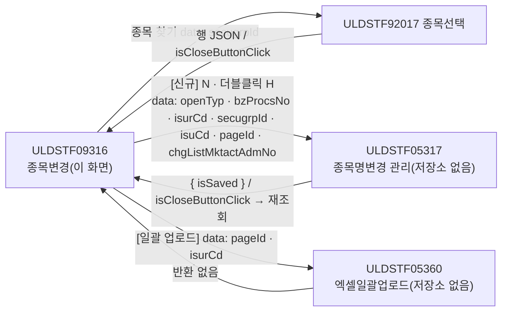
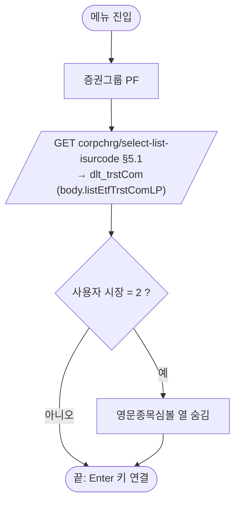
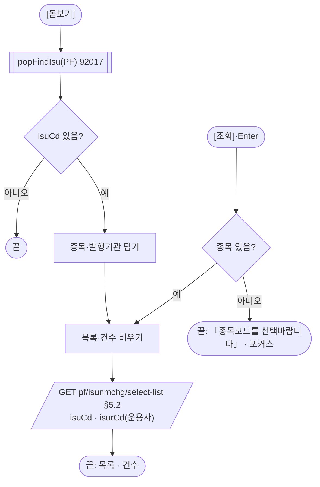
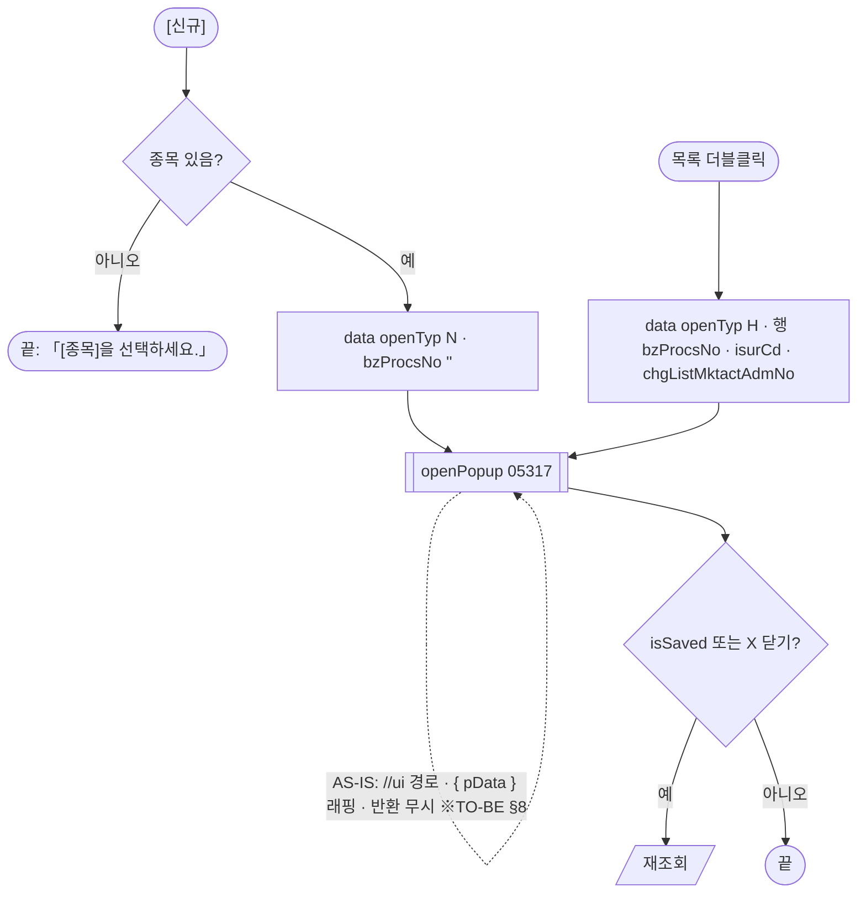
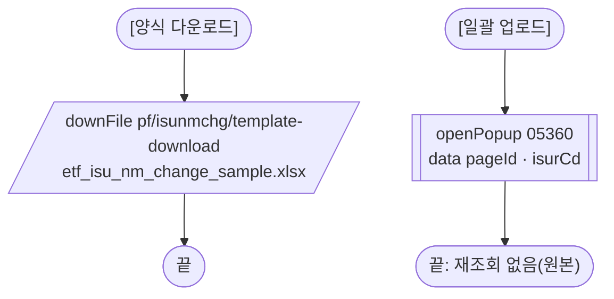

# ULDSTF09316 종목변경 — 업무 분석 및 전환 내역

| 항목 | 내용 |
|---|---|
| AS-IS 원본 | `ULDSTF09316.xml` — W-Craft 1차 변환본(`meta_asisFileNm="ULDSTF09316.gfm"`, 원본 gfm 은 저장소에 없음)에 **API 적용까지 마친 개발 사본**(W-Craft 마커 없이 개발자가 다시 쓴 스크립트). 반입 `conversion/conversion-front/ui/ULDSTF09316/ULDSTF09316.xml` (pf 묶음 21본 중 하나) |
| 신규 API 명세 | 없음 — **화면에 적용된 `/api/...` 경로·method·dataCollection keyInfo 를 명세로 간주**(사용자 결정 2026-10-29 준용, pf 계약서). §5 는 "화면 적용 API ↔ AS-IS" 대응표. `api_spec_check` 는 SKIP(형식 검사 A07·A08 만) |
| TO-BE | `conversion/conversion-front/ui-tobe/ULDSTF09316.xml` (메뉴 본화면 — 배포 경로 `/ui/lst/pf/ULDSTF09316.xml` 가정). **2026-10-30 전환** — 1단계: 캡처 없음 → 기존 마크업 정비(사본 `$CLAUDE_JOB_DIR/tmp/ULDSTF09316_stage1.xml`), 2단계: 스크립트 재전환. 게이트: `gate_screen --pcc stf`·`scan_mixed_compare`·`publish_gate --pcc stf --before {1단계} --allow P20`·`api_spec_check`(SKIP)·`init_binding_check`·`wsxml_lint` 0/0, `convert.py` 고정점 |
| 퍼블리싱 파일 | 화면 폴더 `ULDSTF09316.xml` body 를 1단계 기준. publish 원본 `conversion/publish/상장/상장처리(대내)/ULDSTF09316.xml` 은 참고만 — publish 원본에는 운용사 콤보·엑셀다운로드·양식 다운로드·일괄 업로드가 없다(개발 사본에서 추가, §10 #5) |
| 화면 캡처 | 없음 |
| 업무공통 | pcc: `$c.lc.getGlbValue`·`$c.lc.popFindIsu`. gcc: `$c.win.setEnterKeyEvent`·`$c.win.openPopup`·`$c.win.getProgramId`·`$c.data.downloadGridViewExcel`·`$c.data.downFile`·`$c.sbm.executeDynamic`·`$c.exception.handleError`. 게이트는 `--pcc stf` |
| 작성 | Inswave / 2026-10-30 |

참고 양식: [websquare_gfm_conversion.md](../../../md/websquare_gfm_conversion.md) — §1.4, §6.5. 호출·반환 키는 pf 21본 공통 계약서(§2 「외부·미보유 팝업」 05317·05360)를 따른다.

---

## 1. 화면 개요

상장 담당자가 **상장형 수익증권(PF) 종목의 종목명변경(한글·영문 종목명·약명·심볼) 이력을 보고, 새 변경을 등록하거나 엑셀로 일괄 등록하는** 메뉴 화면이다.

1. 진입하면 운용사 콤보 목록을 받는다.
2. [종목 찾기]로 종목을 고르면 그 종목의 종목명변경 내역을 조회한다. 운용사는 선택 조건이다.
3. 목록 더블클릭은 종목명변경 관리 팝업(ULDSTF05317)을 이력(H)으로, [신규]는 신규(N)로 연다.
4. [양식 다운로드]는 업로드 양식, [일괄 업로드]는 엑셀 일괄업로드 팝업(ULDSTF05360), [엑셀다운로드]는 목록 xlsx.

### 1.1 호출 화면 (메뉴)

메뉴 본화면(body `sub_contents`). 이 화면을 여는 다른 화면은 없다.

### 1.2 호출 규약 (부모 → 이 화면) / 반환 규약

해당 없음 — 메뉴 본화면. 숨겨진 하단 [닫기](`btn_Close`, `display:none`, `closePopup`)는 옮기지 않았다(§8 #6).

### 1.3 이 화면이 여는 하위 팝업

| 팝업 | AS-IS 호출 | 넘기는 `data` (TO-BE) | 받는 결과 / 취소 판정 |
|---|---|---|---|
| ULDSTF92017 종목선택(pcc `$c.lc.popFindIsu`) | `openPopup("/ui/lst/common/ULDSTF92017.xml", 1180×880, { secugrpId })` 직접 | `secugrpId`(pcc 가 `{ secugrpId }` 로) | 행 JSON `isuCd`·`isuKorNm`·`isurCd` / `isCloseButtonClick`·`isuCd` 빈 값이면 취소 |
| ULDSTF05317 종목명변경 관리 (1230×500) | `fn_OpenPopup` — `openPopup("//ui/lst/lstproc/ULDSTF05317.xml", opts, { pData : { clickBzProcsNo, vIsurCd, vOpenTyp, vSecuGrpId, vIsuCd, pageId:"STF09316", chgListMktactAdmNo } })` | 평면 `{ openTyp, bzProcsNo, isurCd, secugrpId, isuCd, pageId:"ULDSTF09316", chgListMktactAdmNo }` (pf 계약서) | `{ isSaved }` / `isSaved`·X 닫기면 재조회 |
| ULDSTF05360 종목변경 엑셀일괄업로드 (1300×750) | `fn_openUpload` — `openPopup("/ui/lst/lstproc/ULDSTF05360.xml", opts, { 'pageId ' : 'ULDSTF09316', vIsurCd })` | `{ pageId:"ULDSTF09316", isurCd }` | 없음 — 원본처럼 닫힌 뒤 재조회하지 않음 |

- 05317·05360 은 **저장소에 없다** — 키는 pf 계약서 제안(§10 #1·#2). 특히 **`pageId` 값을 계약서대로 `"ULDSTF09316"` 으로 바꿨는데**, pcc `checkBzDoubleInput` 은 `pageId === "STF09316"` 일 때만 PF 종목명변경 중복 확인 경로를 탄다 — 05317 이 이 값을 pcc 에 그대로 넘기면 분기가 어긋난다(§10 #3, 판단 필요).

### 1.4 업무 프로세스 흐름

| # | 업무 | 시작 | 끝 | 주요 함수 | 관련 절 |
|---|---|---|---|---|---|
| 1 | 진입 | 메뉴 | 운용사 콤보 채움, 코스닥 사용자는 영문심볼 열 숨김, Enter 키 연결 | `scwin.init` → `scwin.selectTrstComList` · `scwin.setComponentSymbl` | §3, §5.1 |
| 2 | 종목 찾기·조회 | [돋보기] `btn_FindIsu` | 종목명변경 내역 | `scwin.openIsuPopup` → `scwin.search` → `scwin.selectList` | §6.2, §5.2 |
| 3 | 조회 | [조회]·Enter | 내역 다시 표시 | `scwin.btn_Search_onclick` → `scwin.validateSearch` → `scwin.search` | §6.3, §6.4 |
| 4 | 신규 | [신규] `btn_New` | 관리 팝업(N) → 저장·닫기면 재조회 | `scwin.writeNew` → `scwin.openMngPopup` | §6.5, §6.7 |
| 5 | 이력 | 목록 더블클릭 | 관리 팝업(H) → 저장·닫기면 재조회 | `scwin.openDetail` → `scwin.openMngPopup` | §6.6, §6.7 |
| 6 | 일괄 업로드 | [양식 다운로드]·[일괄 업로드] | 양식 파일 / 업로드 팝업 | `scwin.downloadTemplate` · `scwin.openUploadPopup` | §6.8, §6.9 |
| 7 | 엑셀 | [엑셀다운로드] | 목록 xlsx | `scwin.excelDown` | §6.10 |

#### 화면 간 흐름

#### 업무 1: 진입

#### 업무 2·3: 종목 찾기·조회

#### 업무 4·5: 신규·이력

#### 업무 6: 일괄 업로드

#### 화면 모드 상태 전이

해당 없음 — 조회·팝업 호출 전용(저장은 하위 팝업이 한다).

## 2. 화면 구성 및 데이터 정의

### 2.1 화면 구성

| 영역 | AS-IS 요소 | TO-BE 컴포넌트 (바인딩) | 설명 |
|---|---|---|---|
| 머리 | `pfmContentHeader` | `pfmContentHeader` | |
| 조회 | `panel_Top` — colgroup 5칸인데 행은 th·td(colspan 3)·th·td(colspan 3) | `panel_Top` — colgroup 4칸, colspan 없음 | colgroup ↔ 칸 수 불일치 정정(P01) |
| 조회 | `label_2_top` 「종목코드(명)」(req) | `label_2_top` | |
| 조회 | `txb_ISU_CD`·`txb_ISU_NM`(바인딩 없음) | `txb_ISU_CD`(`dma_search.isuCd`)·`txb_ISU_NM`(`dma_search.isuNm`) | 읽기 전용 |
| 조회 | `img_ISU_CD`(돋보기) | `btn_FindIsu` | |
| 조회 | `tbx_textbox1` 「운용사」 + `sbx_isurCd3`(`chooseOption` 전체, `ev:onchange="scwin.sbx_isurCd3_onchange"` — 정의 없음, 목록은 스크립트 `setNodeSet`) | `sbx_TrstCom`(`dma_search.trstComIsurCd`, itemset `dlt_trstCom`) | 미정의 핸들러 제거(§8 #5) |
| 조회 | `btn_Search` [조회] | `btn_Search` | |
| 목록 | `tbcbox` 래퍼(`MaxTab_01` 잔재) > titbox `tbx_textbox3` 「종목명변경내역」 | titbox(래퍼 제거) `tbx_textbox3` | 탭 없음 |
| 목록 | `tbx_totCnt`(span) | `tbx_totCnt` | |
| 목록 | `btn_Excel_3` [엑셀다운로드] | `btn_Excel` | |
| 목록 | `grd_gridView2`(orgid `grd_List`, `caption3`·`header1`·`gBody1`) | `grd_List`(`cap_List`·`hdr_List`·`gbd_List`, `row15`) | 머리글 `h_NO`(숨김)·본문 `NO` 열 제거(행 번호는 `rowNumVisible`), 본문 `ISU_CD`(대문자) → `isuCd` |
| 목록 | 머리글 `h_DISCLS_YN`·`h_LIST_DD`·`h_ISU_KOR_NM`·`h_ISU_KOR_ABBRV`·`h_ISU_ENG_NM`·`h_ISU_ENG_ABBRV`·`h_ISU_ENG_SYMBL`·`h_LIST_BZ_TP_NM`·`h_ISU_CD`·`h_FNL_EMP_NM`·`h_BZ_PROCS_NO`·`h_ACPT_NO` | `h_disclsYn` … `h_acptNo` | 변경일 열 `displayFormat="####-##-##"`·mask → `dataType="date" displayFormat="yyyy-MM-dd"`(규칙 46) |
| 하단 | `panel_New` — `btn_FORM_U1` [양식 다운로드]·`btn_trigger1` [일괄 업로드]·`btn_New` [신규]·`btn_Close`(숨김) | `btn_FormDown`·`btn_Upload`·`btn_New`(pt) | 규칙 41, [닫기] 제거 |

### 2.2 데이터 정의

| TO-BE | 종류 | 키(컬럼) | 출처 / 용도 |
|---|---|---|---|
| `dma_search` | dataMap(화면 전용) | `isuCd`, `isuNm`, `trstComIsurCd`(운용사 — 요청 키 `isurCd`) | 조회 조건 |
| `dlt_trstCom` | dataList | `value` 코드값, `text` 코드명 | `corpchrg/select-list-isurcode` 의 `body.listEtfTrstComLP` (개발 사본 `dlt_listEtfTrstComLPRes`) |
| `dlt_list` | dataList | `chgListMktactAdmNo`(number) 변경상장시장조치관리번호, `bzProcsNo`, `isurCd`, `isuCd`, `listDd` 상장일(변경일), `isuKorNm`, `isuKorAbbrv`, `isuEngNm`, `isuEngAbbrv`, `isuEngSymbl`, `secugrpId`, `stkcertKindCd`, `stkcertKindNm`, `listBzTpNm`, `listBzTpCd`, `draftYn`, `disclsYn`, `mktactYn`, `fnlEmpNm`, **`acptNo`(추가)** | `pf/isunmchg/select-list` 응답 — 개발 사본 키 그대로 + 그리드 「접수번호」 열이 읽는 `acptNo` 를 추가(개발 사본 키에 없어 늘 빈 칸, §10 #4) |
| `scwin.isurCd` | 전역 | — | 고른 종목의 발행기관코드 — 일괄업로드 팝업으로 |

- 개발 사본 전역 `vScrenID`(`"ULDSTF09305.xml"` — 다른 화면 이름)·`clickBzProcsNo`·`clickBokRow`·`vOpenTyp`·`vIsuCd`·`fr_SecuGrpId`·`vSYMBL_INPUT_CD`·`chgListMktactAdmNo` 는 data 를 만들 때 바로 읽도록 바꿔 없앴다(§9).

## 3. 로딩 (`scwin.onpageload` → `scwin.init`)

1. **증권그룹** — `$c.lc.getGlbValue("SECUGRP_ID_PF")`(개발 사본 문자열 `"PF"`).
2. **운용사 콤보** — `await scwin.selectTrstComList()`(§5.1). 콤보는 마크업 itemset 으로 바인딩(개발 사본 `sbx_isurCd3.setNodeSet(…)`).
3. **영문심볼 열** — `scwin.setComponentSymbl(session market)` — 코스닥(2)이면 `isuEngSymbl` 열 숨김.
4. **Enter 키** — `setEnterKeyEvent(panel_Top, scwin.btn_Search_onclick)`(규칙 22). 달력 없음.

## 4. 컴포넌트 이벤트

| TO-BE 컴포넌트 | 이벤트 | TO-BE 핸들러 | 동작 | AS-IS |
|---|---|---|---|---|
| `btn_FindIsu` | onclick | `scwin.btn_FindIsu_onclick` | `scwin.openIsuPopup` | `img_ISU_CD` → `scwin.img_ISU_CD_onclick` |
| `btn_Search` | onclick | `scwin.btn_Search_onclick` | `validateSearch` → `search` | `btn_Search` → `scwin.btn_Search_onclick` → `fn_all_list_sync` |
| `grd_List` | oncelldblclick | `scwin.grd_List_oncelldblclick` | `scwin.openDetail` | `grd_gridView2` → `scwin.grd_List_oncelldblclick` → `fn_OpenDetailMng` |
| `btn_New` | onclick | `scwin.btn_New_onclick` | `scwin.writeNew` | `btn_New` → `scwin.btn_New_onclick` |
| `btn_Excel` | onclick | `scwin.btn_Excel_onclick` | `scwin.excelDown` | `btn_Excel_3` → `scwin.btn_Excel_3_onclick` |
| `btn_FormDown` | onclick | `scwin.btn_FormDown_onclick` | `scwin.downloadTemplate` | `btn_FORM_U1` → `scwin.btn_FORM_U1_onclick` |
| `btn_Upload` | onclick | `scwin.btn_Upload_onclick` | `scwin.openUploadPopup` | `btn_trigger1` → `scwin.btn_excelUpload_onclick` → `fn_openUpload` |
| (없음) | — | — | — | `sbx_isurCd3` onchange `scwin.sbx_isurCd3_onchange`(정의 없음), `btn_Close` → `scwin.btn_Close_onclick`(숨김), body `scwin.onpageunload`(정의 없음), `scwin.grd_Bok_Recv_OnDblClick`·`scwin.btn_Excel_onclick`(연결된 컴포넌트 없음) — 옮기지 않음 |

## 5. 서버 통신

| # | 용도 | AS-IS | TO-BE (화면 적용 API) |
|---|---|---|---|
| 5.1 | 운용사 콤보 목록 | (개발 사본에서 추가) | `GET /api/listing/lstmgt/corpchrg/select-list-isurcode` |
| 5.2 | 종목명변경 내역 | — | `GET /api/listing/lstproc/pf/isunmchg/select-list` |
| 5.3 | 업로드 양식 | — | `GET /api/listing/lstproc/pf/isunmchg/template-download` (`$c.data.downFile`) |

### 5.1 운용사 콤보 목록 (`scwin.selectTrstComList`)

| 항목 | 내용 |
|---|---|
| `id` / `method` / `action` | `sbm_selectTrstComList` / `get` / `/api/listing/lstmgt/corpchrg/select-list-isurcode` |
| `target` | `dlt_trstCom=body.listEtfTrstComLP` |
| 후처리 | 없음 — 콤보 itemset 이 자동 반영(개발 사본은 성공 시 `setNodeSet`) |
| 실패 · 중복 | 공통 안내 / `skipped` 건너뜀 |

### 5.2 종목명변경 내역 (`scwin.selectList`)

| 항목 | 내용 |
|---|---|
| `id` / `method` / `action` | `sbm_selectList` / `get` / `/api/listing/lstproc/pf/isunmchg/select-list` |
| `requestData` | `{ isuCd, isurCd : dma_search.trstComIsurCd }` — 운용사 「전체」면 빈 값 |
| `target` / `gridview` | `dlt_list=body` / `grd_List`(규칙 44 — 개발 사본 `"grd_gridView2"`) |
| 후처리 | 건수 `tbx_totCnt`(`scwin.search`) |
| 실패 · 중복 | 공통 안내, `false` / `skipped` |

### 5.3 업로드 양식 (`scwin.downloadTemplate`)

* `await $c.data.downFile("/api/listing/lstproc/pf/isunmchg/template-download", "etf_isu_nm_change_sample.xlsx")` — 파일명은 개발 사본 그대로(ETF 이름, §10 #6).

## 6. 일반 함수

### 6.1 영문심볼 열 (`scwin.setComponentSymbl`)
* 시장 `"2"` 면 `grd_List.setColumnVisible("isuEngSymbl", false)`.

### 6.2 종목 찾기 (`scwin.openIsuPopup`)
* `$c.lc.popFindIsu(secugrpId)` → 취소(`isCloseButtonClick`·`isuCd` 빈 값)면 끝 → 종목·발행기관 → `scwin.search`. 개발 사본 `!isEmpty(result)` 는 닫기 객체도 통과시켰다(§8 #3).

### 6.3 조회 (`scwin.search`)
* 목록·건수 비움 → `selectList` → 건수.

### 6.4 조회 조건 확인 (`scwin.validateSearch(message)`)
* 종목코드가 없으면 안내 + `txb_ISU_CD.focus()`. 문구는 원본처럼 조회 「종목코드를 선택바랍니다」, 신규 「[종목]을 선택하세요.」.

### 6.5 신규 (`scwin.writeNew`)
* data `{ openTyp:"N", bzProcsNo:"", isurCd, secugrpId, isuCd, pageId, chgListMktactAdmNo:"" }` → `openMngPopup`. 개발 사본은 앞서 더블클릭한 행의 `chgListMktactAdmNo` 를 그대로 넘겼다(§8 #4).

### 6.6 이력 (`scwin.openDetail`)
* data `{ openTyp:"H", bzProcsNo·isurCd·chgListMktactAdmNo = 행 값, secugrpId, isuCd = 고른 종목, pageId }` → `openMngPopup`. 원본 `fn_setBzProcsNo`·`fn_getBzProcsNo`(값 보관용)는 data 로 대체.

### 6.7 관리 팝업 (`scwin.openMngPopup(data)`)
* `openPopup("/ui/lst/lstproc/ULDSTF05317.xml", { id, popupName:"종목명변경 관리", 1230×500, type:"pageFramePopup" }, data)` await → `isSaved || isCloseButtonClick` 이면 `scwin.search`. 개발 사본은 `"//ui/…"` 경로, `{ pData : … }` 래핑, `v` 접두 키, 반환 무시(`if(res){}` 빈 블록).

### 6.8 일괄업로드 팝업 (`scwin.openUploadPopup`)
* `openPopup("/ui/lst/lstproc/ULDSTF05360.xml", 1300×750, { pageId, isurCd })` await. 재조회하지 않음(원본). 개발 사본 키 `'pageId '`(뒤 공백)·`vIsurCd` 정정. 주석으로 남은 `uploadGridViewExcel` 방식은 옮기지 않음.

### 6.9 양식 다운로드 (`scwin.downloadTemplate`) — §5.3

### 6.10 엑셀 (`scwin.excelDown`)
* `downloadGridViewExcel(grd_List, { fileName : getProgramId() + "_종목변경_" + 시각 + ".xlsx", sheetName : "리스트" })`(규칙 42). 0건 안내는 공통(원본 `com_search_0027` 안내 대체).

## 7. 업무 코드 · 메시지 목록

| 구분 | 값 | 의미 |
|---|---|---|
| `openTyp` | H / N | 이력(수정) / 신규 (원본 주석의 R=접수는 이 화면에서 안 씀) |
| 사용자 시장 | 2 | 코스닥 — 영문종목심볼 열 숨김 |
| 메시지 | 「종목코드를 선택바랍니다」 | 조회 시 종목 없음 |
| | 「[종목]을 선택하세요.」 | 신규 시 종목 없음 |
| | (공통) | 엑셀 0건 — 원본 `com_search_0027` |

## 8. 원본 특이사항 · 결함

| # | 원본에서 실제로 일어나는 일 (근거) | 전환본 처리 |
|---|---|---|
| 1 | `vScrenID = "ULDSTF09305.xml"` — 다른 화면 이름 | **삭제**(규칙 1) |
| 2 | 관리 팝업 경로 `"//ui/lst/lstproc/ULDSTF05317.xml"`(슬래시 2개), 일괄업로드 data 키 `'pageId '`(뒤 공백) | **고침** |
| 3 | 종목 찾기 취소 판정 `!isEmpty(result)` — 닫기 객체 `{ isCloseButtonClick }` 도 통과해 `undefined` 를 넣고 조회 | **고침** — `isuCd` 로 판정 |
| 4 | [신규]가 이전 더블클릭 행의 `chgListMktactAdmNo`·`vIsurCd`(행 발행기관) 를 그대로 씀 | **고침** — 신규는 빈 값·고른 종목 발행기관 |
| 5 | `sbx_isurCd3` onchange 핸들러·`onpageunload` 미정의, `grd_Bok_Recv_OnDblClick`(→ 없는 `fn_OpenDetailBokRecv`)·`btn_Excel_onclick`(없는 `grd_List`) 죽은 코드 | **옮기지 않음** |
| 6 | 본화면에 숨긴 [닫기](`closePopup`) | **옮기지 않음** |
| 7 | 조회 영역 colgroup 5칸 ↔ 실제 8칸, 그리드 숨김 `NO` 열(`{CurRow}`), 본문 대문자 `ISU_CD`, 머리글 ` ` | **고침** |
| 8 | 그리드 「접수번호」 `acptNo` 가 dataList 에 없음 | 키 추가(응답 확인 §10 #4) |
| 9 | 관리 팝업 반환을 받고 아무것도 안 함 | **바꿈** — 재조회 규약 |

## 9. 전환 내역 (AS-IS → TO-BE)

| AS-IS | TO-BE |
|---|---|
| `scwin.onpageload` / `scwin.init` | `scwin.onpageload` → `scwin.init` |
| `scwin.fn_get_isurcode` | `scwin.selectTrstComList` |
| `scwin.fn_setComponentSymbl` | `scwin.setComponentSymbl` |
| `scwin.fn_all_list_sync` | `scwin.btn_Search_onclick` + `scwin.validateSearch` |
| `scwin.fn_list_sync` | `scwin.selectList` + `scwin.search` |
| `scwin.fn_OpenDetailMng` + `scwin.fn_setBzProcsNo` + `scwin.fn_getBzProcsNo` | `scwin.openDetail` |
| `scwin.fn_OpenPopup` | `scwin.openMngPopup` |
| `scwin.btn_New_onclick` | `scwin.btn_New_onclick` → `scwin.writeNew` |
| `scwin.btn_Search_onclick` | `scwin.btn_Search_onclick` |
| `scwin.btn_Excel_onclick`(죽은 코드) · `scwin.btn_Excel_3_onclick` | `scwin.btn_Excel_onclick` → `scwin.excelDown` |
| `scwin.btn_Close_onclick` | 삭제 |
| `scwin.img_ISU_CD_onclick` | `scwin.btn_FindIsu_onclick` → `scwin.openIsuPopup` |
| `scwin.grd_Bok_Recv_OnDblClick` | 삭제(죽은 코드) |
| `scwin.grd_List_oncelldblclick` | `scwin.grd_List_oncelldblclick` |
| `scwin.btn_excelUpload_onclick` + `scwin.fn_openUpload` | `scwin.btn_Upload_onclick` → `scwin.openUploadPopup` |
| `scwin.btn_FORM_U1_onclick` | `scwin.btn_FormDown_onclick` → `scwin.downloadTemplate` |
| `dlt_listEtfTrstComLPRes` | `dlt_trstCom` |

- publicInfo: 정의한 21함수 전부.

## 10. 남은 작업 (TODO)

1. **ULDSTF05317** — 저장소에 없다. 평면 data 키·반환 `{ isSaved }` 는 pf 계약서 제안. 개발 사본은 `{ pData : { clickBzProcsNo, vIsurCd, vOpenTyp, vSecuGrpId, vIsuCd, … } }` 로 넘겼다.
2. **ULDSTF05360** — 저장소에 없다. data `{ pageId, isurCd }` 제안, 업로드 뒤 이 화면을 다시 조회할지 확인(원본은 안 함).
3. **`pageId` 값 (판단 필요)** — 계약서대로 `"ULDSTF09316"` 을 넘긴다. 그러나 pcc `checkBzDoubleInput`(`cm/pcc/stf/list_common.xml` 2463행)은 `pageId === "STF09316"` 일 때만 `pf/isunmchg/double-check` 경로를 쓴다. 05317 이 이 값을 그대로 pcc 에 넘기면 주식 변경상장 경로로 잘못 간다 — 05317 전환 때 `"STF09316"` 으로 되돌리거나 pcc 비교값을 바꿔야 한다.
4. **`acptNo`** — 그리드 「접수번호」가 읽는 키를 추가했다. 응답에 오는지 확인.
5. **publish 원본과 차이** — 운용사 콤보·엑셀·양식·일괄 업로드는 publish 원본에 없고 개발 사본에서 추가됐다. 퍼블리싱 반영 여부 확인.
6. **양식 파일명** — `etf_isu_nm_change_sample.xlsx`(ETF 이름)가 PF 에도 맞는지.
7. **배포 경로** — `/ui/lst/pf/ULDSTF09316.xml` 가정.
