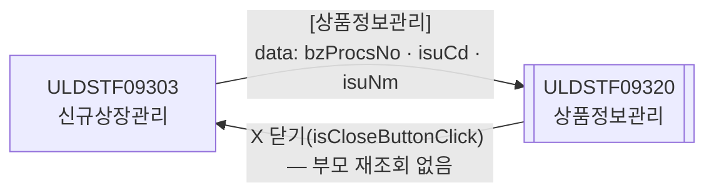
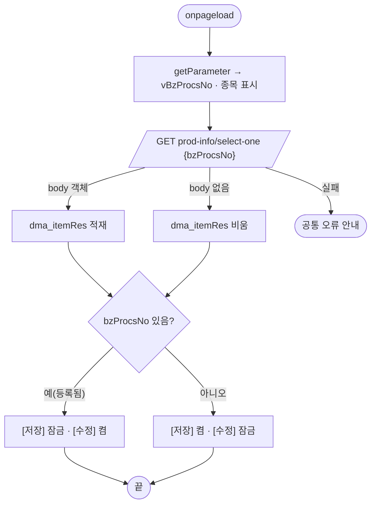
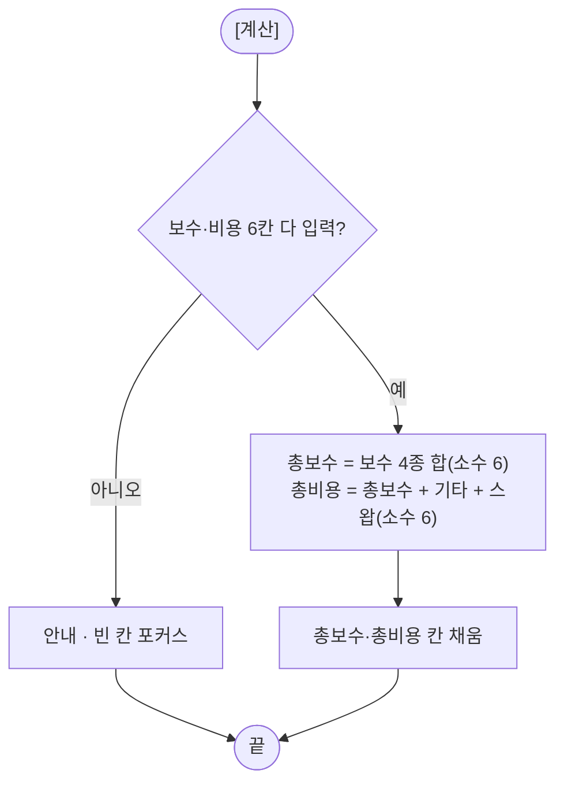
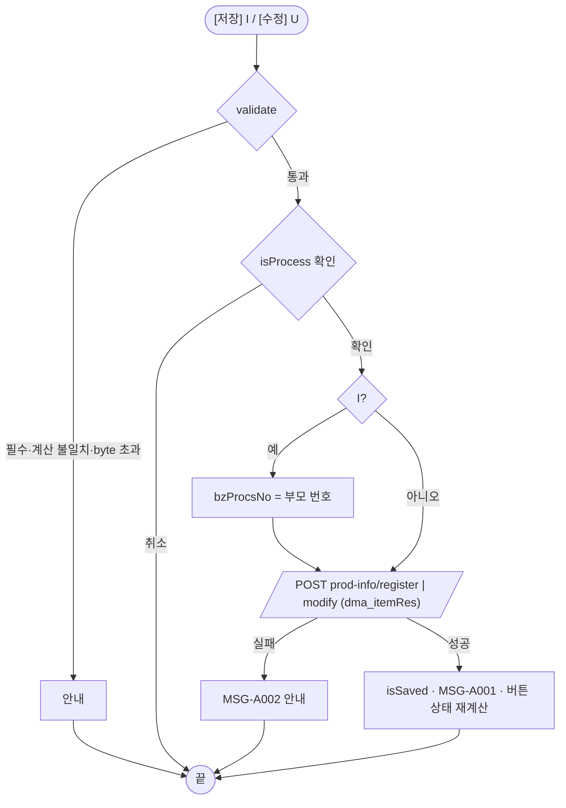

# ULDSTF09320 (팝업)상장형수익증권상품정보관리 — 업무 분석 및 전환 내역

| 항목 | 내용 |
|---|---|
| AS-IS 원본 | `ULDSTF09320.xml` — W-Craft 1차 변환본(`meta_asisFileNm="ULDSTF09320.gfm"`, 원본 gfm 은 저장소에 없음)에 **API 적용까지 마친 개발 사본**. 업무 로직은 이 스크립트와 남은 옛 코드 주석으로 분석했다 — 반입 `conversion/conversion-front/ui/ULDSTF09320/ULDSTF09320.xml` (pf 묶음) |
| 신규 API 명세 | 없음 — **화면에 적용된 `/api/...` 경로·method·dataCollection keyInfo 를 명세로 간주**(사용자 결정 2026-10-29 준용). §5 는 "화면 적용 API ↔ AS-IS(주석에 남은 옛 호출)" 대응표. `api_spec_check` 는 SKIP |
| TO-BE | `conversion/conversion-front/ui-tobe/ULDSTF09320.xml` (배포 경로 `/ui/lst/pf/ULDSTF09320.xml` — 부모 09303 의 원본 리터럴) |
| 퍼블리싱 | 화면 폴더 `ULDSTF09320.xml` 의 body 를 1단계 기준으로 정비했다(선례 ULDBNS30400 「캡처 없음, 기존 마크업 정비」). `conversion/publish/상장/상장처리(대내)/ULDSTF09320.xml` 은 참고만 — 차이는 바인딩·입력칸 폭(body diff 54줄, 라벨 같음) |
| 화면 캡처 | 없음 |
| 업무공통 | `$c.stf`(`checkMaxLength`·`getMessageParam`)·`$c.lc`(`isProcess`) — `cm/pcc/stf`. 게이트는 `--pcc stf` |
| 공통 계약 | pf 21본 공통 계약서 — 09303 → 09320 `{ bzProcsNo, isuCd, isuNm }`, 반환 `{ isSaved }`(09303 은 원본대로 닫힌 뒤 재조회하지 않음) |
| 작성 | Inswave / 2026-10-30 |

참고 양식: [websquare_gfm_conversion.md](../../../md/websquare_gfm_conversion.md) — §1.4 업무 프로세스 흐름, §6.5 getPar/setPar 전환. 선례: ULDSTF05806·05103(응답 판정 `checkResult`).

---

## 1. 화면 개요

상장형 수익증권 **신규상장관리(ULDSTF09303)** 에서 [상품정보관리]로 여는 팝업이다. 그 신규상장 건(업무처리번호)의 **상품정보**를 등록·수정한다.

1. 부모가 업무처리번호·종목코드·종목명을 넘겨 연다. 업무처리번호로 상품정보를 조회해 등록 전이면 [저장], 등록됐으면 [수정]만 켠다.
2. 총보수: 집합투자업자·AP/LP·신탁회사·일반사무관리회사 보수 4종의 합. 총비용: 총보수 + 기타비용 + 스왑비용. [계산]으로 채운다(소수 6자리).
3. 홈페이지·회계기간·분배금 지급기준일·상품정보(기본정보·투자유의사항)는 필수, 영문 항목·합성 상장형 수익증권 담보관리 항목은 선택.
4. [저장]/[수정] 전에 필수 보수·비용, 총보수·총비용이 계산값과 같은지, 필수 항목·최대 byte 를 검사한다.

### 1.1 호출 화면 (1본)

- `ULDSTF09303` 상장형 수익증권 신규상장관리(같은 pf 묶음 D) — [상품정보관리](`btn_sim`)가 1000×900 으로 연다. 저장된 건에서만 켜진다.

### 1.2 호출 규약 (부모 → 이 화면) / 반환 규약

| TO-BE 키 | 의미 | AS-IS | 빈 값일 때 |
|---|---|---|---|
| `bzProcsNo` | 신규상장 업무처리번호 | `parentWin.scwin.vBzProcsNo`(원본 gfm 은 `?nIndex=`) | 부모는 저장 전이면 버튼을 잠근다 — 빈 값으로 조회하면 등록 전 상태 |
| `isuCd` | 종목코드(표시) | `parentWin.txb_SearchIsuCd` | 빈 칸 |
| `isuNm` | 종목명(표시) | `parentWin.txb_SearchIsuNm` | 빈 칸 |

- **반환**: 스스로 닫는 경로가 없다(하단 [닫기] 금지). 저장·수정 성공 시 `scwin.isSaved = true` 로 남기지만, X 로 닫히면 `{ isCloseButtonClick : true }` 가 간다. 부모 09303 은 원본처럼 닫힌 뒤 다시 조회하지 않는다(공통 계약서).

### 1.3 이 화면이 여는 하위 팝업

해당 없음.

### 1.4 업무 프로세스 흐름

#### 화면 간 흐름

#### 업무 1: 로딩

#### 업무 2: 계산

#### 업무 3: 저장(등록)·수정

| 단계 | 주체 | 내용 | 분기 | 근거 |
|---|---|---|---|---|
| 1 | 화면 | 검사(필수·계산값·byte) | 탈락 → 안내 | §6.3 |
| 2 | 화면 | 처리 확인(MSG-A006) | 취소 → 끝 | §6.4 |
| 3 | 서버 | 등록·수정 | 실패 → MSG-A002 | §5.2·§5.3 |
| 4 | 화면 | 성공 안내, 등록이면 [수정] 켬 | — | §6.4, §8 #4 |

---

## 2. 화면 구성 및 데이터 정의

### 2.1 화면 구성 (AS-IS 요소 → TO-BE 컴포넌트)

| 영역 | AS-IS id | TO-BE | 비고 |
|---|---|---|---|
| 머리 | (없음) | `pfmContentHeader` | 팝업 contentHeader 필수 |
| 종목 | `panel_Top`·`label_1`·`txb_ISU_CD`·`txb_ISU_NM`(읽기) | 같음 | 부모 data 로 채움 |
| 총보수 | `label_28`·`panel_1`·`label_5`·`label_18`·`label_19`·`label_20`·`label_21` | 같음 | |
| 보수 4종 | `edt_CIS_COST_RT`·`edt_AP_CMP_LP_COST_RT`·`edt_TRST_COM_COST_RT`·`edt_TRANSAGNT_COST_RT`(`dataType="number"`) | `class="tar" dataType="float" displayFormat="#,###.######[floor]" applyFormat="display"` | 규칙 48 — 원본 maxdecimalplace 6 |
| 총보수 | `edt_PF_TOT_FEE`(비활성) | 같은 형식 | 계산 결과 |
| 기타비용 | `label_29`·`panel_2`·`label_22`·`edt_MISC_COST_RT`·`label_23`·`txa_MISC_COST_DTL` | 같음(`edt_MISC_COST_RT` 규칙 48) | |
| 합성비용 | `label_42`·`label_24`·`edt_SYNTH_SWAP_COST_RT`·`label_25`·`txa_SYNTH_COST_DTL`·`label_26`·`edt_TOT_COST_RT`(비활성)·`btn_calcul`·`label_27` | 같음(`edt_*` 규칙 48) | |
| 상품정보 | `panel_Main`·`label_2`·`txb_HPAGE`·`label_6`·`txb_TRST_CALC_PD_CONTN`·`label_7`·`txb_TRST_DISTR_PAY_BAS_DD_CONTN`·`label_13`·`txa_PF_PROD_INFO`·`label_3`·`txa_PF_INVSTWARN_CONTN`·`label_9`·`txa_TRST_CALC_PD_ENG_CONTN`·`label_10`·`txa_DISTR_PAY_BAS_DD_ENG_CONTN`·`label_4`·`txa_PF_PROD_ENG_INFO`·`label_8`·`txa_PF_INVSTWARN_ENG_CONTN`·`label_14`·`label_11`·`txa_SYNTH_PF_COLTRL_ADM_OVRVW`·`label_15`·`label_16`·`txa_COLTRL_ADM_ASSTCOM_HPAGE_ADDR` | 같음 | `txa_PF_INVSTWARN_CONTN` `ev:onblur` 이름 정리 |
| 버튼 | `btn_Update`(btn_cm)·`btn_save`(pt)·`btn_Close` | `grp_btnBox` 안 [수정]·[저장] 둘 다 `btn_cm pt` | 규칙 41, 팝업 하단 [닫기] 제거 |

### 2.2 데이터 정의 (DataCollection)

| id | 종류 | 키 | 용도 |
|---|---|---|---|
| `dma_itemRes` | dataMap | `bzProcsNo`·`hpage`·`trstCalcPdContn`·`trstDistrPayBasDdContn`·`pfProdInfo`·`pfInvstwarnContn`·`pfProdEngInfo`·`pfInvstwarnEngContn`·`trstCalcPdEngContn`·`distrPayBasDdEngContn`·`synthPfBasIdxOvrvw`·`basIdxRelAsstcomHpageAddr`·`synthPfColtrlAdmOvrvw`·`coltrlAdmAsstcomHpageAddr`·`cisCostRt`(n)·`apCmpLpCostRt`(n)·`trstComCostRt`(n)·`transagntCostRt`(n)·`pfTotFee`(n)·`miscCostRt`(n)·`miscCostDtl`·`synthSwapCostRt`(n)·`synthCostDtl`·`totCostRt`(n) | select-one 응답 + register·modify 요청 |

- 삭제: `bnd_Item`(Gauce 바인드 맵 잔재 — 실제 바인딩은 컴포넌트 `ref`).
- `synthPfBasIdxOvrvw`·`basIdxRelAsstcomHpageAddr` 는 입력칸이 없다(`bnd_Item` 이 가리키던 `txa_SYNTH_PF_BAS_IDX_OVRVW`·`txa_BAS_IDX_REL_ASSTCOM_HPAGE_ADDR` 가 body 에 없음) — 조회 값이 그대로 저장에 실려 간다(§10 #4).

### 2.3 원본 요소 전체 대응 (자동 추출 — 누락 점검용)

원본 XML 의 모든 id·명칭을 TO-BE 와 대조했다. 「같음」은 TO-BE 에 같은 id 가 있는 것이다.

#### DataCollection (원본 head)

| AS-IS id | TO-BE | 키(명칭) |
|---|---|---|
| `dma_itemRes` (dataMap) | 같음 | `bzProcsNo`(업무처리번호)·`hpage`(홈페이지)·`trstCalcPdContn`(신탁계산기간내용)·`trstDistrPayBasDdContn`(투자신탁분배금지급기준일자내용)·`pfProdInfo`(PF상품정보)·`pfInvstwarnContn`(PF투자유의사항)·`pfProdEngInfo`(PF상품영문정보)·`pfInvstwarnEngContn`(PF투자유의영문내용)·`trstCalcPdEngContn`(신탁계산기간영문내용)·`distrPayBasDdEngContn`(분배금지급기준일자영문내용)·`synthPfBasIdxOvrvw`(합성PF기초지수개요)·`basIdxRelAsstcomHpageAddr`(기초지수관련자산운용사홈페이지주소)·`synthPfColtrlAdmOvrvw`(합성PF담보관리개요)·`coltrlAdmAsstcomHpageAddr`(담보관리자산운용사홈페이지주소)·`cisCostRt`(집합투자기구비용율)·`apCmpLpCostRt`(AP대비LP비용율)·`trstComCostRt`(신탁회사비용율)·`transagntCostRt`(일반사무수탁회사비용율)·`pfTotFee`(PF총수수료)·`miscCostRt`(기타비용율)·`miscCostDtl`(기타비용내역)·`synthSwapCostRt`(합성스왑비용율)·`synthCostDtl`(합성비용내역)·`totCostRt`(총비용율) |
| `bnd_Item` (dataMap) | 삭제(Gauce 바인드 맵 잔재 — §2.2) |  |

#### 컴포넌트 (원본 body, 문서 순서)

| AS-IS id | 태그 | 라벨·바인딩 | TO-BE |
|---|---|---|---|
| `panel_Top` | xf:group |  | 같음 |
| `label_1` | w2:textbox | 종목코드 | 같음 |
| `txb_ISU_CD` | xf:input |  | 같음 |
| `txb_ISU_NM` | xf:input |  | 같음 |
| `label_28` | w2:textbox | 총보수 | 같음 |
| `panel_1` | xf:group |  | 같음 |
| `label_5` | w2:textbox | 집합투자업자보수 | 같음 |
| `edt_CIS_COST_RT` | xf:input |  — `dma_itemRes.cisCostRt` | 같음 |
| `label_18` | w2:textbox | AP/LP보수 | 같음 |
| `edt_AP_CMP_LP_COST_RT` | xf:input |  — `dma_itemRes.apCmpLpCostRt` | 같음 |
| `label_19` | w2:textbox | 신탁회사보수 | 같음 |
| `edt_TRST_COM_COST_RT` | xf:input |  — `dma_itemRes.trstComCostRt` | 같음 |
| `label_20` | w2:textbox | 일반사무관리회사보수 | 같음 |
| `edt_TRANSAGNT_COST_RT` | xf:input |  — `dma_itemRes.transagntCostRt` | 같음 |
| `label_21` | w2:textbox | 총보수(%) | 같음 |
| `edt_PF_TOT_FEE` | xf:input |  — `dma_itemRes.pfTotFee` | 같음 |
| `label_29` | w2:textbox | 기타비용(%) | 같음 |
| `panel_2` | xf:group |  | 같음 |
| `label_22` | w2:textbox | 기타비용 | 같음 |
| `edt_MISC_COST_RT` | xf:input |  — `dma_itemRes.miscCostRt` | 같음 |
| `label_23` | w2:textbox | 기타비용상세내역 | 같음 |
| `txa_MISC_COST_DTL` | xf:textarea |  — `dma_itemRes.miscCostDtl` | 같음 |
| `label_42` | w2:textbox | 합성비용(%) | 같음 |
| `label_24` | w2:textbox | 스왑비용 | 같음 |
| `edt_SYNTH_SWAP_COST_RT` | xf:input |  — `dma_itemRes.synthSwapCostRt` | 같음 |
| `label_25` | w2:textbox | 스왑비용 상세내역 | 같음 |
| `txa_SYNTH_COST_DTL` | xf:textarea |  — `dma_itemRes.synthCostDtl` | 같음 |
| `label_26` | w2:textbox | 총비용(%) | 같음 |
| `edt_TOT_COST_RT` | xf:input |  — `dma_itemRes.totCostRt` | 같음 |
| `btn_calcul` | xf:trigger |  | 같음 |
| `label_27` | w2:textbox | *[계산]버튼을 눌러 '총보수'와 '총비용'을 합산하세요. | 같음 |
| `panel_Main` | xf:group |  | 같음 |
| `label_2` | w2:textbox | 홈페이지 | 같음 |
| `txb_HPAGE` | xf:input |  — `dma_itemRes.hpage` | 같음 |
| `label_6` | w2:textbox | 회계기간 | 같음 |
| `txb_TRST_CALC_PD_CONTN` | xf:input |  — `dma_itemRes.trstCalcPdContn` | 같음 |
| `label_7` | w2:textbox | 분배금 지급기준일 | 같음 |
| `txb_TRST_DISTR_PAY_BAS_DD_CONTN` | xf:input |  — `dma_itemRes.trstDistrPayBasDdContn` | 같음 |
| `label_13` | w2:textbox | 상품정보(기본정보) | 같음 |
| `txa_PF_PROD_INFO` | xf:textarea |  — `dma_itemRes.pfProdInfo` | 같음 |
| `label_3` | w2:textbox | 상품정보(투자유의사항) | 같음 |
| `txa_PF_INVSTWARN_CONTN` | xf:textarea |  — `dma_itemRes.pfInvstwarnContn` | 같음 |
| `label_9` | w2:textbox | 영문회계기간 | 같음 |
| `txa_TRST_CALC_PD_ENG_CONTN` | xf:textarea |  — `dma_itemRes.trstCalcPdEngContn` | 같음 |
| `label_10` | w2:textbox | 영문분배금 지급기준일 | 같음 |
| `txa_DISTR_PAY_BAS_DD_ENG_CONTN` | xf:textarea |  — `dma_itemRes.distrPayBasDdEngContn` | 같음 |
| `label_4` | w2:textbox | 영문상품정보(기본정보) | 같음 |
| `txa_PF_PROD_ENG_INFO` | xf:textarea |  — `dma_itemRes.pfProdEngInfo` | 같음 |
| `label_8` | w2:textbox | 영문상품정보(투자유의사항) | 같음 |
| `txa_PF_INVSTWARN_ENG_CONTN` | xf:textarea |  — `dma_itemRes.pfInvstwarnEngContn` | 같음 |
| `label_14` | w2:textbox | 합성 상장형 수익증권 | 같음 |
| `label_11` | w2:textbox | 담보관리개요 등 | 같음 |
| `txa_SYNTH_PF_COLTRL_ADM_OVRVW` | xf:textarea |  — `dma_itemRes.synthPfColtrlAdmOvrvw` | 같음 |
| `label_15` | w2:textbox | 담보관리관련자산운용사 | 같음 |
| `label_16` | w2:textbox | 홈페이지 | 같음 |
| `txa_COLTRL_ADM_ASSTCOM_HPAGE_ADDR` | xf:textarea |  — `dma_itemRes.coltrlAdmAsstcomHpageAddr` | 같음 |
| `btn_Update` | xf:trigger |  | 같음 |
| `btn_save` | xf:trigger |  | 같음 |
| `btn_Close` | xf:trigger |  | 삭제(팝업 하단 [닫기] 금지) |

---

## 3. 로딩 (`scwin.onpageload` → `scwin.init`)

1. `const param = $c.data.getParameter() ?? {}` → `scwin.vBzProcsNo`, `txb_ISU_CD`·`txb_ISU_NM` 표시(원본은 `parentWin` 직접 읽기).
2. `await scwin.selectOne()` → `scwin.applyButtonState()` → 첫 보수 칸 포커스(원본은 비활성 총보수 칸 — 효과 없음).
- 달력·조회 영역 없음 — init 바인딩 대상 없음. 원본 `onpageload` 의 `getProgramId(frameP)` 는 쓰지 않던 값이라 지웠다.

---

## 4. 컴포넌트 이벤트

| 컴포넌트 · 이벤트 | AS-IS 핸들러 | TO-BE 핸들러 | 동작 |
|---|---|---|---|
| `btn_calcul` click | `btn_calcul_onclick` → `fn_calcul` | `scwin.btn_calcul_onclick` → `scwin.calculate` | §6.2 |
| `btn_save` click | `btn_save_onclick` → `fn_save` | `scwin.btn_save_onclick` → `scwin.save("I")` | §6.4 |
| `btn_Update` click | `btn_Update_onclick` → `fn_update` | `scwin.btn_Update_onclick` → `scwin.save("U")` | §6.4 |
| `txa_PF_INVSTWARN_CONTN` blur | `txa_PF_INVSTWARN_CONTN_OnKillFocus` | `scwin.txa_PF_INVSTWARN_CONTN_onblur` | 첫 보수 칸으로 포커스(§8 #6) |
| `btn_Close` click | `btn_Close_onclick`(`closePopup`) | 삭제 | 팝업 하단 [닫기] 금지 |
| (body) | `onpageunload`(빈 함수) | 삭제 | |

---

## 5. 서버 통신

| # | 용도 | 화면 적용 API (명세 대용) | AS-IS(주석) | TO-BE 함수 |
|---|---|---|---|---|
| 5.1 | 상품정보 조회 | `GET /api/listing/lstproc/pf/new-listing/prod-info/select-one` `{ bzProcsNo }` | `/listingCommon.do?…queryId=lds.stf.pf.lstlst.select.sangpum.info.mgr.condition` | `scwin.selectOne` |
| 5.2 | 상품정보 등록 | `POST …/prod-info/register` (ref `dma_itemRes`) | `/pf/PfLstinvstg.do?method=saveNewListingPfSangpumInfoMgr` TRS_IDX I | `scwin.saveTrs("I")` |
| 5.3 | 상품정보 수정 | `POST …/prod-info/modify` (ref `dma_itemRes`) | 같은 method, TRS_IDX U | `scwin.saveTrs("U")` |

### 5.1 상품정보 조회 (`scwin.selectOne`)

- `executeDynamic(opts, { bzProcsNo })` — 개발 사본은 query string 을 `+` 로 이어 붙였다(규칙 38 위반 → requestData 인자).
- 등록 전이면 body 가 비어 올 수 있어 `target` 을 쓰지 않고, body 가 객체면 `setJSON`, 아니면 `setEmptyValue()`(§10 #3).

### 5.2·5.3 등록·수정 (`scwin.saveTrs`)

- 등록이면 `dma_itemRes.bzProcsNo` 를 부모 번호로 채워 보낸다(원본 그대로).
- 응답 정의가 없어 `scwin.checkResult` — `success` 이고 `completeYn` 이 없거나 `true`/`Y` 면 성공, 아니면 MSG-A002(§10 #2). 원본 `trs_Save_OnFail`(주석)과 같은 자리.

---

## 6. 일반 함수

### 6.1 버튼 상태 (`scwin.applyButtonState`)

`dma_itemRes.bzProcsNo` 가 있으면 [저장] 잠금·[수정] 켬, 없으면 반대(원본 init 분기, `.src` 이미지 교체 주석은 삭제).

### 6.2 계산 (`scwin.checkRate` · `scwin.toRate` · `scwin.getTotals` · `scwin.calculate`)

- `checkRate`: 보수 4종·기타비용·스왑비용 필수 — 빈 칸이면 원본 문구로 안내·포커스하고 **멈춘다**(원본은 결과를 버려 NaN 으로 계산·저장이 계속됐다 — §8 #2).
- `getTotals`: 총보수 = 4종 합 `toFixed(6)`, 총비용 = 총보수 + 기타 + 스왑 `toFixed(6)`, 숫자로 돌려준다. `toRate` 는 빈 값을 0 으로.
- `calculate`: 통과하면 두 칸을 채운다.

### 6.3 저장 전 검사 (`scwin.validate`)

1. `checkRate`.
2. 총보수·총비용 칸 값이 `getTotals` 와 **숫자로** 같은지 — 다르면 "[계산]버튼을 눌러 합산하세요."(원본은 `toFixed` 문자열과 칸 값을 문자열로 비교해 표시 형식에 따라 늘 다를 수 있었다 — §8 #3).
3. 기타비용·스왑비용 상세내역: 값이 있으면 200 byte.
4. 홈페이지 200·회계기간 200·분배금 지급기준일 300·상품정보(기본정보) 4000·상품정보(투자유의사항) 4000 byte — 비면 "[항목]를 입력하세요."(원본 문구), 넘으면 `$c.stf.checkMaxLength` 가 안내·포커스.

### 6.4 저장·수정 (`scwin.save` · `scwin.checkResult`)

검사 → `$c.lc.isProcess(I|U)`(MSG-A006) → (I) `bzProcsNo` 채움 → `saveTrs` → `isSaved = true` → MSG-A001 저장/수정 → `applyButtonState`(등록 뒤 [수정] 켬 — 원본은 [저장]만 잠가 다시 열 때까지 수정할 수 없었다, §8 #4).

### 6.5 부모 ↔ 팝업 파라미터 전달 (getPar/setPar → `$c.win.openPopup` + `await`)

원본은 `$c.win.getParent()` 로 부모 09303 의 `scwin.vBzProcsNo`·`txb_SearchIsuCd`·`txb_SearchIsuNm` 를 읽었다 → 부모가 data `{ bzProcsNo, isuCd, isuNm }` 로 넘기고 이 화면은 `getParameter()` 로 받는다. 부르는 곳이 없던 `fn_GetParIsur`/`fn_SetParIsur`(회사코드 팝업용 잔재)는 지웠다.

---

## 7. 업무 코드 · 메시지 목록

| 구분 | 값 | 의미 |
|---|---|---|
| 처리구분 | `I` 저장 · `U` 수정 | `isProcess`·`saveTrs` |
| 메시지 | MSG-A006(처리 확인) · MSG-A001(완료) · MSG-A002(실패) | `$c.stf.getMessageParam` |
| 문구 | "'집합투자업자보수'를 입력하세요." 등 6종 · "입력한 보수값과 현재 '총보수'값이 일치하지 않습니다.\n[계산]버튼을 눌러 합산하세요." · "…'총비용'…" · "[항목]를 입력하세요." | 원본 그대로 |

---

## 8. 원본 특이사항 · 결함

| # | 내용 | 결정 |
|---|---|---|
| 1 | 부모 09303 의 전역·컴포넌트를 직접 읽음 | **고침** — data(§6.5) |
| 2 | `fn_calcul`·`fn_CheckForm` 이 `fn_checkRt` 결과를 버려 빈 칸이 있어도 계산·저장 진행 | **고침** — 결과로 멈춤 |
| 3 | 총보수·총비용 일치 검사가 문자열 비교 | **고침** — 숫자 비교 |
| 4 | 등록 성공 뒤 [저장]만 잠그고 [수정]은 잠긴 채 | **고침** — 버튼 상태 재계산 |
| 5 | `fn_GetParIsur`/`fn_SetParIsur` — 부르는 곳 없음 | **옮기지 않음** |
| 6 | 투자유의사항 blur → 비활성 총보수 칸에 포커스(효과 없음) | **고침** — 첫 보수 칸 |
| 7 | 하단 [닫기], 쓰지 않는 `BTN_MAP`·`vScrenTpCD`·`pMenuID`·`pIndex`·`fr_SecuGrpId`, `onpageload` 의 `getProgramId` | **옮기지 않음** — 팝업 하단 닫기 금지, 잔재 |
| 8 | 조회 action 에 query string `+` 연결 | **고침** — requestData(규칙 38) |

---

## 9. 전환 내역 (AS-IS → TO-BE)

| AS-IS | TO-BE | 비고 |
|---|---|---|
| `scwin.onpageload` | `scwin.onpageload` | init 호출만 |
| `scwin.init` | `scwin.init` | §3 |
| `scwin.onpageunload` | 삭제 | |
| `scwin.fn_GetParIsur`·`scwin.fn_SetParIsur` | 삭제 | §8 #5 |
| `scwin.fn_checkRt` | `scwin.checkRate` | §8 #2 |
| `scwin.fn_calcul` | `scwin.calculate` + `scwin.getTotals` + `scwin.toRate` | §6.2 |
| `scwin.fn_CheckForm` | `scwin.validate` | §6.3 |
| `scwin.fn_trs` | `scwin.saveTrs` | §5.2·§5.3 |
| `scwin.fn_save`·`scwin.fn_update` | `scwin.save(I|U)` | §6.4 |
| `scwin.fn_read_sync` | `scwin.selectOne` | §5.1 |
| `scwin.trs_Save_OnSuccess` | `scwin.save` 뒷부분 + `scwin.checkResult` | |
| (init 분기) | `scwin.applyButtonState` | §6.1 |
| `scwin.btn_save_onclick`·`scwin.btn_Update_onclick`·`scwin.btn_calcul_onclick` | 같은 이름 | |
| `scwin.btn_Close_onclick` | 삭제 | §8 #7 |
| `scwin.txa_PF_INVSTWARN_CONTN_OnKillFocus` | `scwin.txa_PF_INVSTWARN_CONTN_onblur` | 규칙 3 |

- publicInfo: 정의한 16함수 전부. 상수·상태(`RT_DECIMAL`·`vBzProcsNo`·`isSaved`)는 등재하지 않는다.
- 게이트: `gate_screen --pcc stf`·`scan_mixed_compare`(A 0·B 0)·`publish_gate --before 1단계 사본 --allow P20`·`api_spec_check`(SKIP, A07·A08 통과)·`init_binding_check`·`wsxml_lint` 0/0, `convert.py` 고정점.

---

## 10. 남은 작업 (TODO)

1. **부모 09303 계약** — 같은 묶음(D)에서 09303 이 `{ bzProcsNo, isuCd, isuNm }` 로 열도록 맞췄다(대조 완료).
2. **register·modify 응답** — 응답 정의가 없어 `success`(+ `completeYn` 있으면 그 값)로 판정한다. 서버 응답 구조 확인.
3. **select-one 등록 전 응답** — body 가 `null`·빈 객체·필드 null 객체 중 무엇인지(어느 쪽이든 등록 전 상태로 동작하게 했다).
4. **입력칸 없는 키** — `synthPfBasIdxOvrvw`(합성PF 기초지수개요)·`basIdxRelAsstcomHpageAddr`(기초지수관련 자산운용사 홈페이지)는 칸이 없어 조회 값을 그대로 저장한다. 칸이 필요한지 업무 확인.
5. **소수 자리** — 보수·비용 칸을 소수 6자리 표시(`#,###.######[floor]`)로 두었다(규칙 48). 원본 maxlength 6 도 그대로다 — 소수 입력 길이 제한이 맞는지 실화면 확인.
6. **배포 경로** — `/ui/lst/pf/ULDSTF09320.xml`(부모 원본 리터럴).
